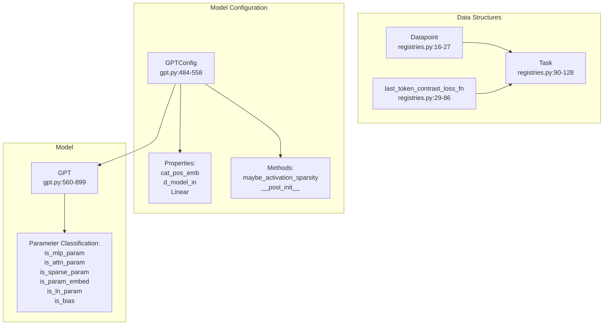
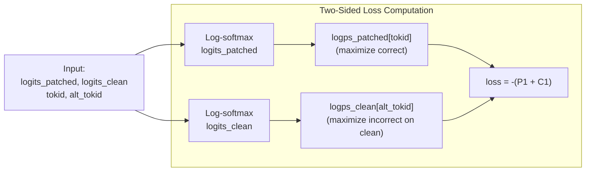
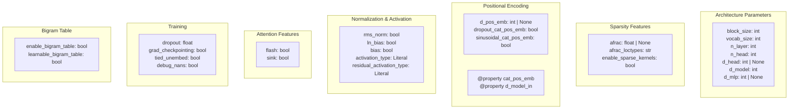
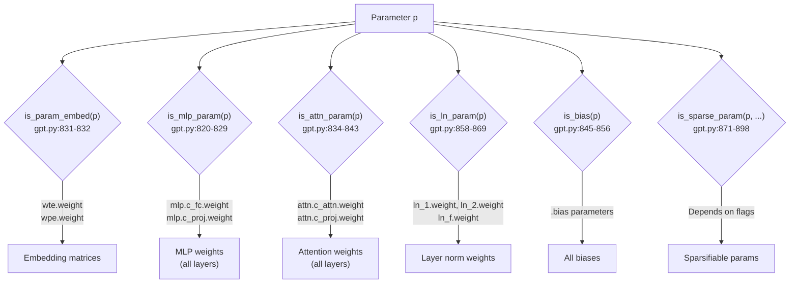
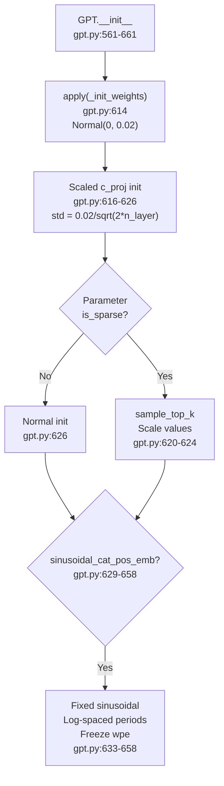
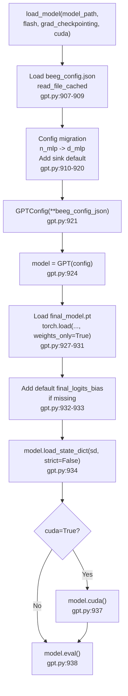
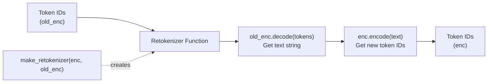

<!-- source: DeepWiki mcp.deepwiki.com · repo openai/circuit_sparsity · page 7 Technical Reference · fetched 2026-10-26 -->

# Technical Reference

<details>
<summary>Relevant source files</summary>

The following files were used as context for generating this wiki page:

- [circuit_sparsity/inference/gpt.py](circuit_sparsity/inference/gpt.py)
- [circuit_sparsity/registries.py](circuit_sparsity/registries.py)

</details>


This document provides detailed API documentation and implementation details for advanced users and contributors. It covers low-level technical components, type definitions, parameter classification utilities, and internal mechanisms that power the sparse circuit analysis system.

For high-level model architecture, see [GPT Model Implementation](#2). For user-facing visualization features, see [Visualization System](#3). For training workflows, see [Training Sparse Models](#4).

---

## Core Type Definitions

The system defines several fundamental dataclasses that structure experimental data and model configuration.

### Type Hierarchy



**Sources:** [circuit_sparsity/registries.py:15-128](), [circuit_sparsity/inference/gpt.py:484-899]()

### Datapoint Structure

The `Datapoint` class [circuit_sparsity/registries.py:16-27]() encapsulates a single data example with optional patching inputs:

| Field | Type | Purpose |
|-------|------|---------|
| `inputs` | `torch.Tensor` | Primary input token IDs (shape: `[1, seq_len]`) |
| `patch_from_inputs` | `torch.Tensor \| None` | Alternative inputs for patching/counterfactual analysis |
| `pretrain_inputs` | `torch.Tensor \| None` | Deprecated scrubbing inputs |
| `target_tokid` | `int \| None` | Expected correct token ID at final position |
| `target_alt_tokid` | `int \| None` | Alternative/incorrect token ID for contrastive loss |

The patching mechanism enables counterfactual interventions where activations from `inputs` are replaced with activations computed from `patch_from_inputs` at specific circuit nodes.

**Sources:** [circuit_sparsity/registries.py:15-27]()

### Task Structure

The `Task` class [circuit_sparsity/registries.py:90-128]() aggregates multiple datapoints with associated loss computation:

| Field | Type | Purpose |
|-------|------|---------|
| `xs` | `list[Datapoint]` | Training/validation examples |
| `xs_test` | `list[Datapoint]` | Held-out test examples |
| `loss_fn` | `Callable` | Loss computation function (typically `last_token_contrast_loss_fn`) |
| `enc` | `tiktoken.Encoding` | Tokenizer for encoding/decoding |

Key methods:
- `limit(n: int)` [circuit_sparsity/registries.py:101-107](): Returns new `Task` with first `n` examples
- `left_truncate_to_len(n: int)` [circuit_sparsity/registries.py:109-127](): Truncates all sequences to maximum length `n` from the right

**Sources:** [circuit_sparsity/registries.py:89-128]()

### Loss Function

The `last_token_contrast_loss_fn` [circuit_sparsity/registries.py:29-86]() computes contrastive loss on the final token:



The two-sided formulation encourages the circuit to:
1. Increase probability of `tokid` on patched inputs (where circuit is active)
2. Increase probability of `alt_tokid` on clean inputs (where circuit is disabled)

When `alt_tokid` is `None`, the clean side marginalizes over all tokens except `tokid` using `logsumexp` [circuit_sparsity/registries.py:72-81]().

**Sources:** [circuit_sparsity/registries.py:29-86]()

---

## GPTConfig Deep Dive

The `GPTConfig` dataclass [circuit_sparsity/inference/gpt.py:484-558]() provides comprehensive model configuration with specialized features beyond standard GPT-2.

### Configuration Categories



**Sources:** [circuit_sparsity/inference/gpt.py:484-558]()

### Key Properties and Methods

**`cat_pos_emb` property** [circuit_sparsity/inference/gpt.py:522-524](): Returns `True` if concatenated positional embeddings are enabled (when `d_pos_emb is not None`). This triggers use of `BlockCatPosEmb`, `CausalSelfAttentionCatPosEmb`, and `MLPCatPosEmb` variants.

**`d_model_in` property** [circuit_sparsity/inference/gpt.py:526-528](): Returns effective input dimension after concatenating positional embeddings: `d_model + d_pos_emb` if `cat_pos_emb` else `d_model`.

**`maybe_activation_sparsity(x, loctype)` method** [circuit_sparsity/inference/gpt.py:544-557](): Applies activation sparsity at specified locations:
- Checks if `afrac` is set and `loctype` is in `afrac_loctypes` (comma-separated)
- Keeps top-k activations by absolute value where `k = int(afrac * x.shape[-1])`
- Uses `keep_abstopk` helper to zero out non-top-k values
- Valid `loctype` values: `"attn_in"`, `"attn_out"`, `"attn_k"`, `"attn_q"`, `"attn_v"`, `"mlp_in"`, `"mlp_out"`, `"mlp_neuron"`, `"resid_post_attn"`, `"resid_post_mlp"`

**`__post_init__` validation** [circuit_sparsity/inference/gpt.py:530-538]():
- Asserts `d_model % n_head == 0`
- Sets `d_mlp = 4 * d_model` if not provided
- Sets `d_head = d_model // n_head` if not provided

**Sources:** [circuit_sparsity/inference/gpt.py:522-558]()

---

## Model Parameter Classification

The `GPT` class provides methods to classify parameters by type, essential for applying different optimization strategies or sparsity patterns to different parameter groups.

### Parameter Classification Methods



**Sources:** [circuit_sparsity/inference/gpt.py:820-898]()

### Implementation Details

**`is_mlp_param(p)`** [circuit_sparsity/inference/gpt.py:820-829]():
```python
id(p) in list_join([
    [
        id(self.transformer.h[i].mlp.c_fc.weight),
        id(self.transformer.h[i].mlp.c_proj.weight),
    ]
    for i in range(self.config.n_layer)
])
```
Returns `True` for both up-projection (`c_fc`) and down-projection (`c_proj`) weights in all MLP blocks.

**`is_attn_param(p)`** [circuit_sparsity/inference/gpt.py:834-843]():
```python
id(p) in list_join([
    [
        id(self.transformer.h[i].attn.c_attn.weight),
        id(self.transformer.h[i].attn.c_proj.weight),
    ]
    for i in range(self.config.n_layer)
])
```
Returns `True` for QKV projection (`c_attn`) and output projection (`c_proj`) weights in all attention blocks.

**`is_sparse_param(p, dense_embeddings, dense_unembed, dense_biases)`** [circuit_sparsity/inference/gpt.py:871-898]():
- Determines which parameters should use sparse representations
- Core MLP/attention weights are always sparsifiable
- Embeddings, unembed, and biases depend on optional flags
- Assertions enforce that flags must be specified when querying those parameter types

**Sources:** [circuit_sparsity/inference/gpt.py:820-898]()

---

## Weight Initialization

The GPT model implements custom initialization strategies depending on parameter type and sparsity configuration.

### Initialization Pipeline



**Sources:** [circuit_sparsity/inference/gpt.py:561-661]()

### Standard Weight Initialization

The `_init_weights` method [circuit_sparsity/inference/gpt.py:675-681]() applies:
- Linear layers: `Normal(mean=0.0, std=0.02)`
- Embeddings: `Normal(mean=0.0, std=0.02)`
- Biases: Zeros

### Scaled Residual Projection Initialization

For parameters named `*.c_proj.weight` [circuit_sparsity/inference/gpt.py:616-626]():
- **Sparse tensors**: Sample top-k indices, scale values by `0.02 / sqrt(2 * n_layer)`
- **Dense tensors**: `Normal(mean=0.0, std=0.02 / sqrt(2 * n_layer))`

This follows the GPT-2 paper's recommendation to scale down residual projections.

### Sinusoidal Positional Embeddings

When `config.sinusoidal_cat_pos_emb=True` [circuit_sparsity/inference/gpt.py:629-658]():

1. **Period calculation**: Log-spaced periods from 4 tokens to `block_size` tokens
   ```python
   periods = torch.logspace(
       math.log10(4.0), 
       math.log10(max(4.0, block_size)), 
       steps=d_pos_emb//2
   )
   ```

2. **Angle computation**: `angles[t, d] = t * (2π / periods[d])`

3. **Encoding**: Concatenate `[sin(angles), cos(angles)]` along dimension, pad to `d_pos_emb`

4. **Freezing**: Set `wpe.weight.requires_grad_(False)`

This provides fixed, non-learnable positional information that's concatenated rather than added.

**Sources:** [circuit_sparsity/inference/gpt.py:629-658]()

---

## Model Loading Pipeline

The `load_model` function [circuit_sparsity/inference/gpt.py:906-939]() provides the standard interface for loading trained models from blob storage.

### Loading Flow



**Sources:** [circuit_sparsity/inference/gpt.py:906-939]()

### Configuration Migration

The loader handles backward compatibility:
- **`n_mlp` → `d_mlp` rename** [circuit_sparsity/inference/gpt.py:910-911]()
- **`sink` default** [circuit_sparsity/inference/gpt.py:913-914](): Adds `sink=False` if missing
- **Sink validation** [circuit_sparsity/inference/gpt.py:915](): Asserts sink requires flash attention
- **`use_tied_aux_matrix` removal** [circuit_sparsity/inference/gpt.py:918-919](): Deprecated feature

### State Dict Loading

The function uses `strict=False` [circuit_sparsity/inference/gpt.py:934]() to allow:
- Missing keys for newly added buffers
- Extra keys from deprecated features
- Flexible loading across code versions

**Sources:** [circuit_sparsity/inference/gpt.py:906-939]()

---

## Utility Functions Reference

The codebase provides several reusable utility functions for data manipulation and tensor operations.

### Core Utilities

| Function | Location | Purpose | Signature |
|----------|----------|---------|-----------|
| `list_join` | [registries.py:150-152]() | Flatten list of lists (monadic join) | `list[list] → list` |
| `keymap` | [registries.py:155-157]() | Apply functions to dict values by key | `dict[str, Callable], dict → dict` |
| `pad_or_clip_to_len` | [registries.py:169-182]() | Left-pad or right-clip tensor to length | `Tensor, int, value → Tensor` |
| `load_jsonls` | [registries.py:160-166]() | Load multiple .jsonl files | `list[str] → list[dict]` |
| `only_one` | [registries.py:185-187]() | Assert single element, return it | `list → element` |
| `lcompose` | [registries.py:199-205]() | Left-to-right function composition | `*Callable → Callable` |

**Sources:** [circuit_sparsity/registries.py:150-205]()

### list_join Implementation

```python
def list_join(xss: list[list]) -> list:
    """monadic join for lists"""
    return [x for xs in xss for x in xs]
```

Flattens one level of nesting. Used extensively for parameter collection:
```python
id(p) in list_join([
    [id(layer.mlp.weight), id(layer.attn.weight)]
    for layer in self.transformer.h
])
```

**Sources:** [circuit_sparsity/registries.py:150-152](), [circuit_sparsity/inference/gpt.py:901-903]()

### keymap Implementation

```python
def keymap(fs: dict[str, Callable], d: dict) -> dict:
    assert set(fs.keys()).issubset(d.keys())
    return {k: fs.get(k, lambda x: x)(v) for k, v in d.items()}
```

Applies transformations to specific dictionary keys, leaving others unchanged. Useful for selective data preprocessing.

**Sources:** [circuit_sparsity/registries.py:155-157]()

### pad_or_clip_to_len Implementation

```python
def pad_or_clip_to_len(x, n, v):
    assert len(x.shape) == 1
    if x.shape[0] > n:
        res = x[-n:]  # Clip from left
    else:
        res = torch.cat([
            torch.full((n - x.shape[0],), v, device=x.device),
            x,
        ])  # Pad on left
    return res
```

Ensures tensor has exact length `n` by either clipping from the left or padding with value `v` on the left. This preserves recent tokens while discarding or padding old ones.

**Sources:** [circuit_sparsity/registries.py:169-182]()

---

## Retokenization System

The `make_retokenizer` factory [circuit_sparsity/registries.py:130-147]() creates functions that convert token sequences between different encodings.



### Implementation

The factory wraps the conversion logic with automatic tensor handling:
```python
def _maybe_untensorify(f):
    def _f(x):
        if isinstance(x, torch.Tensor):
            return torch.tensor(f(x.tolist()))
        else:
            return f(x)
    return _f
```

This allows the same retokenizer to work with both Python lists and PyTorch tensors, recursively handling nested lists.

**Sources:** [circuit_sparsity/registries.py:130-147]()

---

## Debug and Diagnostic Features

### NaN Detection

When `config.debug_nans=True` [circuit_sparsity/inference/gpt.py:504](), the model inserts assertions throughout the forward pass:

| Location | Check | File Reference |
|----------|-------|----------------|
| Attention input | `x.isfinite().all()` | [gpt.py:103-104]() |
| Q/K/V after projection | `q/k/v.isfinite().all()` | [gpt.py:121-124]() |
| Attention output | `y.isfinite().all()` | [gpt.py:150-151, 163-164]() |
| MLP input | `x.isfinite().all()` | [gpt.py:186-187]() |
| MLP after c_fc | `x.isfinite().all()` | [gpt.py:191-192]() |
| MLP after activation | `x.isfinite().all()` | [gpt.py:198-199]() |
| MLP after c_proj | `x.isfinite().all()` | [gpt.py:203-204]() |
| Block input | `x.isfinite().all()` | [gpt.py:307-308]() |
| Post-embedding | `x.isfinite().all()` | [gpt.py:701-702]() |

These checks help identify numerical instability during development but should be disabled for production due to performance overhead.

**Sources:** [circuit_sparsity/inference/gpt.py:103-308, 701-702]()

### Gradient Checkpointing

When `config.grad_checkpointing=True` [circuit_sparsity/inference/gpt.py:509](), the model uses `torch_recompute_preserving_hook_context` [circuit_sparsity/inference/gpt.py:311-316, 330-335]() to trade compute for memory:

- Recomputes activations during backward pass instead of storing them
- Preserves hook recording context across recomputation
- Uses `use_reentrant=False` for PyTorch 2.0+ compatibility

This enables training larger models within memory constraints.

**Sources:** [circuit_sparsity/inference/gpt.py:311-316, 330-335]()

---

## Constants and Configuration

### Global Constants

```python
MODEL_BASE_DIR = "https://openaipublic.blob.core.windows.net/circuit-sparsity"
CACHE_DIR = os.path.expanduser("~/data/dev/shm/cache")
```
[circuit_sparsity/registries.py:12-13]()

- **`MODEL_BASE_DIR`**: Azure Blob Storage base URL for all model artifacts
- **`CACHE_DIR`**: Local cache directory for downloaded files, defaults to `/dev/shm` for fast access

### Tokenizer Configuration

Default tokenizer is `"tinypython_2k"` [circuit_sparsity/inference/gpt.py:507](). This custom encoding is designed for Python code with vocabulary size 2048. See [Tokenization](#5.3) for details on custom encodings.

**Sources:** [circuit_sparsity/registries.py:12-13](), [circuit_sparsity/inference/gpt.py:507]()

---

