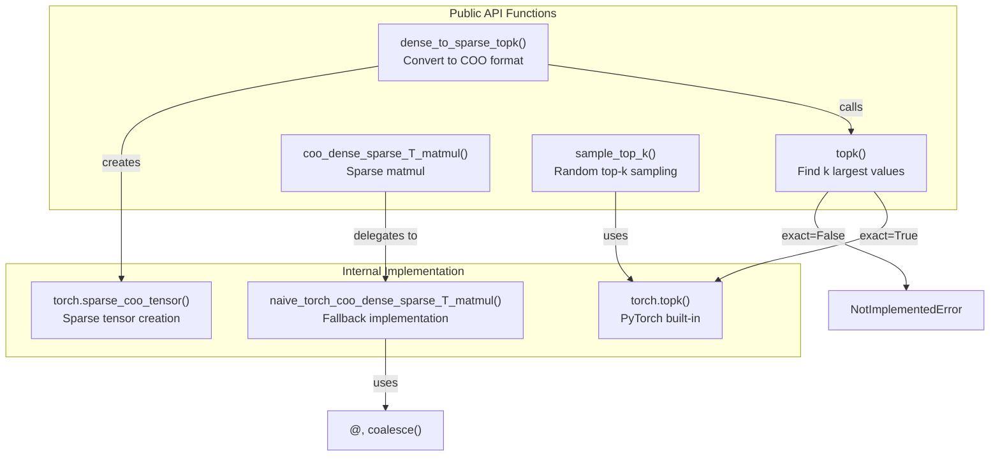
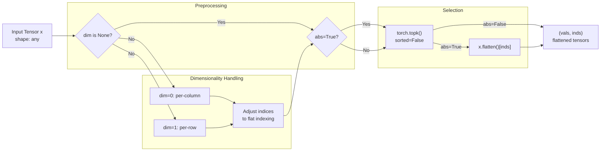
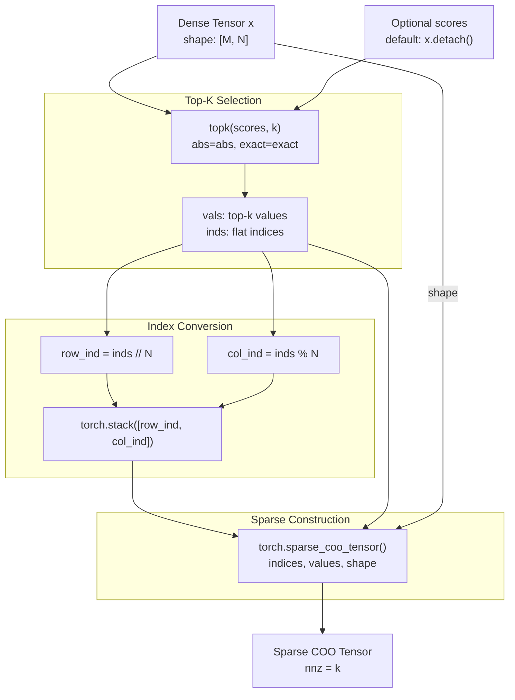
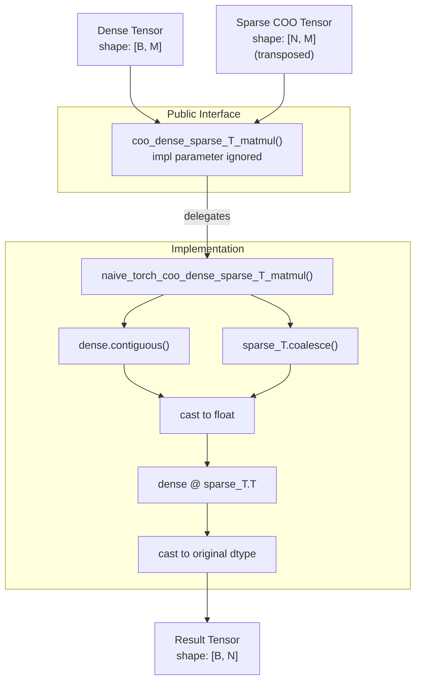

<!-- source: DeepWiki mcp.deepwiki.com · repo openai/circuit_sparsity · page 7.1 Sparse Kernels · fetched 2026-10-26 -->

# Sparse Kernels

Relevant source files

The following files were used as context for generating this wiki page:

- [circuit_sparsity/inference/kernels.py](circuit_sparsity/inference/kernels.py)

## Purpose and Scope

This document details the `circuit_sparsity.inference.kernels` module, which provides lightweight implementations of sparse operations used by the GPT model during inference. These are minimal fallback implementations that mimic the API of a production `circuit_sparsity.kernels` module (which integrates with bespoke CUDA kernels). The fallbacks enable inference-only builds without external CUDA dependencies.

The module provides three categories of operations:
1. Top-k selection functions for finding the largest magnitude values
2. Dense-to-sparse conversion utilities
3. Sparse matrix multiplication routines

For information about how these kernels are used within the GPT model architecture, see [Model Architecture Components](#2.2). For training-time sparsity application, see [Sparsity Application and Annealing](#4.2).

**Sources:** [circuit_sparsity/inference/kernels.py:1-7]()

## Module Architecture

The kernels module provides a focused API surface for sparse operations. The diagram below shows the relationship between the primary functions and their purpose in the sparse computation pipeline.

**Function Categories**

| Category | Functions | Purpose |
|----------|-----------|---------|
| Selection | `topk`, `sample_top_k` | Extract k largest magnitude elements from dense tensors |
| Conversion | `dense_to_sparse_topk` | Create sparse COO tensors from dense inputs |
| Operations | `coo_dense_sparse_T_matmul`, `naive_torch_coo_dense_sparse_T_matmul` | Perform sparse matrix multiplication |

**Sources:** [circuit_sparsity/inference/kernels.py:19-96]()

## Top-K Selection Functions

### topk Function

The `topk` function finds the k largest values in a tensor, supporting both absolute value and signed selection. It provides flexible dimensionality handling and flattening behavior.

**Parameters:**

| Parameter | Type | Description |
|-----------|------|-------------|
| `x` | `torch.Tensor` | Input tensor to select from |
| `k` | `int` | Number of elements to select |
| `abs` | `bool` | If True, select by absolute value; default False |
| `exact` | `bool` | If True, use exact selection; approximate not implemented |
| `dim` | `int or None` | Dimension for per-row/column selection; None flattens |

**Behavior:**

- When `dim=None`, flattens the tensor and selects k largest elements globally
- When `dim=0`, selects k elements per column, adjusting k to `k // x.shape[1]`
- When `dim=1`, selects k elements per row, adjusting k to `k // x.shape[0]`
- Returns flattened indices regardless of input dimensionality for consistency
- When `abs=True`, selects by magnitude but returns original signed values

**Sources:** [circuit_sparsity/inference/kernels.py:40-83]()

### sample_top_k Function

The `sample_top_k` function generates random samples and returns the k largest values by absolute value. This is used for initialization or testing purposes.

**Implementation:**
- Generates `n` random values from standard normal distribution
- Selects k largest by absolute value
- Returns only the values (not indices)

**Sources:** [circuit_sparsity/inference/kernels.py:19-24]()

## Sparse Tensor Conversion

### dense_to_sparse_topk Function

The `dense_to_sparse_topk` function converts a dense tensor to a sparse COO (Coordinate) format by retaining only the k largest magnitude elements.

**Parameters:**

| Parameter | Type | Default | Description |
|-----------|------|---------|-------------|
| `x` | `torch.Tensor` | required | Dense tensor to sparsify |
| `k` | `int` | required | Number of non-zero elements to keep |
| `scores` | `torch.Tensor or None` | `None` | Scores for selection; uses `x.detach()` if None |
| `abs` | `bool` | `True` | Select by absolute value |
| `exact` | `bool` | `False` | Use exact top-k |

**Index Transformation:**

The function converts flat indices to 2D COO coordinates:
- Flat index `i` in shape `[M, N]` becomes `(i // N, i % N)`
- Row indices: `inds // x.shape[1]`
- Column indices: `inds % x.shape[1]`

**Assertions:**
- `scores.shape == x.shape` (if scores provided)
- `ret._nnz() == k` (validates sparse tensor has exactly k non-zeros)

**Sources:** [circuit_sparsity/inference/kernels.py:27-37]()

## Sparse Matrix Operations

### Matrix Multiplication Functions

The module provides two functions for sparse matrix multiplication, where the second operand is a transposed sparse matrix.

**coo_dense_sparse_T_matmul**

Public interface for sparse matrix multiplication. In this fallback implementation, the `impl` parameter is ignored and the function always delegates to the naive implementation.

**Signature:** `coo_dense_sparse_T_matmul(dense: torch.Tensor, sparse_T: torch.Tensor, impl: str)`

**naive_torch_coo_dense_sparse_T_matmul**

Performs the actual computation using PyTorch's built-in sparse matrix support.

**Algorithm:**
1. Ensure dense tensor is contiguous in memory
2. Coalesce sparse tensor (combines duplicate indices)
3. Cast both to float32 for computation
4. Compute `dense @ sparse_T.T` 
5. Cast result back to original dtype

**Note:** The transpose operation `.T` on the sparse tensor is efficient because it only swaps index dimensions without moving data.

**Sources:** [circuit_sparsity/inference/kernels.py:86-95]()

## Implementation Details

### Production vs. Fallback Implementations

The module header documents an important architectural distinction:

> The production `circuit_sparsity.kernels` module integrates with a bespoke set of CUDA kernels. Those dependencies are unavailable in the standalone inference-only build, so we provide light-weight fallbacks that mimic the parts of the API exercised by `GPT`.

This means:
- **Production:** Custom CUDA kernels with optimized performance
- **Inference-only build:** PyTorch-based fallbacks in this module
- **API compatibility:** Both provide the same function signatures

### Exact vs. Approximate Top-K

The `topk` function includes an `exact` parameter:
- `exact=True`: Uses `torch.topk(sorted=False)` for deterministic selection
- `exact=False`: Raises `NotImplementedError` in this fallback build

The approximate version would use faster algorithms trading accuracy for speed, but is only available with the CUDA kernel implementation.

**Sources:** [circuit_sparsity/inference/kernels.py:44-47]()

### Memory Layout Considerations

**Contiguous Memory:** The `naive_torch_coo_dense_sparse_T_matmul` function calls `.contiguous()` on the dense tensor to ensure efficient memory access patterns during matrix multiplication.

**Coalescing:** Sparse tensors are coalesced to combine any duplicate indices before multiplication, which is required for correct sparse matrix operations.

**Sources:** [circuit_sparsity/inference/kernels.py:91-95]()

### Dtype Handling

Matrix multiplication is performed in float32 regardless of input dtype, then cast back to the original dtype. This ensures numerical stability while preserving the user's intended precision.

**Sources:** [circuit_sparsity/inference/kernels.py:94]()

---

