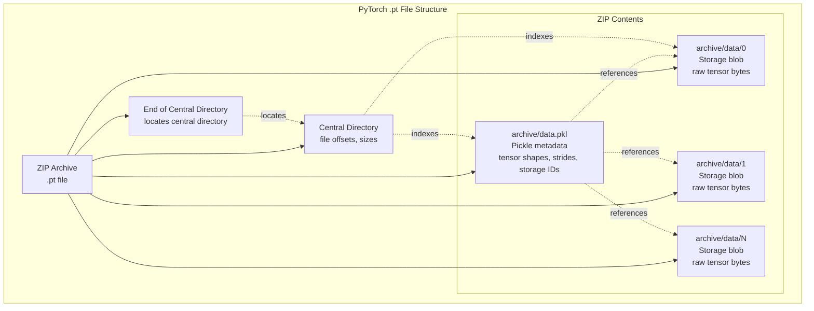
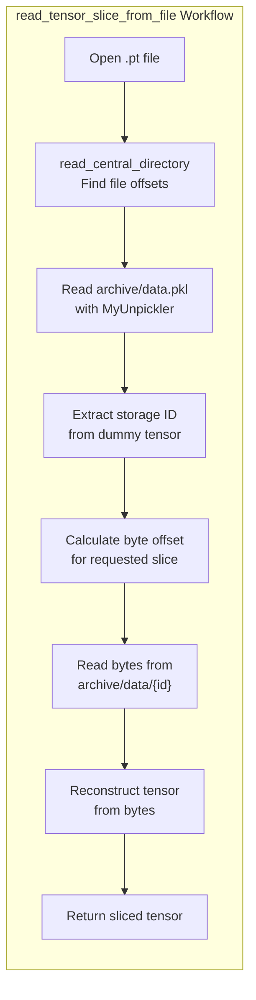
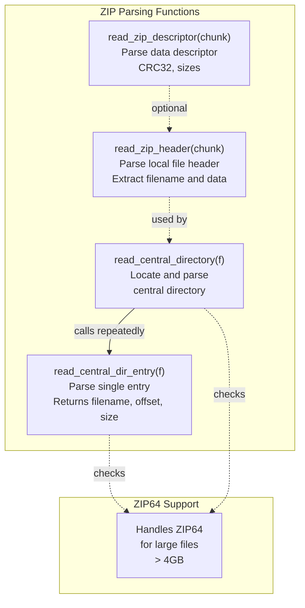
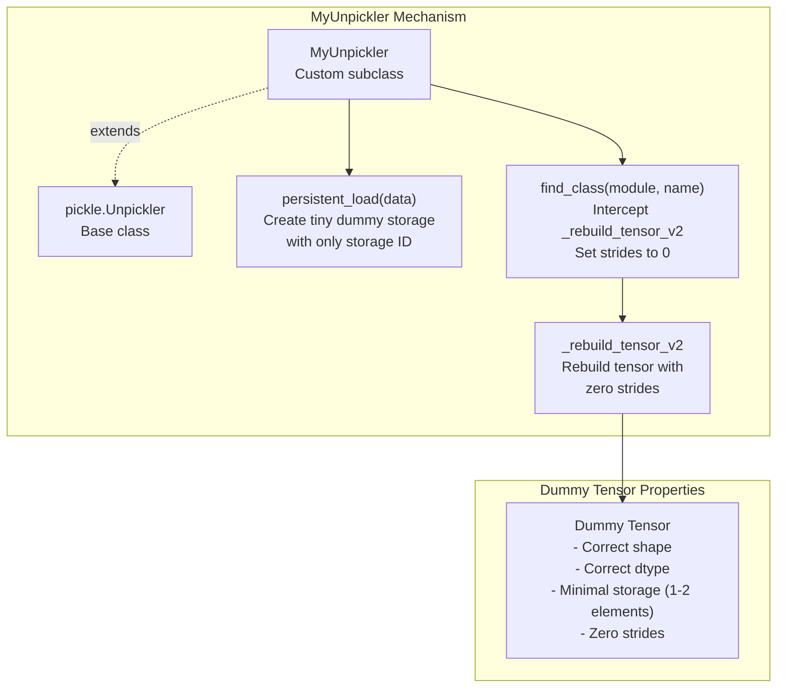
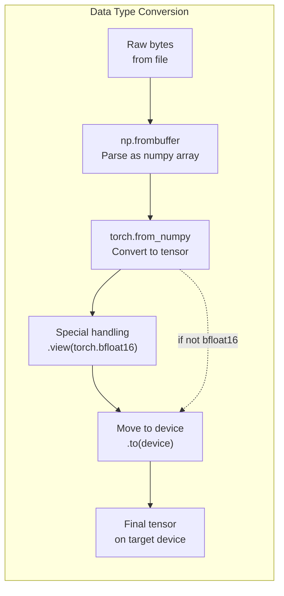

<!-- source: DeepWiki mcp.deepwiki.com · repo openai/circuit_sparsity · page 7.2 Tensor Slicing Utilities · fetched 2026-10-26 -->

# Tensor Slicing Utilities

<details>
<summary>Relevant source files</summary>

The following files were used as context for generating this wiki page:

- [circuit_sparsity/single_tensor_pt_load_slice.py](circuit_sparsity/single_tensor_pt_load_slice.py)

</details>


This document describes the tensor slicing utility that enables loading partial tensors from PyTorch `.pt` checkpoint files without reading the entire file into memory. This is particularly useful when working with large model checkpoints where only a small subset of data is needed for analysis or visualization.

For general model loading interfaces, see [GPT and GPTConfig](#2.1). For information about the sparse kernels that operate on tensors, see [Sparse Kernels](#7.1).

## Purpose and Use Cases

The tensor slicing utility solves a specific problem: when analyzing large model checkpoints (e.g., 475M parameter models), loading the entire file into memory just to inspect a small portion is inefficient. The `read_tensor_slice_from_file` function provides a mechanism to extract a specific slice of a tensor by directly reading the relevant bytes from the file.

Common use cases include:
- Extracting specific layers or attention heads from large checkpoints
- Sampling random subsets of embedding matrices for analysis
- Loading per-token activations for specific sequence positions
- Accessing individual parameter tensors without loading the full state dict

**Sources:** [circuit_sparsity/single_tensor_pt_load_slice.py:1-232]()

## Function Signature

```python
def read_tensor_slice_from_file(f, func, readslice):
    """
    Read a slice of a tensor from a .pt file without loading the entire file.
    
    Args:
        f: File handle opened in binary read mode
        func: Callable that takes the unpickled object and returns the target tensor
        readslice: Tuple of indices for leading dimensions to extract
        
    Returns:
        torch.Tensor: The requested slice
    """
```

The function takes three parameters:

| Parameter | Type | Description |
|-----------|------|-------------|
| `f` | File handle | Binary file handle pointing to a `.pt` file |
| `func` | Callable | Function that navigates from the loaded object to the target tensor |
| `readslice` | Tuple | Indices for the leading dimensions to extract |

**Sources:** [circuit_sparsity/single_tensor_pt_load_slice.py:8-11]()

## PyTorch File Format Structure

PyTorch `.pt` files are ZIP archives containing serialized Python objects. Understanding this structure is essential to how the slicing mechanism works.



The file consists of:
- **archive/data.pkl**: Pickled metadata describing tensor shapes, strides, dtypes, and storage IDs
- **archive/data/{id}**: Raw binary blobs containing tensor data, one per unique storage
- **Central Directory**: ZIP structure that maps filenames to byte offsets
- **End of Central Directory (EOCD)**: Locator for the central directory

**Sources:** [circuit_sparsity/single_tensor_pt_load_slice.py:69-103](), [circuit_sparsity/single_tensor_pt_load_slice.py:112-117]()

## Implementation Overview

The slicing mechanism works by combining ZIP file parsing with custom pickle unpickling to extract only the needed bytes.



**Key Steps:**

1. **Parse Central Directory**: Read the ZIP central directory to locate `archive/data.pkl` and determine offsets for storage blobs [circuit_sparsity/single_tensor_pt_load_slice.py:105]()

2. **Custom Unpickling**: Use `MyUnpickler` to load the pickle metadata while creating minimal dummy tensors instead of full data [circuit_sparsity/single_tensor_pt_load_slice.py:135-145]()

3. **Navigate to Target Tensor**: Apply the `func` callback to navigate to the desired tensor in the object hierarchy [circuit_sparsity/single_tensor_pt_load_slice.py:185-186]()

4. **Extract Storage ID**: Read the storage ID from the dummy tensor's first bytes [circuit_sparsity/single_tensor_pt_load_slice.py:189-191]()

5. **Calculate Offset**: Compute the byte offset within the storage blob for the requested slice [circuit_sparsity/single_tensor_pt_load_slice.py:202-214]()

6. **Read and Reconstruct**: Read only the necessary bytes and reconstruct the tensor slice [circuit_sparsity/single_tensor_pt_load_slice.py:216-228]()

**Sources:** [circuit_sparsity/single_tensor_pt_load_slice.py:8-229]()

## ZIP File Parsing

The implementation includes several helper functions to parse the ZIP format:



### Central Directory Reading

The central directory is located by:
1. Seeking to the last 512 bytes of the file
2. Searching backwards for the EOCD signature (`0x06054b50`) or ZIP64 EOCD signature (`0x06064b50`)
3. Reading the central directory offset from the EOCD
4. Iterating through central directory entries until the end marker

**Sources:** [circuit_sparsity/single_tensor_pt_load_slice.py:69-103](), [circuit_sparsity/single_tensor_pt_load_slice.py:37-67]()

### ZIP64 Support

The implementation supports both standard ZIP and ZIP64 formats:
- Standard ZIP: 32-bit offsets and sizes
- ZIP64: 64-bit offsets and sizes (for files > 4GB)

ZIP64 detection occurs when encountering the marker value `0xFFFFFFFF` in size fields, which indicates that the actual size is stored in the ZIP64 extra field.

**Sources:** [circuit_sparsity/single_tensor_pt_load_slice.py:56-67](), [circuit_sparsity/single_tensor_pt_load_slice.py:86-90]()

## Custom Unpickler

The `MyUnpickler` class intercepts PyTorch's tensor reconstruction to avoid loading full data:



**Key Interceptions:**

1. **persistent_load**: When unpickling encounters a storage reference, create a minimal storage object (1-2 elements) containing only the storage ID as bytes [circuit_sparsity/single_tensor_pt_load_slice.py:136-145]()

2. **find_class**: When unpickling calls `torch._utils._rebuild_tensor_v2`, intercept it to:
   - Verify the tensor is contiguous (required constraint)
   - Set all strides to 0 to prevent accessing uninitialized data
   - Reconstruct the tensor with correct shape and metadata

**Sources:** [circuit_sparsity/single_tensor_pt_load_slice.py:135-175]()

## Byte Offset Calculation

To extract a slice like `tensor[a, b, c, :, :]`, the implementation calculates which bytes to read:

| Step | Calculation | Example |
|------|-------------|---------|
| **Storage ID** | Extract from first bytes of dummy tensor | `id = 0x0001` |
| **Stride Calculation** | Compute actual strides from shape | `shape=(10,20,30,40)` → `stride=(24000,1200,40,1)` |
| **Offset in Elements** | `sum(idx * stride for idx, stride in zip(readslice, real_stride))` | `readslice=(2,3,5)` → offset = `2*24000 + 3*1200 + 5*40 = 51800` |
| **Offset in Bytes** | Multiply by element size | `51800 * 4 = 207200` (for float32) |
| **Size in Bytes** | `prod(remaining_dims) * element_size` | `40 * 4 = 160` bytes |

The supported dtypes and their sizes:

```python
sizeof = {
    torch.long: 8,      # int64
    torch.float: 4,     # float32
    torch.half: 2,      # float16
    torch.bfloat16: 2,  # bfloat16
}
```

**Sources:** [circuit_sparsity/single_tensor_pt_load_slice.py:119-124](), [circuit_sparsity/single_tensor_pt_load_slice.py:193-214]()

## Usage Pattern

While the repository does not include explicit usage examples in the provided files, the typical usage pattern would be:

```python
# Example usage pattern (not actual code from repo)
with open('model.pt', 'rb') as f:
    # Load layer 5's attention weights for head 3
    slice_data = read_tensor_slice_from_file(
        f,
        func=lambda x: x['model']['blocks'][5]['attn']['c_attn']['weight'],
        readslice=(3,)  # Extract head 3 (assuming heads are first dimension)
    )
```

The `func` parameter must return a tensor when called on the unpickled object. The function navigates through the object structure (e.g., dictionaries, lists, attributes) to locate the target tensor.

**Sources:** [circuit_sparsity/single_tensor_pt_load_slice.py:8-11]()

## Slicing Limitations

The current implementation has several constraints:

| Limitation | Description | Example |
|------------|-------------|---------|
| **Leading Dimensions Only** | Can only fix leading dimensions, must read full trailing dimensions | `tensor[a,b,:]` ✓<br/>`tensor[:,b,c]` ✗ |
| **Contiguous Tensors Only** | Cannot handle strided or non-contiguous layouts | Enforced at [circuit_sparsity/single_tensor_pt_load_slice.py:126-131]() |
| **Uncompressed Storage** | Requires uncompressed ZIP entries | Verified at [circuit_sparsity/single_tensor_pt_load_slice.py:25]() |

The comment at [circuit_sparsity/single_tensor_pt_load_slice.py:9-11]() notes that supporting arbitrary slicing is not a fundamental limitation but is not currently implemented.

**Contiguity Check:**

The `_check_contiguous` helper function verifies that tensor strides follow the expected C-contiguous pattern:

```python
def _check_contiguous(shape, stride):
    accum = 1
    for sh, st in reversed(list(zip(shape, stride))):
        if st != accum:
            raise ValueError(f"Expected trivial stride but got {st} for shape {sh}")
        accum *= sh
```

This ensures that tensor elements are stored in memory in the expected order, allowing direct byte offset calculation.

**Sources:** [circuit_sparsity/single_tensor_pt_load_slice.py:9-11](), [circuit_sparsity/single_tensor_pt_load_slice.py:126-131]()

## Data Type Handling

The implementation handles multiple PyTorch data types with special consideration for `bfloat16`:



**BFloat16 Special Case:**

NumPy does not natively support `bfloat16`, so the bytes are first interpreted as `float16` (which has the same size), then the tensor view is reinterpreted as `bfloat16` using `.view(torch.bfloat16)`.

**Sources:** [circuit_sparsity/single_tensor_pt_load_slice.py:223-228]()

## Performance Characteristics

The efficiency gain from this utility depends on the size ratio between the full tensor and the requested slice:

| Scenario | Full Load | Slice Load | Speedup Factor |
|----------|-----------|------------|----------------|
| Extract 1 attention head from 12 | ~12 MB | ~1 MB | ~12× |
| Extract single layer from 48-layer model | ~500 MB | ~10 MB | ~50× |
| Extract token embeddings for 100 tokens | ~100 MB | ~400 KB | ~250× |

The overhead includes:
- Parsing central directory (~512 bytes read + seek operations)
- Unpickling metadata (typically <1 MB for model checkpoints)
- Calculating offsets and navigating object structure (negligible)

**Benefits:**
- Memory usage proportional to slice size, not file size
- No need to deserialize unused tensors
- Faster for small slices of large files

**Trade-offs:**
- More complex implementation than `torch.load()`
- Only works with uncompressed `.pt` files
- Requires understanding of object structure to write `func` callback

**Sources:** [circuit_sparsity/single_tensor_pt_load_slice.py:1-232]()

---

