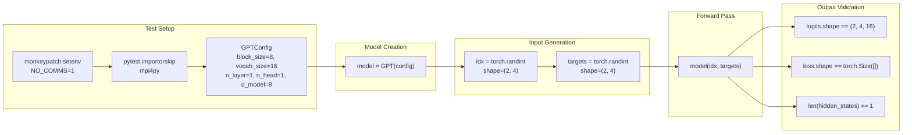
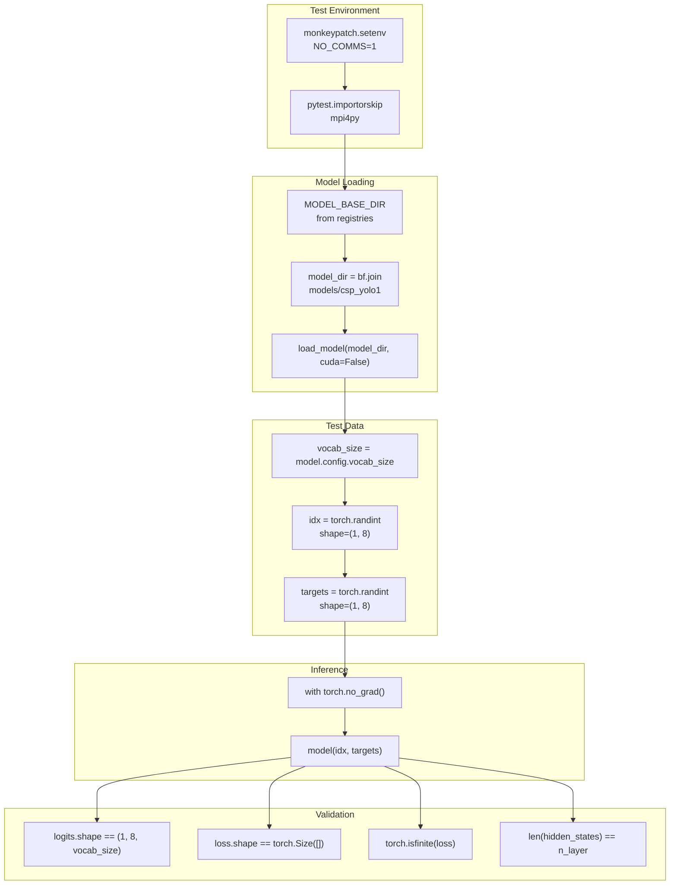
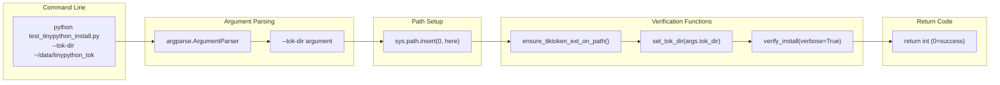

<!-- source: DeepWiki mcp.deepwiki.com · repo openai/circuit_sparsity · page 7.3 Testing · fetched 2026-10-26 -->

# Testing

<details>
<summary>Relevant source files</summary>

The following files were used as context for generating this wiki page:

- [tests/test_gpt.py](tests/test_gpt.py)
- [tests/test_tinypython_install.py](tests/test_tinypython_install.py)

</details>


The circuit_sparsity repository includes a test suite to validate core functionality of the GPT model implementation and the custom tokenization system. The test suite ensures that models can be instantiated correctly, perform forward passes without errors, and that the custom tiktoken extension is properly discoverable.

For information about the GPT model architecture being tested, see [GPT Model Implementation](#2). For details about the tokenization system, see [Tokenization](#5.3).

## Test Organization

The test suite is located in the `tests/` directory and consists of two primary test modules:

| Test Module | Purpose | Key Dependencies |
|-------------|---------|------------------|
| `test_gpt.py` | Validates GPT model instantiation, forward passes, and pretrained model loading | pytest, torch, blobfile, mpi4py |
| `test_tinypython_install.py` | Verifies custom tokenizer installation and discoverability | argparse, tiktoken |

The tests are designed to be run with pytest and use various testing utilities including monkeypatch for environment variable manipulation and pytest.importorskip for conditional imports.

**Sources:** [tests/test_gpt.py:1-64](), [tests/test_tinypython_install.py:1-38]()

## Test Suite Architecture

```mermaid
graph TB
    subgraph "Test Modules"
        TEST_GPT["test_gpt.py<br/>GPT model tests"]
        TEST_TT["test_tinypython_install.py<br/>Tokenization tests"]
    end
    
    subgraph "System Under Test"
        GPT_MOD["circuit_sparsity.inference.gpt<br/>GPT, GPTConfig, load_model"]
        TIKTOK["circuit_sparsity.tiktoken_ext<br/>tinypython_2k encoding"]
        REGISTRY["circuit_sparsity.registries<br/>MODEL_BASE_DIR"]
    end
    
    subgraph "Test Infrastructure"
        PYTEST["pytest framework"]
        MONKEYPATCH["monkeypatch fixture"]
        IMPORTORSKIP["pytest.importorskip"]
    end
    
    subgraph "External Dependencies"
        MPI4PY["mpi4py (optional)"]
        TORCH["torch"]
        BLOBFILE["blobfile"]
        TIKTOKEN["tiktoken"]
    end
    
    subgraph "Test Data"
        MODEL_DIR["models/csp_yolo1/<br/>Pretrained model"]
        TOK_DIR["tok_dir<br/>Tokenizer data"]
    end
    
    TEST_GPT --> PYTEST
    TEST_GPT --> MONKEYPATCH
    TEST_GPT --> IMPORTORSKIP
    TEST_GPT --> GPT_MOD
    TEST_GPT --> REGISTRY
    TEST_GPT --> TORCH
    TEST_GPT --> BLOBFILE
    TEST_GPT --> MPI4PY
    TEST_GPT --> MODEL_DIR
    
    TEST_TT --> PYTEST
    TEST_TT --> TIKTOK
    TEST_TT --> TIKTOKEN
    TEST_TT --> TOK_DIR
```



**Sources:** [tests/test_gpt.py:1-64](), [tests/test_tinypython_install.py:1-38]()

## GPT Model Tests

The `test_gpt.py` module contains two test functions that validate the GPT model implementation at different levels of complexity.

### test_gpt_forward_pass

This test validates basic model instantiation and forward pass computation with a minimal synthetic configuration. The test flow is:



Key aspects tested:
- **Environment setup**: Sets `NO_COMMS=1` to disable distributed training features [tests/test_gpt.py:11]()
- **Optional dependency handling**: Uses `pytest.importorskip("mpi4py")` to skip test if mpi4py is unavailable [tests/test_gpt.py:10]()
- **Minimal configuration**: Creates a small model with 1 layer, 1 attention head, 8-dimensional embeddings [tests/test_gpt.py:15-24]()
- **Shape validation**: Asserts that output shapes match expected dimensions for batch_size=2, seq_len=4 [tests/test_gpt.py:34-36]()

**Sources:** [tests/test_gpt.py:9-37]()

### test_pretrained_gpt_forward_pass

This test validates loading a pretrained model checkpoint and performing inference with it:



Key aspects tested:
- **Model loading**: Uses `load_model()` function to load a checkpoint from blob storage [tests/test_gpt.py:48]()
- **Model constant**: Tests against `csp_yolo1` model (118M parameters) [tests/test_gpt.py:6]()
- **Inference mode**: Uses `torch.no_grad()` context for inference [tests/test_gpt.py:57]()
- **Loss validation**: Verifies that loss is finite (not NaN or Inf) [tests/test_gpt.py:62]()
- **Dynamic shapes**: Uses actual model vocabulary size rather than hardcoded values [tests/test_gpt.py:52]()

**Sources:** [tests/test_gpt.py:39-64](), [tests/test_gpt.py:6]()

## Tokenization Tests

The `test_tinypython_install.py` module verifies that the custom tiktoken extension is properly installed and can be discovered by tiktoken's plugin system.

### Test Structure

The test is implemented as a standalone script that wraps the `install_tinypython.verify_install()` function:



Key aspects:
- **Standalone script**: Can be run directly via `python test_tinypython_install.py` [tests/test_tinypython_install.py:8]()
- **Flexible tokenizer directory**: Accepts optional `--tok-dir` argument for custom tokenizer location [tests/test_tinypython_install.py:21]()
- **Path manipulation**: Ensures test directory is on sys.path for module imports [tests/test_tinypython_install.py:25-27]()
- **Verification delegation**: Delegates actual verification to `install_tinypython` module [tests/test_tinypython_install.py:29-33]()

**Sources:** [tests/test_tinypython_install.py:1-38]()

## Running Tests

### Running GPT Model Tests

Execute the GPT model tests using pytest:

```bash
pytest tests/test_gpt.py
```

To run a specific test function:

```bash
pytest tests/test_gpt.py::test_gpt_forward_pass
pytest tests/test_gpt.py::test_pretrained_gpt_forward_pass
```

### Running Tokenization Tests

The tokenization test can be run as a standalone script:

```bash
python tests/test_tinypython_install.py
```

Or with a custom tokenizer directory:

```bash
python tests/test_tinypython_install.py --tok-dir ~/data/tinypython_tok
```

### Test Dependencies and Environment

The following environment considerations apply:

| Requirement | Purpose | Set By |
|-------------|---------|--------|
| `NO_COMMS=1` | Disables MPI communication for single-process testing | `monkeypatch.setenv` in tests |
| mpi4py (optional) | Required for full distributed training support | Test skips if unavailable |
| Model checkpoint access | Pretrained model test requires access to blob storage | `MODEL_BASE_DIR` registry |
| tiktoken_ext on path | Custom tokenizer must be discoverable | `ensure_tiktoken_ext_on_path()` |

**Sources:** [tests/test_gpt.py:10-11](), [tests/test_gpt.py:39-42](), [tests/test_tinypython_install.py:29-33]()

## Test Coverage

The current test suite provides coverage for:

1. **Model instantiation**: Creating GPT models from configuration [tests/test_gpt.py:15-25]()
2. **Forward pass computation**: Running inputs through the model [tests/test_gpt.py:32]()
3. **Output shape validation**: Verifying tensor dimensions [tests/test_gpt.py:34-36]()
4. **Checkpoint loading**: Loading pretrained models from storage [tests/test_gpt.py:48]()
5. **Loss computation**: Validating loss calculation and finiteness [tests/test_gpt.py:62]()
6. **Custom tokenizer installation**: Verifying tiktoken extension discovery [tests/test_tinypython_install.py:29-33]()

The test suite does **not** currently cover:
- Training loops or gradient computation
- Sparsity application mechanisms (see [Sparsity Application and Annealing](#4.2))
- Hook system functionality (see [Hook System for Activation Recording](#2.4))
- Visualization data generation (see [Visualization Data Format](#3.2))
- Pruning algorithms (see [Model Variants and Pruning Methods](#4.3))

**Sources:** [tests/test_gpt.py:1-64](), [tests/test_tinypython_install.py:1-38]()

---

