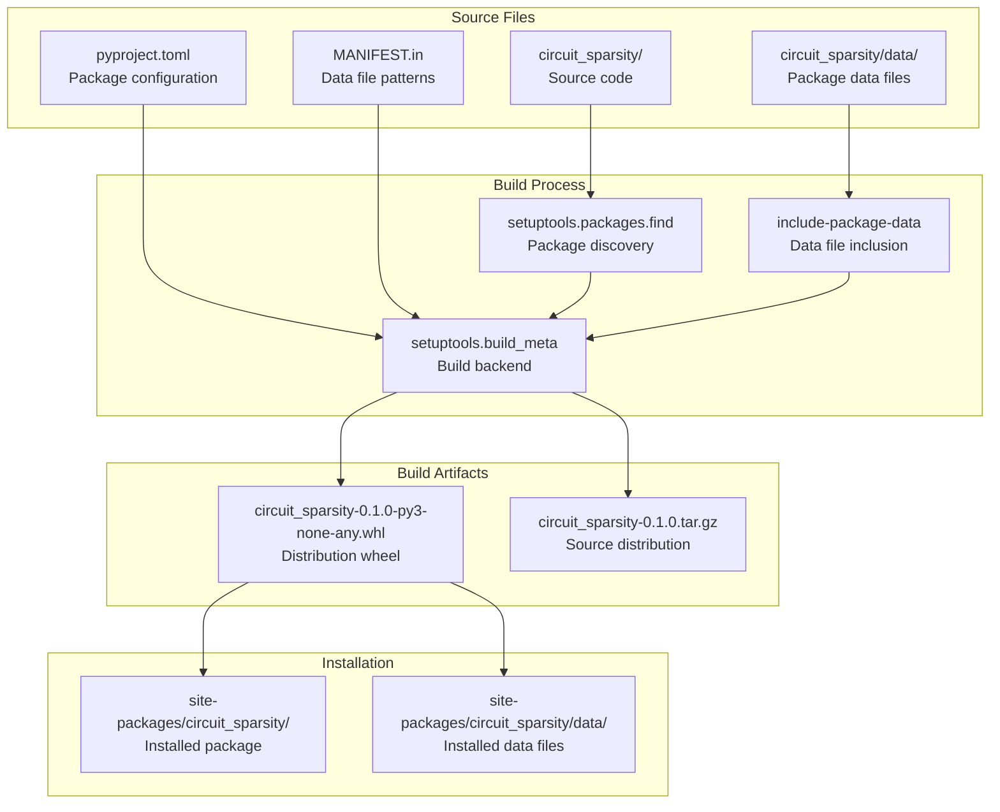
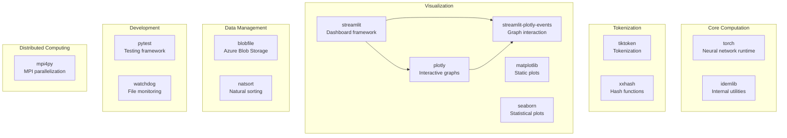
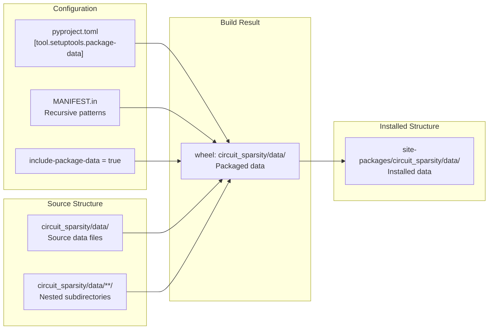
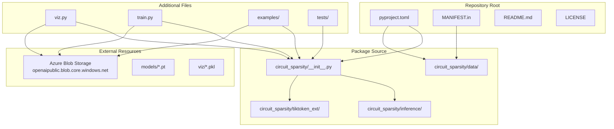

<!-- source: DeepWiki mcp.deepwiki.com · repo openai/circuit_sparsity · page 8 Development and Packaging · fetched 2026-10-26 -->

# Development and Packaging

<details>
<summary>Relevant source files</summary>

The following files were used as context for generating this wiki page:

- [MANIFEST.in](MANIFEST.in)
- [pyproject.toml](pyproject.toml)

</details>


This document covers the package configuration, build system, and distribution mechanisms for the `circuit_sparsity` Python package. It explains how the package is structured for development, how dependencies are managed, and how data files are included in distributions.

For information about installing the package as a user, see [Installation and Setup](#1.1). For information about the repository structure and file organization, see [Repository Structure](#1.2).

---

## Package Overview

The `circuit_sparsity` package is configured as a standard Python package using modern Python packaging standards. The package uses `setuptools` as its build backend with configuration defined in `pyproject.toml` following PEP 517/518 standards.

**Package Metadata**

| Property | Value |
|----------|-------|
| Package Name | `circuit_sparsity` |
| Version | `0.1.0` |
| Minimum Python | `>=3.10` |
| Build System | `setuptools>=69` |
| License | MIT License |

Sources: [pyproject.toml:5-18]()

---

## Build System Configuration

### Build System Architecture



**Build System Components**

The build system is configured in the `[build-system]` section of `pyproject.toml`:

```toml
[build-system]
requires = ["setuptools>=69", "wheel"]
build-backend = "setuptools.build_meta"
```

This specifies that:
- `setuptools` version 69 or higher is required for building
- The `wheel` package is needed for creating wheel distributions
- The PEP 517 build backend is `setuptools.build_meta`

Sources: [pyproject.toml:1-3]()

---

## Package Discovery

The package uses setuptools' automatic package discovery mechanism configured in the `[tool.setuptools.packages.find]` section:

```toml
[tool.setuptools.packages.find]
where = ["."]
include = ["circuit_sparsity*"]
```

This configuration:
- Searches for packages in the current directory (`.`)
- Includes only packages matching `circuit_sparsity*` pattern
- Automatically discovers all subpackages under `circuit_sparsity/`

The following packages are automatically discovered:
- `circuit_sparsity`
- `circuit_sparsity.inference`
- `circuit_sparsity.tiktoken_ext`

Sources: [pyproject.toml:39-41]()

---

## Dependencies

### Dependency Architecture



**Dependency Categories**

| Category | Dependencies | Purpose |
|----------|--------------|---------|
| Core | `torch`, `idemlib` | Neural network operations and internal utilities |
| Tokenization | `tiktoken`, `xxhash` | Text tokenization and hash-based operations |
| Visualization | `streamlit`, `plotly`, `streamlit-plotly-events`, `matplotlib`, `seaborn` | Interactive and static visualization |
| Storage | `blobfile` | Azure Blob Storage access |
| Utilities | `natsort`, `watchdog` | Sorting and file system monitoring |
| Testing | `pytest` | Unit testing framework |
| Distributed | `mpi4py` | MPI-based distributed computing |

Sources: [pyproject.toml:19-34]()

### Dependency Details

**torch** - The PyTorch deep learning framework is the core dependency, used throughout the codebase for tensor operations, neural network layers, and GPU acceleration.

**idemlib** - Internal OpenAI library providing utility functions and common patterns.

**tiktoken** - OpenAI's fast tokenizer used with the custom `tinypython_2k` encoding. See [Tokenization](#5.3) for details.

**streamlit** and **plotly** - The visualization dashboard (`viz.py`) is built on Streamlit with Plotly graphs. The `streamlit-plotly-events` package enables click event handling. See [Visualization System](#3) for details.

**blobfile** - Provides transparent access to Azure Blob Storage, used throughout for loading models and data from remote storage.

**mpi4py** - Used for distributed training and computation, though not heavily utilized in the current codebase.

**pytest** - Used for the test suite in `tests/`. See [Testing](#7.3) for details.

Sources: [pyproject.toml:19-34]()

---

## Data File Management

### Data File Inclusion Mechanism



**Package Data Configuration**

The `[tool.setuptools.package-data]` section specifies which non-Python files should be included:

```toml
[tool.setuptools.package-data]
circuit_sparsity = ["data/*", "data/**/*"]
```

This configuration:
- Includes all files in `circuit_sparsity/data/`
- Includes all files in any subdirectory under `circuit_sparsity/data/` (using `**/*` glob pattern)
- Only includes data files within the `circuit_sparsity` package directory

The `include-package-data = true` setting in `[tool.setuptools]` enables automatic inclusion of data files specified in the package data configuration.

Sources: [pyproject.toml:36-44]()

**MANIFEST.in Configuration**

The `MANIFEST.in` file provides additional patterns for including data files in source distributions:

```
recursive-include circuit_sparsity/data *
```

This ensures that all files under `circuit_sparsity/data/` are included when creating source distributions (`.tar.gz` files), even if they're not explicitly listed in `pyproject.toml`.

Sources: [MANIFEST.in:1-3]()

**Data File Types**

The package may include various data files:
- Custom tokenizer vocabularies (e.g., for `tinypython_2k` encoding)
- Configuration templates
- Example inputs for testing
- Reference data for validation

Note: Large model weights (`.pt` files) are **not** included in the package distribution. These are stored separately on Azure Blob Storage and loaded at runtime. See [Repository Structure](#1.2) for details on the blob storage layout.

---

## Package Metadata

### Project Metadata Configuration

The `[project]` section in `pyproject.toml` defines the package metadata:

| Field | Value | Purpose |
|-------|-------|---------|
| `name` | `"circuit_sparsity"` | Package name for PyPI and imports |
| `version` | `"0.1.0"` | Current version following semantic versioning |
| `description` | `"Utilities and scripts for CS visualization"` | Short package description |
| `requires-python` | `">=3.10"` | Minimum Python version requirement |
| `readme` | Inline text | Package readme shown on PyPI |
| `authors` | `[{ name = "circuit_sparsity authors" }]` | Package authors |
| `classifiers` | Programming Language, License, OS | PyPI classifiers |

**Version Constraints**

The package requires Python 3.10 or higher due to:
- Use of modern type hints and syntax features
- Dependencies that require Python 3.10+
- Structural pattern matching features (if used)

**Classifiers**

The package declares the following classifiers:
- `"Programming Language :: Python :: 3"` - Python 3 compatible
- `"License :: OSI Approved :: MIT License"` - MIT licensed
- `"Operating System :: OS Independent"` - Cross-platform

Note: The actual license file may specify Apache License 2.0. See [License](#8.3) for details.

Sources: [pyproject.toml:5-18]()

---

## Development Workflow

### Building the Package

To build the package locally:

```bash
# Install build tools
pip install build

# Build both wheel and source distribution
python -m build

# Output will be in dist/
# - circuit_sparsity-0.1.0-py3-none-any.whl
# - circuit_sparsity-0.1.0.tar.gz
```

### Installing in Development Mode

For active development, install in editable mode:

```bash
# Install in editable mode with all dependencies
pip install -e .

# This creates a link to the source directory
# Changes to Python files take effect immediately
```

When installed in editable mode:
- Python files are imported directly from the source directory
- No need to reinstall after code changes
- Data files in `circuit_sparsity/data/` are accessible via package imports

### Testing the Build

To verify the package builds correctly:

```bash
# Check package configuration
python -m setuptools.check

# Build and inspect contents
python -m build
unzip -l dist/circuit_sparsity-0.1.0-py3-none-any.whl

# Install locally and test imports
pip install dist/circuit_sparsity-0.1.0-py3-none-any.whl
python -c "import circuit_sparsity; print(circuit_sparsity.__file__)"
```

---

## Integration with Repository Structure



**Package vs. Repository**

The repository contains more than just the package:

| Type | Location | Included in Package? |
|------|----------|---------------------|
| Core Package | `circuit_sparsity/` | ✅ Yes |
| Data Files | `circuit_sparsity/data/` | ✅ Yes |
| Main Scripts | `viz.py`, `train.py` | ❌ No (run from repo) |
| Examples | `examples/` | ❌ No (run from repo) |
| Tests | `tests/` | ❌ No |
| Model Weights | Remote blob storage | ❌ No (loaded at runtime) |

The package includes only the core `circuit_sparsity` module and its data files. Scripts like `viz.py` and `train.py` are designed to be run from the repository root with the package installed.

Sources: [pyproject.toml:36-44]()

---

## Distribution Considerations

### Installation Methods

The package can be installed in several ways:

**From Source Repository**
```bash
# Clone repository
git clone https://github.com/openai/circuit_sparsity
cd circuit_sparsity

# Install in editable mode
pip install -e .
```

**From Built Wheel**
```bash
# Build the package
python -m build

# Install the wheel
pip install dist/circuit_sparsity-0.1.0-py3-none-any.whl
```

**From PyPI** (if published)
```bash
pip install circuit_sparsity
```

### Platform Compatibility

The package is platform-independent (pure Python) and should work on:
- Linux (primary development platform)
- macOS
- Windows

However, some dependencies (especially `torch` and `mpi4py`) may have platform-specific requirements or installation procedures.

### Data Loading Strategy

The package uses a hybrid data loading strategy:

1. **Small data files** - Included in the package distribution under `circuit_sparsity/data/`
2. **Large model weights** - Stored on Azure Blob Storage and loaded via `blobfile`
3. **Visualization artifacts** - Stored on Azure Blob Storage, cached locally

This approach keeps the package distribution size manageable while providing access to large pretrained models and processed data.

Sources: [pyproject.toml:19-34]()

---

For information about specific dependencies and their usage patterns, see:
- GPT model implementation: [GPT Model Implementation](#2)
- Visualization system: [Visualization System](#3)
- Training pipeline: [Training Sparse Models](#4)
- Testing framework: [Testing](#7.3)

---

