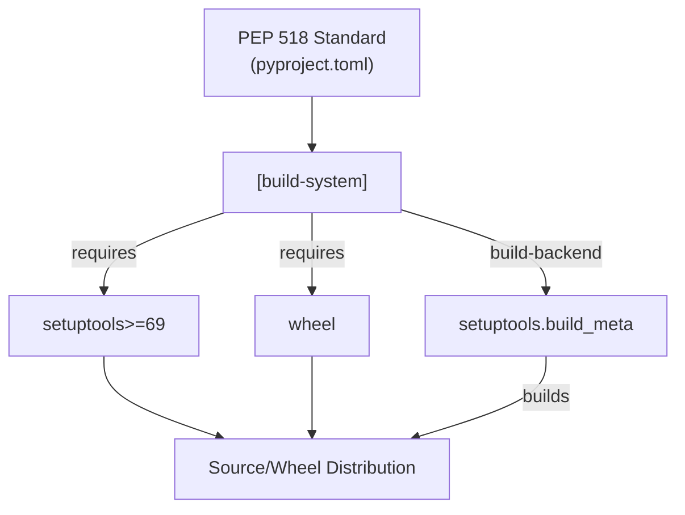
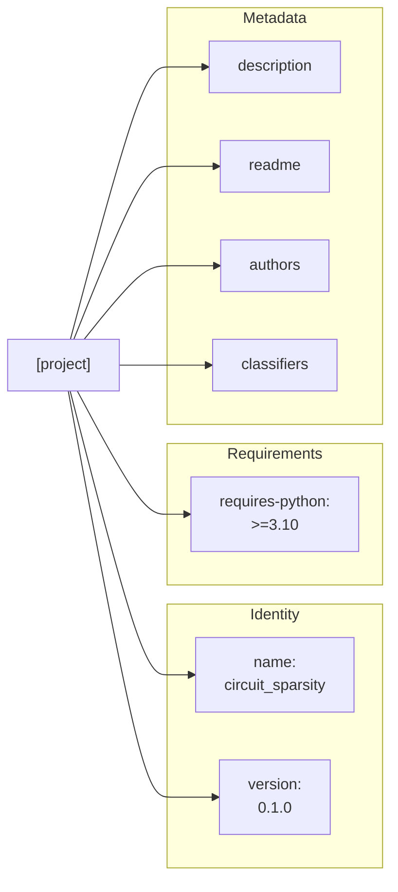
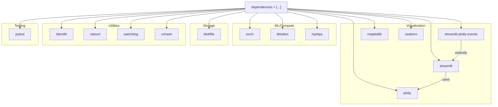
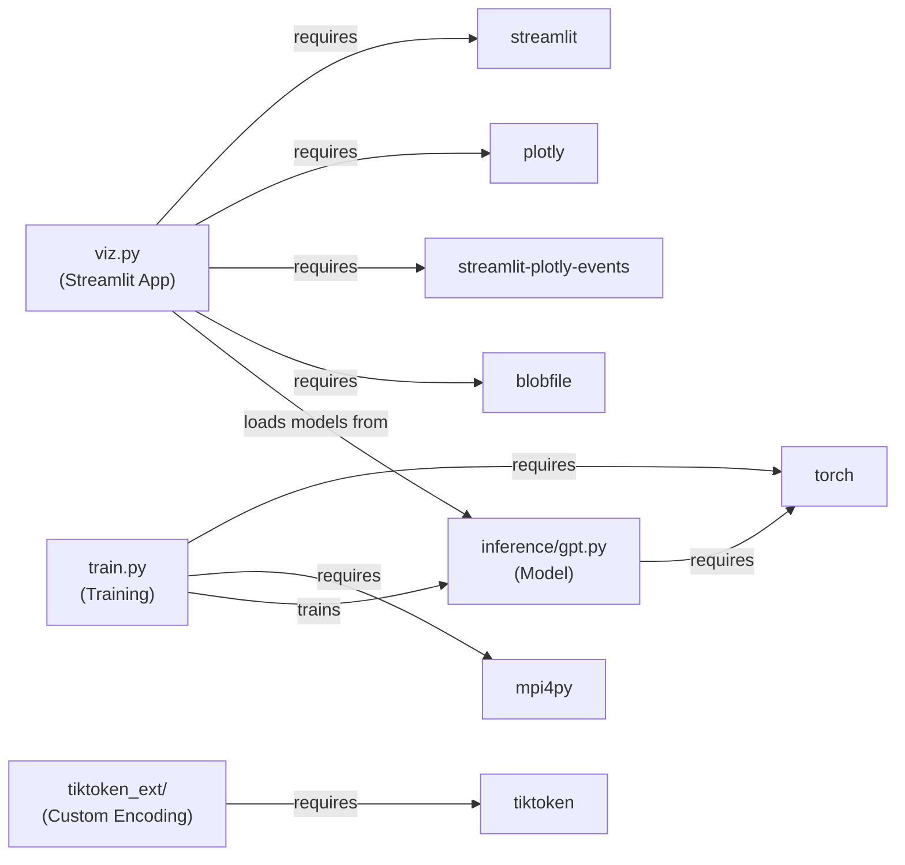
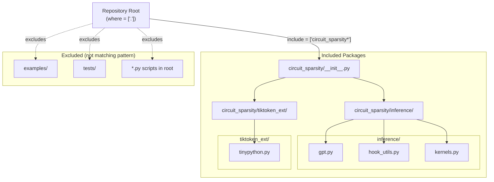
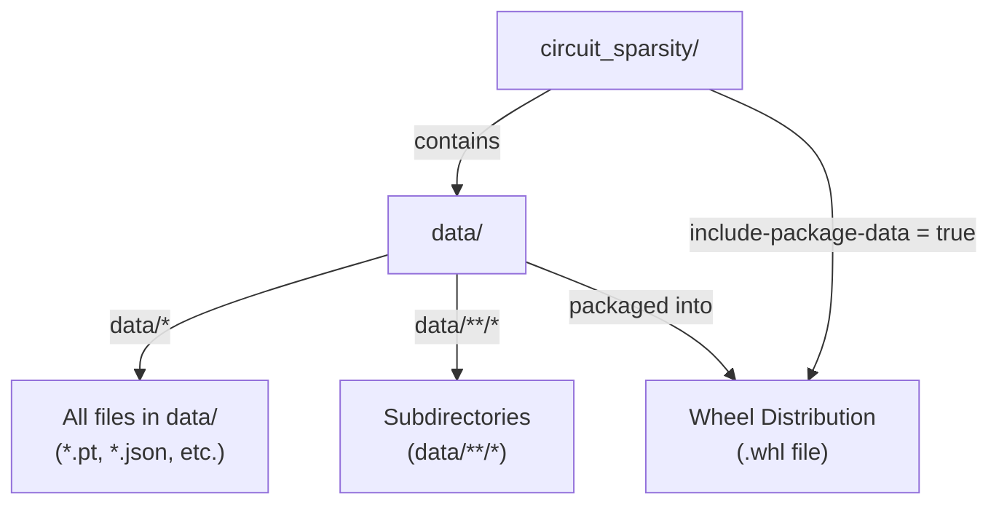
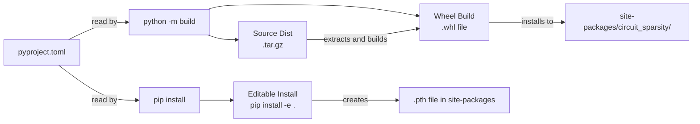

<!-- source: DeepWiki mcp.deepwiki.com · repo openai/circuit_sparsity · page 8.1 Package Configuration · fetched 2026-10-26 -->

# Package Configuration

<details>
<summary>Relevant source files</summary>

The following files were used as context for generating this wiki page:

- [pyproject.toml](pyproject.toml)

</details>


This document explains the build configuration and packaging setup for the `circuit_sparsity` package as defined in `pyproject.toml`. It covers the build system, project metadata, dependencies, and package structure configuration that controls how the package is built and distributed.

For information about data file distribution and Git LFS configuration, see [Data Files and Distribution](#8.2). For licensing terms, see [License](#8.3).

---

## Overview

The `circuit_sparsity` package is configured using a modern `pyproject.toml` file following PEP 518, PEP 621, and PEP 660 standards. This configuration defines the build system, project metadata, runtime dependencies, and package discovery rules. The package uses setuptools as its build backend and includes provisions for bundling data files within the distribution.

**Sources:** [pyproject.toml:1-45]()

---

## Build System Configuration

The build system is configured to use modern setuptools with explicit version requirements:

```toml
[build-system]
requires = ["setuptools>=69", "wheel"]
build-backend = "setuptools.build_meta"
```

### Build System Diagram



| Configuration Key | Value | Purpose |
|------------------|-------|---------|
| `requires` | `["setuptools>=69", "wheel"]` | Specifies build-time dependencies required to build the package |
| `build-backend` | `"setuptools.build_meta"` | Defines the Python object that implements the build interface |

The minimum setuptools version (69) ensures access to modern packaging features including improved PEP 621 support and better handling of package data files.

**Sources:** [pyproject.toml:1-3]()

---

## Project Metadata

The `[project]` section defines the package's identity and distribution metadata:

### Project Metadata Diagram



### Metadata Fields

| Field | Value | Description |
|-------|-------|-------------|
| `name` | `"circuit_sparsity"` | Package name used for pip installation and imports |
| `version` | `"0.1.0"` | Semantic version number indicating early development |
| `description` | `"Utilities and scripts for CS visualization"` | Short one-line description |
| `readme` | Inline text (not file) | Minimal package description for PyPI |
| `requires-python` | `">=3.10"` | Minimum Python version requirement |
| `authors` | `[{ name = "circuit_sparsity authors" }]` | Package author attribution |

### Classifiers

The package includes PyPI classifiers for metadata discovery:

```python
classifiers = [
  "Programming Language :: Python :: 3",
  "License :: OSI Approved :: MIT License",
  "Operating System :: OS Independent",
]
```

These classifiers indicate Python 3 compatibility, MIT licensing (note: the repository uses Apache 2.0 as documented in [License](#8.3)), and cross-platform operation.

**Sources:** [pyproject.toml:5-18]()

---

## Dependencies

The package declares 14 runtime dependencies covering visualization, machine learning, testing, and cloud storage:

### Dependency Architecture Diagram



### Dependency Categories

| Category | Dependencies | Purpose in System |
|----------|-------------|-------------------|
| **Visualization** | `plotly`, `streamlit`, `streamlit-plotly-events`, `matplotlib`, `seaborn` | Powers the interactive dashboard in [viz.py](#3). `plotly` creates graphs, `streamlit` hosts the web app, `streamlit-plotly-events` enables click interactions |
| **ML/Compute** | `torch`, `tiktoken`, `mpi4py` | `torch` provides the neural network framework for [GPT](#2), `tiktoken` handles tokenization [tiktoken_ext](#5.3), `mpi4py` enables distributed training |
| **Storage** | `blobfile` | Provides Azure Blob Storage access for loading models and visualization data from remote storage |
| **Utilities** | `idemlib`, `natsort`, `watchdog`, `xxhash` | General utilities: `idemlib` for idempotent operations, `natsort` for natural string sorting, `watchdog` for file monitoring, `xxhash` for fast hashing |
| **Testing** | `pytest` | Test framework used in [test_gpt.py](#7.3) and other test modules |

### Key Dependency Relationships



**Sources:** [pyproject.toml:19-34]()

---

## Package Structure Configuration

The `[tool.setuptools]` section configures how setuptools discovers and includes package files:

### Package Discovery

```toml
[tool.setuptools.packages.find]
where = ["."]
include = ["circuit_sparsity*"]
```

This configuration tells setuptools to:
1. Search for packages in the repository root (`where = ["."]`)
2. Include only packages matching `circuit_sparsity*` pattern (includes `circuit_sparsity`, `circuit_sparsity.inference`, `circuit_sparsity.tiktoken_ext`, etc.)

### Package Structure Mapping



The pattern `circuit_sparsity*` matches:
- `circuit_sparsity` (main package)
- `circuit_sparsity.inference` (subpackage)
- `circuit_sparsity.tiktoken_ext` (subpackage)

But excludes:
- `examples/` (example scripts, not part of installed package)
- `tests/` (test modules)
- Root-level scripts like `train.py`, `viz.py`, `clear_cache.py`

**Sources:** [pyproject.toml:39-41]()

---

## Package Data Configuration

The package includes data files in its distribution:

```toml
[tool.setuptools]
include-package-data = true

[tool.setuptools.package-data]
circuit_sparsity = ["data/*", "data/**/*"]
```

### Data File Inclusion

| Configuration | Value | Effect |
|--------------|-------|--------|
| `include-package-data` | `true` | Enables inclusion of data files specified in `package-data` |
| `circuit_sparsity` data patterns | `["data/*", "data/**/*"]` | Includes all files in `circuit_sparsity/data/` recursively |

### Data File Structure



The glob patterns ensure that:
- `data/*` includes files directly in the `data/` directory
- `data/**/*` includes files in all subdirectories recursively

This allows the package to bundle model weights, tokenizer data, or other assets that are accessed at runtime via `pkg_resources` or `importlib.resources`.

**Sources:** [pyproject.toml:36-44]()

---

## Build and Installation Commands

Based on this configuration, the package can be built and installed using standard Python packaging tools:

### Installation Methods

| Method | Command | Use Case |
|--------|---------|----------|
| Editable install | `pip install -e .` | Development: changes to source code are immediately reflected |
| Regular install | `pip install .` | Local installation from source |
| Build wheel | `python -m build` | Create distributable `.whl` file |
| Build sdist | `python -m build --sdist` | Create source distribution `.tar.gz` |

### Package Installation Flow



The editable install is particularly useful for development as it allows changes to `circuit_sparsity/` source files to be immediately available without reinstalling.

**Sources:** [pyproject.toml:1-45]()

---

## Version Management

The version is currently hardcoded as `"0.1.0"` in the configuration:

```toml
version = "0.1.0"
```

This indicates:
- **Major version 0**: Package is in initial development, API may change
- **Minor version 1**: First minor release
- **Patch version 0**: No patches applied

For production releases, version management could be automated using tools like `setuptools_scm` to derive versions from Git tags, but the current configuration uses static versioning for simplicity.

**Sources:** [pyproject.toml:7]()

---

## Summary

The `pyproject.toml` configuration establishes a modern Python package with:

1. **Build system**: setuptools>=69 with wheel support
2. **14 dependencies** spanning visualization, ML, storage, and utilities
3. **Package discovery** that includes only `circuit_sparsity*` modules
4. **Data file bundling** for `circuit_sparsity/data/` contents
5. **Python 3.10+** requirement

This configuration supports both development workflows (editable installs) and distribution (wheel/sdist builds) while ensuring all necessary dependencies and data files are properly included.

**Sources:** [pyproject.toml:1-45]()

---

