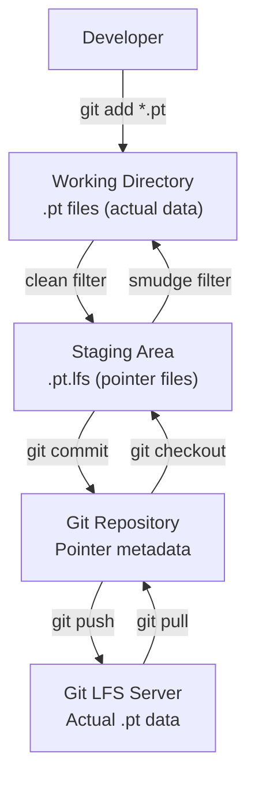
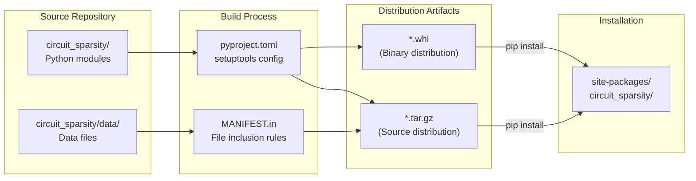
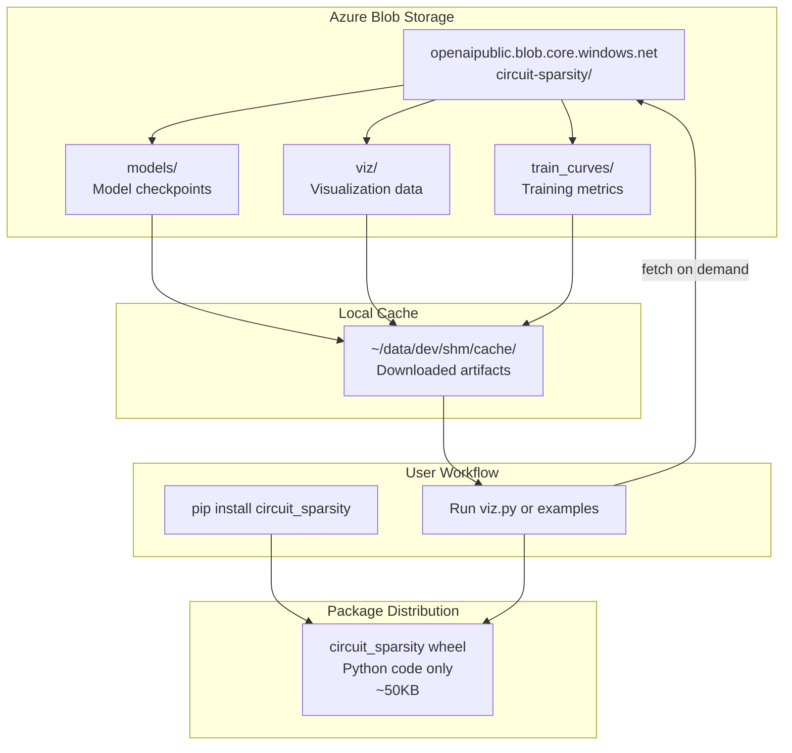

<!-- source: DeepWiki mcp.deepwiki.com · repo openai/circuit_sparsity · page 8.2 Data Files and Distribution · fetched 2026-10-26 -->

# Data Files and Distribution

<details>
<summary>Relevant source files</summary>

The following files were used as context for generating this wiki page:

- [.gitattributes](.gitattributes)
- [.gitignore](.gitignore)
- [MANIFEST.in](MANIFEST.in)

</details>


## Purpose and Scope

This page documents how data files are managed in the `circuit_sparsity` repository, including version control configuration, package distribution, and the relationship between local files and remote storage. It covers Git LFS configuration for model weights, file exclusion patterns, and package manifest configuration.

For information about the Azure Blob Storage backend and data organization, see [Repository Structure](#1.2). For package build configuration, see [Package Configuration](#8.1).

---

## Overview

The `circuit_sparsity` repository handles three categories of data files:

| Category | Examples | Storage Location | Distribution Method |
|----------|----------|------------------|---------------------|
| Large model files | `*.pt` | Git LFS + Azure Blob | Remote fetch |
| Package data files | `circuit_sparsity/data/*` | Git repo | Included in wheel |
| Generated artifacts | `final_model.pt`, build dirs | Local only | Excluded via `.gitignore` |

The system is designed to minimize repository size while ensuring reproducibility and ease of distribution.

---

## Git LFS Configuration

### Purpose

Model checkpoint files (`.pt` format) can be hundreds of megabytes to gigabytes in size. Git Large File Storage (LFS) prevents repository bloat by storing file pointers in Git while keeping actual file contents on LFS servers.

### Configuration

The [.gitattributes:1]() file configures Git LFS:

```
*.pt filter=lfs diff=lfs merge=lfs -text
```

This instructs Git to:
- **filter=lfs**: Use LFS clean/smudge filters when staging/checking out `.pt` files
- **diff=lfs**: Use LFS-specific diff algorithms
- **merge=lfs**: Use LFS-specific merge strategies
- **-text**: Treat as binary files (no line ending normalization)

### Workflow Impact

When developers interact with `.pt` files:



**Sources:** [.gitattributes:1]()

---

## Version Control Exclusions

### Ignored Patterns

The [.gitignore:1-36]() file defines patterns for files that should not be tracked in version control:

#### System and Cache Files

| Pattern | Purpose |
|---------|---------|
| `.DS_Store` | macOS directory metadata |
| `__pycache__/`, `*.py[cod]`, `*$py.class` | Python bytecode cache |
| `.pytest_cache/`, `.mypy_cache/`, `.ruff_cache/` | Testing and linting caches |
| `.venv/`, `venv/`, `env/` | Virtual environments |

#### Build Artifacts

| Pattern | Purpose |
|---------|---------|
| `build/`, `dist/` | Package build outputs |
| `*.egg-info/`, `*.egg` | Python package metadata |
| `.coverage`, `coverage.xml` | Test coverage reports |

#### Development Tools

| Pattern | Purpose |
|---------|---------|
| `.vscode/`, `.idea/` | IDE configuration directories |
| `*.log` | Application log files |

#### Model Artifacts

The pattern `final_model.pt` [.gitignore:35]() explicitly excludes the standard checkpoint filename produced by training. This prevents accidental commits of large model files that should be managed through Azure Blob Storage or Git LFS.

**Sources:** [.gitignore:1-36]()

---

## Package Distribution

### MANIFEST.in Configuration

The [MANIFEST.in:1-3]() file controls which non-Python files are included in source distributions (sdist):

```
recursive-include circuit_sparsity/data *
```

This directive includes all files under the `circuit_sparsity/data/` directory in the package distribution.

### Distribution Flow



### Current State

The comment in MANIFEST.in [MANIFEST.in:1]() indicates:

> "Include data files if they are moved under the package in the future"

This suggests that:
1. The `circuit_sparsity/data/` directory may not currently exist
2. The configuration is prepared for future inclusion of package data files
3. Currently, all necessary data is fetched from Azure Blob Storage rather than bundled

**Sources:** [MANIFEST.in:1-3]()

---

## Relationship to Remote Storage

### Data Storage Architecture

The package distribution excludes large data files, which are instead accessed from Azure Blob Storage:



### Design Rationale

| Aspect | In Package | In Remote Storage |
|--------|-----------|-------------------|
| **Size** | Small (~50KB code) | Large (GBs of models) |
| **Update frequency** | Stable code | Frequently updated experiments |
| **Distribution** | PyPI/pip | Azure CDN |
| **Access pattern** | Always needed | On-demand per experiment |
| **Version control** | Git | Immutable blob names |

This separation allows:
- Fast package installation without downloading all data
- Independent updates to models without package releases
- Shared data access across different installation methods
- Lower bandwidth requirements for users not needing all artifacts

**Sources:** [MANIFEST.in:1-3](), [.gitignore:35]()

---

## Best Practices

### For Contributors

When adding files to the repository:

1. **Large binary files** (>10MB): Use Git LFS
   ```bash
   git lfs track "*.pt"
   ```

2. **Generated files**: Add to `.gitignore`
   - Training checkpoints: `final_model.pt`
   - Build artifacts: `build/`, `dist/`
   - Cache directories: `__pycache__/`

3. **Package data files**: If adding files that should be bundled:
   - Place under `circuit_sparsity/data/`
   - Verify `MANIFEST.in` includes them
   - Keep total size under 1MB

4. **Remote data**: For large datasets or model artifacts:
   - Upload to Azure Blob Storage
   - Document access patterns in code
   - Update loading functions to fetch from blob

### For Users

When working with the package:

1. **Installation**: `pip install circuit_sparsity` gets only code
2. **Data access**: Data is fetched automatically on first use
3. **Caching**: Downloaded data is cached locally (configurable location)
4. **Offline work**: Download required artifacts in advance using data loading utilities

**Sources:** [.gitattributes:1](), [.gitignore:1-36](), [MANIFEST.in:1-3]()

---

## File Size Management Summary

| File Type | Size Range | Version Control | Distribution | Access Method |
|-----------|-----------|-----------------|--------------|---------------|
| Python source | <100KB | Git | PyPI package | Import from package |
| Model checkpoints | 100MB-1GB | Git LFS pointers | Azure Blob | Download on demand |
| Viz data | 1-50MB | Git LFS pointers | Azure Blob | Download on demand |
| Training curves | <1MB | Git LFS pointers | Azure Blob | Download on demand |
| Documentation | <1MB | Git | PyPI package | Read from package |

**Sources:** [.gitattributes:1](), [.gitignore:1-36](), [MANIFEST.in:1-3]()

---

