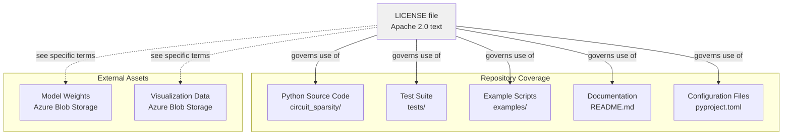
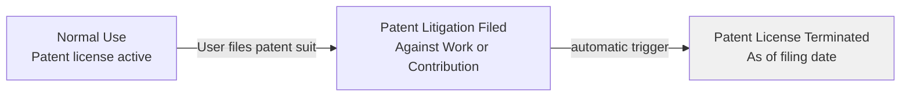
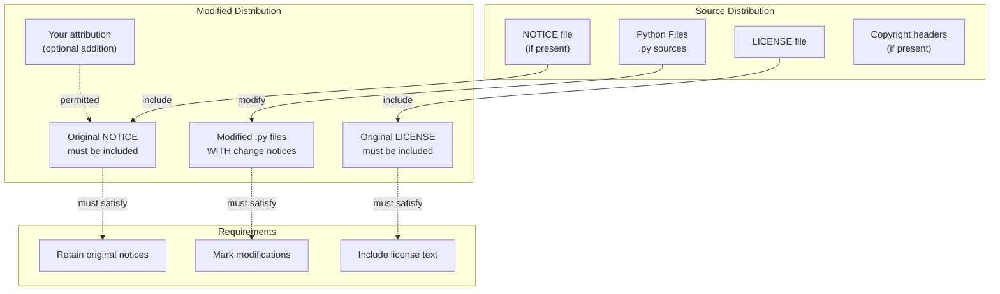

<!-- source: DeepWiki mcp.deepwiki.com · repo openai/circuit_sparsity · page 8.3 License · fetched 2026-10-26 -->

# License

Relevant source files

The following files were used as context for generating this wiki page:

- [LICENSE](LICENSE)

This page documents the licensing terms under which the circuit_sparsity repository is distributed. The repository uses the Apache License 2.0, which governs how the code, documentation, and associated materials may be used, modified, and redistributed.

For information about package configuration and distribution mechanics, see [Package Configuration](#8.1). For data file handling in distributions, see [Data Files and Distribution](#8.2).

## License Type and Location

The circuit_sparsity repository is distributed under the **Apache License, Version 2.0** (January 2004). The complete license text is available in [LICENSE:1-203]().

**Sources:** [LICENSE:1-203]()

## Key Permissions Granted

The Apache License 2.0 grants users broad permissions to use and redistribute the software. The following table summarizes the primary rights granted under [LICENSE:67-72]():

| Permission | Description | License Section |
|------------|-------------|-----------------|
| **Reproduce** | Create copies of the Work | Section 2 |
| **Prepare Derivative Works** | Modify and create works based on the original | Section 2 |
| **Publicly Display** | Show the Work publicly | Section 2 |
| **Publicly Perform** | Execute or demonstrate the Work publicly | Section 2 |
| **Sublicense** | Grant licenses to others | Section 2 |
| **Distribute** | Share the Work and derivatives | Section 2 |

These permissions are:
- **Perpetual**: No expiration date
- **Worldwide**: Valid in all jurisdictions
- **Non-exclusive**: Multiple parties may use the software simultaneously
- **No-charge**: No royalty or licensing fees required
- **Irrevocable**: Cannot be withdrawn (except for patent litigation, see below)

**Sources:** [LICENSE:67-72]()

## Patent Grant and Termination

In addition to copyright permissions, the license includes a patent grant [LICENSE:74-88](). Each contributor grants a royalty-free patent license covering their contributions. However, this patent license includes a defensive termination clause:

If a user initiates patent litigation alleging that the Work or any Contribution constitutes patent infringement, their patent license under this Agreement terminates immediately [LICENSE:82-88]().

**Sources:** [LICENSE:74-88]()

## Redistribution Requirements

When redistributing the Work or Derivative Works, users must comply with specific conditions outlined in [LICENSE:90-129](). The following requirements apply:

### Required Actions for Redistribution

| Requirement | Details | License Reference |
|-------------|---------|-------------------|
| **Include License** | Provide copy of Apache License 2.0 to recipients | Section 4(a) |
| **Mark Modifications** | Add prominent notices to modified files stating changes were made | Section 4(b) |
| **Preserve Notices** | Retain copyright, patent, trademark, and attribution notices from Source form | Section 4(c) |
| **Include NOTICE File** | If present, reproduce attribution notices in distributions | Section 4(d) |

### Application to circuit_sparsity Components

**Sources:** [LICENSE:90-129]()

## Warranty Disclaimer and Liability Limitation

The license includes important disclaimers that apply to the use of circuit_sparsity:

### Warranty Disclaimer

The software is provided **"AS IS"** without any warranties [LICENSE:144-152](). This means:

- No warranty of **MERCHANTABILITY**: No guarantee the software is suitable for commercial use
- No warranty of **FITNESS FOR A PARTICULAR PURPOSE**: No guarantee it meets specific research needs
- No warranty of **NON-INFRINGEMENT**: No guarantee against intellectual property conflicts
- No warranty of **TITLE**: No guarantee of ownership rights

### Liability Limitation

Contributors are not liable for damages arising from use of the Work [LICENSE:154-164](). This includes but is not limited to:
- Loss of goodwill
- Work stoppage
- Computer failure or malfunction
- Commercial damages or losses

Users assume all risks associated with using or redistributing the Work [LICENSE:150-152]().

**Sources:** [LICENSE:144-164]()

## Contributions

Any contribution intentionally submitted for inclusion in the Work is subject to the license terms [LICENSE:131-137](). Unless explicitly stated otherwise:

- Contributions are under Apache License 2.0 terms
- No additional terms or conditions apply
- Contributor grants the same copyright and patent licenses to all users

This ensures all contributions maintain compatible licensing and can be freely integrated.

**Sources:** [LICENSE:131-137]()

## Trademark Restrictions

The license does **not** grant permission to use [LICENSE:139-142]():
- Trade names of the Licensor
- Trademarks of the Licensor  
- Service marks of the Licensor
- Product names of the Licensor

Such use is only permitted for:
- Reasonable and customary description of the Work's origin
- Reproducing the content of the NOTICE file (if present)

**Sources:** [LICENSE:139-142]()

## Key Definitions

The license defines specific terms used throughout [LICENSE:8-65](). Understanding these definitions is important for compliance:

| Term | Definition |
|------|------------|
| **Work** | The work of authorship (source or object form) made available under the License |
| **Derivative Works** | Works based on or derived from the Work, representing original authorship |
| **Contribution** | Work intentionally submitted to Licensor for inclusion in the Work |
| **Contributor** | Licensor and any individual or Legal Entity whose Contribution has been incorporated |
| **Source** Form | Preferred form for making modifications (source code, documentation source, configuration files) |
| **Object** Form | Result of mechanical transformation/translation of Source form (compiled code, generated docs) |

**Sources:** [LICENSE:8-65]()

## Practical Implications for Users

For different usage scenarios of the circuit_sparsity repository:

### Using the Package in Research

- ✓ Install via pip and use in research projects
- ✓ Load pre-trained models from Azure Blob Storage
- ✓ Run visualization and analysis tools
- ✓ No attribution required beyond reasonable citation practices
- ⚠ Software provided "AS IS" without warranties

### Modifying the Code

- ✓ Modify source code for custom needs
- ✓ Create derivative works with different configurations
- ✓ Add features or fix bugs
- ⚠ Must mark modified files with change notices
- ⚠ Must retain original copyright and license notices

### Redistributing

- ✓ Share original or modified versions
- ✓ Include in larger projects
- ✓ Sublicense to others
- ✓ Charge fees for redistribution/support if desired
- ⚠ Must include copy of Apache License 2.0
- ⚠ Must include NOTICE file if present
- ⚠ Cannot use OpenAI trademarks without permission

**Sources:** [LICENSE:1-203]()

## Full License Text

The complete Apache License 2.0 text with all terms, conditions, and legal provisions is available in the repository at [LICENSE:1-203](). Users should refer to this file for the authoritative license terms.

For questions about license interpretation or compliance, consult with qualified legal counsel, as this documentation provides only a summary and not legal advice.

**Sources:** [LICENSE:1-203]()