# Page: Overview

# Overview

<details>
<summary>Relevant source files</summary>

The following files were used as context for generating this wiki page:

- [README.md](README.md)
- [pyproject.toml](pyproject.toml)

</details>


This page introduces the `circuit_sparsity` repository, which provides tools for analyzing sparse neural network circuits as described in [Gao et al. 2025](https://openai.com/index/understanding-neural-networks-through-sparse-circuits/). The repository contains a GPT transformer implementation with sparsity features, a Streamlit-based visualization dashboard for exploring pruned circuits, and utilities for training and analyzing sparse models.

For installation instructions and environment setup, see [Installation and Setup](#1.1). For details on the GPT model architecture, see [GPT Model Implementation](#2). For visualization features, see [Visualization System](#3).

**Sources:** [README.md:1-5]()

## Purpose and Scope

The `circuit_sparsity` repository serves three primary purposes:

1. **Inference**: Run forward passes on sparse transformer models with configurable activation and weight sparsity
2. **Visualization**: Interactively explore pruned circuits through a Streamlit dashboard that displays circuit structure, node importance, and activation patterns
3. **Analysis**: Reproduce experimental results and analyze model behaviors on specific tasks

The repository does **not** include the pruning algorithms themselves (which use external tools like CARBS optimization), but provides the infrastructure to load, visualize, and analyze the resulting pruned circuits.

**Sources:** [README.md:3-5](), [README.md:30-58]()

## System Architecture

The repository consists of three main subsystems that interact with a centralized data storage layer:

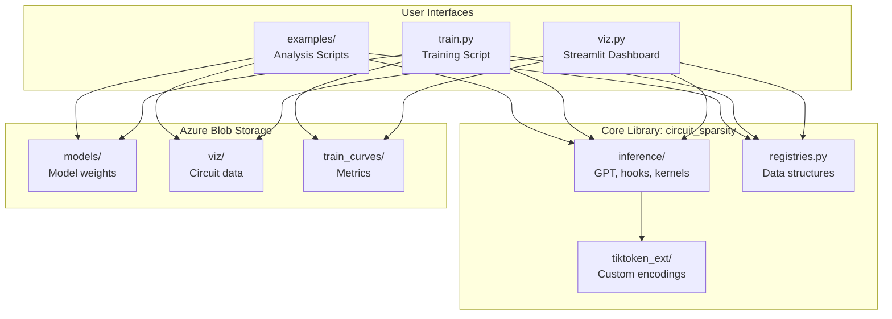

**Component Responsibilities:**

| Component | Purpose | Key Files |
|-----------|---------|-----------|
| `inference/` | GPT model implementation with sparsity support | `gpt.py`, `hook_utils.py`, `kernels.py` |
| `registries.py` | Data structures for tasks, datapoints, and model configurations | `registries.py` |
| `tiktoken_ext/` | Custom tokenization for Python code | `tinypython.py` |
| `viz.py` | Interactive circuit exploration dashboard | `viz.py` |
| `train.py` | Training script for sparse models | `train.py` |
| `examples/` | Demonstration scripts for analysis | `bracket_counting_example.py` |

**Sources:** [README.md:32-38](), [README.md:68-85]()

## Core Components

### GPT Model System

The `circuit_sparsity.inference.gpt` module provides a lightweight GPT implementation designed for sparse circuit analysis:

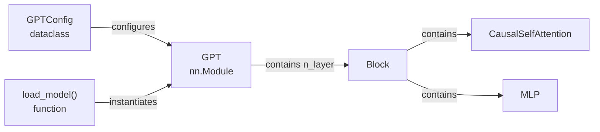

Key classes and functions:
- `GPTConfig`: Configuration dataclass with parameters like `d_model`, `n_layer`, `n_head`, `afrac` (activation sparsity)
- `GPT`: Main transformer model supporting CPU/GPU inference
- `load_model(model_dir, cuda=False)`: Loads model from `beeg_config.json` and `final_model.pt`

**Sources:** [README.md:32-38]()

### Hook System

The `hook_utils` module enables recording intermediate activations during forward passes:

```python
from circuit_sparsity.inference.gpt import load_model
from circuit_sparsity.inference.hook_utils import hook_recorder

model = load_model("models/csp_yolo1")

with hook_recorder() as rec:
    model(input_ids)

# rec contains {"0.attn.act_in": tensor(...), "0.attn.act_out": tensor(...), ...}
```

This is essential for the visualization system and analysis scripts. See [Hook System for Activation Recording](#2.4) for details.

**Sources:** [README.md:42-56]()

### Visualization Dashboard

The `viz.py` Streamlit app provides interactive exploration of pruned circuits:

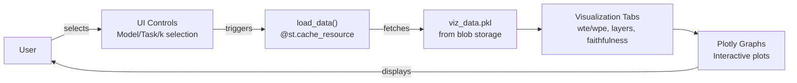

Launch with: `streamlit run circuit_sparsity/viz.py`

The dashboard allows users to:
- Select models, datasets, pruning sweeps, and node budgets (`k`)
- View circuit topology with node importance scores
- Click nodes to see activation patterns on code samples
- Compare circuit performance across different pruning levels

**Sources:** [README.md:14-28]()

## Data Organization

All persistent data resides in Azure Blob Storage at `https://openaipublic.blob.core.windows.net/circuit-sparsity`:

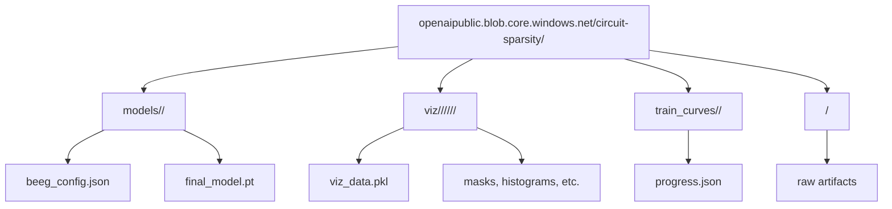

| Directory | Contents | Used By |
|-----------|----------|---------|
| `models/<model_name>/` | `beeg_config.json`, `final_model.pt` | `load_model()`, training scripts |
| `viz/<path>/` | `viz_data.pkl` with circuit data | Streamlit dashboard |
| `train_curves/<model_name>/` | `progress.json` with training metrics | Dashboard summary table |

The paths are defined in `registries.py` as `MODEL_BASE_DIR`, `VIZ_BASE_DIR`, etc.

**Sources:** [README.md:68-85]()

## Model Families

The repository includes several model families for different experimental purposes:

| Model Family | Size | Purpose | Example |
|--------------|------|---------|---------|
| `csp_yolo1` | 118M params | Qualitative demonstrations | `single_double_quote` task |
| `csp_yolo2` | 475M params | Qualitative demonstrations | `bracket_counting` task |
| `csp_sweep1_*` | Variable | Figure 3 results (size/sparsity sweep) | Performance curves |
| `csp_bridge1`, `csp_bridge2` | - | Paper results | Main findings |
| `dense1_1x`, `dense1_2x`, `dense1_4x` | 1x, 2x, 4x | Baseline comparisons | Dense models |

Pruning algorithm variants:
- `prune_v2`: 256 CARBS iterations, fixed `k` target (unpublished)
- `prune_v3`: 256 CARBS iterations, fixed loss target (unpublished)
- `prune_v4`: 768 CARBS iterations, fixed loss target (published)
- `prune_v5_logitscaling`: 256 CARBS iterations with logit scaling (published)

**Sources:** [README.md:88-105]()

## User Workflows

The system supports four primary workflows:

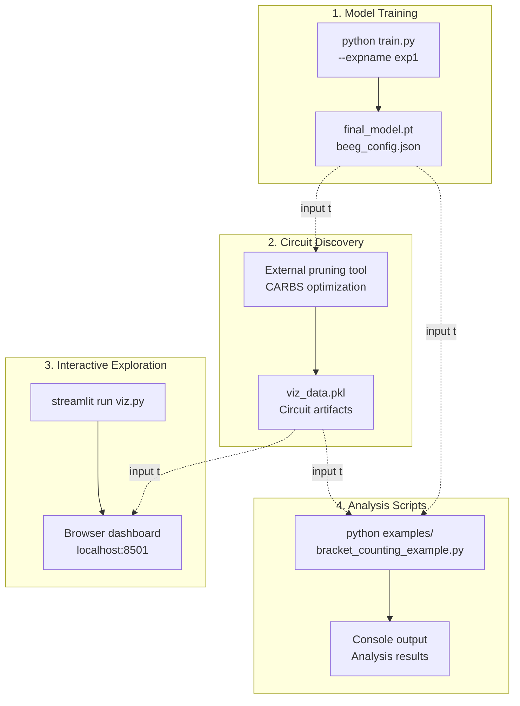

**Typical Usage Patterns:**

1. **Load and run a pretrained model:**
   ```python
   from circuit_sparsity.inference.gpt import load_model
   model = load_model("models/csp_yolo2")
   logits, loss, _ = model(input_ids, targets=targets)
   ```

2. **Launch the visualizer:**
   ```bash
   streamlit run circuit_sparsity/viz.py
   ```
   Then select model, dataset, sweep, and k value from the UI.

3. **Run example analysis:**
   ```bash
   python examples/bracket_counting_example.py
   ```

**Sources:** [README.md:14-19](), [README.md:40-58](), [README.md:107-109]()

## Dependencies

The package requires Python 3.10+ and the following key dependencies:

| Category | Packages |
|----------|----------|
| Deep Learning | `torch` |
| Visualization | `streamlit`, `plotly`, `matplotlib`, `seaborn`, `streamlit-plotly-events` |
| Data Handling | `blobfile`, `tiktoken`, `natsort` |
| Utilities | `pytest`, `idemlib`, `xxhash`, `watchdog`, `mpi4py` |

Install with: `pip install -e .`

**Sources:** [pyproject.toml:19-34](), [README.md:9-11]()

## Quick Reference

**Key Import Paths:**
- `circuit_sparsity.inference.gpt` → `GPT`, `GPTConfig`, `load_model`
- `circuit_sparsity.inference.hook_utils` → `hook_recorder`, `HookContext`
- `circuit_sparsity.registries` → `Datapoint`, `Task`, `MODEL_BASE_DIR`
- `circuit_sparsity.tiktoken_ext.tinypython` → Custom tokenization

**Common Commands:**
```bash
# Launch visualizer
streamlit run circuit_sparsity/viz.py

# Run tests
pytest tests/test_gpt.py

# Clear local cache
python clear_cache.py
```

**Data URL Pattern:**
```
https://openaipublic.blob.core.windows.net/circuit-sparsity/
  └── models/<model_name>/final_model.pt
  └── viz/<experiment>/<model>/<task>/<sweep>/<k>/viz_data.pkl
  └── train_curves/<model_name>/progress.json
```

**Sources:** [README.md:9-11](), [README.md:14-19](), [README.md:60-64](), [README.md:107-112]()

---

# Page: Installation and Setup

# Installation and Setup

<details>
<summary>Relevant source files</summary>

The following files were used as context for generating this wiki page:

- [README.md](README.md)
- [clear_cache.py](clear_cache.py)
- [pyproject.toml](pyproject.toml)

</details>


This document guides you through installing the `circuit_sparsity` package, configuring your environment, and setting up the necessary cache directories. It covers Python version requirements, dependency installation, environment variable configuration, and verification steps. For information about the repository structure and data layout, see [Repository Structure](#1.2).

## Prerequisites

The package requires **Python 3.10 or later** as specified in [pyproject.toml:10](). The system is designed to run on CPU or GPU environments, with CUDA support optional for GPU-accelerated inference.

**Required System Components:**
- Python ≥ 3.10
- pip package manager
- Git (for cloning the repository)
- Sufficient disk space for model weights and cached data (~10GB recommended)

Sources: [pyproject.toml:10]()

## Installation

Install the package in editable mode from the repository root:

```bash
pip install -e .
```

This command installs the package using the configuration in [pyproject.toml:1-45]() and makes the `circuit_sparsity` module available for import. The `-e` flag creates an editable installation, allowing you to modify the source code without reinstalling.

**Installation Process:**

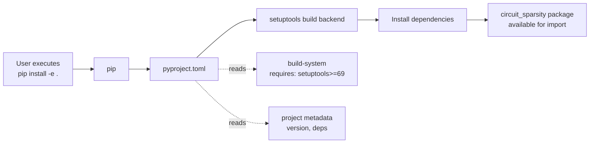

Sources: [README.md:7-11](), [pyproject.toml:1-45]()

## Dependencies

The package declares the following dependencies in [pyproject.toml:19-34]():

| Dependency | Purpose |
|------------|---------|
| `torch` | Neural network inference and tensor operations |
| `streamlit` | Interactive visualization dashboard |
| `plotly` | Interactive graph rendering |
| `streamlit-plotly-events` | Click event handling in Streamlit |
| `tiktoken` | Tokenization (with custom extensions) |
| `blobfile` | Azure Blob Storage access |
| `matplotlib` | Static plotting utilities |
| `seaborn` | Statistical visualizations |
| `pytest` | Testing framework |
| `idemlib` | Internal utilities |
| `natsort` | Natural sorting of strings |
| `watchdog` | File system monitoring |
| `xxhash` | Fast hashing |
| `mpi4py` | MPI parallelization (for training) |

These dependencies are automatically installed by pip. CUDA support for PyTorch is not explicitly required but can be configured separately for GPU acceleration.

Sources: [pyproject.toml:19-34]()

## Environment Configuration

### Cache Directories

The system uses two primary cache locations to store downloaded model weights, visualization data, and tokenization artifacts:

**Cache Directory Structure:**

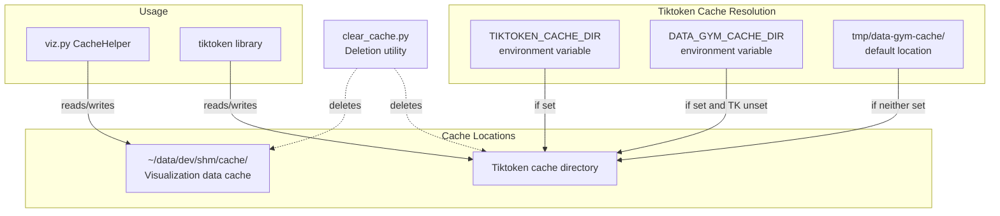

**Primary Cache: `~/data/dev/shm/cache`**

This directory stores downloaded model weights, visualization data files (`viz_data.pkl`), and training curves from Azure Blob Storage. The `CacheHelper` class in `viz.py` manages this cache automatically.

**Tiktoken Cache**

The tiktoken library caches encoding definitions. The cache location is resolved in the following order (as shown in [clear_cache.py:28-34]()):
1. `$TIKTOKEN_CACHE_DIR` environment variable
2. `$DATA_GYM_CACHE_DIR` environment variable  
3. `<temp_dir>/data-gym-cache` (default)

Sources: [clear_cache.py:1-41](), [README.md:21]()

### Environment Variables

**Optional Environment Variables:**

| Variable | Purpose | Default |
|----------|---------|---------|
| `TIKTOKEN_CACHE_DIR` | Override tiktoken cache location | System temp directory |
| `DATA_GYM_CACHE_DIR` | Alternative tiktoken cache location | System temp directory |
| `PYTHONPATH` | Include repository root for imports | (not set) |

To ensure imports work correctly when running scripts outside the package structure, add the repository root to your `PYTHONPATH`:

```bash
export PYTHONPATH=/path/to/circuit_sparsity:$PYTHONPATH
```

This is particularly important when running example scripts like `examples/bracket_counting_example.py` or utility scripts like `clear_cache.py`.

Sources: [clear_cache.py:28-34]()

### Clearing Caches

To force re-downloading of data or clear stale cached files, run the cache deletion utility:

```bash
python clear_cache.py
```

This script removes both the visualization cache (`~/data/dev/shm/cache`) and the tiktoken cache. It provides output confirming which directories were deleted or skipped.

Sources: [README.md:109](), [clear_cache.py:1-41]()

## Verifying Installation

**Test the installation by running the test suite:**

```bash
pytest tests/test_gpt.py
```

This executes unit tests for the GPT model implementation, including configuration validation, forward pass computation, and hook system functionality.

**Verify basic imports:**

```python
from circuit_sparsity.inference.gpt import GPT, GPTConfig, load_model
from circuit_sparsity.inference.hook_utils import hook_recorder
from circuit_sparsity.registries import MODEL_BASE_DIR

# Create a minimal model
config = GPTConfig(block_size=8, vocab_size=16, n_layer=1, n_head=1, d_model=8)
model = GPT(config)
print(f"Model initialized with {config.n_layer} layers")
```

If these imports succeed without errors, the core package is correctly installed.

**Launch the visualization dashboard:**

```bash
streamlit run circuit_sparsity/viz.py
```

The dashboard should open in your browser at `http://localhost:8501`. On first launch, it will download visualization data and model weights from Azure Blob Storage, which may take several minutes depending on your connection speed.

Sources: [README.md:60-64](), [README.md:14-19](), [README.md:40-58]()

## Data Access and Remote Storage

**Azure Blob Storage Layout:**

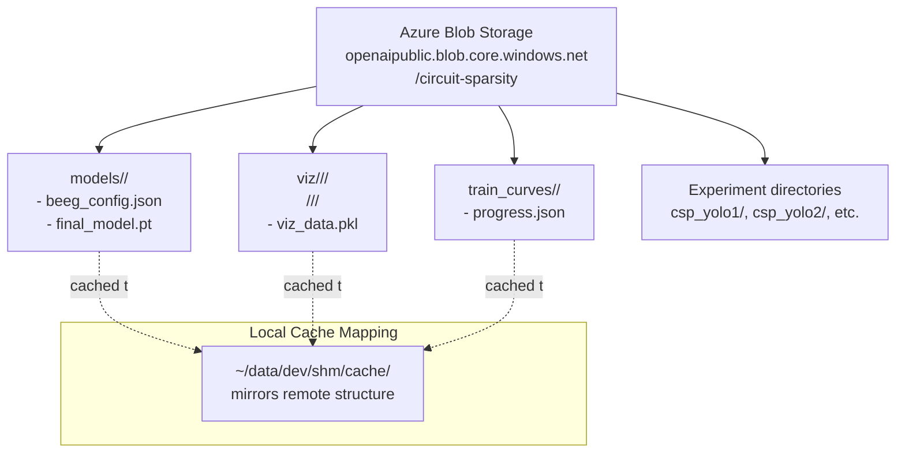

The system automatically downloads data from `https://openaipublic.blob.core.windows.net/circuit-sparsity` as needed. Downloaded files are cached locally in `~/data/dev/shm/cache/` to avoid repeated downloads. The `blobfile` library handles transparent remote access and caching.

**Key Data Locations:**
- **Model weights:** `models/<model_name>/final_model.pt`
- **Model configuration:** `models/<model_name>/beeg_config.json`
- **Visualization data:** `viz/<experiment>/<model_name>/<task_name>/<sweep>/<k>/viz_data.pkl`
- **Training metrics:** `train_curves/<model_name>/progress.json`

The `MODEL_BASE_DIR` constant in `registries.py` provides the base URL for accessing these resources.

Sources: [README.md:66-85](), [README.md:21-22]()

## Common Installation Issues

**Import Errors:**
- Ensure you ran `pip install -e .` from the repository root
- Verify `PYTHONPATH` includes the repository directory when running scripts directly
- Check that Python version is ≥ 3.10

**Cache Permission Errors:**
- Ensure `~/data/dev/shm/cache/` is writable
- Check environment variables `TIKTOKEN_CACHE_DIR` or `DATA_GYM_CACHE_DIR` point to writable locations

**Network/Download Errors:**
- The first run requires internet access to download from Azure Blob Storage
- Large model files may take time to download; be patient during initial setup
- Run `clear_cache.py` and retry if downloads appear corrupted

**PyTorch CUDA Issues:**
- CUDA support is optional; the system works on CPU
- For GPU acceleration, install PyTorch with CUDA separately following PyTorch documentation

Sources: [README.md:7-64](), [clear_cache.py:1-41]()

---

# Page: Repository Structure

# Repository Structure

<details>
<summary>Relevant source files</summary>

The following files were used as context for generating this wiki page:

- [README.md](README.md)
- [circuit_sparsity/__init__.py](circuit_sparsity/__init__.py)
- [pyproject.toml](pyproject.toml)

</details>


This document describes the physical organization of the `circuit_sparsity` repository, including the Python package structure, the data layout on Azure Blob Storage, and the naming conventions for models and experiments. For details on installing and configuring the package, see [Installation and Setup](#1.1). For information on the package dependencies and build configuration, see [Package Configuration](#8.1).

## Overview

The repository consists of two primary components:

1. **Local code**: The `circuit_sparsity` Python package containing model implementations, visualization tools, training scripts, and utilities
2. **Remote data**: Artifacts stored on Azure Blob Storage, including trained model weights, visualization data, and training metrics

The local package is lightweight and version-controlled, while the remote data layer contains large binary files that are accessed on-demand and cached locally.

## Package Structure

The `circuit_sparsity` package follows a modular organization with subdirectories for different functional areas:

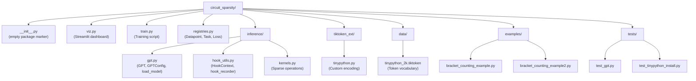

**Sources:** [pyproject.toml:1-45](), [README.md:32-38]()

### Core Modules

| Module | Purpose | Key Exports |
|--------|---------|-------------|
| `inference/gpt.py` | Transformer model implementation | `GPT`, `GPTConfig`, `load_model()` |
| `inference/hook_utils.py` | Activation recording system | `HookContext`, `hook_recorder()` |
| `inference/kernels.py` | Sparse matrix operations | `topk()`, `dense_to_sparse_topk()` |
| `registries.py` | Data structures and metadata | `Datapoint`, `Task`, `MODEL_BASE_DIR`, loss functions |
| `viz.py` | Interactive visualization dashboard | Streamlit app entry point |
| `train.py` | Model training script | Command-line interface for training |
| `tiktoken_ext/tinypython.py` | Custom tokenization | `tinypython_2k` encoding |

**Sources:** [README.md:32-38](), [pyproject.toml:39-44]()

### Top-Level Files

The repository root contains configuration and utility files:

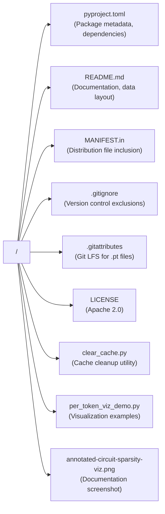

**Sources:** [README.md:1-113](), [pyproject.toml:1-45]()

## Blob Storage Data Layout

All persistent data resides on Azure Blob Storage at the base URL:
```
https://openaipublic.blob.core.windows.net/circuit-sparsity
```

The storage is organized into three primary directory trees:

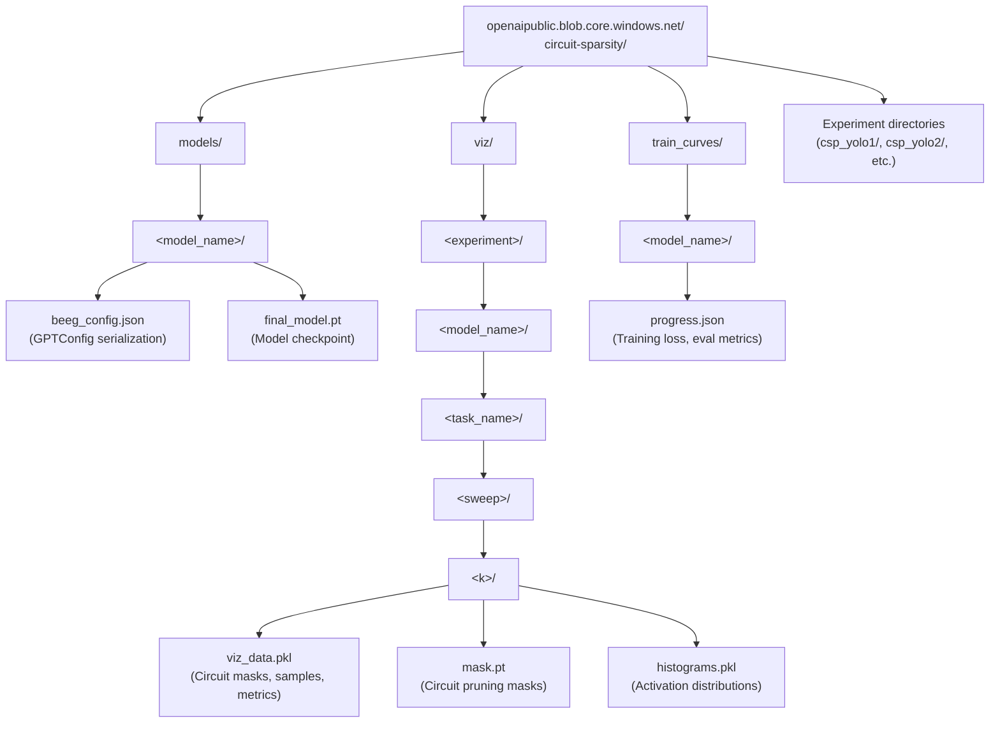

**Sources:** [README.md:66-85]()

### Directory Structure Details

#### `models/` Directory

Stores trained model checkpoints. Each model has its own subdirectory containing:

- **`beeg_config.json`**: Serialized `GPTConfig` object with all hyperparameters needed to reconstruct the model architecture
- **`final_model.pt`**: PyTorch checkpoint containing model weights, loaded by `load_model()` in [circuit_sparsity/inference/gpt.py]()

Example path: `models/csp_yolo2/beeg_config.json`

**Sources:** [README.md:70-72]()

#### `viz/` Directory

Contains visualization artifacts produced by circuit pruning and preprocessing. The nested structure organizes outputs by multiple dimensions:

```
viz/<experiment>/<model_name>/<task_name>/<sweep>/<k>/viz_data.pkl
```

Where:
- `<experiment>`: Experimental grouping (e.g., `csp_yolo1_qual`, `csp_sweep1_results`)
- `<model_name>`: Model identifier from `registries.py`
- `<task_name>`: Task identifier (e.g., `bracket_counting`, `single_double_quote`)
- `<sweep>`: Pruning algorithm variant (e.g., `prune_v4`, `prune_v5_logitscaling`)
- `<k>`: Node budget (integer representing circuit size)

The primary payload is `viz_data.pkl`, which contains:
- Circuit masks (which nodes are retained)
- Sample datapoints for the task
- Importance scores for nodes
- Activation snapshots
- Ablation metrics

**Sources:** [README.md:73-77]()

#### `train_curves/` Directory

Stores training metrics organized by model:

```
train_curves/<model_name>/progress.json
```

The `progress.json` file contains time-series data for:
- Training loss
- Evaluation loss
- Sparsity metrics
- Step counters

This data is consumed by the visualization dashboard's summary table.

**Sources:** [README.md:78-79]()

## Model Organization

The repository includes multiple model families designed for different research purposes:

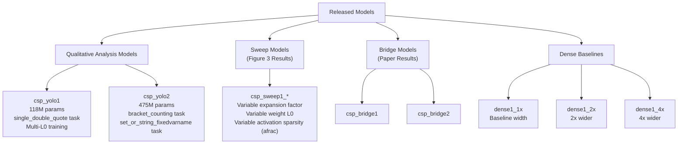

**Sources:** [README.md:87-98]()

### Model Naming Conventions

| Model Prefix | Purpose | Example |
|--------------|---------|---------|
| `csp_yolo1` | Early qualitative model (118M params) | Used for `single_double_quote` demonstrations |
| `csp_yolo2` | Main qualitative model (475M params) | Used for `bracket_counting` and `set_or_string_fixedvarname` |
| `csp_sweep1_*` | Systematic architecture sweep | `csp_sweep1_2x_l0_0.5_afrac_0.1` indicates 2x expansion, 0.5 weight L0, 0.1 activation sparsity |
| `csp_bridge*` | Paper checkpoint models | Models specifically used to generate paper results |
| `dense1_*` | Dense baseline models | `dense1_2x` is a dense model 2x wider than baseline |

**Sources:** [README.md:87-98]()

## Pruning Sweep Identifiers

Pruning experiments are identified by sweep IDs that encode the algorithm version and hyperparameters:

| Sweep ID | CARBS Iterations | Algorithm | Target | Publication Status |
|----------|------------------|-----------|--------|-------------------|
| `prune_v2` | 256 | Early version | Fixed `k` | Unpublished |
| `prune_v3` | 256 | Intermediate version | Fixed target loss | Unpublished |
| `prune_v4` | 768 | Published algorithm | Fixed target loss | Published |
| `prune_v5_logitscaling` | 256 | Published with logit scaling | Fixed target loss | Published |

**Sources:** [README.md:100-104]()

The evolution from `prune_v2` to `prune_v5_logitscaling` reflects algorithmic improvements:
- **v2**: Targets a fixed node count `k`, does not optimize for loss
- **v3**: Switches to targeting a fixed target loss, but with fewer CARBS iterations
- **v4**: The main published algorithm with extensive hyperparameter search (768 CARBS iterations)
- **v5_logitscaling**: Adds logit scaling to the published algorithm

## File Types and Their Purposes

### Configuration Files

| File | Format | Purpose | Created By | Consumed By |
|------|--------|---------|------------|-------------|
| `beeg_config.json` | JSON | Model architecture specification | Training script | `load_model()` |
| `pyproject.toml` | TOML | Package metadata and dependencies | Manual | `pip`, `setuptools` |

**Sources:** [README.md:70-72](), [pyproject.toml:1-45]()

### Model and Data Files

| File | Format | Purpose | Size | Cached Locally |
|------|--------|---------|------|----------------|
| `final_model.pt` | PyTorch | Model weights | 100s of MB | Yes (on access) |
| `viz_data.pkl` | Pickle | Circuit visualization payload | ~10-100 MB | Yes (Streamlit cache) |
| `mask.pt` | PyTorch | Circuit pruning masks | Small | Optional |
| `progress.json` | JSON | Training metrics time-series | Small | Yes (Streamlit cache) |
| `tinypython_2k.tiktoken` | Binary | Tokenizer vocabulary | <1 MB | Yes (tiktoken cache) |

**Sources:** [README.md:66-85]()

### Caching Behavior

The visualization system implements two-tier caching:

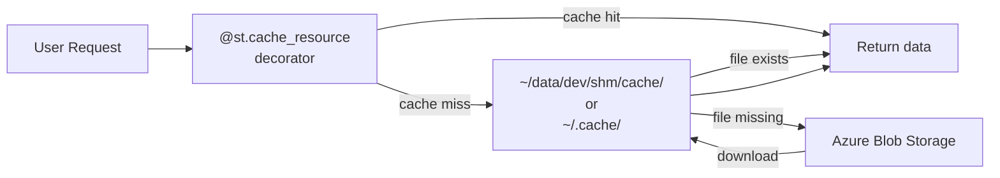

Users can clear cached data using the `clear_cache.py` utility:

```bash
python clear_cache.py
```

This removes both Streamlit cache and tiktoken cache, forcing fresh downloads on next access.

**Sources:** [README.md:21-22](), [README.md:109]()

## Relationship to Code Entities

The following diagram maps storage locations to the code entities that interact with them:

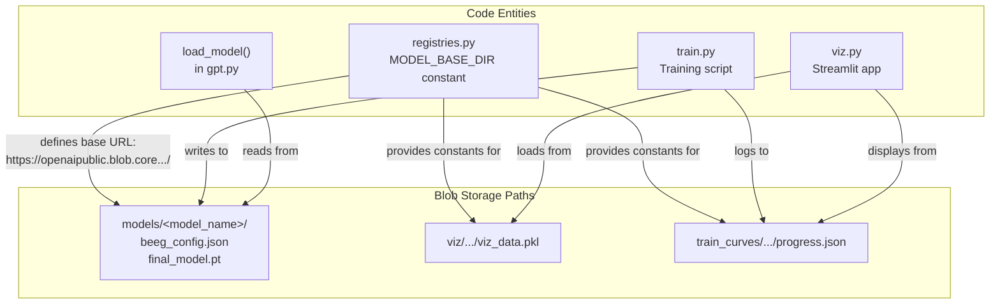

**Sources:** [README.md:57-58](), [README.md:66-85]()

### Code Usage Examples

**Loading a model:**
```python
from circuit_sparsity.inference.gpt import load_model
from circuit_sparsity.registries import MODEL_BASE_DIR

# MODEL_BASE_DIR points to blob storage base URL
model = load_model(f"{MODEL_BASE_DIR}/models/csp_yolo2", cuda=False)
```

**Path construction in registries.py:**
The `registries.py` module defines constants that construct full paths:
```python
MODEL_BASE_DIR = "https://openaipublic.blob.core.windows.net/circuit-sparsity"
# Used to build: {MODEL_BASE_DIR}/models/{model_name}/beeg_config.json
```

**Sources:** [README.md:57-58](), [README.md:84-85]()

## Summary

The repository structure separates concerns effectively:

- **Local code** (`circuit_sparsity/` package) is lightweight and contains all implementation logic
- **Remote data** (Azure Blob Storage) contains large artifacts accessed on-demand
- **Model organization** follows semantic naming that encodes experiment parameters
- **Pruning sweeps** are versioned to track algorithmic evolution
- **Caching** reduces bandwidth usage and improves interactive experience

For guidance on modifying the package structure or adding new data files to distributions, see [Data Files and Distribution](#8.2).

---

# Page: GPT Model Implementation

# GPT Model Implementation

<details>
<summary>Relevant source files</summary>

The following files were used as context for generating this wiki page:

- [README.md](README.md)
- [circuit_sparsity/inference/gpt.py](circuit_sparsity/inference/gpt.py)

</details>


This document provides an overview of the GPT transformer model implementation in `circuit_sparsity/inference/gpt.py`. This implementation is designed specifically to support sparse neural network circuits with extensive instrumentation for activation recording and analysis.

For detailed information on specific components, see:
- Configuration parameters and the `GPT` class: [GPT and GPTConfig](#2.1)
- Internal architecture components: [Model Architecture Components](#2.2)
- Sparsity mechanisms: [Sparsity Features](#2.3)
- Activation recording infrastructure: [Hook System for Activation Recording](#2.4)

## Purpose and Scope

The GPT implementation serves as the core inference engine for sparse circuit analysis. It provides:

1. A lightweight, configurable transformer architecture suitable for CPU/GPU inference
2. Built-in support for activation sparsity (`afrac`) and weight sparsity
3. Integration with the hook system for recording intermediate activations
4. Multiple architectural variants including concatenated position embeddings and attention sinks
5. Compatibility with the visualization and training pipelines

This implementation prioritizes analyzability and configurability over raw performance, making it suitable for research on sparse circuits rather than production deployment.

**Sources:** [circuit_sparsity/inference/gpt.py:1-940](), [README.md:30-58]()

## System Architecture Overview

The following diagram shows how the major classes and modules relate to each other in the GPT implementation:

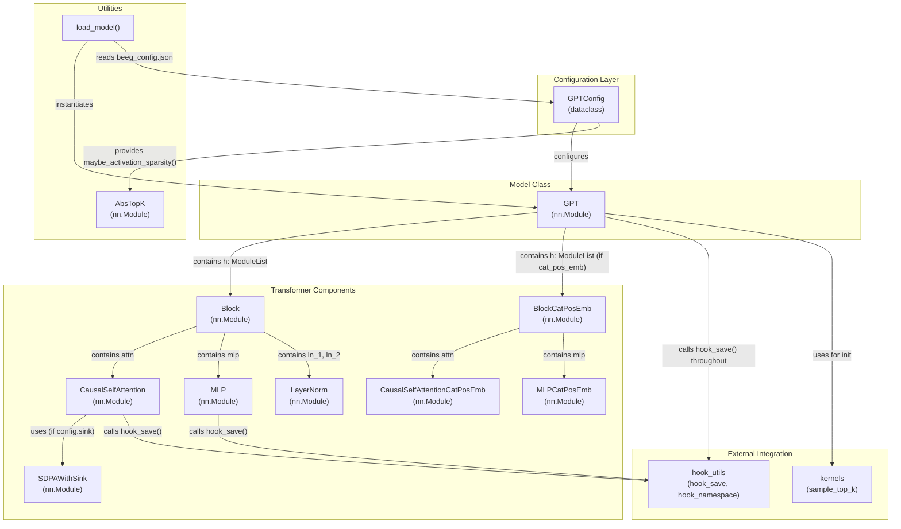

**Sources:** [circuit_sparsity/inference/gpt.py:32-940]()

## Model Forward Pass Data Flow

This diagram illustrates how data flows through the model during a forward pass, mapping conceptual operations to specific code entities:

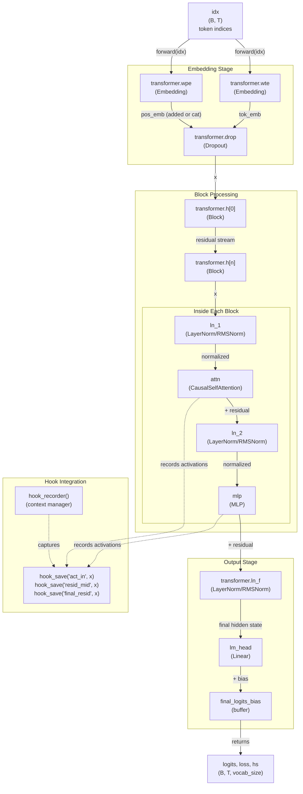

**Sources:** [circuit_sparsity/inference/gpt.py:683-778]()

## Configuration System

The model is configured via the `GPTConfig` dataclass, which provides a comprehensive set of parameters:

| Parameter Category | Key Fields | Purpose |
|-------------------|------------|---------|
| **Model Dimensions** | `d_model`, `d_mlp`, `d_head`, `n_layer`, `n_head` | Define model size and architecture |
| **Sequence Length** | `block_size`, `vocab_size` | Define input/output dimensions |
| **Sparsity** | `afrac`, `afrac_loctypes` | Control activation sparsity (see [Sparsity Features](#2.3)) |
| **Position Embeddings** | `d_pos_emb`, `cat_pos_emb`, `sinusoidal_cat_pos_emb` | Configure position encoding strategy |
| **Attention** | `flash`, `sink` | Enable Flash Attention and attention sinks |
| **Normalization** | `rms_norm`, `ln_bias` | Choose normalization type |
| **Activation Functions** | `activation_type`, `residual_activation_type` | Select non-linearities |
| **Training** | `dropout`, `grad_checkpointing` | Control training behavior |
| **Advanced** | `tied_unembed`, `enable_bigram_table` | Additional features |

The configuration system provides a `maybe_activation_sparsity()` method [circuit_sparsity/inference/gpt.py:544-557]() that applies top-k sparsity selectively based on `afrac` and `afrac_loctypes` settings.

**Sources:** [circuit_sparsity/inference/gpt.py:484-558]()

## Key Architectural Components

The following table maps conceptual components to their code implementations:

| Component | Class | Key Methods | Line Reference |
|-----------|-------|-------------|----------------|
| **Token Embedding** | `nn.Embedding` | Accessed as `transformer.wte` | [circuit_sparsity/inference/gpt.py:574]() |
| **Position Embedding** | `nn.Embedding` | Accessed as `transformer.wpe` | [circuit_sparsity/inference/gpt.py:575]() |
| **Transformer Block** | `Block` or `BlockCatPosEmb` | `forward()`, `forward_attn_block()`, `forward_mlp_block()` | [circuit_sparsity/inference/gpt.py:285-482]() |
| **Self-Attention** | `CausalSelfAttention` | `forward(x)` returns attention output | [circuit_sparsity/inference/gpt.py:61-168]() |
| **Feed-Forward** | `MLP` | `forward(x)` applies c_fc → act → c_proj | [circuit_sparsity/inference/gpt.py:170-209]() |
| **Output Head** | `nn.Linear` | Accessed as `lm_head` | [circuit_sparsity/inference/gpt.py:584]() |

### Block Structure

Each `Block` decomposes into two sub-operations:

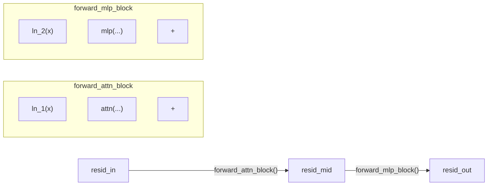

This decomposition allows selective computation when analyzing circuits (see `include_resid_mid` parameter in [circuit_sparsity/inference/gpt.py:683]()).

**Sources:** [circuit_sparsity/inference/gpt.py:285-349](), [circuit_sparsity/inference/gpt.py:413-482]()

## Model Loading and Instantiation

The repository provides a convenience function `load_model()` for loading pre-trained models:

```python
def load_model(model_path, flash=False, grad_checkpointing=False, cuda=True)
```

**Loading Process:**

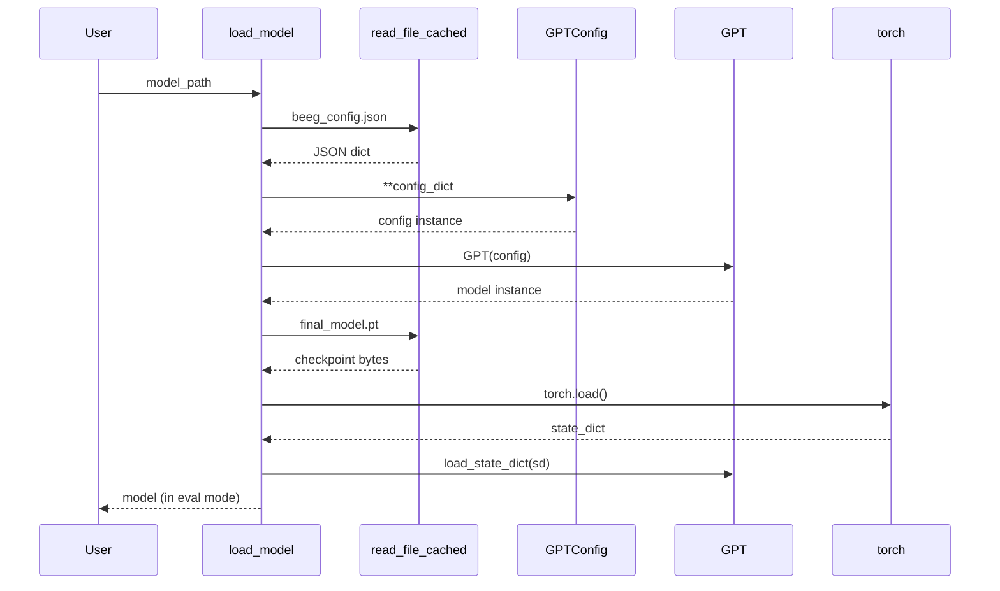

The function expects a directory containing:
- `beeg_config.json`: Serialized `GPTConfig` parameters
- `final_model.pt`: Model checkpoint with weights

**Sources:** [circuit_sparsity/inference/gpt.py:906-939](), [README.md:36-38]()

## Architecture Variants

The implementation includes several architectural variants for different use cases:

### Standard Architecture

The default configuration uses:
- Additive position embeddings (`pos_emb` added to `tok_emb`)
- Standard `Block`, `CausalSelfAttention`, and `MLP` classes
- Optional Flash Attention via `F.scaled_dot_product_attention`

**Sources:** [circuit_sparsity/inference/gpt.py:560-626]()

### Concatenated Position Embeddings

When `config.d_pos_emb` is set, the model uses concatenation instead of addition:

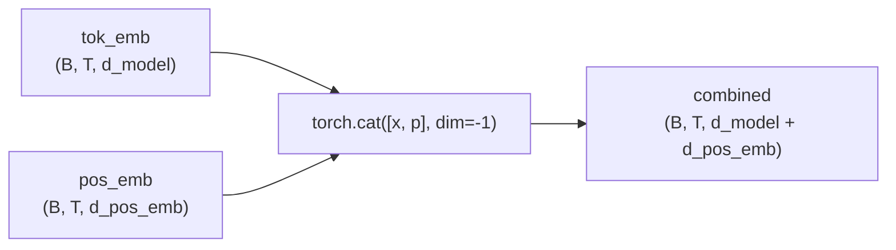

This variant uses:
- `BlockCatPosEmb` instead of `Block`
- `CausalSelfAttentionCatPosEmb` and `MLPCatPosEmb` with modified input dimensions
- Separate layer norms for position embeddings (`ln_p1`, `ln_p2`)

The `config.d_model_in` property [circuit_sparsity/inference/gpt.py:527-528]() returns `d_model + d_pos_emb` when concatenation is enabled.

**Sources:** [circuit_sparsity/inference/gpt.py:351-482](), [circuit_sparsity/inference/gpt.py:513-528]()

### Attention Sinks

When `config.sink=True`, the model uses `SDPAWithSink` [circuit_sparsity/inference/gpt.py:211-283]() which adds a learnable attention sink mechanism:

1. Prepends a dummy key-value slot with zero value
2. Adds a learnable per-head `sink_logit` parameter to the attention scores
3. Allows the model to "discard" information by attending to the sink

This is only compatible with `flash=True` (Flash Attention).

**Sources:** [circuit_sparsity/inference/gpt.py:84-86](), [circuit_sparsity/inference/gpt.py:211-283]()

## Integration Points

The GPT model integrates with other system components:

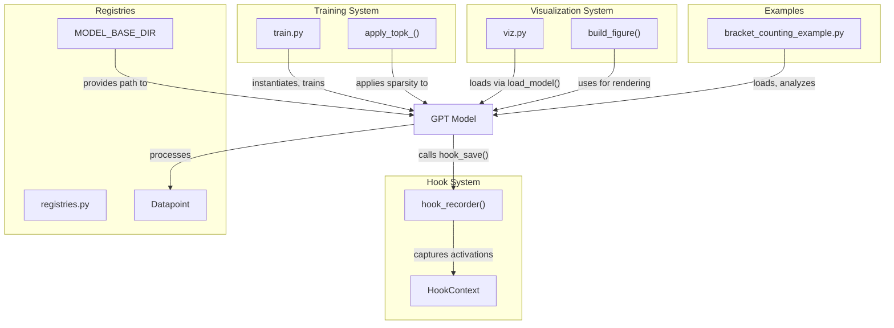

**Key Integration Methods:**

| Method | Purpose | Used By |
|--------|---------|---------|
| `forward(idx, targets)` | Standard forward pass with optional loss | Training, evaluation, examples |
| `forward_tail(x, n, ...)` | Forward from intermediate layer `n` | Circuit analysis, ablations |
| `generate(idx, max_new_tokens)` | Autoregressive generation | Interactive demos |
| `get_num_params()` | Count parameters | Model reporting |
| `is_mlp_param(p)`, `is_attn_param(p)` | Parameter classification | Sparse training, analysis |

**Sources:** [circuit_sparsity/inference/gpt.py:683-818](), [circuit_sparsity/inference/gpt.py:820-898]()

## Hook Integration for Activation Recording

The model extensively uses the hook system (detailed in [Hook System for Activation Recording](#2.4)) to save intermediate activations. Key hook points include:

| Hook Name | Location | Code Reference |
|-----------|----------|----------------|
| `"act_in"` | Input to attention/MLP | [circuit_sparsity/inference/gpt.py:101](), [circuit_sparsity/inference/gpt.py:184]() |
| `"k"`, `"q"`, `"v"` | Attention components | [circuit_sparsity/inference/gpt.py:113-115]() |
| `"y"` | Attention output before projection | [circuit_sparsity/inference/gpt.py:158]() |
| `"post_act"` | MLP after activation function | [circuit_sparsity/inference/gpt.py:196]() |
| `"resid_in"`, `"resid_mid"` | Residual stream states | [circuit_sparsity/inference/gpt.py:305](), [circuit_sparsity/inference/gpt.py:328]() |
| `"resid_delta"` | Residual additions | [circuit_sparsity/inference/gpt.py:313](), [circuit_sparsity/inference/gpt.py:331]() |
| `"final_resid"` | Final hidden state | [circuit_sparsity/inference/gpt.py:763]() |

Hooks are organized by layer using `hook_namespace(f"{layer_idx}")` [circuit_sparsity/inference/gpt.py:756]().

**Sources:** [circuit_sparsity/inference/gpt.py:97-209](), [circuit_sparsity/inference/gpt.py:305-343]()

## Usage Example

Basic usage pattern from tests:

```python
from circuit_sparsity.inference.gpt import GPT, GPTConfig, load_model
from circuit_sparsity.inference.hook_utils import hook_recorder
from circuit_sparsity.registries import MODEL_BASE_DIR

# Option 1: Create from config
config = GPTConfig(block_size=8, vocab_size=16, n_layer=1, n_head=1, d_model=8)
model = GPT(config)

# Option 2: Load pre-trained
model = load_model(f"{MODEL_BASE_DIR}/models/csp_yolo1", cuda=False)

# Forward pass
logits, loss, _ = model(idx, targets=targets)

# Capture activations
with hook_recorder() as rec:
    logits, _, _ = model(idx)
# rec now contains {"0.attn.act_in": tensor(...), "0.attn.k": tensor(...), ...}
```

**Sources:** [README.md:40-58](), [tests/test_gpt.py]()

## Model Parameter Classification

The `GPT` class provides utility methods for classifying parameters, useful for applying different training strategies:

```mermaid
graph TB
    param["Parameter p"]
    
    is_mlp_param{"is_mlp_param(p)"}
    is_attn_param{"is_attn_param(p)"}
    is_bias{"is_bias(p)"}
    is_ln_param{"is_ln_param(p)"}
    is_param_embed{"is_param_embed(p)"}
    is_sparse_param{"is_sparse_param(p)"}
    
    param --> is_mlp_param
    param --> is_attn_param
    param --> is_bias
    param --> is_ln_param
    param --> is_param_embed
    param --> is_sparse_param
    
    is_mlp_param -->|"True"| mlp_weights["c_fc.weight, c_proj.weight<br/>in all MLP layers"]
    is_attn_param -->|"True"| attn_weights["c_attn.weight, c_proj.weight<br/>in all attention layers"]
    is_bias -->|"True"| biases["All bias parameters"]
    is_ln_param -->|"True"| ln_weights["LayerNorm/RMSNorm weights"]
    is_param_embed -->|"True"| embeddings["wte.weight, wpe.weight"]
    is_sparse_param -->|"True"| sparse["Parameters eligible for sparsity"]
```

These methods enable selective parameter handling during training (e.g., applying sparsity only to certain parameter classes).

**Sources:** [circuit_sparsity/inference/gpt.py:820-898]()

---

# Page: GPT and GPTConfig

# GPT and GPTConfig

<details>
<summary>Relevant source files</summary>

The following files were used as context for generating this wiki page:

- [circuit_sparsity/inference/gpt.py](circuit_sparsity/inference/gpt.py)
- [tests/test_gpt.py](tests/test_gpt.py)

</details>


This page documents the `GPT` class and `GPTConfig` dataclass, which define the core transformer model architecture and its configuration interface. These components provide a flexible GPT-style language model with extensive configuration options for sparsity, architectural variants, and experimental features.

For details on the internal architecture components (attention, MLP, blocks), see [Model Architecture Components](#2.2). For sparsity-specific features and activation sparsity mechanisms, see [Sparsity Features](#2.3). For the hook system used to record intermediate activations, see [Hook System for Activation Recording](#2.4).

---

## GPTConfig Dataclass

The `GPTConfig` dataclass in [circuit_sparsity/inference/gpt.py:484-558]() defines all model hyperparameters and architectural choices. It uses Python's `@dataclass` decorator and includes a `__post_init__` method to validate and set derived parameters.

### Core Architecture Parameters

| Parameter | Type | Default | Description |
|-----------|------|---------|-------------|
| `block_size` | `int` | 1024 | Maximum sequence length (context window) |
| `vocab_size` | `int` | 50304 | Vocabulary size, padded to multiple of 64 |
| `n_layer` | `int` | 12 | Number of transformer blocks |
| `n_head` | `int` | 12 | Number of attention heads per layer |
| `d_head` | `int \| None` | None | Head dimension (defaults to `d_model // n_head`) |
| `d_model` | `int` | 768 | Model/embedding dimension |
| `d_mlp` | `int \| None` | None | MLP hidden dimension (defaults to `4 * d_model`) |

### Normalization and Activation

| Parameter | Type | Default | Description |
|-----------|------|---------|-------------|
| `rms_norm` | `bool` | False | Use RMSNorm instead of LayerNorm |
| `ln_bias` | `bool` | True | Include bias in LayerNorm layers |
| `bias` | `bool` | True | Include bias in linear layers |
| `activation_type` | `Literal["gelu", "relu"]` | "gelu" | Activation function for MLP |
| `residual_activation_type` | `Literal["identity", "relu"]` | "identity" | Optional activation on residual stream |

### Sparsity Configuration

| Parameter | Type | Default | Description |
|-----------|------|---------|-------------|
| `afrac` | `float \| None` | None | Fraction of activations to keep (top-k by magnitude) |
| `afrac_loctypes` | `str` | "attn_in,attn_out,mlp_in,mlp_out" | Comma-separated locations where `afrac` is applied |
| `enable_sparse_kernels` | `bool` | False | Use sparse kernel implementations |

### Positional Embeddings

| Parameter | Type | Default | Description |
|-----------|------|---------|-------------|
| `d_pos_emb` | `int \| None` | None | Dimension for concatenated positional embeddings |
| `sinusoidal_cat_pos_emb` | `bool` | False | Use fixed sinusoidal positional embeddings |
| `dropout_cat_pos_emb` | `bool` | False | Apply dropout to concatenated positional embeddings |

When `d_pos_emb` is set, the model uses concatenated positional embeddings instead of adding them to token embeddings. This changes the input dimension to MLP and attention layers via the derived property `d_model_in = d_model + d_pos_emb`.

### Attention Features

| Parameter | Type | Default | Description |
|-----------|------|---------|-------------|
| `flash` | `bool` | True | Use Flash Attention (scaled_dot_product_attention) |
| `sink` | `bool` | False | Use attention sink (learnable denominator term) |

The `sink` parameter enables `SDPAWithSink` [circuit_sparsity/inference/gpt.py:211-282](), which adds a learnable attention sink token. This requires `flash=True`.

### Training and Regularization

| Parameter | Type | Default | Description |
|-----------|------|---------|-------------|
| `dropout` | `float` | 0.0 | Dropout probability |
| `grad_checkpointing` | `bool` | True | Enable gradient checkpointing to save memory |

### Experimental Features

| Parameter | Type | Default | Description |
|-----------|------|---------|-------------|
| `enable_bigram_table` | `bool` | False | Enable bigram lookup table for logit adjustment |
| `learnable_bigram_table` | `bool` | False | Make bigram table a learnable parameter |
| `tied_unembed` | `bool` | True | Share weights between token embedding and unembedding |
| `tokenizer_name` | `str` | "tinypython_2k" | Name of tokenizer encoding |
| `debug_nans` | `bool` | False | Enable NaN checking assertions throughout forward pass |

### Derived Properties and Methods

```mermaid
graph TB
    subgraph "GPTConfig Derived Values"
        CONFIG["GPTConfig<br/>dataclass"]
        
        POST_INIT["__post_init__()<br/>Validation and defaults"]
        
        CAT_POS["cat_pos_emb<br/>@property<br/>Returns d_pos_emb is not None"]
        
        D_MODEL_IN["d_model_in<br/>@property<br/>Returns d_model + d_pos_emb<br/>if cat_pos_emb"]
        
        LINEAR["Linear<br/>@property<br/>Returns nn.Linear"]
        
        MAYBE_SPARSE["maybe_activation_sparsity()<br/>Applies top-k if afrac is set"]
    end
    
    CONFIG --> POST_INIT
    POST_INIT --> |"Sets d_mlp = 4*d_model<br/>if None"| CONFIG
    POST_INIT --> |"Sets d_head = d_model//n_head<br/>if None"| CONFIG
    POST_INIT --> |"Validates constraints"| CONFIG
    
    CONFIG --> CAT_POS
    CONFIG --> D_MODEL_IN
    CONFIG --> LINEAR
    CONFIG --> MAYBE_SPARSE
    
    CAT_POS -.used by.-> D_MODEL_IN
```

**Sources:** [circuit_sparsity/inference/gpt.py:484-558]()

The `maybe_activation_sparsity(x, loctype)` method [circuit_sparsity/inference/gpt.py:544-557]() applies top-k sparsification when `afrac` is set and the location type matches `afrac_loctypes`. This is called throughout the forward pass at specific points like `"attn_in"`, `"mlp_neuron"`, etc.

---

## GPT Class

The `GPT` class [circuit_sparsity/inference/gpt.py:560-899]() implements the full transformer model. It inherits from `nn.Module` and constructs the architecture based on a `GPTConfig` instance.

### Model Structure

```mermaid
graph TB
    GPT["GPT<br/>nn.Module"]
    
    subgraph "self.transformer (ModuleDict)"
        WTE["wte<br/>nn.Embedding<br/>(vocab_size, d_model)"]
        WPE["wpe<br/>nn.Embedding<br/>(block_size, d_pos_emb or d_model)"]
        DROP["drop<br/>nn.Dropout"]
        H["h<br/>nn.ModuleList<br/>List of Block/BlockCatPosEmb"]
        LN_F["ln_f<br/>LayerNorm or RMSNorm<br/>(d_model)"]
    end
    
    LM_HEAD["lm_head<br/>nn.Linear<br/>(d_model, vocab_size)<br/>bias=False"]
    
    LOGITS_BIAS["final_logits_bias<br/>buffer<br/>(vocab_size,)"]
    
    BIGRAM["bigram_table<br/>Optional parameter or buffer<br/>(vocab_size, vocab_size)"]
    
    GPT --> WTE
    GPT --> WPE
    GPT --> DROP
    GPT --> H
    GPT --> LN_F
    GPT --> LM_HEAD
    GPT --> LOGITS_BIAS
    GPT --> BIGRAM
    
    WTE -.tied weights.-> LM_HEAD
```

**Sources:** [circuit_sparsity/inference/gpt.py:560-662]()

### Initialization

The `__init__` method performs several initialization steps:

1. **Module Construction** [circuit_sparsity/inference/gpt.py:572-602]():
   - Creates token embeddings (`wte`), positional embeddings (`wpe`)
   - Instantiates `n_layer` transformer blocks (either `Block` or `BlockCatPosEmb` depending on `config.cat_pos_emb`)
   - Creates final layer norm and language modeling head
   - Optionally creates bigram table

2. **Weight Tying** [circuit_sparsity/inference/gpt.py:608-611]():
   - If `config.tied_unembed=True`, sets `transformer.wte.weight = lm_head.weight`
   - Implements parameter sharing between embedding and unembedding matrices

3. **Weight Initialization** [circuit_sparsity/inference/gpt.py:613-626]():
   - Applies `_init_weights` to all modules (normal distribution with std=0.02)
   - Special scaled initialization for residual projection weights (`c_proj.weight`)
   - Scaling factor: `0.02 / sqrt(2 * n_layer)`

4. **Sinusoidal Positional Embeddings** [circuit_sparsity/inference/gpt.py:628-658]():
   - If `config.sinusoidal_cat_pos_emb=True`, initializes `wpe` with fixed sinusoidal encodings
   - Uses log-spaced frequencies from period 4 to `block_size`
   - Freezes `wpe.weight` by setting `requires_grad=False`

### Forward Pass

```mermaid
graph TD
    INPUT["idx<br/>(batch, seq_len)<br/>Token IDs"]
    
    TOK_EMB["Token Embedding<br/>transformer.wte(idx)"]
    POS_EMB["Position Embedding<br/>wpe.weight[:seq_len]"]
    
    CAT_DECISION{"config.cat_pos_emb?"}
    
    ADD["x = drop(tok_emb + pos_emb)"]
    JUST_TOK["x = drop(tok_emb)<br/>pos_emb_to_cat = pos_emb"]
    
    BIGRAM_CHECK{"enable_bigram_table?"}
    BIGRAM_BIAS["additional_logits_bias =<br/>F.embedding(idx, bigram_table)"]
    NO_BIGRAM["additional_logits_bias = None"]
    
    FORWARD_TAIL["forward_tail(x, n=0, ...)"]
    
    BLOCKS["For each Block in h[n:]:<br/>x = block(x, pos_emb_to_cat)"]
    
    FINAL_LN["x = ln_f(x)"]
    
    LOGITS["logits = lm_head(x) +<br/>final_logits_bias +<br/>additional_logits_bias"]
    
    LOSS_CHECK{"targets provided?"}
    COMPUTE_LOSS["loss = F.cross_entropy(...)"]
    ZERO_LOSS["loss = zeros(1)"]
    
    OUTPUT["Return (logits, loss, hs)"]
    
    INPUT --> TOK_EMB
    INPUT --> POS_EMB
    TOK_EMB --> CAT_DECISION
    POS_EMB --> CAT_DECISION
    
    CAT_DECISION -->|"False"| ADD
    CAT_DECISION -->|"True"| JUST_TOK
    
    ADD --> BIGRAM_CHECK
    JUST_TOK --> BIGRAM_CHECK
    
    BIGRAM_CHECK -->|"True"| BIGRAM_BIAS
    BIGRAM_CHECK -->|"False"| NO_BIGRAM
    
    BIGRAM_BIAS --> FORWARD_TAIL
    NO_BIGRAM --> FORWARD_TAIL
    
    FORWARD_TAIL --> BLOCKS
    BLOCKS --> FINAL_LN
    FINAL_LN --> LOGITS
    
    LOGITS --> LOSS_CHECK
    LOSS_CHECK -->|"Yes"| COMPUTE_LOSS
    LOSS_CHECK -->|"No"| ZERO_LOSS
    
    COMPUTE_LOSS --> OUTPUT
    ZERO_LOSS --> OUTPUT
```

**Sources:** [circuit_sparsity/inference/gpt.py:683-778]()

The forward pass has two entry points:
- `forward(idx, targets=None, include_resid_mid=False)` [circuit_sparsity/inference/gpt.py:683-725]() - Main entry point that handles embeddings
- `forward_tail(x, n, ...)` [circuit_sparsity/inference/gpt.py:727-778]() - Continues from layer `n` with pre-embedded activations

The `forward_tail` method is useful for:
- Running partial forward passes starting from intermediate layers
- Analysis workflows that need to inject activations mid-network
- Supporting the `include_resid_mid` flag which splits blocks into attention and MLP sub-blocks

### Key Methods

| Method | Signature | Description |
|--------|-----------|-------------|
| `forward` | `(idx, targets=None, include_resid_mid=False)` | Full forward pass returning (logits, loss, hidden_states) |
| `forward_tail` | `(x, n, targets=None, ...)` | Forward from layer `n` onward |
| `generate` | `(idx, max_new_tokens, temperature=1.0, top_k=None)` | Autoregressive text generation |
| `crop_block_size` | `(block_size)` | Reduce model's context window |
| `get_num_params` | `(non_embedding=True)` | Count model parameters |

### Parameter Classification Methods

The `GPT` class provides several helper methods to identify parameter types [circuit_sparsity/inference/gpt.py:820-898]():

```mermaid
graph LR
    PARAM["Parameter p"]
    
    IS_MLP["is_mlp_param(p)<br/>c_fc.weight, c_proj.weight"]
    IS_ATTN["is_attn_param(p)<br/>attn c_attn.weight, c_proj.weight"]
    IS_EMBED["is_param_embed(p)<br/>wte.weight, wpe.weight"]
    IS_BIAS["is_bias(p)<br/>All bias terms"]
    IS_LN["is_ln_param(p)<br/>ln_1, ln_2, ln_f weights"]
    IS_SPARSE["is_sparse_param(p, ...)<br/>Main weight matrices"]
    
    PARAM --> IS_MLP
    PARAM --> IS_ATTN
    PARAM --> IS_EMBED
    PARAM --> IS_BIAS
    PARAM --> IS_LN
    PARAM --> IS_SPARSE
```

**Sources:** [circuit_sparsity/inference/gpt.py:820-898]()

These methods are used during training to:
- Apply different optimization schedules to different parameter types
- Determine which parameters should be sparse vs dense
- Implement weight decay policies

The `is_sparse_param` method [circuit_sparsity/inference/gpt.py:871-898]() takes optional boolean flags (`dense_embeddings`, `dense_unembed`, `dense_biases`) to control which parameter types are considered sparse.

---

## Model Loading Interface

The `load_model` function [circuit_sparsity/inference/gpt.py:906-939]() provides the standard interface for loading trained models from disk or blob storage.

### Function Signature

```python
def load_model(model_path, flash=False, grad_checkpointing=False, cuda=True)
```

### Loading Process

```mermaid
graph TD
    START["load_model(model_path, ...)"]
    
    READ_CONFIG["Read beeg_config.json<br/>from model_path"]
    
    MIGRATE["Migrate old config keys:<br/>n_mlp → d_mlp<br/>Add sink=False if missing<br/>Remove use_tied_aux_matrix"]
    
    OVERRIDE["Override config:<br/>flash = flash<br/>grad_checkpointing = grad_checkpointing"]
    
    CREATE_CONFIG["config = GPTConfig(**beeg_config_json)"]
    
    CREATE_MODEL["model = GPT(config)"]
    
    LOAD_WEIGHTS["Load final_model.pt<br/>torch.load with map_location"]
    
    ADD_BIAS{"final_logits_bias<br/>in state_dict?"}
    
    CREATE_BIAS["Add zero final_logits_bias"]
    
    LOAD_STATE["model.load_state_dict(sd, strict=False)"]
    
    CUDA_CHECK{"cuda?"}
    
    TO_CUDA["model.cuda()"]
    
    EVAL["model.eval()"]
    
    RETURN["return model"]
    
    START --> READ_CONFIG
    READ_CONFIG --> MIGRATE
    MIGRATE --> OVERRIDE
    OVERRIDE --> CREATE_CONFIG
    CREATE_CONFIG --> CREATE_MODEL
    CREATE_MODEL --> LOAD_WEIGHTS
    LOAD_WEIGHTS --> ADD_BIAS
    
    ADD_BIAS -->|"No"| CREATE_BIAS
    ADD_BIAS -->|"Yes"| LOAD_STATE
    CREATE_BIAS --> LOAD_STATE
    
    LOAD_STATE --> CUDA_CHECK
    CUDA_CHECK -->|"True"| TO_CUDA
    CUDA_CHECK -->|"False"| EVAL
    TO_CUDA --> EVAL
    EVAL --> RETURN
```

**Sources:** [circuit_sparsity/inference/gpt.py:906-939]()

### Usage Examples

```python
# Load model for inference on GPU with Flash Attention
model = load_model("path/to/model", flash=True, cuda=True)

# Load model for CPU inference without Flash Attention
model = load_model("path/to/model", flash=False, cuda=False)

# Load with gradient checkpointing for memory-efficient training
model = load_model("path/to/model", grad_checkpointing=True)
```

### Configuration Migration

The function handles backward compatibility by migrating deprecated configuration keys:
- `n_mlp` is renamed to `d_mlp` [circuit_sparsity/inference/gpt.py:910-911]()
- `use_tied_aux_matrix` is removed if present [circuit_sparsity/inference/gpt.py:918-919]()
- `sink` is set to False if missing [circuit_sparsity/inference/gpt.py:913-914]()

The `load_state_dict` call uses `strict=False` to allow loading models even when some parameters are missing or extra parameters are present in the checkpoint.

---

## Integration with Other Systems

### Hook System Integration

The model is instrumented with `hook_save` and `hook_namespace` calls throughout the forward pass [circuit_sparsity/inference/gpt.py:24-28](). These enable activation recording without modifying the model code. See [Hook System for Activation Recording](#2.4) for details.

Key hook locations:
- `"act_in"` - Input to attention/MLP blocks
- `"k"`, `"q"`, `"v"` - Attention key, query, value projections
- `"post_act"` - MLP activations after nonlinearity
- `"resid_delta"` - Residual stream contributions
- `"final_resid"` - Final residual stream before unembedding

### Sparsity System Integration

The `config.maybe_activation_sparsity()` method is called at specific points during forward pass when `afrac` is configured. The `enable_sparse_kernels` flag enables alternative implementations using sparse tensor operations. See [Sparsity Features](#2.3) for details.

### Tokenization Integration

The `config.tokenizer_name` field specifies which tokenizer to use. The model itself doesn't perform tokenization - that's handled by the tiktoken extension system. See [Tokenization](#5.3) for details.

### Training Integration

During training, the model is used via the `train.py` script which:
- Creates models from `GPTConfig` specifications
- Applies sparsity during training via `apply_topk_` calls (not part of the model itself)
- Uses parameter classification methods to configure optimizers
- See [Training Sparse Models](#4) for details.

**Sources:** [circuit_sparsity/inference/gpt.py:1-939](), [tests/test_gpt.py:1-64]()

---

# Page: Model Architecture Components

# Model Architecture Components

<details>
<summary>Relevant source files</summary>

The following files were used as context for generating this wiki page:

- [circuit_sparsity/inference/gpt.py](circuit_sparsity/inference/gpt.py)

</details>


This page documents the internal building blocks of the GPT model implementation: the attention mechanism, MLP layers, transformer blocks, and their architectural variants. These components form the core computational units that process tokens through the network.

For information about the top-level GPT class and configuration parameters, see [GPT and GPTConfig](#2.1). For details on sparsity mechanisms applied to these components, see [Sparsity Features](#2.3). For activation recording during forward passes, see [Hook System for Activation Recording](#2.4).

## Component Hierarchy

The model is composed of hierarchical components that build up from primitive operations to complete transformer blocks:

```mermaid
graph TB
    GPT["GPT<br/>(lines 560-939)"]
    
    subgraph "Standard Architecture"
        Block["Block<br/>(lines 285-348)"]
        Attn["CausalSelfAttention<br/>(lines 61-167)"]
        MLP["MLP<br/>(lines 170-208)"]
        LN["LayerNorm<br/>(lines 49-58)"]
    end
    
    subgraph "CatPosEmb Variants"
        BlockCat["BlockCatPosEmb<br/>(lines 413-481)"]
        AttnCat["CausalSelfAttentionCatPosEmb<br/>(lines 351-388)"]
        MLPCat["MLPCatPosEmb<br/>(lines 391-410)"]
    end
    
    subgraph "Attention Mechanisms"
        SDPA["F.scaled_dot_product_attention"]
        SDPASink["SDPAWithSink<br/>(lines 211-282)"]
    end
    
    GPT -->|"contains n_layer"| Block
    GPT -->|"or if config.cat_pos_emb"| BlockCat
    
    Block -->|"forward_attn_block"| Attn
    Block -->|"forward_mlp_block"| MLP
    Block -->|"ln_1, ln_2"| LN
    
    BlockCat -->|"uses"| AttnCat
    BlockCat -->|"uses"| MLPCat
    BlockCat -->|"ln_1, ln_2, ln_p1, ln_p2"| LN
    
    Attn -->|"if flash and not sink"| SDPA
    Attn -->|"if flash and sink"| SDPASink
    AttnCat -->|"delegates to"| Attn
    MLPCat -->|"delegates to"| MLP
```

**Sources:** [circuit_sparsity/inference/gpt.py:1-940]()

## LayerNorm

The `LayerNorm` class implements layer normalization with optional bias terms. This deviates from PyTorch's default by allowing `bias=False` for more efficient architectures.

| Component | Type | Purpose |
|-----------|------|---------|
| `weight` | `nn.Parameter` | Scaling parameter (shape: `ndim`) |
| `bias` | `nn.Parameter` or `None` | Optional bias term |
| `forward()` | Method | Applies normalization with epsilon=1e-5 |

The implementation uses `F.layer_norm` with a fixed epsilon of `1e-5`. Models may also use `nn.RMSNorm` instead when `config.rms_norm=True`, which is selected in `Block.__init__` and `GPT.__init__`.

**Sources:** [circuit_sparsity/inference/gpt.py:49-58]()

## CausalSelfAttention

The `CausalSelfAttention` class implements multi-head causal self-attention with support for both Flash Attention and manual attention computation.

### Architecture

```mermaid
graph LR
    Input["x<br/>(B, T, d_model)"]
    
    subgraph "Projections"
        CAttn["c_attn<br/>Linear(d_model, 3*d_head*n_head)"]
        Split["split into q, k, v"]
    end
    
    subgraph "Attention Computation"
        Reshape["reshape to<br/>(B, n_head, T, d_head)"]
        SDPA["scaled_dot_product_attention<br/>or SDPAWithSink"]
    end
    
    subgraph "Output"
        Merge["merge heads<br/>(B, T, n_head*d_head)"]
        CProj["c_proj<br/>Linear(n_head*d_head, d_model)"]
        Dropout["resid_dropout"]
    end
    
    Input --> CAttn
    CAttn --> Split
    Split --> Reshape
    Reshape --> SDPA
    SDPA --> Merge
    Merge --> CProj
    CProj --> Dropout
    Dropout --> Output["output"]
```

**Sources:** [circuit_sparsity/inference/gpt.py:61-167]()

### Key Fields

| Field | Type | Description |
|-------|------|-------------|
| `c_attn` | `nn.Linear` | Combined QKV projection (3 × d_head × n_head output dims) |
| `c_proj` | `nn.Linear` | Output projection back to d_model |
| `n_head` | `int` | Number of attention heads |
| `d_head` | `int` | Dimension per head |
| `flash` | `bool` | Whether to use Flash Attention (PyTorch >= 2.0) |
| `attn_imp` | Callable | Either `F.scaled_dot_product_attention` or `SDPAWithSink` |

### Forward Pass Details

The forward method [circuit_sparsity/inference/gpt.py:97-167]() performs:

1. **Input processing**: Applies optional activation sparsity via `config.maybe_activation_sparsity(x, "attn_in")` and saves activation with `hook_save("act_in", x)`
2. **QKV computation**: Projects input through `c_attn` and splits into q, k, v tensors
3. **Per-component sparsity**: Each of q, k, v may have activation sparsity applied
4. **Attention**: Uses Flash Attention if available, otherwise manual computation with causal masking
5. **Output projection**: Merges heads, applies `c_proj`, dropout, and final activation sparsity

The attention scale is computed as `1.0 / math.sqrt(k.size(-1))` [circuit_sparsity/inference/gpt.py:126]().

**Sources:** [circuit_sparsity/inference/gpt.py:97-167]()

## MLP

The `MLP` class implements a two-layer feedforward network with configurable activation functions.

### Structure

```mermaid
graph LR
    Input["x<br/>(B, T, d_model)"]
    
    CFC["c_fc<br/>Linear(d_model, d_mlp)"]
    Act["act_fn<br/>(GELU or ReLU)"]
    CProj["c_proj<br/>Linear(d_mlp, d_model)"]
    Drop["dropout"]
    
    Input --> CFC
    CFC --> Act
    Act --> CProj
    CProj --> Drop
    Drop --> Output["output"]
```

**Sources:** [circuit_sparsity/inference/gpt.py:170-208]()

### Configuration

| Field | Type | Description |
|-------|------|-------------|
| `c_fc` | `nn.Linear` | Expansion projection (d_model → d_mlp) |
| `c_proj` | `nn.Linear` | Contraction projection (d_mlp → d_model) |
| `act_fn` | `nn.Module` | GELU (default) or ReLU activation |
| `dropout` | `nn.Dropout` | Residual dropout |

The activation function is selected based on `config.activation_type` [circuit_sparsity/inference/gpt.py:175-178](). The default MLP dimension is `d_mlp = 4 * d_model` [circuit_sparsity/inference/gpt.py:536]().

Hook points include `act_in` (line 184) and `post_act` (line 196) for recording activations before and after the nonlinearity.

**Sources:** [circuit_sparsity/inference/gpt.py:170-208]()

## Block Structure

The `Block` class combines attention and MLP sublayers with residual connections. It is designed with the invariant that `forward = forward_mlp_block ∘ forward_attn_block`.

### Data Flow Through Block

```mermaid
graph TB
    Input["resid_in<br/>(B, T, d_model)"]
    
    subgraph "Attention Sublayer"
        LN1["ln_1<br/>(LayerNorm or RMSNorm)"]
        Attn["CausalSelfAttention"]
        Add1["+<br/>(residual)"]
        OptReLU1["optional ReLU<br/>if residual_activation_type='relu'"]
        Sparse1["optional activation sparsity<br/>resid_post_attn"]
    end
    
    subgraph "MLP Sublayer"
        Mid["resid_mid"]
        LN2["ln_2<br/>(LayerNorm or RMSNorm)"]
        MLP["MLP"]
        Add2["+<br/>(residual)"]
        OptReLU2["optional ReLU<br/>if residual_activation_type='relu'"]
        Sparse2["optional activation sparsity<br/>resid_post_mlp"]
    end
    
    Input --> LN1
    Input --> Add1
    LN1 --> Attn
    Attn --> Add1
    Add1 --> OptReLU1
    OptReLU1 --> Sparse1
    Sparse1 --> Mid
    
    Mid --> LN2
    Mid --> Add2
    LN2 --> MLP
    MLP --> Add2
    Add2 --> OptReLU2
    OptReLU2 --> Sparse2
    Sparse2 --> Output["output"]
```

**Sources:** [circuit_sparsity/inference/gpt.py:285-348]()

### Methods

| Method | Lines | Description |
|--------|-------|-------------|
| `forward_attn_block()` | 304-325 | Processes attention sublayer with pre-norm, residual connection, optional ReLU |
| `forward_mlp_block()` | 327-343 | Processes MLP sublayer with pre-norm, residual connection, optional ReLU |
| `forward()` | 345-348 | Sequentially applies both sublayers |

Both sublayers support gradient checkpointing via `torch_recompute_preserving_hook_context` when `config.grad_checkpointing=True` [circuit_sparsity/inference/gpt.py:311-316, 330-335]().

Hook namespaces are created for each sublayer (`"attn"` and `"mlp"`) to organize activation recordings [circuit_sparsity/inference/gpt.py:310, 329]().

**Sources:** [circuit_sparsity/inference/gpt.py:285-348]()

## CatPosEmb Variants

When `config.cat_pos_emb=True`, the model uses specialized component variants that concatenate positional embeddings to the token embeddings instead of adding them.

### Architecture Changes

| Standard Component | CatPosEmb Variant | Key Difference |
|-------------------|-------------------|----------------|
| `CausalSelfAttention` | `CausalSelfAttentionCatPosEmb` | Accepts `pos_emb_to_cat` parameter, concatenates before projection |
| `MLP` | `MLPCatPosEmb` | Accepts `pos_emb_to_cat` parameter, concatenates before c_fc |
| `Block` | `BlockCatPosEmb` | Adds `ln_p1`, `ln_p2` for normalizing positional embeddings |

### CatPosEmb Data Flow

```mermaid
graph LR
    subgraph "Input"
        X["x<br/>(B, T, d_model)"]
        P["pos_emb_to_cat<br/>(B, T, d_pos_emb)"]
    end
    
    subgraph "Normalization"
        LN_X["ln_1(x)"]
        LN_P["ln_p1(pos_emb)"]
    end
    
    subgraph "Concatenation"
        Cat["concat along dim=-1<br/>(B, T, d_model + d_pos_emb)"]
    end
    
    X --> LN_X
    P --> LN_P
    LN_X --> Cat
    LN_P --> Cat
    Cat --> Attn["CausalSelfAttention.forward<br/>(operates on concatenated input)"]
```

**Sources:** [circuit_sparsity/inference/gpt.py:351-481]()

### Key Implementation Details

**CausalSelfAttentionCatPosEmb** [circuit_sparsity/inference/gpt.py:351-388]():
- Overrides `c_attn` projection to accept `d_model_in = d_model + d_pos_emb` inputs
- Concatenates normalized positional embeddings before calling base forward method
- Broadcasts positional embeddings if batch size is 1

**MLPCatPosEmb** [circuit_sparsity/inference/gpt.py:391-410]():
- Overrides `c_fc` projection to accept concatenated inputs
- Delegates to parent MLP forward after concatenation

**BlockCatPosEmb** [circuit_sparsity/inference/gpt.py:413-481]():
- Adds `ln_p1` and `ln_p2` layer norms for positional embeddings
- Modified `forward_attn_block()` and `forward_mlp_block()` signatures accept `pos_emb_to_cat` parameter
- Maintains the same residual connection structure as standard Block

**Sources:** [circuit_sparsity/inference/gpt.py:351-481]()

## SDPAWithSink

The `SDPAWithSink` class implements attention sinks—a learnable denominator-only attention term that helps stabilize attention distributions.

### Mechanism

```mermaid
graph TB
    subgraph "Input Tensors"
        Q["q: (B, H, Lq, D)"]
        K["k: (B, H, Lk, D)"]
        V["v: (B, H, Lk, Dv)"]
    end
    
    subgraph "Sink Augmentation"
        K0["k_sink = zeros(B, H, 1, D)"]
        V0["v_sink = zeros(B, H, 1, Dv)"]
        KAug["k_aug = cat([k_sink, k], dim=2)<br/>(B, H, Lk+1, D)"]
        VAug["v_aug = cat([v_sink, v], dim=2)<br/>(B, H, Lk+1, Dv)"]
    end
    
    subgraph "Attention Mask"
        Allow["allow mask<br/>col 0: always True<br/>cols 1+: causal"]
        Bias["sink_logit bias<br/>added to col 0"]
        Mask["attn_mask<br/>with sink bias"]
    end
    
    Q --> SDPA
    KAug --> SDPA
    VAug --> SDPA
    K --> KAug
    V --> VAug
    K0 --> KAug
    V0 --> VAug
    
    Allow --> Mask
    Bias --> Mask
    Mask --> SDPA["F.scaled_dot_product_attention<br/>(is_causal=False)"]
    
    SDPA --> Out["output: (B, H, Lq, Dv)"]
```

**Sources:** [circuit_sparsity/inference/gpt.py:211-282]()

### Implementation Details

The attention sink is implemented by:

1. **Prepending dummy KV slot** [circuit_sparsity/inference/gpt.py:237-240](): A zero-valued key and value are concatenated to position 0
2. **Custom attention mask** [circuit_sparsity/inference/gpt.py:243-270](): 
   - Column 0 (sink) is always visible
   - Remaining columns follow causal lower-triangular pattern
   - Learnable bias `sink_logit` is added to column 0's logits
3. **Standard SDPA** [circuit_sparsity/inference/gpt.py:273-281](): Uses `is_causal=False` to avoid double-masking

The `sink_logit` parameter has shape `(num_heads,)` and is initialized to 0.0 by default [circuit_sparsity/inference/gpt.py:217-220]().

**Sources:** [circuit_sparsity/inference/gpt.py:211-282]()

## Component Selection Logic

The GPT model selects component implementations based on configuration:

| Configuration | Component Used | Location |
|--------------|----------------|----------|
| `config.cat_pos_emb=True` | `BlockCatPosEmb` | [gpt.py:568]() |
| `config.cat_pos_emb=False` | `Block` | [gpt.py:570]() |
| `config.flash=True, config.sink=False` | `F.scaled_dot_product_attention` | [gpt.py:85-86]() |
| `config.flash=True, config.sink=True` | `SDPAWithSink` | [gpt.py:84-86]() |
| `config.flash=False` | Manual attention with causal bias buffer | [gpt.py:88-96]() |
| `config.rms_norm=True` | `nn.RMSNorm` | [gpt.py:292-293, 297-298]() |
| `config.rms_norm=False` | `LayerNorm` | [gpt.py:294, 300]() |

The instantiation happens in `GPT.__init__` [circuit_sparsity/inference/gpt.py:561-582](), where a list of blocks is created: `nn.ModuleList([(block_cls(config)) for _ in range(config.n_layer)])`.

**Sources:** [circuit_sparsity/inference/gpt.py:561-582]()

## Utility Components

### AbsTopK

The `AbsTopK` class implements top-k sparsification by absolute value:

```python
# Keeps only the k largest elements by magnitude, zeros others
x = AbsTopK(k=512)(x)  # shape preserved
```

This is used internally for activation sparsity mechanisms but can also be applied manually.

**Sources:** [circuit_sparsity/inference/gpt.py:32-41]()

### Parameter Classification

The `GPT` class provides methods to identify parameter types [circuit_sparsity/inference/gpt.py:820-898]():

| Method | Purpose | Returns |
|--------|---------|---------|
| `is_mlp_param(p)` | Check if parameter belongs to MLP layers | bool |
| `is_attn_param(p)` | Check if parameter belongs to attention layers | bool |
| `is_param_embed(p)` | Check if parameter is an embedding (wte/wpe) | bool |
| `is_bias(p)` | Check if parameter is a bias term | bool |
| `is_ln_param(p)` | Check if parameter is a layer norm weight | bool |
| `is_sparse_param(p, ...)` | Check if parameter should be sparse during training | bool |

These methods use Python's `id()` function to match parameter identity, enabling precise parameter group creation for optimizers.

**Sources:** [circuit_sparsity/inference/gpt.py:820-898]()

---

# Page: Sparsity Features

# Sparsity Features

<details>
<summary>Relevant source files</summary>

The following files were used as context for generating this wiki page:

- [circuit_sparsity/inference/gpt.py](circuit_sparsity/inference/gpt.py)
- [circuit_sparsity/train.py](circuit_sparsity/train.py)

</details>


This document describes the sparsity mechanisms implemented in the GPT model, including activation sparsity (`afrac`), weight sparsity (`pfrac`), Flash Attention, and attention sinks. These features enable training and inference with sparse circuits while maintaining performance.

For information about the overall model architecture and configuration, see [GPT and GPTConfig](#2.1). For details on training sparse models, see [Training Sparse Models](#4). For specific pruning algorithms, see [Model Variants and Pruning Methods](#4.3).

---

## Activation Sparsity (afrac)

Activation sparsity enforces sparsity on intermediate activations during the forward pass by retaining only the top-k elements by absolute value and zeroing out the rest. This mechanism is controlled by the `afrac` configuration parameter.

### Configuration Parameters

The `GPTConfig` dataclass defines activation sparsity through two parameters:

| Parameter | Type | Description |
|-----------|------|-------------|
| `afrac` | `float \| None` | Fraction of activations to keep (e.g., 0.25 keeps 25% of activations) |
| `afrac_loctypes` | `str` | Comma-separated list of locations where sparsity is applied |

Default `afrac_loctypes` value: `"attn_in,attn_out,mlp_in,mlp_out"`

**Sources:** [circuit_sparsity/inference/gpt.py:502-503]()

### Application Mechanism

Activation sparsity is applied through the `maybe_activation_sparsity` method, which is called at strategic points throughout the forward pass:

```mermaid
graph TB
    subgraph "Activation Sparsity Flow"
        INPUT["Input Tensor x<br/>(B, T, C)"]
        CHECK{"afrac is not None<br/>AND loctype in<br/>afrac_loctypes?"}
        TOPK["keep_abstopk:<br/>k = int(afrac * x.shape[-1])"]
        SCATTER["Zero all elements<br/>except top-k by abs value"]
        OUTPUT["Output Tensor<br/>(B, T, C) with sparsity"]
    end
    
    INPUT --> CHECK
    CHECK -->|Yes| TOPK
    CHECK -->|No| OUTPUT
    TOPK --> SCATTER
    SCATTER --> OUTPUT
```

**Title:** Activation Sparsity Application Flow

**Sources:** [circuit_sparsity/inference/gpt.py:544-557]()

### Sparsity Application Locations

The model applies activation sparsity at specific locations identified by `loctype` strings:

```mermaid
graph LR
    subgraph "CausalSelfAttention"
        ATTN_IN["attn_in<br/>Input to attention"]
        ATTN_K["attn_k<br/>Key vectors"]
        ATTN_Q["attn_q<br/>Query vectors"]
        ATTN_V["attn_v<br/>Value vectors"]
        ATTN_OUT["attn_out<br/>Attention output"]
    end
    
    subgraph "MLP"
        MLP_IN["mlp_in<br/>Input to MLP"]
        MLP_NEURON["mlp_neuron<br/>Post-activation"]
        MLP_OUT["mlp_out<br/>MLP output"]
    end
    
    subgraph "Block"
        RESID_POST_ATTN["resid_post_attn<br/>After attention residual"]
        RESID_POST_MLP["resid_post_mlp<br/>After MLP residual"]
    end
```

**Title:** Activation Sparsity Location Types

| Location Type | Module | Line Reference |
|---------------|--------|----------------|
| `attn_in` | CausalSelfAttention | [circuit_sparsity/inference/gpt.py:100]() |
| `attn_k` | CausalSelfAttention | [circuit_sparsity/inference/gpt.py:109]() |
| `attn_q` | CausalSelfAttention | [circuit_sparsity/inference/gpt.py:110]() |
| `attn_v` | CausalSelfAttention | [circuit_sparsity/inference/gpt.py:111]() |
| `attn_out` | CausalSelfAttention | [circuit_sparsity/inference/gpt.py:166]() |
| `mlp_in` | MLP | [circuit_sparsity/inference/gpt.py:183]() |
| `mlp_neuron` | MLP | [circuit_sparsity/inference/gpt.py:195]() |
| `mlp_out` | MLP | [circuit_sparsity/inference/gpt.py:207]() |
| `resid_post_attn` | Block | [circuit_sparsity/inference/gpt.py:323]() |
| `resid_post_mlp` | Block | [circuit_sparsity/inference/gpt.py:342]() |

**Sources:** [circuit_sparsity/inference/gpt.py:100-342]()

### Implementation Details

The `keep_abstopk` function within `maybe_activation_sparsity` performs the following operations:

1. Computes `k = int(afrac * x.shape[-1])` to determine number of elements to keep
2. Uses `torch.topk` with `x.abs()` to find top-k indices by absolute value
3. Creates a zero tensor and scatters the original values at top-k positions
4. Returns the sparsified tensor

**Sources:** [circuit_sparsity/inference/gpt.py:546-555]()

---

## Weight Sparsity (pfrac)

Weight sparsity is applied during training to limit the number of non-zero parameters. Unlike activation sparsity which operates during the forward pass, weight sparsity directly modifies parameter tensors between gradient updates.

### Configuration and Scheduling

Weight sparsity is controlled by the `pfrac` parameter in training, which can be annealed over time:

| Parameter | Type | Description |
|-----------|------|-------------|
| `pfrac` | `float` | Target fraction of parameters to keep (final sparsity level) |
| `pfrac_anneal` | `bool` | Whether to gradually anneal from high to low sparsity |
| `pfrac_anneal_initial` | `float \| "max"` | Initial sparsity level (can be `expansion_factor^2` for "max") |
| `pfrac_anneal_mode` | `"linear" \| "power_law"` | Annealing schedule type |
| `expansion_factor` | `float` | Width expansion factor for model |
| `expansion_factor_mlp` | `float` | Separate expansion factor for MLP layers |

**Sources:** [circuit_sparsity/train.py:358-369]()

### The apply_topk_ Function

The `apply_topk_` function is the core mechanism for enforcing weight sparsity:

```mermaid
graph TB
    subgraph "apply_topk_ Workflow"
        START["For each parameter p"]
        CHECK1{"Is 2D or bias?"}
        CHECK2{"Is special<br/>(bigram_table, wpe)?"}
        COMPUTE_L0["Compute L0frac<br/>based on pfrac and<br/>expansion factors"]
        CALC_K["k = int(L0frac * p.numel())"]
        NEURONWISE{"Mixed neuronwise<br/>mode enabled?"}
        TOPK_NEURON["Apply neuronwise topk<br/>with minimum_alive_per_neuron"]
        TOPK_GLOBAL["Apply global topk"]
        MASK["Create mask and zero<br/>non-topk elements"]
        END["Parameter sparsified"]
    end
    
    START --> CHECK1
    CHECK1 -->|No| START
    CHECK1 -->|Yes| CHECK2
    CHECK2 -->|Yes, skip| START
    CHECK2 -->|No| COMPUTE_L0
    COMPUTE_L0 --> CALC_K
    CALC_K --> NEURONWISE
    NEURONWISE -->|Yes| TOPK_NEURON
    NEURONWISE -->|No| TOPK_GLOBAL
    TOPK_NEURON --> MASK
    TOPK_GLOBAL --> MASK
    MASK --> END
```

**Title:** Weight Sparsity Application Workflow

**Sources:** [circuit_sparsity/train.py:84-187]()

### L0 Fraction Calculation

The relationship between `pfrac` (user-facing parameter) and `L0frac` (actual sparsity applied) depends on parameter type:

```python
# For embeddings and biases
L0frac = pfrac / expansion_factor

# For attention/MLP weights
L0frac = pfrac / (expansion_factor * expansion_factor_mlp)
```

This ensures that the overall parameter budget scales appropriately with model width.

**Sources:** [circuit_sparsity/train.py:227-232]()

### Neuron-wise Sparsity

When `achyuta_mixed_neuronwise_v2` is enabled, sparsity is enforced with a minimum number of connections per neuron:

```mermaid
graph TB
    subgraph "Neuron-wise Sparsity Mode"
        PARAM["Parameter matrix<br/>(out_dim, in_dim)"]
        DIM["Determine neuron dimension<br/>based on parameter name"]
        SCORE["Compute abs(p) scores"]
        MIN_ALIVE["Select minimum_alive_per_neuron<br/>top values per neuron"]
        BOOST["Set selected values to 1e10"]
        GLOBAL["Apply global topk to k<br/>on boosted scores"]
        ZERO["Zero non-selected elements"]
    end
    
    PARAM --> DIM
    DIM --> SCORE
    SCORE --> MIN_ALIVE
    MIN_ALIVE --> BOOST
    BOOST --> GLOBAL
    GLOBAL --> ZERO
```

**Title:** Neuron-wise Sparsity Mechanism

The `topk_neuronwise_dim` function determines which dimension corresponds to neurons for each parameter type:

| Parameter Name Pattern | Neuron Dimension | Reasoning |
|------------------------|------------------|-----------|
| `mlp.c_fc` | 1 (input) | d_model → 4*d_model expansion |
| `mlp.c_proj` | 0 (output) | 4*d_model → d_model reduction |
| `attn.c_attn` | 1 (input) | d_model → 3*d_model (Q,K,V) |
| `attn.c_proj` | 0 (output) | d_model → d_model projection |
| `wte` | 1 (output) | vocab_size → d_model |
| `lm_head.weight` | 1 (input) | d_model → vocab_size |

**Sources:** [circuit_sparsity/train.py:189-215](), [circuit_sparsity/train.py:147-176]()

### Annealing Schedules

Two annealing schedules are supported for gradually increasing sparsity during training:

**Linear Mode** ([circuit_sparsity/train.py:290-311]()):
```
pfrac(step) = pfrac_initial + (pfrac_final - pfrac_initial) * frac^exponent
where frac = (step - start_step) / (stop_step - start_step)
```

**Power Law Mode** ([circuit_sparsity/train.py:314-345]()):
```
log10(pfrac(step)) = slope * (log10(step) - log10(start_step)) + log10(pfrac_initial)
where slope = (log10(pfrac_final) - log10(pfrac_initial)) / (log10(stop_step) - log10(start_step))
```

**Sources:** [circuit_sparsity/train.py:290-345](), [circuit_sparsity/train.py:537-558]()

---

## Flash Attention

Flash Attention is an optimized implementation of scaled dot-product attention that reduces memory usage and improves performance. It is controlled by the `flash` configuration parameter.

### Configuration and Detection

```mermaid
graph LR
    CONFIG["GPTConfig.flash = True"]
    DETECT{"PyTorch >= 2.0<br/>has scaled_dot_product_attention?"}
    ENABLED["self.flash = True<br/>Use F.scaled_dot_product_attention"]
    FALLBACK["self.flash = False<br/>Use manual attention implementation"]
    WARNING["Print warning about<br/>slow attention"]
    
    CONFIG --> DETECT
    DETECT -->|Yes| ENABLED
    DETECT -->|No| FALLBACK
    FALLBACK --> WARNING
```

**Title:** Flash Attention Detection Flow

**Sources:** [circuit_sparsity/inference/gpt.py:81-89]()

### Implementation Comparison

The model supports two attention implementations:

**Flash Attention Path** ([circuit_sparsity/inference/gpt.py:129-138]()):
- Uses `F.scaled_dot_product_attention` or `SDPAWithSink` (if `sink=True`)
- Automatic causal masking
- Memory-efficient CUDA kernels
- Supports dropout during training

**Manual Attention Path** ([circuit_sparsity/inference/gpt.py:139-148]()):
- Explicit computation: `att = (q @ k.T) * scale`
- Manual causal mask application using pre-allocated buffer
- Explicit softmax and dropout
- Falls back when Flash Attention unavailable

### Usage with Attention Sinks

When both `flash=True` and `sink=True` are set, the model uses `SDPAWithSink` instead of the standard Flash Attention:

```python
if self.flash:
    self.attn_imp = (
        SDPAWithSink(config.n_head) if config.sink else F.scaled_dot_product_attention
    )
```

**Sources:** [circuit_sparsity/inference/gpt.py:84-86]()

---

## Attention Sinks

Attention sinks add a learnable denominator-only term to the attention mechanism by prepending a dummy key-value slot whose value is always zero but whose attention logit is learnable.

### SDPAWithSink Implementation

The `SDPAWithSink` module wraps Flash Attention with attention sink functionality:

```mermaid
graph TB
    subgraph "SDPAWithSink Forward Pass"
        INPUT["Query Q: (B, H, Lq, D)<br/>Key K: (B, H, Lk, D)<br/>Value V: (B, H, Lk, Dv)"]
        SINK_KV["Prepend zero K,V slots:<br/>k_aug = cat([k_sink=0, K])<br/>v_aug = cat([v_sink=0, V])"]
        MASK_BUILD["Build causal mask:<br/>allow[:, 0] = True (sink always visible)<br/>allow[:, 1:] = lower_triangular"]
        BIAS["Add learnable sink_logit bias<br/>to sink column (column 0)"]
        SDPA["F.scaled_dot_product_attention<br/>with custom attn_mask"]
        OUTPUT["Output: (B, H, Lq, Dv)"]
    end
    
    INPUT --> SINK_KV
    SINK_KV --> MASK_BUILD
    MASK_BUILD --> BIAS
    BIAS --> SDPA
    SDPA --> OUTPUT
```

**Title:** Attention Sink Mechanism

**Sources:** [circuit_sparsity/inference/gpt.py:211-282]()

### Sink Parameter Initialization

The sink logit parameter is initialized with a configurable value:

| Parameter | Shape | Initialization | Purpose |
|-----------|-------|----------------|---------|
| `sink_logit` | `(num_heads,)` | `init_logit` (default 0.0) | Per-head learnable bias for attention sink |

During the forward pass, the sink logit is added only to the first column of the attention mask:

```python
sink_bias_mask = torch.zeros((1, 1, 1, Lk + 1))
sink_bias_mask[..., 0] = 1.0
attn_mask = base_mask + sink_bias_mask * b  # b is sink_logit
```

**Sources:** [circuit_sparsity/inference/gpt.py:217-270]()

### Causal Mask Construction

The attention sink modifies the standard causal mask to always allow attending to the sink position:

```python
allow = torch.zeros((Lq, Lk + 1), dtype=torch.bool)
allow[:, 0] = True  # sink column always on
allow[:, 1:] = torch.ones((Lq, Lk)).tril()  # standard causal for real keys
```

This ensures that:
1. All query positions can attend to the sink (column 0)
2. Standard causal masking applies to real key positions (columns 1+)
3. The sink value vector is zero, so it only affects the attention denominator

**Sources:** [circuit_sparsity/inference/gpt.py:243-260]()

---

## Other Sparsity-Related Features

### AbsTopK Module

A standalone module for applying absolute top-k sparsity:

```python
class AbsTopK(nn.Module):
    def __init__(self, k):
        super().__init__()
        self.k = k

    def forward(self, x):
        vals, inds = torch.topk(x.abs(), self.k, dim=-1, sorted=False)
        ret = torch.zeros_like(x)
        ret.scatter_(-1, inds, x.gather(-1, inds))
        return ret
```

**Sources:** [circuit_sparsity/inference/gpt.py:32-41]()

### Residual Activation Functions

The model supports optional activation functions on residual connections:

| `residual_activation_type` | Behavior |
|----------------------------|----------|
| `"identity"` (default) | No activation on residuals |
| `"relu"` | Apply ReLU to residual stream after each block |

When `residual_activation_type="relu"`, the residual stream is clamped to non-negative values:

```python
if self.config.residual_activation_type == "relu":
    x = torch.relu(x)
```

**Sources:** [circuit_sparsity/inference/gpt.py:321-323](), [circuit_sparsity/inference/gpt.py:340-342](), [circuit_sparsity/inference/gpt.py:500]()

### Gradient Checkpointing

Gradient checkpointing reduces memory usage during training by recomputing activations during the backward pass:

| Configuration | Implementation |
|---------------|----------------|
| `grad_checkpointing=True` | Uses `torch_recompute_preserving_hook_context` |
| `grad_checkpointing=False` | Standard forward pass |

The checkpointing wrapper preserves hook context during recomputation:

```python
if self.config.grad_checkpointing:
    x = x + hook_save(
        "resid_delta",
        torch_recompute_preserving_hook_context(
            lambda x: self.attn(self.ln_1(x)), x, use_reentrant=False
        ),
    )
```

**Sources:** [circuit_sparsity/inference/gpt.py:311-319](), [circuit_sparsity/inference/gpt.py:509]()

### Debug NaN Detection

When `debug_nans=True`, the model inserts assertions throughout the forward pass to detect NaN values:

```python
if self.config.debug_nans:
    assert x.isfinite().all(), "nan in input"
```

This is useful for debugging numerical stability issues but adds overhead.

**Sources:** [circuit_sparsity/inference/gpt.py:103-104](), [circuit_sparsity/inference/gpt.py:504]()

### Sparse Kernel Integration

The configuration includes an `enable_sparse_kernels` flag for future sparse kernel support:

```python
enable_sparse_kernels: bool = False
```

This flag is defined but not currently used in the forward pass. See [Sparse Kernels](#7.1) for related kernel implementations.

**Sources:** [circuit_sparsity/inference/gpt.py:517]()

---

## Configuration Summary

The following table summarizes all sparsity-related configuration parameters:

| Parameter | Type | Default | Description |
|-----------|------|---------|-------------|
| `afrac` | `float \| None` | `None` | Fraction of activations to keep |
| `afrac_loctypes` | `str` | `"attn_in,attn_out,mlp_in,mlp_out"` | Locations for activation sparsity |
| `flash` | `bool` | `True` | Enable Flash Attention |
| `sink` | `bool` | `False` | Enable attention sinks |
| `residual_activation_type` | `"identity" \| "relu"` | `"identity"` | Activation on residual stream |
| `grad_checkpointing` | `bool` | `True` | Enable gradient checkpointing |
| `debug_nans` | `bool` | `False` | Enable NaN detection assertions |
| `enable_sparse_kernels` | `bool` | `False` | Reserved for sparse kernel integration |

**Sources:** [circuit_sparsity/inference/gpt.py:484-520]()

---

# Page: Hook System for Activation Recording

# Hook System for Activation Recording

<details>
<summary>Relevant source files</summary>

The following files were used as context for generating this wiki page:

- [README.md](README.md)
- [circuit_sparsity/inference/hook_utils.py](circuit_sparsity/inference/hook_utils.py)

</details>


This page documents the hook system implemented in `circuit_sparsity/inference/hook_utils.py`, which provides a mechanism for recording intermediate tensor activations during model inference. The hook system is a critical component for circuit analysis, enabling researchers to capture and analyze internal model states without modifying model code.

For information about the GPT model that uses this hook system, see [GPT and GPTConfig](#2.1). For details on how recorded activations are used in visualization, see [Visualization Data Format](#3.2).

## Purpose and Architecture

The hook system provides a context-based mechanism for intercepting tensors as they flow through a neural network. It supports:

- **Selective recording** of activations via regex pattern matching
- **Hierarchical naming** of activation points through namespaces
- **Runtime interventions** to modify tensors during forward passes
- **Gradient recording** for backward pass analysis
- **Checkpoint compatibility** to work with gradient checkpointing

The system uses a global `HookContext` object to maintain state, avoiding the need to thread context through function calls or modify model signatures.

**Architecture Overview**

```mermaid
graph TB
    subgraph "User Code"
        USER["Researcher calling<br/>model(input)"]
        RECORDER["with hook_recorder()"]
    end
    
    subgraph "Hook System"
        GLOBAL["Global context<br/>HookContext instance"]
        REGEX["Pattern matching<br/>re.compile(regex)"]
        STORAGE["Dictionary storage<br/>curcontext"]
    end
    
    subgraph "Model Execution"
        FORWARD["Model forward pass"]
        NAMESPACE["with hook_namespace('0')"]
        SAVE["hook_save('attn.act_in', x)"]
    end
    
    subgraph "Output"
        DICT["Activation dictionary<br/>{\"0.attn.act_in\": tensor}"]
    end
    
    USER --> RECORDER
    RECORDER --> GLOBAL
    GLOBAL --> REGEX
    GLOBAL --> STORAGE
    
    RECORDER --> FORWARD
    FORWARD --> NAMESPACE
    NAMESPACE --> SAVE
    
    SAVE --> REGEX
    SAVE --> STORAGE
    STORAGE --> DICT
    DICT --> USER
```

Sources: [circuit_sparsity/inference/hook_utils.py:1-185]()

## Core Components

### HookContext Class

The `HookContext` class maintains the state for all hook operations. It stores:

| Field | Type | Purpose |
|-------|------|---------|
| `curcontext` | `dict \| None` | Dictionary storing recorded activations |
| `curname` | `str` | Current namespace prefix (e.g., `"0.attn."`) |
| `curregex` | `Pattern \| None` | Compiled regex for filtering recorded names |
| `curinterventions` | `dict \| None` | Mapping from names to intervention functions |
| `save_grads` | `bool \| None` | Whether to record gradients |
| `curintervtransformer` | `Callable` | Transformation applied to interventions |

The class provides context managers for managing this state:

- `hook_recorder(regex, interventions, save_grads)` - Main recording interface
- `hook_namespace(name)` - Hierarchical naming
- `hook_intervention_transform(transformer)` - Intervention composition

Sources: [circuit_sparsity/inference/hook_utils.py:21-86]()

### Global Context Management

The module maintains a single global `HookContext` instance accessed through:

```python
context = HookContext()  # Module-level singleton

def get_context() -> HookContext:
    return context

def set_context(new_context: HookContext) -> None:
    global context
    context = new_context
```

Top-level convenience functions delegate to the global context:

```python
def hook_recorder(*a, **k):
    return get_context().hook_recorder(*a, **k)

def hook_namespace(*a, **k):
    return get_context().hook_namespace(*a, **k)

def hook_save(*a, **k):
    return get_context().hook_save(*a, **k)
```

This design allows model code to call `hook_save()` without passing context explicitly.

Sources: [circuit_sparsity/inference/hook_utils.py:117-183]()

### hook_recorder Context Manager

The primary interface for recording activations:

```python
with hook_recorder(regex=".*", interventions=None, save_grads=False) as rec:
    model(input_ids)
# rec is now a dict: {"0.attn.act_in": tensor, "0.mlp.act_out": tensor, ...}
```

**Parameters:**

| Parameter | Default | Description |
|-----------|---------|-------------|
| `regex` | `".*"` | Regular expression pattern; only matching names are recorded |
| `interventions` | `None` | Dictionary mapping names to functions for modifying tensors |
| `save_grads` | `False` | If `True`, also record gradients as `"{name}.grad"` |

**Behavior:**

1. Initializes `curcontext` to an empty dictionary
2. Compiles the regex pattern
3. Sets up intervention and gradient recording flags
4. Yields the context dictionary for user access
5. Resets all state on exit (even if exceptions occur)

The context manager enforces non-reentrancy: attempting to nest `hook_recorder` calls will raise an assertion error.

Sources: [circuit_sparsity/inference/hook_utils.py:40-56](), [README.md:42-58]()

### hook_namespace Context Manager

Provides hierarchical naming for activation points:

```python
with hook_namespace("0"):
    with hook_namespace("attn"):
        hook_save("act_in", tensor)  # Recorded as "0.attn.act_in"
```

**Behavior:**

1. Saves the current `curname`
2. Appends `name + "."` to `curname`
3. Restores the original `curname` on exit

This allows model components to create namespaces without knowing their position in the hierarchy. For example, attention blocks add `"attn"` namespace without knowing they're in block `"0"` or `"17"`.

Sources: [circuit_sparsity/inference/hook_utils.py:75-85]()

### hook_save Function

Records or modifies a tensor at a specific named point:

```python
def hook_save(name: str, tensor: torch.Tensor) -> torch.Tensor:
    """Optionally record ``tensor`` using the current namespace."""
```

**Processing Order:**

```mermaid
graph TD
    INPUT["Input: hook_save('act_in', x)"]
    CHECK_INTERV["Check interventions dict<br/>key = curname + name"]
    APPLY_INTERV["Apply intervention function<br/>x = interventions[key](x)"]
    CHECK_REGEX["Check if regex matches<br/>curname + name"]
    STORE["Store in curcontext<br/>curcontext[key] = x"]
    CHECK_GRAD["Check save_grads flag<br/>and requires_grad"]
    WRAP_GRAD["Wrap with _Grad autograd.Function<br/>to capture gradient"]
    RETURN["Return (possibly modified) x"]
    
    INPUT --> CHECK_INTERV
    CHECK_INTERV -->|"key in interventions"| APPLY_INTERV
    CHECK_INTERV -->|"key not in interventions"| CHECK_REGEX
    APPLY_INTERV --> CHECK_REGEX
    CHECK_REGEX -->|"regex matches"| STORE
    CHECK_REGEX -->|"no match"| CHECK_GRAD
    STORE --> CHECK_GRAD
    CHECK_GRAD -->|"save_grads=True"| WRAP_GRAD
    CHECK_GRAD -->|"save_grads=False"| RETURN
    WRAP_GRAD --> RETURN
```

The function always returns a tensor (possibly modified), allowing it to be used inline:

```python
x = hook_save("intermediate", x + 5)  # Returns x + 5, records it if active
```

Sources: [circuit_sparsity/inference/hook_utils.py:87-114]()

## Usage Patterns

### Basic Activation Recording

The most common usage pattern for capturing activations:

```python
from circuit_sparsity.inference.gpt import GPT, GPTConfig
from circuit_sparsity.inference.hook_utils import hook_recorder

# Create model
config = GPTConfig(block_size=128, vocab_size=2048, n_layer=12)
model = GPT(config)

# Record all activations
input_ids = torch.randint(0, 2048, (1, 128))
with hook_recorder() as activations:
    logits, loss, _ = model(input_ids)

# Access recorded tensors
print(activations.keys())
# Output: dict_keys(['wte', 'wpe', '0.attn.act_in', '0.attn.attn_scores', ...])
```

Sources: [README.md:42-58]()

### Selective Recording with Regex

Filter which activations to record using pattern matching:

```python
# Record only attention activations
with hook_recorder(regex=".*attn.*") as activations:
    model(input_ids)
# Result: {'0.attn.act_in': ..., '0.attn.attn_scores': ..., '1.attn.act_in': ...}

# Record only layer 0
with hook_recorder(regex="^0\..*") as activations:
    model(input_ids)
# Result: {'0.attn.act_in': ..., '0.attn.attn_scores': ..., '0.mlp.act_in': ...}

# Record specific activation points
with hook_recorder(regex=".*act_in$") as activations:
    model(input_ids)
# Result: {'0.attn.act_in': ..., '0.mlp.act_in': ..., '1.attn.act_in': ...}
```

Regex filtering reduces memory usage when only specific activations are needed for analysis.

Sources: [circuit_sparsity/inference/hook_utils.py:41-48]()

### Hierarchical Naming in Model Code

Models use `hook_namespace` to create structured activation names:

```python
class Block(nn.Module):
    def forward(self, x):
        with hook_namespace(f"{self.layer_idx}"):
            with hook_namespace("attn"):
                x = hook_save("act_in", x)
                attn_out = self.attn(x)
                x = hook_save("act_out", attn_out)
            
            with hook_namespace("mlp"):
                mlp_in = hook_save("act_in", x)
                mlp_out = self.mlp(mlp_in)
                x = hook_save("act_out", mlp_out)
        return x
```

This produces names like:
- `"0.attn.act_in"`
- `"0.attn.act_out"`
- `"0.mlp.act_in"`
- `"0.mlp.act_out"`

The hierarchical structure makes it easy to identify where each activation originates.

Sources: [circuit_sparsity/inference/hook_utils.py:75-85]()

## Advanced Features

### Interventions

Interventions allow runtime modification of activations for causal analysis:

```python
# Replace attention output in layer 0 with zeros
interventions = {
    "0.attn.act_out": lambda x: torch.zeros_like(x)
}

with hook_recorder(interventions=interventions) as activations:
    logits = model(input_ids)
    # Layer 0 attention output was replaced with zeros during forward pass
```

**Use Cases:**

- **Ablation studies**: Zero out specific activations to measure their importance
- **Activation patching**: Replace activations with values from different inputs
- **Steering**: Modify internal representations to control model behavior

The intervention function receives the original tensor and must return a tensor of the same shape.

Sources: [circuit_sparsity/inference/hook_utils.py:35-38](), [circuit_sparsity/inference/hook_utils.py:90-94]()

### Intervention Transformers

The `hook_intervention_transform` context manager allows dynamic modification of the intervention dictionary:

```python
def scale_interventions(interventions):
    """Scale all intervention outputs by 0.5"""
    return {
        key: lambda x, fn=fn: fn(x) * 0.5
        for key, fn in interventions.items()
    }

base_interventions = {"0.mlp.act_out": lambda x: x + 1.0}

with hook_intervention_transform(scale_interventions):
    with hook_recorder(interventions=base_interventions) as activations:
        model(input_ids)
        # "0.mlp.act_out" will be: (x + 1.0) * 0.5
```

Transformers compose: nested `hook_intervention_transform` contexts apply transformations in order.

Sources: [circuit_sparsity/inference/hook_utils.py:58-73]()

### Gradient Recording

Enable gradient recording for backpropagation analysis:

```python
input_ids = torch.randint(0, 2048, (1, 128))
targets = torch.randint(0, 2048, (1, 128))

with hook_recorder(save_grads=True) as activations:
    logits, loss, _ = model(input_ids, targets=targets)
    loss.backward()

# Access both activations and their gradients
print(activations["0.mlp.act_in"].shape)        # Forward activation
print(activations["0.mlp.act_in.grad"].shape)   # Backward gradient
```

The system uses a custom `autograd.Function` to intercept gradients during the backward pass and store them with a `.grad` suffix.

Sources: [circuit_sparsity/inference/hook_utils.py:99-112]()

### Gradient Checkpointing Integration

The `torch_recompute_preserving_hook_context` function wraps PyTorch's gradient checkpointing while preserving hook functionality:

```python
from circuit_sparsity.inference.hook_utils import torch_recompute_preserving_hook_context

def expensive_computation(x):
    # This computation will be recomputed during backward pass
    # but hooks will still work correctly
    x = hook_save("checkpoint_input", x)
    y = some_expensive_operation(x)
    return hook_save("checkpoint_output", y)

with hook_recorder() as activations:
    result = torch_recompute_preserving_hook_context(
        expensive_computation, input_tensor
    )
```

**Implementation Details:**

1. Creates a new `HookContext` copying state from the current context
2. Wraps the function to use the new context during both forward and recompute phases
3. Merges recorded activations back to the original context after the first forward pass
4. Preserves regex patterns, interventions, and gradient recording settings

This ensures that activations are recorded exactly once despite recomputation, and hook state remains consistent.

Sources: [circuit_sparsity/inference/hook_utils.py:127-163]()

## Integration with GPT Model

The GPT model extensively uses the hook system throughout its forward pass. Here's how different components integrate:

**Hook Points in Model Architecture**

```mermaid
graph TB
    subgraph "GPT.forward()"
        INPUT["Input: idx tensor"]
        WTE["Embeddings<br/>hook_save('wte', tok_emb)"]
        WPE["Positions<br/>hook_save('wpe', pos_emb)"]
    end
    
    subgraph "Block 0"
        NS0["hook_namespace('0')"]
        ATTN0["Attention component"]
        MLP0["MLP component"]
    end
    
    subgraph "Attention"
        ATTN_NS["hook_namespace('attn')"]
        ATTN_IN["hook_save('act_in', x)"]
        ATTN_SCORES["hook_save('attn_scores', scores)"]
        ATTN_OUT["hook_save('act_out', result)"]
    end
    
    subgraph "MLP"
        MLP_NS["hook_namespace('mlp')"]
        MLP_IN["hook_save('act_in', x)"]
        MLP_HIDDEN["hook_save('act_hidden', h)"]
        MLP_OUT["hook_save('act_out', result)"]
    end
    
    subgraph "Output"
        LN_F["Final LayerNorm<br/>hook_save('ln_f', x)"]
        LOGITS["Logits<br/>hook_save('logits', logits)"]
    end
    
    INPUT --> WTE
    INPUT --> WPE
    WTE --> NS0
    WPE --> NS0
    
    NS0 --> ATTN0
    ATTN0 --> ATTN_NS
    ATTN_NS --> ATTN_IN
    ATTN_IN --> ATTN_SCORES
    ATTN_SCORES --> ATTN_OUT
    
    NS0 --> MLP0
    MLP0 --> MLP_NS
    MLP_NS --> MLP_IN
    MLP_IN --> MLP_HIDDEN
    MLP_HIDDEN --> MLP_OUT
    
    MLP_OUT --> LN_F
    LN_F --> LOGITS
```

**Typical Activation Names**

| Pattern | Example | Component |
|---------|---------|-----------|
| `wte` | `wte` | Token embeddings |
| `wpe` | `wpe` | Position embeddings |
| `{layer}.attn.*` | `0.attn.act_in` | Attention input in layer 0 |
| `{layer}.attn.*` | `11.attn.attn_scores` | Attention scores in layer 11 |
| `{layer}.mlp.*` | `5.mlp.act_hidden` | MLP hidden activation in layer 5 |
| `{layer}.mlp.*` | `23.mlp.act_out` | MLP output in layer 23 |
| `ln_f` | `ln_f` | Final layer norm output |
| `logits` | `logits` | Model logits |

The systematic naming convention makes it easy to:
- Select activations from specific layers (regex: `"^5\..*"`)
- Compare attention vs MLP activations (regex: `".*attn.*"` vs `".*mlp.*"`)
- Track how activations flow through the network

Sources: [README.md:42-58](), [circuit_sparsity/inference/hook_utils.py:1-9]()

## Design Rationale

The hook system's design choices optimize for:

**1. Non-invasive instrumentation**: Models call `hook_save()` throughout their code, but these calls have zero overhead when no recorder is active (the global context is checked first).

**2. Flexible filtering**: Regex-based filtering allows users to select exactly which activations they need without modifying model code or creating multiple recording configurations.

**3. Hierarchical organization**: Namespaces create structured names that reflect the model's architectural hierarchy, making it easy to reason about where activations originate.

**4. Functional purity**: The `hook_save()` function returns its input (possibly modified), allowing inline usage without breaking functional code style.

**5. Context isolation**: The global context approach avoids threading context through function signatures, but the `torch_recompute_preserving_hook_context` function demonstrates how to create isolated contexts when needed.

**6. Intervention composability**: The intervention transformer mechanism allows layering multiple intervention strategies without complex manual composition.

This design makes the hook system suitable for both exploratory analysis (recording everything) and production circuits (targeted interventions on specific nodes).

Sources: [circuit_sparsity/inference/hook_utils.py:1-9]()

---

# Page: Visualization System

# Visualization System

<details>
<summary>Relevant source files</summary>

The following files were used as context for generating this wiki page:

- [README.md](README.md)
- [circuit_sparsity/viz.py](circuit_sparsity/viz.py)

</details>


## Purpose and Scope

The Visualization System provides an interactive Streamlit-based web dashboard for exploring sparse neural network circuits discovered through pruning. This system allows researchers to visualize circuit structure, examine per-node importance metrics, inspect activation patterns on specific examples, and analyze faithfulness curves across different node budgets.

This page covers the overall architecture, data flow, and key components of the visualization system. For detailed usage instructions, see [Using the Streamlit Dashboard](#3.1). For the structure of visualization data files, see [Visualization Data Format](#3.2). For interactive features, see [Interactive Graph Features](#3.3).

**Sources:** [README.md:1-28](), [circuit_sparsity/viz.py:1-50]()

---

## System Architecture

The visualization system implements a multi-tier architecture separating data loading, UI controls, rendering, and interactivity:

```mermaid
graph TB
    subgraph "Entry Point"
        main["main()<br/>circuit_sparsity/viz.py"]
    end
    
    subgraph "UI Layer"
        controls["Model/Dataset/Sweep/k<br/>Selectboxes<br/>Lines 1316-1398"]
        tabs["st.tabs()<br/>Main viz + wte/wpe<br/>Line 1315"]
    end
    
    subgraph "Rendering Layer"
        jacob_viz["jacob_viz()<br/>Primary visualization<br/>Lines 648-862"]
        build_figure["build_figure()<br/>Graph construction<br/>Lines 292-645"]
        display_code_heatmap["display_code_heatmap()<br/>Token coloring<br/>Lines 74-132"]
        faithfulness_plot["faithfulness_at_k_plot()<br/>Loss vs k<br/>Lines 1205-1256"]
        pruning_plot["plot_all_pruning_losses()<br/>Training curves<br/>Lines 1258-1298"]
    end
    
    subgraph "Data Loading"
        load_data["load_data()<br/>@st.cache_resource<br/>Lines 222-242"]
        load_graph_data["load_graph_data()<br/>Parse importances<br/>Lines 182-215"]
        get_fatk["get_fatk()<br/>Get loss at k<br/>Lines 1187-1202"]
    end
    
    subgraph "Interactivity"
        plotly_events["plotly_events()<br/>Click handling<br/>Line 809"]
        session_state["st.session_state<br/>Click data tracking<br/>Lines 665-836"]
    end
    
    subgraph "Data Sources"
        viz_data_pkl["viz_data.pkl<br/>Circuit + samples<br/>Lines 228-242"]
        progress_json["progress.json<br/>Training metrics<br/>Lines 1582-1593"]
        model_pt["final_model.pt<br/>Model weights<br/>Lines 1556-1571"]
    end
    
    subgraph "Backend Storage"
        blob_storage["Azure Blob Storage<br/>openaipublic.blob.core.windows.net"]
        local_cache["Local Cache<br/>CACHE_DIR<br/>tiktoken cache"]
    end
    
    main --> controls
    main --> tabs
    
    controls --> load_data
    
    tabs --> jacob_viz
    tabs --> faithfulness_plot
    tabs --> pruning_plot
    
    jacob_viz --> build_figure
    jacob_viz --> display_code_heatmap
    jacob_viz --> load_graph_data
    
    build_figure --> plotly_events
    plotly_events --> session_state
    session_state --> jacob_viz
    
    load_data --> viz_data_pkl
    get_fatk --> viz_data_pkl
    
    viz_data_pkl -.stored in.-> blob_storage
    progress_json -.stored in.-> blob_storage
    model_pt -.stored in.-> blob_storage
    
    blob_storage --> local_cache
    local_cache --> load_data
```

**Sources:** [circuit_sparsity/viz.py:1300-1554](), [README.md:14-28]()

---

## Data Flow and Caching Strategy

The system implements a two-tier caching strategy to minimize latency and blob storage access:

```mermaid
graph LR
    subgraph "User Actions"
        select_model["Select Model<br/>Dataset<br/>Sweep<br/>k"]
    end
    
    subgraph "Cache Layer 1: Streamlit"
        st_cache["@st.cache_resource<br/>load_data()<br/>Lines 222-242"]
    end
    
    subgraph "Cache Layer 2: tiktoken"
        tiktoken_cache["read_file_cached()<br/>CACHE_DIR<br/>Line 230"]
    end
    
    subgraph "Remote Storage"
        blob["Azure Blob Storage<br/>viz_data.pkl paths"]
    end
    
    subgraph "In-Memory Data"
        viz_data["viz_data dict<br/>circuit_data<br/>samples<br/>importances"]
        graph_data["Parsed graph data<br/>rows, edges<br/>importances<br/>Lines 182-215"]
    end
    
    select_model -->|triggers| st_cache
    st_cache -->|checks| tiktoken_cache
    tiktoken_cache -->|miss| blob
    tiktoken_cache -->|hit| viz_data
    blob -->|fetch| tiktoken_cache
    tiktoken_cache --> viz_data
    viz_data --> graph_data
```

The `@st.cache_resource` decorator on `load_data()` prevents reloading on every Streamlit rerun, while `read_file_cached()` from tiktoken provides persistent disk caching of blob storage downloads.

**Sources:** [circuit_sparsity/viz.py:222-242](), [circuit_sparsity/registries.py:1-20]()

---

## Key Components

### Main Entry Point

The `main()` function at [circuit_sparsity/viz.py:1300-1554]() serves as the application entry point:

| Responsibility | Implementation | Lines |
|----------------|----------------|-------|
| UI Configuration | `st.set_page_config()` with wide layout | 1673 |
| Model Selection | Four-column selectbox layout | 1312-1398 |
| Tab Management | Main viz + wte/wpe tabs | 1315, 1415-1550 |
| Data Path Resolution | Iterates base_paths to find viz_data.pkl | 1399-1406 |
| Performance Monitoring | Thread-based trace monitor | 1307, 1597-1658 |

**Sources:** [circuit_sparsity/viz.py:1300-1554]()

### Primary Visualization Function

`jacob_viz()` at [circuit_sparsity/viz.py:648-862]() renders the main circuit visualization:

```mermaid
graph TB
    jacob_viz["jacob_viz(viz_data)"]
    
    subgraph "Data Extraction"
        retained_nodes["retained_nodes<br/>circuit_data<br/>Line 651"]
        samples_dict["samples_dict<br/>Line 652"]
        importances["importances<br/>Line 653"]
        model_config["model_config<br/>Line 655"]
    end
    
    subgraph "UI Elements"
        layer_selector["Layer selectbox<br/>Lines 695-700"]
        plot_column["Plot column<br/>Interactive graph<br/>Lines 663-810"]
        info_column["Info column<br/>Sample viewer<br/>Lines 825-1172"]
    end
    
    subgraph "Rendering"
        build_fig["build_figure()<br/>Returns fig + handlers<br/>Lines 795-808"]
        plotly_render["plotly_events()<br/>Capture clicks<br/>Line 809"]
        heatmap_render["display_code_heatmap()<br/>Token visualization<br/>Lines 930-961"]
    end
    
    jacob_viz --> retained_nodes
    jacob_viz --> samples_dict
    jacob_viz --> importances
    jacob_viz --> model_config
    
    retained_nodes --> layer_selector
    layer_selector --> build_fig
    build_fig --> plotly_render
    plotly_render --> info_column
    info_column --> heatmap_render
```

The function manages the coordination between layer selection, graph rendering, click event handling, and sample display.

**Sources:** [circuit_sparsity/viz.py:648-862]()

### Graph Construction

`build_figure()` at [circuit_sparsity/viz.py:292-645]() creates the interactive Plotly graph:

**Parameters:**
- `row_strengths`: Per-node ablation importance values
- `edge_strengths`: Connection weights between layers
- `choice`: Selected layer (e.g., `"0.mlp"`, `"2.attn"`)
- `d_head`, `n_head`: Attention head configuration
- `baseline`: Pruned model loss for delta computation

**Returns:**
- `fig`: Plotly `go.Figure` object
- `change_highlighted`: Function to update selected node
- `inconn`, `outconn`: Connection dictionaries

The function handles two visualization modes:

| Mode | Locations | Edge Pairs | Layout |
|------|-----------|------------|--------|
| MLP | `act_in`, `post_act`, `resid_delta` | `(act_in→post_act)`, `(post_act→resid_delta)` | Simple row layout |
| Attention | `act_in`, `q`, `k`, `v`, `resid_delta` | `(act_in→q/k/v)`, `(v→resid_delta)` | Head-grouped layout with spacing |

**Sources:** [circuit_sparsity/viz.py:292-645]()

### Token-Level Visualization

`display_code_heatmap()` at [circuit_sparsity/viz.py:74-132]() creates colored token displays:

```python
# Function signature (conceptual)
display_code_heatmap(
    tokens: list[str],           # Token strings
    mask: torch.Tensor,          # Activation values
    minmax: tuple = None,        # Color scale bounds
    highlight_idx: int = None,   # Index to border
    center_zero: bool = False    # Symmetric colormap
) -> str  # HTML string
```

The function uses matplotlib's `coolwarm` colormap to map activation values to RGB colors, then generates an HTML string with inline styles. Special handling includes:
- Automatic min/max normalization or zero-centered scaling
- Optional highlighting of max/min tokens with borders
- Hover tooltips showing exact activation values

**Sources:** [circuit_sparsity/viz.py:74-132]()

---

## Visualization Data Structure

The primary data artifact `viz_data.pkl` loaded at [circuit_sparsity/viz.py:228-242]() contains:

| Key | Type | Purpose | Used In |
|-----|------|---------|---------|
| `circuit_data` | `dict[str, torch.Tensor]` | Retained node masks per location | Layer filtering, node indexing |
| `samples` | `dict[str, dict]` | Activation samples per channel | Sample viewer (lines 841-1172) |
| `importances` | `dict` | Ablation metrics, model config | Graph coloring, loss display |
| `num_total_nodes` | `int` | Total nodes before pruning | Faithfulness plot title |
| `all_loss` | `list[tuple]` | Training curve data | Pruning loss plot |
| `prune_config` | `dict` | Hyperparameters | Configuration display |

The `importances` sub-dictionary contains:
- `ch_interv_losses`: Per-channel ablation losses
- `layer_interv_losses`: Per-layer ablation losses  
- `pair_data`: Edge importance matrices
- `beeg_model_config`: `GPTConfig` instance
- `task_samples`: Task-specific examples with activations

**Sources:** [circuit_sparsity/viz.py:648-660](), [circuit_sparsity/viz.py:182-215]()

---

## Tab Organization

The Streamlit app provides multiple views through tabs at [circuit_sparsity/viz.py:1315]():

### Main Viz Tab

Contains three sections:
1. **Circuit Graph** (left column): Interactive per-layer circuit with clickable nodes
2. **Sample Viewer** (right column): Shows activations on examples for selected node
3. **Plots** (below): Faithfulness curve and pruning training curve

### wte/wpe Tab

Displays embedding layer analysis at [circuit_sparsity/viz.py:1451-1550]():
- **Token embedding (`wte`)**: Per-channel top/bottom tokens by weight
- **Position embedding (`wpe`)**: Heatmap of positional encodings

Uses `read_tensor_slice_from_file()` to efficiently load specific weight tensors without deserializing the entire model.

**Sources:** [circuit_sparsity/viz.py:1315](), [circuit_sparsity/viz.py:1415-1550]()

---

## Interactive Features

### Click Event Handling

The system uses `plotly_events()` from `streamlit_plotly_events` to capture user clicks:

```mermaid
sequenceDiagram
    participant User
    participant Plotly as plotly_events()
    participant State as st.session_state
    participant Viz as jacob_viz()
    participant Heatmap as display_code_heatmap()
    
    User->>Plotly: Click node
    Plotly->>State: Update click_data with curveNumber
    State->>Viz: Trigger rerun
    Viz->>State: Read click_data
    Viz->>Heatmap: Render samples for selected node
    Heatmap->>User: Display colored tokens
```

The `curveNumber` from the click event maps to a node index through `curve_dict` (lines 773-778), which then indexes into `retained_nodes` to find the actual channel index.

**Sources:** [circuit_sparsity/viz.py:809](), [circuit_sparsity/viz.py:825-836]()

### Sample Viewer Modes

The sample viewer at [circuit_sparsity/viz.py:863-1172]() offers two distribution modes:

**Pretraining Distribution** (lines 904-961):
- Shows top/bottom 0.1%, 1%, 10%, 50% percentile examples
- Displays 5 samples per percentile
- Uses consistent color scale across all samples

**Task Distribution** (lines 962-1172):
- Shows paired examples from task-specific data
- Offers three heatmap modes for attention layers:
  - `"acts"`: Raw activation values
  - `"channel attn"`: Per-channel attention pattern
  - `"head attn"`: Full head attention pattern
- Includes class 1 vs class 2 comparison with difference column

**Sources:** [circuit_sparsity/viz.py:863-1172]()

---

## Performance Optimizations

| Technique | Implementation | Benefit |
|-----------|----------------|---------|
| Streamlit resource caching | `@st.cache_resource` on `load_data()` | Avoids reloading on UI interactions |
| Tiktoken file caching | `read_file_cached()` wrapper | Persists downloads across sessions |
| Lazy model loading | `read_tensor_slice_from_file()` | Loads specific tensors without full deserialization |
| Thread-local caching | `memcache` with `CacheHelper(None)` | Fast repeated operations |
| PostScript GC disable | `st.config.set_option("runner.postScriptGC", False)` | Reduces Streamlit rerun lag |
| Concurrent directory listing | `ThreadPoolExecutor` for path discovery | Parallel blob storage queries |

The performance monitor thread at [circuit_sparsity/viz.py:1597-1658]() provides live feedback showing which function is currently executing.

**Sources:** [circuit_sparsity/viz.py:218-242](), [circuit_sparsity/viz.py:1304](), [circuit_sparsity/viz.py:1336-1387](), [circuit_sparsity/viz.py:1556-1571]()

---

## Usage Flow

```mermaid
graph LR
    start[Launch streamlit]
    select[Select model/dataset/sweep/k]
    load[Load viz_data.pkl]
    view[View circuit graph]
    click[Click node]
    inspect[Inspect activations]
    explore[Explore other layers/k values]
    
    start --> select
    select --> load
    load --> view
    view --> click
    click --> inspect
    inspect --> explore
    explore --> select
```

To launch the dashboard:
```bash
streamlit run circuit_sparsity/viz.py
```

The app automatically discovers available models, datasets, pruning sweeps, and k-values from the Azure Blob Storage directory structure. Users navigate through the hierarchy to select a specific pruned circuit, then interact with the visualization to understand circuit structure and behavior.

**Sources:** [README.md:14-28](), [circuit_sparsity/viz.py:1300-1410]()

---

# Page: Using the Streamlit Dashboard

# Using the Streamlit Dashboard

<details>
<summary>Relevant source files</summary>

The following files were used as context for generating this wiki page:

- [README.md](README.md)
- [circuit_sparsity/viz.py](circuit_sparsity/viz.py)

</details>


## Purpose and Scope

This page explains how to launch and use the Streamlit-based visualization dashboard for exploring pruned circuit data. The dashboard provides an interactive interface for examining circuit structure, node importance, activation patterns, and sample-level behavior.

For information about the underlying data format loaded by the dashboard, see [Visualization Data Format](#3.2). For details on the graph rendering and interaction mechanisms, see [Interactive Graph Features](#3.3).

---

## Launching the Dashboard

The dashboard is launched via the `streamlit` CLI from the project root:

```bash
streamlit run circuit_sparsity/viz.py
```

By default, this opens a browser tab at `http://localhost:8501`. The dashboard automatically:
1. Discovers available models, datasets, and pruning sweeps from Azure Blob Storage
2. Caches downloaded data to `CACHE_DIR` (configured in `registries.py`)
3. Loads visualization artifacts on demand based on user selections

**Sources:** [README.md:14-24](), [circuit_sparsity/viz.py:1300-1676]()

---

## UI Layout and Navigation

### Control Panel Structure

```mermaid
graph TB
    subgraph "Top Control Bar"
        MODEL["model selector<br/>(st.selectbox)"]
        DATASET["dataset selector<br/>(st.selectbox)"]
        SWEEP["sweep selector<br/>(st.selectbox)"]
        K["k selector<br/>(st.selectbox)"]
        K_DISPLAY["k display<br/>(actual L0)"]
    end
    
    subgraph "Visualization Area"
        TAB1["Main Viz Tab<br/>(jacob_viz)"]
        TAB2["wte/wpe Tab<br/>(embedding analysis)"]
    end
    
    MODEL -->|triggers| DATASET
    DATASET -->|triggers| SWEEP
    SWEEP -->|triggers| K
    K -->|loads| VIZ_DATA["viz_data.pt"]
    VIZ_DATA --> TAB1
    VIZ_DATA --> TAB2
    
    K_DISPLAY -.displays actual.-> K
```

The main interface consists of five horizontal controls at the top, followed by tab-based visualizations below.

**Sources:** [circuit_sparsity/viz.py:1312-1410]()

---

## Control Selectors

### Model Selector

The model selector dropdown (`model_name`) filters available models. Current options include:
- `csp_yolo1`: 118M parameter model for qualitative analysis
- `csp_yolo2`: 475M parameter model used for bracket counting examples

**Implementation:** [circuit_sparsity/viz.py:1316-1326]()

### Dataset Selector

The dataset selector (`dataset_name`) dynamically populates based on available datasets for the selected model. Discovery happens via `local_listdir()` which queries blob storage paths:

```
{MODEL_BASE_DIR}/viz/{model_name}/{dataset_name}/
```

Common datasets include:
- `single_double_quote`
- `bracket_counting_beeg`
- `set_or_string_fixedvarname`

**Implementation:** [circuit_sparsity/viz.py:1327-1351]()

### Sweep Selector

The sweep selector (`sweep_name`) chooses which pruning algorithm was used:
- `prune_v2`: 256 CARBS iterations (unpublished)
- `prune_v3`: 256 CARBS iterations (unpublished)
- `prune_v4`: 768 CARBS iterations (published)
- `prune_v5_logitscaling`: 256 CARBS iterations with logit scaling (published)

**Implementation:** [circuit_sparsity/viz.py:1352-1368]()

### K Selector

The k selector (`k`) chooses the node budget. Available values are discovered by scanning subdirectories. Each k value represents a different sparsity level. The displayed k value shows the actual L0 count (total retained nodes) computed from `viz_data["circuit_data"]`.

**Implementation:** [circuit_sparsity/viz.py:1370-1410]()

**Sources:** [circuit_sparsity/viz.py:1300-1410]()

---

## Main Visualization Tab

### Tab Structure

```mermaid
graph TB
    subgraph "jacob_viz function"
        LOAD["load_graph_data()<br/>Processes importances"]
        LAYER_SELECT["Layer Selector<br/>(st.selectbox)"]
        
        subgraph "Left Column: Graph Plot"
            BUILD["build_figure()<br/>Constructs Plotly graph"]
            PLOTLY["plotly_events()<br/>Captures clicks"]
        end
        
        subgraph "Right Column: Node Info"
            NODE_INFO["Selected node display"]
            SAMPLE_CHOICE["Sample distribution choice"]
            PRETRAIN_SAMPLES["Pretraining samples"]
            TASK_SAMPLES["Task samples"]
            HEATMAP["display_code_heatmap()<br/>Token-level activations"]
        end
        
        METRICS["Loss metrics display"]
        FAITH["faithfulness_at_k_plot()"]
        PRUNE_PLOT["plot_all_pruning_losses()"]
    end
    
    LOAD --> LAYER_SELECT
    LAYER_SELECT --> BUILD
    BUILD --> PLOTLY
    PLOTLY -->|click event| NODE_INFO
    NODE_INFO --> SAMPLE_CHOICE
    SAMPLE_CHOICE --> PRETRAIN_SAMPLES
    SAMPLE_CHOICE --> TASK_SAMPLES
    PRETRAIN_SAMPLES --> HEATMAP
    TASK_SAMPLES --> HEATMAP
    
    LOAD --> METRICS
    LOAD --> FAITH
    LOAD --> PRUNE_PLOT
```

The main tab is implemented by `jacob_viz()` and displays:
1. Layer selection with ablation delta information
2. Interactive circuit graph
3. Selected node details with sample visualizations
4. Faithfulness and pruning loss plots

**Sources:** [circuit_sparsity/viz.py:648-1173](), [circuit_sparsity/viz.py:1415-1450]()

---

## Layer Selection and Graph Display

### Layer Selector

The layer selector dropdown shows all MLP and attention layers with metadata:

```
{layer_id}: (ablation delta: {delta:.4f}; nodes {count}) 🔵
```

Layers with ablation delta > 0.3 are marked with 🔵 for quick identification. The dropdown automatically selects the first high-impact layer.

**Implementation:** [circuit_sparsity/viz.py:672-703]()

### Interactive Graph

The graph is constructed by `build_figure()` and displays:
- **Nodes**: Scatter markers sized 22, colored by ablation importance delta using `rgba_blue()`
- **Edges**: Arrows between nodes, binned by weight magnitude into 16 bins
- **Y-axis labels**: Show location names (e.g., `{layer}.act_in`, `{layer}.post_act`, `{layer}.resid_delta`)

**Node Layout:**
- MLP layers: 3 rows (act_in → post_act → resid_delta)
- Attention layers: 5 rows (act_in → q/k/v → resid_delta)
- Attention nodes are grouped by head with 2-unit spacing

**Implementation:** [circuit_sparsity/viz.py:292-645]()

### Loss Display

Loss metrics are displayed above the graph:

| Metric | Description |
|--------|-------------|
| `loss before pruning` | Baseline model loss (`importances["loss"]`) |
| `loss after pruning` | Pruned circuit loss (`importances["interv_loss"]`) |

Values > 0.5 are highlighted in red with ⚠️ emoji. All displayed loss values are divided by 2 to correct for a historical factor-of-2 error in stored data.

**Implementation:** [circuit_sparsity/viz.py:780-794]()

**Sources:** [circuit_sparsity/viz.py:292-810]()

---

## Node Selection and Sample Viewing

### Node Click Behavior

```mermaid
graph LR
    USER["User clicks node"]
    PLOTLY["plotly_events()<br/>returns click_data"]
    SESSION["st.session_state.click_data<br/>stores curveNumber"]
    CURVE_DICT["curve_dict<br/>maps to (row, col)"]
    COMPOSITE["composite_key<br/>(e.g., '2.mlp.post_act')"]
    NODE_IDX["key3_selection<br/>(actual node index)"]
    SAMPLES["samples_dict[composite_key][node_idx]"]
    
    USER --> PLOTLY
    PLOTLY --> SESSION
    SESSION --> CURVE_DICT
    CURVE_DICT --> COMPOSITE
    COMPOSITE --> NODE_IDX
    NODE_IDX --> SAMPLES
    SAMPLES --> DISPLAY["Display in right column"]
```

When a node is clicked:
1. `plotly_events()` captures the `curveNumber` from the click event
2. `curve_dict` maps this to `(row_index, column_index)` 
3. The row index determines the location (e.g., `"2.mlp.post_act"`)
4. The column index maps to the actual node index via `retained_nodes[location][col]`
5. Samples are retrieved from `samples_dict[location][node_idx]`

**Implementation:** [circuit_sparsity/viz.py:809-861]()

**Sources:** [circuit_sparsity/viz.py:809-873]()

---

## Sample Distribution Views

### Pretraining Distribution

When "pretraining" is selected, samples are organized by activation quantiles:

| Quantile | Sample Count | Direction |
|----------|--------------|-----------|
| Bottom 0.1% | 5 | Low activations |
| Bottom 1% | 5 | Low activations |
| Bottom 10% | 5 | Low activations |
| Bottom 50% | 5 | Low activations |
| Top 0.1% | 5 | High activations |
| Top 1% | 5 | High activations |
| Top 10% | 5 | High activations |
| Top 50% | 5 | High activations |

Each sample is displayed as a code heatmap with token-level activation coloring. The color scale min/max is computed across all displayed samples for consistency.

**Data structure:** `docs[node_idx][frac][direction][sample_idx]` where each sample is a tuple `(token_ids, activations, highlight_position)`.

**Implementation:** [circuit_sparsity/viz.py:899-961]()

### Task Distribution

When "task distribution" is selected, samples from the task-specific dataset are shown in two columns:
- **Class 1**: First half of `task_samples`
- **Class 2**: Second half of `task_samples`
- **Diff** (MLPs only): Per-token difference between class 2 and corresponding class 1 sample

**Additional controls for attention layers:**
- Radio buttons: `acts` | `channel attn` | `head attn`
- Toggle: "zero centered color scale"

When `channel attn` or `head attn` is selected, the heatmap shows attention patterns computed from Q and K activations:

```python
att = torch.einsum("ijk,iJk->ijJ", qs, ks) * attention_scale
att = att.masked_fill(mask == 0, float("-inf"))
att = (att - att.logsumexp(dim=-1, keepdim=True)).exp()
```

**Implementation:** [circuit_sparsity/viz.py:962-1172]()

**Sources:** [circuit_sparsity/viz.py:863-1172]()

---

## Token Heatmap Rendering

### Heatmap Construction

The `display_code_heatmap()` function renders token-level activations:

```mermaid
graph LR
    TOKENS["tokens<br/>(list of strings)"]
    MASK["mask<br/>(activation values)"]
    NORM["plt.Normalize()<br/>Maps values to [0,1]"]
    CMAP["coolwarm colormap<br/>Maps to RGB"]
    HTML["HTML spans<br/>with background colors"]
    
    TOKENS --> HTML
    MASK --> NORM
    NORM --> CMAP
    CMAP --> HTML
```

**Color normalization options:**
- Default: `min(mask)` to `max(mask)`
- `center_zero=True`: `-max(abs(mask))` to `+max(abs(mask))`
- Custom `minmax`: User-specified range

**Highlight features:**
- `highlight_idx="max"`: Auto-detects and boxes the maximum activation if it's >0.2 standard deviations above the second-largest
- Manual `highlight_idx`: Boxes the specified token index
- Boxed tokens show border color: red (max), blue (min), or black (neutral)

**Token display:**
- Newline tokens (`"\n"`) are preserved as actual newlines
- Hover tooltips show exact activation values
- HTML is rendered via `st.components.v1.html()` with scrolling enabled

**Implementation:** [circuit_sparsity/viz.py:74-132]()

**Sources:** [circuit_sparsity/viz.py:74-132]()

---

## Additional Visualizations

### Faithfulness at k Plot

The `faithfulness_at_k_plot()` function displays loss vs. node budget:

```mermaid
graph LR
    VIZ_PATH["viz_data_path"]
    LIST_K["local_listdir()<br/>Find all k values"]
    LOAD_K["load_data() for each k<br/>Extract loss"]
    LOSS_DICT["loss_at_k dict"]
    PLOTLY["go.Scatter<br/>Log-log plot"]
    HLINES["Horizontal lines<br/>baseline & threshold"]
    
    VIZ_PATH --> LIST_K
    LIST_K --> LOAD_K
    LOAD_K --> LOSS_DICT
    LOSS_DICT --> PLOTLY
    PLOTLY --> HLINES
```

**Plot features:**
- X-axis: k values (log scale)
- Y-axis: Loss (log scale)
- Black dotted line: Baseline loss (`viz_data["importances"]["loss"]`)
- Black dashed line: 0.01 threshold
- Displays `num_total_nodes` in title

**Implementation:** [circuit_sparsity/viz.py:1205-1256]()

### Pruning Loss Progression

The `plot_all_pruning_losses()` function shows optimization progress during pruning:

**Data source:** `viz_data["all_loss"]` - list of `(iteration, loss)` tuples

**Plot features:**
- X-axis: Pruning hyperparameter optimization step (log scale)
- Y-axis: Loss (log scale)
- Conversion: `x_displayed = (x + 1) * 8`
- Below plot: `viz_data["prune_config"]` JSON display

**Implementation:** [circuit_sparsity/viz.py:1258-1298]()

**Sources:** [circuit_sparsity/viz.py:1205-1298](), [circuit_sparsity/viz.py:1419-1450]()

---

## wte/wpe Tab

### Embedding Weight Viewer

The second tab provides tools for exploring token embeddings (`wte`) and positional embeddings (`wpe`).

**Channel Inspector:**
1. Select a residual stream channel index (0 to `d_model-1`)
2. View top/bottom 20 tokens by weight for that channel
3. See histogram of all weights for that channel

**Display format:**

| Token ID | Token | Weight |
|----------|-------|--------|
| 123 | `def` | 0.4523 |
| 456 | `class` | 0.4012 |
| ... | ... | ... |

Spaces are displayed as `␣` for visibility.

**Implementation:** [circuit_sparsity/viz.py:1451-1535]()

### Positional Embedding Heatmap

The wpe heatmap visualizes positional encodings:
- Rows: Token positions 1-255 (position 0 excluded)
- Columns: First 512 channels (fully zero columns removed)
- Color scale: Symmetric log (`symlog`) centered at 0
- Generated with `sns.heatmap()`

**Data loading:** `wpe = get_model_weights(model_path, lambda x: x["transformer.wpe.weight"]).half()`

**Implementation:** [circuit_sparsity/viz.py:1536-1550]()

**Sources:** [circuit_sparsity/viz.py:1451-1550]()

---

## Data Loading and Caching

### Caching Architecture

```mermaid
graph TB
    CALL["User selects config<br/>(model, dataset, sweep, k)"]
    CACHE_CHECK["@st.cache_resource<br/>load_data() check"]
    CACHE_HIT["Return cached<br/>viz_data"]
    
    CACHE_MISS["Cache miss"]
    TIKTOKEN_CACHE["read_file_cached()<br/>tiktoken cache"]
    BLOB["Azure Blob Storage<br/>openaipublic"]
    LOCAL["Local filesystem<br/>CACHE_DIR"]
    
    LOAD_PT["torch.load()<br/>viz_data.pt"]
    PROCESS["Process GPTConfig"]
    RETURN["Return viz_data"]
    
    CALL --> CACHE_CHECK
    CACHE_CHECK -->|hit| CACHE_HIT
    CACHE_CHECK -->|miss| CACHE_MISS
    CACHE_MISS --> TIKTOKEN_CACHE
    TIKTOKEN_CACHE --> BLOB
    TIKTOKEN_CACHE --> LOCAL
    TIKTOKEN_CACHE --> LOAD_PT
    LOAD_PT --> PROCESS
    PROCESS --> RETURN
```

### Load Data Function

The `load_data()` function is the primary data loading entry point:

**Caching:**
- Decorated with `@st.cache_resource(show_spinner=False)`
- Cached by `viz_data_path` parameter
- Persists across Streamlit reruns within a session

**Loading steps:**
1. Call `read_file_cached()` from tiktoken to fetch/cache from blob storage
2. Load with `torch.load(weights_only=True, map_location="cpu")`
3. Reconstruct `GPTConfig` from dictionary, filtering to valid parameter names
4. Return complete `viz_data` dictionary

**Implementation:** [circuit_sparsity/viz.py:222-242]()

### Cache Helpers

Two cache helpers are instantiated:
- `cache = CacheHelper(CACHE_DIR)`: Persistent disk cache
- `memcache = CacheHelper(None)`: In-memory cache for expensive computations

Functions like `local_listdir()` use `@memcache("local_listdir_v0")` to avoid repeated blob storage queries.

**Implementation:** [circuit_sparsity/viz.py:218-219](), [circuit_sparsity/viz.py:1181-1184]()

**Sources:** [circuit_sparsity/viz.py:218-242](), [circuit_sparsity/registries.py]()

---

## Performance Monitoring

### Trace Monitor Thread

The dashboard includes a background thread that displays the current execution location:

```
> circuit_sparsity/viz.py:build_figure:500        |
```

This helps diagnose performance issues by showing which function is executing. The monitor:
- Runs in a separate daemon thread
- Updates every 10ms
- Displays a spinner animation
- Shows the call stack within `circuit_sparsity` modules
- Exits gracefully when `trace_mon_kill()` is called

**Implementation:** [circuit_sparsity/viz.py:1596-1658]()

**Sources:** [circuit_sparsity/viz.py:1596-1658]()

---

## Configuration Options

### Streamlit Configuration

The dashboard sets specific Streamlit configuration:

```python
st.set_page_config(page_title="Circuit viz", layout="wide")
st.config.set_option("runner.postScriptGC", False)
```

- `layout="wide"`: Uses full browser width
- `runner.postScriptGC=False`: Reduces lag on reruns by disabling garbage collection after script execution

**Implementation:** [circuit_sparsity/viz.py:1673-1674](), [circuit_sparsity/viz.py:1304]()

**Sources:** [circuit_sparsity/viz.py:1300-1676]()

---

# Page: Visualization Data Format

# Visualization Data Format

<details>
<summary>Relevant source files</summary>

The following files were used as context for generating this wiki page:

- [README.md](README.md)
- [circuit_sparsity/viz.py](circuit_sparsity/viz.py)

</details>


This page documents the structure of visualization data files (`viz_data.pt`) that contain pruned circuit information, activation samples, and importance metrics used by the Streamlit dashboard. For information about using the visualization dashboard itself, see [Using the Streamlit Dashboard](#3.1). For details on the interactive graph rendering, see [Interactive Graph Features](#3.3).

## File Location and Naming Convention

Visualization data files are stored in Azure Blob Storage following a hierarchical path structure:

```
viz/<experiment>/<model_name>/<task_name>/<sweep>/<k>/viz_data.pt
```

**Path Components:**

| Component | Description | Example Values |
|-----------|-------------|----------------|
| `<experiment>` | Experiment identifier | `csp_yolo1`, `csp_yolo2` |
| `<model_name>` | Model name | `csp_yolo1`, `csp_yolo2` |
| `<task_name>` | Task/dataset name | `single_double_quote`, `bracket_counting_beeg` |
| `<sweep>` | Pruning method identifier | `prune_v4`, `prune_v5_logitscaling` |
| `<k>` | Node budget (L0 sparsity target) | `64`, `128`, `256`, `k_optim` |

The base URL is `https://openaipublic.blob.core.windows.net/circuit-sparsity/viz/`.

**Sources:** [README.md:68-84](), [circuit_sparsity/viz.py:1399-1406]()

## File Format

Despite the `.pkl` extension mentioned in documentation, the actual files use PyTorch's `.pt` format and are loaded using `torch.load()` with `weights_only=True` for security.

```mermaid
graph TB
    subgraph "Storage Layer"
        BLOB["Azure Blob Storage<br/>openaipublic.blob.core.windows.net/circuit-sparsity"]
        CACHE["Local Cache<br/>~/data/dev/shm/cache"]
    end
    
    subgraph "Loading Process"
        RFC["read_file_cached()<br/>tiktoken cache helper"]
        TL["torch.load()<br/>weights_only=True"]
        LC["load_config()<br/>Reconstruct GPTConfig"]
    end
    
    subgraph "Loaded Structure"
        VD["viz_data: dict"]
        CD["circuit_data"]
        SAMP["samples"]
        IMP["importances"]
        META["metadata"]
    end
    
    BLOB -->|"fetch if not cached"| RFC
    CACHE -->|"return if cached"| RFC
    RFC --> TL
    TL --> VD
    VD --> CD
    VD --> SAMP
    VD --> IMP
    VD --> META
    LC -->|"reconstruct config object"| IMP
```

**Sources:** [circuit_sparsity/viz.py:222-242]()

## Top-Level Structure

The loaded visualization data is a dictionary with the following top-level keys:

```python
viz_data = {
    "circuit_data": dict,      # Retained nodes by location
    "samples": dict,           # Activation samples for each node
    "importances": dict,       # Importance metrics and intervention results
    "all_loss": list,          # Loss history during pruning optimization
    "num_total_nodes": int,    # Total number of nodes in unpruned model
    "prune_config": dict,      # Pruning algorithm configuration
}
```

**Sources:** [circuit_sparsity/viz.py:648-656](), [circuit_sparsity/viz.py:1205-1256]()

## circuit_data: Retained Node Masks

The `circuit_data` dictionary maps location strings to tensors containing the indices of retained (non-pruned) nodes at each location in the model.

**Structure:**

```python
circuit_data = {
    "0.attn.act_in": torch.Tensor([node_indices...]),
    "0.attn.q": torch.Tensor([node_indices...]),
    "0.attn.k": torch.Tensor([node_indices...]),
    "0.attn.v": torch.Tensor([node_indices...]),
    "0.attn.resid_delta": torch.Tensor([node_indices...]),
    "0.mlp.act_in": torch.Tensor([node_indices...]),
    "0.mlp.post_act": torch.Tensor([node_indices...]),
    "0.mlp.resid_delta": torch.Tensor([node_indices...]),
    # ... repeated for each layer
}
```

**Location String Format:**

- `{layer}.attn.{sublocation}` - Attention layer nodes
- `{layer}.mlp.{sublocation}` - MLP layer nodes

**Sublocations:**
- `act_in` - Input activations to the block
- `q`, `k`, `v` - Query, key, value projections (attention only)
- `post_act` - Post-activation neurons (MLP only)
- `resid_delta` - Residual stream contributions

**Usage Example:**

```python
# Get retained nodes for layer 2 MLP post-activation
retained_indices = viz_data["circuit_data"]["2.mlp.post_act"]
# retained_indices might be tensor([5, 23, 407, 892, ...])

# Count total nodes in circuit
total_nodes = sum(v.numel() for v in viz_data["circuit_data"].values())
```

**Sources:** [circuit_sparsity/viz.py:651](), [circuit_sparsity/viz.py:676-679](), [circuit_sparsity/viz.py:844-847](), [circuit_sparsity/viz.py:1408-1410]()

## samples: Activation Samples

The `samples` dictionary contains activation samples showing when each retained node is highly or lowly activated, organized by location and node index.

```mermaid
graph TB
    subgraph "samples Structure"
        SDICT["samples: dict<br/>{location -> node_samples}"]
        
        subgraph "Location Level"
            LOC1["'2.mlp.post_act'<br/>dict{node_idx -> distributions}"]
        end
        
        subgraph "Node Level"
            NODE1["407<br/>dict{frac -> [top, bottom]}"]
        end
        
        subgraph "Distribution Level"
            FRAC1["0.001 (0.1%)<br/>[[top_samples], [bottom_samples]]"]
            FRAC2["0.01 (1%)<br/>[[top_samples], [bottom_samples]]"]
            FRAC3["0.1 (10%)<br/>[[top_samples], [bottom_samples]]"]
            FRAC4["0.5 (50%)<br/>[[top_samples], [bottom_samples]]"]
        end
        
        subgraph "Sample Tuple"
            TUPLE["(doc_tokens, activations, position)<br/>tuple of 3 tensors"]
        end
    end
    
    SDICT --> LOC1
    LOC1 --> NODE1
    NODE1 --> FRAC1
    NODE1 --> FRAC2
    NODE1 --> FRAC3
    NODE1 --> FRAC4
    FRAC1 --> TUPLE
    
```

**Structure:**

```python
samples = {
    "location_string": {
        node_index: {
            fraction: [
                [top_samples...],      # Index 0: highest activations
                [bottom_samples...]    # Index 1: lowest activations
            ]
        }
    }
}
```

**Sample Tuple Format:**

Each sample is a 3-tuple:
1. `doc_tokens` (torch.Tensor): Token IDs for the document
2. `activations` (torch.Tensor): Activation values for each token position
3. `position` (int): The specific token position being highlighted

**Fraction Values:**

- `0.001` - Top/bottom 0.1% of activations from pretraining distribution
- `0.01` - Top/bottom 1%
- `0.1` - Top/bottom 10%
- `0.5` - Top/bottom 50%

**Sources:** [circuit_sparsity/viz.py:840-873](), [circuit_sparsity/viz.py:899-961]()

## importances: Importance Metrics

The `importances` dictionary contains intervention results, importance scores, and model configuration used to generate the pruned circuit.

**Structure:**

```python
importances = {
    "beeg_model_config": GPTConfig,           # Model configuration object
    "loss": float,                            # Baseline loss (unpruned)
    "interv_loss": float,                     # Loss after pruning (x2 factor*)
    "ch_interv_losses": dict,                 # Per-channel intervention losses
    "layer_interv_losses": dict,              # Per-layer intervention losses
    "pair_data": list,                        # Edge importance matrices
    "pair_data_connections": list,            # Edge connection metadata
    "task_samples": tuple,                    # Task-specific samples
}
```

**Note:** All stored loss values have a 2x factor due to a historical implementation detail and are divided by 2 when displayed.

### ch_interv_losses

Maps location strings to lists of per-node ablation importance scores (loss increase when node is ablated):

```python
ch_interv_losses = {
    "0.mlp.act_in": [0.0234, 0.0156, ...],     # One value per retained node
    "0.mlp.post_act": [0.1234, 0.0456, ...],
    "0.mlp.resid_delta": [0.0876, 0.0234, ...],
    # ...
}
```

**Sources:** [circuit_sparsity/viz.py:182-195](), [circuit_sparsity/viz.py:659-661]()

### layer_interv_losses

Aggregate importance scores when entire layers (MLP or attention) are ablated:

```python
layer_interv_losses = {
    "0.mlp": 0.2345,    # Delta loss when layer 0 MLP ablated
    "0.attn": 0.1234,   # Delta loss when layer 0 attention ablated
    "1.mlp": 0.3456,
    # ...
}
```

**Sources:** [circuit_sparsity/viz.py:190-193](), [circuit_sparsity/viz.py:680-686]()

### pair_data and pair_data_connections

Edge importance data connecting nodes between consecutive locations.

**pair_data format:**

```python
pair_data = [
    (edge_matrix, src_node_indices, tgt_node_indices, (src_location, tgt_location)),
    # edge_matrix: np.ndarray or torch.Tensor, shape (n_src_nodes, n_tgt_nodes)
    # src_node_indices: list of retained source node indices
    # tgt_node_indices: list of retained target node indices
    # (src_location, tgt_location): tuple of location strings
]
```

**Example:**

```python
edges[0] = (
    np.array([[0.0123, 0.0456], [0.0789, 0.0234]]),  # 2x2 edge weights
    [5, 23],                                           # source nodes 5, 23
    [407, 892],                                        # target nodes 407, 892
    ("2.mlp.act_in", "2.mlp.post_act")                # location pair
)
```

**Sources:** [circuit_sparsity/viz.py:185-186](), [circuit_sparsity/viz.py:332-344](), [circuit_sparsity/viz.py:705-755]()

### task_samples

Task-specific evaluation samples stored as a tuple:

```python
task_samples = (
    task_docs,      # list[torch.Tensor]: Token sequences for task samples
    task_acts,      # dict{location: dict{node_idx: tensor(n_docs, n_tokens)}}
)
```

The `task_acts` structure provides activations for each retained node across all task samples, enabling task-specific analysis in the visualization.

**Sources:** [circuit_sparsity/viz.py:194-195](), [circuit_sparsity/viz.py:963-1005]()

### beeg_model_config

A `GPTConfig` object containing the model architecture configuration. This is reconstructed during loading by filtering the saved dictionary to match the `GPTConfig` parameter names:

```python
# Reconstruction logic
param_names = inspect.signature(GPTConfig).parameters.keys()
config = GPTConfig(**{k: v for k, v in config_dict.items() if k in param_names})
```

**Sources:** [circuit_sparsity/viz.py:235-240](), [circuit_sparsity/viz.py:655-657]()

## Additional Metadata

### all_loss

A list tracking the pruning optimization process:

```python
all_loss = [
    (step_0, loss_0),
    (step_1, loss_1),
    # ...
    (step_n, final_loss)
]
```

Each tuple contains the optimization step number and the corresponding loss value. This is visualized in the "Pruning Tab" to show convergence during hyperparameter search.

**Sources:** [circuit_sparsity/viz.py:1259-1298]()

### num_total_nodes

Integer representing the total number of nodes in the unpruned model, used as a reference point for understanding sparsity levels:

```python
num_total_nodes = 12345  # Total nodes across all locations before pruning
```

**Sources:** [circuit_sparsity/viz.py:1212](), [circuit_sparsity/viz.py:1226]()

### prune_config

Dictionary containing the pruning algorithm configuration and hyperparameters used to generate this circuit:

```python
prune_config = {
    "algorithm": "prune_v4",
    "carbs_iterations": 768,
    "batch_size": 64,
    "epochs": 48,
    # ... other hyperparameters
}
```

**Sources:** [circuit_sparsity/viz.py:1254-1255](), [circuit_sparsity/viz.py:1297]()

## Data Flow and Creation

```mermaid
graph LR
    subgraph "Preprocessing Phase"
        MODEL["Trained Model<br/>final_model.pt"]
        PRUNE["Pruning Algorithm<br/>prune_v4/v5"]
        EVAL["Evaluation Dataset<br/>Task samples"]
        
        COLLECT["Collect Activations<br/>hook_recorder"]
        COMPUTE["Compute Importances<br/>Ablation studies"]
        SAMPLE["Sample Extremes<br/>Top/bottom fracs"]
    end
    
    subgraph "Serialization"
        BUILD["Build viz_data dict"]
        SAVE["torch.save()<br/>viz_data.pt"]
    end
    
    subgraph "Visualization"
        LOAD["load_data()<br/>@st.cache_resource"]
        VIZ["Streamlit Dashboard<br/>viz.py"]
    end
    
    MODEL --> PRUNE
    PRUNE --> COLLECT
    EVAL --> COLLECT
    COLLECT --> COMPUTE
    COLLECT --> SAMPLE
    
    COMPUTE --> BUILD
    SAMPLE --> BUILD
    
    BUILD --> SAVE
    SAVE --> LOAD
    LOAD --> VIZ
```

**Preprocessing Steps:**

1. **Pruning**: Apply pruning algorithm (e.g., `prune_v4`) to trained model, identifying circuit with budget `k` nodes
2. **Activation Collection**: Run model on pretraining and task distributions, recording activations at all locations using the hook system (see [Hook System for Activation Recording](#2.4))
3. **Importance Computation**: Perform ablation studies by zeroing out individual nodes and edges, measuring loss increases
4. **Sample Selection**: For each retained node, identify top/bottom samples from pretraining distribution at different percentile thresholds
5. **Serialization**: Package all data into `viz_data` dictionary and save as `.pt` file

**Loading:**

The Streamlit dashboard loads visualization data through the `load_data()` function, which is decorated with `@st.cache_resource` to avoid reloading on every interaction. The function uses `read_file_cached()` from tiktoken's caching infrastructure, which maintains a local cache at `~/data/dev/shm/cache` to avoid redundant downloads from Azure Blob Storage.

**Sources:** [circuit_sparsity/viz.py:222-242](), [README.md:68-84]()

## Usage in Visualization

The visualization system uses this data structure to render interactive circuit graphs:

**Node Colors:** Computed from `ch_interv_losses` values, showing ablation importance via color intensity

**Edge Rendering:** Uses `pair_data` edge matrices to draw connections between retained nodes

**Sample Display:** When clicking a node, `samples` dictionary provides code heatmaps showing when the node activates strongly

**Layer Selection:** `layer_interv_losses` helps identify important layers (marked with 🔵 when delta > 0.3)

**Faithfulness Plot:** `all_loss` and multiple `k` values enable plotting loss vs. sparsity curves

For detailed information on how these components are rendered interactively, see [Interactive Graph Features](#3.3).

**Sources:** [circuit_sparsity/viz.py:648-1173](), [circuit_sparsity/viz.py:292-645]()

---

# Page: Interactive Graph Features

# Interactive Graph Features

<details>
<summary>Relevant source files</summary>

The following files were used as context for generating this wiki page:

- [circuit_sparsity/viz.py](circuit_sparsity/viz.py)

</details>


This page documents the interactive graph visualization features in the Streamlit dashboard, focusing on how circuit nodes and edges are rendered, how user interactions work, and how activation patterns are displayed. The interactive graphs are the primary interface for exploring sparse circuits.

For information about launching the dashboard and selecting models, see [Using the Streamlit Dashboard](#3.1). For details on the underlying data structures, see [Visualization Data Format](#3.2).

## Purpose and Scope

The interactive graph system provides a visual representation of sparse circuit structure at the layer level. Users can click on nodes to inspect their activation patterns, view code samples with heatmaps, and examine connectivity. The system handles both MLP and attention layers with specialized layouts and supports multiple visualization modes for activation patterns.

---

## Graph Construction Pipeline

The `build_figure` function constructs interactive Plotly graphs for individual layers. It processes node strengths (ablation importances) and edge strengths (connection weights) to create a layered visualization.

```mermaid
graph TB
    INPUT["build_figure inputs"]
    INPUT --> PARSE["Parse layer type<br/>(MLP vs Attention)"]
    
    PARSE --> MLP_FILTER["Filter MLP locations:<br/>act_in, post_act, resid_delta"]
    PARSE --> ATTN_FILTER["Filter Attention locations:<br/>act_in, q, k, v, resid_delta"]
    
    MLP_FILTER --> LAYOUT_MLP["layout_rows()<br/>Simple left-to-right"]
    ATTN_FILTER --> LAYOUT_ATTN["Custom head-based layout<br/>ids_to_xpos()"]
    
    LAYOUT_MLP --> COLOR["rgba_blue()<br/>Strength to color"]
    LAYOUT_ATTN --> COLOR
    
    COLOR --> NODES["Create Scatter traces<br/>One per node"]
    
    EDGES["Edge strength matrices"] --> BIN["Bin edges by strength<br/>16 bins from min to max"]
    BIN --> ARROWS["Create arrow annotations<br/>One per edge"]
    
    NODES --> FIG["Plotly Figure"]
    ARROWS --> FIG
    
    FIG --> RETURN["Return fig,<br/>change_highlighted callback,<br/>inconn/outconn dicts"]
```

**Sources:** [circuit_sparsity/viz.py:292-645]()

### Node Layout Algorithms

The system uses different spatial layouts depending on layer type:

| Layer Type | Layout Function | Description |
|------------|----------------|-------------|
| MLP | `layout_rows()` [circuit_sparsity/viz.py:253-265]() | Simple left-to-right arrangement in three rows (act_in, post_act, resid_delta) |
| Attention | Custom with `ids_to_xpos()` [circuit_sparsity/viz.py:441-454]() | Groups nodes by attention head, with spacing between heads |

The attention layout algorithm calculates head offsets to spatially separate different attention heads:

```mermaid
graph LR
    HEAD_LOOP["For each head"] --> COUNT["Count max nodes<br/>across q, k, v"]
    COUNT --> OFFSET["cur_offset += count + 2"]
    OFFSET --> MAP["Map node IDs to x positions<br/>using head_offsets"]
    MAP --> RESULT["Custom layout dict:<br/>{1: q_xpos, 2: k_xpos, 3: v_xpos}"]
```

**Sources:** [circuit_sparsity/viz.py:427-466]()

---

## Node Representation

Each node in the graph is rendered as a Plotly `Scatter` trace with the following properties:

### Node Visual Properties

```mermaid
graph TB
    NODE["Node in circuit"] --> STRENGTH["Ablation importance<br/>from row_strengths"]
    STRENGTH --> BASELINE["Subtract baseline<br/>(pruned_loss)"]
    BASELINE --> RGBA["rgba_blue()<br/>Maps to blue intensity"]
    
    RGBA --> MARKER["Plotly marker dict"]
    MARKER --> SIZE["size: 22"]
    MARKER --> COLOR["color: rgba string"]
    MARKER --> BORDER["line: width=1, color=black"]
    
    NODE --> CUSTOM["customdata: (ni, x, y)"]
    NODE --> HOVER["hovertemplate with<br/>index and importance"]
```

**Sources:** [circuit_sparsity/viz.py:484-509](), [circuit_sparsity/viz.py:245-251]()

The `rgba_blue` function [circuit_sparsity/viz.py:245-251]() maps node strength to transparency, where stronger nodes (higher ablation importance) appear more opaque.

### Node Customdata Structure

Each node stores a tuple `(ni, x, y)` in its `customdata` field:
- `ni`: Node index in flattened array
- `x`: Horizontal position in row
- `y`: Row index (layer location)

This payload enables click event handling to identify which node was selected.

**Sources:** [circuit_sparsity/viz.py:503]()

---

## Edge Visualization

Edges represent connections between nodes across adjacent layers. The system visualizes edge strengths using arrow annotations with varying transparency.

### Edge Binning System

```mermaid
graph TB
    EDGES["Edge strength matrices"] --> RANGE["Determine range:<br/>min_edge_val to max_edge_val"]
    RANGE --> BINS["Create 16 bins<br/>np.linspace(min, max+1e-4, 17)"]
    
    BINS --> LOOP["For each bin"]
    LOOP --> COLLECT["Collect edges where<br/>lo <= strength < hi"]
    
    MLP_EDGES["MLP edges"] --> NONZERO["Get nonzero (i,j) pairs"]
    ATTN_EDGES["Attention edges"] --> ATTN_PAIRS["Filter by attn_pairs:<br/>(act_in→q/k/v, v→resid_delta)"]
    
    NONZERO --> SEGMENT["Build line segments:<br/>[x_src, x_tgt, None]"]
    ATTN_PAIRS --> SEGMENT
    
    SEGMENT --> ANNOT["Create arrow annotation<br/>with binned color"]
```

**Sources:** [circuit_sparsity/viz.py:478-593]()

### Edge Connection Tracking

The system maintains two dictionaries during edge construction:

- `inconns`: Maps `(location, node_index)` → list of source node indices
- `outconns`: Maps `(location, node_index)` → list of target node indices

These are populated as edges are processed [circuit_sparsity/viz.py:513-567]() and returned for display in the info panel.

**Sources:** [circuit_sparsity/viz.py:513-537](), [circuit_sparsity/viz.py:539-567]()

---

## Click Event Handling

The interactive system uses `streamlit_plotly_events` to capture user clicks on nodes and update the display accordingly.

```mermaid
graph TB
    PLOTLY_EVENTS["plotly_events(fig,<br/>click_event=True)"] --> CLICK["User clicks node"]
    CLICK --> CURVE_NUM["Extract curveNumber<br/>from click_data"]
    CURVE_NUM --> SESSION["Store in<br/>st.session_state.click_data"]
    
    SESSION --> CURVE_DICT["Look up in curve_dict:<br/>{idx: [y, x]}"]
    CURVE_DICT --> POINT_ID["Get point_id = [row, col]"]
    
    POINT_ID --> COMPOSITE["Build composite_key:<br/>f'{layer}.{sublocation}'"]
    COMPOSITE --> NODE_IDX["Get node index from<br/>retained_nodes[key][col]"]
    
    NODE_IDX --> SAMPLES["Retrieve samples_dict<br/>[composite_key][node_idx]"]
    SAMPLES --> DISPLAY["Display code heatmaps<br/>and connection info"]
```

**Sources:** [circuit_sparsity/viz.py:809](), [circuit_sparsity/viz.py:826-862]()

### Session State Management

The system uses Streamlit session state to persist selections across reruns:

| Session Key | Purpose | Initialization |
|-------------|---------|----------------|
| `click_data` | Index of selected node | Reset to 0 on layer change [circuit_sparsity/viz.py:665-669]() |
| `doc_direction` | Sample direction (top/bottom) | First available direction [circuit_sparsity/viz.py:881-882]() |
| `doc_idx` | Current document index | 0 [circuit_sparsity/viz.py:884-885]() |
| `sample_doc` | Sample document selection | 0 [circuit_sparsity/viz.py:887-888]() |

**Sources:** [circuit_sparsity/viz.py:665-669](), [circuit_sparsity/viz.py:881-888]()

---

## Code Heatmap Display

When a node is selected, the system displays code samples with token-level activation heatmaps using the `display_code_heatmap` function.

### Heatmap Rendering Process

```mermaid
graph TB
    TOKENS["Token list"] --> NORM["Create colormap norm<br/>plt.Normalize(min, max)"]
    MASK["Activation values"] --> NORM
    
    NORM --> CMAP["Apply coolwarm colormap<br/>cmap(norm(mask))"]
    CMAP --> RGBA["RGBA values per token"]
    
    HIGHLIGHT["highlight_idx parameter"] --> CHECK_MAX["If 'max': find outliers<br/>>0.2*stddev from next"]
    CHECK_MAX --> BORDER["Add red/blue border"]
    
    TOKENS --> HTML["Build HTML string"]
    RGBA --> SPAN["<span> with background<br/>rgba({r},{g},{b},{a})"]
    BORDER --> SPAN
    
    SPAN --> TOOLTIP["title attribute with<br/>activation value"]
    TOOLTIP --> HTML
```

**Sources:** [circuit_sparsity/viz.py:74-132]()

### Color Normalization Modes

The heatmap supports different normalization strategies:

| Mode | When Used | Implementation |
|------|-----------|----------------|
| Explicit minmax | Always if provided | `plt.Normalize(minmax[0], minmax[1])` [circuit_sparsity/viz.py:82-83]() |
| Center zero | `center_zero=True` | `plt.Normalize(-extreme, extreme)` where extreme = max(abs) [circuit_sparsity/viz.py:85-87]() |
| Auto range | Default | `plt.Normalize(min(mask), max(mask))` [circuit_sparsity/viz.py:89]() |

**Sources:** [circuit_sparsity/viz.py:82-89]()

### Outlier Highlighting

When `highlight_idx="max"` is passed, the system automatically detects and highlights outlier tokens:

1. Calculate standard deviation of mask values
2. If `largest - second_largest > 0.2 * stddev`, highlight maximum with red border
3. If `second_smallest - smallest > 0.2 * stddev`, highlight minimum with blue border

**Sources:** [circuit_sparsity/viz.py:91-101]()

---

## Activation Visualization Modes

The system supports multiple modes for visualizing activations, particularly for attention layers.

### Mode Selection System

```mermaid
graph TB
    LAYER_TYPE["Layer type"] --> IS_ATTN{"Is attention?"}
    
    IS_ATTN -->|Yes| RADIO["Radio button:<br/>acts / channel attn / head attn"]
    IS_ATTN -->|No| ACTS_ONLY["Acts mode only"]
    
    RADIO --> MODE_ACTS["Acts: Show activation values"]
    RADIO --> MODE_CH["Channel attn:<br/>Single channel attention pattern"]
    RADIO --> MODE_HEAD["Head attn:<br/>Full head attention pattern"]
    
    MODE_ACTS --> ZERO_TOGGLE["Optional: center_zero toggle"]
    MODE_CH --> NO_TOGGLE["No center_zero"]
    MODE_HEAD --> NO_TOGGLE
```

**Sources:** [circuit_sparsity/viz.py:974-991]()

### Attention Pattern Computation

For attention visualization modes, the system reconstructs attention patterns from Q and K activations:

```mermaid
graph TB
    NODE["Selected node"] --> HEAD_IDX["head_idx = node // d_head"]
    HEAD_IDX --> FILTER_QK["Filter Q, K for this head"]
    
    FILTER_QK --> STACK["Stack channels:<br/>qs, ks shape (doc, ctx, ch)"]
    STACK --> EINSUM["torch.einsum('ijk,iJk->ijJ')"]
    EINSUM --> LOGITS["Attention logits"]
    
    LOGITS --> SCALE["Scale by 1/sqrt(d_head)"]
    SCALE --> MASK["Apply causal mask"]
    MASK --> SOFTMAX["LogSumExp then exp"]
    SOFTMAX --> ATTN["Attention patterns"]
    
    MODE{"Mode?"} --> HEAD_MODE["Head attn:<br/>Use full attention"]
    MODE --> CH_MODE["Channel attn:<br/>Recompute for single channel"]
```

**Sources:** [circuit_sparsity/viz.py:1006-1093]()

### Sample Distribution Options

Users can toggle between two sample distributions:

| Distribution | Source | Purpose |
|--------------|--------|---------|
| Pretraining | `docs[key3_selection][frac][top_or_bottom]` | Shows top/bottom 0.1%, 1%, 10%, 50% activating samples from training data [circuit_sparsity/viz.py:904-961]() |
| Task distribution | `task_data[1][composite_key][key3_selection]` | Shows activations on task-specific evaluation samples [circuit_sparsity/viz.py:962-1172]() |

**Sources:** [circuit_sparsity/viz.py:866-870](), [circuit_sparsity/viz.py:904-1172]()

---

## Graph Layout Configuration

The system handles complex layout requirements for different layer types through configuration dictionaries.

### MLP Layer Configuration

```mermaid
graph LR
    MLP_LOCS["mlp_locs:<br/>act_in, post_act, resid_delta"] --> ROWS["3 rows"]
    EDGES_MLP["Edge pairs"] --> PAIR1["(act_in → post_act)"]
    EDGES_MLP --> PAIR2["(post_act → resid_delta)"]
```

**Sources:** [circuit_sparsity/viz.py:312-316]()

### Attention Layer Configuration

```mermaid
graph TB
    ATTN_LOCS["attn_locs:<br/>act_in, q, k, v, resid_delta"] --> ROWS["5 rows"]
    
    EDGES_ATTN["Edge pairs"] --> PAIR1["(act_in → q)"]
    EDGES_ATTN --> PAIR2["(act_in → k)"]
    EDGES_ATTN --> PAIR3["(act_in → v)"]
    EDGES_ATTN --> PAIR4["(v → resid_delta)"]
    
    HEADS["Attention heads"] --> SPACING["2-unit spacing between heads"]
    SPACING --> OFFSETS["head_offsets list"]
```

**Sources:** [circuit_sparsity/viz.py:317-329](), [circuit_sparsity/viz.py:427-440]()

---

## Integration with Main Visualization Loop

The interactive graphs are integrated into the main `jacob_viz` function which orchestrates the entire visualization tab.

```mermaid
graph TB
    JACOB_VIZ["jacob_viz()"] --> LOAD["Load graph data:<br/>load_graph_data()"]
    LOAD --> UI["Create layer selectbox"]
    
    UI --> CHOICE["User selects layer"]
    CHOICE --> FILTER["Filter rows/edges<br/>for selected layer"]
    
    FILTER --> BUILD["build_figure()"]
    BUILD --> FIG["Plotly Figure"]
    FIG --> EVENTS["plotly_events(fig)"]
    
    EVENTS --> CLICK_DATA["click_data"]
    CLICK_DATA --> UPDATE["Update session_state"]
    UPDATE --> HIGHLIGHT["change_highlighted()"]
    
    UPDATE --> INFO_PANEL["Display info panel:<br/>connections, samples, heatmaps"]
```

**Sources:** [circuit_sparsity/viz.py:648-862]()

### Layer Selection Interface

The layer selection dropdown displays layers with their ablation importance and node count:

Format: `"{layer}: (ablation delta: {delta:.4f}; nodes {count}) 🔵"`

Layers with ablation delta > 0.3 are marked with 🔵 and automatically selected by default [circuit_sparsity/viz.py:681-693]().

**Sources:** [circuit_sparsity/viz.py:671-703]()

---

## Supporting Utility Functions

### Connection Tracking

The `inconns` and `outconns` dictionaries are built during edge processing:

```python
# Structure: {(location, node_index): [connected_node_indices]}
inconns[(locs[r+1], node_names[locs[r+1]][j])].append(node_names[locs[r]][i])
outconns[(locs[r], node_names[locs[r]][i])].append(node_names[locs[r+1]][j])
```

These are displayed in the info panel as text [circuit_sparsity/viz.py:859-861]().

**Sources:** [circuit_sparsity/viz.py:513-567](), [circuit_sparsity/viz.py:859-861]()

### Degree Analysis

For MLP layers, the system can compute and display node degrees (number of connections):

```mermaid
graph LR
    DEGS["defaultdict:<br/>node_id → [indegree, outdegree]"] --> FILTER["Filter for mlp.post_act nodes"]
    FILTER --> DISPLAY["st.code(degs)"]
```

**Sources:** [circuit_sparsity/viz.py:813-823]()

---

## Example Workflow

Complete user interaction workflow:

1. User selects layer from dropdown (e.g., "2.mlp")
2. `build_figure` constructs graph with nodes and edges
3. `plotly_events` captures click on a specific node
4. `curveNumber` is extracted and stored in `session_state.click_data`
5. Node lookup: `curve_dict[click_data]` → `point_id`
6. Composite key: `"2.mlp.post_act"`, node index: `407`
7. Samples retrieved: `samples_dict["2.mlp.post_act"][407]`
8. Code heatmaps rendered with `display_code_heatmap`
9. Connections displayed: "input connections: [...] output connections: [...]"

**Sources:** [circuit_sparsity/viz.py:648-862]()

---

# Page: Training Sparse Models

# Training Sparse Models

<details>
<summary>Relevant source files</summary>

The following files were used as context for generating this wiki page:

- [README.md](README.md)
- [circuit_sparsity/train.py](circuit_sparsity/train.py)

</details>


This page provides an overview of the training pipeline for creating sparse transformer models with weight sparsity. It documents the high-level architecture of the `train.py` script and the mechanisms for applying and annealing sparsity during training.

For detailed usage instructions and command-line arguments, see [Training Script Usage](#4.1). For implementation details of sparsity application mechanisms, see [Sparsity Application and Annealing](#4.2). For information about different model families and post-training pruning methods, see [Model Variants and Pruning Methods](#4.3). For the underlying GPT model architecture, see [GPT Model Implementation](#2).

## Overview

The training system implements sparse transformer training by:

1. **Initializing** an overparameterized GPT model with expansion factors
2. **Applying sparsity** via top-k selection on weight magnitudes after each optimizer step
3. **Annealing** the sparsity level from dense (or very sparse) to a target sparsity over training
4. **Saving** the final model checkpoint and configuration

The training script is deliberately minimalistic and designed to be adapted for different datasets and training regimes. The implementation in [circuit_sparsity/train.py]() provides a complete working example that can train the models described in Gao et al. 2025, though training times may be slow without additional optimizations.

Sources: [circuit_sparsity/train.py:1-7](), [README.md:87-98]()

## Training Pipeline Architecture

The following diagram shows the major components of the training system and their relationships:

```mermaid
graph TB
    subgraph "Initialization"
        ARGS["Command-line Arguments<br/>pfrac, expansion_factor, lr, etc."]
        CONFIG["GPTConfig<br/>d_model, n_layer, afrac, etc."]
        MODEL["GPT(config)"]
        OPT["torch.optim.Adam"]
    end
    
    subgraph "Dataset"
        LOADER["load_dataset()"]
        ITER["Dataset Iterator"]
        BATCH["Token Batches<br/>[batch_size, n_ctx]"]
    end
    
    subgraph "Training Loop"
        FORWARD["model(tokens)<br/>Forward pass with autocast"]
        LOSS["F.cross_entropy<br/>Compute loss"]
        BACKWARD["loss.backward()<br/>Compute gradients"]
        CLIP["Gradient Clipping<br/>RMS normalization"]
        STEP["optimizer.step()"]
        TOPK["apply_topk_<br/>Zero out small weights"]
        DECAY["Weight Decay<br/>Manual application"]
    end
    
    subgraph "Scheduling"
        PFRAC_SCHED["_sched_fn() or<br/>_loglog_linear_sched_fn()"]
        LR_SCHED["Learning Rate Decay<br/>Linear warmup + decay"]
    end
    
    subgraph "Output"
        SAVE["Save Checkpoint"]
        BEEG_CONFIG["beeg_config.json"]
        FINAL_MODEL["final_model.pt"]
    end
    
    ARGS --> CONFIG
    CONFIG --> MODEL
    MODEL --> OPT
    
    LOADER --> ITER
    ITER --> BATCH
    
    BATCH --> FORWARD
    MODEL --> FORWARD
    FORWARD --> LOSS
    LOSS --> BACKWARD
    BACKWARD --> CLIP
    CLIP --> STEP
    OPT --> STEP
    STEP --> TOPK
    MODEL --> TOPK
    TOPK --> DECAY
    MODEL --> DECAY
    
    PFRAC_SCHED --> TOPK
    LR_SCHED --> OPT
    
    MODEL --> SAVE
    CONFIG --> BEEG_CONFIG
    MODEL --> FINAL_MODEL
    
    BEEG_CONFIG --> SAVE
    FINAL_MODEL --> SAVE
```

Sources: [circuit_sparsity/train.py:348-648]()

## Key Training Concepts

### Parameter Fraction (pfrac)

The `pfrac` parameter controls the target sparsity level. It represents the fraction of parameters that should remain non-zero in the fully trained model. The relationship between `pfrac` and the actual L0 fraction (fraction of non-zero parameters) depends on the model's expansion factors:

| Parameter Type | L0 Calculation |
|---------------|----------------|
| Weight matrices (non-embedding) | `pfrac / (expansion_factor * expansion_factor_mlp)` |
| Embeddings (`wte`, `lm_head`) | `pfrac / expansion_factor` |
| Biases | `pfrac / expansion_factor` |

The `pfrac_to_L0frac()` function at [circuit_sparsity/train.py:227-232]() implements this mapping. This design allows the sparsity target to be specified independently of model architecture decisions.

Sources: [circuit_sparsity/train.py:227-232](), [circuit_sparsity/train.py:84-187]()

### Expansion Factors

Models are scaled up from a baseline architecture using expansion factors:

- `expansion_factor`: Scales `d_model`, attention heads, and other core dimensions
- `expansion_factor_mlp`: Scales MLP hidden dimensions (defaults to `expansion_factor` if not specified)

For example, with `expansion_factor=4` and `expansion_factor_mlp=4`, a baseline model with `d_model=256` becomes a model with `d_model=1024`. The expansion factors are used to calculate how aggressively to sparsify different parameter types.

Sources: [circuit_sparsity/train.py:369-411](), [circuit_sparsity/train.py:432-452]()

### Sparsity Annealing

Rather than training at the target sparsity from the beginning, the training process typically anneals from a higher `pfrac` (more dense) to the final target. Two annealing modes are supported:

- **Linear mode**: Uses `_sched_fn()` with a power-law interpolation controlled by `pfrac_anneal_exponent`
- **Power-law mode**: Uses `_loglog_linear_sched_fn()` for log-log linear schedules

The annealing schedule is controlled by:
- `pfrac_anneal_initial`: Starting sparsity (can be `"max"` to start fully dense)
- `pfrac_anneal_start_frac`: Step fraction to begin annealing
- `pfrac_anneal_stop_frac`: Step fraction to complete annealing
- `pfrac`: Final target sparsity

Sources: [circuit_sparsity/train.py:290-345](), [circuit_sparsity/train.py:537-559]()

## Training Process Flow

The following diagram shows the detailed flow through one training iteration, mapping natural language concepts to specific code entities:

```mermaid
graph TB
    START["Training Step i"]
    
    subgraph "LR Scheduling"
        CHECK_WARMUP{"i < lr_warmup_steps?"}
        WARMUP_LR["my_lr = lr * i / lr_warmup_steps"]
        DECAY_LR["my_lr = lr * (1 - decay_factor)"]
        APPLY_LR["Set optimizer.param_groups lr"]
    end
    
    subgraph "Sparsity Scheduling"
        CHECK_ANNEAL{"pfrac_anneal?"}
        CALL_SCHED["this_pfrac = _sched_fn() or<br/>_loglog_linear_sched_fn()"]
        USE_FIXED["this_pfrac = pfrac"]
    end
    
    subgraph "Forward Pass"
        LOAD_BATCH["toks = x.cuda()"]
        AUTOCAST["with torch.cuda.amp.autocast()"]
        FORWARD_CALL["beeg_logits, _, _ = beeg_model(toks)"]
        COMPUTE_LOSS["loss = F.cross_entropy(logits, targets)"]
        SCALE["loss = scaler.scale(loss)"]
    end
    
    subgraph "Backward Pass"
        BACKWARD_CALL["loss.backward()"]
        UNSCALE["scaler.unscale_(optimizer)"]
        GRAD_CLIP{"gradclip?"}
        CLIP_NORMS["torch.nn.utils.clip_grad_norm_<br/>Divide by RMS"]
        SKIP_CLIP["Skip clipping"]
    end
    
    subgraph "Weight Updates"
        STEP_OPT["scaler.step(optimizer)"]
        UPDATE_SCALER["scaler.update()"]
        APPLY_TOPK_CALL["apply_topk_(beeg_model,<br/>pfrac=this_pfrac, ...)"]
        WEIGHT_DECAY_CALL["Manual weight decay:<br/>p.data -= wd * lr * p.data"]
    end
    
    START --> CHECK_WARMUP
    CHECK_WARMUP -->|Yes| WARMUP_LR
    CHECK_WARMUP -->|No| DECAY_LR
    WARMUP_LR --> APPLY_LR
    DECAY_LR --> APPLY_LR
    
    APPLY_LR --> CHECK_ANNEAL
    CHECK_ANNEAL -->|Yes| CALL_SCHED
    CHECK_ANNEAL -->|No| USE_FIXED
    CALL_SCHED --> LOAD_BATCH
    USE_FIXED --> LOAD_BATCH
    
    LOAD_BATCH --> AUTOCAST
    AUTOCAST --> FORWARD_CALL
    FORWARD_CALL --> COMPUTE_LOSS
    COMPUTE_LOSS --> SCALE
    
    SCALE --> BACKWARD_CALL
    BACKWARD_CALL --> UNSCALE
    UNSCALE --> GRAD_CLIP
    GRAD_CLIP -->|Yes| CLIP_NORMS
    GRAD_CLIP -->|No| SKIP_CLIP
    CLIP_NORMS --> STEP_OPT
    SKIP_CLIP --> STEP_OPT
    
    STEP_OPT --> UPDATE_SCALER
    UPDATE_SCALER --> APPLY_TOPK_CALL
    APPLY_TOPK_CALL --> WEIGHT_DECAY_CALL
    
    WEIGHT_DECAY_CALL --> NEXT["Next iteration"]
```

Sources: [circuit_sparsity/train.py:527-631]()

## Sparsity Application Mechanism

The `apply_topk_()` function is called after every optimizer step to enforce sparsity constraints. For each parameter:

1. **Calculate L0 fraction** based on parameter type and expansion factors
2. **Determine k** (number of parameters to keep): `k = int(L0frac * p.numel())`
3. **Select top-k** by absolute value using `topk()` helper function
4. **Zero out** remaining parameters by setting `p.data[mask] = 0`

The function supports two sparsity modes:

| Mode | Description | Code Location |
|------|-------------|---------------|
| **Global top-k** | Select k largest weights globally across the parameter | Default behavior |
| **Neuron-wise top-k** | Select top-k along neuron dimensions, with minimum alive constraints | Controlled by `achyuta_mixed_neuronwise_v2` flag |

The neuron-wise mode uses `topk_neuronwise_dim()` to determine the appropriate dimension for each layer type (attention projections vs MLP projections).

Sources: [circuit_sparsity/train.py:84-187](), [circuit_sparsity/train.py:189-215](), [circuit_sparsity/train.py:30-81]()

## Training Outputs

A successful training run produces two files in the specified experiment directory:

### beeg_config.json

A serialized `GPTConfig` containing all model architecture parameters:
- Layer dimensions (`d_model`, `n_layer`, `n_head`, `d_head`)
- Activation functions (`activation_type`, `residual_activation_type`)
- Sparsity configuration (`afrac`, `afrac_loctypes`)
- Special features (`sink`, `enable_bigram_table`)

This configuration file is used by `load_model()` to reconstruct the model architecture during inference.

### final_model.pt

A PyTorch state dictionary checkpoint containing all trained model weights. The weights are sparse (contain zeros) but stored in dense format. The checkpoint includes:
- Transformer layer weights (attention and MLP projections)
- Embedding weights (`wte`, `wpe`)
- Layer normalization parameters
- Language modeling head weights (`lm_head`)

Sources: [circuit_sparsity/train.py:636-648]()

## Relationship to Other Pipeline Stages

The training phase is the first step in the overall model lifecycle:

```mermaid
graph LR
    TRAIN["Training<br/>(train.py)<br/>Produces sparse checkpoint"]
    PRUNE["Pruning<br/>(External)<br/>Finds circuits at fixed k"]
    PREPROCESS["Preprocessing<br/>(External)<br/>Collects activations"]
    VIZ["Visualization<br/>(viz.py)<br/>Interactive analysis"]
    
    TRAIN -->|final_model.pt| PRUNE
    PRUNE -->|Circuit masks| PREPROCESS
    PREPROCESS -->|viz_data.pkl| VIZ
    
    style TRAIN fill:#ffe1e1
```

The trained model serves as the starting point for circuit discovery through pruning algorithms (see [Model Variants and Pruning Methods](#4.3)). The pruning process systematically removes nodes to find minimal circuits that preserve task performance. These circuits are then preprocessed and visualized using the Streamlit dashboard (see [Visualization System](#3)).

Sources: [README.md:100-104]()

## Configuration Groups

The `main()` function accepts numerous parameters organized into functional groups:

| Group | Key Parameters | Purpose |
|-------|---------------|---------|
| **Model Architecture** | `expansion_factor`, `expansion_factor_mlp`, `n_layer`, `d_head`, `vocab_size` | Define model size and structure |
| **Sparsity** | `pfrac`, `pfrac_anneal`, `pfrac_anneal_initial`, `achyuta_mixed_neuronwise_v2`, `afrac` | Control weight and activation sparsity |
| **Optimization** | `lr`, `weight_decay`, `adam_beta1`, `adam_beta2`, `eps`, `gradclip` | Configure optimizer behavior |
| **Scheduling** | `pfrac_anneal_mode`, `pfrac_anneal_exponent`, `lr_decay`, `lr_warmup_frac` | Control annealing and learning rate schedules |
| **Training** | `total_tokens`, `global_bs`, `n_ctx`, `val_every`, `seed` | Basic training loop configuration |
| **Special Features** | `enable_bigram_table`, `attn_sink`, `activation_type`, `residual_activation_type` | Enable specific model capabilities |

The example configuration at [circuit_sparsity/train.py:651-688]() demonstrates typical parameter settings for training a sparse model with `pfrac=0.25` (25% parameters active) and various architectural features enabled.

Sources: [circuit_sparsity/train.py:348-387](), [circuit_sparsity/train.py:651-688]()

---

# Page: Training Script Usage

# Training Script Usage

<details>
<summary>Relevant source files</summary>

The following files were used as context for generating this wiki page:

- [circuit_sparsity/train.py](circuit_sparsity/train.py)

</details>


This page documents how to use the `train.py` script to train sparse transformer models. It covers command-line invocation, configuration parameters, training workflows, and output artifacts. For details on the sparsity application mechanisms and annealing schedules, see [Sparsity Application and Annealing](#4.2). For information about different model families and pruning methods, see [Model Variants and Pruning Methods](#4.3). For GPT model architecture details, see [GPT and GPTConfig](#2.1).

## Overview

The `train.py` script provides a minimalistic implementation for training sparse transformer models as described in Gao et al. 2025. The script:

- Creates and configures a GPT model with specified sparsity parameters
- Applies parameter sparsification during training using top-k masking
- Supports progressive sparsity annealing from dense to sparse
- Saves trained model weights and configuration for later use

The script is designed to be modified for your own dataset. The included `load_dataset()` function is a mock implementation that generates random tokens for demonstration purposes.

**Sources:** [circuit_sparsity/train.py:1-7]()

## Script Invocation

The script can be invoked directly as a Python module or by modifying the `main()` function call at the bottom of the file:

```python
python -m circuit_sparsity.train
```

Or by importing and calling the `main()` function with custom parameters:

```python
from circuit_sparsity.train import main

main(
    expname="my_experiment",
    n_ctx=256,
    global_bs=512,
    # ... other parameters
)
```

The example invocation at [train.py:650-688]() demonstrates a typical configuration.

**Sources:** [circuit_sparsity/train.py:348-387](), [circuit_sparsity/train.py:650-688]()

## Configuration Parameters

The `main()` function accepts numerous parameters organized into the following categories:

### Experiment Configuration

| Parameter | Type | Description |
|-----------|------|-------------|
| `expname` | `str` | Experiment name, used as the directory for saving outputs |
| `seed` | `int` | Random seed for reproducibility (default: 0) |
| `dataset_name` | `str` | Dataset identifier passed to `load_dataset()` |

### Model Architecture

| Parameter | Type | Description |
|-----------|------|-------------|
| `n_ctx` | `int` | Context length (sequence length) |
| `vocab_size` | `int` | Vocabulary size (must be 2048 or 50304) |
| `n_layer` | `int` | Number of transformer layers |
| `expansion_factor` | `float` | Width multiplier for the base model (applies to d_model and attention) |
| `expansion_factor_mlp` | `float \| None` | Width multiplier specifically for MLPs (defaults to `expansion_factor` if None) |
| `d_head` | `int \| None` | Dimension per attention head (if None, computed from base model) |
| `activation_type` | `str` | MLP activation function (e.g., "relu", "gelu") |
| `residual_activation_type` | `str` | Activation applied to residual stream (typically "identity") |

The script creates a `GPTConfig` by starting from a base configuration (`smol_model_config`) and scaling it by the expansion factors. The base model has `d_model=256`, `n_head=8`, `n_layer=4`, and the script scales these dimensions.

**Sources:** [circuit_sparsity/train.py:397-452]()

### Training Hyperparameters

| Parameter | Type | Description |
|-----------|------|-------------|
| `global_bs` | `int` | Global batch size |
| `total_tokens` | `int` | Total number of tokens to train on (determines `total_steps`) |
| `lr` | `float` | Base learning rate |
| `lr_decay` | `bool` | Whether to apply linear learning rate decay |
| `lr_warmup_frac` | `float \| None` | Fraction of training for learning rate warmup |
| `weight_decay` | `float` | Weight decay coefficient (applied manually, not via optimizer) |
| `adam_beta1` | `float` | Adam optimizer beta1 parameter |
| `adam_beta2` | `float` | Adam optimizer beta2 parameter |
| `eps` | `float` | Adam optimizer epsilon parameter |
| `gradclip` | `bool` | Whether to apply gradient clipping via RMS normalization |
| `enable_mixed` | `bool` | Whether to use mixed precision training (AMP) |

**Sources:** [circuit_sparsity/train.py:354-381](), [circuit_sparsity/train.py:476-484](), [circuit_sparsity/train.py:529-536]()

### Sparsity Configuration

| Parameter | Type | Description |
|-----------|------|-------------|
| `pfrac` | `float \| None` | Target parameter sparsity fraction (if None, no weight sparsity) |
| `pfrac_anneal` | `bool` | Whether to anneal pfrac during training |
| `pfrac_anneal_mode` | `"linear" \| "power_law"` | Annealing schedule type |
| `pfrac_anneal_exponent` | `int` | Exponent for power-law annealing (only used if mode is "linear") |
| `pfrac_anneal_start_frac` | `float` | Fraction of training when annealing starts |
| `pfrac_anneal_stop_frac` | `float` | Fraction of training when annealing stops |
| `pfrac_anneal_initial` | `float \| "max"` | Initial pfrac value ("max" means `expansion_factor²`) |
| `pfrac_anneal_schedule_lr_with_L0` | `bool` | Whether to scale learning rate with pfrac during annealing |
| `afrac` | `float \| None` | Activation sparsity fraction (if None or 1, no activation sparsity) |
| `afrac_loctypes` | `str` | Comma-separated locations for activation sparsity |

**Sources:** [circuit_sparsity/train.py:358-366](), [circuit_sparsity/train.py:382-383](), [circuit_sparsity/train.py:537-567]()

### Advanced Sparsity Options

| Parameter | Type | Description |
|-----------|------|-------------|
| `achyuta_mixed_neuronwise_v2` | `bool` | Enable neuron-wise sparsity with minimum alive neurons |
| `minimum_alive_per_neuron` | `int` | Minimum number of non-zero parameters per neuron (requires `achyuta_mixed_neuronwise_v2=True`) |
| `enable_bigram_table` | `bool` | Enable learnable bigram lookup table |
| `attn_sink` | `bool` | Enable attention sink tokens |

**Sources:** [circuit_sparsity/train.py:366-368](), [circuit_sparsity/train.py:378](), [circuit_sparsity/train.py:385](), [circuit_sparsity/train.py:456-470]()

### Evaluation and Logging

| Parameter | Type | Description |
|-----------|------|-------------|
| `val_every` | `int` | Evaluate on test set every N steps (default: 20) |

**Sources:** [circuit_sparsity/train.py:384](), [circuit_sparsity/train.py:596-605]()

## Training Workflow

The following diagram illustrates the main training loop and how sparsity is applied:

```mermaid
graph TB
    START["main() invoked"]
    SETUP["Initialize:<br/>- Set random seeds<br/>- Create GPTConfig<br/>- Create GPT model<br/>- Initialize optimizer"]
    LOAD["load_dataset()<br/>returns iterator"]
    
    LOOP_START["Training Loop<br/>for each batch"]
    
    SCHED["Compute schedules:<br/>- Learning rate (warmup/decay)<br/>- pfrac (annealing)<br/>- afrac"]
    
    UPDATE_LR["Update optimizer<br/>learning rate"]
    
    FORWARD["Forward pass:<br/>beeg_model(toks)"]
    
    LOSS["Compute cross-entropy loss"]
    
    BACKWARD["Backward pass:<br/>loss.backward()"]
    
    GRADCLIP_CHECK{"gradclip?"}
    
    GRADCLIP["Apply gradient<br/>RMS clipping"]
    
    VAL_CHECK{"i % val_every == 0?"}
    
    VAL["Evaluate on<br/>test set"]
    
    STEP["optimizer.step()"]
    
    TOPK_CHECK{"pfrac is not None?"}
    
    TOPK["apply_topk_()<br/>Zero out smallest weights"]
    
    WD_CHECK{"weight_decay?"}
    
    WD["Apply weight decay:<br/>p.data -= wd * lr * p.data"]
    
    DONE_CHECK{"i >= total_steps?"}
    
    SAVE["Save artifacts:<br/>- final_model.pt<br/>- beeg_config.json"]
    
    END["Training complete"]
    
    START --> SETUP
    SETUP --> LOAD
    LOAD --> LOOP_START
    LOOP_START --> SCHED
    SCHED --> UPDATE_LR
    UPDATE_LR --> FORWARD
    FORWARD --> LOSS
    LOSS --> BACKWARD
    BACKWARD --> GRADCLIP_CHECK
    GRADCLIP_CHECK -->|Yes| GRADCLIP
    GRADCLIP_CHECK -->|No| VAL_CHECK
    GRADCLIP --> VAL_CHECK
    VAL_CHECK -->|Yes| VAL
    VAL_CHECK -->|No| STEP
    VAL --> STEP
    STEP --> TOPK_CHECK
    TOPK_CHECK -->|Yes| TOPK
    TOPK_CHECK -->|No| WD_CHECK
    TOPK --> WD_CHECK
    WD_CHECK -->|Yes| WD
    WD_CHECK -->|No| DONE_CHECK
    WD --> DONE_CHECK
    DONE_CHECK -->|No| LOOP_START
    DONE_CHECK -->|Yes| SAVE
    SAVE --> END
```

**Sources:** [circuit_sparsity/train.py:526-648]()

## Key Functions and Their Roles

### Dataset Loading

The `load_dataset()` function provides a mock dataset for demonstration:

```mermaid
graph LR
    LOAD["load_dataset()"]
    PARAMS["Parameters:<br/>- dataset_name<br/>- global_bs<br/>- n_ctx<br/>- seed"]
    ITER["Returns:<br/>- _iter: batch iterator<br/>- test_tokens: test data"]
    
    PARAMS --> LOAD
    LOAD --> ITER
```

**Users must replace this function** with their own data loader that follows the same interface: returning an iterator yielding batches of shape `[global_bs, n_ctx]` and a test set tensor.

**Sources:** [circuit_sparsity/train.py:235-278]()

### Sparsity Application

The `apply_topk_()` function is called after each optimizer step to enforce weight sparsity:

| Function | Purpose |
|----------|---------|
| `apply_topk_()` | Zeros out all but the top-k parameters (by absolute value) in each weight matrix |
| `topk()` | Helper that computes top-k values and indices, with optional per-neuron mode |
| `topk_neuronwise_dim()` | Determines which dimension represents neurons for a given parameter |
| `pfrac_to_L0frac()` | Converts pfrac to L0 fraction accounting for expansion factors |

The function handles different parameter types (embeddings, biases, attention, MLP) with appropriate sparsity levels.

**Sources:** [circuit_sparsity/train.py:84-187](), [circuit_sparsity/train.py:30-81](), [circuit_sparsity/train.py:189-215](), [circuit_sparsity/train.py:227-232]()

### Schedule Functions

Two schedule functions control pfrac annealing:

```mermaid
graph TB
    SCHED_CHECK{"pfrac_anneal_mode?"}
    
    LINEAR["_sched_fn()<br/>Power-law interpolation<br/>with exponent"]
    
    POWER["_loglog_linear_sched_fn()<br/>Log-log linear schedule"]
    
    PFRAC["this_pfrac<br/>Current sparsity level"]
    
    SCHED_CHECK -->|"linear"| LINEAR
    SCHED_CHECK -->|"power_law"| POWER
    LINEAR --> PFRAC
    POWER --> PFRAC
```

- `_sched_fn()`: Implements power-law interpolation with configurable exponent
- `_loglog_linear_sched_fn()`: Implements log-log linear interpolation (appears linear on log-log plot)

**Sources:** [circuit_sparsity/train.py:290-346](), [circuit_sparsity/train.py:537-557]()

## Output Artifacts

The training script saves the following artifacts to the directory specified by `expname`:

| File | Description | Format |
|------|-------------|--------|
| `final_model.pt` | Trained model state dictionary | PyTorch checkpoint (binary) |
| `beeg_config.json` | Model configuration used for training | JSON serialization of `GPTConfig` |

The save operation uses `blobfile` for cross-platform compatibility with local and cloud storage:

```mermaid
graph LR
    RANK_CHECK{"rank == 0?"}
    
    MKDIR["os.makedirs(save_dir)"]
    
    CONFIG["Save beeg_config.json<br/>json.dump(asdict(beeg_config))"]
    
    MODEL["Save final_model.pt<br/>torch.save(state_dict)"]
    
    RANK_CHECK -->|Yes| MKDIR
    MKDIR --> CONFIG
    CONFIG --> MODEL
```

Only rank 0 saves in distributed settings (though the current script has `world_size=1`).

**Sources:** [circuit_sparsity/train.py:636-648]()

## Example Configuration

The example at the bottom of `train.py` demonstrates a typical configuration for training a sparse model:

```python
main(
    # Experiment
    expname="example",
    seed=0,
    
    # Model architecture
    n_ctx=256,
    vocab_size=2048,
    n_layer=8,
    expansion_factor=4,
    d_head=16,
    activation_type="gelu",
    residual_activation_type="identity",
    
    # Training
    global_bs=512,
    total_tokens=32_000_000_000,
    lr=1.28e-2,
    lr_warmup_frac=0.01,
    lr_decay=True,
    weight_decay=0.1,
    adam_beta1=0.9,
    adam_beta2=0.95,
    eps=0.1,
    gradclip=True,
    
    # Sparsity
    pfrac=1/4,
    pfrac_anneal=True,
    pfrac_anneal_mode="linear",
    pfrac_anneal_exponent=1,
    pfrac_anneal_start_frac=0.01,
    pfrac_anneal_stop_frac=0.5,
    pfrac_anneal_initial="max",
    pfrac_anneal_schedule_lr_with_L0=True,
    achyuta_mixed_neuronwise_v2=True,
    minimum_alive_per_neuron=4,
    afrac=0.25,
    afrac_loctypes="attn_in,attn_out,mlp_in,mlp_out,mlp_neuron,attn_v,attn_k,attn_q",
    
    # Advanced
    enable_bigram_table=True,
    attn_sink=False,
    enable_mixed=True,
    
    # Dataset and evaluation
    dataset_name="placeholder",
    val_every=20,
)
```

This configuration trains an 8-layer model with:
- 4× width expansion (1024-dimensional residual stream)
- 25% final parameter sparsity (pfrac=0.25)
- Annealing from dense to sparse over first 50% of training
- 25% activation sparsity
- Neuron-wise sparsity with at least 4 parameters per neuron
- Learning rate warmup and decay
- Mixed precision training

**Sources:** [circuit_sparsity/train.py:650-688]()

## Parameter Relationships

The following diagram shows how key parameters relate to each other and to the final model:

```mermaid
graph TB
    BASE["Base Config:<br/>d_model=256<br/>n_head=8<br/>d_head=32<br/>n_layer=4"]
    
    EXP_FACTOR["expansion_factor"]
    EXP_FACTOR_MLP["expansion_factor_mlp"]
    D_HEAD["d_head"]
    N_LAYER["n_layer"]
    
    FINAL_D_MODEL["final d_model =<br/>256 * expansion_factor"]
    FINAL_D_MLP["final d_mlp =<br/>256 * 4 * expansion_factor_mlp"]
    FINAL_N_HEAD["final n_head =<br/>(8 * expansion_factor_mlp * 32) / d_head"]
    FINAL_D_HEAD["final d_head"]
    FINAL_N_LAYER["final n_layer"]
    
    CONFIG["GPTConfig"]
    
    BASE --> EXP_FACTOR
    BASE --> EXP_FACTOR_MLP
    BASE --> D_HEAD
    BASE --> N_LAYER
    
    EXP_FACTOR --> FINAL_D_MODEL
    EXP_FACTOR_MLP --> FINAL_D_MLP
    EXP_FACTOR_MLP --> FINAL_N_HEAD
    D_HEAD --> FINAL_N_HEAD
    D_HEAD --> FINAL_D_HEAD
    N_LAYER --> FINAL_N_LAYER
    
    FINAL_D_MODEL --> CONFIG
    FINAL_D_MLP --> CONFIG
    FINAL_N_HEAD --> CONFIG
    FINAL_D_HEAD --> CONFIG
    FINAL_N_LAYER --> CONFIG
```

If `expansion_factor_mlp` is None, it defaults to `expansion_factor`. If `d_head` is None, it's computed as `32 * expansion_factor`.

**Sources:** [circuit_sparsity/train.py:410-446]()

## Common Usage Patterns

### Training a Dense Baseline

To train a dense model without sparsity:

```python
main(
    expname="dense_baseline",
    pfrac=None,  # No weight sparsity
    afrac=None,  # No activation sparsity
    # ... other parameters
)
```

### Training with Fixed Sparsity

To train with constant sparsity throughout:

```python
main(
    expname="fixed_sparse",
    pfrac=0.1,
    pfrac_anneal=False,  # No annealing
    # ... other parameters
)
```

### Training with Annealing

To gradually increase sparsity during training:

```python
main(
    expname="annealed_sparse",
    pfrac=0.1,  # Final sparsity
    pfrac_anneal=True,
    pfrac_anneal_initial="max",  # Start dense
    pfrac_anneal_start_frac=0.01,
    pfrac_anneal_stop_frac=0.5,
    # ... other parameters
)
```

**Sources:** [circuit_sparsity/train.py:502-513](), [circuit_sparsity/train.py:537-559]()

## Notes and Limitations

1. **Dataset Replacement Required**: The `load_dataset()` function is a placeholder. Users must implement their own data loading logic that returns an iterator yielding token batches.

2. **Single-GPU Only**: The script has `world_size=1` and `rank=0` hardcoded. Distributed training would require modifications.

3. **Manual Weight Decay**: Weight decay is applied manually after the optimizer step rather than through the optimizer's built-in mechanism.

4. **Gradient Clipping Method**: The script uses RMS-based gradient clipping (dividing by RMS of gradients) rather than norm-based clipping.

5. **Sparsity Timing**: The `apply_topk_()` function is called after every optimizer step, immediately zeroing out small weights. This differs from approaches that apply sparsity only at evaluation time.

**Sources:** [circuit_sparsity/train.py:1-7](), [circuit_sparsity/train.py:26-27](), [circuit_sparsity/train.py:619-624](), [circuit_sparsity/train.py:588-594](), [circuit_sparsity/train.py:609-618]()

---

# Page: Sparsity Application and Annealing

# Sparsity Application and Annealing

<details>
<summary>Relevant source files</summary>

The following files were used as context for generating this wiki page:

- [circuit_sparsity/train.py](circuit_sparsity/train.py)

</details>


## Purpose and Scope

This page documents the mechanisms for applying weight sparsity to transformer models during training. It covers the `apply_topk_` function that zeroes out low-magnitude weights, the annealing schedules that gradually increase sparsity over training, and the neuron-wise sparsity option for structured pruning.

For training script usage and command-line arguments, see [Training Script Usage](#4.1). For model architecture and configuration, see [GPT and GPTConfig](#2.1).

---

## Overview

The sparsity application system implements **activation-based sparsity** during training by repeatedly zeroing out the smallest-magnitude weights according to a target sparsity level. The key components are:

1. **pfrac**: The sparsity parameter that controls what fraction of parameters remain non-zero
2. **L0 fraction**: The per-layer sparsity level computed from pfrac and expansion factors
3. **Top-k selection**: Identifying which weights to keep based on magnitude
4. **Annealing schedules**: Gradually increasing sparsity from initialization to target
5. **Neuron-wise sparsity**: Optional structured pruning that preserves minimum weights per neuron

```mermaid
graph TB
    subgraph "Training Loop"
        STEP["Training Step i"]
        FWD["Forward Pass"]
        BWD["Backward Pass"]
        OPT["Optimizer Step"]
        TOPK["apply_topk_()"]
        WD["Weight Decay"]
    end
    
    subgraph "Sparsity Configuration"
        PFRAC["pfrac parameter"]
        ANNEAL["Annealing Schedule"]
        THISPFRAC["this_pfrac for step i"]
    end
    
    subgraph "Parameter Processing"
        ITER["Iterate over named_parameters()"]
        L0CALC["pfrac_to_L0frac()"]
        TOPKFN["topk() selection"]
        MASK["Zero out low-magnitude weights"]
    end
    
    STEP --> FWD
    FWD --> BWD
    BWD --> OPT
    OPT --> TOPK
    TOPK --> WD
    WD --> STEP
    
    PFRAC --> ANNEAL
    ANNEAL --> THISPFRAC
    THISPFRAC --> TOPK
    
    TOPK --> ITER
    ITER --> L0CALC
    L0CALC --> TOPKFN
    TOPKFN --> MASK
```

**Sources:** [circuit_sparsity/train.py:502-618]()

---

## The apply_topk_ Function

The `apply_topk_` function is the core mechanism for enforcing sparsity. It iterates over all model parameters and zeros out the smallest-magnitude weights to achieve the target sparsity level.

### Function Signature

```python
def apply_topk_(
    model,
    *,
    pfrac,
    expansion_factor,
    expansion_factor_mlp,
    abs=True,
    achyuta_mixed_neuronwise_v2=False,
    minimum_alive_per_neuron=0,
    final_pfrac,
)
```

### Parameter-Specific Sparsity Mapping

Different parameter types receive different sparsity levels based on their role in the network:

| Parameter Type | pfrac Adjustment | L0 Calculation |
|---------------|------------------|----------------|
| Weight matrices (attn, mlp) | Direct | `pfrac / (expansion_factor * expansion_factor_mlp)` |
| Embeddings (wte, lm_head) | Interpolated | `adjusted_pfrac / expansion_factor` |
| Biases | Interpolated | `adjusted_pfrac / expansion_factor` |
| Position embeddings (wpe) | Skipped | Not sparsified |
| Bigram table | Skipped | Not sparsified |

The interpolation for embeddings and biases uses a linear interpolation from `final_pfrac` to `expansion_factor`:

```python
_maybe_adjust_pfrac_embbias = lambda x: _lerp(
    final_pfrac,
    expansion_factor,
    (x - final_pfrac) / (expansion_factor * expansion_factor_mlp - final_pfrac),
)
```

This ensures that embeddings and biases are denser than weight matrices, as they have smaller capacity.

```mermaid
graph LR
    subgraph "Parameter Types"
        WTE["wte.weight<br/>(vocab → d_model)"]
        WPE["wpe.weight<br/>(n_ctx → d_model)"]
        ATTN["attn weights<br/>(d_model → d_model)"]
        MLP["mlp weights<br/>(d_model → 4*d_model)"]
        BIAS["biases"]
        LMHEAD["lm_head.weight<br/>(d_model → vocab)"]
        BIGRAM["bigram_table"]
    end
    
    subgraph "Sparsity Treatment"
        EMBADJUST["Adjusted pfrac<br/>(interpolated)"]
        DIRECT["Direct pfrac"]
        SKIP["Not sparsified"]
    end
    
    WTE --> EMBADJUST
    LMHEAD --> EMBADJUST
    BIAS --> EMBADJUST
    ATTN --> DIRECT
    MLP --> DIRECT
    WPE --> SKIP
    BIGRAM --> SKIP
    
    EMBADJUST --> L0EMB["L0frac = adjusted / exp_factor"]
    DIRECT --> L0WEIGHT["L0frac = pfrac / (exp * exp_mlp)"]
```

**Sources:** [circuit_sparsity/train.py:84-187](), [circuit_sparsity/train.py:227-232]()

---

## Top-K Selection

The `topk` function selects the k largest values from a tensor, either globally or along a specific dimension.

### Global Top-K

By default, `topk(x, k)` selects the k largest absolute values across the entire tensor:

```python
vals, inds = topk(p.data.abs(), k, abs=False)
```

The returned `inds` are flat indices into the flattened parameter tensor, which are then used to create a mask:

```python
mask = torch.ones_like(p.data.flatten(), dtype=torch.bool)
mask.index_fill_(0, indices, 0)  # Set selected indices to False
mask = mask.view_as(p.data)
p.data[mask] = 0  # Zero out unselected weights
```

### Dimension-Wise Top-K

When `dim` is specified, top-k is computed per-row or per-column. The function expects `k` to be the **global** number of elements to keep, so it divides by the number of neurons:

```python
assert k % x.shape[1 - dim] == 0
k //= x.shape[1 - dim]  # Convert to per-neuron k
```

**Sources:** [circuit_sparsity/train.py:30-81]()

---

## Annealing Schedules

Sparsity annealing gradually increases the sparsity level from a dense initialization to the target sparsity. This improves training stability and final performance compared to training at the target sparsity from the beginning.

### Linear Annealing

The `_sched_fn` function implements power-law annealing with configurable exponent:

```python
def _sched_fn(
    step,
    *,
    x_anneal_initial,
    x_anneal_final,
    x_anneal_exponent,
    x_anneal_start_step,
    x_anneal_stop_step,
)
```

The schedule computes:
1. Progress: `sched_progress = (step - start) / (stop - start)` (clamped to [0, 1])
2. Fractional progress: `frac = 1 - (1 - sched_progress) ^ exponent`
3. Interpolated value: `lerp(initial, final, frac)`

With `exponent=1`, this is linear. Higher exponents make sparsity increase more slowly at first, then faster later.

### Log-Log Linear Annealing

The `_loglog_linear_sched_fn` function implements a schedule that appears linear on a log-log plot:

```python
def _loglog_linear_sched_fn(
    step: int,
    *,
    x_anneal_initial_value: float,
    x_anneal_final_value: float,
    x_anneal_start_step: int,
    x_anneal_stop_step: int,
) -> float
```

This computes:
1. Log-space coordinates: `logx = log10(step)`, `logy0 = log10(initial)`, etc.
2. Slope in log-space: `slope = (logy1 - logy0) / (logx1 - logx0)`
3. Interpolation: `logy = slope * (logx - logx0) + logy0`
4. Exponentiation: `return 10^logy`

This schedule is useful for matching power-law learning rate schedules.

```mermaid
graph TB
    subgraph "Annealing Configuration"
        MODE["pfrac_anneal_mode"]
        INIT["pfrac_anneal_initial<br/>(often 'max' = exp²)"]
        FINAL["pfrac<br/>(target sparsity)"]
        START["pfrac_anneal_start_frac<br/>(e.g., 0.01 = 1% of training)"]
        STOP["pfrac_anneal_stop_frac<br/>(e.g., 0.5 = 50% of training)"]
        EXP["pfrac_anneal_exponent<br/>(for power-law mode)"]
    end
    
    subgraph "Schedule Functions"
        LINEAR["_sched_fn()<br/>Power-law interpolation"]
        LOGLOG["_loglog_linear_sched_fn()<br/>Log-log linear"]
    end
    
    subgraph "Per-Step Computation"
        STEP["Current step i"]
        COMPUTE["Compute this_pfrac"]
        APPLYTOPK["apply_topk_(pfrac=this_pfrac)"]
    end
    
    MODE -->|"mode='linear'"| LINEAR
    MODE -->|"mode='power_law'"| LOGLOG
    INIT --> LINEAR
    FINAL --> LINEAR
    START --> LINEAR
    STOP --> LINEAR
    EXP --> LINEAR
    
    INIT --> LOGLOG
    FINAL --> LOGLOG
    START --> LOGLOG
    STOP --> LOGLOG
    
    STEP --> COMPUTE
    LINEAR --> COMPUTE
    LOGLOG --> COMPUTE
    COMPUTE --> APPLYTOPK
```

**Sources:** [circuit_sparsity/train.py:290-311](), [circuit_sparsity/train.py:314-345]()

---

## Neuron-Wise Sparsity

The `achyuta_mixed_neuronwise_v2` option implements **structured sparsity** that ensures a minimum number of weights per neuron remain non-zero. This prevents "dead neurons" where all weights are pruned.

### Algorithm

When enabled with `minimum_alive_per_neuron > 0`, the algorithm:

1. Determines the neuron dimension using `topk_neuronwise_dim(pn, p)`
2. Selects the top `minimum_alive_per_neuron` weights **per neuron** along the neuron dimension
3. Sets those weights' scores to a very high value (1e10)
4. Performs global top-k on the modified scores to select the remaining weights

This ensures that every neuron has at least `minimum_alive_per_neuron` weights, with the rest distributed globally.

```mermaid
graph TB
    subgraph "Standard Sparsity"
        STD_SCORE["Compute abs scores"]
        STD_TOPK["Global topk(k)"]
        STD_MASK["Create mask"]
    end
    
    subgraph "Neuron-Wise Sparsity"
        NW_DIM["Determine neuron dim<br/>topk_neuronwise_dim()"]
        NW_MINTOPK["Per-neuron topk<br/>(min_alive * n_neurons)"]
        NW_BOOST["Set selected to 1e10"]
        NW_GLOBALTOPK["Global topk(k)"]
        NW_MASK["Create mask"]
    end
    
    subgraph "Parameter Type Mapping"
        CFC["mlp.c_fc<br/>(d_model → 4d_model)"]
        CPROJ["mlp.c_proj<br/>(4d_model → d_model)"]
        CATTN["attn.c_attn<br/>(d_model → 3d_model)"]
        ACPROJ["attn.c_proj<br/>(d_model → d_model)"]
    end
    
    CFC -->|"dim=1"| NW_DIM
    CPROJ -->|"dim=0"| NW_DIM
    CATTN -->|"dim=1"| NW_DIM
    ACPROJ -->|"dim=0"| NW_DIM
    
    NW_DIM --> NW_MINTOPK
    NW_MINTOPK --> NW_BOOST
    NW_BOOST --> NW_GLOBALTOPK
    NW_GLOBALTOPK --> NW_MASK
```

### Neuron Dimension Mapping

The `topk_neuronwise_dim` function determines which dimension corresponds to the "neuron" dimension for each parameter type:

| Parameter Name | Shape | Neuron Dimension | Purpose |
|----------------|-------|------------------|---------|
| `mlp.c_fc` | (4d_model, d_model) | dim=1 | Input dimension (features) |
| `mlp.c_proj` | (d_model, 4d_model) | dim=0 | Output dimension (neurons) |
| `attn.c_attn` | (3d_model, d_model) | dim=1 | Input dimension |
| `attn.c_proj` | (d_model, d_model) | dim=0 | Output dimension |
| `wte` | (vocab_size, d_model) | dim=1 | Embedding dimension |
| `wpe` | (n_ctx, d_model) | dim=1 | Embedding dimension |
| `lm_head.weight` | (vocab_size, d_model) | dim=1 | Input dimension |

The dimension choice ensures that each neuron (hidden unit) retains at least `minimum_alive_per_neuron` connections.

**Sources:** [circuit_sparsity/train.py:146-176](), [circuit_sparsity/train.py:189-215]()

---

## Integration with Training Loop

The training loop integrates sparsity application at two key points:

### 1. Initial Sparsification (Optional)

If `pfrac` is set and `pfrac_anneal=False`, sparsity is applied once before training:

```python
if pfrac is not None and not pfrac_anneal:
    apply_topk_(
        beeg_model,
        pfrac=pfrac,
        expansion_factor=expansion_factor,
        expansion_factor_mlp=expansion_factor_mlp,
        achyuta_mixed_neuronwise_v2=achyuta_mixed_neuronwise_v2,
        minimum_alive_per_neuron=minimum_alive_per_neuron,
        final_pfrac=pfrac,
    )
```

### 2. Per-Step Sparsification

After each optimizer step, `apply_topk_` is called with the current `this_pfrac`:

```python
# Inside training loop
if pfrac_anneal:
    this_pfrac = _sched_fn(i, ...)  # or _loglog_linear_sched_fn
else:
    this_pfrac = pfrac

# ... forward, backward, optimizer step ...

if pfrac is not None:
    apply_topk_(
        beeg_model,
        pfrac=this_pfrac,
        expansion_factor=expansion_factor,
        expansion_factor_mlp=expansion_factor_mlp,
        achyuta_mixed_neuronwise_v2=achyuta_mixed_neuronwise_v2,
        minimum_alive_per_neuron=minimum_alive_per_neuron,
        final_pfrac=pfrac,
    )
```

This happens **after** the optimizer step but **before** weight decay, ensuring that:
1. Gradients are computed on the sparse weights from the previous step
2. The optimizer updates the sparse weights
3. Sparsity is re-applied to the updated weights
4. Weight decay operates on the newly sparsified weights

```mermaid
graph TB
    START["Step i begins"]
    ANNEAL["Compute this_pfrac<br/>from annealing schedule"]
    FORWARD["Forward pass<br/>with sparse weights"]
    BACKWARD["Backward pass<br/>compute gradients"]
    OPTIM["Optimizer step<br/>update parameters"]
    TOPK["apply_topk_()<br/>re-sparsify weights"]
    WD["Weight decay<br/>on sparse weights"]
    END["Step i ends"]
    
    START --> ANNEAL
    ANNEAL --> FORWARD
    FORWARD --> BACKWARD
    BACKWARD --> OPTIM
    OPTIM --> TOPK
    TOPK --> WD
    WD --> END
    END --> START
    
    NOTE1["Gradients flow through<br/>sparse structure"]
    NOTE2["Top-k selection uses<br/>updated magnitudes"]
    NOTE3["Weight decay respects<br/>sparsity mask"]
    
    BACKWARD -.-> NOTE1
    TOPK -.-> NOTE2
    WD -.-> NOTE3
```

### Learning Rate Scaling with Sparsity

When `pfrac_anneal_schedule_lr_with_L0=True`, the learning rate is scaled with the square root of the density ratio:

```python
if pfrac_anneal_schedule_lr_with_L0:
    my_lr = my_lr * ((pfrac / this_pfrac) ** 0.5)
```

This compensates for the changing effective learning rate as sparsity increases, maintaining stable training dynamics.

**Sources:** [circuit_sparsity/train.py:502-513](), [circuit_sparsity/train.py:527-618]()

---

## Example Configuration

A typical training configuration with sparsity annealing:

```python
main(
    pfrac=1 / 4,  # Target: 25% parameters remain
    pfrac_anneal=True,
    pfrac_anneal_mode="linear",
    pfrac_anneal_exponent=1,
    pfrac_anneal_start_frac=0.01,  # Start at 1% of training
    pfrac_anneal_stop_frac=0.5,     # Complete at 50% of training
    pfrac_anneal_initial="max",     # Start fully dense (expansion_factor²)
    pfrac_anneal_schedule_lr_with_L0=True,
    achyuta_mixed_neuronwise_v2=True,
    minimum_alive_per_neuron=4,     # Min 4 weights per neuron
    expansion_factor=4,
    expansion_factor_mlp=4,
)
```

This configuration:
- Starts training with all parameters active (`pfrac_anneal_initial="max"`)
- Linearly decreases pfrac from ~16 (4²) to 0.25 during steps 1% to 50%
- Ensures each neuron retains at least 4 connections
- Scales learning rate with density to maintain training stability

**Sources:** [circuit_sparsity/train.py:651-688]()

---

# Page: Model Variants and Pruning Methods

# Model Variants and Pruning Methods

<details>
<summary>Relevant source files</summary>

The following files were used as context for generating this wiki page:

- [README.md](README.md)
- [circuit_sparsity/train.py](circuit_sparsity/train.py)

</details>


This page documents the different model families and pruning algorithms used in the circuit sparsity research. It describes the naming conventions, architectural characteristics, and intended purposes of each model variant, as well as the evolution of pruning methods from early experiments to published results.

For information about the training process that produces these models, see [Training Script Usage](#4.1). For details on sparsity application during training, see [Sparsity Application and Annealing](#4.2). For model architecture details, see [GPT and GPTConfig](#2.1).

## Model Families Overview

The repository organizes models into functional categories based on their research purpose. Each model family has distinct characteristics and uses:

| Family | Purpose | Parameter Range | Key Feature |
|--------|---------|----------------|-------------|
| `csp_yolo1/2` | Qualitative demonstrations | 118M - 475M | Used for interpretability examples |
| `csp_sweep1_*` | Systematic analysis | Variable | Explores sparsity-performance tradeoffs |
| `csp_bridge1/2` | Paper results | Variable | Specific checkpoints for publication |
| `dense1_*x` | Baselines | Variable | Comparison points for sparse models |

Sources: [README.md:87-98]()

## Model Naming and Organization

```mermaid
graph TB
    subgraph "Model Storage Structure"
        BLOB["Azure Blob Storage<br/>openaipublic.blob.core.windows.net/circuit-sparsity"]
        MODELS["models/<model_name>/"]
        CONFIG["beeg_config.json<br/>GPTConfig serialization"]
        WEIGHTS["final_model.pt<br/>Model checkpoint"]
    end
    
    subgraph "Model Families"
        YOLO["csp_yolo*<br/>Research models"]
        SWEEP["csp_sweep1_*<br/>Sweep models"]
        BRIDGE["csp_bridge*<br/>Bridge models"]
        DENSE["dense1_*x<br/>Dense baselines"]
    end
    
    subgraph "Naming Convention"
        PREFIX["Prefix:<br/>csp_ or dense1_"]
        VARIANT["Variant:<br/>yolo1, sweep1, bridge1"]
        SUFFIX["Suffix:<br/>expansion factor, sparsity"]
    end
    
    BLOB --> MODELS
    MODELS --> CONFIG
    MODELS --> WEIGHTS
    
    YOLO -.stored as.-> MODELS
    SWEEP -.stored as.-> MODELS
    BRIDGE -.stored as.-> MODELS
    DENSE -.stored as.-> MODELS
    
    PREFIX --> YOLO
    PREFIX --> SWEEP
    PREFIX --> BRIDGE
    PREFIX --> DENSE
    
    VARIANT --> SUFFIX
```

**Model Naming Convention Diagram**: Shows how models are organized in blob storage and the naming pattern used to identify different model families.

Sources: [README.md:68-85]()

## Research Models: csp_yolo1 and csp_yolo2

These models serve as demonstration cases for qualitative circuit analysis. They are featured in examples and visualizations to showcase interpretable behaviors.

### csp_yolo1

| Property | Value |
|----------|-------|
| Total Parameters | 118M |
| Primary Use | `single_double_quote` analysis |
| Training Method | Multiple L0 values simultaneously (older method) |
| Status | Pre-publication training approach |

This model was trained with methods that differ from the final published approach, particularly in handling multiple L0 (sparsity) values during training.

### csp_yolo2

| Property | Value |
|----------|-------|
| Total Parameters | 475M |
| Primary Use | `bracket_counting`, `set_or_string_fixedvarname` |
| Status | Published training approach |

Used extensively in the bracket counting example (see [Bracket Counting Analysis](#6.1)). The model demonstrates clear circuit structure for syntactic tasks.

**Example Usage**:
```python
from circuit_sparsity.inference.gpt import load_model
from circuit_sparsity.registries import MODEL_BASE_DIR

model = load_model(f"{MODEL_BASE_DIR}/models/csp_yolo2", cuda=False)
```

Sources: [README.md:91-92](), [examples/bracket_counting_example.py]()

## Sweep Models: csp_sweep1_*

The sweep models enable systematic exploration of the sparsity-performance relationship across multiple dimensions. These models produced the results in Figure 3 of the paper.

```mermaid
graph LR
    subgraph "Sweep Dimensions"
        SIZE["Model Size<br/>Expansion Factor"]
        WEIGHT["Weight Sparsity<br/>L0 / pfrac"]
        ACTIVATION["Activation Sparsity<br/>afrac"]
    end
    
    subgraph "Model Configuration"
        DMODEL["d_model = 256 * expansion_factor"]
        DMLP["d_mlp = 1024 * expansion_factor_mlp"]
        NHEAD["n_head = adjusted for d_head"]
    end
    
    subgraph "Training Parameters"
        PFRAC["pfrac<br/>Weight sparsity target"]
        AFRAC["afrac<br/>Activation sparsity target"]
        ANNEAL["Annealing Schedule<br/>pfrac_anneal_*"]
    end
    
    SIZE --> DMODEL
    SIZE --> DMLP
    SIZE --> NHEAD
    
    WEIGHT --> PFRAC
    ACTIVATION --> AFRAC
    
    PFRAC --> ANNEAL
    
    DMODEL --> MODEL["GPT Model Instance"]
    DMLP --> MODEL
    NHEAD --> MODEL
    ANNEAL --> MODEL
    AFRAC --> MODEL
```

**Sweep Model Configuration Diagram**: Shows the three primary dimensions varied in sweep models and how they map to model configuration parameters.

### Sweep Naming Convention

The sweep model names encode their configuration:
- **Expansion Factor**: Relative size multiplier (e.g., `2x`, `4x`)
- **Weight L0**: Target weight sparsity level
- **Activation Sparsity**: `afrac` value applied during inference

**Example**: `csp_sweep1_2x_l0_0.25_afrac_0.5` indicates:
- 2x expansion factor relative to baseline
- 25% weight sparsity (L0 = 0.25)
- 50% activation sparsity (afrac = 0.5)

### Configuration Parameters

Key parameters from [train.py:433-452]() that define sweep models:

| Parameter | Description | Typical Values |
|-----------|-------------|---------------|
| `expansion_factor` | Multiplier for `d_model` | 1.0, 2.0, 4.0, 8.0 |
| `expansion_factor_mlp` | Multiplier for MLP width | Same as `expansion_factor` or independent |
| `pfrac` | Final weight sparsity target | 0.25, 0.5, 0.75 |
| `afrac` | Activation sparsity level | 0.25, 0.5, None |
| `d_head` | Attention head dimension | 16, 32, 64 |
| `n_layer` | Number of transformer layers | 4, 8, 12 |

Sources: [README.md:93](), [train.py:348-452]()

## Bridge Models: csp_bridge1 and csp_bridge2

Bridge models are specific checkpoints used to generate the main results presented in the paper. These models represent validated configurations that achieved target performance metrics.

| Property | csp_bridge1 | csp_bridge2 |
|----------|------------|------------|
| Purpose | Primary paper results | Secondary paper results |
| Status | Published | Published |
| Usage | Main ablation studies | Comparative analysis |

These models serve as reference points for reproducing published results. The visualization dashboard includes them for comparison with sweep models.

Sources: [README.md:94-95]()

## Dense Baselines

Dense baseline models provide comparison points for evaluating the efficiency of sparse models. They are trained without sparsity constraints using the same dataset and training procedure.

### Model Variants

| Model | Width Multiplier | Purpose |
|-------|-----------------|---------|
| `dense1_1x` | 1x (baseline) | Direct size comparison |
| `dense1_2x` | 2x | Matched capacity for 2x sparse models |
| `dense1_4x` | 4x | Matched capacity for 4x sparse models |

### Training Configuration

Dense models are trained with `pfrac=None` (no weight sparsity) and `afrac=None` (no activation sparsity):

```python
# From train.py configuration
beeg_config = GPTConfig(
    # ... other params ...
    afrac=None,  # No activation sparsity
    # No pfrac applied
)
```

The width multipliers follow the formula from [train.py:438]():
```
d_model = 256 * expansion_factor
d_mlp = 1024 * expansion_factor_mlp
```

Sources: [README.md:96-98](), [train.py:433-452]()

## Pruning Algorithm Evolution

The pruning algorithms evolved through multiple iterations, with later versions incorporating improved hyperparameter search and optimization strategies.

```mermaid
graph TB
    subgraph "Pruning Algorithm Timeline"
        V2["prune_v2<br/>UNPUBLISHED"]
        V3["prune_v3<br/>UNPUBLISHED"]
        V4["prune_v4<br/>PUBLISHED"]
        V5["prune_v5_logitscaling<br/>PUBLISHED"]
    end
    
    subgraph "v2 Characteristics"
        V2_CARBS["256 CARBS iterations"]
        V2_BS["batch_size = 16"]
        V2_TARGET["Target: fixed k"]
        V2_STATUS["Status: Early experiment"]
    end
    
    subgraph "v3 Characteristics"
        V3_CARBS["256 CARBS iterations"]
        V3_BS["batch_size = 64"]
        V3_EPOCHS["epochs = 32"]
        V3_TARGET["Target: fixed loss"]
    end
    
    subgraph "v4 Characteristics"
        V4_CARBS["768 CARBS iterations"]
        V4_BS["batch_size = 64"]
        V4_EPOCHS["epochs = 48"]
        V4_TARGET["Target: fixed loss"]
        V4_STATUS["Status: Published method"]
    end
    
    subgraph "v5 Characteristics"
        V5_CARBS["256 CARBS iterations"]
        V5_BS["batch_size = 32"]
        V5_EPOCHS["epochs = 32"]
        V5_FEATURE["Feature: Logit scaling"]
        V5_STATUS["Status: Published variant"]
    end
    
    V2 -->|"Improved targeting"| V3
    V3 -->|"More optimization"| V4
    V4 -->|"Alternative approach"| V5
    
    V2 --- V2_CARBS
    V2 --- V2_BS
    V2 --- V2_TARGET
    V2 --- V2_STATUS
    
    V3 --- V3_CARBS
    V3 --- V3_BS
    V3 --- V3_EPOCHS
    V3 --- V3_TARGET
    
    V4 --- V4_CARBS
    V4 --- V4_BS
    V4 --- V4_EPOCHS
    V4 --- V4_TARGET
    V4 --- V4_STATUS
    
    V5 --- V5_CARBS
    V5 --- V5_BS
    V5 --- V5_EPOCHS
    V5 --- V5_FEATURE
    V5 --- V5_STATUS
```

**Pruning Algorithm Evolution Diagram**: Shows the progression of pruning methods and their key characteristics.

### Pruning Method Comparison

| Version | CARBS Iters | Batch Size | Epochs | Target | Status | Key Feature |
|---------|------------|------------|---------|---------|--------|-------------|
| `prune_v2` | 256 | 16 | - | Fixed k | Unpublished | Node budget constraint |
| `prune_v3` | 256 | 64 | 32 | Fixed loss | Unpublished | Loss-based targeting |
| `prune_v4` | 768 | 64 | 48 | Fixed loss | **Published** | Extended optimization |
| `prune_v5_logitscaling` | 256 | 32 | 32 | Fixed loss | **Published** | Logit scaling regularization |

### Key Differences

**Target Objective**:
- **prune_v2**: Targets a specific node budget `k` (e.g., keep exactly 10,000 nodes)
- **prune_v3/v4/v5**: Target a specific loss value, finding the minimal circuit that achieves it

**CARBS Optimization**:
CARBS (Cost-Aware Bayesian Search) is used for hyperparameter optimization in the pruning process. The number of iterations determines how thoroughly the hyperparameter space is explored:
- v2/v3/v5: 256 iterations (faster but less thorough)
- v4: 768 iterations (more thorough exploration)

**Logit Scaling (v5)**:
`prune_v5_logitscaling` introduces logit scaling as a regularization technique during pruning. This affects how the circuit's outputs are scaled relative to the full model.

Sources: [README.md:100-104]()

## Model-Pruning Method Relationships

```mermaid
graph TB
    subgraph "Training Phase"
        TRAIN_SWEEP["train.py<br/>Sweep models"]
        TRAIN_YOLO["train.py<br/>YOLO models"]
        TRAIN_BRIDGE["train.py<br/>Bridge models"]
        TRAIN_DENSE["train.py<br/>Dense models"]
    end
    
    subgraph "Model Artifacts"
        SWEEP_MODELS["csp_sweep1_*<br/>Variable configurations"]
        YOLO_MODELS["csp_yolo1/2<br/>Demonstration models"]
        BRIDGE_MODELS["csp_bridge1/2<br/>Paper models"]
        DENSE_MODELS["dense1_*x<br/>Baselines"]
    end
    
    subgraph "Pruning Phase"
        PRUNE_EXTERNAL["External Pruning Tool<br/>Not in this repo"]
        V4["prune_v4<br/>Primary method"]
        V5["prune_v5_logitscaling<br/>Alternative method"]
    end
    
    subgraph "Circuit Artifacts"
        VIZ_SWEEP["viz/<exp>/csp_sweep1_*/..."]
        VIZ_YOLO["viz/<exp>/csp_yolo2/..."]
        VIZ_BRIDGE["viz/<exp>/csp_bridge*/..."]
    end
    
    TRAIN_SWEEP --> SWEEP_MODELS
    TRAIN_YOLO --> YOLO_MODELS
    TRAIN_BRIDGE --> BRIDGE_MODELS
    TRAIN_DENSE --> DENSE_MODELS
    
    SWEEP_MODELS --> PRUNE_EXTERNAL
    YOLO_MODELS --> PRUNE_EXTERNAL
    BRIDGE_MODELS --> PRUNE_EXTERNAL
    
    PRUNE_EXTERNAL --> V4
    PRUNE_EXTERNAL --> V5
    
    V4 --> VIZ_SWEEP
    V4 --> VIZ_BRIDGE
    V5 --> VIZ_SWEEP
    V5 --> VIZ_YOLO
```

**Model-Pruning Pipeline Diagram**: Shows the relationship between training, model families, and pruning methods.

### Typical Combinations

The following combinations are commonly used:

| Model Family | Pruning Method | Purpose |
|--------------|----------------|---------|
| `csp_sweep1_*` | `prune_v4` | Main performance curves (Figure 3) |
| `csp_sweep1_*` | `prune_v5_logitscaling` | Alternative regularization comparison |
| `csp_yolo2` | `prune_v4` or `prune_v5_logitscaling` | Qualitative analysis circuits |
| `csp_bridge*` | `prune_v4` | Published paper results |
| `dense1_*x` | Not pruned | Baseline comparison only |

Sources: [README.md:87-104]()

## Configuration Parameters by Model Family

### Sweep Model Template

From [train.py:433-452](), sweep models typically use:

```python
GPTConfig(
    block_size=1024,
    vocab_size=2048,
    n_layer=4,  # or 8, 12
    n_head=calculated_from_d_head,
    d_model=256 * expansion_factor,
    d_mlp=1024 * expansion_factor_mlp,
    d_head=16,  # or 32, 64
    dropout=0.0,
    rms_norm=True,
    residual_activation_type="identity",
    activation_type="relu" or "gelu",
    tied_unembed=False,
    afrac=0.25,  # or 0.5, or None
)
```

### YOLO Model Template

YOLO models have larger parameter counts achieved through higher expansion factors:

```python
# csp_yolo1: ~118M params
expansion_factor = ?  # Larger value
n_layer = ?  # More layers

# csp_yolo2: ~475M params
expansion_factor = ?  # Even larger value
n_layer = ?  # More layers
```

### Dense Model Template

Dense models use the same architecture but with no sparsity:

```python
GPTConfig(
    # ... same base parameters as sweep models ...
    afrac=None,  # No activation sparsity
    # No pfrac applied during training
)
```

Sources: [train.py:397-452]()

## Selecting Models for Analysis

### By Research Goal

**Qualitative Interpretation**:
- Use `csp_yolo2` with `prune_v4` or `prune_v5_logitscaling`
- Load via visualization dashboard at specific node budgets `k`

**Performance Analysis**:
- Use `csp_sweep1_*` models with `prune_v4`
- Compare across different expansion factors and sparsity levels

**Baseline Comparison**:
- Use `dense1_1x`, `dense1_2x`, `dense1_4x`
- Match width to sparse model capacity

**Paper Reproduction**:
- Use `csp_bridge1` or `csp_bridge2` with `prune_v4`
- Follow exact configurations from paper

### Loading Models Programmatically

```python
from circuit_sparsity.inference.gpt import load_model
from circuit_sparsity.registries import MODEL_BASE_DIR

# Load a specific model
model_name = "csp_yolo2"  # or any other model
model = load_model(f"{MODEL_BASE_DIR}/models/{model_name}", cuda=False)

# Model configuration is automatically loaded from beeg_config.json
print(f"Model has {model.config.n_layer} layers")
print(f"d_model: {model.config.d_model}")
print(f"afrac: {model.config.afrac}")
```

### Accessing Pruned Circuits

Pruned circuit artifacts are organized under the `viz/` directory:

```
viz/<experiment>/<model_name>/<task_name>/<sweep>/<k>/viz_data.pkl
```

Example paths:
- `viz/qual_v3/csp_yolo2/bracket_counting/prune_v4/10000/viz_data.pkl`
- `viz/fig3/csp_sweep1_2x/all_tasks/prune_v4/50000/viz_data.pkl`

These are loaded automatically by the visualization dashboard (see [Using the Streamlit Dashboard](#3.1)).

Sources: [README.md:68-85](), [circuit_sparsity/viz.py]()

## Storage and Distribution

All model weights and pruned circuit data are hosted on Azure Blob Storage:

```
https://openaipublic.blob.core.windows.net/circuit-sparsity/
├── models/
│   ├── csp_yolo1/
│   │   ├── beeg_config.json
│   │   └── final_model.pt
│   ├── csp_yolo2/
│   │   ├── beeg_config.json
│   │   └── final_model.pt
│   ├── csp_sweep1_*/
│   ├── csp_bridge*/
│   └── dense1_*/
└── viz/
    └── <experiment>/
        └── <model_name>/
            └── <task_name>/
                └── <sweep>/
                    └── <k>/
                        └── viz_data.pkl
```

The visualization system and model loading utilities automatically fetch and cache these artifacts locally.

Sources: [README.md:68-85]()

---

# Page: Data Management and Utilities

# Data Management and Utilities

<details>
<summary>Relevant source files</summary>

The following files were used as context for generating this wiki page:

- [README.md](README.md)
- [circuit_sparsity/registries.py](circuit_sparsity/registries.py)

</details>


This page documents the data structures, utility functions, and configuration constants defined in [`circuit_sparsity/registries.py`](circuit_sparsity/registries.py:1-206)(). These components provide the foundational layer for managing experimental data, computing loss functions, and performing common data transformations across the codebase.

For information about tokenization specifics, see [5.3](#5.3). For loss function details, see [5.2](#5.2). For the complete utility function reference, see [5.4](#5.4).

## Data Directory Structure

The repository uses a standardized directory layout for storing models, visualization artifacts, and training metrics on Azure Blob Storage. All paths are relative to the base URL defined in `MODEL_BASE_DIR`.

### Storage Layout Diagram

```mermaid
graph TB
    BASE["MODEL_BASE_DIR<br/>openaipublic.blob.core.windows.net/circuit-sparsity"]
    
    subgraph "models/"
        MODEL_DIR["models/{model_name}/"]
        BEEG["beeg_config.json<br/>GPTConfig serialization"]
        FINAL["final_model.pt<br/>Model checkpoint"]
    end
    
    subgraph "viz/"
        VIZ_PATH["viz/{experiment}/{model}/{task}/{sweep}/{k}/"]
        VIZ_DATA["viz_data.pkl<br/>Circuit masks, activations,<br/>samples, importances"]
        VIZ_EXTRA["Additional artifacts<br/>masks, histograms, buckets"]
    end
    
    subgraph "train_curves/"
        CURVES["train_curves/{model_name}/"]
        PROGRESS["progress.json<br/>Training metrics"]
    end
    
    subgraph "Local Cache"
        CACHE["CACHE_DIR<br/>~/data/dev/shm/cache"]
        CACHED_FILES["Cached remote files"]
    end
    
    BASE --> MODEL_DIR
    BASE --> VIZ_PATH
    BASE --> CURVES
    
    MODEL_DIR --> BEEG
    MODEL_DIR --> FINAL
    
    VIZ_PATH --> VIZ_DATA
    VIZ_PATH --> VIZ_EXTRA
    
    CURVES --> PROGRESS
    
    BASE -.fetched to.-> CACHE
    CACHE --> CACHED_FILES
```

**Sources:** [circuit_sparsity/registries.py:12-13](), [README.md:68-84]()

### Path Components

| Component | Purpose | Example |
|-----------|---------|---------|
| `{model_name}` | Identifies trained model checkpoint | `csp_yolo2`, `csp_sweep1_1x_l0200_afrac0.75` |
| `{experiment}` | Groups related experiments | `csp_yolo1`, `csp_bridge1` |
| `{task}` | Specifies the evaluation task | `bracket_counting`, `single_double_quote` |
| `{sweep}` | Pruning algorithm variant | `prune_v4`, `prune_v5_logitscaling` |
| `{k}` | Node budget for circuit | `1024`, `2048`, `4096` |

**Sources:** [README.md:68-85]()

## Core Data Structures

The `registries` module defines two primary dataclasses that structure experimental data throughout the codebase.

### Datapoint Class

```mermaid
classDiagram
    class Datapoint {
        +Tensor inputs
        +Tensor patch_from_inputs
        +Tensor pretrain_inputs
        +int target_tokid
        +int target_alt_tokid
    }
    
    class Task {
        +list~Datapoint~ xs
        +list~Datapoint~ xs_test
        +Callable loss_fn
        +Encoding enc
        +limit(n: int) Task
        +left_truncate_to_len(n: int) Task
    }
    
    Task "1" --> "*" Datapoint : contains
    Task --> "1" last_token_contrast_loss_fn : uses
```

**Sources:** [circuit_sparsity/registries.py:15-27]()

The `Datapoint` class encapsulates a single training or evaluation example:

| Field | Type | Purpose |
|-------|------|---------|
| `inputs` | `torch.Tensor` | Primary input token sequence, shape `(1, seq_len)` |
| `patch_from_inputs` | `torch.Tensor \| None` | Alternative input for patching/ablation experiments |
| `pretrain_inputs` | `torch.Tensor \| None` | Pretraining inputs (deprecated, used for scrubbing) |
| `target_tokid` | `int \| None` | Token ID of correct prediction |
| `target_alt_tokid` | `int \| None` | Token ID of incorrect alternative |

**Code Reference:** [circuit_sparsity/registries.py:16-27]()

### Task Class

The `Task` class groups datapoints with their associated loss function and tokenizer:

| Field | Type | Purpose |
|-------|------|---------|
| `xs` | `list[Datapoint]` | Training/evaluation datapoints (shuffled with seed 0) |
| `xs_test` | `list[Datapoint]` | Held-out test datapoints (shuffled with seed 0) |
| `loss_fn` | `Callable` | Loss function (typically `last_token_contrast_loss_fn`) |
| `enc` | `tiktoken.Encoding` | Tokenizer for decoding/encoding text |

**Code Reference:** [circuit_sparsity/registries.py:89-128]()

The `Task` class provides two transformation methods:

- **`limit(n: int) -> Task`**: Returns a new task with only the first `n` examples from both `xs` and `xs_test`
- **`left_truncate_to_len(n: int) -> Task`**: Truncates all input sequences to the last `n` tokens, preserving the final tokens

**Sources:** [circuit_sparsity/registries.py:101-128]()

### Data Flow in Task Processing

```mermaid
graph LR
    JSONL["JSONL files<br/>load_jsonls()"]
    OBS["dset_obs<br/>list of dicts"]
    XS["xs: list[Datapoint]<br/>get_xs_simple()"]
    TASK["Task<br/>xs, xs_test, loss_fn, enc"]
    
    JSONL -->|"read_file_cached()"| OBS
    OBS -->|"create Datapoint"| XS
    XS -->|"__post_init__<br/>shuffle(seed=0)"| TASK
    
    TASK -->|"limit(n)"| TASK_LIM["Limited Task<br/>First n examples"]
    TASK -->|"left_truncate_to_len(n)"| TASK_TRUNC["Truncated Task<br/>Last n tokens"]
```

**Sources:** [circuit_sparsity/registries.py:89-197]()

## Configuration Constants

Two module-level constants configure data access:

```python
MODEL_BASE_DIR = "https://openaipublic.blob.core.windows.net/circuit-sparsity"
CACHE_DIR = os.path.expanduser("~/data/dev/shm/cache")
```

- **`MODEL_BASE_DIR`**: Base URL for all remote data (models, visualization artifacts, training curves)
- **`CACHE_DIR`**: Local filesystem path where `tiktoken` and visualization data are cached

**Sources:** [circuit_sparsity/registries.py:12-13]()

## Loss Function Details

The primary loss function is `last_token_contrast_loss_fn`, which computes a contrastive loss on the final token prediction.

### Function Signature

```
last_token_contrast_loss_fn(
    x: Datapoint,
    logits: torch.Tensor,
    *,
    tokid: int | None = None,
    two_sided: bool = True,
    alt_tokid: int | None = None,
) -> torch.Tensor
```

**Sources:** [circuit_sparsity/registries.py:29-87]()

### Loss Computation Logic

```mermaid
graph TB
    START["Input: Datapoint x, logits"]
    
    CHECK_TWO["two_sided == True?"]
    UNPACK["logits_patched, logits_clean = logits"]
    SINGLE["logits_patched = logits"]
    
    CHECK_ALT["alt_tokid provided?"]
    
    TWO_TOKEN["Two-token softmax<br/>logps over [tokid, alt_tokid]"]
    TWO_LOSS["-(logps_patched[-1, 0] +<br/>logps_clean[-1, 1])"]
    
    FULL_VOCAB["Full vocabulary softmax"]
    FULL_LOSS["-(logps_patched[-1, tokid] +<br/>logsumexp(logps_clean[-1, all except tokid]))"]
    
    RETURN["Return loss"]
    
    START --> CHECK_TWO
    CHECK_TWO -->|Yes| UNPACK
    CHECK_TWO -->|No| SINGLE
    
    UNPACK --> CHECK_ALT
    SINGLE --> CHECK_ALT
    
    CHECK_ALT -->|Yes| TWO_TOKEN
    CHECK_ALT -->|No| FULL_VOCAB
    
    TWO_TOKEN --> TWO_LOSS
    FULL_VOCAB --> FULL_LOSS
    
    TWO_LOSS --> RETURN
    FULL_LOSS --> RETURN
```

**Sources:** [circuit_sparsity/registries.py:29-87]()

### Loss Components

| Mode | Purpose | Loss Calculation |
|------|---------|------------------|
| **Two-sided** | Maximize correct token prob on patched input AND minimize correct token prob on clean input | Contrastive: encourage opposite predictions |
| **Two-token** | Compare only target vs alternative | `log_softmax` over `[tokid, alt_tokid]` |
| **Full vocabulary** | Compare target vs all other tokens | `log_softmax` over entire vocabulary |

The function prioritizes `x.target_tokid` and `x.target_alt_tokid` if set, otherwise uses the explicit `tokid` and `alt_tokid` parameters.

**Sources:** [circuit_sparsity/registries.py:29-87]()

## Utility Functions

The `registries` module provides several helper functions for data manipulation and transformation.

### Data Processing Utilities

```mermaid
graph LR
    subgraph "List Operations"
        LIST_JOIN["list_join(xss)<br/>Flatten nested lists"]
        ONLY_ONE["only_one(xs)<br/>Assert single element"]
    end
    
    subgraph "Dictionary Operations"
        KEYMAP["keymap(fs, d)<br/>Apply functions to dict values"]
    end
    
    subgraph "Tensor Operations"
        PAD_CLIP["pad_or_clip_to_len(x, n, v)<br/>Left-pad or right-clip"]
    end
    
    subgraph "File Operations"
        LOAD_JSONLS["load_jsonls(paths)<br/>Load multiple JSONL files"]
    end
    
    subgraph "Functional Composition"
        LCOMPOSE["lcompose(*fs)<br/>Left-to-right composition"]
    end
```

**Sources:** [circuit_sparsity/registries.py:150-206]()

### Function Reference Table

| Function | Signature | Purpose |
|----------|-----------|---------|
| `list_join` | `(xss: list[list]) -> list` | Flattens nested lists (monadic join) |
| `keymap` | `(fs: dict[str, Callable], d: dict) -> dict` | Applies functions to dictionary values by key |
| `load_jsonls` | `(paths) -> list` | Loads and parses multiple JSONL files using `read_file_cached` |
| `pad_or_clip_to_len` | `(x, n, v) -> Tensor` | Left-pads with value `v` or right-clips tensor `x` to length `n` |
| `only_one` | `(xs) -> Any` | Asserts list has exactly one element and returns it |
| `get_xs_simple` | `(dset_obs) -> list[Datapoint]` | Converts dataset observations to `Datapoint` objects |
| `lcompose` | `(*fs) -> Callable` | Left-to-right function composition |

**Sources:** [circuit_sparsity/registries.py:150-206]()

### Retokenization

The `make_retokenizer` function creates a callable that converts token sequences from one encoding to another:

```mermaid
graph LR
    OLD_ENC["old_enc.decode(tokens)"]
    TEXT["Decoded text string"]
    NEW_ENC["enc.encode(text)"]
    NEW_TOKENS["New token sequence"]
    
    OLD_ENC --> TEXT
    TEXT --> NEW_ENC
    NEW_ENC --> NEW_TOKENS
    
    TENSOR_CHECK{"Input is<br/>torch.Tensor?"}
    UNWRAP["x.tolist()"]
    REWRAP["torch.tensor(result)"]
    
    TENSOR_CHECK -->|Yes| UNWRAP
    UNWRAP --> OLD_ENC
    NEW_TOKENS --> REWRAP
    
    TENSOR_CHECK -->|No| OLD_ENC
```

The retokenizer handles both list and `torch.Tensor` inputs, automatically converting between formats. It supports nested lists for batch processing.

**Sources:** [circuit_sparsity/registries.py:130-148]()

### Example: pad_or_clip_to_len Usage

This function is particularly useful for ensuring consistent sequence lengths:

```python
# If x has shape (120,) and n=256, v=0:
# Result: tensor([0, 0, ..., 0, x[0], x[1], ..., x[119]])  # 136 zeros prepended

# If x has shape (300,) and n=256:
# Result: x[-256:]  # Last 256 elements (left-clipped)
```

The function always preserves the **rightmost** (final) tokens when clipping, which is important for language models where the final tokens typically contain the prediction target.

**Sources:** [circuit_sparsity/registries.py:169-183]()

---

# Page: Datapoint and Task Classes

# Datapoint and Task Classes

<details>
<summary>Relevant source files</summary>

The following files were used as context for generating this wiki page:

- [circuit_sparsity/registries.py](circuit_sparsity/registries.py)

</details>


## Purpose and Scope

This document describes the `Datapoint` and `Task` classes defined in [circuit_sparsity/registries.py](), which provide the core data structures for organizing experimental data throughout the codebase. These classes structure input sequences, target tokens, and test datasets for training and analysis.

For loss function implementations that consume `Datapoint` objects, see [Loss Functions](#5.2). For tokenization systems that produce the encodings used by `Task`, see [Tokenization](#5.3).

**Sources:** [circuit_sparsity/registries.py:1-206]()

---

## Datapoint Class

The `Datapoint` class represents a single data example with input sequences and optional target information. It is defined as a dataclass at [circuit_sparsity/registries.py:15-27]().

### Fields

| Field | Type | Purpose |
|-------|------|---------|
| `inputs` | `torch.Tensor` | Primary input token sequence (shape: [1, seq_len]) |
| `patch_from_inputs` | `torch.Tensor \| None` | Alternative input for patching/ablation experiments |
| `pretrain_inputs` | `torch.Tensor \| None` | **Deprecated.** Previously used for scrubbing experiments |
| `target_tokid` | `int \| None` | Target token ID for loss computation |
| `target_alt_tokid` | `int \| None` | Alternative token ID for contrastive loss |

### Datapoint Structure

```mermaid
classDiagram
    class Datapoint {
        +torch.Tensor inputs
        +torch.Tensor|None patch_from_inputs
        +torch.Tensor|None pretrain_inputs
        +int|None target_tokid
        +int|None target_alt_tokid
    }
    
    class "Loss Function" {
        +compute_loss(Datapoint, logits)
    }
    
    class "Model Forward Pass" {
        +forward(inputs)
        +returns logits
    }
    
    Datapoint --> "Model Forward Pass" : "provides inputs"
    "Model Forward Pass" --> "Loss Function" : "provides logits"
    Datapoint --> "Loss Function" : "provides target info"
```

### Usage Patterns

The `inputs` field always contains the primary token sequence on which the model performs inference. When `patch_from_inputs` is provided, it enables patching experiments where certain activations from the patch input are substituted into the main computation path.

The target fields (`target_tokid` and `target_alt_tokid`) are consumed by loss functions like `last_token_contrast_loss_fn` to compute task-specific losses. When these fields are set, loss functions prioritize them over explicitly passed token IDs.

**Sources:** [circuit_sparsity/registries.py:15-27]()

---

## Task Class

The `Task` class aggregates multiple `Datapoint` instances with associated metadata for training and evaluation. It is defined at [circuit_sparsity/registries.py:89-127]().

### Fields

| Field | Type | Purpose |
|-------|------|---------|
| `xs` | `list[Datapoint]` | Training dataset examples |
| `xs_test` | `list[Datapoint]` | Test dataset examples |
| `loss_fn` | `Callable` | Loss function for this task |
| `enc` | `tiktoken.Encoding` | Tokenizer encoding |

### Initialization Behavior

The `__post_init__` method [circuit_sparsity/registries.py:96-99]() shuffles both `xs` and `xs_test` using a fixed random seed (0), ensuring reproducible data ordering across runs:

```python
def __post_init__(self):
    rnd = random.Random(0)
    rnd.shuffle(self.xs)
    rnd.shuffle(self.xs_test)
```

### Methods

#### limit(n: int) → Task

Creates a new `Task` containing only the first `n` examples from both training and test sets [circuit_sparsity/registries.py:101-107]().

```mermaid
graph LR
    T1["Task<br/>xs: 1000 samples<br/>xs_test: 200 samples"]
    T2["Task<br/>xs: 100 samples<br/>xs_test: 100 samples"]
    
    T1 -->|"limit(100)"| T2
```

#### left_truncate_to_len(n: int = 255) → Task

Creates a new `Task` where all training `Datapoint` sequences are truncated from the left to length `n` [circuit_sparsity/registries.py:109-127](). This preserves the most recent tokens while discarding earlier context.

The method truncates:
- `inputs` to last `n` tokens
- `patch_from_inputs` to last `n` tokens (if present)
- `pretrain_inputs` to last `n` tokens (if present)

Test set (`xs_test`) is not modified by this operation.

```mermaid
graph TB
    subgraph "Original Datapoint"
        DP1["inputs: [1, 512]<br/>patch_from_inputs: [1, 512]"]
    end
    
    subgraph "After left_truncate_to_len(255)"
        DP2["inputs: [1, 255]<br/>patch_from_inputs: [1, 255]<br/>(rightmost 255 tokens preserved)"]
    end
    
    DP1 -->|"left_truncate_to_len(255)"| DP2
```

**Sources:** [circuit_sparsity/registries.py:89-127]()

---

## Creating Datapoint Instances

### get_xs_simple Helper

The `get_xs_simple` function [circuit_sparsity/registries.py:190-196]() provides a simple way to create lists of `Datapoint` objects from raw dataset observations:

```python
def get_xs_simple(dset_obs):
    return [
        Datapoint(
            inputs=torch.tensor(dset_ob["tokens"]).cuda().unsqueeze(0),
        )
        for dset_ob in dset_obs
    ]
```

This function:
1. Expects `dset_obs` to be a list of dictionaries with `"tokens"` keys
2. Converts each token list to a CUDA tensor
3. Adds a batch dimension via `unsqueeze(0)`
4. Wraps each tensor in a `Datapoint` with no patching or target information

### Common Construction Patterns

```mermaid
graph TB
    JSON["JSONL Files<br/>load_jsonls()"]
    DICT["List of Dicts<br/>{tokens: [...], ...}"]
    SIMPLE["get_xs_simple()"]
    CUSTOM["Custom Construction"]
    
    DP["List[Datapoint]"]
    TASK["Task Object"]
    
    JSON --> DICT
    DICT --> SIMPLE
    DICT --> CUSTOM
    
    SIMPLE --> DP
    CUSTOM --> DP
    
    DP -->|"with loss_fn, enc"| TASK
```

For experiments requiring patching or specific targets, `Datapoint` instances are typically constructed manually with all required fields populated.

**Sources:** [circuit_sparsity/registries.py:190-196]()

---

## Integration with System Components

The following diagram shows how `Datapoint` and `Task` integrate with other system components:

```mermaid
graph TB
    subgraph "Data Definition"
        DP["Datapoint<br/>registries.py:15-27"]
        TASK["Task<br/>registries.py:89-127"]
    end
    
    subgraph "Data Loading"
        JSONL["load_jsonls()<br/>registries.py:160-166"]
        SIMPLE["get_xs_simple()<br/>registries.py:190-196"]
    end
    
    subgraph "Training System"
        TRAIN["train.py<br/>Training loop"]
        LOSS["last_token_contrast_loss_fn<br/>registries.py:29-86"]
    end
    
    subgraph "Model System"
        GPT["GPT Model<br/>inference/gpt.py"]
        HOOKS["HookContext<br/>hook_utils.py"]
    end
    
    subgraph "Analysis System"
        VIZ["viz.py<br/>Streamlit dashboard"]
        EXAMPLES["bracket_counting_example.py"]
    end
    
    JSONL --> SIMPLE
    SIMPLE --> DP
    DP --> TASK
    
    TASK --> TRAIN
    TASK --> VIZ
    TASK --> EXAMPLES
    
    TRAIN --> GPT
    TRAIN --> LOSS
    
    DP --> LOSS
    DP --> GPT
    DP --> HOOKS
```

### Data Flow Summary

1. **Data Loading**: JSONL files are loaded via `load_jsonls()` and converted to `Datapoint` instances
2. **Task Creation**: Lists of `Datapoint` objects are wrapped in `Task` with associated loss function and encoding
3. **Training**: The training script iterates over `Task.xs`, passing `Datapoint.inputs` to the model and using the loss function
4. **Analysis**: Visualization and example scripts consume `Task` objects to analyze model behavior on specific datasets

**Sources:** [circuit_sparsity/registries.py:1-206]()

---

## Constants and Configuration

The registries module also defines global constants used throughout the system:

| Constant | Value | Purpose |
|----------|-------|---------|
| `MODEL_BASE_DIR` | `"https://openaipublic.blob.core.windows.net/circuit-sparsity"` | Base URL for model storage |
| `CACHE_DIR` | `"~/data/dev/shm/cache"` | Local cache directory |

These constants are referenced by data loading utilities to fetch remote artifacts and cache them locally.

**Sources:** [circuit_sparsity/registries.py:12-13]()

---

# Page: Loss Functions

# Loss Functions

<details>
<summary>Relevant source files</summary>

The following files were used as context for generating this wiki page:

- [circuit_sparsity/registries.py](circuit_sparsity/registries.py)

</details>


## Purpose and Scope

This page documents the loss functions used for training and evaluating sparse circuits in the circuit_sparsity codebase. The primary loss function is `last_token_contrast_loss_fn`, which computes a contrast-based loss on the final token prediction to optimize circuits for specific prediction tasks.

For information about how losses are used during training, see [Training Sparse Models](#4). For details on the Datapoint and Task structures that contain loss functions, see [Datapoint and Task Classes](#5.1).

## Overview

The loss computation system in circuit_sparsity is designed around the concept of **contrast loss** - measuring how well a model predicts a specific target token versus alternative tokens or the full vocabulary. This approach is particularly useful for circuit analysis, where the goal is to identify minimal subnetworks that preserve specific prediction behaviors.

The loss functions operate on:
- **Datapoint objects**: containing input tensors and target token IDs
- **Logits tensors**: model output predictions
- **Two-sided evaluation**: comparing both patched (circuit) and clean (full model) predictions

**Sources:** [circuit_sparsity/registries.py:1-206]()

## last_token_contrast_loss_fn

The core loss function is `last_token_contrast_loss_fn` located in [circuit_sparsity/registries.py:29-86](). This function computes the contrast loss for the last token in a sequence, which is the typical prediction task for autoregressive language models.

### Function Signature and Parameters

```python
def last_token_contrast_loss_fn(
    x: Datapoint,
    logits: torch.Tensor,
    *,
    tokid: int | None = None,
    two_sided: bool = True,
    alt_tokid: int | None = None,
) -> torch.Tensor
```

| Parameter | Type | Description |
|-----------|------|-------------|
| `x` | `Datapoint` | Input datapoint containing target token information |
| `logits` | `torch.Tensor` | Model output logits; tuple of `(logits_patched, logits_clean)` if `two_sided=True` |
| `tokid` | `int \| None` | Target token ID; overridden by `x.target_tokid` if set |
| `two_sided` | `bool` | Whether to compute two-sided loss (default: `True`) |
| `alt_tokid` | `int \| None` | Alternative token ID for binary classification; overridden by `x.target_alt_tokid` if set |

**Sources:** [circuit_sparsity/registries.py:29-48]()

### Loss Computation Flow

```mermaid
graph TB
    DP["Datapoint x<br/>target_tokid<br/>target_alt_tokid"]
    LOGITS["Logits Input"]
    
    TWOSIDED{"two_sided?"}
    UNPACK["Unpack logits:<br/>(logits_patched, logits_clean)"]
    SINGLE["Use logits_patched only"]
    
    ALTCHECK{"alt_tokid<br/>specified?"}
    BINARY["Binary Classification:<br/>tokid vs alt_tokid"]
    MULTICLASS["Multi-class:<br/>tokid vs all others"]
    
    SOFTMAX_BIN["log_softmax on [tokid, alt_tokid]"]
    SOFTMAX_MULTI["log_softmax on full vocabulary"]
    
    LOSS_BIN["Loss = -(logps_patched[-1, 0] + logps_clean[-1, 1])"]
    LOSS_MULTI["Loss = -(logps_patched[-1, tokid] + logsumexp(clean ~tokid))"]
    
    OUTPUT["Return loss scalar"]
    
    DP --> TWOSIDED
    LOGITS --> TWOSIDED
    
    TWOSIDED -->|"True"| UNPACK
    TWOSIDED -->|"False (deprecated)"| SINGLE
    
    UNPACK --> ALTCHECK
    SINGLE --> ALTCHECK
    
    ALTCHECK -->|"Yes"| BINARY
    ALTCHECK -->|"No"| MULTICLASS
    
    BINARY --> SOFTMAX_BIN
    MULTICLASS --> SOFTMAX_MULTI
    
    SOFTMAX_BIN --> LOSS_BIN
    SOFTMAX_MULTI --> LOSS_MULTI
    
    LOSS_BIN --> OUTPUT
    LOSS_MULTI --> OUTPUT
```

**Diagram: Loss Function Computation Flow**

**Sources:** [circuit_sparsity/registries.py:29-86]()

## Two-Sided Loss Computation

The two-sided loss computation is the primary mode (the one-sided path at [circuit_sparsity/registries.py:37]() explicitly asserts `two_sided` must be `True`). This approach optimizes for two objectives simultaneously:

1. **Patched model (circuit)**: Maximize probability of target token
2. **Clean model (full network)**: Maximize probability of non-target tokens

### Mathematical Formulation

For **binary classification** (with `alt_tokid` specified):

```
Loss = -(log P_patched(tokid) + log P_clean(alt_tokid))
     = -(logps_patched[-1, 0] + logps_clean[-1, 1])
```

where `logps` contains only the two relevant token probabilities [circuit_sparsity/registries.py:56-58]().

For **multi-class** (full vocabulary):

```
Loss = -(log P_patched(tokid) + log Σ_{j≠tokid} P_clean(j))
```

The second term uses `logsumexp` for numerical stability [circuit_sparsity/registries.py:72-82]():

```python
torch.logsumexp(
    torch.cat([
        logps_clean[-1, :tokid],
        logps_clean[-1, tokid + 1 :],
    ], dim=-1),
    dim=-1,
)
```

**Sources:** [circuit_sparsity/registries.py:50-86]()

## Integration with Task Class

Loss functions are integrated into the system through the `Task` dataclass [circuit_sparsity/registries.py:89-127](). Each task contains a `loss_fn` field that specifies how to compute loss for that task's evaluation.

```mermaid
graph LR
    subgraph "Task Dataclass"
        XS["xs: list[Datapoint]<br/>Training examples"]
        XS_TEST["xs_test: list[Datapoint]<br/>Test examples"]
        LOSS_FN["loss_fn: Callable<br/>Loss computation"]
        ENC["enc: tiktoken.Encoding<br/>Tokenizer"]
    end
    
    subgraph "Datapoint Structure"
        INPUTS["inputs: Tensor<br/>Input token IDs"]
        TARGET["target_tokid: int<br/>Expected token"]
        ALT["target_alt_tokid: int<br/>Alternative token"]
    end
    
    subgraph "Loss Function Usage"
        FORWARD["Model forward pass"]
        LOGITS["Get logits"]
        COMPUTE["loss_fn(dp, logits)"]
        SCALAR["Loss scalar"]
    end
    
    LOSS_FN -.stored in.-> COMPUTE
    XS --> INPUTS
    XS --> TARGET
    XS --> ALT
    
    INPUTS --> FORWARD
    FORWARD --> LOGITS
    LOGITS --> COMPUTE
    TARGET --> COMPUTE
    ALT --> COMPUTE
    
    COMPUTE --> SCALAR
```

**Diagram: Loss Function Integration with Task and Datapoint**

**Sources:** [circuit_sparsity/registries.py:15-27](), [circuit_sparsity/registries.py:89-127]()

## Token ID Resolution

The loss function has a hierarchical resolution strategy for determining which tokens to use [circuit_sparsity/registries.py:39-48]():

1. **From Datapoint fields**: If `x.target_tokid` or `x.target_alt_tokid` are set, they take precedence
2. **From function parameters**: Use `tokid` or `alt_tokid` parameters if Datapoint fields are `None`
3. **Assertion-based validation**: The code asserts that either the Datapoint field or parameter is provided (not both)

This design allows flexibility in specifying targets at either the data level (preferred) or at call time.

| Priority | Source | Code Location |
|----------|--------|---------------|
| 1st | `x.target_tokid` | [circuit_sparsity/registries.py:40-44]() |
| 2nd | `tokid` parameter | Used if `x.target_tokid` is `None` |
| 1st (alt) | `x.target_alt_tokid` | [circuit_sparsity/registries.py:45-48]() |
| 2nd (alt) | `alt_tokid` parameter | Used if `x.target_alt_tokid` is `None` |

**Sources:** [circuit_sparsity/registries.py:39-48]()

## Numerical Stability

The implementation uses several techniques for numerical stability:

1. **Log-softmax instead of softmax**: Computing `log_softmax` directly is more stable than `log(softmax(x))` [circuit_sparsity/registries.py:56, 66-67]()

2. **Logsumexp for summation**: When summing probabilities in log space, `logsumexp` prevents underflow [circuit_sparsity/registries.py:72-82]()

3. **Selective softmax**: For binary classification, only two logits are included in the softmax, reducing computation [circuit_sparsity/registries.py:56-57]()

```mermaid
graph TB
    LOGITS["Raw logits"]
    
    subgraph "Numerical Operations"
        LOGSOFTMAX["F.log_softmax(logits, dim=-1)"]
        SELECT["Select relevant tokens"]
        LOGSUMEXP["torch.logsumexp(...)"]
        NEG["Negate for loss"]
    end
    
    STABLE["Numerically stable loss"]
    
    LOGITS --> LOGSOFTMAX
    LOGSOFTMAX --> SELECT
    SELECT --> LOGSUMEXP
    LOGSUMEXP --> NEG
    NEG --> STABLE
```

**Diagram: Numerical Stability Operations**

**Sources:** [circuit_sparsity/registries.py:56-82]()

## Usage Examples

### Basic Usage with Target Token

```python
# Datapoint with target_tokid set
dp = Datapoint(
    inputs=torch.tensor([[1, 2, 3, 4]]),
    target_tokid=42
)

# Two-sided logits from patched and clean models
logits_patched, logits_clean = model_patched(dp.inputs), model_clean(dp.inputs)

# Compute loss
loss = last_token_contrast_loss_fn(
    dp, 
    (logits_patched, logits_clean),
    two_sided=True
)
```

### Binary Classification with Alternative Token

```python
# Datapoint for binary choice (tokid vs alt_tokid)
dp = Datapoint(
    inputs=torch.tensor([[1, 2, 3, 4]]),
    target_tokid=42,
    target_alt_tokid=17
)

# Loss will optimize: P_patched(42) high, P_clean(17) high
loss = last_token_contrast_loss_fn(
    dp,
    (logits_patched, logits_clean)
)
```

**Sources:** [circuit_sparsity/registries.py:15-27](), [circuit_sparsity/registries.py:29-86]()

## Relationship to Pruning and Circuit Discovery

The loss function plays a critical role in circuit discovery (see [Model Variants and Pruning Methods](#4.3)):

- **Pruning objective**: Find minimal circuits that maintain low loss on specific tasks
- **Two-sided evaluation**: Ensures the circuit preserves the correct behavior (high P(target) in patched) while the full model would have different behavior (high P(~target) in clean)
- **CARBS optimization**: Uses this loss to guide hyperparameter search for pruning thresholds

The pruning algorithms (prune_v2 through prune_v5) use this loss function to evaluate circuit quality at different sparsity levels.

**Sources:** [circuit_sparsity/registries.py:29-86]()

---

# Page: Tokenization

# Tokenization

<details>
<summary>Relevant source files</summary>

The following files were used as context for generating this wiki page:

- [circuit_sparsity/tiktoken_ext/__init__.py](circuit_sparsity/tiktoken_ext/__init__.py)
- [circuit_sparsity/tiktoken_ext/tinypython.py](circuit_sparsity/tiktoken_ext/tinypython.py)

</details>


## Purpose and Scope

This page documents the custom tokenization system used in the `circuit_sparsity` repository. The system extends OpenAI's `tiktoken` library with a specialized encoding called `tinypython_2k`, designed for tokenizing Python code with a vocabulary size of 2048 tokens.

For information about how tokenization is used in the data pipeline and model training, see [Datapoint and Task Classes](#5.1). For details about model configuration that uses these encodings, see [GPT and GPTConfig](#2.1).

**Sources:** [circuit_sparsity/tiktoken_ext/tinypython.py:1-60]()

---

## Overview

The tokenization system consists of a custom `tiktoken` encoding that plugs into `tiktoken`'s extension discovery mechanism. The encoding uses Byte Pair Encoding (BPE) with vocabulary files (`encoder.json` and `vocab.bpe`) that define merge operations and token mappings optimized for Python code.

The system supports two modes of operation:
1. Loading vocabulary files from local directories (configured via `TINYPYTHON_TOK_DIR` environment variable)
2. Falling back to default locations under `MODEL_BASE_DIR`

**Sources:** [circuit_sparsity/tiktoken_ext/tinypython.py:13-25](), [circuit_sparsity/tiktoken_ext/__init__.py:1-7]()

---

## tiktoken Extension Mechanism

### Plugin Discovery

```mermaid
graph TB
    TIKTOKEN["tiktoken.get_encoding()"]
    DISCOVERY["Plugin Discovery<br/>searches for tiktoken_ext.*"]
    MODULE["circuit_sparsity/tiktoken_ext/<br/>__init__.py"]
    TINYPYTHON["tinypython.py<br/>ENCODING_CONSTRUCTORS"]
    CONSTRUCTOR["tinypython_2k()<br/>returns encoding spec"]
    ENCODING["Encoding instance<br/>ready for use"]
    
    TIKTOKEN -->|"get_encoding('tinypython_2k')"| DISCOVERY
    DISCOVERY -->|"imports"| MODULE
    MODULE -->|"discovers"| TINYPYTHON
    TINYPYTHON -->|"looks up"| CONSTRUCTOR
    CONSTRUCTOR -->|"calls"| ENCODING
```

**Diagram: tiktoken Extension Discovery Flow**

The `tiktoken` library discovers custom encodings by searching for modules under the `tiktoken_ext.*` namespace. Each extension module must define an `ENCODING_CONSTRUCTORS` dictionary mapping encoding names to constructor functions.

| Component | Location | Purpose |
|-----------|----------|---------|
| `ENCODING_CONSTRUCTORS` | [tinypython.py:55-59]() | Maps `"tinypython_2k"` to constructor function |
| `tinypython_2k()` | [tinypython.py:28-49]() | Returns encoding specification dictionary |
| `tiktoken_ext/__init__.py` | [__init__.py:1-7]() | Marks directory as plugin namespace |

**Sources:** [circuit_sparsity/tiktoken_ext/tinypython.py:52-59](), [circuit_sparsity/tiktoken_ext/__init__.py:1-7]()

---

## The tinypython_2k Encoding

### Encoding Specification

The `tinypython_2k()` function returns a dictionary containing the complete encoding specification:

```mermaid
graph LR
    SPEC["Encoding Spec Dictionary"]
    NAME["name: 'tinypython_2k'"]
    PAT["pat_str: regex pattern"]
    MERGE["mergeable_ranks: dict"]
    SPECIAL["special_tokens: dict"]
    
    SPEC --> NAME
    SPEC --> PAT
    SPEC --> MERGE
    SPEC --> SPECIAL
    
    VOCABBPE["vocab.bpe"]
    ENCODERJSON["encoder.json"]
    
    VOCABBPE -->|"loaded via"| MERGE
    ENCODERJSON -->|"loaded via"| MERGE
    
    ENDOFTEXT["ENDOFTEXT: '<|endoftext|>'"]
    ENDOFTEXT -->|"token ID: 2047"| SPECIAL
```

**Diagram: tinypython_2k Encoding Specification Structure**

| Field | Value | Purpose |
|-------|-------|---------|
| `name` | `"tinypython_2k"` | Identifies the encoding |
| `pat_str` | Regex pattern | Defines token boundary rules |
| `mergeable_ranks` | Dictionary | BPE merge priorities from vocab files |
| `special_tokens` | `{ENDOFTEXT: 2047}` | Special token mappings |

**Sources:** [circuit_sparsity/tiktoken_ext/tinypython.py:28-49]()

### Tokenization Pattern

The encoding uses a sophisticated regex pattern to split text into tokens:

```
[^\r\n\p{L}\p{N}]?\p{L}+|\p{N}{1,3}| ?[^\s\p{L}\p{N}]+[\r\n/]*|\s*[\r\n]+|\s+(?!\S)|\s+
```

This pattern handles:
- Letter sequences with optional leading punctuation: `[^\r\n\p{L}\p{N}]?\p{L}+`
- Numbers in groups of 1-3 digits: `\p{N}{1,3}`
- Punctuation and symbols with trailing newlines: `[^\s\p{L}\p{N}]+[\r\n/]*`
- Whitespace sequences: `\s*[\r\n]+|\s+(?!\S)|\s+`

**Sources:** [circuit_sparsity/tiktoken_ext/tinypython.py:46]()

### Special Tokens

The encoding defines one special token:

| Token String | Constant | Token ID | Usage |
|--------------|----------|----------|-------|
| `"<\|endoftext\|>"` | `ENDOFTEXT` | 2047 | Marks end of text sequences |

**Sources:** [circuit_sparsity/tiktoken_ext/tinypython.py:10](), [circuit_sparsity/tiktoken_ext/tinypython.py:48]()

---

## File Locations and Configuration

### Vocabulary File Resolution

```mermaid
graph TB
    RESOLVE["_paths_from_env_or_default()"]
    ENV["TINYPYTHON_TOK_DIR<br/>environment variable"]
    DEFAULT["MODEL_BASE_DIR/tinypython"]
    
    VOCAB["vocab.bpe"]
    ENCODER["encoder.json"]
    
    LOADER["data_gym_to_mergeable_bpe_ranks()"]
    RANKS["mergeable_ranks dictionary"]
    
    RESOLVE -->|"checks"| ENV
    ENV -->|"if set"| VOCAB
    ENV -->|"if set"| ENCODER
    RESOLVE -->|"else uses"| DEFAULT
    DEFAULT --> VOCAB
    DEFAULT --> ENCODER
    
    VOCAB --> LOADER
    ENCODER --> LOADER
    LOADER --> RANKS
```

**Diagram: Vocabulary File Resolution Process**

The `_paths_from_env_or_default()` function resolves vocabulary file locations:

1. **Environment Variable Path**: If `TINYPYTHON_TOK_DIR` is set, uses `$TINYPYTHON_TOK_DIR/vocab.bpe` and `$TINYPYTHON_TOK_DIR/encoder.json`
2. **Default Path**: Otherwise uses `MODEL_BASE_DIR/tinypython/vocab.bpe` and `MODEL_BASE_DIR/tinypython/encoder.json`

| File | Content | Format |
|------|---------|--------|
| `vocab.bpe` | BPE merge operations | Text format with merge rules |
| `encoder.json` | Token to ID mappings | JSON dictionary |

**Sources:** [circuit_sparsity/tiktoken_ext/tinypython.py:13-25](), [circuit_sparsity/tiktoken_ext/tinypython.py:37-41]()

### Configuration

To use a local vocabulary directory:

```bash
export TINYPYTHON_TOK_DIR=/path/to/vocab/directory
```

The directory must contain both `vocab.bpe` and `encoder.json` files.

**Sources:** [circuit_sparsity/tiktoken_ext/tinypython.py:20-21]()

---

## Usage

### Loading the Encoding

To use the `tinypython_2k` encoding in code:

```python
import tiktoken

# Load the encoding
enc = tiktoken.get_encoding("tinypython_2k")

# Encode text to token IDs
text = "def hello():\n    pass"
token_ids = enc.encode(text)

# Decode token IDs back to text
decoded = enc.decode(token_ids)
```

The `tiktoken.get_encoding()` function automatically discovers and loads the custom encoding through the plugin mechanism.

**Sources:** [circuit_sparsity/tiktoken_ext/tinypython.py:52-59]()

### Integration with Model Code

The GPT models in this repository use the `tinypython_2k` encoding when configured with `tokenizer_name="tinypython_2k"` in `GPTConfig`. The tokenizer is loaded during model initialization and used for all text processing.

**Sources:** [circuit_sparsity/tiktoken_ext/tinypython.py:28-49]()

---

## Technical Details

### BPE Rank Loading

```mermaid
graph LR
    VOCAB["vocab.bpe<br/>merge rules"]
    JSON["encoder.json<br/>token mappings"]
    
    LOADER["data_gym_to_mergeable_bpe_ranks()"]
    
    RANKS["mergeable_ranks<br/>dict[bytes, int]"]
    
    VOCAB --> LOADER
    JSON --> LOADER
    LOADER --> RANKS
    
    SPEC["encoding spec"]
    RANKS --> SPEC
```

**Diagram: BPE Rank Construction**

The `data_gym_to_mergeable_bpe_ranks()` function from `tiktoken.load` processes the vocabulary files:

1. Reads merge operations from `vocab.bpe`
2. Reads token-to-ID mappings from `encoder.json`
3. Combines them into a `mergeable_ranks` dictionary
4. Returns a mapping of byte sequences to their merge priorities

**Sources:** [circuit_sparsity/tiktoken_ext/tinypython.py:38-41]()

### Encoding Spec Structure

The encoding specification returned by `tinypython_2k()` is a dictionary with four required keys:

| Key | Type | Description |
|-----|------|-------------|
| `name` | `str` | The encoding name (`"tinypython_2k"`) |
| `pat_str` | `str` | Regex pattern for token boundaries |
| `mergeable_ranks` | `dict[bytes, int]` | BPE merge priorities |
| `special_tokens` | `dict[str, int]` | Special token string to ID mapping |

This structure conforms to `tiktoken`'s encoding specification requirements.

**Sources:** [circuit_sparsity/tiktoken_ext/tinypython.py:43-49]()

---

## PYTHONPATH Configuration

For the plugin discovery mechanism to work, the repository root must be on `PYTHONPATH` so that `tiktoken` can import `tiktoken_ext.*` modules:

```bash
export PYTHONPATH=/path/to/circuit_sparsity:$PYTHONPATH
```

This allows `tiktoken` to discover the `circuit_sparsity.tiktoken_ext.tinypython` module.

**Sources:** [circuit_sparsity/tiktoken_ext/__init__.py:4-5]()

---

## Summary

The tokenization system provides:

- **Custom Encoding**: A Python-optimized BPE encoding with 2048 tokens
- **Plugin Architecture**: Seamless integration with `tiktoken` via the `tiktoken_ext` namespace
- **Flexible Configuration**: Environment variable control over vocabulary file locations
- **Simple API**: Standard `tiktoken.get_encoding()` interface for loading

The `tinypython_2k` encoding is specifically designed for the Python code analysis tasks that this repository performs, providing efficient tokenization of Python syntax and semantics.

**Sources:** [circuit_sparsity/tiktoken_ext/tinypython.py:1-60](), [circuit_sparsity/tiktoken_ext/__init__.py:1-7]()

---

# Page: Utility Functions

# Utility Functions

<details>
<summary>Relevant source files</summary>

The following files were used as context for generating this wiki page:

- [circuit_sparsity/registries.py](circuit_sparsity/registries.py)
- [clear_cache.py](clear_cache.py)

</details>


This page documents the helper functions provided in the circuit_sparsity package for common operations including list manipulation, data transformation, file loading, and cache management. These utilities are primarily located in [circuit_sparsity/registries.py]() and are used throughout the codebase to support data processing, model training, and analysis workflows.

For information about the data structures these utilities operate on, see [Datapoint and Task Classes](#5.1). For tokenization-specific functionality, see [Tokenization](#5.3).

---

## Overview of Utility Functions

The utility functions in this codebase fall into four main categories:

```mermaid
graph TB
    subgraph "Utility Function Categories"
        GENERAL["General Helpers<br/>list_join, keymap<br/>only_one, lcompose"]
        DATA["Data Processing<br/>pad_or_clip_to_len<br/>load_jsonls<br/>get_xs_simple"]
        RETOK["Retokenization<br/>make_retokenizer"]
        CACHE["Cache Management<br/>clear_cache.py<br/>CACHE_DIR"]
    end
    
    subgraph "Usage Contexts"
        TRAIN["Training Pipeline"]
        VIZ["Visualization System"]
        ANALYSIS["Analysis Scripts"]
    end
    
    GENERAL --> TRAIN
    GENERAL --> VIZ
    DATA --> TRAIN
    DATA --> ANALYSIS
    RETOK --> TRAIN
    RETOK --> ANALYSIS
    CACHE --> VIZ
```

**Sources:** [circuit_sparsity/registries.py:1-206](), [clear_cache.py:1-42]()

---

## General Helper Functions

### list_join

```mermaid
graph LR
    INPUT["[[1, 2], [3], [4, 5]]"]
    FUNC["list_join(xss)"]
    OUTPUT["[1, 2, 3, 4, 5]"]
    
    INPUT --> FUNC
    FUNC --> OUTPUT
```

The `list_join` function flattens a list of lists into a single list. It is described in the code as "monadic join for lists".

**Definition:** [circuit_sparsity/registries.py:150-152]()

**Signature:**
```python
def list_join(xss: list[list]) -> list
```

**Behavior:**
- Takes a list of lists as input
- Returns a flattened list containing all elements from all sublists
- Preserves element order from left to right, outer to inner

**Example Usage:**
```python
# Flatten nested token lists
all_tokens = list_join([[100, 200], [300], [400, 500]])
# Result: [100, 200, 300, 400, 500]
```

**Sources:** [circuit_sparsity/registries.py:150-152]()

---

### keymap

The `keymap` function applies transformations to specific keys in a dictionary.

**Definition:** [circuit_sparsity/registries.py:155-157]()

**Signature:**
```python
def keymap(fs: dict[str, Callable], d: dict) -> dict
```

**Parameters:**
| Parameter | Type | Description |
|-----------|------|-------------|
| `fs` | `dict[str, Callable]` | Mapping from keys to transformation functions |
| `d` | `dict` | Input dictionary to transform |

**Behavior:**
- Applies each function in `fs` to the corresponding key in `d`
- Returns a new dictionary with transformed values
- Keys not in `fs` are copied unchanged via identity function
- Asserts that all keys in `fs` exist in `d`

**Example Usage:**
```python
# Convert specific fields while preserving others
data = {"tokens": [1, 2, 3], "loss": 0.5, "step": 100}
result = keymap(
    {"tokens": lambda x: torch.tensor(x)},
    data
)
# Result: {"tokens": tensor([1, 2, 3]), "loss": 0.5, "step": 100}
```

**Sources:** [circuit_sparsity/registries.py:155-157]()

---

### only_one

A simple assertion utility that ensures a list contains exactly one element and returns it.

**Definition:** [circuit_sparsity/registries.py:185-187]()

**Signature:**
```python
def only_one(xs: list) -> Any
```

**Behavior:**
- Asserts that `len(xs) == 1`
- Returns the single element
- Raises `AssertionError` if the list has zero or multiple elements

**Use Case:**
Used when a query or filter is expected to return exactly one result, making the intent explicit and catching errors early.

**Sources:** [circuit_sparsity/registries.py:185-187]()

---

### lcompose

Left-to-right function composition utility.

**Definition:** [circuit_sparsity/registries.py:199-205]()

**Signature:**
```python
def lcompose(*fs: Callable) -> Callable
```

**Behavior:**
- Creates a new function that applies functions left-to-right
- Equivalent to `f1(f2(f3(x)))` for `lcompose(f3, f2, f1)`
- Useful for creating transformation pipelines

```mermaid
graph LR
    X["x"]
    F1["f1(x)"]
    F2["f2(f1(x))"]
    F3["f3(f2(f1(x)))"]
    
    X --> F1
    F1 --> F2
    F2 --> F3
    
    COMPOSE["lcompose(f1, f2, f3)"]
    X2["x"] --> COMPOSE --> F3
```

**Example Usage:**
```python
# Create a preprocessing pipeline
preprocess = lcompose(
    tokenize,
    pad_to_length,
    convert_to_tensor
)
result = preprocess(raw_text)
```

**Sources:** [circuit_sparsity/registries.py:199-205]()

---

## Data Processing Utilities

### pad_or_clip_to_len

```mermaid
graph TB
    INPUT["tensor([5, 6, 7, 8, 9])"]
    CHECK{{"len > n?"}}
    CLIP["Clip from left:<br/>x[-n:]"]
    PAD["Pad from left:<br/>cat([full(n-len), x])"]
    OUTPUT_CLIP["tensor([7, 8, 9])<br/>if n=3"]
    OUTPUT_PAD["tensor([0, 0, 5, 6, 7, 8, 9])<br/>if n=7, v=0"]
    
    INPUT --> CHECK
    CHECK -->|"Yes"| CLIP
    CHECK -->|"No"| PAD
    CLIP --> OUTPUT_CLIP
    PAD --> OUTPUT_PAD
```

The `pad_or_clip_to_len` function ensures a 1D tensor has exactly length `n` by either clipping from the left or padding from the left.

**Definition:** [circuit_sparsity/registries.py:169-182]()

**Signature:**
```python
def pad_or_clip_to_len(x: torch.Tensor, n: int, v: Any) -> torch.Tensor
```

**Parameters:**
| Parameter | Type | Description |
|-----------|------|-------------|
| `x` | `torch.Tensor` | 1D input tensor |
| `n` | `int` | Target length |
| `v` | `Any` | Padding value to use if `x` is shorter than `n` |

**Behavior:**
- Asserts that `x` is 1D
- If `x.shape[0] > n`: returns the rightmost `n` elements (`x[-n:]`)
- If `x.shape[0] <= n`: pads with value `v` on the left
- Preserves the device of the input tensor

**Use Case:**
Commonly used to ensure token sequences have a fixed length for batching or model input requirements. Left-padding is used to preserve the most recent context.

**Sources:** [circuit_sparsity/registries.py:169-182]()

---

### load_jsonls

Loads and parses JSONL (JSON Lines) files from multiple paths.

**Definition:** [circuit_sparsity/registries.py:160-166]()

**Signature:**
```python
def load_jsonls(paths: list[str]) -> list[dict]
```

**Behavior:**
- Takes a list of file paths
- Uses `tiktoken.load.read_file_cached` for cached file reading
- Parses each line as JSON
- Returns a concatenated list of all parsed objects from all files

**Implementation Details:**
```mermaid
graph LR
    PATHS["paths: [path1, path2]"]
    READ["read_file_cached(path)"]
    DECODE["decode() + splitlines()"]
    PARSE["json.loads(line)"]
    CONCAT["Concatenate all results"]
    
    PATHS --> READ
    READ --> DECODE
    DECODE --> PARSE
    PARSE --> CONCAT
```

**Use Case:**
Loading datasets stored in JSONL format, which is common for text datasets where each line represents a separate example.

**Sources:** [circuit_sparsity/registries.py:160-166]()

---

### get_xs_simple

Creates a list of `Datapoint` objects from a simple dataset format.

**Definition:** [circuit_sparsity/registries.py:190-196]()

**Signature:**
```python
def get_xs_simple(dset_obs: list[dict]) -> list[Datapoint]
```

**Parameters:**
| Parameter | Type | Description |
|-----------|------|-------------|
| `dset_obs` | `list[dict]` | List of dictionaries with "tokens" key |

**Behavior:**
- Expects each dictionary to have a "tokens" key containing a token sequence
- Converts tokens to a CUDA tensor with shape `(1, seq_len)`
- Creates a `Datapoint` with only `inputs` field populated
- Other fields (`patch_from_inputs`, `pretrain_inputs`, `target_tokid`, `target_alt_tokid`) are left as `None`

**Example Input/Output:**
```python
dset_obs = [
    {"tokens": [1, 2, 3]},
    {"tokens": [4, 5, 6, 7]}
]
datapoints = get_xs_simple(dset_obs)
# datapoints[0].inputs.shape = torch.Size([1, 3])
# datapoints[1].inputs.shape = torch.Size([1, 4])
```

**Sources:** [circuit_sparsity/registries.py:190-196]()

---

## Retokenization Utilities

### make_retokenizer

Creates a function that converts token sequences from one encoding to another.

**Definition:** [circuit_sparsity/registries.py:130-147]()

```mermaid
graph TB
    FUNC["make_retokenizer(enc, old_enc)"]
    
    subgraph "Retokenization Process"
        INPUT["tokens in old_enc"]
        DECODE["old_enc.decode(tokens)"]
        TEXT["text string"]
        ENCODE["enc.encode(text)"]
        OUTPUT["tokens in enc"]
        
        INPUT --> DECODE
        DECODE --> TEXT
        TEXT --> ENCODE
        ENCODE --> OUTPUT
    end
    
    subgraph "Features"
        TENSOR["Handles torch.Tensor"]
        NESTED["Handles nested lists"]
        AUTO["Auto-converts types"]
    end
    
    FUNC --> INPUT
    TENSOR -.supports.-> FUNC
    NESTED -.supports.-> FUNC
    AUTO -.supports.-> FUNC
```

**Signature:**
```python
def make_retokenizer(
    enc: tiktoken.Encoding, 
    old_enc: tiktoken.Encoding
) -> Callable
```

**Parameters:**
| Parameter | Type | Description |
|-----------|------|-------------|
| `enc` | `tiktoken.Encoding` | Target encoding |
| `old_enc` | `tiktoken.Encoding` | Source encoding |

**Behavior:**
- Returns a function that converts token sequences from `old_enc` to `enc`
- Automatically handles `torch.Tensor` inputs by converting to/from lists
- Recursively handles nested lists
- The conversion process: `old_tokens → text → new_tokens`

**Implementation Pattern:**
The returned function uses a decorator `_maybe_untensorify` [circuit_sparsity/registries.py:131-138]() that:
1. Checks if input is a `torch.Tensor`
2. If yes, converts to list, applies transformation, converts back to tensor
3. If no, applies transformation directly

**Recursive Handling:**
The inner function `_f` [circuit_sparsity/registries.py:140-145]() checks if the input is a list of lists and recursively processes nested structures.

**Use Case:**
Used when switching between different tokenizers (e.g., from GPT-2 tokenizer to a custom `tinypython_2k` tokenizer) without regenerating entire datasets from raw text.

**Sources:** [circuit_sparsity/registries.py:130-147]()

---

## Cache Management

### CACHE_DIR Constant

The default cache directory for visualization data.

**Definition:** [circuit_sparsity/registries.py:13]()

```python
CACHE_DIR = os.path.expanduser("~/data/dev/shm/cache")
```

This directory is used by the visualization system to cache downloaded model artifacts and data files from Azure Blob Storage.

**Sources:** [circuit_sparsity/registries.py:13]()

---

### clear_cache.py Script

A standalone utility script for deleting cache directories.

**Location:** [clear_cache.py:1-42]()

```mermaid
graph TB
    SCRIPT["clear_cache.py"]
    
    subgraph "Cache Locations"
        VIZ_CACHE["~/data/dev/shm/cache<br/>Visualization cache"]
        TIK_CACHE["tiktoken cache<br/>Token encoding data"]
    end
    
    subgraph "Search Order for tiktoken"
        ENV1["$TIKTOKEN_CACHE_DIR"]
        ENV2["$DATA_GYM_CACHE_DIR"]
        DEFAULT["$TMPDIR/data-gym-cache"]
    end
    
    SCRIPT --> VIZ_CACHE
    SCRIPT --> TIK_CACHE
    
    TIK_CACHE --> ENV1
    ENV1 -->|"not set"| ENV2
    ENV2 -->|"not set"| DEFAULT
```

**Purpose:**
Cleans up cache directories used by the circuit_sparsity package, particularly useful when:
- Disk space is limited
- Cache corruption is suspected
- Testing cache miss behavior
- Forcing re-download of updated remote data

**Cache Locations:**

| Cache Type | Default Path | Environment Override |
|------------|--------------|---------------------|
| Visualization | `~/data/dev/shm/cache` | None |
| tiktoken | `$TMPDIR/data-gym-cache` | `TIKTOKEN_CACHE_DIR` or `DATA_GYM_CACHE_DIR` |

**Usage:**
```bash
python clear_cache.py
```

**Output:**
```
Deleted /home/user/data/dev/shm/cache
Deleted /tmp/data-gym-cache
```

**Implementation:** [clear_cache.py:23-37]()

The script:
1. Identifies all cache directories based on environment variables
2. Uses `shutil.rmtree` to recursively delete each directory
3. Reports which directories were deleted or skipped (if not found)

**Sources:** [clear_cache.py:1-42]()

---

## Utility Function Reference Table

| Function | Location | Purpose | Input Type | Output Type |
|----------|----------|---------|------------|-------------|
| `list_join` | [registries.py:150-152]() | Flatten list of lists | `list[list]` | `list` |
| `keymap` | [registries.py:155-157]() | Transform dict values by key | `dict`, `dict[str, Callable]` | `dict` |
| `only_one` | [registries.py:185-187]() | Extract single element | `list` | `Any` |
| `lcompose` | [registries.py:199-205]() | Function composition | `*Callable` | `Callable` |
| `pad_or_clip_to_len` | [registries.py:169-182]() | Normalize tensor length | `torch.Tensor`, `int`, `Any` | `torch.Tensor` |
| `load_jsonls` | [registries.py:160-166]() | Load JSONL files | `list[str]` | `list[dict]` |
| `get_xs_simple` | [registries.py:190-196]() | Create datapoints | `list[dict]` | `list[Datapoint]` |
| `make_retokenizer` | [registries.py:130-147]() | Convert between encodings | `tiktoken.Encoding`, `tiktoken.Encoding` | `Callable` |

**Sources:** [circuit_sparsity/registries.py:1-206]()

---

## Common Usage Patterns

### Preprocessing Pipeline Example

```mermaid
graph LR
    RAW["Raw JSONL files"]
    LOAD["load_jsonls(paths)"]
    TRANSFORM["keymap(transformations)"]
    DATAPOINTS["get_xs_simple(dicts)"]
    NORMALIZE["pad_or_clip_to_len(x, 256, 0)"]
    TASK["Task object"]
    
    RAW --> LOAD
    LOAD --> TRANSFORM
    TRANSFORM --> DATAPOINTS
    DATAPOINTS --> NORMALIZE
    NORMALIZE --> TASK
```

**Typical Sequence:**
1. Load multiple JSONL files with `load_jsonls`
2. Transform specific fields with `keymap`
3. Convert to `Datapoint` objects with `get_xs_simple`
4. Normalize sequence lengths with `pad_or_clip_to_len`
5. Create a `Task` object for training or evaluation

**Sources:** [circuit_sparsity/registries.py:160-196]()

---

### Tokenizer Migration Example

When switching from one tokenizer to another without regenerating datasets:

```mermaid
graph LR
    OLD_TASK["Task with old_enc"]
    RETOK["make_retokenizer(new_enc, old_enc)"]
    APPLY["Apply to all token fields"]
    NEW_TASK["Task with new_enc"]
    
    OLD_TASK --> RETOK
    RETOK --> APPLY
    APPLY --> NEW_TASK
```

**Process:**
1. Create retokenizer function with `make_retokenizer(new_enc, old_enc)`
2. Apply to `Datapoint.inputs` fields
3. Apply to `Datapoint.patch_from_inputs` if present
4. Apply to `Datapoint.pretrain_inputs` if present
5. Update `Task.enc` reference

**Sources:** [circuit_sparsity/registries.py:130-147]()

---

## Summary

The utility functions in circuit_sparsity provide essential building blocks for data manipulation, transformation, and caching. They follow functional programming principles with pure functions and composability. Key characteristics:

- **Type-aware**: Handle both `torch.Tensor` and Python native types
- **Composable**: Functions like `lcompose` and `keymap` support pipeline construction
- **Device-aware**: Functions like `pad_or_clip_to_len` preserve tensor devices
- **Cached**: File loading uses `tiktoken.load.read_file_cached` for performance

These utilities are used extensively in the training pipeline, visualization system, and analysis scripts, providing consistent data handling across the codebase.

**Sources:** [circuit_sparsity/registries.py:1-206](), [clear_cache.py:1-42]()

---

# Page: Examples and Tutorials

# Examples and Tutorials

<details>
<summary>Relevant source files</summary>

The following files were used as context for generating this wiki page:

- [README.md](README.md)
- [circuit_sparsity/examples/bracket_counting_example.py](circuit_sparsity/examples/bracket_counting_example.py)

</details>


This page provides working examples demonstrating how to use the circuit_sparsity system for analysis and reproduction of results from Gao et al. 2025. These examples show common patterns for loading models, processing data, and analyzing predictions. For information about the underlying GPT model and inference, see [GPT Model Implementation](#2). For details on the visualization system used to generate the data consumed by these examples, see [Visualization System](#3).

## Overview of Available Examples

The repository includes example scripts demonstrating different analysis workflows:

| Example Script | Location | Purpose | Model Used |
|----------------|----------|---------|------------|
| Bracket Counting Analysis | `circuit_sparsity/examples/bracket_counting_example.py` | Reproduce and diagnose bracket counting prediction errors | `csp_yolo2` |
| Per-Token Visualization Demo | `per_token_viz_demo.py` | Visualize activations as heatmaps over tokens | Various |

These examples are designed to be run from the repository root and demonstrate key functionality including model loading, data processing, tokenization, and inference.

**Sources:** [README.md:108-109](), [circuit_sparsity/examples/bracket_counting_example.py:1-6]()

## Common Example Workflow

### Example Execution Pattern

All examples follow a common workflow pattern for loading resources and running analysis:

```mermaid
graph TB
    Start["Example Script<br/>(e.g., bracket_counting_example.py)"]
    
    subgraph "Initialization"
        LoadEnc["Load Encoding<br/>tinypython.tinypython_2k()"]
        LoadModel["Load Model<br/>load_model(model_path)"]
        LoadData["Load Visualization Data<br/>read_file_cached() + torch.load()"]
    end
    
    subgraph "Data Processing"
        Extract["Extract Sample<br/>viz['importances']['task_samples']"]
        Clean["Clean Sample<br/>_truncate_zeros()"]
    end
    
    subgraph "Inference"
        Forward["Model Forward Pass<br/>model(sample)"]
        Analyze["Analyze Outputs<br/>Compare logits, decode tokens"]
    end
    
    subgraph "Output"
        Print["Print Results<br/>Console output"]
    end
    
    Start --> LoadEnc
    Start --> LoadModel
    Start --> LoadData
    
    LoadData --> Extract
    Extract --> Clean
    
    Clean --> Forward
    LoadModel --> Forward
    
    Forward --> Analyze
    LoadEnc --> Analyze
    
    Analyze --> Print
```

**Sources:** [circuit_sparsity/examples/bracket_counting_example.py:31-59]()

### Key Components and Their Roles

The following diagram maps natural language concepts to concrete code entities used across examples:

```mermaid
graph TB
    subgraph "Data Sources"
        ModelPath["MODEL_BASE_DIR/models/<model_name>/<br/>beeg_config.json + final_model.pt"]
        VizPath["MODEL_BASE_DIR/viz/<experiment>/<model>/<task>/<sweep>/<k>/<br/>viz_data.pt"]
        EncDef["tinypython.tinypython_2k()<br/>Returns dict for Encoding"]
    end
    
    subgraph "Loading Functions"
        LoadModelFn["load_model(model_path, flash=True, cuda=False)<br/>→ GPT instance"]
        ReadCached["read_file_cached(viz_path)<br/>→ bytes"]
        TorchLoad["torch.load(buf, map_location='cpu', weights_only=True)<br/>→ dict"]
        EncInit["Encoding(**tinypython_2k())<br/>→ Encoding instance"]
    end
    
    subgraph "Core Objects"
        GPT["GPT model<br/>Transformer with sparse circuits"]
        VizDict["viz dict with keys:<br/>- importances<br/>- task_samples<br/>- circuit_data"]
        Enc["Encoding object<br/>Methods: encode(), decode()"]
        Sample["torch.Tensor[seq_len]<br/>Token IDs"]
    end
    
    subgraph "Inference and Analysis"
        Forward["model(sample.unsqueeze(0))<br/>→ (logits, loss, aux)"]
        LogitsSlice["logits[0, -1]<br/>Last token predictions"]
        Compare["Compare specific token logits"]
        Decode["enc.decode(tokens)<br/>→ string"]
    end
    
    ModelPath --> LoadModelFn
    LoadModelFn --> GPT
    
    VizPath --> ReadCached
    ReadCached --> TorchLoad
    TorchLoad --> VizDict
    
    EncDef --> EncInit
    EncInit --> Enc
    
    VizDict --> Sample
    Sample --> Forward
    GPT --> Forward
    
    Forward --> LogitsSlice
    LogitsSlice --> Compare
    
    Sample --> Decode
    Enc --> Decode
```

**Sources:** [circuit_sparsity/examples/bracket_counting_example.py:17-42](), [circuit_sparsity/registries.py]() (implied by MODEL_BASE_DIR)

## Bracket Counting Analysis

### Purpose and Background

The bracket counting example ([circuit_sparsity/examples/bracket_counting_example.py]()) reproduces a specific mismatch where the `csp_yolo2` model predicts `]` instead of `]]` on the first visualization sample. This demonstrates how to:

1. Load a specific pretrained sparse model
2. Extract samples from visualization data
3. Run inference and analyze predictions
4. Decode and compare token-level outputs

**Sources:** [circuit_sparsity/examples/bracket_counting_example.py:1-6]()

### Data Flow in Bracket Counting Example

```mermaid
graph LR
    subgraph "Configuration"
        ModelName["model_name = 'csp_yolo2'"]
        VizSpec["viz path:<br/>bracket_counting_beeg/<br/>prune_v4/k_optim"]
        Tokens["tok_double = enc.encode(']]\\n')[0]<br/>tok_single = enc.encode(']\\n')[0]"]
    end
    
    subgraph "Loaded Resources"
        Model["GPT model<br/>(flash=True, cuda=False)"]
        VizData["viz dict<br/>viz['importances']['task_samples'][0][0]"]
        Encoding["Encoding instance<br/>(tinypython_2k)"]
    end
    
    subgraph "Processing"
        TruncZeros["_truncate_zeros(sample)<br/>Remove padding zeros"]
        Unsqueeze["sample.unsqueeze(0)<br/>Add batch dimension"]
    end
    
    subgraph "Inference Results"
        Logits["logits[0, -1]<br/>Shape: [vocab_size]"]
        LogDouble["last[tok_double]<br/>Logit for ']]'"]
        LogSingle["last[tok_single]<br/>Logit for ']'"]
        Pred["pred = tok_double if log_double > log_single else tok_single"]
    end
    
    subgraph "Output"
        DecodedSample["enc.decode(sample.tolist())<br/>Human-readable code"]
        Results["Print comparison<br/>and predicted token"]
    end
    
    ModelName --> Model
    VizSpec --> VizData
    Tokens --> Encoding
    
    VizData --> TruncZeros
    TruncZeros --> Unsqueeze
    Unsqueeze --> Model
    Model --> Logits
    
    Logits --> LogDouble
    Logits --> LogSingle
    LogDouble --> Pred
    LogSingle --> Pred
    
    TruncZeros --> DecodedSample
    Encoding --> DecodedSample
    
    Pred --> Results
    DecodedSample --> Results
```

**Sources:** [circuit_sparsity/examples/bracket_counting_example.py:31-59]()

### Step-by-Step Walkthrough

#### 1. Initialize Encoding and Load Model

The example begins by creating a tokenizer and loading the model:

```python
enc = Encoding(**tinypython.tinypython_2k())
model_name = "csp_yolo2"
model_path = os.path.expanduser(f"{MODEL_BASE_DIR}/models/{model_name}")
model = load_model(model_path, flash=True, cuda=False)
```

- `Encoding(**tinypython.tinypython_2k())` creates a tiktoken Encoding instance with the custom Python tokenizer (see [Tokenization](#5.3))
- `load_model()` loads the GPT model from disk, enabling Flash Attention but keeping it on CPU (see [GPT and GPTConfig](#2.1))

**Sources:** [circuit_sparsity/examples/bracket_counting_example.py:32-35]()

#### 2. Load Visualization Data

The example loads preprocessed visualization data containing task samples:

```python
viz_path = os.path.expanduser(
    f"{MODEL_BASE_DIR}/viz/csp_yolo2/bracket_counting_beeg/prune_v4/k_optim/viz_data.pt"
)
buf = io.BytesIO(read_file_cached(viz_path))
viz = torch.load(buf, map_location="cpu", weights_only=True)
sample = _truncate_zeros(viz["importances"]["task_samples"][0][0])
```

- `read_file_cached()` fetches from Azure Blob Storage with local caching
- `viz["importances"]["task_samples"][0][0]` extracts the first sample from the task samples
- `_truncate_zeros()` removes trailing padding tokens (see section below)

**Sources:** [circuit_sparsity/examples/bracket_counting_example.py:37-42]()

#### 3. Helper Function: _truncate_zeros

This utility function removes trailing zero tokens used as padding:

```python
def _truncate_zeros(sample: torch.Tensor) -> torch.Tensor:
    assert sample.ndim == 1
    non_zero_indices = sample.nonzero()
    if non_zero_indices.numel() == 0:
        return sample
    return sample[: non_zero_indices[-1] + 1]
```

The function:
- Verifies the sample is 1-dimensional
- Finds all non-zero indices
- Returns the sample truncated to the last non-zero position

**Sources:** [circuit_sparsity/examples/bracket_counting_example.py:22-28]()

#### 4. Define Target Tokens

The example encodes the two tokens it will compare:

```python
tok_double = enc.encode("]]\n")[0]
tok_single = enc.encode("]\n")[0]
```

These represent the two possible predictions:
- `]]` with newline (double closing bracket)
- `]` with newline (single closing bracket)

**Sources:** [circuit_sparsity/examples/bracket_counting_example.py:44-45]()

#### 5. Run Inference and Compare Logits

The core analysis runs a forward pass and extracts logits:

```python
with torch.no_grad():
    print(f"{sample=}")
    logits, _, _ = model(sample.unsqueeze(0))
    last = logits[0, -1]
    log_double = float(last[tok_double])
    log_single = float(last[tok_single])
    pred = tok_double if log_double > log_single else tok_single
```

Key operations:
- `sample.unsqueeze(0)` adds a batch dimension (required by model)
- `model(sample)` returns `(logits, loss, aux)` tuple
- `logits[0, -1]` extracts the last token's predictions
- Comparison determines which token has higher logit

**Sources:** [circuit_sparsity/examples/bracket_counting_example.py:47-53]()

#### 6. Decode and Display Results

Finally, the example decodes tokens and prints results:

```python
text = enc.decode(sample.tolist())
print("decoded sample:\n", text)
print("logits ]] / ]", log_double, log_single)
print("pred token id", pred, "decoded", enc.decode([pred]))
```

Output includes:
- The original Python code sample
- Raw logit values for both tokens
- The predicted token ID and its decoded form

**Sources:** [circuit_sparsity/examples/bracket_counting_example.py:55-58]()

### Running the Example

Execute from the repository root:

```bash
python circuit_sparsity/examples/bracket_counting_example.py
```

Expected output format:
```
sample=tensor([...token IDs...])
decoded sample:
 [Python code with bracket counting]
logits ]] / ] [float] [float]
pred token id [int] decoded [string]
```

**Sources:** [circuit_sparsity/examples/bracket_counting_example.py:4-5](), [README.md:92]()

## Per-Token Visualization Demo

### Purpose

The `per_token_viz_demo.py` script demonstrates minimal examples for token-level visualizations, showing how to visualize activations as heatmaps over tokens. This script is located at the repository root and provides examples of creating visual representations of model activations at the token level.

### Key Functionality

Based on the README, this demo script shows how to:

1. Load model activations for specific inputs
2. Create per-token heatmaps showing activation patterns
3. Generate visualizations suitable for understanding model behavior

The script provides simpler, more focused examples compared to the full Streamlit dashboard (see [Using the Streamlit Dashboard](#3.1)).

**Sources:** [README.md:108]()

## Common Patterns for Analysis

### Model Loading Pattern

All examples use this standard pattern for loading models:

| Step | Function/Method | Purpose |
|------|----------------|---------|
| 1. Define path | `f"{MODEL_BASE_DIR}/models/{model_name}"` | Construct model directory path |
| 2. Load model | `load_model(model_path, flash=..., cuda=...)` | Load GPT model with config |
| 3. Set mode | `model.eval()` (implicit in load_model) | Ensure inference mode |

The `load_model()` function automatically:
- Reads `beeg_config.json` to reconstruct `GPTConfig`
- Loads `final_model.pt` checkpoint weights
- Configures Flash Attention and device placement

**Sources:** [circuit_sparsity/examples/bracket_counting_example.py:34-35]()

### Data Loading Pattern

Loading visualization data follows this pattern:

```mermaid
graph LR
    ConstructPath["Construct path:<br/>MODEL_BASE_DIR/viz/<exp>/<model>/<task>/<sweep>/<k>/viz_data.pt"]
    ReadCache["read_file_cached(path)<br/>Fetch from blob storage"]
    CreateBuf["io.BytesIO(bytes)<br/>Create in-memory buffer"]
    TorchLoad["torch.load(buf, map_location='cpu', weights_only=True)<br/>Deserialize"]
    ExtractData["Extract specific keys:<br/>viz['importances']['task_samples']"]
    
    ConstructPath --> ReadCache
    ReadCache --> CreateBuf
    CreateBuf --> TorchLoad
    TorchLoad --> ExtractData
```

This pattern ensures:
- Files are cached locally after first download
- Data loads on CPU (no GPU required)
- Only trusted tensor data is loaded (`weights_only=True`)

**Sources:** [circuit_sparsity/examples/bracket_counting_example.py:37-42]()

### Tokenization Pattern

Working with tokens involves these common operations:

| Operation | Code Pattern | Purpose |
|-----------|-------------|---------|
| Create encoder | `enc = Encoding(**tinypython.tinypython_2k())` | Initialize custom tokenizer |
| Encode text | `tokens = enc.encode(text)` | Convert string to token IDs |
| Decode tokens | `text = enc.decode(token_list)` | Convert token IDs to string |
| Get single token | `tok = enc.encode("text")[0]` | Extract first token of encoding |

The `tinypython_2k` encoding is specifically designed for Python code and includes vocabulary optimized for common Python constructs.

**Sources:** [circuit_sparsity/examples/bracket_counting_example.py:32](), [circuit_sparsity/examples/bracket_counting_example.py:44-45](), [circuit_sparsity/examples/bracket_counting_example.py:55]()

### Inference Pattern

Standard inference follows this pattern:

```python
with torch.no_grad():
    # Add batch dimension if needed
    input_tensor = sample.unsqueeze(0)  # [seq_len] -> [1, seq_len]
    
    # Forward pass
    logits, loss, aux = model(input_tensor, targets=None)
    
    # Extract predictions
    last_token_logits = logits[0, -1]  # [vocab_size]
    predicted_token = last_token_logits.argmax()
```

Key points:
- Always use `torch.no_grad()` for inference
- Model expects batched input: `[batch_size, seq_len]`
- Returns tuple: `(logits, loss, aux_dict)`
- Loss is `None` if no targets provided

**Sources:** [circuit_sparsity/examples/bracket_counting_example.py:47-53]()

## Writing Your Own Analysis Scripts

### Template Structure

A typical analysis script follows this structure:

```python
from circuit_sparsity.inference.gpt import load_model
from circuit_sparsity.registries import MODEL_BASE_DIR
from circuit_sparsity.tiktoken_ext import tinypython
from tiktoken import Encoding
import torch

def main():
    # 1. Initialize tokenizer
    enc = Encoding(**tinypython.tinypython_2k())
    
    # 2. Load model
    model = load_model(f"{MODEL_BASE_DIR}/models/<model_name>", cuda=False)
    
    # 3. Prepare input
    tokens = enc.encode("your input text")
    input_tensor = torch.tensor(tokens).unsqueeze(0)
    
    # 4. Run inference
    with torch.no_grad():
        logits, loss, aux = model(input_tensor)
    
    # 5. Analyze results
    predictions = logits[0, -1].argmax()
    decoded = enc.decode([predictions.item()])
    
    # 6. Display output
    print(f"Predicted: {decoded}")

if __name__ == "__main__":
    main()
```

**Sources:** [circuit_sparsity/examples/bracket_counting_example.py:31-62]()

### Accessing Activations

To capture intermediate activations, use the hook system (see [Hook System for Activation Recording](#2.4)):

```python
from circuit_sparsity.inference.hook_utils import hook_recorder

with hook_recorder() as rec:
    logits, _, _ = model(input_tensor)

# Access activations by name
attn_activations = rec["0.attn.act_in"]  # Layer 0 attention input
mlp_activations = rec["0.mlp.act_in"]    # Layer 0 MLP input
```

The `rec` dictionary contains all recorded activations with keys following the pattern `"{layer_idx}.{component}.{hook_point}"`.

**Sources:** [README.md:52-56]()

### Common Model Variants

Different models are designed for different purposes:

| Model Name | Size | Use Case |
|------------|------|----------|
| `csp_yolo1` | 118M params | Qualitative analysis, `single_double_quote` task |
| `csp_yolo2` | 475M params | Bracket counting, set/string analysis |
| `csp_sweep1_*` | Various | Performance curves, systematic experiments |
| `csp_bridge1` / `csp_bridge2` | Various | Paper results reproduction |
| `dense1_1x` / `dense1_2x` / `dense1_4x` | Various | Dense baselines for comparison |

Choose the appropriate model based on your analysis needs. YOLO models are best for qualitative demonstrations, while sweep models support quantitative comparisons.

**Sources:** [README.md:91-98]()

## Additional Resources

### Utilities

The repository includes additional utility scripts:

- `clear_cache.py`: Deletes locally cached blob storage files and tiktoken cache. Run this if you need to re-fetch fresh artifacts.
- Files in `tests/`: Unit tests demonstrating correct usage patterns (see [Testing](#7.3))

**Sources:** [README.md:109]()

### Related Documentation

For deeper understanding of the components used in examples:

- [GPT Model Implementation](#2) - Detailed model architecture
- [Hook System for Activation Recording](#2.4) - Capturing intermediate activations
- [Tokenization](#5.3) - Custom tokenizer details
- [Visualization System](#3) - Full interactive dashboard
- [Model Variants and Pruning Methods](#4.3) - Available models and their purposes

---

# Page: Bracket Counting Analysis

# Bracket Counting Analysis

<details>
<summary>Relevant source files</summary>

The following files were used as context for generating this wiki page:

- [circuit_sparsity/examples/bracket_counting_example.py](circuit_sparsity/examples/bracket_counting_example.py)

</details>


## Purpose and Scope

This document explains the bracket counting analysis example script, which demonstrates how to diagnose specific model prediction errors using the circuit_sparsity system. The script reproduces a bracket-counting mismatch on the `csp_yolo2` model where the model incorrectly predicts `]` instead of `]]` on a visualization sample.

This example illustrates how to:
- Load models and their associated visualization data
- Extract and prepare samples from `viz_data.pt` files
- Run inference with specific token comparisons
- Diagnose prediction errors by examining logits

For information about the model architecture, see [GPT Model Implementation](#2). For details about visualization data structure, see [Visualization Data Format](#3.2). For general tokenization concepts, see [Tokenization](#5.3).

**Sources:** [circuit_sparsity/examples/bracket_counting_example.py:1-62]()

---

## Script Overview

The `bracket_counting_example.py` script provides a minimal reproducible example of a specific model behavior. It demonstrates how researchers can isolate and investigate individual model predictions by loading a trained model, extracting a test sample, and comparing the model's output logits for specific tokens.

```mermaid
graph TB
    SCRIPT["bracket_counting_example.py<br/>main()"]
    
    subgraph "Data Loading"
        ENC["Encoding<br/>tinypython_2k()"]
        MODEL["load_model()<br/>csp_yolo2"]
        VIZ["viz_data.pt<br/>task_samples"]
    end
    
    subgraph "Sample Preparation"
        SAMPLE["sample tensor<br/>_truncate_zeros()"]
        TOKENS["Token IDs<br/>tok_double: ']]\\n'<br/>tok_single: ']\\n'"]
    end
    
    subgraph "Inference"
        FORWARD["model.forward()<br/>logits, _, _"]
        LAST["last token logits<br/>logits[0, -1]"]
        COMPARE["log_double vs log_single<br/>argmax prediction"]
    end
    
    subgraph "Output"
        DECODE["enc.decode()<br/>text representation"]
        PRINT["Console output<br/>sample, logits, prediction"]
    end
    
    SCRIPT --> ENC
    SCRIPT --> MODEL
    SCRIPT --> VIZ
    
    ENC --> TOKENS
    VIZ --> SAMPLE
    MODEL --> FORWARD
    
    SAMPLE --> FORWARD
    FORWARD --> LAST
    LAST --> COMPARE
    
    TOKENS --> COMPARE
    SAMPLE --> DECODE
    COMPARE --> PRINT
    DECODE --> PRINT
```

**Diagram: Script Data Flow**

The script follows a linear workflow: load dependencies, prepare data, run inference, and output diagnostics. The key insight is comparing logits for two specific tokens (`]]` vs `]`) to understand why the model makes a particular prediction.

**Sources:** [circuit_sparsity/examples/bracket_counting_example.py:31-62]()

---

## Model and Data Loading

### Loading the GPT Model

The script loads the `csp_yolo2` model using the `load_model()` function with specific configuration:

```python
model_name = "csp_yolo2"
model_path = os.path.expanduser(f"{MODEL_BASE_DIR}/models/{model_name}")
model = load_model(model_path, flash=True, cuda=False)
```

The parameters specify:
- **`flash=True`**: Enables Flash Attention optimization
- **`cuda=False`**: Forces CPU execution for reproducibility

The model path follows the standard structure `{MODEL_BASE_DIR}/models/{model_name}`, where `MODEL_BASE_DIR` is typically `~/data/dev/shm/cache` or the blob storage URL.

**Sources:** [circuit_sparsity/examples/bracket_counting_example.py:33-35]()

### Loading Visualization Data

The script loads visualization data from a specific pruned circuit:

```python
viz_path = os.path.expanduser(
    f"{MODEL_BASE_DIR}/viz/csp_yolo2/bracket_counting_beeg/prune_v4/k_optim/viz_data.pt"
)
buf = io.BytesIO(read_file_cached(viz_path))
viz = torch.load(buf, map_location="cpu", weights_only=True)
```

The path structure indicates:
- **Model**: `csp_yolo2`
- **Task**: `bracket_counting_beeg`
- **Pruning method**: `prune_v4`
- **Circuit budget**: `k_optim` (optimal k value)

The `read_file_cached()` function from tiktoken handles both local files and remote blob storage URLs transparently. The `weights_only=True` parameter ensures safe loading.

**Sources:** [circuit_sparsity/examples/bracket_counting_example.py:37-41]()

---

## Sample Extraction and Token Preparation

### Truncating Padding Zeros

The script extracts a sample from the visualization data and removes padding:

```python
sample = _truncate_zeros(viz["importances"]["task_samples"][0][0])
```

The `_truncate_zeros()` helper function removes trailing zero tokens used as padding:

```mermaid
graph LR
    INPUT["Input tensor<br/>[tok1, tok2, ..., tokN, 0, 0, 0]"]
    NONZERO["nonzero()<br/>find last non-zero index"]
    SLICE["slice [:last_idx+1]<br/>remove trailing zeros"]
    OUTPUT["Output tensor<br/>[tok1, tok2, ..., tokN]"]
    
    INPUT --> NONZERO
    NONZERO --> SLICE
    SLICE --> OUTPUT
```

**Diagram: Padding Removal Process**

This ensures the model processes only actual content tokens, not padding. The function handles edge cases where all tokens are zero or non-zero.

**Sources:** [circuit_sparsity/examples/bracket_counting_example.py:22-28](), [circuit_sparsity/examples/bracket_counting_example.py:42]()

### Token ID Extraction

The script extracts token IDs for the two tokens being compared:

```python
tok_double = enc.encode("]]\n")[0]
tok_single = enc.encode("]\n")[0]
```

These represent:
- **`tok_double`**: The token ID for `]]` followed by newline
- **`tok_single`**: The token ID for `]` followed by newline

The `[0]` index extracts the first token because `encode()` returns a list. The newline character is included because the tokenizer treats `]]` differently from `]]\n` depending on the encoding scheme.

**Sources:** [circuit_sparsity/examples/bracket_counting_example.py:44-45]()

---

## Running Inference and Logit Comparison

### Forward Pass

The script runs inference on the sample using a no-gradient context:

```python
with torch.no_grad():
    print(f"{sample=}")
    logits, _, _ = model(sample.unsqueeze(0))
    last = logits[0, -1]
```

Key operations:
- **`sample.unsqueeze(0)`**: Adds batch dimension, converting shape `[seq_len]` to `[1, seq_len]`
- **`model()`**: Returns tuple `(logits, cache, attn_probs)` - only logits are used
- **`logits[0, -1]`**: Extracts logits for the last token in the sequence

The model returns logits of shape `[batch_size, seq_len, vocab_size]`, so `logits[0, -1]` gives the prediction for the next token after the input sequence.

**Sources:** [circuit_sparsity/examples/bracket_counting_example.py:47-50]()

### Logit Extraction and Comparison

```python
log_double = float(last[tok_double])
log_single = float(last[tok_single])
pred = tok_double if log_double > log_single else tok_single
```

This extracts the specific logit values for the two candidate tokens and determines which the model prefers based on higher logit value. The comparison reveals why the model makes a particular prediction.

**Sources:** [circuit_sparsity/examples/bracket_counting_example.py:51-53]()

---

## Diagnostic Output

The script produces human-readable diagnostic output:

```python
text = enc.decode(sample.tolist())
print("decoded sample:\n", text)
print("logits ]] / ]", log_double, log_single)
print("pred token id", pred, "decoded", enc.decode([pred]))
```

**Example output format:**

| Output Component | Purpose |
|-----------------|---------|
| `decoded sample:` | Shows the actual code/text the model is processing |
| `logits ]] / ]` | Numerical logit values for both candidate tokens |
| `pred token id` | The token ID the model predicts |
| `decoded` | Human-readable form of the predicted token |

This allows researchers to see:
1. What input the model received
2. The relative confidence (logit values) for each candidate
3. Which token the model ultimately predicted

**Sources:** [circuit_sparsity/examples/bracket_counting_example.py:55-58]()

---

## Understanding the Mismatch

```mermaid
graph TB
    CODE["Input code sample<br/>from viz_data.pt"]
    
    subgraph "Model Processing"
        EMBED["Token embeddings<br/>wte + wpe"]
        LAYERS["Transformer layers<br/>attention + MLP"]
        LOGITS["Output logits<br/>shape: [vocab_size]"]
    end
    
    subgraph "Token Comparison"
        DOUBLE["tok_double: ']]\\n'<br/>logit value: X"]
        SINGLE["tok_single: ']\\n'<br/>logit value: Y"]
        DECISION{"Y > X?"}
    end
    
    subgraph "Analysis"
        EXPECTED["Expected: ]]<br/>(correct closing)"]
        ACTUAL["Predicted: ]<br/>(premature close)"]
        MISMATCH["Mismatch reason:<br/>- Sparse circuit<br/>- Insufficient context<br/>- Training bias"]
    end
    
    CODE --> EMBED
    EMBED --> LAYERS
    LAYERS --> LOGITS
    
    LOGITS --> DOUBLE
    LOGITS --> SINGLE
    
    DOUBLE --> DECISION
    SINGLE --> DECISION
    
    DECISION -->|"Yes"| ACTUAL
    DECISION -->|"No"| EXPECTED
    
    ACTUAL --> MISMATCH
```

**Diagram: Prediction Mismatch Analysis**

The mismatch occurs when the model assigns a higher logit to `]` than to `]]`. This can happen due to:
- **Sparse circuit effects**: The pruned circuit may lack connections needed for bracket counting
- **Context limitations**: The model may not have sufficient context to track nesting depth
- **Training distribution**: The training data may have biased the model toward single brackets

This example demonstrates how to isolate and investigate such behaviors by examining raw logit values rather than relying only on decoded predictions.

**Sources:** [circuit_sparsity/examples/bracket_counting_example.py:1-62]()

---

## Usage and Extension

### Running the Script

Execute from the repository root:

```bash
python circuit_sparsity/examples/bracket_counting_example.py
```

The script requires:
- Access to model files in `{MODEL_BASE_DIR}/models/csp_yolo2`
- Access to visualization data in `{MODEL_BASE_DIR}/viz/csp_yolo2/...`
- The `tinypython_2k` tokenizer installed via tiktoken_ext

**Sources:** [circuit_sparsity/examples/bracket_counting_example.py:4-5]()

### Extending the Analysis

Researchers can adapt this script for other analyses:

1. **Different samples**: Change `[0][0]` indices in line 42 to examine other samples from `task_samples`
2. **Different tokens**: Modify token pairs being compared (e.g., other bracket types or code constructs)
3. **Different models**: Change `model_name` to analyze other model variants (e.g., `csp_yolo1`, `dense1_1x`)
4. **Pruning variants**: Modify the viz_path to load data from different pruning methods (`prune_v2`, `prune_v3`, `prune_v5_logitscaling`)
5. **Full logit distribution**: Examine `last.topk(k=10)` instead of just two tokens to see broader model uncertainty

**Example modification for top-k analysis:**

```python
# After line 50, add:
top_logits, top_indices = last.topk(k=10)
for logit, idx in zip(top_logits, top_indices):
    print(f"  {idx.item()}: {enc.decode([idx.item()])} = {logit.item():.3f}")
```

This would show the model's top 10 predictions with their confidence levels.

**Sources:** [circuit_sparsity/examples/bracket_counting_example.py:42-58]()

---

## Component Dependencies

The script demonstrates integration of multiple circuit_sparsity components:

| Component | Usage | Import Source |
|-----------|-------|---------------|
| `load_model()` | Model loading | `circuit_sparsity.inference.gpt` |
| `Encoding` | Tokenization | `tiktoken` |
| `tinypython_2k()` | Custom encoding | `circuit_sparsity.tiktoken_ext.tinypython` |
| `MODEL_BASE_DIR` | Path resolution | `circuit_sparsity.registries` |
| `read_file_cached()` | Remote file access | `tiktoken.load` |

This demonstrates the modular design where inference, tokenization, and data management are cleanly separated.

**Sources:** [circuit_sparsity/examples/bracket_counting_example.py:8-19]()

---

## Key Takeaways

The bracket counting analysis script exemplifies:

1. **Minimal reproducibility**: Complete analysis in 62 lines of code
2. **Logit-level debugging**: Direct examination of model outputs rather than just decoded predictions
3. **Integration patterns**: How to combine models, visualization data, and tokenizers
4. **Scientific rigor**: Systematic comparison of specific predictions to understand model behavior

This pattern can be adapted for investigating other model behaviors, making it a template for circuit analysis research.

**Sources:** [circuit_sparsity/examples/bracket_counting_example.py:1-62]()

---

# Page: Per-Token Visualization Demo

# Per-Token Visualization Demo

<details>
<summary>Relevant source files</summary>

The following files were used as context for generating this wiki page:

- [per_token_viz_demo.py](per_token_viz_demo.py)

</details>


## Purpose and Scope

This page documents `per_token_viz_demo.py`, a standalone Streamlit application for visualizing per-token activation patterns from `viz_data.pkl` files. Unlike the main visualization dashboard (see [Using the Streamlit Dashboard](#3.1)), this demo provides a minimal, schema-adaptive interface focused specifically on rendering activation heatmaps over code tokens.

The demo is designed for quick inspection of per-token activation data without requiring knowledge of the specific data structure used in a given `viz_data.pkl` file. It automatically scans for compatible arrays and provides interactive controls for exploring different nodes and activation patterns.

**Sources:** [per_token_viz_demo.py:1-20]()

## Running the Demo

### Launch Command

```bash
STREAMLIT_SERVER_FILEWATCHER_TYPE=none streamlit run per_token_viz_demo.py
```

The `STREAMLIT_SERVER_FILEWATCHER_TYPE=none` environment variable disables file watching to improve performance, as this demo typically loads static pickle files.

### Basic Workflow

```mermaid
graph LR
    USER["User"] -->|"provides path"| INPUT["st.text_input<br/>viz_data.pkl path"]
    INPUT -->|"loads"| PICKLE["pickle.load()"]
    PICKLE -->|"extracts"| DATA["viz_data dict"]
    DATA -->|"scans"| DISCOVER["find_candidates()<br/>try_get_tokens()"]
    DISCOVER -->|"selects"| UI["Streamlit controls<br/>array selector<br/>node slider"]
    UI -->|"renders"| VIZ["color_spans()<br/>heatmap display"]
    VIZ -->|"displays to"| USER
```

**Diagram: Demo Execution Flow**

The user provides a file path, the app loads the pickle file, discovers compatible data structures, and presents interactive controls for visualization.

**Sources:** [per_token_viz_demo.py:137-194]()

## Data Discovery Process

### Schema-Adaptive Architecture

The demo implements a flexible discovery mechanism that adapts to different `viz_data.pkl` schemas without requiring manual configuration.

```mermaid
graph TB
    VIZDATA["viz_data dict<br/>loaded from pickle"]
    
    subgraph "Token Discovery"
        TRYGET["try_get_tokens()"]
        STRINGS["Direct string tokens<br/>keys: tokens, code_tokens,<br/>str_tokens, text_tokens"]
        IDS["Token IDs<br/>keys: token_ids,<br/>input_ids, ids"]
        TIKTOKEN["tiktoken decoding<br/>uses beeg_model_config"]
    end
    
    subgraph "Array Discovery"
        FINDCAND["find_candidates()"]
        ITERITEMS["_iter_items()<br/>recursive traversal"]
        SHAPE["Shape matching<br/>[nodes, seq_len] or<br/>[seq_len, nodes]"]
    end
    
    VIZDATA -->|"samples"| TRYGET
    VIZDATA -->|"samples"| FINDCAND
    
    TRYGET --> STRINGS
    TRYGET --> IDS
    IDS --> TIKTOKEN
    
    FINDCAND --> ITERITEMS
    ITERITEMS --> SHAPE
    SHAPE -->|"yields"| CANDIDATES["list[Candidate]<br/>with path, arr, orientation"]
```

**Diagram: Schema-Adaptive Data Discovery**

The demo recursively scans `viz_data["samples"]` for both tokens and activation arrays, attempting multiple extraction strategies.

**Sources:** [per_token_viz_demo.py:46-83](), [per_token_viz_demo.py:85-112]()

### Token Extraction

The `try_get_tokens()` function implements a priority-based search for token representations:

| Priority | Token Type | Sample Keys | Processing |
|----------|-----------|-------------|------------|
| 1 | String tokens | `tokens`, `code_tokens`, `str_tokens`, `text_tokens` | Direct usage |
| 2 | Token IDs | `token_ids`, `input_ids`, `ids` | Decode via tiktoken |
| 3 | Fallback | Token IDs | Convert to string representation |

The function attempts to extract the tokenizer name from `viz_data["importances"]["beeg_model_config"].tokenizer_name` to properly decode token IDs.

**Sources:** [per_token_viz_demo.py:85-112]()

### Activation Array Detection

The `find_candidates()` function uses `_iter_items()` to recursively traverse the nested dictionary structure, searching for 2D arrays:

```python
# Shape matching logic (conceptual)
h, w = array.shape
if w == seq_len:  # [nodes, tokens]
    orientation = "nodes_tokens"
elif h == seq_len:  # [tokens, nodes]
    orientation = "tokens_nodes"
```

The function creates `Candidate` objects containing:
- **path**: tuple of keys traversed to reach the array
- **arr**: numpy array of activations
- **orientation**: detected layout ("nodes_tokens" or "tokens_nodes")

**Sources:** [per_token_viz_demo.py:46-82]()

## User Interface Components

### Control Layout

```mermaid
graph TB
    subgraph "Input Controls"
        PATH["Text input: viz_data.pkl path"]
        ARRSEL["Selectbox: choose activation array"]
        ORIENT["Radio buttons: orientation"]
        SLIDER["Slider: node idx 0 to n_nodes-1"]
    end
    
    subgraph "Visualization Output"
        HEATMAP["color_spans() HTML<br/>per-token colored text"]
        SEABORN["seaborn heatmap<br/>matplotlib visualization"]
    end
    
    subgraph "Debug Panel"
        EXPAND["Expander: candidate arrays"]
        LIST["List all detected candidates<br/>with paths and shapes"]
    end
    
    PATH --> ARRSEL
    ARRSEL --> ORIENT
    ORIENT --> SLIDER
    SLIDER --> HEATMAP
    SLIDER --> SEABORN
    
    ARRSEL -.debug.-> EXPAND
    EXPAND --> LIST
```

**Diagram: UI Component Hierarchy**

The interface progressively guides users from data loading through array selection to node-specific visualization.

**Sources:** [per_token_viz_demo.py:141-194]()

### Array Selection

The selectbox displays candidate arrays with formatted labels:

```
path/to/array  shape=(num_nodes, seq_len)  as=nodes_tokens
```

Users can select among all discovered candidates (up to 50 by default, controlled by `max_candidates` parameter).

**Sources:** [per_token_viz_demo.py:165-167]()

### Orientation Override

The radio button allows users to override the detected orientation if the automatic detection is incorrect:

- **nodes_tokens**: array shape is `[num_nodes, seq_len]`
- **tokens_nodes**: array shape is `[seq_len, num_nodes]`

The selected orientation determines whether the array is transposed before indexing.

**Sources:** [per_token_viz_demo.py:169-171]()

## Visualization Output

### Color-Coded Token Display

The `color_spans()` function generates HTML rendering of tokens with background colors representing activation values:

```mermaid
graph LR
    VALUES["activation values<br/>numpy array"]
    
    subgraph "Normalization"
        CENTER["center_zero flag"]
        NORM["normalize to [0, 1]<br/>symmetric or min-max"]
    end
    
    subgraph "Color Mapping"
        CMAP["matplotlib coolwarm<br/>colormap"]
        RGBA["RGBA values"]
    end
    
    subgraph "HTML Generation"
        SPANS["span elements<br/>with background colors"]
        TITLE["title attribute<br/>shows exact value"]
    end
    
    VALUES --> CENTER
    CENTER --> NORM
    NORM --> CMAP
    CMAP --> RGBA
    RGBA --> SPANS
    VALUES --> TITLE
    SPANS --> HTML["HTML output<br/>st.html()"]
    TITLE --> HTML
```

**Diagram: Color Span Generation Pipeline**

Activation values are normalized and mapped to colors, then rendered as HTML spans with tooltips.

**Sources:** [per_token_viz_demo.py:115-134]()

### Normalization Modes

The `center_zero` parameter controls value scaling:

| Mode | Description | Range |
|------|-------------|-------|
| `center_zero=True` | Symmetric around zero | `[-max_abs, +max_abs]` |
| `center_zero=False` | Min-max scaling | `[min_val, max_val]` |

The coolwarm colormap uses blue for negative/low values and red for positive/high values.

**Sources:** [per_token_viz_demo.py:119-125]()

### Heatmap Visualization

In addition to the colored token display, a seaborn heatmap provides a traditional numerical visualization:

```python
# Conceptual structure
sns.heatmap(vals[None, :], cmap="coolwarm", cbar=True, center=0, ax=ax)
```

The heatmap displays a single row with token positions on the x-axis, providing a complementary view of the activation pattern.

**Sources:** [per_token_viz_demo.py:182-189]()

## Technical Implementation Details

### Type Conversion

The `_to_numpy()` helper function handles both PyTorch tensors and native numpy arrays:

```python
# Detects torch.Tensor and converts to numpy
# Falls back to np.asarray() for other types
```

This enables the demo to work with `viz_data.pkl` files that may contain either tensor type.

**Sources:** [per_token_viz_demo.py:35-43]()

### Recursive Traversal

The `_iter_items()` generator recursively traverses nested dictionaries and lists, yielding `(path, value)` tuples:

```mermaid
graph TB
    START["_iter_items(obj, prefix=())"]
    
    DICT{"isinstance<br/>dict?"}
    LIST{"isinstance<br/>list/tuple?"}
    LEAF["yield (prefix, obj)"]
    
    START --> DICT
    DICT -->|"yes"| DICTLOOP["for k, v in items:<br/>recurse(v, prefix + (k,))"]
    DICT -->|"no"| LIST
    LIST -->|"yes"| LISTLOOP["for i, v in enumerate:<br/>recurse(v, prefix + (i,))"]
    LIST -->|"no"| LEAF
    
    DICTLOOP --> START
    LISTLOOP --> START
```

**Diagram: Recursive Data Structure Traversal**

The function builds path tuples as it descends through the nested structure, enabling identification of where each array was found.

**Sources:** [per_token_viz_demo.py:46-54]()

### Candidate Data Structure

```python
@dataclass
class Candidate:
    path: tuple[str, ...]      # Path through nested dict/list structure
    arr: np.ndarray            # Activation array
    orientation: str           # "nodes_tokens" or "tokens_nodes"
```

This dataclass encapsulates all information needed to display and select an activation array.

**Sources:** [per_token_viz_demo.py:57-62]()

## Usage Scenarios

### Debugging Visualization Data

When a `viz_data.pkl` file has an unknown or custom structure, this demo can quickly identify compatible arrays without requiring code modifications.

### Comparing Node Activations

The node slider allows rapid iteration through different nodes to understand their activation patterns across the token sequence.

### Validating Data Preprocessing

Researchers can verify that preprocessing correctly captured per-token activations before using the full visualization dashboard.

## Limitations and Considerations

### Maximum Candidates

The `max_candidates=50` parameter in `find_candidates()` limits the number of arrays scanned to prevent performance issues with large pickle files. If the desired array is not found, increase this parameter.

**Sources:** [per_token_viz_demo.py:64]()

### Token Decoding Failures

If tiktoken cannot decode token IDs (due to missing encoding or configuration errors), the demo falls back to displaying numeric IDs as strings. This ensures the demo remains functional even with incomplete configuration.

**Sources:** [per_token_viz_demo.py:109-111]()

### Memory Constraints

Large activation arrays are loaded entirely into memory. For very large models or sequences, this may cause memory issues. The demo does not implement any streaming or chunking mechanisms.

---

# Page: Technical Reference

# Technical Reference

<details>
<summary>Relevant source files</summary>

The following files were used as context for generating this wiki page:

- [circuit_sparsity/inference/gpt.py](circuit_sparsity/inference/gpt.py)
- [circuit_sparsity/registries.py](circuit_sparsity/registries.py)

</details>


This document provides detailed API documentation and implementation details for advanced users and contributors. It covers low-level technical components, type definitions, parameter classification utilities, and internal mechanisms that power the sparse circuit analysis system.

For high-level model architecture, see [GPT Model Implementation](#2). For user-facing visualization features, see [Visualization System](#3). For training workflows, see [Training Sparse Models](#4).

---

## Core Type Definitions

The system defines several fundamental dataclasses that structure experimental data and model configuration.

### Type Hierarchy

```mermaid
graph TB
    subgraph "Data Structures"
        DP["Datapoint<br/>registries.py:16-27"]
        TASK["Task<br/>registries.py:90-128"]
        LOSS["last_token_contrast_loss_fn<br/>registries.py:29-86"]
    end
    
    subgraph "Model Configuration"
        GPTCFG["GPTConfig<br/>gpt.py:484-558"]
        PROPS["Properties:<br/>cat_pos_emb<br/>d_model_in<br/>Linear"]
        METHODS["Methods:<br/>maybe_activation_sparsity<br/>__post_init__"]
    end
    
    subgraph "Model"
        GPT["GPT<br/>gpt.py:560-899"]
        PARAMS["Parameter Classification:<br/>is_mlp_param<br/>is_attn_param<br/>is_sparse_param<br/>is_param_embed<br/>is_ln_param<br/>is_bias"]
    end
    
    DP --> TASK
    LOSS --> TASK
    GPTCFG --> PROPS
    GPTCFG --> METHODS
    GPTCFG --> GPT
    GPT --> PARAMS
```

**Sources:** [circuit_sparsity/registries.py:15-128](), [circuit_sparsity/inference/gpt.py:484-899]()

### Datapoint Structure

The `Datapoint` class [circuit_sparsity/registries.py:16-27]() encapsulates a single data example with optional patching inputs:

| Field | Type | Purpose |
|-------|------|---------|
| `inputs` | `torch.Tensor` | Primary input token IDs (shape: `[1, seq_len]`) |
| `patch_from_inputs` | `torch.Tensor \| None` | Alternative inputs for patching/counterfactual analysis |
| `pretrain_inputs` | `torch.Tensor \| None` | Deprecated scrubbing inputs |
| `target_tokid` | `int \| None` | Expected correct token ID at final position |
| `target_alt_tokid` | `int \| None` | Alternative/incorrect token ID for contrastive loss |

The patching mechanism enables counterfactual interventions where activations from `inputs` are replaced with activations computed from `patch_from_inputs` at specific circuit nodes.

**Sources:** [circuit_sparsity/registries.py:15-27]()

### Task Structure

The `Task` class [circuit_sparsity/registries.py:90-128]() aggregates multiple datapoints with associated loss computation:

| Field | Type | Purpose |
|-------|------|---------|
| `xs` | `list[Datapoint]` | Training/validation examples |
| `xs_test` | `list[Datapoint]` | Held-out test examples |
| `loss_fn` | `Callable` | Loss computation function (typically `last_token_contrast_loss_fn`) |
| `enc` | `tiktoken.Encoding` | Tokenizer for encoding/decoding |

Key methods:
- `limit(n: int)` [circuit_sparsity/registries.py:101-107](): Returns new `Task` with first `n` examples
- `left_truncate_to_len(n: int)` [circuit_sparsity/registries.py:109-127](): Truncates all sequences to maximum length `n` from the right

**Sources:** [circuit_sparsity/registries.py:89-128]()

### Loss Function

The `last_token_contrast_loss_fn` [circuit_sparsity/registries.py:29-86]() computes contrastive loss on the final token:

```mermaid
graph LR
    INPUTS["Input:<br/>logits_patched, logits_clean<br/>tokid, alt_tokid"]
    
    subgraph "Two-Sided Loss Computation"
        LP["Log-softmax<br/>logits_patched"]
        LC["Log-softmax<br/>logits_clean"]
        
        P1["logps_patched[tokid]<br/>(maximize correct)"]
        C1["logps_clean[alt_tokid]<br/>(maximize incorrect on clean)"]
        
        LOSS["loss = -(P1 + C1)"]
    end
    
    INPUTS --> LP
    INPUTS --> LC
    LP --> P1
    LC --> C1
    P1 --> LOSS
    C1 --> LOSS
```

The two-sided formulation encourages the circuit to:
1. Increase probability of `tokid` on patched inputs (where circuit is active)
2. Increase probability of `alt_tokid` on clean inputs (where circuit is disabled)

When `alt_tokid` is `None`, the clean side marginalizes over all tokens except `tokid` using `logsumexp` [circuit_sparsity/registries.py:72-81]().

**Sources:** [circuit_sparsity/registries.py:29-86]()

---

## GPTConfig Deep Dive

The `GPTConfig` dataclass [circuit_sparsity/inference/gpt.py:484-558]() provides comprehensive model configuration with specialized features beyond standard GPT-2.

### Configuration Categories

```mermaid
graph TB
    subgraph "Architecture Parameters"
        ARCH["block_size: int<br/>vocab_size: int<br/>n_layer: int<br/>n_head: int<br/>d_head: int | None<br/>d_model: int<br/>d_mlp: int | None"]
    end
    
    subgraph "Sparsity Features"
        SPARSE["afrac: float | None<br/>afrac_loctypes: str<br/>enable_sparse_kernels: bool"]
    end
    
    subgraph "Positional Encoding"
        POS["d_pos_emb: int | None<br/>dropout_cat_pos_emb: bool<br/>sinusoidal_cat_pos_emb: bool"]
        PROP["@property cat_pos_emb<br/>@property d_model_in"]
    end
    
    subgraph "Normalization & Activation"
        NORM["rms_norm: bool<br/>ln_bias: bool<br/>bias: bool<br/>activation_type: Literal<br/>residual_activation_type: Literal"]
    end
    
    subgraph "Attention Features"
        ATTN["flash: bool<br/>sink: bool"]
    end
    
    subgraph "Training"
        TRAIN["dropout: float<br/>grad_checkpointing: bool<br/>tied_unembed: bool<br/>debug_nans: bool"]
    end
    
    subgraph "Bigram Table"
        BIGRAM["enable_bigram_table: bool<br/>learnable_bigram_table: bool"]
    end
```

**Sources:** [circuit_sparsity/inference/gpt.py:484-558]()

### Key Properties and Methods

**`cat_pos_emb` property** [circuit_sparsity/inference/gpt.py:522-524](): Returns `True` if concatenated positional embeddings are enabled (when `d_pos_emb is not None`). This triggers use of `BlockCatPosEmb`, `CausalSelfAttentionCatPosEmb`, and `MLPCatPosEmb` variants.

**`d_model_in` property** [circuit_sparsity/inference/gpt.py:526-528](): Returns effective input dimension after concatenating positional embeddings: `d_model + d_pos_emb` if `cat_pos_emb` else `d_model`.

**`maybe_activation_sparsity(x, loctype)` method** [circuit_sparsity/inference/gpt.py:544-557](): Applies activation sparsity at specified locations:
- Checks if `afrac` is set and `loctype` is in `afrac_loctypes` (comma-separated)
- Keeps top-k activations by absolute value where `k = int(afrac * x.shape[-1])`
- Uses `keep_abstopk` helper to zero out non-top-k values
- Valid `loctype` values: `"attn_in"`, `"attn_out"`, `"attn_k"`, `"attn_q"`, `"attn_v"`, `"mlp_in"`, `"mlp_out"`, `"mlp_neuron"`, `"resid_post_attn"`, `"resid_post_mlp"`

**`__post_init__` validation** [circuit_sparsity/inference/gpt.py:530-538]():
- Asserts `d_model % n_head == 0`
- Sets `d_mlp = 4 * d_model` if not provided
- Sets `d_head = d_model // n_head` if not provided

**Sources:** [circuit_sparsity/inference/gpt.py:522-558]()

---

## Model Parameter Classification

The `GPT` class provides methods to classify parameters by type, essential for applying different optimization strategies or sparsity patterns to different parameter groups.

### Parameter Classification Methods

```mermaid
graph TB
    PARAM["Parameter p"]
    
    EMBED{"is_param_embed(p)<br/>gpt.py:831-832"}
    MLP{"is_mlp_param(p)<br/>gpt.py:820-829"}
    ATTN{"is_attn_param(p)<br/>gpt.py:834-843"}
    LN{"is_ln_param(p)<br/>gpt.py:858-869"}
    BIAS{"is_bias(p)<br/>gpt.py:845-856"}
    SPARSE{"is_sparse_param(p, ...)<br/>gpt.py:871-898"}
    
    PARAM --> EMBED
    PARAM --> MLP
    PARAM --> ATTN
    PARAM --> LN
    PARAM --> BIAS
    PARAM --> SPARSE
    
    EMBED -->|"wte.weight<br/>wpe.weight"| E_RES["Embedding matrices"]
    MLP -->|"mlp.c_fc.weight<br/>mlp.c_proj.weight"| M_RES["MLP weights<br/>(all layers)"]
    ATTN -->|"attn.c_attn.weight<br/>attn.c_proj.weight"| A_RES["Attention weights<br/>(all layers)"]
    LN -->|"ln_1.weight, ln_2.weight<br/>ln_f.weight"| L_RES["Layer norm weights"]
    BIAS -->|".bias parameters"| B_RES["All biases"]
    SPARSE -->|"Depends on flags"| S_RES["Sparsifiable params"]
```

**Sources:** [circuit_sparsity/inference/gpt.py:820-898]()

### Implementation Details

**`is_mlp_param(p)`** [circuit_sparsity/inference/gpt.py:820-829]():
```python
id(p) in list_join([
    [
        id(self.transformer.h[i].mlp.c_fc.weight),
        id(self.transformer.h[i].mlp.c_proj.weight),
    ]
    for i in range(self.config.n_layer)
])
```
Returns `True` for both up-projection (`c_fc`) and down-projection (`c_proj`) weights in all MLP blocks.

**`is_attn_param(p)`** [circuit_sparsity/inference/gpt.py:834-843]():
```python
id(p) in list_join([
    [
        id(self.transformer.h[i].attn.c_attn.weight),
        id(self.transformer.h[i].attn.c_proj.weight),
    ]
    for i in range(self.config.n_layer)
])
```
Returns `True` for QKV projection (`c_attn`) and output projection (`c_proj`) weights in all attention blocks.

**`is_sparse_param(p, dense_embeddings, dense_unembed, dense_biases)`** [circuit_sparsity/inference/gpt.py:871-898]():
- Determines which parameters should use sparse representations
- Core MLP/attention weights are always sparsifiable
- Embeddings, unembed, and biases depend on optional flags
- Assertions enforce that flags must be specified when querying those parameter types

**Sources:** [circuit_sparsity/inference/gpt.py:820-898]()

---

## Weight Initialization

The GPT model implements custom initialization strategies depending on parameter type and sparsity configuration.

### Initialization Pipeline

```mermaid
graph TB
    INIT["GPT.__init__<br/>gpt.py:561-661"]
    
    STANDARD["apply(_init_weights)<br/>gpt.py:614<br/>Normal(0, 0.02)"]
    
    SCALED["Scaled c_proj init<br/>gpt.py:616-626<br/>std = 0.02/sqrt(2*n_layer)"]
    
    SPARSE_CHECK{"Parameter<br/>is_sparse?"}
    
    SPARSE_INIT["sample_top_k<br/>Scale values<br/>gpt.py:620-624"]
    
    DENSE_INIT["Normal init<br/>gpt.py:626"]
    
    SIN_POS{"sinusoidal_cat_pos_emb?<br/>gpt.py:629-658"}
    
    SIN_INIT["Fixed sinusoidal<br/>Log-spaced periods<br/>Freeze wpe<br/>gpt.py:633-658"]
    
    INIT --> STANDARD
    STANDARD --> SCALED
    SCALED --> SPARSE_CHECK
    SPARSE_CHECK -->|Yes| SPARSE_INIT
    SPARSE_CHECK -->|No| DENSE_INIT
    DENSE_INIT --> SIN_POS
    SPARSE_INIT --> SIN_POS
    SIN_POS -->|Yes| SIN_INIT
```

**Sources:** [circuit_sparsity/inference/gpt.py:561-661]()

### Standard Weight Initialization

The `_init_weights` method [circuit_sparsity/inference/gpt.py:675-681]() applies:
- Linear layers: `Normal(mean=0.0, std=0.02)`
- Embeddings: `Normal(mean=0.0, std=0.02)`
- Biases: Zeros

### Scaled Residual Projection Initialization

For parameters named `*.c_proj.weight` [circuit_sparsity/inference/gpt.py:616-626]():
- **Sparse tensors**: Sample top-k indices, scale values by `0.02 / sqrt(2 * n_layer)`
- **Dense tensors**: `Normal(mean=0.0, std=0.02 / sqrt(2 * n_layer))`

This follows the GPT-2 paper's recommendation to scale down residual projections.

### Sinusoidal Positional Embeddings

When `config.sinusoidal_cat_pos_emb=True` [circuit_sparsity/inference/gpt.py:629-658]():

1. **Period calculation**: Log-spaced periods from 4 tokens to `block_size` tokens
   ```python
   periods = torch.logspace(
       math.log10(4.0), 
       math.log10(max(4.0, block_size)), 
       steps=d_pos_emb//2
   )
   ```

2. **Angle computation**: `angles[t, d] = t * (2π / periods[d])`

3. **Encoding**: Concatenate `[sin(angles), cos(angles)]` along dimension, pad to `d_pos_emb`

4. **Freezing**: Set `wpe.weight.requires_grad_(False)`

This provides fixed, non-learnable positional information that's concatenated rather than added.

**Sources:** [circuit_sparsity/inference/gpt.py:629-658]()

---

## Model Loading Pipeline

The `load_model` function [circuit_sparsity/inference/gpt.py:906-939]() provides the standard interface for loading trained models from blob storage.

### Loading Flow

```mermaid
graph TB
    CALL["load_model(model_path,<br/>flash, grad_checkpointing, cuda)"]
    
    CONFIG["Load beeg_config.json<br/>read_file_cached<br/>gpt.py:907-909"]
    
    MIGRATE["Config migration<br/>n_mlp -> d_mlp<br/>Add sink default<br/>gpt.py:910-920"]
    
    CREATE["GPTConfig(**beeg_config_json)<br/>gpt.py:921"]
    
    CONSTRUCT["model = GPT(config)<br/>gpt.py:924"]
    
    LOAD["Load final_model.pt<br/>torch.load(..., weights_only=True)<br/>gpt.py:927-931"]
    
    DEFAULT["Add default final_logits_bias<br/>if missing<br/>gpt.py:932-933"]
    
    LOADSD["model.load_state_dict(sd, strict=False)<br/>gpt.py:934"]
    
    DEVICE{"cuda=True?"}
    
    CUDA["model.cuda()<br/>gpt.py:937"]
    
    EVAL["model.eval()<br/>gpt.py:938"]
    
    CALL --> CONFIG
    CONFIG --> MIGRATE
    MIGRATE --> CREATE
    CREATE --> CONSTRUCT
    CONSTRUCT --> LOAD
    LOAD --> DEFAULT
    DEFAULT --> LOADSD
    LOADSD --> DEVICE
    DEVICE -->|Yes| CUDA
    DEVICE -->|No| EVAL
    CUDA --> EVAL
```

**Sources:** [circuit_sparsity/inference/gpt.py:906-939]()

### Configuration Migration

The loader handles backward compatibility:
- **`n_mlp` → `d_mlp` rename** [circuit_sparsity/inference/gpt.py:910-911]()
- **`sink` default** [circuit_sparsity/inference/gpt.py:913-914](): Adds `sink=False` if missing
- **Sink validation** [circuit_sparsity/inference/gpt.py:915](): Asserts sink requires flash attention
- **`use_tied_aux_matrix` removal** [circuit_sparsity/inference/gpt.py:918-919](): Deprecated feature

### State Dict Loading

The function uses `strict=False` [circuit_sparsity/inference/gpt.py:934]() to allow:
- Missing keys for newly added buffers
- Extra keys from deprecated features
- Flexible loading across code versions

**Sources:** [circuit_sparsity/inference/gpt.py:906-939]()

---

## Utility Functions Reference

The codebase provides several reusable utility functions for data manipulation and tensor operations.

### Core Utilities

| Function | Location | Purpose | Signature |
|----------|----------|---------|-----------|
| `list_join` | [registries.py:150-152]() | Flatten list of lists (monadic join) | `list[list] → list` |
| `keymap` | [registries.py:155-157]() | Apply functions to dict values by key | `dict[str, Callable], dict → dict` |
| `pad_or_clip_to_len` | [registries.py:169-182]() | Left-pad or right-clip tensor to length | `Tensor, int, value → Tensor` |
| `load_jsonls` | [registries.py:160-166]() | Load multiple .jsonl files | `list[str] → list[dict]` |
| `only_one` | [registries.py:185-187]() | Assert single element, return it | `list → element` |
| `lcompose` | [registries.py:199-205]() | Left-to-right function composition | `*Callable → Callable` |

**Sources:** [circuit_sparsity/registries.py:150-205]()

### list_join Implementation

```python
def list_join(xss: list[list]) -> list:
    """monadic join for lists"""
    return [x for xs in xss for x in xs]
```

Flattens one level of nesting. Used extensively for parameter collection:
```python
id(p) in list_join([
    [id(layer.mlp.weight), id(layer.attn.weight)]
    for layer in self.transformer.h
])
```

**Sources:** [circuit_sparsity/registries.py:150-152](), [circuit_sparsity/inference/gpt.py:901-903]()

### keymap Implementation

```python
def keymap(fs: dict[str, Callable], d: dict) -> dict:
    assert set(fs.keys()).issubset(d.keys())
    return {k: fs.get(k, lambda x: x)(v) for k, v in d.items()}
```

Applies transformations to specific dictionary keys, leaving others unchanged. Useful for selective data preprocessing.

**Sources:** [circuit_sparsity/registries.py:155-157]()

### pad_or_clip_to_len Implementation

```python
def pad_or_clip_to_len(x, n, v):
    assert len(x.shape) == 1
    if x.shape[0] > n:
        res = x[-n:]  # Clip from left
    else:
        res = torch.cat([
            torch.full((n - x.shape[0],), v, device=x.device),
            x,
        ])  # Pad on left
    return res
```

Ensures tensor has exact length `n` by either clipping from the left or padding with value `v` on the left. This preserves recent tokens while discarding or padding old ones.

**Sources:** [circuit_sparsity/registries.py:169-182]()

---

## Retokenization System

The `make_retokenizer` factory [circuit_sparsity/registries.py:130-147]() creates functions that convert token sequences between different encodings.

```mermaid
graph LR
    OLD["Token IDs<br/>(old_enc)"]
    
    FACTORY["make_retokenizer(enc, old_enc)"]
    
    RETOK["Retokenizer Function"]
    
    DECODE["old_enc.decode(tokens)<br/>Get text string"]
    
    ENCODE["enc.encode(text)<br/>Get new token IDs"]
    
    NEW["Token IDs<br/>(enc)"]
    
    OLD --> RETOK
    RETOK --> DECODE
    DECODE --> ENCODE
    ENCODE --> NEW
    FACTORY -.creates.-> RETOK
```

### Implementation

The factory wraps the conversion logic with automatic tensor handling:
```python
def _maybe_untensorify(f):
    def _f(x):
        if isinstance(x, torch.Tensor):
            return torch.tensor(f(x.tolist()))
        else:
            return f(x)
    return _f
```

This allows the same retokenizer to work with both Python lists and PyTorch tensors, recursively handling nested lists.

**Sources:** [circuit_sparsity/registries.py:130-147]()

---

## Debug and Diagnostic Features

### NaN Detection

When `config.debug_nans=True` [circuit_sparsity/inference/gpt.py:504](), the model inserts assertions throughout the forward pass:

| Location | Check | File Reference |
|----------|-------|----------------|
| Attention input | `x.isfinite().all()` | [gpt.py:103-104]() |
| Q/K/V after projection | `q/k/v.isfinite().all()` | [gpt.py:121-124]() |
| Attention output | `y.isfinite().all()` | [gpt.py:150-151, 163-164]() |
| MLP input | `x.isfinite().all()` | [gpt.py:186-187]() |
| MLP after c_fc | `x.isfinite().all()` | [gpt.py:191-192]() |
| MLP after activation | `x.isfinite().all()` | [gpt.py:198-199]() |
| MLP after c_proj | `x.isfinite().all()` | [gpt.py:203-204]() |
| Block input | `x.isfinite().all()` | [gpt.py:307-308]() |
| Post-embedding | `x.isfinite().all()` | [gpt.py:701-702]() |

These checks help identify numerical instability during development but should be disabled for production due to performance overhead.

**Sources:** [circuit_sparsity/inference/gpt.py:103-308, 701-702]()

### Gradient Checkpointing

When `config.grad_checkpointing=True` [circuit_sparsity/inference/gpt.py:509](), the model uses `torch_recompute_preserving_hook_context` [circuit_sparsity/inference/gpt.py:311-316, 330-335]() to trade compute for memory:

- Recomputes activations during backward pass instead of storing them
- Preserves hook recording context across recomputation
- Uses `use_reentrant=False` for PyTorch 2.0+ compatibility

This enables training larger models within memory constraints.

**Sources:** [circuit_sparsity/inference/gpt.py:311-316, 330-335]()

---

## Constants and Configuration

### Global Constants

```python
MODEL_BASE_DIR = "https://openaipublic.blob.core.windows.net/circuit-sparsity"
CACHE_DIR = os.path.expanduser("~/data/dev/shm/cache")
```
[circuit_sparsity/registries.py:12-13]()

- **`MODEL_BASE_DIR`**: Azure Blob Storage base URL for all model artifacts
- **`CACHE_DIR`**: Local cache directory for downloaded files, defaults to `/dev/shm` for fast access

### Tokenizer Configuration

Default tokenizer is `"tinypython_2k"` [circuit_sparsity/inference/gpt.py:507](). This custom encoding is designed for Python code with vocabulary size 2048. See [Tokenization](#5.3) for details on custom encodings.

**Sources:** [circuit_sparsity/registries.py:12-13](), [circuit_sparsity/inference/gpt.py:507]()

---

# Page: Sparse Kernels

# Sparse Kernels

<details>
<summary>Relevant source files</summary>

The following files were used as context for generating this wiki page:

- [circuit_sparsity/inference/kernels.py](circuit_sparsity/inference/kernels.py)

</details>


## Purpose and Scope

This document details the `circuit_sparsity.inference.kernels` module, which provides lightweight implementations of sparse operations used by the GPT model during inference. These are minimal fallback implementations that mimic the API of a production `circuit_sparsity.kernels` module (which integrates with bespoke CUDA kernels). The fallbacks enable inference-only builds without external CUDA dependencies.

The module provides three categories of operations:
1. Top-k selection functions for finding the largest magnitude values
2. Dense-to-sparse conversion utilities
3. Sparse matrix multiplication routines

For information about how these kernels are used within the GPT model architecture, see [Model Architecture Components](#2.2). For training-time sparsity application, see [Sparsity Application and Annealing](#4.2).

**Sources:** [circuit_sparsity/inference/kernels.py:1-7]()

## Module Architecture

The kernels module provides a focused API surface for sparse operations. The diagram below shows the relationship between the primary functions and their purpose in the sparse computation pipeline.

```mermaid
graph TB
    subgraph "Public API Functions"
        TOPK["topk()<br/>Find k largest values"]
        DENSE_TO_SPARSE["dense_to_sparse_topk()<br/>Convert to COO format"]
        MATMUL["coo_dense_sparse_T_matmul()<br/>Sparse matmul"]
        SAMPLE["sample_top_k()<br/>Random top-k sampling"]
    end
    
    subgraph "Internal Implementation"
        TORCH_TOPK["torch.topk()<br/>PyTorch built-in"]
        SPARSE_COO["torch.sparse_coo_tensor()<br/>Sparse tensor creation"]
        NAIVE_MATMUL["naive_torch_coo_dense_sparse_T_matmul()<br/>Fallback implementation"]
    end
    
    TOPK -->|"exact=True"| TORCH_TOPK
    TOPK -->|"exact=False"| NOT_IMPL["NotImplementedError"]
    
    DENSE_TO_SPARSE -->|"calls"| TOPK
    DENSE_TO_SPARSE -->|"creates"| SPARSE_COO
    
    MATMUL -->|"delegates to"| NAIVE_MATMUL
    NAIVE_MATMUL -->|"uses"| SPARSE_T_MATMUL["@, coalesce()"]
    
    SAMPLE -->|"uses"| TORCH_TOPK
```

**Function Categories**

| Category | Functions | Purpose |
|----------|-----------|---------|
| Selection | `topk`, `sample_top_k` | Extract k largest magnitude elements from dense tensors |
| Conversion | `dense_to_sparse_topk` | Create sparse COO tensors from dense inputs |
| Operations | `coo_dense_sparse_T_matmul`, `naive_torch_coo_dense_sparse_T_matmul` | Perform sparse matrix multiplication |

**Sources:** [circuit_sparsity/inference/kernels.py:19-96]()

## Top-K Selection Functions

### topk Function

The `topk` function finds the k largest values in a tensor, supporting both absolute value and signed selection. It provides flexible dimensionality handling and flattening behavior.

```mermaid
graph LR
    INPUT["Input Tensor x<br/>shape: any"]
    
    subgraph "Preprocessing"
        FLATTEN{"dim is None?"}
        ABS{"abs=True?"}
    end
    
    subgraph "Selection"
        TORCH_TOPK["torch.topk()<br/>sorted=False"]
        EXTRACT["x.flatten()[inds]"]
    end
    
    subgraph "Dimensionality Handling"
        DIM0["dim=0: per-column"]
        DIM1["dim=1: per-row"]
        ADJUST["Adjust indices<br/>to flat indexing"]
    end
    
    OUTPUT["(vals, inds)<br/>flattened tensors"]
    
    INPUT --> FLATTEN
    FLATTEN -->|"Yes"| ABS
    FLATTEN -->|"No"| DIM0
    FLATTEN -->|"No"| DIM1
    
    DIM0 --> ADJUST
    DIM1 --> ADJUST
    ADJUST --> ABS
    
    ABS -->|"Yes"| TORCH_TOPK
    ABS -->|"No"| TORCH_TOPK
    
    TORCH_TOPK -->|"abs=True"| EXTRACT
    TORCH_TOPK -->|"abs=False"| OUTPUT
    EXTRACT --> OUTPUT
```

**Parameters:**

| Parameter | Type | Description |
|-----------|------|-------------|
| `x` | `torch.Tensor` | Input tensor to select from |
| `k` | `int` | Number of elements to select |
| `abs` | `bool` | If True, select by absolute value; default False |
| `exact` | `bool` | If True, use exact selection; approximate not implemented |
| `dim` | `int or None` | Dimension for per-row/column selection; None flattens |

**Behavior:**

- When `dim=None`, flattens the tensor and selects k largest elements globally
- When `dim=0`, selects k elements per column, adjusting k to `k // x.shape[1]`
- When `dim=1`, selects k elements per row, adjusting k to `k // x.shape[0]`
- Returns flattened indices regardless of input dimensionality for consistency
- When `abs=True`, selects by magnitude but returns original signed values

**Sources:** [circuit_sparsity/inference/kernels.py:40-83]()

### sample_top_k Function

The `sample_top_k` function generates random samples and returns the k largest values by absolute value. This is used for initialization or testing purposes.

**Implementation:**
- Generates `n` random values from standard normal distribution
- Selects k largest by absolute value
- Returns only the values (not indices)

**Sources:** [circuit_sparsity/inference/kernels.py:19-24]()

## Sparse Tensor Conversion

### dense_to_sparse_topk Function

The `dense_to_sparse_topk` function converts a dense tensor to a sparse COO (Coordinate) format by retaining only the k largest magnitude elements.

```mermaid
graph TB
    INPUT_X["Dense Tensor x<br/>shape: [M, N]"]
    INPUT_SCORES["Optional scores<br/>default: x.detach()"]
    
    subgraph "Top-K Selection"
        TOPK_CALL["topk(scores, k)<br/>abs=abs, exact=exact"]
        VALS_INDS["vals: top-k values<br/>inds: flat indices"]
    end
    
    subgraph "Index Conversion"
        ROW_IND["row_ind = inds // N"]
        COL_IND["col_ind = inds % N"]
        STACK["torch.stack([row_ind, col_ind])"]
    end
    
    subgraph "Sparse Construction"
        COO["torch.sparse_coo_tensor()<br/>indices, values, shape"]
    end
    
    OUTPUT["Sparse COO Tensor<br/>nnz = k"]
    
    INPUT_X --> TOPK_CALL
    INPUT_SCORES --> TOPK_CALL
    
    TOPK_CALL --> VALS_INDS
    VALS_INDS --> ROW_IND
    VALS_INDS --> COL_IND
    
    ROW_IND --> STACK
    COL_IND --> STACK
    STACK --> COO
    
    VALS_INDS --> COO
    INPUT_X -->|"shape"| COO
    COO --> OUTPUT
```

**Parameters:**

| Parameter | Type | Default | Description |
|-----------|------|---------|-------------|
| `x` | `torch.Tensor` | required | Dense tensor to sparsify |
| `k` | `int` | required | Number of non-zero elements to keep |
| `scores` | `torch.Tensor or None` | `None` | Scores for selection; uses `x.detach()` if None |
| `abs` | `bool` | `True` | Select by absolute value |
| `exact` | `bool` | `False` | Use exact top-k |

**Index Transformation:**

The function converts flat indices to 2D COO coordinates:
- Flat index `i` in shape `[M, N]` becomes `(i // N, i % N)`
- Row indices: `inds // x.shape[1]`
- Column indices: `inds % x.shape[1]`

**Assertions:**
- `scores.shape == x.shape` (if scores provided)
- `ret._nnz() == k` (validates sparse tensor has exactly k non-zeros)

**Sources:** [circuit_sparsity/inference/kernels.py:27-37]()

## Sparse Matrix Operations

### Matrix Multiplication Functions

The module provides two functions for sparse matrix multiplication, where the second operand is a transposed sparse matrix.

```mermaid
graph TB
    DENSE["Dense Tensor<br/>shape: [B, M]"]
    SPARSE_T["Sparse COO Tensor<br/>shape: [N, M]<br/>(transposed)"]
    
    subgraph "Public Interface"
        COO_MATMUL["coo_dense_sparse_T_matmul()<br/>impl parameter ignored"]
    end
    
    subgraph "Implementation"
        NAIVE["naive_torch_coo_dense_sparse_T_matmul()"]
        CONTIGUOUS["dense.contiguous()"]
        COALESCE["sparse_T.coalesce()"]
        FLOAT_CAST["cast to float"]
        MATMUL_OP["dense @ sparse_T.T"]
        DTYPE_CAST["cast to original dtype"]
    end
    
    OUTPUT["Result Tensor<br/>shape: [B, N]"]
    
    DENSE --> COO_MATMUL
    SPARSE_T --> COO_MATMUL
    
    COO_MATMUL -->|"delegates"| NAIVE
    
    NAIVE --> CONTIGUOUS
    NAIVE --> COALESCE
    CONTIGUOUS --> FLOAT_CAST
    COALESCE --> FLOAT_CAST
    FLOAT_CAST --> MATMUL_OP
    MATMUL_OP --> DTYPE_CAST
    DTYPE_CAST --> OUTPUT
```

**coo_dense_sparse_T_matmul**

Public interface for sparse matrix multiplication. In this fallback implementation, the `impl` parameter is ignored and the function always delegates to the naive implementation.

**Signature:** `coo_dense_sparse_T_matmul(dense: torch.Tensor, sparse_T: torch.Tensor, impl: str)`

**naive_torch_coo_dense_sparse_T_matmul**

Performs the actual computation using PyTorch's built-in sparse matrix support.

**Algorithm:**
1. Ensure dense tensor is contiguous in memory
2. Coalesce sparse tensor (combines duplicate indices)
3. Cast both to float32 for computation
4. Compute `dense @ sparse_T.T` 
5. Cast result back to original dtype

**Note:** The transpose operation `.T` on the sparse tensor is efficient because it only swaps index dimensions without moving data.

**Sources:** [circuit_sparsity/inference/kernels.py:86-95]()

## Implementation Details

### Production vs. Fallback Implementations

The module header documents an important architectural distinction:

> The production `circuit_sparsity.kernels` module integrates with a bespoke set of CUDA kernels. Those dependencies are unavailable in the standalone inference-only build, so we provide light-weight fallbacks that mimic the parts of the API exercised by `GPT`.

This means:
- **Production:** Custom CUDA kernels with optimized performance
- **Inference-only build:** PyTorch-based fallbacks in this module
- **API compatibility:** Both provide the same function signatures

### Exact vs. Approximate Top-K

The `topk` function includes an `exact` parameter:
- `exact=True`: Uses `torch.topk(sorted=False)` for deterministic selection
- `exact=False`: Raises `NotImplementedError` in this fallback build

The approximate version would use faster algorithms trading accuracy for speed, but is only available with the CUDA kernel implementation.

**Sources:** [circuit_sparsity/inference/kernels.py:44-47]()

### Memory Layout Considerations

**Contiguous Memory:** The `naive_torch_coo_dense_sparse_T_matmul` function calls `.contiguous()` on the dense tensor to ensure efficient memory access patterns during matrix multiplication.

**Coalescing:** Sparse tensors are coalesced to combine any duplicate indices before multiplication, which is required for correct sparse matrix operations.

**Sources:** [circuit_sparsity/inference/kernels.py:91-95]()

### Dtype Handling

Matrix multiplication is performed in float32 regardless of input dtype, then cast back to the original dtype. This ensures numerical stability while preserving the user's intended precision.

**Sources:** [circuit_sparsity/inference/kernels.py:94]()

---

# Page: Tensor Slicing Utilities

# Tensor Slicing Utilities

<details>
<summary>Relevant source files</summary>

The following files were used as context for generating this wiki page:

- [circuit_sparsity/single_tensor_pt_load_slice.py](circuit_sparsity/single_tensor_pt_load_slice.py)

</details>


This document describes the tensor slicing utility that enables loading partial tensors from PyTorch `.pt` checkpoint files without reading the entire file into memory. This is particularly useful when working with large model checkpoints where only a small subset of data is needed for analysis or visualization.

For general model loading interfaces, see [GPT and GPTConfig](#2.1). For information about the sparse kernels that operate on tensors, see [Sparse Kernels](#7.1).

## Purpose and Use Cases

The tensor slicing utility solves a specific problem: when analyzing large model checkpoints (e.g., 475M parameter models), loading the entire file into memory just to inspect a small portion is inefficient. The `read_tensor_slice_from_file` function provides a mechanism to extract a specific slice of a tensor by directly reading the relevant bytes from the file.

Common use cases include:
- Extracting specific layers or attention heads from large checkpoints
- Sampling random subsets of embedding matrices for analysis
- Loading per-token activations for specific sequence positions
- Accessing individual parameter tensors without loading the full state dict

**Sources:** [circuit_sparsity/single_tensor_pt_load_slice.py:1-232]()

## Function Signature

```python
def read_tensor_slice_from_file(f, func, readslice):
    """
    Read a slice of a tensor from a .pt file without loading the entire file.
    
    Args:
        f: File handle opened in binary read mode
        func: Callable that takes the unpickled object and returns the target tensor
        readslice: Tuple of indices for leading dimensions to extract
        
    Returns:
        torch.Tensor: The requested slice
    """
```

The function takes three parameters:

| Parameter | Type | Description |
|-----------|------|-------------|
| `f` | File handle | Binary file handle pointing to a `.pt` file |
| `func` | Callable | Function that navigates from the loaded object to the target tensor |
| `readslice` | Tuple | Indices for the leading dimensions to extract |

**Sources:** [circuit_sparsity/single_tensor_pt_load_slice.py:8-11]()

## PyTorch File Format Structure

PyTorch `.pt` files are ZIP archives containing serialized Python objects. Understanding this structure is essential to how the slicing mechanism works.

```mermaid
graph TB
    subgraph "PyTorch .pt File Structure"
        ZIPFILE["ZIP Archive<br/>.pt file"]
        
        subgraph "ZIP Contents"
            DATAPKL["archive/data.pkl<br/>Pickle metadata<br/>tensor shapes, strides, storage IDs"]
            STORAGE0["archive/data/0<br/>Storage blob<br/>raw tensor bytes"]
            STORAGE1["archive/data/1<br/>Storage blob<br/>raw tensor bytes"]
            STORAGEN["archive/data/N<br/>Storage blob<br/>raw tensor bytes"]
        end
        
        CENTRALDIR["Central Directory<br/>file offsets, sizes"]
        EOCD["End of Central Directory<br/>locates central directory"]
    end
    
    ZIPFILE --> DATAPKL
    ZIPFILE --> STORAGE0
    ZIPFILE --> STORAGE1
    ZIPFILE --> STORAGEN
    ZIPFILE --> CENTRALDIR
    ZIPFILE --> EOCD
    
    DATAPKL -.references.-> STORAGE0
    DATAPKL -.references.-> STORAGE1
    DATAPKL -.references.-> STORAGEN
    
    CENTRALDIR -.indexes.-> DATAPKL
    CENTRALDIR -.indexes.-> STORAGE0
    EOCD -.locates.-> CENTRALDIR
```

The file consists of:
- **archive/data.pkl**: Pickled metadata describing tensor shapes, strides, dtypes, and storage IDs
- **archive/data/{id}**: Raw binary blobs containing tensor data, one per unique storage
- **Central Directory**: ZIP structure that maps filenames to byte offsets
- **End of Central Directory (EOCD)**: Locator for the central directory

**Sources:** [circuit_sparsity/single_tensor_pt_load_slice.py:69-103](), [circuit_sparsity/single_tensor_pt_load_slice.py:112-117]()

## Implementation Overview

The slicing mechanism works by combining ZIP file parsing with custom pickle unpickling to extract only the needed bytes.

```mermaid
graph LR
    subgraph "read_tensor_slice_from_file Workflow"
        START["Open .pt file"]
        READCD["read_central_directory<br/>Find file offsets"]
        READPKL["Read archive/data.pkl<br/>with MyUnpickler"]
        EXTRACTID["Extract storage ID<br/>from dummy tensor"]
        CALCOFFSET["Calculate byte offset<br/>for requested slice"]
        READBYTES["Read bytes from<br/>archive/data/{id}"]
        RECONSTRUCT["Reconstruct tensor<br/>from bytes"]
        END["Return sliced tensor"]
    end
    
    START --> READCD
    READCD --> READPKL
    READPKL --> EXTRACTID
    EXTRACTID --> CALCOFFSET
    CALCOFFSET --> READBYTES
    READBYTES --> RECONSTRUCT
    RECONSTRUCT --> END
```

**Key Steps:**

1. **Parse Central Directory**: Read the ZIP central directory to locate `archive/data.pkl` and determine offsets for storage blobs [circuit_sparsity/single_tensor_pt_load_slice.py:105]()

2. **Custom Unpickling**: Use `MyUnpickler` to load the pickle metadata while creating minimal dummy tensors instead of full data [circuit_sparsity/single_tensor_pt_load_slice.py:135-145]()

3. **Navigate to Target Tensor**: Apply the `func` callback to navigate to the desired tensor in the object hierarchy [circuit_sparsity/single_tensor_pt_load_slice.py:185-186]()

4. **Extract Storage ID**: Read the storage ID from the dummy tensor's first bytes [circuit_sparsity/single_tensor_pt_load_slice.py:189-191]()

5. **Calculate Offset**: Compute the byte offset within the storage blob for the requested slice [circuit_sparsity/single_tensor_pt_load_slice.py:202-214]()

6. **Read and Reconstruct**: Read only the necessary bytes and reconstruct the tensor slice [circuit_sparsity/single_tensor_pt_load_slice.py:216-228]()

**Sources:** [circuit_sparsity/single_tensor_pt_load_slice.py:8-229]()

## ZIP File Parsing

The implementation includes several helper functions to parse the ZIP format:

```mermaid
graph TB
    subgraph "ZIP Parsing Functions"
        RCD["read_central_directory(f)<br/>Locate and parse<br/>central directory"]
        
        RCDE["read_central_dir_entry(f)<br/>Parse single entry<br/>Returns filename, offset, size"]
        
        RZH["read_zip_header(chunk)<br/>Parse local file header<br/>Extract filename and data"]
        
        RZD["read_zip_descriptor(chunk)<br/>Parse data descriptor<br/>CRC32, sizes"]
    end
    
    RCD -->|"calls repeatedly"| RCDE
    RZH -.used by.-> RCD
    RZD -.optional.-> RZH
    
    subgraph "ZIP64 Support"
        ZIP64["Handles ZIP64<br/>for large files<br/>> 4GB"]
    end
    
    RCDE -.checks.-> ZIP64
    RCD -.checks.-> ZIP64
```

### Central Directory Reading

The central directory is located by:
1. Seeking to the last 512 bytes of the file
2. Searching backwards for the EOCD signature (`0x06054b50`) or ZIP64 EOCD signature (`0x06064b50`)
3. Reading the central directory offset from the EOCD
4. Iterating through central directory entries until the end marker

**Sources:** [circuit_sparsity/single_tensor_pt_load_slice.py:69-103](), [circuit_sparsity/single_tensor_pt_load_slice.py:37-67]()

### ZIP64 Support

The implementation supports both standard ZIP and ZIP64 formats:
- Standard ZIP: 32-bit offsets and sizes
- ZIP64: 64-bit offsets and sizes (for files > 4GB)

ZIP64 detection occurs when encountering the marker value `0xFFFFFFFF` in size fields, which indicates that the actual size is stored in the ZIP64 extra field.

**Sources:** [circuit_sparsity/single_tensor_pt_load_slice.py:56-67](), [circuit_sparsity/single_tensor_pt_load_slice.py:86-90]()

## Custom Unpickler

The `MyUnpickler` class intercepts PyTorch's tensor reconstruction to avoid loading full data:

```mermaid
graph TB
    subgraph "MyUnpickler Mechanism"
        PU["pickle.Unpickler<br/>Base class"]
        
        MU["MyUnpickler<br/>Custom subclass"]
        
        PL["persistent_load(data)<br/>Create tiny dummy storage<br/>with only storage ID"]
        
        FC["find_class(module, name)<br/>Intercept _rebuild_tensor_v2<br/>Set strides to 0"]
        
        RTV2["_rebuild_tensor_v2<br/>Rebuild tensor with<br/>zero strides"]
    end
    
    MU -.extends.-> PU
    MU --> PL
    MU --> FC
    FC --> RTV2
    
    subgraph "Dummy Tensor Properties"
        DT["Dummy Tensor<br/>- Correct shape<br/>- Correct dtype<br/>- Minimal storage (1-2 elements)<br/>- Zero strides"]
    end
    
    RTV2 --> DT
```

**Key Interceptions:**

1. **persistent_load**: When unpickling encounters a storage reference, create a minimal storage object (1-2 elements) containing only the storage ID as bytes [circuit_sparsity/single_tensor_pt_load_slice.py:136-145]()

2. **find_class**: When unpickling calls `torch._utils._rebuild_tensor_v2`, intercept it to:
   - Verify the tensor is contiguous (required constraint)
   - Set all strides to 0 to prevent accessing uninitialized data
   - Reconstruct the tensor with correct shape and metadata

**Sources:** [circuit_sparsity/single_tensor_pt_load_slice.py:135-175]()

## Byte Offset Calculation

To extract a slice like `tensor[a, b, c, :, :]`, the implementation calculates which bytes to read:

| Step | Calculation | Example |
|------|-------------|---------|
| **Storage ID** | Extract from first bytes of dummy tensor | `id = 0x0001` |
| **Stride Calculation** | Compute actual strides from shape | `shape=(10,20,30,40)` → `stride=(24000,1200,40,1)` |
| **Offset in Elements** | `sum(idx * stride for idx, stride in zip(readslice, real_stride))` | `readslice=(2,3,5)` → offset = `2*24000 + 3*1200 + 5*40 = 51800` |
| **Offset in Bytes** | Multiply by element size | `51800 * 4 = 207200` (for float32) |
| **Size in Bytes** | `prod(remaining_dims) * element_size` | `40 * 4 = 160` bytes |

The supported dtypes and their sizes:

```python
sizeof = {
    torch.long: 8,      # int64
    torch.float: 4,     # float32
    torch.half: 2,      # float16
    torch.bfloat16: 2,  # bfloat16
}
```

**Sources:** [circuit_sparsity/single_tensor_pt_load_slice.py:119-124](), [circuit_sparsity/single_tensor_pt_load_slice.py:193-214]()

## Usage Pattern

While the repository does not include explicit usage examples in the provided files, the typical usage pattern would be:

```python
# Example usage pattern (not actual code from repo)
with open('model.pt', 'rb') as f:
    # Load layer 5's attention weights for head 3
    slice_data = read_tensor_slice_from_file(
        f,
        func=lambda x: x['model']['blocks'][5]['attn']['c_attn']['weight'],
        readslice=(3,)  # Extract head 3 (assuming heads are first dimension)
    )
```

The `func` parameter must return a tensor when called on the unpickled object. The function navigates through the object structure (e.g., dictionaries, lists, attributes) to locate the target tensor.

**Sources:** [circuit_sparsity/single_tensor_pt_load_slice.py:8-11]()

## Slicing Limitations

The current implementation has several constraints:

| Limitation | Description | Example |
|------------|-------------|---------|
| **Leading Dimensions Only** | Can only fix leading dimensions, must read full trailing dimensions | `tensor[a,b,:]` ✓<br/>`tensor[:,b,c]` ✗ |
| **Contiguous Tensors Only** | Cannot handle strided or non-contiguous layouts | Enforced at [circuit_sparsity/single_tensor_pt_load_slice.py:126-131]() |
| **Uncompressed Storage** | Requires uncompressed ZIP entries | Verified at [circuit_sparsity/single_tensor_pt_load_slice.py:25]() |

The comment at [circuit_sparsity/single_tensor_pt_load_slice.py:9-11]() notes that supporting arbitrary slicing is not a fundamental limitation but is not currently implemented.

**Contiguity Check:**

The `_check_contiguous` helper function verifies that tensor strides follow the expected C-contiguous pattern:

```python
def _check_contiguous(shape, stride):
    accum = 1
    for sh, st in reversed(list(zip(shape, stride))):
        if st != accum:
            raise ValueError(f"Expected trivial stride but got {st} for shape {sh}")
        accum *= sh
```

This ensures that tensor elements are stored in memory in the expected order, allowing direct byte offset calculation.

**Sources:** [circuit_sparsity/single_tensor_pt_load_slice.py:9-11](), [circuit_sparsity/single_tensor_pt_load_slice.py:126-131]()

## Data Type Handling

The implementation handles multiple PyTorch data types with special consideration for `bfloat16`:

```mermaid
graph LR
    subgraph "Data Type Conversion"
        BYTES["Raw bytes<br/>from file"]
        
        NUMPY["np.frombuffer<br/>Parse as numpy array"]
        
        TORCH["torch.from_numpy<br/>Convert to tensor"]
        
        BF16["Special handling<br/>.view(torch.bfloat16)"]
        
        DEVICE["Move to device<br/>.to(device)"]
        
        FINAL["Final tensor<br/>on target device"]
    end
    
    BYTES --> NUMPY
    NUMPY --> TORCH
    TORCH --> BF16
    BF16 --> DEVICE
    DEVICE --> FINAL
    
    TORCH -.if not bfloat16.-> DEVICE
```

**BFloat16 Special Case:**

NumPy does not natively support `bfloat16`, so the bytes are first interpreted as `float16` (which has the same size), then the tensor view is reinterpreted as `bfloat16` using `.view(torch.bfloat16)`.

**Sources:** [circuit_sparsity/single_tensor_pt_load_slice.py:223-228]()

## Performance Characteristics

The efficiency gain from this utility depends on the size ratio between the full tensor and the requested slice:

| Scenario | Full Load | Slice Load | Speedup Factor |
|----------|-----------|------------|----------------|
| Extract 1 attention head from 12 | ~12 MB | ~1 MB | ~12× |
| Extract single layer from 48-layer model | ~500 MB | ~10 MB | ~50× |
| Extract token embeddings for 100 tokens | ~100 MB | ~400 KB | ~250× |

The overhead includes:
- Parsing central directory (~512 bytes read + seek operations)
- Unpickling metadata (typically <1 MB for model checkpoints)
- Calculating offsets and navigating object structure (negligible)

**Benefits:**
- Memory usage proportional to slice size, not file size
- No need to deserialize unused tensors
- Faster for small slices of large files

**Trade-offs:**
- More complex implementation than `torch.load()`
- Only works with uncompressed `.pt` files
- Requires understanding of object structure to write `func` callback

**Sources:** [circuit_sparsity/single_tensor_pt_load_slice.py:1-232]()

---

# Page: Testing

# Testing

<details>
<summary>Relevant source files</summary>

The following files were used as context for generating this wiki page:

- [tests/test_gpt.py](tests/test_gpt.py)
- [tests/test_tinypython_install.py](tests/test_tinypython_install.py)

</details>


The circuit_sparsity repository includes a test suite to validate core functionality of the GPT model implementation and the custom tokenization system. The test suite ensures that models can be instantiated correctly, perform forward passes without errors, and that the custom tiktoken extension is properly discoverable.

For information about the GPT model architecture being tested, see [GPT Model Implementation](#2). For details about the tokenization system, see [Tokenization](#5.3).

## Test Organization

The test suite is located in the `tests/` directory and consists of two primary test modules:

| Test Module | Purpose | Key Dependencies |
|-------------|---------|------------------|
| `test_gpt.py` | Validates GPT model instantiation, forward passes, and pretrained model loading | pytest, torch, blobfile, mpi4py |
| `test_tinypython_install.py` | Verifies custom tokenizer installation and discoverability | argparse, tiktoken |

The tests are designed to be run with pytest and use various testing utilities including monkeypatch for environment variable manipulation and pytest.importorskip for conditional imports.

**Sources:** [tests/test_gpt.py:1-64](), [tests/test_tinypython_install.py:1-38]()

## Test Suite Architecture

```mermaid
graph TB
    subgraph "Test Modules"
        TEST_GPT["test_gpt.py<br/>GPT model tests"]
        TEST_TT["test_tinypython_install.py<br/>Tokenization tests"]
    end
    
    subgraph "System Under Test"
        GPT_MOD["circuit_sparsity.inference.gpt<br/>GPT, GPTConfig, load_model"]
        TIKTOK["circuit_sparsity.tiktoken_ext<br/>tinypython_2k encoding"]
        REGISTRY["circuit_sparsity.registries<br/>MODEL_BASE_DIR"]
    end
    
    subgraph "Test Infrastructure"
        PYTEST["pytest framework"]
        MONKEYPATCH["monkeypatch fixture"]
        IMPORTORSKIP["pytest.importorskip"]
    end
    
    subgraph "External Dependencies"
        MPI4PY["mpi4py (optional)"]
        TORCH["torch"]
        BLOBFILE["blobfile"]
        TIKTOKEN["tiktoken"]
    end
    
    subgraph "Test Data"
        MODEL_DIR["models/csp_yolo1/<br/>Pretrained model"]
        TOK_DIR["tok_dir<br/>Tokenizer data"]
    end
    
    TEST_GPT --> PYTEST
    TEST_GPT --> MONKEYPATCH
    TEST_GPT --> IMPORTORSKIP
    TEST_GPT --> GPT_MOD
    TEST_GPT --> REGISTRY
    TEST_GPT --> TORCH
    TEST_GPT --> BLOBFILE
    TEST_GPT --> MPI4PY
    TEST_GPT --> MODEL_DIR
    
    TEST_TT --> PYTEST
    TEST_TT --> TIKTOK
    TEST_TT --> TIKTOKEN
    TEST_TT --> TOK_DIR
```

**Sources:** [tests/test_gpt.py:1-64](), [tests/test_tinypython_install.py:1-38]()

## GPT Model Tests

The `test_gpt.py` module contains two test functions that validate the GPT model implementation at different levels of complexity.

### test_gpt_forward_pass

This test validates basic model instantiation and forward pass computation with a minimal synthetic configuration. The test flow is:

```mermaid
graph LR
    subgraph "Test Setup"
        MONKEYPATCH["monkeypatch.setenv<br/>NO_COMMS=1"]
        IMPORTORSKIP["pytest.importorskip<br/>mpi4py"]
        CONFIG["GPTConfig<br/>block_size=8, vocab_size=16<br/>n_layer=1, n_head=1, d_model=8"]
    end
    
    subgraph "Model Creation"
        GPT["model = GPT(config)"]
    end
    
    subgraph "Input Generation"
        IDX["idx = torch.randint<br/>shape=(2, 4)"]
        TARGETS["targets = torch.randint<br/>shape=(2, 4)"]
    end
    
    subgraph "Forward Pass"
        FORWARD["model(idx, targets)"]
    end
    
    subgraph "Output Validation"
        LOGITS["logits.shape == (2, 4, 16)"]
        LOSS["loss.shape == torch.Size([])"]
        HIDDEN["len(hidden_states) == 1"]
    end
    
    MONKEYPATCH --> IMPORTORSKIP
    IMPORTORSKIP --> CONFIG
    CONFIG --> GPT
    GPT --> IDX
    IDX --> TARGETS
    TARGETS --> FORWARD
    FORWARD --> LOGITS
    FORWARD --> LOSS
    FORWARD --> HIDDEN
```

Key aspects tested:
- **Environment setup**: Sets `NO_COMMS=1` to disable distributed training features [tests/test_gpt.py:11]()
- **Optional dependency handling**: Uses `pytest.importorskip("mpi4py")` to skip test if mpi4py is unavailable [tests/test_gpt.py:10]()
- **Minimal configuration**: Creates a small model with 1 layer, 1 attention head, 8-dimensional embeddings [tests/test_gpt.py:15-24]()
- **Shape validation**: Asserts that output shapes match expected dimensions for batch_size=2, seq_len=4 [tests/test_gpt.py:34-36]()

**Sources:** [tests/test_gpt.py:9-37]()

### test_pretrained_gpt_forward_pass

This test validates loading a pretrained model checkpoint and performing inference with it:

```mermaid
graph TB
    subgraph "Test Environment"
        ENV["monkeypatch.setenv<br/>NO_COMMS=1"]
        SKIP["pytest.importorskip<br/>mpi4py"]
    end
    
    subgraph "Model Loading"
        BASE_DIR["MODEL_BASE_DIR<br/>from registries"]
        MODEL_DIR["model_dir = bf.join<br/>models/csp_yolo1"]
        LOAD["load_model(model_dir, cuda=False)"]
    end
    
    subgraph "Test Data"
        VOCAB["vocab_size = model.config.vocab_size"]
        IDX2["idx = torch.randint<br/>shape=(1, 8)"]
        TARGETS2["targets = torch.randint<br/>shape=(1, 8)"]
    end
    
    subgraph "Inference"
        NO_GRAD["with torch.no_grad()"]
        FORWARD2["model(idx, targets)"]
    end
    
    subgraph "Validation"
        SHAPE["logits.shape == (1, 8, vocab_size)"]
        LOSS_SHAPE["loss.shape == torch.Size([])"]
        FINITE["torch.isfinite(loss)"]
        LAYERS["len(hidden_states) == n_layer"]
    end
    
    ENV --> SKIP
    SKIP --> BASE_DIR
    BASE_DIR --> MODEL_DIR
    MODEL_DIR --> LOAD
    LOAD --> VOCAB
    VOCAB --> IDX2
    IDX2 --> TARGETS2
    TARGETS2 --> NO_GRAD
    NO_GRAD --> FORWARD2
    FORWARD2 --> SHAPE
    FORWARD2 --> LOSS_SHAPE
    FORWARD2 --> FINITE
    FORWARD2 --> LAYERS
```

Key aspects tested:
- **Model loading**: Uses `load_model()` function to load a checkpoint from blob storage [tests/test_gpt.py:48]()
- **Model constant**: Tests against `csp_yolo1` model (118M parameters) [tests/test_gpt.py:6]()
- **Inference mode**: Uses `torch.no_grad()` context for inference [tests/test_gpt.py:57]()
- **Loss validation**: Verifies that loss is finite (not NaN or Inf) [tests/test_gpt.py:62]()
- **Dynamic shapes**: Uses actual model vocabulary size rather than hardcoded values [tests/test_gpt.py:52]()

**Sources:** [tests/test_gpt.py:39-64](), [tests/test_gpt.py:6]()

## Tokenization Tests

The `test_tinypython_install.py` module verifies that the custom tiktoken extension is properly installed and can be discovered by tiktoken's plugin system.

### Test Structure

The test is implemented as a standalone script that wraps the `install_tinypython.verify_install()` function:

```mermaid
graph LR
    subgraph "Command Line"
        CLI["python test_tinypython_install.py<br/>--tok-dir ~/data/tinypython_tok"]
    end
    
    subgraph "Argument Parsing"
        PARSER["argparse.ArgumentParser"]
        TOK_DIR_ARG["--tok-dir argument"]
    end
    
    subgraph "Path Setup"
        SYS_PATH["sys.path.insert(0, here)"]
    end
    
    subgraph "Verification Functions"
        ENSURE["ensure_tiktoken_ext_on_path()"]
        SET_DIR["set_tok_dir(args.tok_dir)"]
        VERIFY["verify_install(verbose=True)"]
    end
    
    subgraph "Return Code"
        RC["return int (0=success)"]
    end
    
    CLI --> PARSER
    PARSER --> TOK_DIR_ARG
    TOK_DIR_ARG --> SYS_PATH
    SYS_PATH --> ENSURE
    ENSURE --> SET_DIR
    SET_DIR --> VERIFY
    VERIFY --> RC
```

Key aspects:
- **Standalone script**: Can be run directly via `python test_tinypython_install.py` [tests/test_tinypython_install.py:8]()
- **Flexible tokenizer directory**: Accepts optional `--tok-dir` argument for custom tokenizer location [tests/test_tinypython_install.py:21]()
- **Path manipulation**: Ensures test directory is on sys.path for module imports [tests/test_tinypython_install.py:25-27]()
- **Verification delegation**: Delegates actual verification to `install_tinypython` module [tests/test_tinypython_install.py:29-33]()

**Sources:** [tests/test_tinypython_install.py:1-38]()

## Running Tests

### Running GPT Model Tests

Execute the GPT model tests using pytest:

```bash
pytest tests/test_gpt.py
```

To run a specific test function:

```bash
pytest tests/test_gpt.py::test_gpt_forward_pass
pytest tests/test_gpt.py::test_pretrained_gpt_forward_pass
```

### Running Tokenization Tests

The tokenization test can be run as a standalone script:

```bash
python tests/test_tinypython_install.py
```

Or with a custom tokenizer directory:

```bash
python tests/test_tinypython_install.py --tok-dir ~/data/tinypython_tok
```

### Test Dependencies and Environment

The following environment considerations apply:

| Requirement | Purpose | Set By |
|-------------|---------|--------|
| `NO_COMMS=1` | Disables MPI communication for single-process testing | `monkeypatch.setenv` in tests |
| mpi4py (optional) | Required for full distributed training support | Test skips if unavailable |
| Model checkpoint access | Pretrained model test requires access to blob storage | `MODEL_BASE_DIR` registry |
| tiktoken_ext on path | Custom tokenizer must be discoverable | `ensure_tiktoken_ext_on_path()` |

**Sources:** [tests/test_gpt.py:10-11](), [tests/test_gpt.py:39-42](), [tests/test_tinypython_install.py:29-33]()

## Test Coverage

The current test suite provides coverage for:

1. **Model instantiation**: Creating GPT models from configuration [tests/test_gpt.py:15-25]()
2. **Forward pass computation**: Running inputs through the model [tests/test_gpt.py:32]()
3. **Output shape validation**: Verifying tensor dimensions [tests/test_gpt.py:34-36]()
4. **Checkpoint loading**: Loading pretrained models from storage [tests/test_gpt.py:48]()
5. **Loss computation**: Validating loss calculation and finiteness [tests/test_gpt.py:62]()
6. **Custom tokenizer installation**: Verifying tiktoken extension discovery [tests/test_tinypython_install.py:29-33]()

The test suite does **not** currently cover:
- Training loops or gradient computation
- Sparsity application mechanisms (see [Sparsity Application and Annealing](#4.2))
- Hook system functionality (see [Hook System for Activation Recording](#2.4))
- Visualization data generation (see [Visualization Data Format](#3.2))
- Pruning algorithms (see [Model Variants and Pruning Methods](#4.3))

**Sources:** [tests/test_gpt.py:1-64](), [tests/test_tinypython_install.py:1-38]()

---

# Page: Development and Packaging

# Development and Packaging

<details>
<summary>Relevant source files</summary>

The following files were used as context for generating this wiki page:

- [MANIFEST.in](MANIFEST.in)
- [pyproject.toml](pyproject.toml)

</details>


This document covers the package configuration, build system, and distribution mechanisms for the `circuit_sparsity` Python package. It explains how the package is structured for development, how dependencies are managed, and how data files are included in distributions.

For information about installing the package as a user, see [Installation and Setup](#1.1). For information about the repository structure and file organization, see [Repository Structure](#1.2).

---

## Package Overview

The `circuit_sparsity` package is configured as a standard Python package using modern Python packaging standards. The package uses `setuptools` as its build backend with configuration defined in `pyproject.toml` following PEP 517/518 standards.

**Package Metadata**

| Property | Value |
|----------|-------|
| Package Name | `circuit_sparsity` |
| Version | `0.1.0` |
| Minimum Python | `>=3.10` |
| Build System | `setuptools>=69` |
| License | MIT License |

Sources: [pyproject.toml:5-18]()

---

## Build System Configuration

### Build System Architecture

```mermaid
graph TB
    subgraph "Source Files"
        PYPROJECT["pyproject.toml<br/>Package configuration"]
        MANIFEST["MANIFEST.in<br/>Data file patterns"]
        PKGDIR["circuit_sparsity/<br/>Source code"]
        DATADIR["circuit_sparsity/data/<br/>Package data files"]
    end
    
    subgraph "Build Process"
        SETUPTOOLS["setuptools.build_meta<br/>Build backend"]
        FINDER["setuptools.packages.find<br/>Package discovery"]
        DATAHANDLER["include-package-data<br/>Data file inclusion"]
    end
    
    subgraph "Build Artifacts"
        WHEEL["circuit_sparsity-0.1.0-py3-none-any.whl<br/>Distribution wheel"]
        SDIST["circuit_sparsity-0.1.0.tar.gz<br/>Source distribution"]
    end
    
    subgraph "Installation"
        SITEPACKAGES["site-packages/circuit_sparsity/<br/>Installed package"]
        INSTALLEDDATA["site-packages/circuit_sparsity/data/<br/>Installed data files"]
    end
    
    PYPROJECT --> SETUPTOOLS
    MANIFEST --> SETUPTOOLS
    PKGDIR --> FINDER
    DATADIR --> DATAHANDLER
    
    FINDER --> SETUPTOOLS
    DATAHANDLER --> SETUPTOOLS
    
    SETUPTOOLS --> WHEEL
    SETUPTOOLS --> SDIST
    
    WHEEL --> SITEPACKAGES
    WHEEL --> INSTALLEDDATA
```

**Build System Components**

The build system is configured in the `[build-system]` section of `pyproject.toml`:

```toml
[build-system]
requires = ["setuptools>=69", "wheel"]
build-backend = "setuptools.build_meta"
```

This specifies that:
- `setuptools` version 69 or higher is required for building
- The `wheel` package is needed for creating wheel distributions
- The PEP 517 build backend is `setuptools.build_meta`

Sources: [pyproject.toml:1-3]()

---

## Package Discovery

The package uses setuptools' automatic package discovery mechanism configured in the `[tool.setuptools.packages.find]` section:

```toml
[tool.setuptools.packages.find]
where = ["."]
include = ["circuit_sparsity*"]
```

This configuration:
- Searches for packages in the current directory (`.`)
- Includes only packages matching `circuit_sparsity*` pattern
- Automatically discovers all subpackages under `circuit_sparsity/`

The following packages are automatically discovered:
- `circuit_sparsity`
- `circuit_sparsity.inference`
- `circuit_sparsity.tiktoken_ext`

Sources: [pyproject.toml:39-41]()

---

## Dependencies

### Dependency Architecture

```mermaid
graph TB
    subgraph "Core Computation"
        TORCH["torch<br/>Neural network runtime"]
        IDEM["idemlib<br/>Internal utilities"]
    end
    
    subgraph "Tokenization"
        TIKTOKEN["tiktoken<br/>Tokenization"]
        XXHASH["xxhash<br/>Hash functions"]
    end
    
    subgraph "Visualization"
        STREAMLIT["streamlit<br/>Dashboard framework"]
        PLOTLY["plotly<br/>Interactive graphs"]
        PLOTLYEVENTS["streamlit-plotly-events<br/>Graph interaction"]
        MPL["matplotlib<br/>Static plots"]
        SEABORN["seaborn<br/>Statistical plots"]
    end
    
    subgraph "Data Management"
        BLOBFILE["blobfile<br/>Azure Blob Storage"]
        NATSORT["natsort<br/>Natural sorting"]
    end
    
    subgraph "Development"
        PYTEST["pytest<br/>Testing framework"]
        WATCHDOG["watchdog<br/>File monitoring"]
    end
    
    subgraph "Distributed Computing"
        MPI["mpi4py<br/>MPI parallelization"]
    end
    
    STREAMLIT --> PLOTLY
    STREAMLIT --> PLOTLYEVENTS
    PLOTLY --> PLOTLYEVENTS
```

**Dependency Categories**

| Category | Dependencies | Purpose |
|----------|--------------|---------|
| Core | `torch`, `idemlib` | Neural network operations and internal utilities |
| Tokenization | `tiktoken`, `xxhash` | Text tokenization and hash-based operations |
| Visualization | `streamlit`, `plotly`, `streamlit-plotly-events`, `matplotlib`, `seaborn` | Interactive and static visualization |
| Storage | `blobfile` | Azure Blob Storage access |
| Utilities | `natsort`, `watchdog` | Sorting and file system monitoring |
| Testing | `pytest` | Unit testing framework |
| Distributed | `mpi4py` | MPI-based distributed computing |

Sources: [pyproject.toml:19-34]()

### Dependency Details

**torch** - The PyTorch deep learning framework is the core dependency, used throughout the codebase for tensor operations, neural network layers, and GPU acceleration.

**idemlib** - Internal OpenAI library providing utility functions and common patterns.

**tiktoken** - OpenAI's fast tokenizer used with the custom `tinypython_2k` encoding. See [Tokenization](#5.3) for details.

**streamlit** and **plotly** - The visualization dashboard (`viz.py`) is built on Streamlit with Plotly graphs. The `streamlit-plotly-events` package enables click event handling. See [Visualization System](#3) for details.

**blobfile** - Provides transparent access to Azure Blob Storage, used throughout for loading models and data from remote storage.

**mpi4py** - Used for distributed training and computation, though not heavily utilized in the current codebase.

**pytest** - Used for the test suite in `tests/`. See [Testing](#7.3) for details.

Sources: [pyproject.toml:19-34]()

---

## Data File Management

### Data File Inclusion Mechanism

```mermaid
graph LR
    subgraph "Configuration"
        PYPROJECT_DATA["pyproject.toml<br/>[tool.setuptools.package-data]"]
        MANIFEST_IN["MANIFEST.in<br/>Recursive patterns"]
        INCLUDE_FLAG["include-package-data = true"]
    end
    
    subgraph "Source Structure"
        DATA_SRC["circuit_sparsity/data/<br/>Source data files"]
        SUBDIRS["circuit_sparsity/data/**/<br/>Nested subdirectories"]
    end
    
    subgraph "Build Result"
        WHEEL_DATA["wheel: circuit_sparsity/data/<br/>Packaged data"]
    end
    
    subgraph "Installed Structure"
        INSTALL_DATA["site-packages/circuit_sparsity/data/<br/>Installed data"]
    end
    
    PYPROJECT_DATA --> WHEEL_DATA
    MANIFEST_IN --> WHEEL_DATA
    INCLUDE_FLAG --> WHEEL_DATA
    
    DATA_SRC --> WHEEL_DATA
    SUBDIRS --> WHEEL_DATA
    
    WHEEL_DATA --> INSTALL_DATA
```

**Package Data Configuration**

The `[tool.setuptools.package-data]` section specifies which non-Python files should be included:

```toml
[tool.setuptools.package-data]
circuit_sparsity = ["data/*", "data/**/*"]
```

This configuration:
- Includes all files in `circuit_sparsity/data/`
- Includes all files in any subdirectory under `circuit_sparsity/data/` (using `**/*` glob pattern)
- Only includes data files within the `circuit_sparsity` package directory

The `include-package-data = true` setting in `[tool.setuptools]` enables automatic inclusion of data files specified in the package data configuration.

Sources: [pyproject.toml:36-44]()

**MANIFEST.in Configuration**

The `MANIFEST.in` file provides additional patterns for including data files in source distributions:

```
recursive-include circuit_sparsity/data *
```

This ensures that all files under `circuit_sparsity/data/` are included when creating source distributions (`.tar.gz` files), even if they're not explicitly listed in `pyproject.toml`.

Sources: [MANIFEST.in:1-3]()

**Data File Types**

The package may include various data files:
- Custom tokenizer vocabularies (e.g., for `tinypython_2k` encoding)
- Configuration templates
- Example inputs for testing
- Reference data for validation

Note: Large model weights (`.pt` files) are **not** included in the package distribution. These are stored separately on Azure Blob Storage and loaded at runtime. See [Repository Structure](#1.2) for details on the blob storage layout.

---

## Package Metadata

### Project Metadata Configuration

The `[project]` section in `pyproject.toml` defines the package metadata:

| Field | Value | Purpose |
|-------|-------|---------|
| `name` | `"circuit_sparsity"` | Package name for PyPI and imports |
| `version` | `"0.1.0"` | Current version following semantic versioning |
| `description` | `"Utilities and scripts for CS visualization"` | Short package description |
| `requires-python` | `">=3.10"` | Minimum Python version requirement |
| `readme` | Inline text | Package readme shown on PyPI |
| `authors` | `[{ name = "circuit_sparsity authors" }]` | Package authors |
| `classifiers` | Programming Language, License, OS | PyPI classifiers |

**Version Constraints**

The package requires Python 3.10 or higher due to:
- Use of modern type hints and syntax features
- Dependencies that require Python 3.10+
- Structural pattern matching features (if used)

**Classifiers**

The package declares the following classifiers:
- `"Programming Language :: Python :: 3"` - Python 3 compatible
- `"License :: OSI Approved :: MIT License"` - MIT licensed
- `"Operating System :: OS Independent"` - Cross-platform

Note: The actual license file may specify Apache License 2.0. See [License](#8.3) for details.

Sources: [pyproject.toml:5-18]()

---

## Development Workflow

### Building the Package

To build the package locally:

```bash
# Install build tools
pip install build

# Build both wheel and source distribution
python -m build

# Output will be in dist/
# - circuit_sparsity-0.1.0-py3-none-any.whl
# - circuit_sparsity-0.1.0.tar.gz
```

### Installing in Development Mode

For active development, install in editable mode:

```bash
# Install in editable mode with all dependencies
pip install -e .

# This creates a link to the source directory
# Changes to Python files take effect immediately
```

When installed in editable mode:
- Python files are imported directly from the source directory
- No need to reinstall after code changes
- Data files in `circuit_sparsity/data/` are accessible via package imports

### Testing the Build

To verify the package builds correctly:

```bash
# Check package configuration
python -m setuptools.check

# Build and inspect contents
python -m build
unzip -l dist/circuit_sparsity-0.1.0-py3-none-any.whl

# Install locally and test imports
pip install dist/circuit_sparsity-0.1.0-py3-none-any.whl
python -c "import circuit_sparsity; print(circuit_sparsity.__file__)"
```

---

## Integration with Repository Structure

```mermaid
graph TB
    subgraph "Repository Root"
        PYPROJECT["pyproject.toml"]
        MANIFEST["MANIFEST.in"]
        README["README.md"]
        LICENSE["LICENSE"]
    end
    
    subgraph "Package Source"
        PKG["circuit_sparsity/__init__.py"]
        INFERENCE["circuit_sparsity/inference/"]
        TIKTOKEN["circuit_sparsity/tiktoken_ext/"]
        DATA["circuit_sparsity/data/"]
    end
    
    subgraph "Additional Files"
        VIZ["viz.py"]
        TRAIN["train.py"]
        EXAMPLES["examples/"]
        TESTS["tests/"]
    end
    
    subgraph "External Resources"
        BLOB["Azure Blob Storage<br/>openaipublic.blob.core.windows.net"]
        MODELS["models/*.pt"]
        VIZDATA["viz/*.pkl"]
    end
    
    PYPROJECT --> PKG
    PYPROJECT --> DATA
    MANIFEST --> DATA
    
    PKG --> INFERENCE
    PKG --> TIKTOKEN
    
    VIZ --> PKG
    TRAIN --> PKG
    EXAMPLES --> PKG
    TESTS --> PKG
    
    VIZ --> BLOB
    TRAIN --> BLOB
    EXAMPLES --> BLOB
```

**Package vs. Repository**

The repository contains more than just the package:

| Type | Location | Included in Package? |
|------|----------|---------------------|
| Core Package | `circuit_sparsity/` | ✅ Yes |
| Data Files | `circuit_sparsity/data/` | ✅ Yes |
| Main Scripts | `viz.py`, `train.py` | ❌ No (run from repo) |
| Examples | `examples/` | ❌ No (run from repo) |
| Tests | `tests/` | ❌ No |
| Model Weights | Remote blob storage | ❌ No (loaded at runtime) |

The package includes only the core `circuit_sparsity` module and its data files. Scripts like `viz.py` and `train.py` are designed to be run from the repository root with the package installed.

Sources: [pyproject.toml:36-44]()

---

## Distribution Considerations

### Installation Methods

The package can be installed in several ways:

**From Source Repository**
```bash
# Clone repository
git clone https://github.com/openai/circuit_sparsity
cd circuit_sparsity

# Install in editable mode
pip install -e .
```

**From Built Wheel**
```bash
# Build the package
python -m build

# Install the wheel
pip install dist/circuit_sparsity-0.1.0-py3-none-any.whl
```

**From PyPI** (if published)
```bash
pip install circuit_sparsity
```

### Platform Compatibility

The package is platform-independent (pure Python) and should work on:
- Linux (primary development platform)
- macOS
- Windows

However, some dependencies (especially `torch` and `mpi4py`) may have platform-specific requirements or installation procedures.

### Data Loading Strategy

The package uses a hybrid data loading strategy:

1. **Small data files** - Included in the package distribution under `circuit_sparsity/data/`
2. **Large model weights** - Stored on Azure Blob Storage and loaded via `blobfile`
3. **Visualization artifacts** - Stored on Azure Blob Storage, cached locally

This approach keeps the package distribution size manageable while providing access to large pretrained models and processed data.

Sources: [pyproject.toml:19-34]()

---

For information about specific dependencies and their usage patterns, see:
- GPT model implementation: [GPT Model Implementation](#2)
- Visualization system: [Visualization System](#3)
- Training pipeline: [Training Sparse Models](#4)
- Testing framework: [Testing](#7.3)

---

# Page: Package Configuration

# Package Configuration

<details>
<summary>Relevant source files</summary>

The following files were used as context for generating this wiki page:

- [pyproject.toml](pyproject.toml)

</details>


This document explains the build configuration and packaging setup for the `circuit_sparsity` package as defined in `pyproject.toml`. It covers the build system, project metadata, dependencies, and package structure configuration that controls how the package is built and distributed.

For information about data file distribution and Git LFS configuration, see [Data Files and Distribution](#8.2). For licensing terms, see [License](#8.3).

---

## Overview

The `circuit_sparsity` package is configured using a modern `pyproject.toml` file following PEP 518, PEP 621, and PEP 660 standards. This configuration defines the build system, project metadata, runtime dependencies, and package discovery rules. The package uses setuptools as its build backend and includes provisions for bundling data files within the distribution.

**Sources:** [pyproject.toml:1-45]()

---

## Build System Configuration

The build system is configured to use modern setuptools with explicit version requirements:

```toml
[build-system]
requires = ["setuptools>=69", "wheel"]
build-backend = "setuptools.build_meta"
```

### Build System Diagram

```mermaid
graph TB
    PEP518["PEP 518 Standard<br/>(pyproject.toml)"]
    BUILD["[build-system]"]
    SETUP["setuptools>=69"]
    WHEEL["wheel"]
    META["setuptools.build_meta"]
    
    PEP518 --> BUILD
    BUILD -->|"requires"| SETUP
    BUILD -->|"requires"| WHEEL
    BUILD -->|"build-backend"| META
    
    SETUP --> DIST["Source/Wheel Distribution"]
    WHEEL --> DIST
    META -->|"builds"| DIST
```

| Configuration Key | Value | Purpose |
|------------------|-------|---------|
| `requires` | `["setuptools>=69", "wheel"]` | Specifies build-time dependencies required to build the package |
| `build-backend` | `"setuptools.build_meta"` | Defines the Python object that implements the build interface |

The minimum setuptools version (69) ensures access to modern packaging features including improved PEP 621 support and better handling of package data files.

**Sources:** [pyproject.toml:1-3]()

---

## Project Metadata

The `[project]` section defines the package's identity and distribution metadata:

### Project Metadata Diagram

```mermaid
graph LR
    PROJECT["[project]"]
    
    subgraph "Identity"
        NAME["name:<br/>circuit_sparsity"]
        VERSION["version:<br/>0.1.0"]
    end
    
    subgraph "Requirements"
        PYTHON["requires-python:<br/>&gt;=3.10"]
    end
    
    subgraph "Metadata"
        DESC["description"]
        README["readme"]
        AUTHORS["authors"]
        CLASS["classifiers"]
    end
    
    PROJECT --> NAME
    PROJECT --> VERSION
    PROJECT --> PYTHON
    PROJECT --> DESC
    PROJECT --> README
    PROJECT --> AUTHORS
    PROJECT --> CLASS
```

### Metadata Fields

| Field | Value | Description |
|-------|-------|-------------|
| `name` | `"circuit_sparsity"` | Package name used for pip installation and imports |
| `version` | `"0.1.0"` | Semantic version number indicating early development |
| `description` | `"Utilities and scripts for CS visualization"` | Short one-line description |
| `readme` | Inline text (not file) | Minimal package description for PyPI |
| `requires-python` | `">=3.10"` | Minimum Python version requirement |
| `authors` | `[{ name = "circuit_sparsity authors" }]` | Package author attribution |

### Classifiers

The package includes PyPI classifiers for metadata discovery:

```python
classifiers = [
  "Programming Language :: Python :: 3",
  "License :: OSI Approved :: MIT License",
  "Operating System :: OS Independent",
]
```

These classifiers indicate Python 3 compatibility, MIT licensing (note: the repository uses Apache 2.0 as documented in [License](#8.3)), and cross-platform operation.

**Sources:** [pyproject.toml:5-18]()

---

## Dependencies

The package declares 14 runtime dependencies covering visualization, machine learning, testing, and cloud storage:

### Dependency Architecture Diagram

```mermaid
graph TB
    DEPS["dependencies = [...]"]
    
    subgraph "Visualization"
        PLOT["plotly"]
        STREAM["streamlit"]
        STREAM_EV["streamlit-plotly-events"]
        MPL["matplotlib"]
        SEA["seaborn"]
    end
    
    subgraph "ML/Compute"
        TORCH["torch"]
        TIKTOKEN["tiktoken"]
        MPI["mpi4py"]
    end
    
    subgraph "Storage"
        BLOB["blobfile"]
    end
    
    subgraph "Utilities"
        IDEM["idemlib"]
        NAT["natsort"]
        WATCH["watchdog"]
        XXHASH["xxhash"]
    end
    
    subgraph "Testing"
        PYTEST["pytest"]
    end
    
    DEPS --> PLOT
    DEPS --> STREAM
    DEPS --> STREAM_EV
    DEPS --> MPL
    DEPS --> SEA
    DEPS --> TORCH
    DEPS --> TIKTOKEN
    DEPS --> MPI
    DEPS --> BLOB
    DEPS --> IDEM
    DEPS --> NAT
    DEPS --> WATCH
    DEPS --> XXHASH
    DEPS --> PYTEST
    
    STREAM -->|"uses"| PLOT
    STREAM_EV -->|"extends"| STREAM
```

### Dependency Categories

| Category | Dependencies | Purpose in System |
|----------|-------------|-------------------|
| **Visualization** | `plotly`, `streamlit`, `streamlit-plotly-events`, `matplotlib`, `seaborn` | Powers the interactive dashboard in [viz.py](#3). `plotly` creates graphs, `streamlit` hosts the web app, `streamlit-plotly-events` enables click interactions |
| **ML/Compute** | `torch`, `tiktoken`, `mpi4py` | `torch` provides the neural network framework for [GPT](#2), `tiktoken` handles tokenization [tiktoken_ext](#5.3), `mpi4py` enables distributed training |
| **Storage** | `blobfile` | Provides Azure Blob Storage access for loading models and visualization data from remote storage |
| **Utilities** | `idemlib`, `natsort`, `watchdog`, `xxhash` | General utilities: `idemlib` for idempotent operations, `natsort` for natural string sorting, `watchdog` for file monitoring, `xxhash` for fast hashing |
| **Testing** | `pytest` | Test framework used in [test_gpt.py](#7.3) and other test modules |

### Key Dependency Relationships

```mermaid
graph LR
    VIZ["viz.py<br/>(Streamlit App)"]
    GPT["inference/gpt.py<br/>(Model)"]
    TRAIN["train.py<br/>(Training)"]
    TIKTOK_EXT["tiktoken_ext/<br/>(Custom Encoding)"]
    
    VIZ -->|requires| STREAMLIT["streamlit"]
    VIZ -->|requires| PLOTLY["plotly"]
    VIZ -->|requires| STREAM_EV["streamlit-plotly-events"]
    VIZ -->|requires| BLOBFILE["blobfile"]
    
    GPT -->|requires| TORCH["torch"]
    TRAIN -->|requires| TORCH
    TRAIN -->|requires| MPI["mpi4py"]
    
    TIKTOK_EXT -->|requires| TIKTOKEN["tiktoken"]
    
    VIZ -->|loads models from| GPT
    TRAIN -->|trains| GPT
```

**Sources:** [pyproject.toml:19-34]()

---

## Package Structure Configuration

The `[tool.setuptools]` section configures how setuptools discovers and includes package files:

### Package Discovery

```toml
[tool.setuptools.packages.find]
where = ["."]
include = ["circuit_sparsity*"]
```

This configuration tells setuptools to:
1. Search for packages in the repository root (`where = ["."]`)
2. Include only packages matching `circuit_sparsity*` pattern (includes `circuit_sparsity`, `circuit_sparsity.inference`, `circuit_sparsity.tiktoken_ext`, etc.)

### Package Structure Mapping

```mermaid
graph TB
    ROOT["Repository Root<br/>(where = ['.'])"]
    
    subgraph "Included Packages"
        MAIN["circuit_sparsity/__init__.py"]
        INF["circuit_sparsity/inference/"]
        TIKT["circuit_sparsity/tiktoken_ext/"]
        
        subgraph "inference/"
            GPT_PY["gpt.py"]
            HOOK_PY["hook_utils.py"]
            KERN_PY["kernels.py"]
        end
        
        subgraph "tiktoken_ext/"
            TINY_PY["tinypython.py"]
        end
    end
    
    subgraph "Excluded (not matching pattern)"
        EXAMPLES["examples/"]
        TESTS["tests/"]
        SCRIPTS["*.py scripts in root"]
    end
    
    ROOT -->|"include = ['circuit_sparsity*']"| MAIN
    MAIN --> INF
    MAIN --> TIKT
    INF --> GPT_PY
    INF --> HOOK_PY
    INF --> KERN_PY
    TIKT --> TINY_PY
    
    ROOT -.excludes.-> EXAMPLES
    ROOT -.excludes.-> TESTS
    ROOT -.excludes.-> SCRIPTS
```

The pattern `circuit_sparsity*` matches:
- `circuit_sparsity` (main package)
- `circuit_sparsity.inference` (subpackage)
- `circuit_sparsity.tiktoken_ext` (subpackage)

But excludes:
- `examples/` (example scripts, not part of installed package)
- `tests/` (test modules)
- Root-level scripts like `train.py`, `viz.py`, `clear_cache.py`

**Sources:** [pyproject.toml:39-41]()

---

## Package Data Configuration

The package includes data files in its distribution:

```toml
[tool.setuptools]
include-package-data = true

[tool.setuptools.package-data]
circuit_sparsity = ["data/*", "data/**/*"]
```

### Data File Inclusion

| Configuration | Value | Effect |
|--------------|-------|--------|
| `include-package-data` | `true` | Enables inclusion of data files specified in `package-data` |
| `circuit_sparsity` data patterns | `["data/*", "data/**/*"]` | Includes all files in `circuit_sparsity/data/` recursively |

### Data File Structure

```mermaid
graph TB
    PKG["circuit_sparsity/"]
    DATA["data/"]
    FILES["All files in data/<br/>(*.pt, *.json, etc.)"]
    SUBDIRS["Subdirectories<br/>(data/**/*)"]
    
    PKG -->|contains| DATA
    DATA -->|"data/*"| FILES
    DATA -->|"data/**/*"| SUBDIRS
    
    WHEEL["Wheel Distribution<br/>(.whl file)"]
    
    PKG -->|"include-package-data = true"| WHEEL
    DATA -->|packaged into| WHEEL
```

The glob patterns ensure that:
- `data/*` includes files directly in the `data/` directory
- `data/**/*` includes files in all subdirectories recursively

This allows the package to bundle model weights, tokenizer data, or other assets that are accessed at runtime via `pkg_resources` or `importlib.resources`.

**Sources:** [pyproject.toml:36-44]()

---

## Build and Installation Commands

Based on this configuration, the package can be built and installed using standard Python packaging tools:

### Installation Methods

| Method | Command | Use Case |
|--------|---------|----------|
| Editable install | `pip install -e .` | Development: changes to source code are immediately reflected |
| Regular install | `pip install .` | Local installation from source |
| Build wheel | `python -m build` | Create distributable `.whl` file |
| Build sdist | `python -m build --sdist` | Create source distribution `.tar.gz` |

### Package Installation Flow

```mermaid
graph LR
    PYPROJECT["pyproject.toml"]
    
    PIP["pip install"]
    BUILD_MOD["python -m build"]
    
    EDITABLE["Editable Install<br/>pip install -e ."]
    WHEEL["Wheel Build<br/>.whl file"]
    SDIST["Source Dist<br/>.tar.gz"]
    
    PYPROJECT -->|read by| PIP
    PYPROJECT -->|read by| BUILD_MOD
    
    PIP --> EDITABLE
    BUILD_MOD --> WHEEL
    BUILD_MOD --> SDIST
    
    EDITABLE -->|creates| PTHFILE[".pth file in site-packages"]
    WHEEL -->|installs to| SITEPACK["site-packages/circuit_sparsity/"]
    SDIST -->|extracts and builds| WHEEL
```

The editable install is particularly useful for development as it allows changes to `circuit_sparsity/` source files to be immediately available without reinstalling.

**Sources:** [pyproject.toml:1-45]()

---

## Version Management

The version is currently hardcoded as `"0.1.0"` in the configuration:

```toml
version = "0.1.0"
```

This indicates:
- **Major version 0**: Package is in initial development, API may change
- **Minor version 1**: First minor release
- **Patch version 0**: No patches applied

For production releases, version management could be automated using tools like `setuptools_scm` to derive versions from Git tags, but the current configuration uses static versioning for simplicity.

**Sources:** [pyproject.toml:7]()

---

## Summary

The `pyproject.toml` configuration establishes a modern Python package with:

1. **Build system**: setuptools>=69 with wheel support
2. **14 dependencies** spanning visualization, ML, storage, and utilities
3. **Package discovery** that includes only `circuit_sparsity*` modules
4. **Data file bundling** for `circuit_sparsity/data/` contents
5. **Python 3.10+** requirement

This configuration supports both development workflows (editable installs) and distribution (wheel/sdist builds) while ensuring all necessary dependencies and data files are properly included.

**Sources:** [pyproject.toml:1-45]()

---

# Page: Data Files and Distribution

# Data Files and Distribution

<details>
<summary>Relevant source files</summary>

The following files were used as context for generating this wiki page:

- [.gitattributes](.gitattributes)
- [.gitignore](.gitignore)
- [MANIFEST.in](MANIFEST.in)

</details>


## Purpose and Scope

This page documents how data files are managed in the `circuit_sparsity` repository, including version control configuration, package distribution, and the relationship between local files and remote storage. It covers Git LFS configuration for model weights, file exclusion patterns, and package manifest configuration.

For information about the Azure Blob Storage backend and data organization, see [Repository Structure](#1.2). For package build configuration, see [Package Configuration](#8.1).

---

## Overview

The `circuit_sparsity` repository handles three categories of data files:

| Category | Examples | Storage Location | Distribution Method |
|----------|----------|------------------|---------------------|
| Large model files | `*.pt` | Git LFS + Azure Blob | Remote fetch |
| Package data files | `circuit_sparsity/data/*` | Git repo | Included in wheel |
| Generated artifacts | `final_model.pt`, build dirs | Local only | Excluded via `.gitignore` |

The system is designed to minimize repository size while ensuring reproducibility and ease of distribution.

---

## Git LFS Configuration

### Purpose

Model checkpoint files (`.pt` format) can be hundreds of megabytes to gigabytes in size. Git Large File Storage (LFS) prevents repository bloat by storing file pointers in Git while keeping actual file contents on LFS servers.

### Configuration

The [.gitattributes:1]() file configures Git LFS:

```
*.pt filter=lfs diff=lfs merge=lfs -text
```

This instructs Git to:
- **filter=lfs**: Use LFS clean/smudge filters when staging/checking out `.pt` files
- **diff=lfs**: Use LFS-specific diff algorithms
- **merge=lfs**: Use LFS-specific merge strategies
- **-text**: Treat as binary files (no line ending normalization)

### Workflow Impact

When developers interact with `.pt` files:

```mermaid
graph TB
    DEV["Developer"]
    WORK["Working Directory<br/>.pt files (actual data)"]
    STAGE["Staging Area<br/>.pt.lfs (pointer files)"]
    REPO["Git Repository<br/>Pointer metadata"]
    LFS["Git LFS Server<br/>Actual .pt data"]
    
    DEV -->|"git add *.pt"| WORK
    WORK -->|"clean filter"| STAGE
    STAGE -->|"git commit"| REPO
    REPO -->|"git push"| LFS
    
    LFS -->|"git pull"| REPO
    REPO -->|"git checkout"| STAGE
    STAGE -->|"smudge filter"| WORK
```

**Sources:** [.gitattributes:1]()

---

## Version Control Exclusions

### Ignored Patterns

The [.gitignore:1-36]() file defines patterns for files that should not be tracked in version control:

#### System and Cache Files

| Pattern | Purpose |
|---------|---------|
| `.DS_Store` | macOS directory metadata |
| `__pycache__/`, `*.py[cod]`, `*$py.class` | Python bytecode cache |
| `.pytest_cache/`, `.mypy_cache/`, `.ruff_cache/` | Testing and linting caches |
| `.venv/`, `venv/`, `env/` | Virtual environments |

#### Build Artifacts

| Pattern | Purpose |
|---------|---------|
| `build/`, `dist/` | Package build outputs |
| `*.egg-info/`, `*.egg` | Python package metadata |
| `.coverage`, `coverage.xml` | Test coverage reports |

#### Development Tools

| Pattern | Purpose |
|---------|---------|
| `.vscode/`, `.idea/` | IDE configuration directories |
| `*.log` | Application log files |

#### Model Artifacts

The pattern `final_model.pt` [.gitignore:35]() explicitly excludes the standard checkpoint filename produced by training. This prevents accidental commits of large model files that should be managed through Azure Blob Storage or Git LFS.

**Sources:** [.gitignore:1-36]()

---

## Package Distribution

### MANIFEST.in Configuration

The [MANIFEST.in:1-3]() file controls which non-Python files are included in source distributions (sdist):

```
recursive-include circuit_sparsity/data *
```

This directive includes all files under the `circuit_sparsity/data/` directory in the package distribution.

### Distribution Flow

```mermaid
graph LR
    subgraph "Source Repository"
        SRC["circuit_sparsity/<br/>Python modules"]
        DATA["circuit_sparsity/data/<br/>Data files"]
    end
    
    subgraph "Build Process"
        SETUP["pyproject.toml<br/>setuptools config"]
        MANIFEST["MANIFEST.in<br/>File inclusion rules"]
    end
    
    subgraph "Distribution Artifacts"
        WHEEL["*.whl<br/>(Binary distribution)"]
        SDIST["*.tar.gz<br/>(Source distribution)"]
    end
    
    subgraph "Installation"
        SITEPACK["site-packages/<br/>circuit_sparsity/"]
    end
    
    SRC --> SETUP
    DATA --> MANIFEST
    SETUP --> WHEEL
    SETUP --> SDIST
    MANIFEST --> SDIST
    
    WHEEL -->|"pip install"| SITEPACK
    SDIST -->|"pip install"| SITEPACK
```

### Current State

The comment in MANIFEST.in [MANIFEST.in:1]() indicates:

> "Include data files if they are moved under the package in the future"

This suggests that:
1. The `circuit_sparsity/data/` directory may not currently exist
2. The configuration is prepared for future inclusion of package data files
3. Currently, all necessary data is fetched from Azure Blob Storage rather than bundled

**Sources:** [MANIFEST.in:1-3]()

---

## Relationship to Remote Storage

### Data Storage Architecture

The package distribution excludes large data files, which are instead accessed from Azure Blob Storage:

```mermaid
graph TB
    subgraph "Package Distribution"
        WHEEL["circuit_sparsity wheel<br/>Python code only<br/>~50KB"]
    end
    
    subgraph "Azure Blob Storage"
        BLOB["openaipublic.blob.core.windows.net<br/>circuit-sparsity/"]
        MODELS["models/<br/>Model checkpoints"]
        VIZ["viz/<br/>Visualization data"]
        CURVES["train_curves/<br/>Training metrics"]
    end
    
    subgraph "Local Cache"
        CACHE["~/data/dev/shm/cache/<br/>Downloaded artifacts"]
    end
    
    subgraph "User Workflow"
        INSTALL["pip install circuit_sparsity"]
        RUN["Run viz.py or examples"]
    end
    
    INSTALL --> WHEEL
    RUN --> WHEEL
    RUN -->|"fetch on demand"| BLOB
    BLOB --> MODELS
    BLOB --> VIZ
    BLOB --> CURVES
    MODELS --> CACHE
    VIZ --> CACHE
    CURVES --> CACHE
    CACHE --> RUN
```

### Design Rationale

| Aspect | In Package | In Remote Storage |
|--------|-----------|-------------------|
| **Size** | Small (~50KB code) | Large (GBs of models) |
| **Update frequency** | Stable code | Frequently updated experiments |
| **Distribution** | PyPI/pip | Azure CDN |
| **Access pattern** | Always needed | On-demand per experiment |
| **Version control** | Git | Immutable blob names |

This separation allows:
- Fast package installation without downloading all data
- Independent updates to models without package releases
- Shared data access across different installation methods
- Lower bandwidth requirements for users not needing all artifacts

**Sources:** [MANIFEST.in:1-3](), [.gitignore:35]()

---

## Best Practices

### For Contributors

When adding files to the repository:

1. **Large binary files** (>10MB): Use Git LFS
   ```bash
   git lfs track "*.pt"
   ```

2. **Generated files**: Add to `.gitignore`
   - Training checkpoints: `final_model.pt`
   - Build artifacts: `build/`, `dist/`
   - Cache directories: `__pycache__/`

3. **Package data files**: If adding files that should be bundled:
   - Place under `circuit_sparsity/data/`
   - Verify `MANIFEST.in` includes them
   - Keep total size under 1MB

4. **Remote data**: For large datasets or model artifacts:
   - Upload to Azure Blob Storage
   - Document access patterns in code
   - Update loading functions to fetch from blob

### For Users

When working with the package:

1. **Installation**: `pip install circuit_sparsity` gets only code
2. **Data access**: Data is fetched automatically on first use
3. **Caching**: Downloaded data is cached locally (configurable location)
4. **Offline work**: Download required artifacts in advance using data loading utilities

**Sources:** [.gitattributes:1](), [.gitignore:1-36](), [MANIFEST.in:1-3]()

---

## File Size Management Summary

| File Type | Size Range | Version Control | Distribution | Access Method |
|-----------|-----------|-----------------|--------------|---------------|
| Python source | <100KB | Git | PyPI package | Import from package |
| Model checkpoints | 100MB-1GB | Git LFS pointers | Azure Blob | Download on demand |
| Viz data | 1-50MB | Git LFS pointers | Azure Blob | Download on demand |
| Training curves | <1MB | Git LFS pointers | Azure Blob | Download on demand |
| Documentation | <1MB | Git | PyPI package | Read from package |

**Sources:** [.gitattributes:1](), [.gitignore:1-36](), [MANIFEST.in:1-3]()

---

# Page: License

# License

<details>
<summary>Relevant source files</summary>

The following files were used as context for generating this wiki page:

- [LICENSE](LICENSE)

</details>


This page documents the licensing terms under which the circuit_sparsity repository is distributed. The repository uses the Apache License 2.0, which governs how the code, documentation, and associated materials may be used, modified, and redistributed.

For information about package configuration and distribution mechanics, see [Package Configuration](#8.1). For data file handling in distributions, see [Data Files and Distribution](#8.2).

## License Type and Location

The circuit_sparsity repository is distributed under the **Apache License, Version 2.0** (January 2004). The complete license text is available in [LICENSE:1-203]().

```mermaid
graph TB
    LICENSE["LICENSE file<br/>Apache 2.0 text"]
    
    subgraph "Repository Coverage"
        CODE["Python Source Code<br/>circuit_sparsity/"]
        TESTS["Test Suite<br/>tests/"]
        EXAMPLES["Example Scripts<br/>examples/"]
        DOCS["Documentation<br/>README.md"]
        CONFIG["Configuration Files<br/>pyproject.toml"]
    end
    
    subgraph "External Assets"
        MODELS["Model Weights<br/>Azure Blob Storage"]
        VIZDATA["Visualization Data<br/>Azure Blob Storage"]
    end
    
    LICENSE -->|"governs use of"| CODE
    LICENSE -->|"governs use of"| TESTS
    LICENSE -->|"governs use of"| EXAMPLES
    LICENSE -->|"governs use of"| DOCS
    LICENSE -->|"governs use of"| CONFIG
    
    LICENSE -.->|"see specific terms"| MODELS
    LICENSE -.->|"see specific terms"| VIZDATA
    
    style LICENSE fill:#f0f0f0
```

**Sources:** [LICENSE:1-203]()

## Key Permissions Granted

The Apache License 2.0 grants users broad permissions to use and redistribute the software. The following table summarizes the primary rights granted under [LICENSE:67-72]():

| Permission | Description | License Section |
|------------|-------------|-----------------|
| **Reproduce** | Create copies of the Work | Section 2 |
| **Prepare Derivative Works** | Modify and create works based on the original | Section 2 |
| **Publicly Display** | Show the Work publicly | Section 2 |
| **Publicly Perform** | Execute or demonstrate the Work publicly | Section 2 |
| **Sublicense** | Grant licenses to others | Section 2 |
| **Distribute** | Share the Work and derivatives | Section 2 |

These permissions are:
- **Perpetual**: No expiration date
- **Worldwide**: Valid in all jurisdictions
- **Non-exclusive**: Multiple parties may use the software simultaneously
- **No-charge**: No royalty or licensing fees required
- **Irrevocable**: Cannot be withdrawn (except for patent litigation, see below)

**Sources:** [LICENSE:67-72]()

## Patent Grant and Termination

In addition to copyright permissions, the license includes a patent grant [LICENSE:74-88](). Each contributor grants a royalty-free patent license covering their contributions. However, this patent license includes a defensive termination clause:

```mermaid
graph LR
    NORMAL["Normal Use<br/>Patent license active"]
    LITIGATION["Patent Litigation Filed<br/>Against Work or Contribution"]
    TERMINATED["Patent License Terminated<br/>As of filing date"]
    
    NORMAL -->|"User files patent suit"| LITIGATION
    LITIGATION -->|"automatic trigger"| TERMINATED
    
    style TERMINATED fill:#f0f0f0
```

If a user initiates patent litigation alleging that the Work or any Contribution constitutes patent infringement, their patent license under this Agreement terminates immediately [LICENSE:82-88]().

**Sources:** [LICENSE:74-88]()

## Redistribution Requirements

When redistributing the Work or Derivative Works, users must comply with specific conditions outlined in [LICENSE:90-129](). The following requirements apply:

### Required Actions for Redistribution

| Requirement | Details | License Reference |
|-------------|---------|-------------------|
| **Include License** | Provide copy of Apache License 2.0 to recipients | Section 4(a) |
| **Mark Modifications** | Add prominent notices to modified files stating changes were made | Section 4(b) |
| **Preserve Notices** | Retain copyright, patent, trademark, and attribution notices from Source form | Section 4(c) |
| **Include NOTICE File** | If present, reproduce attribution notices in distributions | Section 4(d) |

### Application to circuit_sparsity Components

```mermaid
graph TB
    subgraph "Source Distribution"
        SRC_CODE["Python Files<br/>.py sources"]
        SRC_LICENSE["LICENSE file"]
        SRC_NOTICE["NOTICE file<br/>(if present)"]
        SRC_HEADERS["Copyright headers<br/>(if present)"]
    end
    
    subgraph "Modified Distribution"
        MOD_CODE["Modified .py files<br/>WITH change notices"]
        MOD_LICENSE["Original LICENSE<br/>must be included"]
        MOD_NOTICE["Original NOTICE<br/>must be included"]
        MOD_ATTR["Your attribution<br/>(optional addition)"]
    end
    
    subgraph "Requirements"
        REQ1["Retain original notices"]
        REQ2["Mark modifications"]
        REQ3["Include license text"]
    end
    
    SRC_CODE -->|"modify"| MOD_CODE
    SRC_LICENSE -->|"include"| MOD_LICENSE
    SRC_NOTICE -->|"include"| MOD_NOTICE
    
    MOD_CODE -.->|"must satisfy"| REQ2
    MOD_LICENSE -.->|"must satisfy"| REQ3
    MOD_NOTICE -.->|"must satisfy"| REQ1
    
    MOD_ATTR -.->|"permitted"| MOD_NOTICE
```

**Sources:** [LICENSE:90-129]()

## Warranty Disclaimer and Liability Limitation

The license includes important disclaimers that apply to the use of circuit_sparsity:

### Warranty Disclaimer

The software is provided **"AS IS"** without any warranties [LICENSE:144-152](). This means:

- No warranty of **MERCHANTABILITY**: No guarantee the software is suitable for commercial use
- No warranty of **FITNESS FOR A PARTICULAR PURPOSE**: No guarantee it meets specific research needs
- No warranty of **NON-INFRINGEMENT**: No guarantee against intellectual property conflicts
- No warranty of **TITLE**: No guarantee of ownership rights

### Liability Limitation

Contributors are not liable for damages arising from use of the Work [LICENSE:154-164](). This includes but is not limited to:
- Loss of goodwill
- Work stoppage
- Computer failure or malfunction
- Commercial damages or losses

Users assume all risks associated with using or redistributing the Work [LICENSE:150-152]().

**Sources:** [LICENSE:144-164]()

## Contributions

Any contribution intentionally submitted for inclusion in the Work is subject to the license terms [LICENSE:131-137](). Unless explicitly stated otherwise:

- Contributions are under Apache License 2.0 terms
- No additional terms or conditions apply
- Contributor grants the same copyright and patent licenses to all users

This ensures all contributions maintain compatible licensing and can be freely integrated.

**Sources:** [LICENSE:131-137]()

## Trademark Restrictions

The license does **not** grant permission to use [LICENSE:139-142]():
- Trade names of the Licensor
- Trademarks of the Licensor  
- Service marks of the Licensor
- Product names of the Licensor

Such use is only permitted for:
- Reasonable and customary description of the Work's origin
- Reproducing the content of the NOTICE file (if present)

**Sources:** [LICENSE:139-142]()

## Key Definitions

The license defines specific terms used throughout [LICENSE:8-65](). Understanding these definitions is important for compliance:

| Term | Definition |
|------|------------|
| **Work** | The work of authorship (source or object form) made available under the License |
| **Derivative Works** | Works based on or derived from the Work, representing original authorship |
| **Contribution** | Work intentionally submitted to Licensor for inclusion in the Work |
| **Contributor** | Licensor and any individual or Legal Entity whose Contribution has been incorporated |
| **Source** Form | Preferred form for making modifications (source code, documentation source, configuration files) |
| **Object** Form | Result of mechanical transformation/translation of Source form (compiled code, generated docs) |

**Sources:** [LICENSE:8-65]()

## Practical Implications for Users

For different usage scenarios of the circuit_sparsity repository:

### Using the Package in Research

- ✓ Install via pip and use in research projects
- ✓ Load pre-trained models from Azure Blob Storage
- ✓ Run visualization and analysis tools
- ✓ No attribution required beyond reasonable citation practices
- ⚠ Software provided "AS IS" without warranties

### Modifying the Code

- ✓ Modify source code for custom needs
- ✓ Create derivative works with different configurations
- ✓ Add features or fix bugs
- ⚠ Must mark modified files with change notices
- ⚠ Must retain original copyright and license notices

### Redistributing

- ✓ Share original or modified versions
- ✓ Include in larger projects
- ✓ Sublicense to others
- ✓ Charge fees for redistribution/support if desired
- ⚠ Must include copy of Apache License 2.0
- ⚠ Must include NOTICE file if present
- ⚠ Cannot use OpenAI trademarks without permission

**Sources:** [LICENSE:1-203]()

## Full License Text

The complete Apache License 2.0 text with all terms, conditions, and legal provisions is available in the repository at [LICENSE:1-203](). Users should refer to this file for the authoritative license terms.

For questions about license interpretation or compliance, consult with qualified legal counsel, as this documentation provides only a summary and not legal advice.

**Sources:** [LICENSE:1-203]()