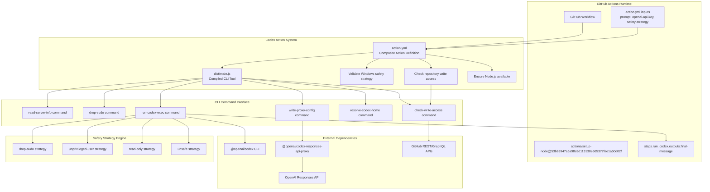
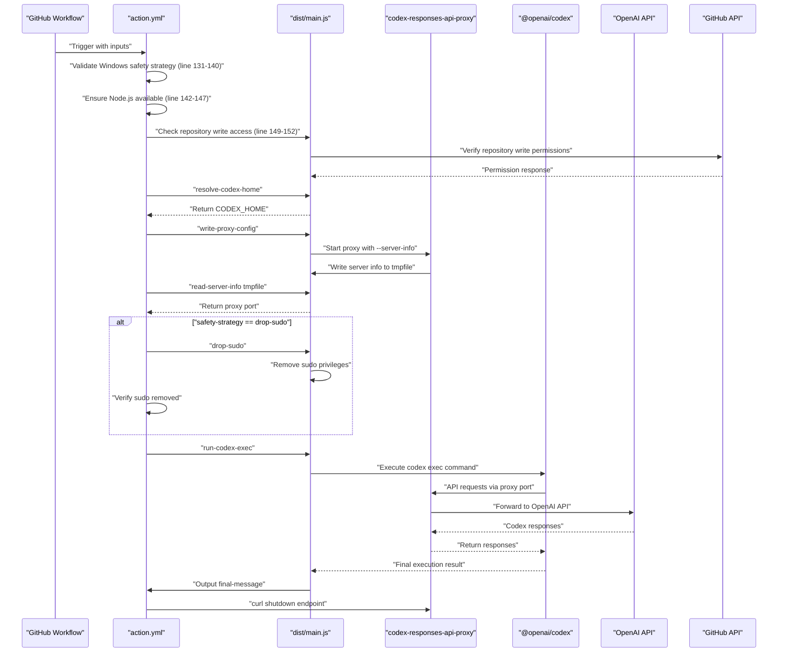
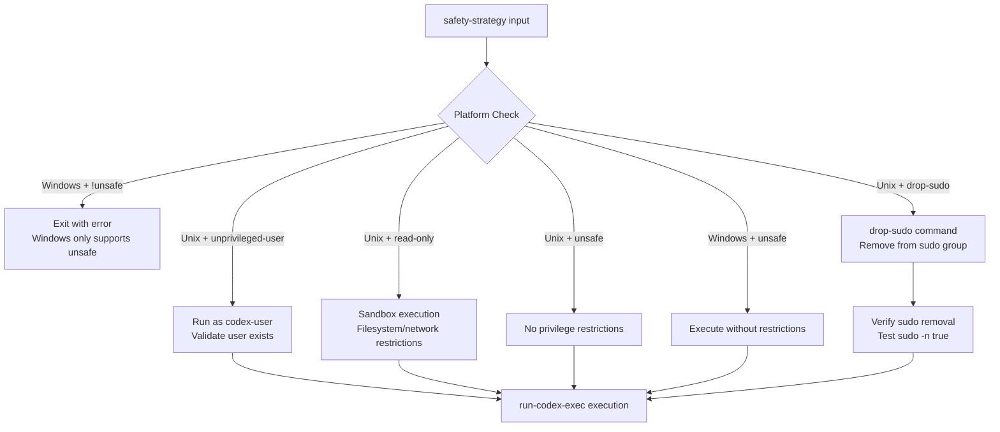
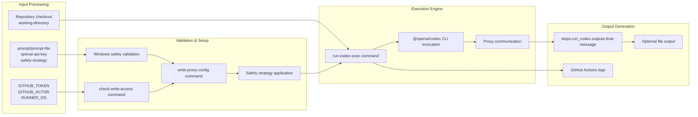

<!-- source: DeepWiki mcp.deepwiki.com · repo openai/codex-action · page 1 Overview · fetched 2026-10-26 -->

# Overview

Relevant source files

The following files were used as context for generating this wiki page:

- [CHANGELOG.md](CHANGELOG.md)
- [README.md](README.md)
- [action.yml](action.yml)

This document provides a comprehensive overview of the `codex-action` repository, which implements a GitHub Action for safely executing OpenAI's Codex CLI within GitHub Actions workflows. This page covers the system's purpose, high-level architecture, and key components.

## Purpose and Scope

The `codex-action` repository implements a GitHub Action that enables users to run `codex exec` commands directly from GitHub Actions workflows while maintaining strict control over execution privileges and security. The action handles the complex infrastructure setup required for Codex execution, including CLI installation, OpenAI API proxy management, and privilege isolation, allowing users to focus on crafting effective prompts.

**Sources:** [README.md:1-3](), [action.yml:1-3]()

## What is codex-action

The `codex-action` system is a composite GitHub Action that orchestrates the execution of OpenAI's Codex CLI in a controlled environment. At its core, it provides:

- **Automated Infrastructure Setup**: Installs `@openai/codex` CLI and `@openai/codex-responses-api-proxy` packages [action.yml:144-154]().
- **Security-First Design**: Implements multiple safety strategies (e.g., `drop-sudo`, `read-only`, `unprivileged-user`) to restrict Codex privileges [action.yml:74-106]().
- **Seamless Integration**: Exposes a simple interface through `action.yml` while handling complex orchestration internally [action.yml:4-122]().
- **Cross-Platform Support**: Works on Linux, macOS, and Windows with appropriate safety constraints [action.yml:74-77](), [action.yml:131-140]().

The action accepts either inline prompts via the `prompt` input or file-based prompts via `prompt-file`, executes them through the Codex CLI, and returns the results as the `final-message` output for downstream workflow steps [action.yml:5-12](), [action.yml:124-126]().

**Sources:** [README.md:1-6](), [action.yml:4-152]()

## High-Level System Architecture

The following diagram shows the major system components and their relationships, using the actual code entities from the repository:

**Figure 1: High-Level System Architecture**

**Sources:** [action.yml:1-152](), [README.md:95-117]()

## Action Execution Flow

The following sequence diagram illustrates the step-by-step execution flow using the actual step names and commands from the action definition:

**Figure 2: Action Execution Sequence**

**Sources:** [action.yml:131-152]()

## Key System Components

### Action Definition Layer
- **`action.yml`**: The composite action definition that orchestrates the entire execution pipeline.
- **Input validation**: Platform-specific safety strategy validation (e.g., ensuring `unsafe` on Windows) [action.yml:131-140]().
- **Dependency management**: Node.js setup [action.yml:142-147]().

### CLI Tool Layer
- **`dist/main.js`**: Compiled TypeScript application that implements core commands used within the composite action steps.
- **Command interface**: Five main commands exposed through the CLI tool:

| Command | Purpose | Reference |
|---------|---------|----------|
| `check-write-access` | Verify repository write permissions for the actor | [action.yml:149-152]() |
| `resolve-codex-home` | Determine the directory for Codex config/cache | N/A |
| `read-server-info` | Parse proxy server information (port/PID) | N/A |
| `drop-sudo` | Remove sudo privileges from the current user | N/A |
| `run-codex-exec` | Execute Codex CLI with security constraints | N/A |
| `write-proxy-config` | Configure and start the Responses API proxy | N/A |

### Safety Strategy System
The action implements four distinct safety strategies to control Codex execution privileges:

**Figure 3: Safety Strategy Decision Tree**

**Sources:** [action.yml:74-106](), [action.yml:131-140](), [README.md:113-114]()

### External Integration Layer
- **`@openai/codex`**: The official Codex CLI package installed at runtime.
- **`@openai/codex-responses-api-proxy`**: Proxy service for OpenAI API communication, protecting the API key.
- **GitHub APIs**: Used for permission checking via `check-write-access` [action.yml:149-152]().
- **OpenAI API**: Target API for Codex execution requests [action.yml:21-22]().

**Sources:** [action.yml:149-152](), [action.yml:21-22]()

## Data Flow Architecture

The action processes data through a structured pipeline from workflow inputs to final outputs:

**Figure 4: Data Flow Architecture**

**Sources:** [action.yml:4-122](), [action.yml:124-126]()

This architecture enables the action to provide a secure, controlled environment for Codex execution while maintaining ease of use for end users through a well-defined GitHub Actions interface.

## Next Steps

- [Getting Started](2) — Practical examples and basic usage patterns.
- [Configuration Reference](3) — Detailed documentation for all action inputs and outputs.
- [Security and Safety Strategies](4) — Deep dive into privilege isolation and safety mechanisms.
- [Internal Architecture](5) — Details on the CLI tool and build system.
- [Development Guide](6) — How to contribute and understand the CI pipeline.
- [Legal and Licensing](7) — Licensing and copyright information.
- [Glossary](8) — Definitions of codebase-specific terms.

---

