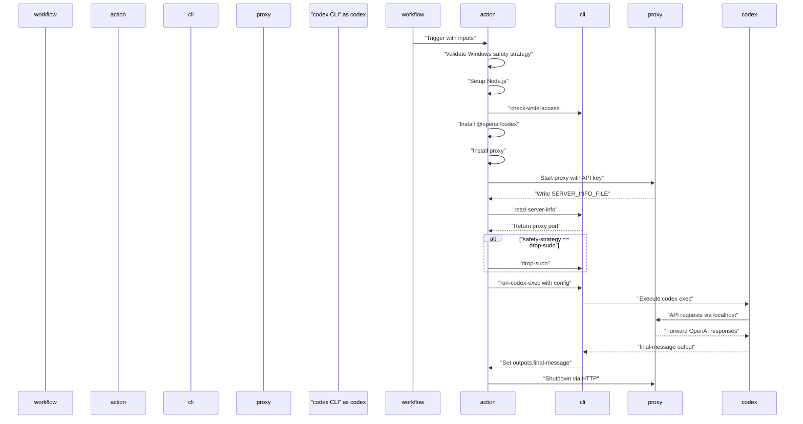
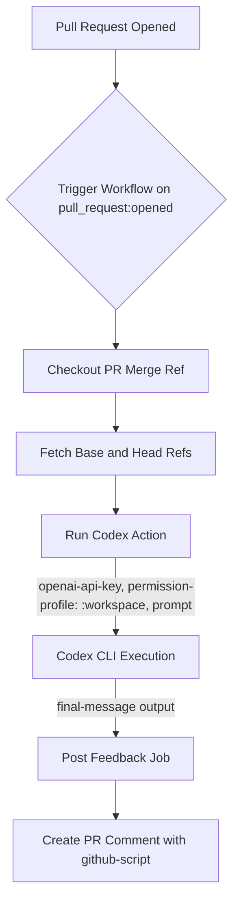
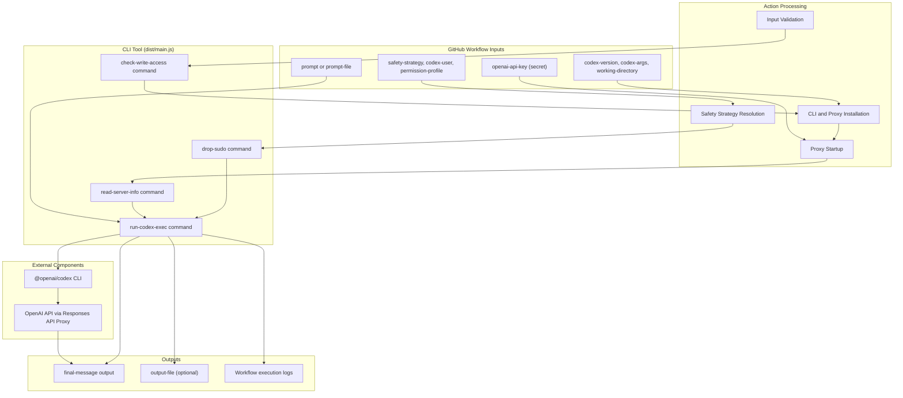

<!-- source: DeepWiki mcp.deepwiki.com · repo openai/codex-action · page 2 Getting Started · fetched 2026-10-26 -->

# Getting Started

<details>
<summary>Relevant source files</summary>

The following files were used as context for generating this wiki page:

- [README.md](README.md)

</details>


This document provides practical examples and basic usage patterns for integrating `codex-action` into GitHub workflows. It covers essential setup steps, common use cases, and fundamental configuration patterns to get you running Codex commands in your CI/CD pipelines quickly.

For comprehensive configuration options, see [Configuration Reference](). For detailed security considerations and advanced safety strategies, see [Security and Safety Strategies]().

## Basic Setup

The `codex-action` is a GitHub composite action that executes OpenAI's Codex CLI in a controlled environment. The minimal setup requires only an OpenAI API key and either a prompt or prompt file.

### Minimal Example

```yaml
name: Run Codex Exec
on: workflow_dispatch

jobs:
  codex:
    runs-on: ubuntu-latest
    steps:
      - uses: actions/checkout@v5
      - name: Run Codex
        uses: openai/codex-action@v1
        with:
          openai-api-key: ${{ secrets.OPENAI_API_KEY }}
          prompt: "Write a Python script that prints hello world"
```

This basic workflow uses the default safety strategy (`drop-sudo`) and streams output to the workflow logs.

**Sources:** [README.md:53-65]()

### Essential Prerequisites

| Requirement | Description |
|-------------|-------------|
| `actions/checkout@v5` | Provides repository context for Codex |
| `OPENAI_API_KEY` secret | Stored in repository or organization secrets |
| Node.js 20+ runtime | Automatically provided by `actions/setup-node@v4` |

The action automatically installs the Codex CLI and required proxy components during execution.

**Sources:** [README.md:3-5]()

## Action Execution Flow

This diagram shows how the key components interact during action execution, mapping to specific steps in the composite action:

Title: Codex Action Execution Sequence


**Sources:** [README.md:1-115]()

## Common Usage Patterns

### Automated Code Review

A common use case for `codex-action` is automated code review. This involves triggering the action on pull request events, providing Codex with the PR details, and then posting its output as a comment.

Title: Automated Code Review Workflow


For a detailed example of setting up an automated code review bot, including `actions/checkout` requirements and how to post comments, see [Example Workflows](#2.1).

**Sources:** [README.md:7-97]()

### Prompt File Pattern

For complex or multi-line prompts, use a dedicated file:

```yaml
- name: Run Codex with file prompt
  uses: openai/codex-action@v1
  with:
    openai-api-key: ${{ secrets.OPENAI_API_KEY }}
    prompt-file: ".github/prompts/refactor.md"
    working-directory: "src"
```

The `prompt-file` path is relative to the repository root, while `working-directory` controls where `codex exec` runs.

**Sources:** [README.md:102-104](), [README.md:108]()

### Output Capture Pattern

Capture Codex output for use in subsequent workflow steps:

```yaml
- name: Run Codex
  id: run_codex
  uses: openai/codex-action@v1
  with:
    openai-api-key: ${{ secrets.OPENAI_API_KEY }}
    prompt: "Analyze this codebase and suggest improvements"
    output-file: "codex_analysis.md"

- name: Use Codex output
  run: |
    echo "Codex result: ${{ steps.run_codex.outputs.final-message }}"
    cat codex_analysis.md
```

The action exposes `final-message` as an output and optionally writes to `output-file`. For a detailed explanation of how to consume these outputs, including output schemas and validation, see [Consuming Outputs](#2.2).

**Sources:** [README.md:31-32](), [README.md:105-107]()

### Safety Strategy Selection

Choose appropriate safety levels based on your use case. On Windows, only `unsafe` is supported.

```yaml
# For untrusted prompts (default)
- uses: openai/codex-action@v1
  with:
    safety-strategy: drop-sudo
    
# For Windows runners (required)
- uses: openai/codex-action@v1
  with:
    safety-strategy: unsafe
    
# For custom user accounts
- uses: openai/codex-action@v1
  with:
    safety-strategy: unprivileged-user
    codex-user: guest
```

**Sources:** [README.md:109-110]()

## Input/Output Data Flow

This diagram illustrates how configuration inputs flow through the system to produce outputs:

Title: Natural Language to Code Entity Mapping


**Sources:** [README.md:99-115]()

## Platform Considerations

### Operating System Support

| Platform | Supported Safety Strategies | Notes |
|----------|----------------------------|--------|
| Ubuntu Latest | `drop-sudo`, `unprivileged-user`, `read-only`, `unsafe` | Full feature support |
| macOS Latest | `drop-sudo`, `unprivileged-user`, `read-only`, `unsafe` | Full feature support |
| Windows Latest | `unsafe` only | Action validates and fails on other strategies |

The action includes platform-specific validation logic to prevent unsupported configurations.

**Sources:** [README.md:1-115]()

### Permission Requirements

The action checks repository write access by default using the `check-write-access` command:

```yaml
# Default behavior - requires write access for triggering user
allow-users: ""

# Allow bot accounts to bypass check  
allow-bots: "false"
```

This security measure prevents unauthorized execution of potentially dangerous prompts by users without write access to the repository.

**Sources:** [README.md:1-115]()

## Next Steps

- For complete input/output reference, see [Configuration Reference]()
- For security best practices and advanced safety strategies, see [Security and Safety Strategies]()  
- For understanding the internal CLI tool commands, see [CLI Commands]()
- For contribution guidelines, see [Contributing and CLA Process]()

**Sources:** [README.md:18]()

---

