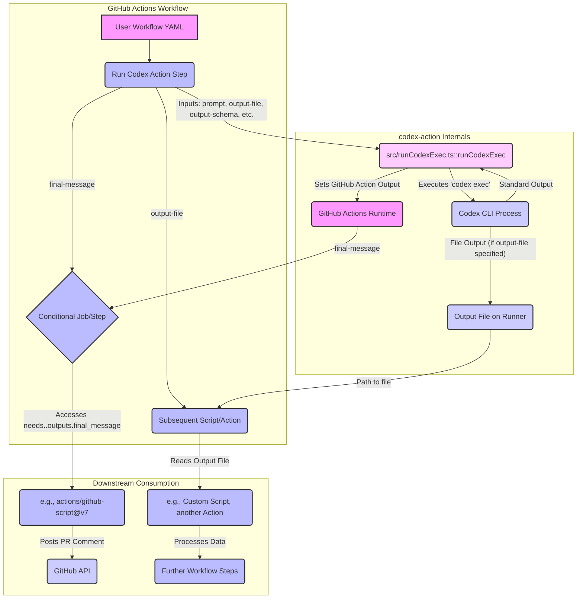

<!-- source: DeepWiki mcp.deepwiki.com · repo openai/codex-action · page 2.2 Consuming Outputs · fetched 2026-10-26 -->

# Consuming Outputs

<details>
<summary>Relevant source files</summary>

The following files were used as context for generating this wiki page:

- [README.md](README.md)
- [examples/unprivileged-user.yml](examples/unprivileged-user.yml)
- [src/checkOutput.ts](src/checkOutput.ts)
- [src/runCodexExec.ts](src/runCodexExec.ts)
- [src/writeProxyConfig.ts](src/writeProxyConfig.ts)

</details>


This page details how the `codex-action` produces and how downstream GitHub Actions workflows consume its outputs, specifically the `final-message` output and the `output-file`. It covers the output schemas and the `checkOutput` validation mechanism.

## Action Outputs

The `codex-action` provides two primary ways to access the results of a Codex execution:

1.  **`final-message` output**: This is a direct output of the GitHub Action, accessible via `steps.<step_id>.outputs.final-message`. It contains the main message generated by Codex.
2.  **`output-file`**: If specified, the Codex output is written to a file at the given path. This allows for more complex processing of the output, especially when the output is structured (e.g., JSON).

### `final-message` Output

The `final-message` output is a string containing the primary response from the Codex model. This is typically used for direct consumption in subsequent steps, such as posting comments on a Pull Request.

**Example Usage:**

The `README.md` provides an example of a PR bot that uses `final-message` to post a comment on a pull request [README.md:76-96]():

```yaml
  post_feedback:
    runs-on: ubuntu-latest
    needs: codex
    if: needs.codex.outputs.final_message != ''
    permissions:
      issues: write
      pull-requests: write
    steps:
      - name: Report Codex feedback
        uses: actions/github-script@v7
        env:
          CODEX_FINAL_MESSAGE: ${{ needs.codex.outputs.final_message }}
        with:
          github-token: ${{ github.token }}
          script: |
            await github.rest.issues.createComment({
              owner: context.repo.owner,
              repo: context.repo.repo,
              issue_number: context.payload.pull_request.number,
              body: process.env.CODEX_FINAL_MESSAGE,
            });
```
In this example, the `post_feedback` job depends on the `codex` job. It retrieves the `final_message` output from the `codex` job using `needs.codex.outputs.final_message` and then uses `actions/github-script@v7` to post this message as a comment on the pull request.

Sources:
- [README.md:76-96]()

### `output-file` Input

The `output-file` input allows users to specify a file path where the final Codex message should be written [README.md:107](). If this input is left empty, no output file is written. This is particularly useful when the Codex output is expected to be structured data that needs to be parsed by another tool or script.

The `runCodexExec` function handles the creation of this output file. If `explicitOutputFile` is provided, it uses that path; otherwise, it creates a temporary file [src/runCodexExec.ts:164-168]().

```typescript
  let outputFile: OutputFile;
  if (explicitOutputFile != null) {
    outputFile = { type: "explicit", file: explicitOutputFile };
  } else {
    outputFile = await createTempOutputFile({ runAsUser });
  }
```

Sources:
- [README.md:107]()
- [src/runCodexExec.ts:164-168]()

## Output Schemas

The `codex-action` supports defining an output schema for Codex, which can be provided either inline via `output-schema` or from a file via `output-schema-file` [README.md:113-114](). These inputs are mutually exclusive. The schema is passed to `codex exec` using the `--output-schema` flag.

The `OutputSchemaSource` type in `src/runCodexExec.ts` defines the structure for these schema inputs:

```typescript
export type OutputSchemaSource =
  | {
      type: "file";
      path: string;
    }
  | {
      type: "inline";
      content: string;
    };
```
[src/runCodexExec.ts:104-112]()

The `resolveOutputSchema` function (not fully shown in the provided code, but implied by its usage in `runCodexExec`) would handle writing the inline schema content to a temporary file if `type: "inline"` is used, or simply using the provided path if `type: "file"`.

Sources:
- [README.md:113-114]()
- [src/runCodexExec.ts:104-112]()

## `checkOutput` Validation

The `checkOutput` function [src/checkOutput.ts:3-27]() is a utility function used internally by `codex-action` to execute a command and capture its standard output, while also ensuring that the command exits successfully (with a zero exit code). If the command fails, it rejects the promise with an error.

```typescript
export function checkOutput(command: Array<string>): Promise<string> {
  const [prog, ...args] = command;
  return new Promise<string>((resolve, reject) => {
    const proc = spawn(prog, args, {
      env: process.env,
      stdio: ["ignore", "pipe", "inherit"],
    });

    proc.on("error", reject);

    let output = "";
    proc.stdout.on("data", (chunk) => {
      output += chunk.toString();
    });

    proc.on("close", (code) => {
      if (code !== 0) {
        reject(new Error(`${prog} exited with code ${code}`));
        return;
      }

      resolve(output);
    });
  });
}
```
[src/checkOutput.ts:3-27]()

This function is crucial for robust execution of external commands within the action. For example, it's used in `src/runCodexExec.ts` to verify `sudo` access before attempting a `drop-sudo` operation [src/runCodexExec.ts:194-195](), and to find the `codex` executable path [src/runCodexExec.ts:201](). It's also used in `src/writeProxyConfig.ts` when the `unprivileged-user` safety strategy is active to move the generated `config.toml` using `sudo` [src/writeProxyConfig.ts:47]().

Sources:
- [src/checkOutput.ts:3-27]()
- [src/runCodexExec.ts:194-195]()
- [src/runCodexExec.ts:201]()
- [src/writeProxyConfig.ts:47]()

## Data Flow for Output Consumption

The following diagram illustrates the data flow from Codex execution to output consumption in a GitHub Actions workflow.


**Diagram: Codex Action Output Data Flow**

Sources:
- [README.md:76-96]()
- [src/runCodexExec.ts:123-149]()

## `checkOutput` Execution Flow

The `checkOutput` function is a critical component for executing external commands reliably. Here's a detailed look at its execution flow.

```mermaid
graph TD
    A[Call checkOutput(command: Array<string>)] --> B{Spawn Child Process};
    B -- "prog, args" --> C(child_process::spawn);
    C -- "stdout: pipe, stderr: inherit" --> D(Process Output Stream);
    C -- "on 'error' event" --> E{Reject Promise};
    D -- "on 'data' event" --> F(Accumulate Output String);
    C -- "on 'close' event" --> G{Check Exit Code};
    G -- "code !== 0" --> E;
    G -- "code === 0" --> H(Resolve Promise with Accumulated Output);
    E -- "Error" --> I(Caller handles error);
    H -- "Output String" --> J(Caller uses output);

    style A fill:#f9f,stroke:#333,stroke-width:2px
    style B fill:#bbf,stroke:#333,stroke-width:2px
    style C fill:#ccf,stroke:#333,stroke-width:2px
    style D fill:#ccf,stroke:#333,stroke-width:2px
    style E fill:#fcc,stroke:#333,stroke-width:2px
    style F fill:#fcf,stroke:#333,stroke-width:2px
    style G fill:#bbf,stroke:#333,stroke-width:2px
    style H fill:#fcf,stroke:#333,stroke-width:2px
    style I fill:#f9f,stroke:#333,stroke-width:2px
    style J fill:#f9f,stroke:#333,stroke-width:2px
```
**Diagram: `checkOutput` Execution Flow**

Sources:
- [src/checkOutput.ts:3-27]()

---

