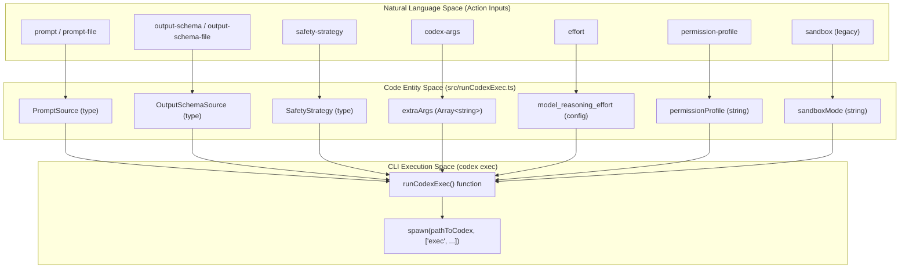
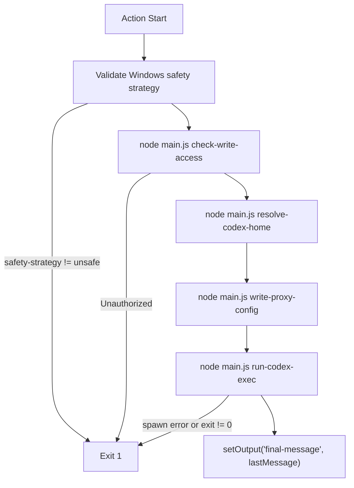
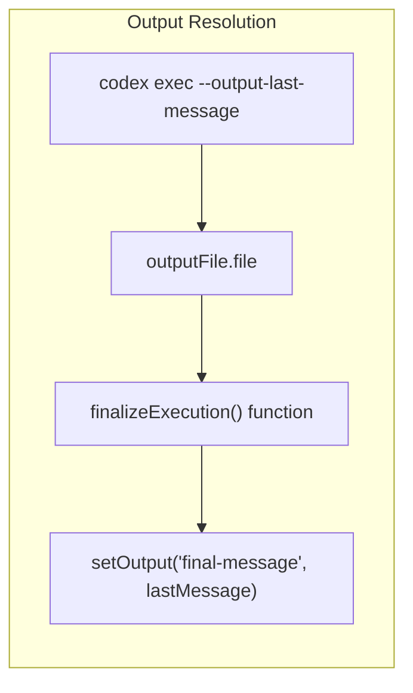

<!-- source: DeepWiki mcp.deepwiki.com · repo openai/codex-action · page 3 Configuration Reference · fetched 2026-10-26 -->

# Configuration Reference

Relevant source files

The following files were used as context for generating this wiki page:

- [README.md](README.md)
- [action.yml](action.yml)

This document provides a complete reference for all configuration inputs and outputs available in the `codex-action` GitHub Action. It covers all action parameters, their validation rules, platform-specific constraints, and data flow from inputs to the internal CLI execution.

## Action Inputs

The action accepts the following input parameters through the `with` section of a workflow step.

| Parameter | Required | Type | Default | Description |
|-----------|----------|------|---------|-------------|
| `openai-api-key` | No | String | `""` | Secret for authenticating with OpenAI API [action.yml:17-20](). |
| `responses-api-endpoint` | No | String | `""` | Optional Responses API endpoint override [action.yml:22-24](). |
| `prompt` | No* | String | `""` | Inline prompt text [action.yml:5-8](). |
| `prompt-file` | No* | String | `""` | Path to file containing the prompt [action.yml:9-12](). |
| `output-file` | No | String | `""` | File where the final Codex message is written [action.yml:13-16](). |
| `working-directory`| No | String | `""` | Directory passed to `codex exec --cd` [action.yml:25-28](). |
| `sandbox` | No | Enum | `""` | Legacy sandbox mode. Prefer `permission-profile` [action.yml:29-35](). |
| `permission-profile`| No | String | `""` | Codex permission profile (e.g., `:workspace`) [action.yml:37-42](). |
| `codex-version` | No | String | `""` | Version of `@openai/codex` to install [action.yml:43-46](). |
| `codex-args` | No | String | `""` | Additional args for `codex exec` (JSON array or shell string) [action.yml:47-53](). |
| `output-schema` | No | String | `""` | Inline JSON schema for structured output [action.yml:54-57](). |
| `output-schema-file`| No | String | `""` | File path to the output schema [action.yml:58-61](). |
| `model` | No | String | `""` | Model identifier (e.g., `gpt-4o`) [action.yml:62-65](). |
| `effort` | No | String | `""` | Reasoning effort (e.g., `low`, `medium`, `high`) [action.yml:66-69](). |
| `codex-home` | No | String | `""` | Trusted Codex home/config directory [action.yml:70-73](). |
| `safety-strategy` | No | Enum | `drop-sudo` | Privilege restriction strategy [action.yml:74-106](). |
| `codex-user` | No | String | `""` | Username for `unprivileged-user` strategy [action.yml:107-110](). |
| `allow-users` | No | String | `""` | Comma-separated list of GitHub usernames allowed to run [action.yml:111-114](). |
| `allow-bots` | No | Boolean | `false` | Allow `github-actions[bot]` to bypass write-access check [action.yml:115-118](). |
| `allow-bot-users` | No | String | `""` | Comma-separated list of trusted GitHub bot usernames [action.yml:119-122](). |

\* Either `prompt` or `prompt-file` must be provided [action.yml:6-10]().

**Sources:** [action.yml:4-122](), [README.md:99-115]()

## Data Flow: From Workflow to CLI

The following diagram bridges the GitHub Action inputs to the internal TypeScript implementation and CLI commands, showing how natural language inputs are mapped to code entities.

**Sources:** [src/runCodexExec.ts:8-62](), [src/runCodexExec.ts:138-142](), [src/runCodexExec.ts:167-172]()

## Input Validation and Execution Flow

The action performs validation in several steps before invoking the Codex CLI. The flow ensures that environment-specific constraints (like Windows limitations) are respected.

**Sources:** [action.yml:131-140](), [action.yml:149-152](), [src/runCodexExec.ts:176-180](), [src/runCodexExec.ts:212-212]()

## Detailed Input Reference

This section provides a high-level overview of the action's inputs. For detailed information on specific input categories, refer to the dedicated child pages.

### Prompt, Output, and Model Inputs

These inputs control the core interaction with the Codex model, defining what prompt is sent, how the output is structured, and which model parameters are used.

-   `prompt`: The direct text to send to Codex.
-   `prompt-file`: A path to a file containing the prompt text.
-   `output-file`: A path where the final Codex message will be written.
-   `output-schema`: Inline JSON schema for structured output.
-   `output-schema-file`: A path to a file containing the JSON schema for structured output.
-   `model`: Specifies the model to be used (e.g., `gpt-4o`).
-   `effort`: Controls the reasoning effort of the model.
-   `working-directory`: Sets the working directory for the Codex execution.
-   `codex-version`: Specifies the version of the `@openai/codex` CLI to install.
-   `codex-home`: Defines the trusted Codex home directory for configuration.

For details, see [Prompt, Output, and Model Inputs](#3.1).

**Sources:** [action.yml:5-16](), [action.yml:25-28](), [action.yml:43-46](), [action.yml:54-73]()

### Sandbox, Permission Profiles, and Access Inputs

These inputs are crucial for controlling the security and execution environment of the Codex process, including sandboxing, privilege management, and user/bot access controls.

-   `sandbox`: A legacy input for defining sandbox modes (`workspace-write`, `read-only`, `danger-full-access`). It is mutually exclusive with `permission-profile`.
-   `permission-profile`: Specifies a Codex permission profile (e.g., `:read-only`, `:workspace`) or a custom profile defined in `codex-home/config.toml`. This is the preferred method for new workflows.
-   `codex-args`: Allows passing additional, arbitrary arguments to the `codex exec` command.
-   `safety-strategy`: Determines how the action restricts environment privileges (`drop-sudo`, `unprivileged-user`, `read-only`, `unsafe`).
-   `codex-user`: Specifies the UNIX username to run Codex as when `safety-strategy` is `unprivileged-user`.
-   `allow-users`: A comma-separated list of GitHub usernames permitted to run the action.
-   `allow-bots`: A boolean flag to allow trusted GitHub bot accounts (e.g., `github-actions[bot]`) to bypass write-access checks.
-   `allow-bot-users`: A comma-separated list of specific GitHub bot usernames allowed to bypass write-access checks.

For details, see [Sandbox, Permission Profiles, and Access Inputs](#3.2).

**Sources:** [action.yml:29-42](), [action.yml:47-53](), [action.yml:74-122]()

## Action Outputs

The action produces one primary output which can be consumed by subsequent steps.

| Output | Type | Description |
|--------|------|-------------|
| `final-message` | String | The raw stdout/output emitted by the `codex exec` command [action.yml:124-126](). |

### Data Extraction Flow
The output is captured from a file (either explicit or temporary) and set using the `@actions/core` `setOutput` function.

**Sources:** [src/runCodexExec.ts:126-128](), [src/runCodexExec.ts:183-183](), [src/runCodexExec.ts:195-212]()

## Implementation of Configuration Precedence

The action manages configuration files for the Codex CLI to ensure the proxy is used.

1.  **Home Directory:** Resolved via `resolve-codex-home`, prioritizing `codex-home` input [action.yml:161-170]().
2.  **Proxy Configuration:** The `writeProxyConfig` function generates a `config.toml` in the `codexHome` directory [src/writeProxyConfig.ts:9-14]().
3.  **Model Provider:** It sets `model_provider = "codex-action-responses-proxy"` and configures the `base_url` to point to the local proxy port [src/writeProxyConfig.ts:23-35]().
4.  **Privileged Write:** If using `unprivileged-user`, it uses `sudo mv` to place the config file in the home directory of the target user [src/writeProxyConfig.ts:40-50]().

**Sources:** [src/writeProxyConfig.ts:9-55](), [src/runCodexExec.ts:153-156]()

---

