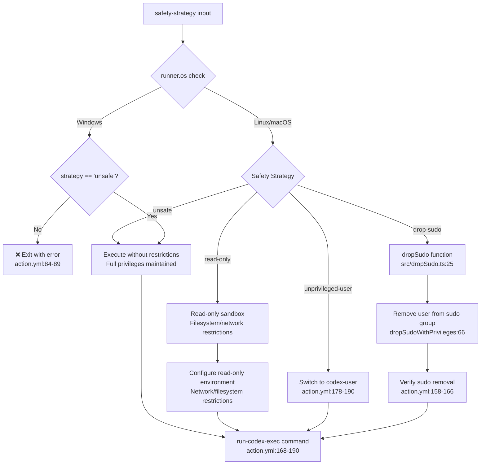
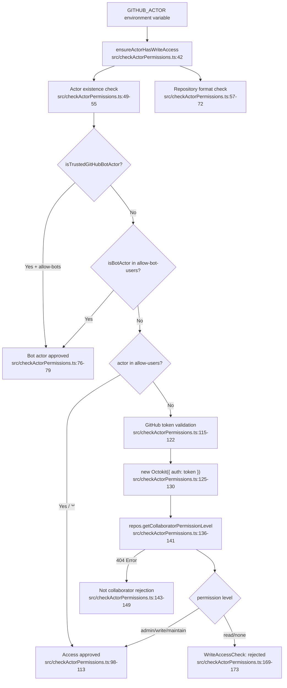

<!-- source: DeepWiki mcp.deepwiki.com · repo openai/codex-action · page 4 Security and Safety Strategies · fetched 2026-10-26 -->

# Security and Safety Strategies

<details>
<summary>Relevant source files</summary>

The following files were used as context for generating this wiki page:

- [README.md](README.md)
- [docs/security.md](docs/security.md)

</details>


This document provides a detailed explanation of the security mechanisms and safety strategies implemented in `codex-action`. It covers how the action protects the `OPENAI_API_KEY`, manages execution privileges, and mitigates risks such as prompt injection and unauthorized access.

## Safety Strategy Overview

The `safety-strategy` input determines the level of privilege restriction applied to the Codex execution environment. Because GitHub-hosted runners provide passwordless `sudo` by default, Codex could potentially exfiltrate sensitive data or modify the runner state if not properly restricted.

### Safety Strategy Decision Flow



**Sources:** [action.yml:36-61](), [action.yml:84-89](), [action.yml:141-156](), [action.yml:158-166](), [src/dropSudo.ts:25-64]()

For a detailed explanation of each strategy, including `drop_sudo`, `read_only`, `unprivileged_user`, and `unsafe`, and their underlying mechanisms like `bubblewrap`/user-namespaces and `setpriv` usage, see [Safety Strategies and Sandboxing](#4.1).

## Permission Checking System

The action enforces repository access controls via `ensureActorHasWriteAccess` to prevent unauthorized users from consuming your OpenAI quota or triggering malicious workflows.

### Permission Validation Architecture



**Sources:** [src/checkActorPermissions.ts:42-174](), [docs/security.md:5-9]()

For a detailed explanation of how `ensureActorHasWriteAccess` gates execution, including allow-lists, trusted bot actors, Octokit collaborator permission lookups, and rejection reasons, see [Actor Permission Checking](#4.2).

## Detailed Safety Strategies

### drop-sudo Strategy (Default)
This strategy permanently removes the current user's ability to use `sudo`. This is critical because a user with `sudo` can read `procfs` (e.g., `/proc/[pid]/mem`) to exfiltrate the `OPENAI_API_KEY` from the memory of the Responses API proxy process, even if the filesystem is read-only.

| Phase | Function / Logic | File Reference |
| :--- | :--- | :--- |
| **Detection** | Validates Linux/macOS support. | [src/dropSudo.ts:26-31]() |
| **Root Phase** | Re-enters the script as root via `sudo -n node ... drop-sudo --root-phase`. | [src/dropSudo.ts:48-59]() |
| **Group Removal** | Removes user from `sudo` (Linux) or `admin` (macOS) groups. | [src/dropSudo.ts:74-118]() |
| **Sudoers Cleanup** | Strips user entries from `/etc/sudoers` and `/etc/sudoers.d/`. | [src/dropSudo.ts:126-149]() |
| **Verification** | Executes `sudo -n true` to confirm access is denied. | [action.yml:158-166]()

**Sources:** [src/dropSudo.ts:25-161](), [docs/security.md:41-43](), [examples/test-sandbox-protections.yml:31-53]()

### unprivileged-user Strategy
Executes the Codex CLI as a specific, restricted user account provided via the `codex-user` input. This is an alternative to `drop-sudo` when a dedicated low-privilege account is already available on the runner.

### read-only Strategy
Attempts to restrict the environment to read-only access. 
> [!WARNING]
> As demonstrated in [examples/test-sandbox-protections.yml](), `read-only` alone is insufficient if `sudo` is still available. A malicious prompt could use `sudo` to dump process memory and find the API key.

### unsafe Strategy
No restrictions are applied. This is the **only** strategy supported on Windows runners due to the lack of native privilege-dropping utilities in the current action implementation.

**Sources:** [action.yml:84-89](), [docs/security.md:41-43]()

## Security Considerations

### Protecting the OpenAI API Key
The `OPENAI_API_KEY` is never passed directly to the Codex CLI. Instead, the action starts a local **Responses API Proxy** process. 
1. The proxy holds the key in memory.
2. The Codex CLI communicates with the proxy over a local socket/pipe.
3. This isolation ensures that even if the Codex CLI is compromised via prompt injection, it cannot directly "see" the environment variable containing the key.

**Sources:** [docs/security.md:41-43](), [examples/test-sandbox-protections.yml:31-40]()

For a detailed explanation of the `@openai/codex-responses-api-proxy`, how it handles the `OPENAI_API_KEY`, and its configuration, see [Responses API Proxy and Key Protection](#4.3).

### Prompt Injection Risks
Untrusted input from Pull Requests (titles, bodies, commit messages) can be used for prompt injection.
- **Pull Request Bodies**: Malicious users may hide instructions in HTML comments (`<!-- -->`). [docs/security.md:15-15]()
- **Commit Messages**: Often overlooked but read by the model. [docs/security.md:16-16]()
- **Media**: Screenshots can contain text-based injections. [docs/security.md:17-17]()

**Sources:** [docs/security.md:11-18]()

### Shell Injection Prevention
To avoid shell injection in workflow steps, never splice `${{ github.event... }}` directly into a `run:` block. Use environment variables instead.

```yaml
# SAFE
env:
  PR_TITLE: ${{ github.event.pull_request.title }}
run: echo "$PR_TITLE"

# UNSAFE
run: echo "${{ github.event.pull_request.title }}"
```

**Sources:** [docs/security.md:19-31]()

### Execution Order Recommendation
It is recommended to run `openai/codex-action` as the **last step** in a job. Because Codex may spawn background processes or modify the host state (especially in `unsafe` mode), running subsequent steps in the same job may be insecure. [docs/security.md:47-54]()

**Sources:** [docs/security.md:47-55]()

---

