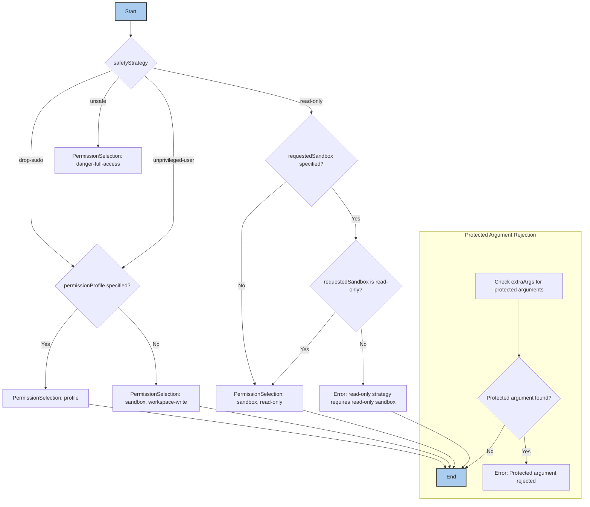

<!-- source: DeepWiki mcp.deepwiki.com · repo openai/codex-action · page 4.1 Safety Strategies and Sandboxing · fetched 2026-10-26 -->

# Safety Strategies and Sandboxing

<details>
<summary>Relevant source files</summary>

The following files were used as context for generating this wiki page:

- [docs/security.md](docs/security.md)
- [src/dropSudo.ts](src/dropSudo.ts)
- [src/linuxCredentials.ts](src/linuxCredentials.ts)
- [src/runCodexExec.ts](src/runCodexExec.ts)

</details>


This page provides a detailed explanation of the safety strategies available in `codex-action`, focusing on `drop_sudo`, `read_only`, `unprivileged_user`, and `unsafe`. It covers their implementation, the underlying mechanisms like `bubblewrap` and `user-namespaces`, the use of `setpriv`, and the logic for rejecting protected arguments.

## Overview of Safety Strategies

The `codex-action` offers several `safety-strategy` options to control the privilege level and sandboxing of the Codex execution environment. These strategies are crucial for mitigating risks associated with running untrusted code, such as prompt injection and API key abuse [docs/security.md:10-19,64-74]().

The available safety strategies are:
*   `drop-sudo`
*   `read-only`
*   `unprivileged-user`
*   `unsafe` [src/runCodexExec.ts:89-93]()

### Safety Strategy Selection Flow

The `determinePermissionSelection` function [src/runCodexExec.ts:500-500]() is responsible for resolving the effective permission profile based on the chosen `safetyStrategy`, `requestedSandbox`, and `permissionProfile` inputs. It also enforces mutual exclusivity and validation rules for these inputs.


**Diagram: Safety Strategy and Permission Selection Flow**

Sources:
*   [src/runCodexExec.ts:89-93]()
*   [src/runCodexExec.ts:179-180]()
*   [src/runCodexExec.ts:500-500]()

## `drop-sudo` Strategy

The `drop-sudo` strategy is designed to remove `sudo` privileges from the Codex process, preventing it from executing commands as root. This is particularly important on GitHub-hosted runners, where passwordless `sudo` is often enabled by default [docs/security.md:70-74]().

### Implementation Details

The `drop-sudo` strategy is implemented in `src/dropSudo.ts` and `src/runCodexExec.ts`. It involves a two-phase process: a root phase and a user phase.

1.  **User Phase (`dropSudo` function)**:
    *   The `dropSudo` function [src/dropSudo.ts:52-103]() is initially called by the action.
    *   It first ensures that passwordless `sudo` is available [src/dropSudo.ts:71-71]().
    *   It then invalidates any cached `sudo` credentials using `sudo -K` [src/dropSudo.ts:73-74,96-99]().
    *   Crucially, it re-executes itself under `sudo` with the `--root-phase` flag [src/dropSudo.ts:78-94](). This allows the privilege-dropping logic to run with root privileges.
    *   After the root phase completes, it verifies that privileged sockets are restricted [src/dropSudo.ts:100-102]().

2.  **Root Phase (`dropSudoWithPrivileges` function)**:
    *   The `dropSudoWithPrivileges` function [src/dropSudo.ts:105-228]() is executed with root privileges.
    *   It sets a minimal `PATH` environment variable to prevent unexpected binaries from being found [src/dropSudo.ts:110-110]().
    *   **Linux Specifics**:
        *   It captures the original runner's Linux credentials (user ID, primary group ID, supplementary group IDs) [src/dropSudo.ts:118-126]().
        *   It identifies groups associated with root service sockets (e.g., `/run` directory) that the original runner user was a member of [src/dropSudo.ts:151-155]().
        *   It then attempts to remove the runner user from the `sudo` group and any other groups that could grant access to privileged sockets [src/dropSudo.ts:156-162]().
        *   It restricts permissions on root service sockets to prevent access by the `nobody` group [src/dropSudo.ts:163-165]().
    *   **macOS Specifics**:
        *   It uses `dseditgroup` to remove the user from the `sudo` group [src/dropSudo.ts:177-185]().
    *   Finally, it removes any entries for the user from `/etc/sudoers.d` and `/etc/sudoers` files [src/dropSudo.ts:203-227]().

### `setpriv` Usage

On Linux, the `drop-sudo` strategy ultimately uses the `setpriv` command to launch the Codex process with significantly reduced privileges [src/runCodexExec.ts:62-76]().

The `setpriv` command is invoked with the following arguments:
*   `--reuid="$uid"`: Sets the real and effective user ID to the specified unprivileged user ID.
*   `--regid="$nobody_gid"`: Sets the real and effective group ID to the `nobody` group ID.
*   `--clear-groups`: Clears all supplementary groups.
*   `--no-new-privs`: Prevents the process from gaining new privileges.
*   `--bounding-set=-all`: Clears all capabilities from the bounding set.
*   `--inh-caps=-all`: Clears all inheritable capabilities.
*   `--ambient-caps=-all`: Clears all ambient capabilities.

This combination ensures that the Codex process runs with minimal privileges, effectively preventing it from performing privileged operations even if it were to escape its sandbox.

```mermaid
graph TD
    A[Action starts] --> B{safetyStrategy is drop-sudo?};
    B -- Yes --> C[Check for non-root runner user];
    C --> D[Capture Linux runner credentials];
    D --> E[Check for passwordless sudo];
    E --> F[Find 'codex' executable path];
    F --> G[Construct sudo command with LINUX_DROP_SUDO_SCRIPT];
    G --> H[Execute sudo command];

    subgraph LINUX_DROP_SUDO_SCRIPT
        I[Script starts as root] --> J[Verify /usr/bin/setpriv exists];
        J --> K[Verify unprivileged nobody account exists];
        K --> L[Call drop-sudo --root-phase];
        L --> M[Verify sudo is disabled];
        M --> N[Execute setpriv command];
        N --> O[Launch Codex executable];
    end

    subgraph dropSudo --root-phase
        P[dropSudoWithPrivileges function] --> Q[Verify running as root];
        Q --> R[Set minimal PATH];
        R --> S[Parse original runner credentials];
        S --> T[Get user groups and ID];
        T --> U[Include account groups in credentials];
        U --> V[Find root service sockets];
        V --> W[Remove user from sudo group and other privileged groups];
        W --> X[Restrict root service socket permissions];
        X --> Y[Remove user entries from /etc/sudoers.d and /etc/sudoers];
    end

    H --> P;
    O --> Z[Codex process runs with reduced privileges];
```
**Diagram: `drop-sudo` Execution Flow**

Sources:
*   [src/runCodexExec.ts:9-77]()
*   [src/runCodexExec.ts:183-231]()
*   [src/dropSudo.ts:52-103]()
*   [src/dropSudo.ts:105-228]()
*   [src/linuxCredentials.ts:41-54]()

## `read-only` Strategy

The `read-only` strategy aims to restrict the Codex process's filesystem access to read-only. This is achieved by configuring the sandbox mode to `read-only` [src/runCodexExec.ts:95-95,100-100]().

When `safetyStrategy` is `read-only`, the `determinePermissionSelection` function [src/runCodexExec.ts:500-500]() ensures that the effective sandbox mode is `read-only`. If a `requestedSandbox` is provided, it must also be `read-only`; otherwise, an error is thrown [src/runCodexExec.ts:510-514]().

This strategy is less secure than `drop-sudo` or `unprivileged-user` because, in the presence of passwordless `sudo` (common on GitHub-hosted runners), a read-only filesystem combined with `sudo` can still expose sensitive information like the `OPENAI_API_KEY` via `/procfs` [docs/security.md:70-74]().

## `unprivileged-user` Strategy

The `unprivileged-user` strategy executes the Codex process as a specified unprivileged user. This strategy requires the `codexUser` input to be provided [src/runCodexExec.ts:233-237]().

The `runCodexExec` function [src/runCodexExec.ts:123-149]() checks if `safetyStrategy` is `unprivileged-user` and, if so, sets `runAsUser` to the value of `codexUser` [src/runCodexExec.ts:160-160](). The actual user switching is handled by the underlying `codex` CLI, which likely uses mechanisms like `setuid`/`setgid` or `sudo -u` to change the process's user.

This strategy, similar to `drop-sudo`, helps protect the `OPENAI_API_KEY` by running Codex with reduced privileges [docs/security.md:70-70]().

## `unsafe` Strategy

The `unsafe` strategy runs the Codex process with full access and no privilege reduction. This strategy should only be used when the input is fully trusted, as it provides no sandboxing or privilege separation [src/runCodexExec.ts:93-93]().

When `safetyStrategy` is `unsafe`, the `determinePermissionSelection` function [src/runCodexExec.ts:500-500]() sets the permission selection to `danger-full-access` [src/runCodexExec.ts:516-516](). This means no sandbox restrictions or permission profiles are applied.

## `bubblewrap` and `user-namespace` Requirements

While not explicitly implemented within the `codex-action` TypeScript code, the underlying `codex` CLI tool (which `codex-action` invokes) relies on sandboxing technologies like `bubblewrap` (bwrap) and Linux `user-namespaces` for its `permission-profile` and `sandbox` features.

`bubblewrap` is a sandboxing tool that allows unprivileged users to create sandboxed environments using Linux `user-namespaces`. `user-namespaces` isolate user and group IDs, allowing a process to have root privileges within its namespace without having root privileges on the host system.

The `codex-action` configures the `codex` CLI with the appropriate `permission-profile` or `sandbox` mode, and the CLI then uses `bubblewrap` (if available and configured) to enforce these restrictions.

## Protected Argument Rejection Logic

The `codex-action` includes logic to reject `codex-args` that would weaken protected permission, trust, provider, or command-execution settings [docs/security.md:34-37](). This is a critical security measure to prevent users from bypassing the intended safety strategies.

The `determinePermissionSelection` function [src/runCodexExec.ts:500-500]() is responsible for this validation. It checks the `extraArgs` provided to the action against a list of protected arguments. If any protected arguments are found, the action will fail, preventing the execution of Codex with potentially insecure configurations.

Examples of rejected arguments include those that:
*   Alternate configuration profiles.
*   Specify additional writable directories.
*   Conflict with hook or sandbox bypasses.
*   Enable `use_legacy_landlock` (unless explicitly allowed in specific contexts).
*   Conflict with a permission profile or an effective read-only sandbox (e.g., `--full-auto`).
*   Load local instruction, compaction, or catalog files when using custom named permission profiles, as these unsandboxed reads can bypass scoped filesystem access [docs/security.md:37-42]().

The `unsafe` strategy is an exception, as it explicitly allows argument pass-through without rejection [docs/security.md:42-42]().

Sources:
*   [docs/security.md:34-42]()
*   [src/runCodexExec.ts:179-180]()
*   [src/runCodexExec.ts:500-500]()

---

