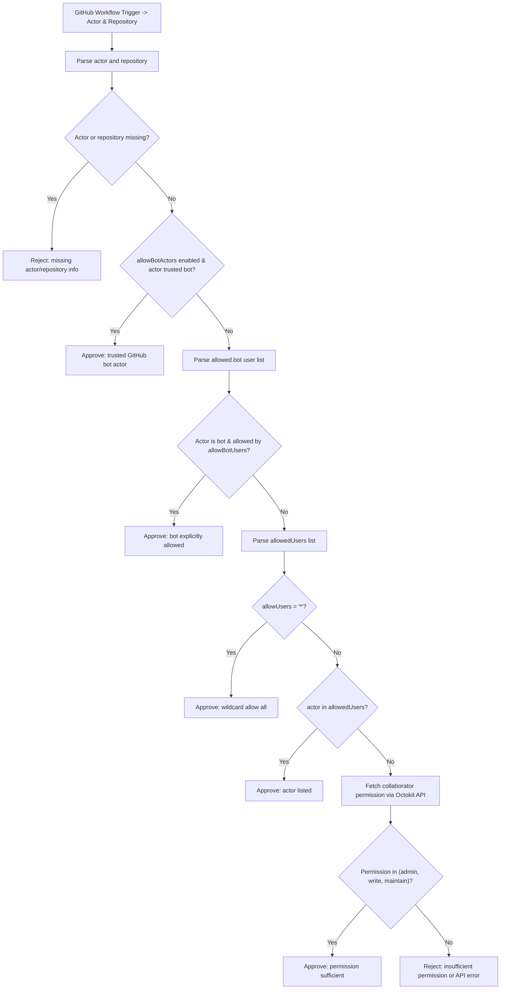
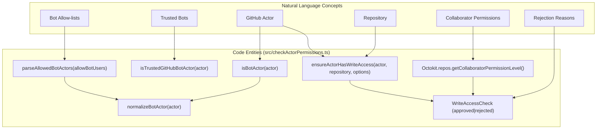

<!-- source: DeepWiki mcp.deepwiki.com · repo openai/codex-action · page 4.2 Actor Permission Checking · fetched 2026-10-26 -->

# Actor Permission Checking

<details>
<summary>Relevant source files</summary>

The following files were used as context for generating this wiki page:

- [src/checkActorPermissions.ts](src/checkActorPermissions.ts)
- [test/checkActorPermissions.test.mjs](test/checkActorPermissions.test.mjs)

</details>


This section explains the implementation details of the `ensureActorHasWriteAccess` function, which enforces write access control on the GitHub actor triggering the workflow in the codex-action repository. It describes the guard mechanisms including user and bot allow-lists, trusted bot actors, GitHub collaborator permission checks via Octokit, support for GitHub Enterprise (GHE) API URLs, and the reasons for rejecting unauthorized actors.

---

## Purpose and Scope

The `ensureActorHasWriteAccess` function serves as a gatekeeper to prevent unauthorized users or bots from executing commands that require write access to the target repository. It primarily ensures that any actor initiating a workflow run has sufficient repository permissions, mitigating risks of privilege escalations or unintended code changes.

This page elaborates on:

- The underlying logic of access verification.
- How trusted bot actors and allow-lists bypass permission checks.
- Octokit integration for collaborator permissions lookup.
- Support for GitHub Enterprise (GHE) via `GITHUB_API_URL`.
- Detailed rejection reasons for denied actors.
- Testing strategies validating this behavior.

---

## Implementation Overview

The core function enforcing permissions is `ensureActorHasWriteAccess`, defined in `src/checkActorPermissions.ts` [src/checkActorPermissions.ts:7-177](). It returns a `WriteAccessCheck` object indicating whether the actor is "approved" or "rejected" along with an explanatory reason.

### Key Points:

- **Inputs:**
  - `actor`: GitHub username triggering the workflow, defaulting to `GITHUB_ACTOR` environment variable.
  - `repository`: Target repository string `"owner/repo"`, defaulting to `GITHUB_REPOSITORY`.
  - `allowBotActors`: Boolean flag to permit special trusted GitHub bot actors without collaborator checks.
  - `allowUsers`: Comma-separated string of allowed GitHub usernames or `"*"` wildcard to allow all users.
  - `allowBotUsers`: Comma-separated list of allowed bot usernames (no wildcards).
  - `token`: GitHub token for Octokit API authentication, resolves from `GITHUB_TOKEN` or `GH_TOKEN` environment variables.
  - Optional `octokit` instance for API calls, normally created internally.

- **Process Flow:**
  1. Validate `actor` and `repository` environment variables. Reject with clear messages if missing or malformed.
  2. Parse `"owner"` and `"repo"` parts from repository string; reject if invalid.
  3. If `allowBotActors` is enabled and the actor is a **trusted GitHub bot actor** (e.g. `github-actions[bot]`), bypass collaborator checks and approve immediately.
  4. Parse `allowBotUsers` list to an explicit set of normalized bot usernames. Reject if wildcards (`*`) are present.
  5. If the actor is a bot and is explicitly allowed via `allowBotUsers`, approve.
  6. If the `allowUsers` list is `"*"`, allow all users without collaborator check.
  7. Otherwise, check if the actor is included in the `allowUsers` list and approve if matched.
  8. If no allow-lists apply, perform an Octokit API call to fetch the actor's collaborator permission level on the repository using `octokit.repos.getCollaboratorPermissionLevel`.
  9. Approve if the permission is one of `"admin"`, `"write"`, or `"maintain"`.
  10. Reject otherwise, providing the exact permission level found.

- **Error Handling:**
  - If the permission check returns a 404 (not collaborator), reject with an explicit reason.
  - On API errors (network or server faults), retry (enabled via Octokit Retry plugin) or fail with a descriptive message.
  - Reject immediately if no GitHub token is available for permission checks, unless the actor is covered by allow-lists or trusted bots.

---

## Data Flow and Control Flow Diagram



**Description:** This flowchart captures the sequential checks and decision branches during permission verification within `ensureActorHasWriteAccess`.

Sources: [src/checkActorPermissions.ts:7-177]()

---

## Key Functions and Classes

| Function Name               | Purpose                                                                                                       | Location                |
|----------------------------|---------------------------------------------------------------------------------------------------------------|-------------------------|
| `ensureActorHasWriteAccess` | Main exported function to verify if actor has sufficient write access, applying allow-lists and Octokit checks | `src/checkActorPermissions.ts:45-177` |
| `isTrustedGitHubBotActor`   | Determines if actor is one of the built-in trusted GitHub bots (e.g., `github-actions[bot]`)                   | `src/checkActorPermissions.ts:186-188` |
| `parseAllowedBotActors`     | Parses the comma-separated `allowBotUsers` string to a set of normalized bot usernames                       | `src/checkActorPermissions.ts:190-203` |
| `isBotActor`                | Tests if username ends with `[bot]` suffix                                                                   | `src/checkActorPermissions.ts:205-207` |
| `normalizeBotActor`         | Normalizes a bot username to lowercase, ensuring it ends with `[bot]` suffix                                  | `src/checkActorPermissions.ts:209-212` |
| `getTokenFromEnv`           | Helper function to retrieve the GitHub token from environment variables                                       | `src/checkActorPermissions.ts:179-182` |

---

## Details on Allow-Lists and Trusted Bot Actors

### Allow-Lists

- **`allowUsers`** input:
  - Comma-separated, case-insensitive list of usernames.
  - `"*"` wildcard enables all users.
  - If specified and the actor matches, no GitHub API permission check is performed.
- **`allowBotUsers`** input:
  - Comma-separated list of bot usernames.
  - Supports normalized form, automatically appending `[bot]` suffix if missing.
  - Wildcards (`*`) are explicitly disallowed and will reject the input.
  - Matches require exact inclusion in the normalized set.

### Trusted Bot Actors

- Predefined trusted GitHub bot actors include `github-actions[bot]` only.
- When `allowBotActors` is enabled, these bots are immediately allowed to proceed without further checks.
- Other bots (like `dependabot[bot]`) are not trusted by default and must be explicitly allowed via `allowBotUsers`.
  
This design separates trusted built-in GitHub bots from third-party or unknown bots, enforcing stricter control on bot users.

---

## Octokit Integration and GHE Support

- The function uses the Octokit REST API client wrapped with the retry plugin to robustly fetch collaborator permission levels.
- It calls `octokit.repos.getCollaboratorPermissionLevel({ owner, repo, username: actor })`.
- The relevant GitHub API token is mandatory unless a allow-list bypass applies.
- To support GitHub Enterprise (GHE), the base URL for Octokit is set if the `GITHUB_API_URL` environment variable is detected, allowing the API calls against a private GitHub instance.
- Status codes 401, 403, and 404 return permission denials immediately without retries.
- Network and 500 errors trigger retry attempts through the integrated retry plugin.

---

## Permission Validation and Rejection Reasons

The function defines strict permission requirements:

- Allowed permission levels: `"admin"`, `"write"`, `"maintain"`.
- All other permissions (including `"read"`, `"none"`) lead to rejection.
- Rejection reasons explicitly mention:
  - Missing or malformed environment variables.
  - Absence of GitHub token for permission check.
  - Actor not being a collaborator.
  - Insufficient permission level.
  - Any API or unknown errors during permission fetching.

This granularity aids debugging and clear diagnostics for users and maintainers.

---

## Example Invocation and Output

```typescript
import { ensureActorHasWriteAccess } from "./checkActorPermissions";

async function main() {
  const result = await ensureActorHasWriteAccess({
    allowBotActors: true,
    allowUsers: "alice,bob",
    allowBotUsers: "renovate",
  });

  if (result.status === "approved") {
    console.log(`Actor ${result.actor} is permitted to continue.`);
  } else {
    console.error(`Access denied for actor ${result.actor}: ${result.reason}`);
    process.exit(1);
  }
}

main();
```

---

## Testing and Reliability

The permission checking logic is well-covered by tests in `test/checkActorPermissions.test.mjs` that simulate various actor scenarios and server behaviors:

- Validations for trusted GitHub bot actors with and without opt-in.
- Explicit allowlisting of custom bot users.
- Handling of missing or malformed inputs.
- Retry behavior when server connections close unexpectedly or respond with transient 500 errors.
- Immediate failure on client errors (401, 403, 404).
- Rejection of wildcard allow-bot-users input.

These tests ensure robustness and correctness of permission enforcement under diverse conditions [test/checkActorPermissions.test.mjs:1-182]().

---

## Natural Language to Code Entity Mapping Diagram


**Legend:** This diagram relates user concepts like actors, repositories, allow-lists, and bot actors to specific functions and types in the code, centralizing permission checking in `ensureActorHasWriteAccess`.

---

## Technical Summary Table

| Concept                        | Code Symbol / File                           | Description                                           |
|-------------------------------|---------------------------------------------|-------------------------------------------------------|
| Core permission check          | `ensureActorHasWriteAccess` (`src/checkActorPermissions.ts`) | Verifies actor's write permissions, allow-lists, and trusted bot bypass. |
| Trusted GitHub Bot recognition | `isTrustedGitHubBotActor`                   | Identifies built-in trusted bot actors.               |
| Bot actor normalization        | `normalizeBotActor`                          | Ensures consistent bot username format for matches.  |
| Collaborator permission lookup | `octokit.repos.getCollaboratorPermissionLevel()` | Fetch GitHub repo collaborator permission levels.     |
| GitHub token resolution        | `getTokenFromEnv()`                          | Reads token from environment variables.                |
| Write access result type       | `WriteAccessCheck`                           | Union type representing approved or rejected status.  |

---

## Summary

The `ensureActorHasWriteAccess` function is a pivotal part of codex-action's security model, preventing unauthorized repository writes by rigorous permission validation. By combining allow-lists, trusted bot knowledge, and real-time GitHub collaborator permission queries, it balances user convenience with security. Support for GitHub Enterprise APIs and robust error handling further ensure this gatekeeper is reliable in diverse environments.

---

Sources:  
[src/checkActorPermissions.ts:1-215]()  
[test/checkActorPermissions.test.mjs:1-182]()

---

