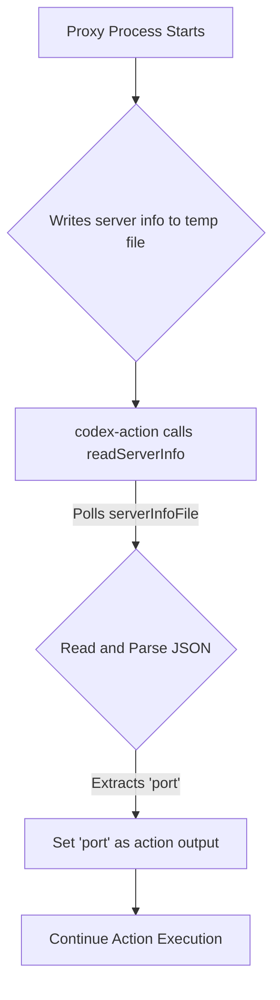
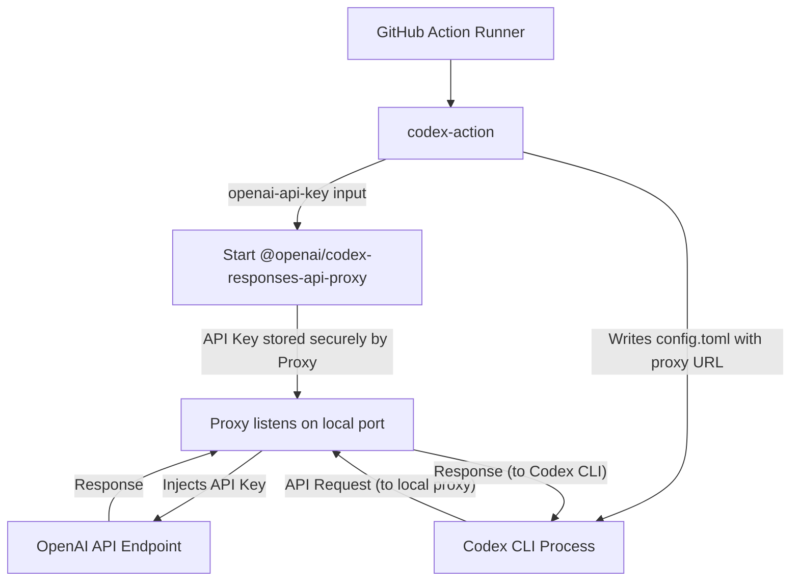

<!-- source: DeepWiki mcp.deepwiki.com · repo openai/codex-action · page 4.3 Responses API Proxy and Key Protection · fetched 2026-10-26 -->

# Responses API Proxy and Key Protection

<details>
<summary>Relevant source files</summary>

The following files were used as context for generating this wiki page:

- [action.yml](action.yml)
- [examples/unprivileged-user.yml](examples/unprivileged-user.yml)
- [src/checkOutput.ts](src/checkOutput.ts)
- [src/readServerInfo.ts](src/readServerInfo.ts)
- [src/writeProxyConfig.ts](src/writeProxyConfig.ts)

</details>


This page details the role of the `@openai/codex-responses-api-proxy` in the `codex-action` workflow, focusing on how it facilitates communication with the OpenAI API while ensuring the security of the API key. It explains the process of reading server information, configuring the proxy within `CODEX_HOME/config.toml`, and the critical mechanism that prevents the OpenAI API key from ever being directly exposed to the Codex process.

## The `@openai/codex-responses-api-proxy`

The `@openai/codex-responses-api-proxy` is a crucial component that acts as an intermediary between the `codex-action` and the OpenAI API. Its primary function is to receive requests from the Codex CLI, inject the `openai-api-key` (which is provided as an input to the GitHub Action), and then forward these requests to the actual OpenAI API endpoint. This design ensures that the sensitive API key is handled exclusively by the proxy and never directly by the potentially less trusted Codex process.

The proxy is started as a separate process by the `codex-action`. Once started, it writes its listening port to a temporary file, which the action then reads to configure Codex.

Sources: `action.yml`(), `src/readServerInfo.ts`(), `src/writeProxyConfig.ts`()

## Server Information File Reading

After the `@openai/codex-responses-api-proxy` starts, it creates a temporary file containing information about its listening port. The `codex-action` then reads this file to obtain the port number. The `readServerInfo` function [src/readServerInfo.ts:8-26]() is responsible for this task. It polls the specified `serverInfoFile` [src/readServerInfo.ts:8]() until it successfully reads and parses the JSON content, extracting the `port` [src/readServerInfo.ts:12]() value. This port is then set as an output of the action [src/readServerInfo.ts:17]().


**Diagram: Server Info File Reading Process**
Sources: `src/readServerInfo.ts`()

## Proxy Configuration in `CODEX_HOME/config.toml`

Once the `codex-action` obtains the proxy's port, it needs to configure the Codex CLI to use this proxy. This is achieved by writing a configuration snippet to the `config.toml` file located within the `CODEX_HOME` directory. The `writeProxyConfig` function [src/writeProxyConfig.ts:9-55]() handles this.

The configuration snippet defines a new model provider named `codex-action-responses-proxy` [src/writeProxyConfig.ts:7](). This provider is configured to use `http://127.0.0.1:<port>/v1` as its `base_url` [src/writeProxyConfig.ts:33]() and specifies `responses` as its `wire_api` [src/writeProxyConfig.ts:34](). This effectively redirects all API calls from Codex to the local proxy.

The `writeProxyConfig` function first attempts to read any existing `config.toml` [src/writeProxyConfig.ts:18-21](). It then prepends a `model_provider` declaration and appends the `[model_providers.codex-action-responses-proxy]` table to the file [src/writeProxyConfig.ts:37]().

A special consideration is made for the `unprivileged-user` safety strategy. In this scenario, the `CODEX_HOME` directory might be owned by a different user, preventing direct writes by the action runner. To overcome this, the `config.toml` is first written to a temporary directory, and then moved to its final location using `sudo mv` [src/writeProxyConfig.ts:40-47](). This ensures the configuration is correctly applied even under strict privilege separation.

```mermaid
graph TD
    A[codex-action obtains proxy port] --> B{Call writeProxyConfig(codexHome, port, safetyStrategy)};
    B --> C{Read existing config.toml};
    C --> D{Construct new config content};
    D -- "Includes model_provider = \"codex-action-responses-proxy\"" --> E{Append [model_providers.codex-action-responses-proxy] table};
    E -- "base_url = http://127.0.0.1:<port>/v1" --> F{Check safetyStrategy};
    F -- "unprivileged-user" --> G[Write to temp file];
    G --> H[sudo mv temp_file config.toml];
    F -- "Other strategies" --> I[Write directly to config.toml];
    H --> J[Codex CLI uses proxy];
    I --> J;
```
**Diagram: Proxy Configuration Flow**
Sources: `src/writeProxyConfig.ts`(), `src/checkOutput.ts`(), `examples/unprivileged-user.yml`()

## OpenAI API Key Protection

The primary security benefit of the Responses API Proxy is the protection of the OpenAI API key. The `openai-api-key` input [action.yml:17-20]() is provided directly to the `codex-action`. However, this key is *never* passed directly to the Codex CLI process.

Instead, the `codex-action` starts the `@openai/codex-responses-api-proxy` with the `openai-api-key` as an environment variable or command-line argument, making it accessible only to the proxy process. The Codex CLI, configured via `config.toml` to use the local proxy, sends its API requests to `http://127.0.0.1:<port>/v1`. The proxy then intercepts these requests, injects the `openai-api-key` it received from the `codex-action`, and forwards the complete request to the actual OpenAI API endpoint.

This architecture ensures that:
1.  The Codex process itself never has direct access to the `openai-api-key`.
2.  Even if the Codex process is compromised, the API key remains protected within the proxy's isolated environment.
3.  The `safety-strategy` [action.yml:74-106]() options, such as `drop-sudo` or `unprivileged-user`, further reduce the attack surface by limiting the privileges of the Codex process, making it harder for an attacker to even attempt to exfiltrate data from the proxy process.


**Diagram: API Key Protection Data Flow**
Sources: `action.yml`(), `src/writeProxyConfig.ts`()

---

