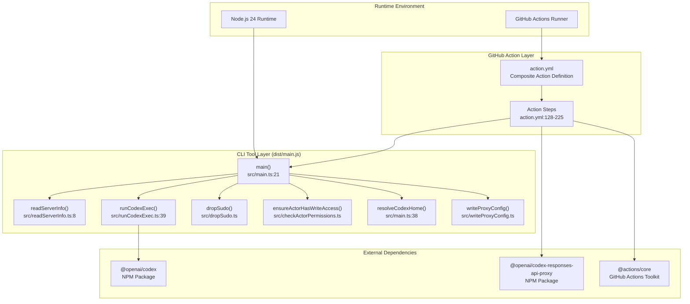
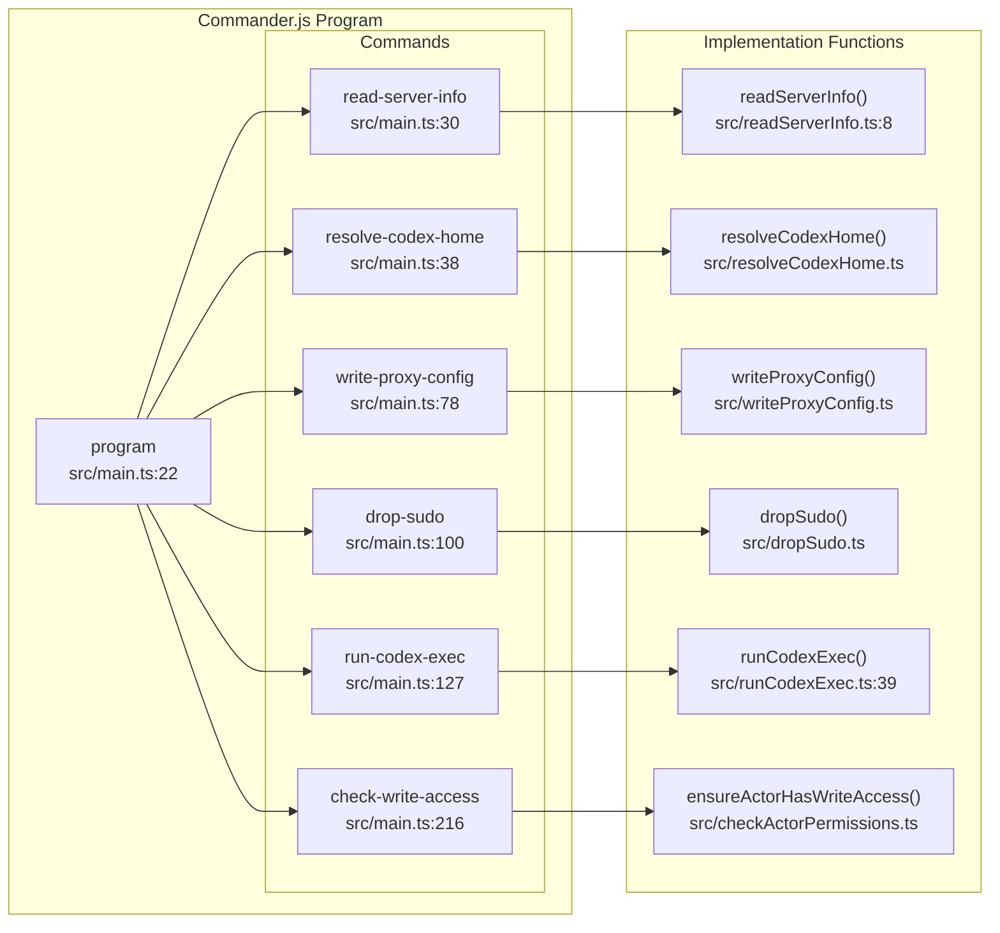
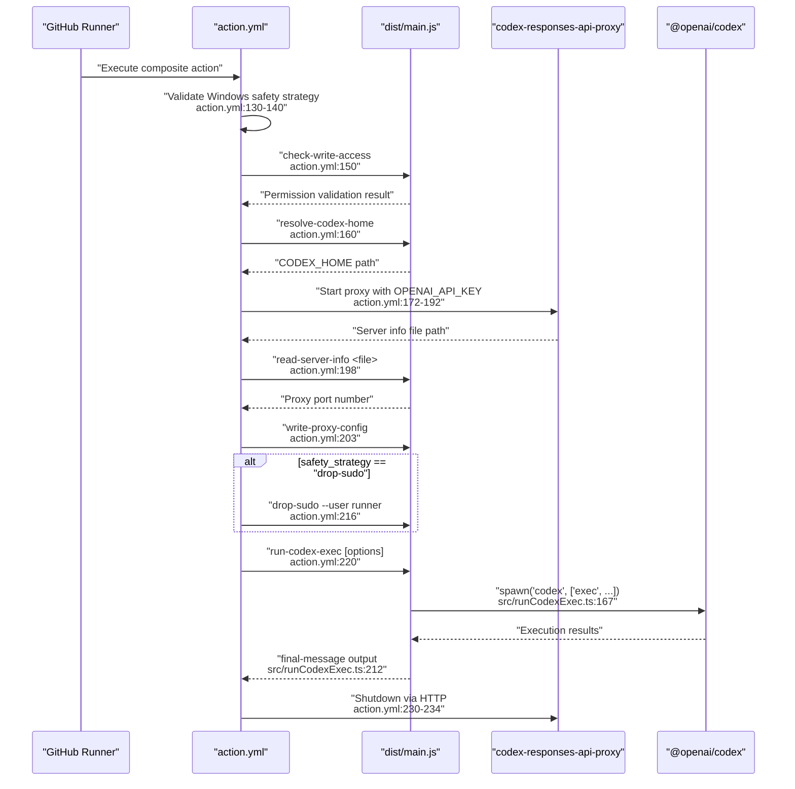

<!-- source: DeepWiki mcp.deepwiki.com · repo openai/codex-action · page 5 Internal Architecture · fetched 2026-10-26 -->

# Internal Architecture

Relevant source files

The following files were used as context for generating this wiki page:

- [action.yml](action.yml)
- [src/main.ts](src/main.ts)

This document provides a technical overview of the internal system architecture of the `codex-action` repository. It covers the core components, execution flow, and key code entities that implement the GitHub Action functionality.

For configuration reference and usage examples, see [Configuration Reference](#3). For detailed information about security mechanisms, see [Security and Safety Strategies](#4). For information about individual CLI commands, see [CLI Commands](#5.1).

## System Overview

The `codex-action` system operates as a composite GitHub Action that orchestrates the execution of OpenAI's Codex CLI through a multi-step workflow with safety mechanisms and permission controls. The architecture consists of two primary components: the action definition and an internal CLI tool that handles the core execution logic.

### Core Architecture

**Sources:** [action.yml:128-225](), [src/main.ts:21-205](), [src/runCodexExec.ts:39](), [src/main.ts:38-75](), [src/readServerInfo.ts:8-26]()

### Command Structure

The internal CLI tool implements a multi-command structure using the `Commander.js` framework:

**Sources:** [src/main.ts:22-225](), [src/runCodexExec.ts:39](), [src/readServerInfo.ts:8-26]()

## Action Execution Flow

The GitHub Action executes through a series of composite steps defined in `action.yml`, each calling specific CLI commands:

### Step-by-Step Execution

**Sources:** [action.yml:130-234](), [src/runCodexExec.ts:167-212](), [src/runCodexExec.ts:39]()

### Safety Strategy Implementation

The safety strategy system is implemented across both the action definition and CLI tool. Key strategies include `drop-sudo`, `read-only`, `unprivileged-user`, and `unsafe`. The `runCodexExec` function uses these strategies to determine the sandbox mode and whether to execute the CLI via `sudo -u`.

For details, see [CLI Commands](#5.1).

**Sources:** [src/runCodexExec.ts:18-22](), [src/runCodexExec.ts:88-91](), [src/runCodexExec.ts:117](), [src/main.ts:168-170]()

## Build and Runtime System

The system uses a TypeScript-to-JavaScript build pipeline that produces a single bundled executable at `dist/main.js`.

### Build Pipeline

The build system utilizes `pnpm` and `esbuild` to bundle the TypeScript source and dependencies into a single CommonJS file for distribution. This ensures that the action can run in a GitHub environment without needing to install its own internal dev-dependencies at runtime.

For details, see [Build System](#5.2).

**Sources:** [dist/main.js:1-32](), [src/main.ts:1-5]()

### Runtime Architecture

The compiled CLI tool runs within the GitHub Actions Node.js environment:

| Component | Runtime Location | Purpose |
|-----------|-----------------|---------|
| `dist/main.js` | GitHub Actions Runner | Main CLI executable (bundled) |
| `@openai/codex` | Global npm install | External Codex CLI |
| `codex-responses-api-proxy` | Global npm install | API proxy server |
| `CODEX_HOME` | Filesystem (default `~/.codex`) | Configuration and state storage |

**Sources:** [action.yml:147](), [src/runCodexExec.ts:153-156](), [src/main.ts:38-41]()

## Key Integration Points

### GitHub API Integration
The system uses `@octokit/rest` to verify if the actor triggering the action has sufficient permissions (write access) before proceeding with execution, particularly when `ALLOW_BOTS` is configured.

**Sources:** [src/main.ts:16](), [src/main.ts:216-225]()

### OpenAI API Integration
Integration is handled via the `codex-responses-api-proxy`. The action starts the proxy, retrieves its connection info using `read-server-info`, and configures the Codex CLI to route requests through this proxy using `write-proxy-config`. The `runCodexExec` function also supports passing model and reasoning effort parameters to the CLI.

**Sources:** [src/main.ts:30-35](), [src/main.ts:78-97](), [src/runCodexExec.ts:134-141](), [src/readServerInfo.ts:8-26]()

---

