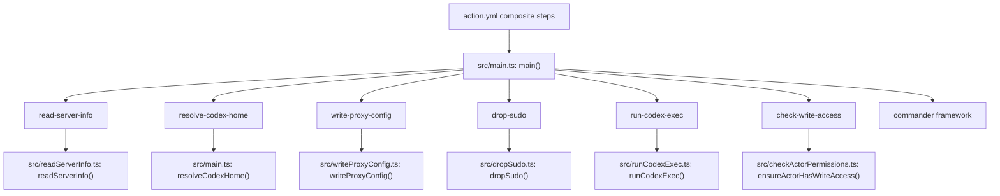
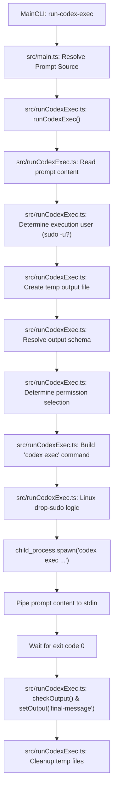

<!-- source: DeepWiki mcp.deepwiki.com · repo openai/codex-action · page 5.1 CLI Commands · fetched 2026-10-26 -->

# CLI Commands

<details>
<summary>Relevant source files</summary>

The following files were used as context for generating this wiki page:

- [src/main.ts](src/main.ts)
- [src/readServerInfo.ts](src/readServerInfo.ts)
- [src/runCodexExec.ts](src/runCodexExec.ts)

</details>


This document covers the internal CLI tool that powers the `codex-action` GitHub Action. The CLI tool, defined in [src/main.ts:21-214](), provides several core commands that handle server information reading, privilege management, environment resolution, and Codex execution orchestration.

## CLI Tool Overview

The CLI tool is implemented as a Node.js application using the `commander` framework [src/main.ts:1-1](). It serves as the primary execution engine that the GitHub Action composite steps invoke to perform specific operations safely and securely.

### Command Structure and Code Mapping

The following diagram maps the high-level CLI commands to their specific implementation files and core functions.



**CLI Tool Architecture**

Sources: [src/main.ts:1-214](), [src/readServerInfo.ts:8-8](), [src/writeProxyConfig.ts:9-9](), [src/dropSudo.ts:25-25](), [src/runCodexExec.ts:39-39](), [src/checkActorPermissions.ts:10-10]()

## Command Reference

### read-server-info

Reads server information from the Responses API Proxy to obtain the port number for Codex CLI communication.

**Syntax:**
```bash
codex-action read-server-info <serverInfoFile>
```

**Arguments:**
- `<serverInfoFile>`: Path to the server info file written by the proxy [src/main.ts:32-32]().

**Behavior:**
The command polls the specified file up to 100 times [src/readServerInfo.ts:9-9](), waiting for valid JSON containing a `port` field. Once found, it sets the GitHub Actions output `port` using `core.setOutput` [src/readServerInfo.ts:17-17]().

Sources: [src/main.ts:29-35](), [src/readServerInfo.ts:8-26]()

### resolve-codex-home

Determines the base directory for Codex configuration and data, ensuring proper path resolution based on the safety strategy.

**Syntax:**
```bash
codex-action resolve-codex-home --codex-home-override <DIR> --safety-strategy <strategy> --codex-user <user> --github-run-id <id>
```

**Behavior:**
1. If `codex-home-override` is provided, it is used.
2. If the safety strategy is `unprivileged-user`, it defaults to `/tmp/codex-<github-run-id>` to ensure the unprivileged user can access the directory [src/main.ts:64-69]().
3. Otherwise, it defaults to `~/.codex` [src/main.ts:40-40]().
4. The resolved path is set as the `codex-home` output [src/main.ts:72-72]().

Sources: [src/main.ts:37-75]()

### write-proxy-config

Writes the OpenAI Proxy model provider configuration into the `config.toml` file located in `CODEX_HOME`.

**Syntax:**
```bash
codex-action write-proxy-config --codex-home <DIR> --port <port> --safety-strategy <strategy>
```

**Implementation Details:**
- It creates a `config.toml` that sets the `model_provider` to `codex-action-responses-proxy` [src/writeProxyConfig.ts:7-24]().
- It configures the proxy URL as `http://127.0.0.1:${port}/v1` [src/writeProxyConfig.ts:33-33]().
- If `safetyStrategy` is `unprivileged-user`, it writes to a temporary file first and uses `sudo mv` via `checkOutput` to place it in the target directory, as the directory may be owned by the unprivileged user [src/writeProxyConfig.ts:40-50]().

Sources: [src/writeProxyConfig.ts:9-55](), [src/checkOutput.ts:3-27]()

### drop-sudo

Removes sudo privileges from a specified user account, supporting both Linux and macOS platforms.

**Syntax:**
```bash
codex-action drop-sudo [--user <user>] [--group <group>] [--root-phase] [--runner-credentials <json>]
```

**Parameters:**
- `--user <user>`: The user whose sudo privileges are to be dropped. Defaults to "runner" [src/main.ts:101-101]().
- `--group <group>`: The group that grants sudo privileges. Defaults to "sudo" [src/main.ts:104-106]().
- `--root-phase`: Internal flag indicating the command is being run as root [src/main.ts:108-108]().
- `--runner-credentials <json>`: Internal parameter for passing runner credentials during the root phase [src/main.ts:109-109]().

**Two-Phase Execution:**
1. **Initial Phase**: Validates passwordless sudo [src/dropSudo.ts:39-39](), invalidates cached credentials with `sudo -K` [src/dropSudo.ts:42-42](), and re-executes itself with `sudo --root-phase` to perform modifications as root [src/dropSudo.ts:48-59]().
2. **Root Phase**: Performs actual privilege removal using platform-specific commands like `deluser` or `gpasswd` (Linux) or `dseditgroup` (macOS) [src/dropSudo.ts:74-118](). It also strips entries from `/etc/sudoers` and `/etc/sudoers.d/` [src/dropSudo.ts:126-149]().

Sources: [src/main.ts:99-124](), [src/dropSudo.ts:25-161]()

### run-codex-exec

Orchestrates the execution of `codex exec` by preparing prompts, managing temporary files, and handling process spawning.

**Syntax:**
```bash
codex-action run-codex-exec --prompt <string> --prompt-file <path> --codex-home <path> --cd <path> --extra-args <json/string> --output-file <path> --output-schema-file <path> --output-schema <schema> --sandbox <mode> --permission-profile <profile> --model <model> --effort <effort> --safety-strategy <strategy> --codex-user <user>
```

**Parameters:**
- `--prompt <string>`: Inline prompt content [src/main.ts:129-129]().
- `--prompt-file <path>`: Path to a file containing the prompt [src/main.ts:131-133]().
- `--codex-home <path>`: Path to the Codex CLI home directory [src/main.ts:135-137]().
- `--cd <path>`: Working directory for Codex execution [src/main.ts:138-138]().
- `--extra-args <json/string>`: Additional arguments to pass to `codex exec` [src/main.ts:140-142]().
- `--output-file <path>`: Path where the final message from `codex exec` will be written [src/main.ts:145-147]().
- `--output-schema-file <path>`: Path to a schema file for `codex exec --output-schema` [src/main.ts:149-151]().
- `--output-schema <schema>`: Inline schema content for `codex exec --output-schema` [src/main.ts:153-155]().
- `--sandbox <mode>`: Legacy sandbox mode override [src/main.ts:157-159]().
- `--permission-profile <profile>`: Permission profile to select via `default_permissions` [src/main.ts:161-164]().
- `--model <model>`: Model the agent should use [src/main.ts:165-165]().
- `--effort <effort>`: Reasoning effort the agent should use [src/main.ts:166-166]().
- `--safety-strategy <strategy>`: Safety strategy to employ (`drop-sudo`, `read-only`, `unprivileged-user`, or `unsafe`) [src/main.ts:168-170]().
- `--codex-user <user>`: User to run `codex exec` as when using `unprivileged-user` strategy [src/main.ts:172-174]().

**Execution Flow:**
The following diagram illustrates the flow from the CLI command to the underlying `runCodexExec` implementation.



**Codex Execution Flow Details:**
1. **Prompt Resolution**: The CLI wrapper resolves the prompt from either an inline string or a file path before calling the implementation [src/main.ts:203-212](). The `runCodexExec` function then reads the content if it's a file [src/runCodexExec.ts:150-157]().
2. **Output File Handling**: An output file is created, either explicitly provided or as a temporary file [src/runCodexExec.ts:163-168]().
3. **Output Schema Resolution**: The output schema is resolved from an inline string or a file, potentially creating a temporary file for inline schemas [src/runCodexExec.ts:170-173]().
4. **Permission Selection**: Determines the sandbox mode or permission profile based on the `safetyStrategy` and provided inputs [src/runCodexExec.ts:174-179]().
5. **User Switching (`drop-sudo` and `unprivileged-user`)**:
    - If `safetyStrategy` is `drop-sudo` on Linux, it performs a complex re-execution using `sudo` and `setpriv` to drop privileges and capabilities [src/runCodexExec.ts:184-231](). This involves checking for `setpriv` and `nobody` user, and ensuring passwordless `sudo` is available initially.
    - If `safetyStrategy` is `unprivileged-user`, it resolves the full path to the `codex` binary and prefixes the command with `sudo -u <codexUser> --` [src/runCodexExec.ts:233-238]().
6. **Environment Setup**: Sets `CODEX_HOME` and `CODEX_INTERNAL_ORIGINATOR_OVERRIDE` to track the execution context [src/runCodexExec.ts:300-308]().
7. **Process Spawning**: Uses `child_process.spawn` to run the command, piping the prompt into `stdin` [src/runCodexExec.ts:310-315]().
8. **Output Processing**: After execution, `checkOutput` is called to validate and set the `final-message` action output [src/runCodexExec.ts:320-321]().
9. **Cleanup**: Deletes temporary output schema files and temporary output message files after execution is finalized [src/runCodexExec.ts:323-324]().

Sources: [src/runCodexExec.ts:39-324](), [src/main.ts:120-205]()

### check-write-access

Verifies if the GitHub actor has write access to the repository based on configured allow-lists and GitHub API permissions.

**Syntax:**
```bash
codex-action check-write-access --github-token <token> --github-api-url <url> --github-repository <repo> --github-actor <actor> --allow-users <users> --allow-bots <bots> --allow-bot-users <bot-users>
```

**Parameters:**
- `--github-token <token>`: GitHub token for API calls [src/main.ts:220-220]().
- `--github-api-url <url>`: GitHub API URL (e.g., `https://api.github.com`) [src/main.ts:221-221]().
- `--github-repository <repo>`: GitHub repository in `owner/repo` format [src/main.ts:222-222]().
- `--github-actor <actor>`: The GitHub actor (username) initiating the workflow [src/main.ts:223-223]().
- `--allow-users <users>`: Comma-separated list of allowed user logins [src/main.ts:224-224]().
- `--allow-bots <bots>`: Comma-separated list of allowed bot logins [src/main.ts:225-225]().
- `--allow-bot-users <bot-users>`: Comma-separated list of allowed bot user logins [src/main.ts:226-226]().

**Behavior:**
This command calls `ensureActorHasWriteAccess` [src/main.ts:230-230]() which performs the following checks:
1. **Allow-list Check**: Compares the `github-actor` against the provided `allow-users`, `allow-bots`, and `allow-bot-users` lists.
2. **Collaborator Permission Check**: If not in an allow-list, it uses the GitHub API (via `Octokit`) to determine if the actor has `write` or `admin` permissions on the repository [src/checkActorPermissions.ts:10-10]().
3. **Output**: Sets the `has-write-access` output to `true` or `false` [src/checkActorPermissions.ts:10-10]().

Sources: [src/main.ts:217-232](), [src/checkActorPermissions.ts:10-10]()

## Internal Helpers

The CLI tool utilizes several internal utilities for robust command execution:

- **`checkOutput`**: Spawns a process and returns its `stdout` as a string, rejecting on non-zero exit codes. It is used for operations like moving config files under sudo [src/checkOutput.ts:3-27](), [src/writeProxyConfig.ts:47-47]().
- **`parseExtraArgs`**: Handles the conversion of `--extra-args` from either a JSON array or a shell-escaped string [src/main.ts:135-135]().
- **`createTempDir`**: Creates temporary directories with appropriate permissions based on whether a specific user needs access (used during `unprivileged-user` setup) [src/runCodexExec.ts:244-246]().

Sources: [src/checkOutput.ts:1-27](), [src/runCodexExec.ts:239-246](), [src/main.ts:135-135]()

---

