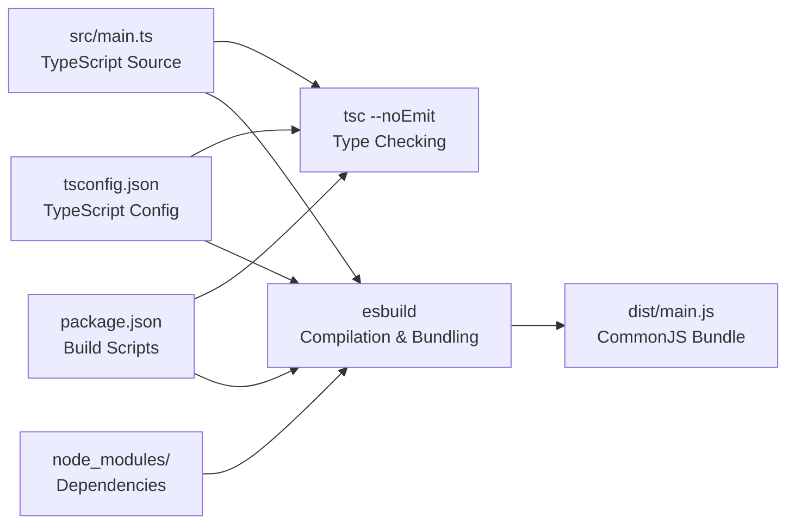
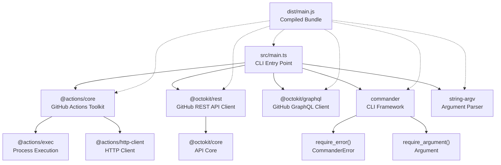
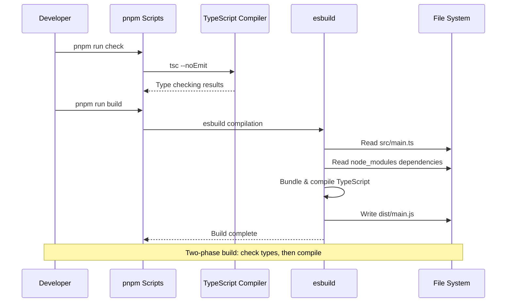

<!-- source: DeepWiki mcp.deepwiki.com · repo openai/codex-action · page 5.2 Build System · fetched 2026-10-26 -->

# Build System

Relevant source files

The following files were used as context for generating this wiki page:

- [.gitignore](.gitignore)
- [dist/main.js](dist/main.js)
- [package.json](package.json)
- [pnpm-lock.yaml](pnpm-lock.yaml)
- [tsconfig.json](tsconfig.json)

This document covers the TypeScript build system used to compile and bundle the `codex-action` source code into a distributable GitHub Action. The build system transforms TypeScript source files into a single CommonJS bundle that can be executed in the GitHub Actions runtime environment.

For information about the CLI commands implemented in the compiled output, see [CLI Commands](5.1). For details about the CI/CD pipeline that verifies the build, see [Build and CI Pipeline](6.2).

## Overview

The build system is centered around **esbuild**, a fast JavaScript bundler that compiles TypeScript source code and bundles all dependencies into a single executable file. The system targets Node.js 20 and produces CommonJS output suitable for GitHub Actions runtime execution.

**Build Toolchain Flow**

Sources: [package.json:6-9](), [tsconfig.json:1-14](), [dist/main.js:1-10]()

## Build Configuration

### TypeScript Configuration

The TypeScript compiler is configured through `tsconfig.json` with strict settings optimized for Node.js development:

| Setting | Value | Purpose |
|---------|-------|---------|
| `target` | `ES2021` | Modern JavaScript features for Node.js 20 [tsconfig.json:3]() |
| `module` | `ESNext` | ESModule syntax for better tree-shaking [tsconfig.json:4]() |
| `moduleResolution` | `Node` | Node.js module resolution algorithm [tsconfig.json:5]() |
| `strict` | `true` | All strict type checking options enabled [tsconfig.json:8]() |
| `noEmit` | `true` | Type checking only, no JavaScript output [tsconfig.json:11]() |

The build process separates type checking (`tsc --noEmit`) from compilation (`esbuild`), allowing for faster development cycles.

Sources: [tsconfig.json:2-11]()

### esbuild Configuration

The primary build command configures esbuild with the following parameters defined in `package.json`:

`esbuild src/main.ts --sourcemap=inline --format=cjs --bundle --platform=node --target=node20 --outdir=dist` [package.json:7]()

| Parameter | Purpose |
|-----------|---------|
| `src/main.ts` | Entry point for bundling [package.json:7]() |
| `--sourcemap=inline` | Inline source maps for debugging [package.json:7]() |
| `--format=cjs` | CommonJS output format for GitHub Actions [package.json:7]() |
| `--bundle` | Bundle all dependencies into single file [package.json:7]() |
| `--platform=node` | Node.js runtime optimizations [package.json:7]() |
| `--target=node20` | Target Node.js 20 runtime [package.json:7]() |
| `--outdir=dist` | Output directory for compiled bundle [package.json:7]() |

Sources: [package.json:7]()

## Dependency Architecture

**Runtime Dependencies Structure**

Sources: [package.json:11-17](), [pnpm-lock.yaml:9-36](), [dist/main.js:34-72]()

### Core Dependencies

| Dependency | Version | Purpose |
|------------|---------|---------|
| `@actions/core` | `^1.11.1` | GitHub Actions SDK for inputs/outputs [package.json:12]() |
| `@octokit/rest` | `^21.1.1` | GitHub REST API client [package.json:14]() |
| `@octokit/graphql` | `^8.2.2` | GitHub GraphQL API client [package.json:13]() |
| `commander` | `14.0.1` | CLI argument parsing and command structure [package.json:15]() |
| `string-argv` | `0.3.2` | Command line string to argv conversion [package.json:16]() |

### Development Dependencies

| Dependency | Version | Purpose |
|------------|---------|---------|
| `typescript` | `^5.4.5` | TypeScript compiler [package.json:21]() |
| `esbuild` | `^0.23.0` | JavaScript bundler [package.json:20]() |
| `@types/node` | `^20.12.7` | Node.js type definitions [package.json:19]() |

Sources: [package.json:11-22]()

## Build Process

**Build Pipeline**

Sources: [package.json:7-8]()

### Build Scripts

The `package.json` defines three main build and verification operations:

- **`check`**: Runs TypeScript type checking without emitting files (`tsc --noEmit`). [package.json:8]()
- **`build`**: Compiles and bundles the application using esbuild into `dist/`. [package.json:7]()
- **`test`**: Triggers a fresh build and then executes Node.js native tests on files in `test/*.test.mjs`. [package.json:9]()

### Output Artifacts and dist/ Synchronization

The build process generates a single output file:

- **`dist/main.js`**: Complete CommonJS bundle containing all source code and dependencies. [package.json:7](), [dist/main.js:1-31]()

The project enforces a **dist synchronization requirement**. Because GitHub Actions execute the code present in the repository (typically pointing to `dist/main.js`), the compiled bundle must be committed to version control. The CI pipeline includes a check to ensure the committed `dist/` matches the result of a fresh `pnpm run build`.

Sources: [package.json:7](), [dist/main.js:1-31]()

## Package Management

The project uses **pnpm** as the package manager, specifically version `10.33.0`. The lockfile (`pnpm-lock.yaml`) uses lockfile version 9.0 and includes detailed dependency resolution with integrity checksums.

**Key pnpm Configuration:**
- `autoInstallPeers: true` - Automatically install peer dependencies. [pnpm-lock.yaml:4]()
- `excludeLinksFromLockfile: false` - Include symbolic links in lockfile. [pnpm-lock.yaml:5]()
- `packageManager` - Defined as `pnpm@10.33.0`. [package.json:24]()

The dependency resolution includes platform-specific optional dependencies for esbuild (e.g., `@esbuild/linux-x64`, `@esbuild/darwin-arm64`), supporting cross-platform development and deployment.

Sources: [package.json:24](), [pnpm-lock.yaml:1-5](), [pnpm-lock.yaml:51-193]()

---

