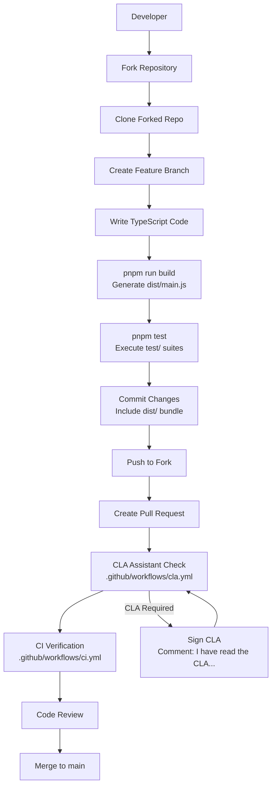
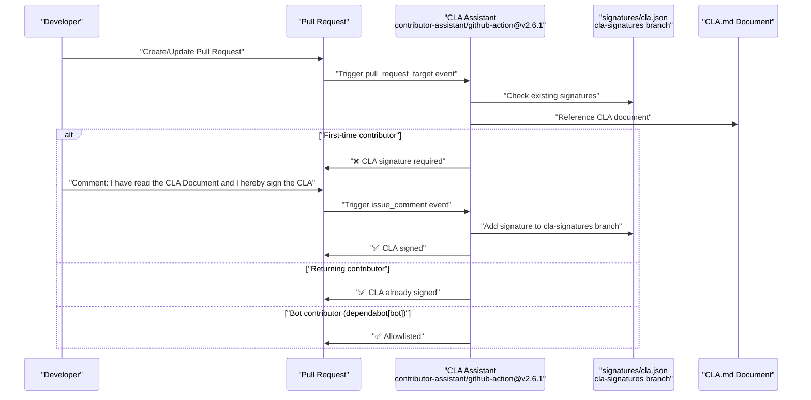
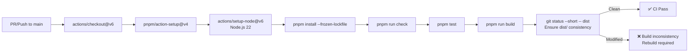

<!-- source: DeepWiki mcp.deepwiki.com · repo openai/codex-action · page 6 Development Guide · fetched 2026-10-26 -->

# Development Guide

Relevant source files

The following files were used as context for generating this wiki page:

- [.github/workflows/ci.yml](.github/workflows/ci.yml)
- [package.json](package.json)

This document provides an overview of the development workflow, contribution requirements, and project governance for the `codex-action` repository. It covers the essential processes that developers need to understand when contributing to this project, including the Contributor License Agreement (CLA) requirements and the continuous integration pipeline.

For detailed information about the CLA process and contributor requirements, see [Contributing and CLA Process](#6.1). For specific details about the build system and CI pipeline implementation, see [Build and CI Pipeline](#6.2).

## Development Workflow Overview

The development process follows a standard GitHub workflow with additional governance requirements. All contributions must comply with the CLA requirements and pass automated build verification.

### Core Development Flow

**Sources:** [.github/workflows/ci.yml:1-46]()

## Contributor License Agreement Process

All contributors must sign a Contributor License Agreement (CLA) before their contributions can be accepted. This process is automated through the CLA Assistant GitHub Action.

### CLA Enforcement Workflow

The CLA workflow automatically triggers on:
- Pull request creation, updates, or closure.
- Issue comments with specific trigger phrases like "I have read the CLA Document and I hereby sign the CLA".
- Manual recheck commands using the "recheck" keyword.

For details, see [Contributing and CLA Process](#6.1).

## Build System Overview

The project uses a TypeScript-based build system with `pnpm` for package management and a bundled output strategy for GitHub Actions compatibility.

### Build Configuration

| Component | Configuration | Purpose |
|-----------|---------------|---------|
| Package Manager | `pnpm` | Dependency management with `--frozen-lockfile` enforcement [[.github/workflows/ci.yml:28]()] |
| Runtime Target | `Node.js 22` | Development and CI execution environment [[.github/workflows/ci.yml:24]()] |
| Build Tool | `pnpm run build` | Bundles TypeScript source into the `dist/` directory [[.github/workflows/ci.yml:37]()] |
| Verification | `pnpm run check` | Performs static type analysis [[.github/workflows/ci.yml:31]()] |

**Sources:** [.github/workflows/ci.yml:21-37]()

## Continuous Integration Pipeline

The CI pipeline ensures code quality and build consistency through automated verification on every pull request and push to the main branch [[.github/workflows/ci.yml:3-7]()].

### CI Workflow Steps

**Sources:** [.github/workflows/ci.yml:10-46]()

### Test Infrastructure
The project utilizes Node.js's native test runner for verifying CLI behavior and security logic. The `pnpm test` command executes tests located under the `test/` directory [[package.json:9]()].

The CI pipeline enforces a "dist synchronization" check: if running `pnpm run build` results in changes to the `dist/` directory that were not committed by the developer, the build fails [[.github/workflows/ci.yml:39-46]()].

For details, see [Build and CI Pipeline](#6.2) and [Test Suite](#6.3).

## Project Governance

The project operates under a governance model that combines automated enforcement with manual review processes.

### Access Control and Permissions

The CLA workflow requires specific GitHub permissions to function, including write access to contents (for signatures) and pull-requests.

| Permission | Purpose |
|------------|---------|
| `actions: write` | Manage workflow runs |
| `contents: write` | Update `signatures/cla.json` on the `cla-signatures` branch |
| `pull-requests: write` | Comment on PRs and manage labels |
| `statuses: write` | Update the commit status check for CLA compliance |

---

