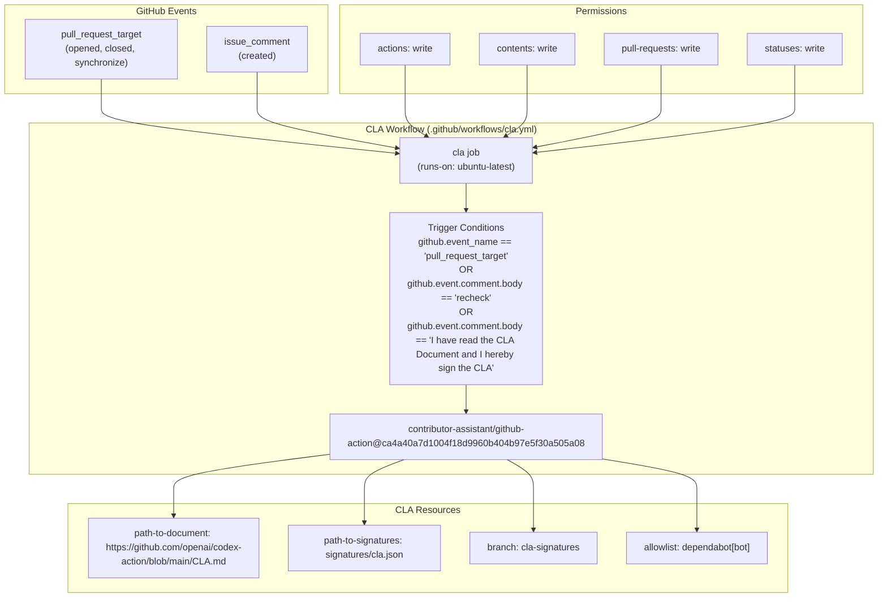
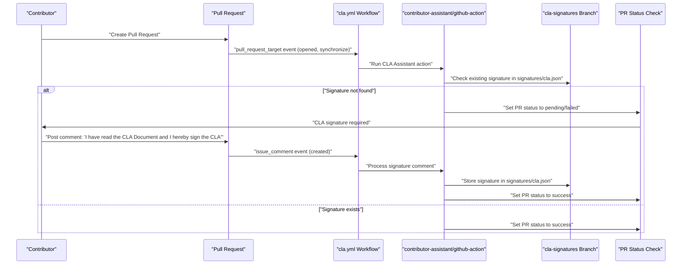
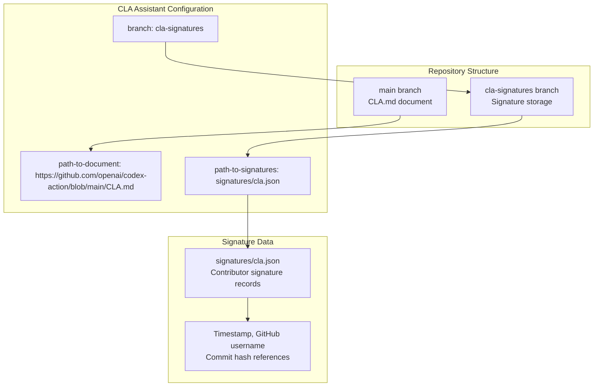

<!-- source: DeepWiki mcp.deepwiki.com · repo openai/codex-action · page 6.1 Contributing and CLA Process · fetched 2026-10-26 -->

# Contributing and CLA Process

<details>
<summary>Relevant source files</summary>

The following files were used as context for generating this wiki page:

- [.github/workflows/cla.yml](.github/workflows/cla.yml)
- [CLA.md](CLA.md)
- [LICENSE](LICENSE)

</details>


This document covers the Contributor License Agreement (CLA) process required for contributing to the `codex-action` repository. It explains how the automated CLA Assistant workflow operates, how contributors sign the agreement, and how signatures are managed.

For information about the build system and CI pipeline, see [6.2 Build and CI Pipeline](). For the complete legal framework including licensing terms, see [7. Legal and Licensing]().

## CLA Workflow Overview

The `codex-action` repository uses an automated CLA process implemented through the GitHub Actions CLA Assistant workflow. All contributors must sign the Individual Contributor License Agreement before their contributions can be accepted.

### CLA Assistant Workflow


Sources: [.github/workflows/cla.yml:1-29]()

### CLA Document Structure

The CLA is based on the Apache Software Foundation Individual CLA v2.2 and contains five main sections:

| Section | Description | Key Terms |
|---------|-------------|-----------|
| 1. Definitions | Defines "Contribution" and "You/Your" | Original work of authorship, individual or legal entity [CLA.md:12-17]() |
| 2. Copyright License | Grants perpetual, royalty-free license | Reproduce, derivative works, distribute [CLA.md:18-22]() |
| 3. Patent License | Patent rights and termination conditions | Make, use, sell, patent litigation termination [CLA.md:24-32]() |
| 4. Representations | Contributor warranties and obligations | Legal entitlement, original creation, "AS IS" provision [CLA.md:34-40]() |
| 5. Miscellany | Governing law and enforceability | California law, severability clause [CLA.md:41-44]() |

Sources: [CLA.md:1-44]()

## How to Sign the CLA

Contributors must sign the CLA by posting a specific comment on their Pull Request. The process is automated and validates the signature against the stored CLA document.

### Signing Process Flow



### Required Comment Text

Contributors must post this exact comment on their Pull Request to agree to the terms for the **OpenAI Codex CLI project**:

```
I have read the CLA Document and I hereby sign the CLA
```

The CLA Assistant workflow also responds to the `recheck` command to re-evaluate CLA status if the automated check fails to update.

Sources: [.github/workflows/cla.yml:19-22](), [CLA.md:5-8]()

## Bot Allowlists and Actor Verification

The repository manages permissions through an allowlist within the CLA Assistant configuration to ensure automated services are not blocked by signature requirements.

### CLA Allowlist
The CLA workflow includes an allowlist for automated accounts that do not require manual signatures:
- `dependabot[bot]`: GitHub's automated dependency update service.

Sources: [.github/workflows/cla.yml:29]()

## Technical Implementation Details

### Workflow Triggers and Conditions

The CLA workflow in [.github/workflows/cla.yml]() uses specific event triggers and conditional logic to handle different scenarios, ensuring the action only runs when relevant to CLA management.

```yaml
# Event triggers
on:
  issue_comment:
    types: [created]
  pull_request_target:
    types: [opened, closed, synchronize]

# Execution conditions
if: |
  github.event_name == 'pull_request_target' ||
  github.event.comment.body == 'recheck' ||
  github.event.comment.body == 'I have read the CLA Document and I hereby sign the CLA'
```
Sources: [.github/workflows/cla.yml:2-6](), [.github/workflows/cla.yml:19-22]()

### Required Permissions

The workflow requires elevated permissions via the `GITHUB_TOKEN` to manage the lifecycle of the CLA check:

| Permission | Access Level | Purpose |
|------------|--------------|---------|
| `actions` | write | Manage workflow runs and status [.github/workflows/cla.yml:9]() |
| `contents` | write | Access and modify repository contents (signature storage) [.github/workflows/cla.yml:10]() |
| `pull-requests` | write | Update PR status and post comments [.github/workflows/cla.yml:11]() |
| `statuses` | write | Set commit status checks for PR gating [.github/workflows/cla.yml:12]() |

Sources: [.github/workflows/cla.yml:8-12]()

## Signature Management

CLA signatures are stored and managed in a dedicated branch with JSON-based tracking to maintain a clean history on the main development branch.

### Signature Storage Architecture



### Configuration Parameters

The CLA Assistant uses the following configuration parameters defined in the workflow file:

- **Document URL**: `https://github.com/openai/codex-action/blob/main/CLA.md` [.github/workflows/cla.yml:26]()
- **Signatures Path**: `signatures/cla.json` [.github/workflows/cla.yml:27]()
- **Storage Branch**: `cla-signatures` [.github/workflows/cla.yml:28]()
- **Allowlist**: `dependabot[bot]` [.github/workflows/cla.yml:29]()

This setup ensures that:
1. The CLA document remains accessible on the `main` branch.
2. Signatures are stored separately in the `cla-signatures` branch to avoid cluttering the main codebase history.
3. The `signatures/cla.json` file maintains a complete audit trail of contributors.
4. Automated accounts like `dependabot[bot]` can contribute without manual intervention.

Sources: [.github/workflows/cla.yml:25-29]()

---

