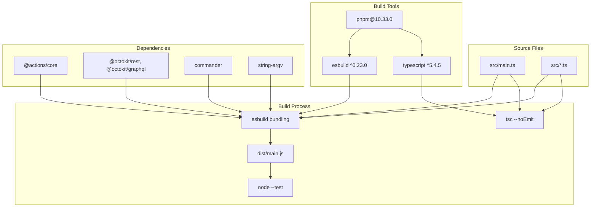
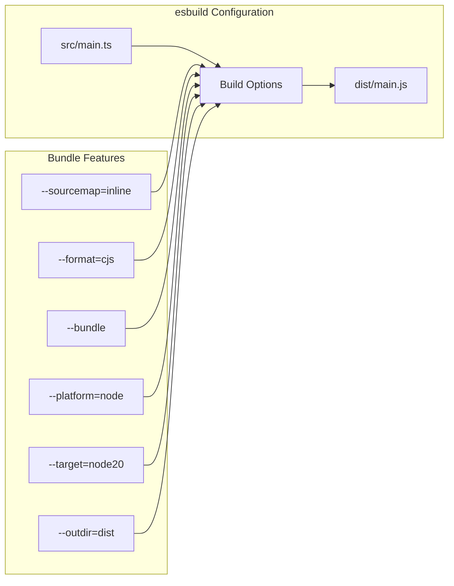
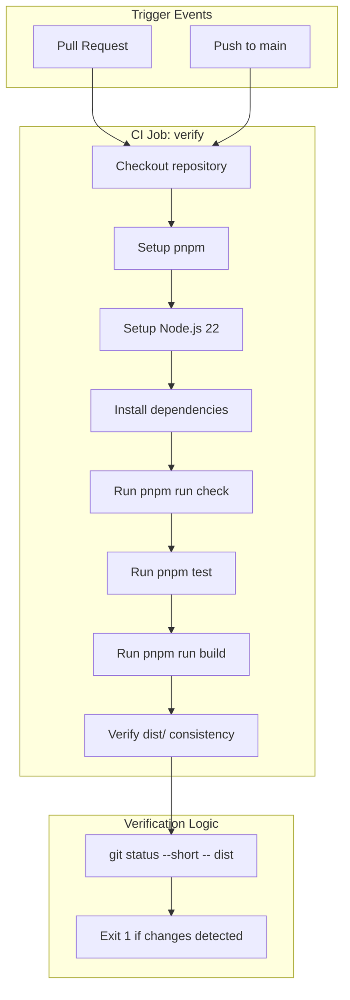
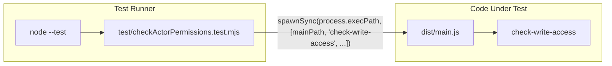

<!-- source: DeepWiki mcp.deepwiki.com · repo openai/codex-action · page 6.2 Build and CI Pipeline · fetched 2026-10-26 -->

# Build and CI Pipeline

<details>
<summary>Relevant source files</summary>

The following files were used as context for generating this wiki page:

- [.github/workflows/ci.yml](.github/workflows/ci.yml)
- [package.json](package.json)
- [pnpm-lock.yaml](pnpm-lock.yaml)

</details>


This document covers the TypeScript build system and continuous integration pipeline for the `codex-action` repository. It details the compilation process from TypeScript source to bundled JavaScript, dependency management, and automated verification workflows.

## Overview

The `codex-action` project uses a modern JavaScript build pipeline centered around TypeScript compilation and `esbuild` bundling. The system transforms TypeScript source files into a single bundled JavaScript file that serves as the entry point for the GitHub Action runtime.

## Build Architecture



**Build Tool Configuration**

The build process uses three primary scripts defined in [package.json:6-10]():

- `check`: Runs TypeScript type checking without emitting files via `tsc --noEmit` [package.json:8-8]().
- `build`: Bundles TypeScript source into a single JavaScript file using `esbuild` [package.json:7-7]().
- `test`: Triggers a build and then executes the test suite using the Node.js native test runner against files in the `test/` directory [package.json:9-9]().

Sources: [package.json:6-10]()

## esbuild Bundling Process



The `esbuild` command in [package.json:7]() uses these key options to produce the final GitHub Action executable:

- `--sourcemap=inline`: Embeds source maps for debugging within the production bundle.
- `--format=cjs`: Outputs CommonJS modules for Node.js compatibility.
- `--bundle`: Combines all dependencies into a single file to avoid node_modules overhead at runtime.
- `--platform=node`: Optimizes for Node.js runtime environments.
- `--target=node20`: Targets Node.js version 20 compatibility.
- `--outdir=dist`: Outputs the bundled file to the `dist/` directory.

Sources: [package.json:7-7]()

## Dependency Management

The project uses `pnpm` as its package manager, configured in [package.json:23]() with a specific version and hash. Dependencies are categorized into runtime and development dependencies:

**Runtime Dependencies** [package.json:11-17]()
- `@actions/core`: GitHub Actions toolkit for input/output handling.
- `@octokit/graphql`: GitHub API client for GraphQL interactions.
- `@octokit/plugin-retry`: Octokit plugin for retrying failed requests.
- `@octokit/rest`: GitHub API client for REST interactions.
- `commander`: CLI framework for parsing internal commands.
- `string-argv`: Argument string parsing utilities for command execution.

**Development Dependencies** [package.json:18-22]()
- `@types/node`: Node.js type definitions for TypeScript.
- `esbuild`: The primary JavaScript bundler.
- `typescript`: The TypeScript compiler used for type checking.

Sources: [package.json:11-23]()

## CI Pipeline Workflow



The CI workflow defined in [.github/workflows/ci.yml:1-46]() runs on Ubuntu and performs these steps:

1.  **Repository Checkout**: Uses `actions/checkout@v6` [actions/checkout@de0fac2e4500dabe0009e67214ff5f5447ce83dd]().
2.  **pnpm Setup**: Configures `pnpm` version 4 via `pnpm/action-setup` [pnpm/action-setup@02f6c237bd2518259fed6c71566509edfb3f2b74](). The `run_install: false` option prevents automatic dependency installation at this stage [pnpm/action-setup@02f6c237bd2518259fed6c71566509edfb3f2b74]().
3.  **Node.js Setup**: Installs Node.js 22 with `pnpm` cache enabled using `actions/setup-node@v6` [actions/setup-node@53b83947a5a98c8d113130e565377fae1a50d02f]().
4.  **Dependency Installation**: Runs `pnpm install --frozen-lockfile` to ensure deterministic builds based on the lockfile [package.json:25](). This command ensures that the installed dependencies exactly match those specified in `pnpm-lock.yaml` [pnpm-lock.yaml:1-1]().
5.  **Type Checking**: Executes `pnpm run check` to verify TypeScript integrity [package.json:25]().
6.  **Test Execution**: Runs `pnpm test` to verify logic against the bundled output [package.json:25]().
7.  **Bundle Building**: Executes `pnpm run build` to generate the latest `dist/` files [package.json:25]().
8.  **Consistency Verification**: Ensures the committed `dist/` matches the newly built output [package.json:25]().

Sources: [.github/workflows/ci.yml:1-46](), [package.json:25](), [pnpm-lock.yaml:1-1]()

## Test Execution and Verification

The test suite validates the behavior of the bundled code by spawning the bundled script. For example, `test/checkActorPermissions.test.mjs` executes `dist/main.js` with specific subcommands to verify actor permission logic.



The `runCheckWriteAccess` helper in the test suite [test/checkActorPermissions.test.mjs:8-21]() demonstrates how tests interact with the bundled `dist/main.js` by setting `GITHUB_ACTOR` environment variables and invoking subcommands.

The CI pipeline includes a critical verification step in [.github/workflows/ci.yml:39-46]() to prevent inconsistencies between committed bundled files and source code:

```bash
status_output="$(git status --short -- dist)"
if [[ -n "$status_output" ]]; then
  echo '::error::Detected modified files in dist/ after running pnpm run build. Please rebuild locally and commit the updated bundles.'
  echo "$status_output"
  exit 1
fi
```

This check ensures that:
- The `dist/main.js` file is current with source changes.
- Developers must rebuild and commit bundled output whenever source files are modified.
- The GitHub Action runtime always executes the code that corresponds to the source in the same commit.

Sources: [.github/workflows/ci.yml:39-46](), [test/checkActorPermissions.test.mjs:6-21](), [package.json:9-9]()

## Package Manager Configuration

The project enforces `pnpm` usage via [package.json:23]() with a specific version and hash constraint to ensure environment consistency:

```json
"packageManager": "pnpm@10.33.0+sha512.10568bb4a6afb58c9eb3630da90cc9516417abebd3fabbe6739f0ae795728da1491e9db5a544c76ad8eb7570f5c4bb3d6c637b2cb41bfdcdb47fa823c8649319"
```

The CI workflow uses `pnpm/action-setup@v4` with `run_install: false` to avoid automatic installation [.github/workflows/ci.yml:19-19](), followed by explicit `pnpm install --frozen-lockfile` [.github/workflows/ci.yml:28-28]() to ensure exact dependency versions match the lockfile precisely.

Sources: [package.json:23-23](), [.github/workflows/ci.yml:16-28]()

---

