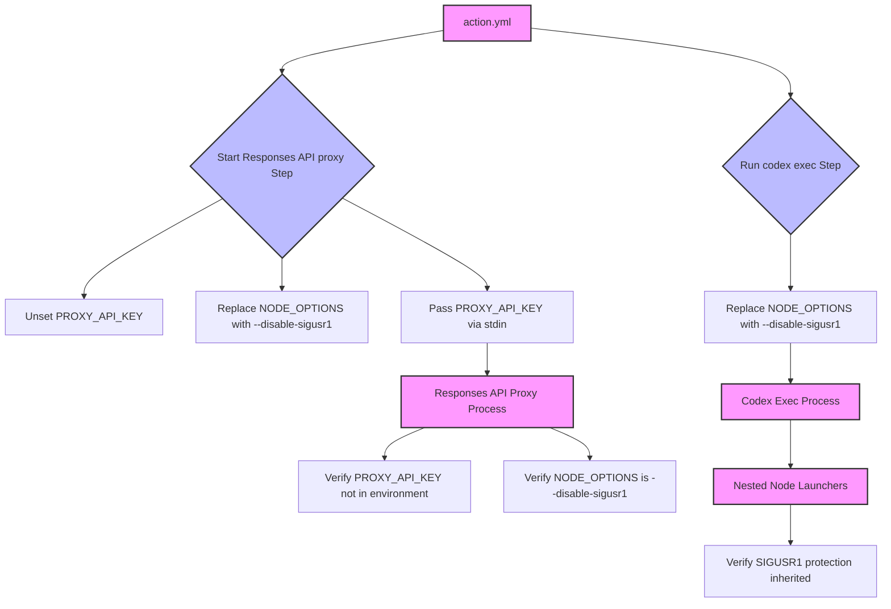

<!-- source: DeepWiki mcp.deepwiki.com · repo openai/codex-action · page 6.3 Test Suite · fetched 2026-10-26 -->

# Test Suite

<details>
<summary>Relevant source files</summary>

The following files were used as context for generating this wiki page:

- [test/actionHardening.test.mjs](test/actionHardening.test.mjs)
- [test/checkActorPermissions.test.mjs](test/checkActorPermissions.test.mjs)
- [test/linuxCredentials.test.mjs](test/linuxCredentials.test.mjs)
- [test/runCodexExec.test.mjs](test/runCodexExec.test.mjs)

</details>


This page details the testing methodologies and specific test suites employed within the `codex-action` repository. The tests, located under the `test/` directory, ensure the robustness, security, and correct behavior of the GitHub Action. They cover various aspects, including the interaction with a fake Codex executable, enforcement of arguments and sandbox policies, hardening of `action.yml` configurations, privilege dropping mechanisms, and permission checks.

## Fake Codex Executable Harness

Many tests rely on a "fake" Codex executable to simulate the behavior of the actual OpenAI Codex CLI without requiring an API key or making external API calls. This fake executable is dynamically generated and placed on the `PATH` during test execution. Its primary function is to capture the arguments it receives and write them to a designated file, along with a "fake final message" to an output file. This allows tests to verify that the `codex-action` correctly constructs and passes arguments to the underlying Codex CLI, and handles its output, without needing to interact with the real Codex service.

The `runCodexExecWithFakeCodex` function [test/runCodexExec.test.mjs:23-112]() is central to this harness. It creates a temporary directory, writes the fake `codex.mjs` script, and creates platform-specific launchers (`codex` for POSIX and `codex.cmd` for Windows) to execute the fake script. It then invokes the `run-codex-exec` command of the `codex-action`'s internal CLI, setting up environment variables like `PATH` to ensure the fake Codex is found first.

```mermaid
graph TD
    A[Test Case] --> B{runCodexExecWithFakeCodex()};
    B --> C[Create Temp Directory];
    C --> D[Write fake codex.mjs];
    D --> E[Create POSIX 'codex' launcher];
    D --> F[Create Windows 'codex.cmd' launcher];
    E --> G[Set PATH to include Temp Directory];
    F --> G;
    G --> H[Spawn 'run-codex-exec' command];
    H --> I{Fake Codex Executable};
    I --> J[Capture Arguments to args.json];
    I --> K[Write "fake final message" to output file];
    H --> L[Read captured arguments];
    L --> M[Return result and capturedArgs];
    M --> A;

    style A fill:#f9f,stroke:#333,stroke-width:2px
    style B fill:#bbf,stroke:#333,stroke-width:2px
    style H fill:#bbf,stroke:#333,stroke-width:2px
    style I fill:#f9f,stroke:#333,stroke-width:2px
```
**Figure 1: Fake Codex Executable Harness Flow**

Sources:
* [test/runCodexExec.test.mjs:23-112]()

## Argument and Sandbox Enforcement Tests

These tests, primarily found in `test/runCodexExec.test.mjs`, validate that the `codex-action` correctly enforces argument validation and sandbox policies. They ensure that mutually exclusive options are rejected and that sensitive arguments cannot be overridden.

Key scenarios tested include:
*   **Legacy Sandbox Preservation**: Verifies that `workspace-write` is the default legacy sandbox when no `sandbox` or `permission-profile` is specified [test/runCodexExec.test.mjs:114-119]().
*   **Permission Profile Selection**: Confirms that a `permission-profile` can be selected without explicitly passing `--sandbox` to the Codex CLI [test/runCodexExec.test.mjs:130-141]().
*   **Mutual Exclusivity**: Asserts that `permission-profile` and `sandbox` inputs are mutually exclusive [test/runCodexExec.test.mjs:143-152]().
*   **`read-only` Strategy Enforcement**: Checks that `permission-profile` is rejected when the `read-only` safety strategy is used, as it forces the legacy `read-only` sandbox [test/runCodexExec.test.mjs:154-163]().
*   **`codex-args` Overrides**: Tests that attempts to override sandbox settings via `codex-args` are rejected when a `permission-profile` is specified [test/runCodexExec.test.mjs:165-181]().
*   **Protected Arguments**: A comprehensive set of tests ensures that various sensitive configuration options, such as `notifications`, `mcp_servers`, `inline hooks`, `model_provider`, and API endpoints, cannot be overridden via `codex-args` [test/runCodexExec.test.mjs:184-210](). This is crucial for preventing privilege escalation and unauthorized access.

Sources:
* [test/runCodexExec.test.mjs:114-210]()

## `action.yml` Hardening Tests

The `test/actionHardening.test.mjs` suite focuses on verifying the security hardening measures implemented directly within the `action.yml` workflow definition. These tests are particularly important for ensuring that sensitive information, such as API keys, is not inadvertently exposed to child processes or the environment, and that Node.js options are correctly managed to prevent security vulnerabilities.

Key tests include:
*   **Responses Proxy Node Options and API Key Handling**: Verifies that the "Start Responses API proxy" step in `action.yml` correctly replaces inherited `NODE_OPTIONS` and explicitly unsets `PROXY_API_KEY` from the environment before executing the proxy [test/actionHardening.test.mjs:30-37](). It also confirms that the API key is passed securely via standard input, not as an environment variable [test/actionHardening.test.mjs:40-78]().
*   **No Credential-Bearing Background Processes**: On Linux, this test ensures that after the Responses API proxy starts, no background processes retain the `PROXY_API_KEY` in their environment [test/actionHardening.test.mjs:81-190](). This is achieved by inspecting `/proc/<pid>/environ` for the secret.
*   **Codex Action Node Options Inheritance**: Confirms that the "Run codex exec" step also replaces inherited `NODE_OPTIONS` to enforce `--disable-sigusr1`, preventing potential signal-based attacks or unintended behavior [test/actionHardening.test.mjs:193-199]().
*   **Nested Node Launchers SIGUSR1 Protection**: Ensures that even nested Node.js processes launched by the action inherit the `--disable-sigusr1` protection [test/actionHardening.test.mjs:202-208]().


**Figure 2: `action.yml` Hardening Test Flow**

Sources:
* [test/actionHardening.test.mjs:30-37]()
* [test/actionHardening.test.mjs:40-78]()
* [test/actionHardening.test.mjs:81-190]()
* [test/actionHardening.test.mjs:193-199]()
* [test/actionHardening.test.mjs:202-208]()

## Drop-Sudo and Linux Credential Tests

The `test/linuxCredentials.test.mjs` suite specifically targets the privilege dropping mechanisms on Linux, particularly the `drop-sudo` safety strategy. These tests ensure that user credentials are correctly captured, serialized, and passed between the root and user phases of the `drop-sudo` process, and that malformed or privileged credentials are rejected.

Key functionalities tested:
*   **Credential Preservation Across Phases**: Verifies that both the `runCodexExec` and `dropSudo` launchers correctly capture and pass the original process credentials (user ID, primary group ID, supplementary group IDs) during the transition from the root phase to the unprivileged user phase [test/linuxCredentials.test.mjs:46-78]().
*   **Live Credential Capture**: Asserts that the `captureLinuxRunnerCredentials` function correctly captures the live credentials without spawning any child processes [test/linuxCredentials.test.mjs:80-88]().
*   **Group Inclusion Logic**: Tests the `includeAccountGroups` function to ensure it correctly merges live-only primary and supplementary groups with the original credentials, while also rejecting invalid user ID mismatches [test/linuxCredentials.test.mjs:90-94]().
*   **Credential Validation**: Ensures that `parseLinuxRunnerCredentials` rejects malformed or root-level runner credentials, preventing attempts to run the action with elevated privileges [test/linuxCredentials.test.mjs:97-107]().

```mermaid
graph TD
    A[Initial Process (Root)] --> B{captureLinuxRunnerCredentials()};
    B --> C[Original Credentials (userId, primaryGroupId, supplementaryGroupIds)];
    C --> D[runCodexExec() or dropSudo()];
    D --> E[Serialize Credentials to JSON];
    E --> F[Spawn Child Process (Unprivileged User)];
    F --> G[Child Process receives JSON credentials];
    G --> H{parseLinuxRunnerCredentials()};
    H --> I[Validate and use Unprivileged Credentials];
    I --> J[includeAccountGroups() for group merging];

    subgraph Credential Validation
        K[Malformed Credentials] --> L[parseLinuxRunnerCredentials() throws error];
        M[Root Credentials (userId=0)] --> L;
    end

    style A fill:#f9f,stroke:#333,stroke-width:2px
    style B fill:#bbf,stroke:#333,stroke-width:2px
    style D fill:#bbf,stroke:#333,stroke-width:2px
    style F fill:#f9f,stroke:#333,stroke-width:2px
    style H fill:#bbf,stroke:#333,stroke-width:2px
    style L fill:#f9f,stroke:#333,stroke-width:2px
```
**Figure 3: Linux Credential Handling and Drop-Sudo Flow**

Sources:
* [test/linuxCredentials.test.mjs:46-78]()
* [test/linuxCredentials.test.mjs:80-88]()
* [test/linuxCredentials.test.mjs:90-94]()
* [test/linuxCredentials.test.mjs:97-107]()

## Permission Check Tests

The `test/checkActorPermissions.test.mjs` suite validates the `check-write-access` command, which is responsible for determining if the GitHub actor has sufficient permissions to execute the action. These tests cover various scenarios involving human users, trusted bots, custom bot allowlists, and API interaction robustness.

Key aspects tested:
*   **Bot Actor Trust**: Ensures that arbitrary bot actor suffixes are not trusted by default and require a GitHub token for permission checks [test/checkActorPermissions.test.mjs:80-85]().
*   **Trusted GitHub Bot Actors**: Verifies that specific trusted GitHub bot actors (e.g., `github-actions[bot]`) are allowed when `--allow-bots` is enabled [test/checkActorPermissions.test.mjs:87-92](). It also confirms that explicit opt-in is required for these bots [test/checkActorPermissions.test.mjs:94-99]().
*   **Dependabot Handling**: Checks that `dependabot[bot]` is not trusted even when generic bot bypass is enabled, requiring specific allowlisting [test/checkActorPermissions.test.mjs:101-106]().
*   **Custom Bot Allowlists**: Tests that custom bot actors can be explicitly listed via `--allow-bot-users` [test/checkActorPermissions.test.mjs:108-113]() and that unlisted bots are rejected [test/checkActorPermissions.test.mjs:115-120](). It also ensures that custom bot allowlists do not apply to human actors [test/checkActorPermissions.test.mjs:122-127]().
*   **Wildcard Rejection**: Confirms that wildcard `*` entries in `--allow-bot-users` are rejected to prevent overly broad permissions [test/checkActorPermissions.test.mjs:129-134]().
*   **API Call Retries**: Validates the robustness of permission checks against transient network issues or server errors. It tests that the action retries permission checks when the connection closes unexpectedly [test/checkActorPermissions.test.mjs:136-150]() or after a transient HTTP 500 error from the GitHub API [test/checkActorPermissions.test.mjs:152-166]().
*   **Non-Retriable HTTP Errors**: Ensures that permission checks do not retry after non-transient HTTP errors like 401, 403, or 404, correctly failing the action [test/checkActorPermissions.test.mjs:168-181]().

Sources:
* [test/checkActorPermissions.test.mjs:80-85]()
* [test/checkActorPermissions.test.mjs:87-92]()
* [test/checkActorPermissions.test.mjs:94-99]()
* [test/checkActorPermissions.test.mjs:101-106]()
* [test/checkActorPermissions.test.mjs:108-113]()
* [test/checkActorPermissions.test.mjs:115-120]()
* [test/checkActorPermissions.test.mjs:122-127]()
* [test/checkActorPermissions.test.mjs:129-134]()
* [test/checkActorPermissions.test.mjs:136-150]()
* [test/checkActorPermissions.test.mjs:152-166]()
* [test/checkActorPermissions.test.mjs:168-181]()

---

