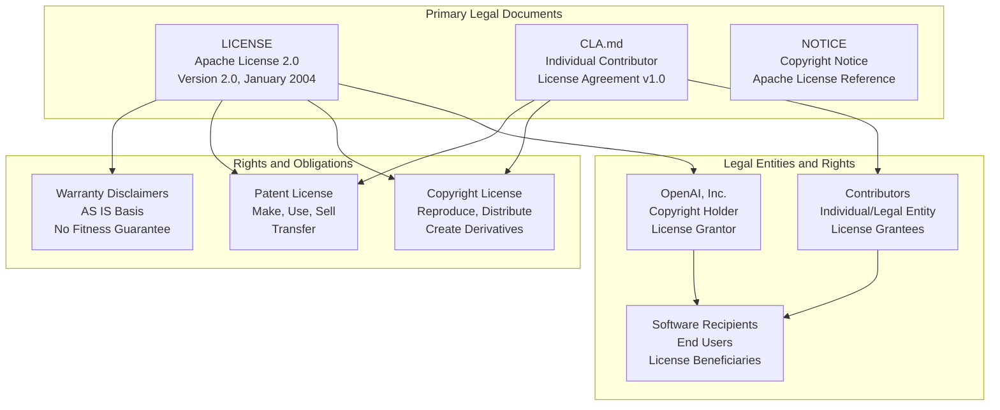
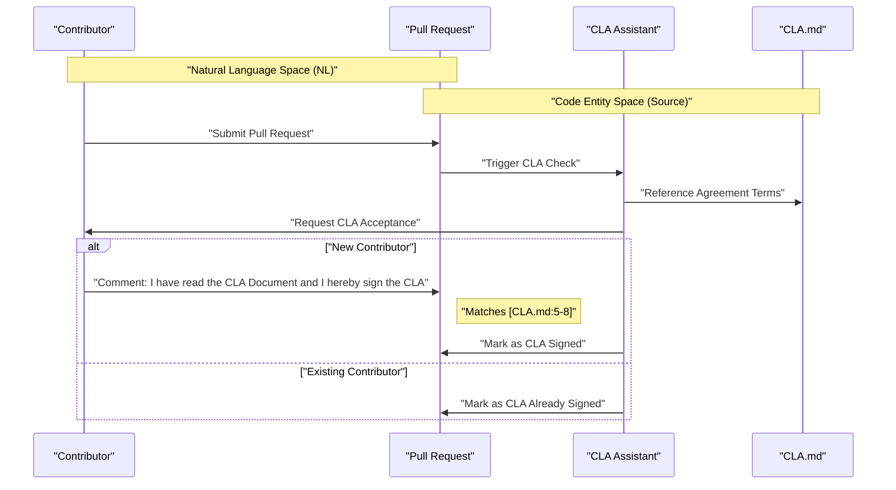

<!-- source: DeepWiki mcp.deepwiki.com · repo openai/codex-action · page 7 Legal and Licensing · fetched 2026-10-26 -->

# Legal and Licensing

<details>
<summary>Relevant source files</summary>

The following files were used as context for generating this wiki page:

- [CLA.md](CLA.md)
- [LICENSE](LICENSE)
- [NOTICE](NOTICE)

</details>


This document provides comprehensive documentation of the legal framework governing the `codex-action` repository, including licensing terms, contributor agreements, and copyright notices. It covers the Apache License 2.0 under which the project is distributed, the Individual Contributor License Agreement (CLA) process for contributors, and compliance requirements for users and distributors of the software.

For information about the CLA workflow automation and signature management, see [6.1. Contributing and CLA Process]().

## Legal Framework Overview

The `codex-action` project operates under a comprehensive legal framework consisting of three primary components: the Apache License 2.0 for software distribution, an Individual Contributor License Agreement for code contributions, and formal copyright notices.

### Legal Framework Structure



Sources: [LICENSE:1-201](), [CLA.md:1-44](), [NOTICE:1-13]()

## Apache License 2.0

The project is licensed under the Apache License 2.0, a permissive open-source license that allows for commercial use, modification, distribution, and private use while requiring preservation of copyright and license notices.

### License Terms and Conditions

| License Component | Description | Apache License Section |
|------------------|-------------|------------------------|
| **Copyright License** | Perpetual, worldwide, non-exclusive, royalty-free license to reproduce, prepare derivative works, display, perform, sublicense, and distribute | Section 2 [LICENSE:66-72]() |
| **Patent License** | Patent license covering claims necessarily infringed by contributions, with termination clause for patent litigation | Section 3 [LICENSE:73-87]() |
| **Redistribution** | Requirements for distributing copies including license preservation, change notices, attribution retention | Section 4 [LICENSE:89-128]() |
| **Submission of Contributions** | Default terms for contribution submission unless explicitly stated otherwise | Section 5 [LICENSE:130-134]() |
| **Trademark Restrictions** | No permission granted to use trade names, trademarks, or service marks | Section 6 [LICENSE:136-141]() |
| **Warranty Disclaimer** | Software provided "AS IS" without warranties of any kind | Section 7 [LICENSE:143-151]() |
| **Limitation of Liability** | No liability for damages except as required by applicable law | Section 8 [LICENSE:153-163]() |

Sources: [LICENSE:66-163]()

### Key Definitions

The Apache License 2.0 establishes specific definitions for legal terms used throughout the agreement:

- **License**: Terms and conditions defined in the Apache License document [LICENSE:9-11]().
- **Licensor**: OpenAI, Inc. as the copyright owner granting the license [LICENSE:12-13]().
- **Legal Entity**: Individual or entity exercising permissions, including controlled entities [LICENSE:15-22]().
- **You**: An individual or Legal Entity exercising permissions granted by this License [LICENSE:24-25]().
- **Source form**: Preferred form for making modifications, including source code, documentation, and configuration files [LICENSE:27-29]().
- **Object form**: Any form resulting from mechanical transformation or translation of a Source form [LICENSE:31-33]().
- **Work**: The `codex-action` software as indicated by copyright notice [LICENSE:35-38]().
- **Derivative Works**: Works based on the original that represent original authorship [LICENSE:40-46]().
- **Contribution**: Work intentionally submitted for inclusion by copyright owner or authorized entity [LICENSE:48-61]().
- **Contributor**: Licensor and any entity whose contributions are incorporated [LICENSE:62-64]().

Sources: [LICENSE:7-64]()

## Individual Contributor License Agreement

All contributors must agree to the Individual Contributor License Agreement (CLA) before their contributions can be accepted. The CLA is based on Apache Software Foundation Individual CLA v2.2 and grants necessary rights to OpenAI while protecting both contributors and the project.

### CLA Agreement Process



Sources: [CLA.md:5-8](), [CLA.md:34-40]()

### CLA Terms and Grants

The Individual Contributor License Agreement establishes the following key provisions:

#### Copyright License Grant
Contributors grant OpenAI, Inc. and all software recipients a perpetual, worldwide, non-exclusive, royalty-free, irrevocable license to:
- Reproduce contributions and derivative works [CLA.md:21]()
- Prepare derivative works of contributions [CLA.md:21]()
- Publicly display and perform contributions [CLA.md:21-22]()
- Sublicense and distribute contributions and derivatives [CLA.md:22]()

#### Patent License Grant  
Contributors grant a perpetual, worldwide, non-exclusive, royalty-free, irrevocable patent license covering claims necessarily infringed by contributions [CLA.md:25-28](). This license terminates if patent litigation is initiated against the project [CLA.md:30-32]().

#### Contributor Representations
Contributors represent that they:
1. Are legally entitled to grant the above licenses [CLA.md:35]()
2. Own original contributions or have authority to submit under CLA terms [CLA.md:36-37]()
3. Provide contributions "AS IS" without warranties [CLA.md:38]()
4. Will notify if any representation becomes inaccurate [CLA.md:39]()

Sources: [CLA.md:18-33](), [CLA.md:34-40]()

### Legal Governance
The CLA is governed by the laws of the **State of California**, USA, excluding its conflict‑of‑laws rules [CLA.md:42-43](). If any provision is held unenforceable, the remaining provisions remain in force [CLA.md:43-44]().

Sources: [CLA.md:41-44]()

## Copyright and Notice Requirements

### Copyright Statement
The project copyright is held by OpenAI with the notice: "Copyright 2025 OpenAI" [NOTICE:1]().

### License Notice Requirements
All distributions must include the Apache License notice as specified in the `NOTICE` file [NOTICE:3-13]():

```
Copyright 2025 OpenAI

Licensed under the Apache License, Version 2.0 (the "License");
you may not use this file except in compliance with the License.
You may obtain a copy of the License at

http://www.apache.org/licenses/LICENSE-2.0

Unless required by applicable law or agreed to in writing, software
distributed under the License is distributed on an "AS IS" BASIS,
WITHOUT WARRANTIES OR CONDITIONS OF ANY KIND, either express or implied.
See the License for the specific language governing permissions and
limitations under the License.
```

### Distribution Requirements
When distributing the work or derivative works, recipients must:
- Include a copy of the Apache License 2.0 [LICENSE:94-95]()
- Provide prominent notices for any modified files [LICENSE:97-98]()
- Retain all copyright, patent, trademark, and attribution notices from the source [LICENSE:100-104]()
- Include attribution notices from the `NOTICE` file in derivative works [LICENSE:107-111]()

Sources: [NOTICE:1-13](), [LICENSE:94-121]()

## Compliance and Usage Rights

### Permitted Uses
Under the Apache License 2.0, users may:
- Use the software commercially
- Modify and create derivative works
- Distribute original and modified versions
- Use privately without distribution obligations

### License Compatibility
The Apache License 2.0 is compatible with many other open-source licenses and allows integration with proprietary software, making it suitable for diverse deployment scenarios.

### Termination Conditions
Patent licenses terminate automatically if any recipient initiates patent litigation alleging that the work or contributions constitute patent infringement [LICENSE:81-87](), [CLA.md:30-32]().

Sources: [LICENSE:73-87](), [CLA.md:25-33]()

## Legal Risk Management

### Warranty Disclaimers
The software is provided **"AS IS"** without warranties including [LICENSE:143-151]():
- Title and non-infringement
- Merchantability  
- Fitness for particular purpose

### Liability Limitations
Contributors have no liability for damages including direct, indirect, special, incidental, or consequential damages, except as required by applicable law for deliberate and grossly negligent acts [LICENSE:153-163]().

### User Responsibilities
Users are solely responsible for:
- Determining appropriateness of use or redistribution [LICENSE:165-167]()
- Assuming risks associated with license permissions [LICENSE:167-168]()

Sources: [LICENSE:143-174]()

---

