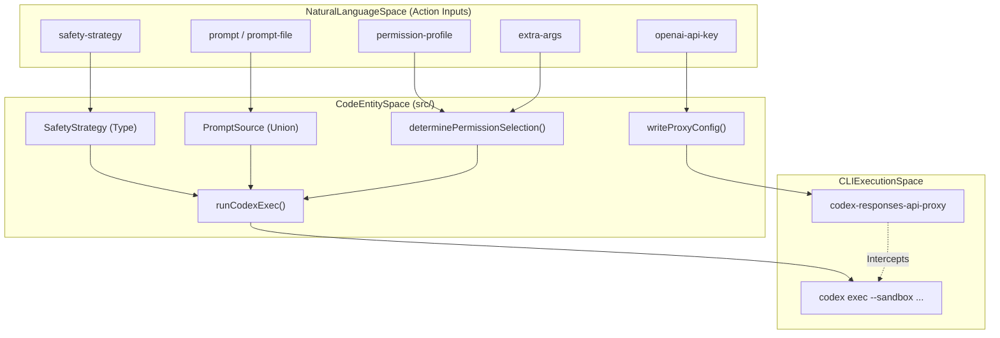
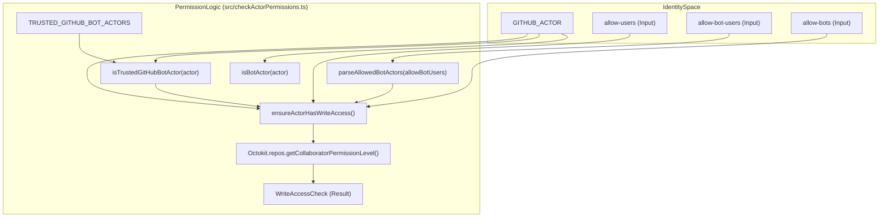

<!-- source: DeepWiki mcp.deepwiki.com · repo openai/codex-action · page 8 Glossary · fetched 2026-10-26 -->

# Glossary

Relevant source files

The following files were used as context for generating this wiki page:

- [docs/security.md](docs/security.md)
- [src/checkActorPermissions.ts](src/checkActorPermissions.ts)
- [src/main.ts](src/main.ts)
- [src/runCodexExec.ts](src/runCodexExec.ts)

This glossary defines codebase-specific terms, jargon, and domain concepts used within the `codex-action` repository. It is intended to help onboarding engineers navigate the security mechanisms, execution flow, and configuration abstractions of the GitHub Action.

## Core Concepts & Terms

### SafetyStrategy
A configuration type that determines how the action restricts privileges before executing the Codex CLI. It is a critical security boundary.
*   **`drop-sudo`**: (Default) Permanently removes the `runner` user from the `sudo` group and cleans up `/etc/sudoers` [src/runCodexExec.ts:18-22](). On Linux, this involves a complex script that uses `setpriv` to drop privileges [src/runCodexExec.ts:9-77]().
*   **`unprivileged-user`**: Executes Codex as a specific, pre-existing UNIX user via `sudo -u [user]` [src/runCodexExec.ts:232-238]().
*   **`read-only`**: Restricts the Codex sandbox to read-only filesystem access [src/runCodexExec.ts:18-22]().
*   **`unsafe`**: Runs with full runner privileges (not recommended) [src/runCodexExec.ts:18-22]().
*   **Code Pointers**: `SafetyStrategy` type [src/runCodexExec.ts:18-22](), `dropSudo` function [src/main.ts:117-124]().

### SandboxMode
The operational mode passed directly to the Codex CLI's `--sandbox` flag. It defines the level of filesystem and network access granted to the model's execution environment.
*   **Values**: `read-only`, `workspace-write`, `danger-full-access` [src/runCodexExec.ts:95-98]().
*   **Implementation**: Determined based on the `safety-strategy` and user input [src/runCodexExec.ts:174-179]().

### codex-home
The directory where Codex stores its configuration (`config.toml`) and internal state. In the context of this action, it is often a temporary directory unique to the GitHub run to ensure isolation.
*   **Code Pointers**: `resolve-codex-home` command [src/main.ts:38-75](), `codexHome` parameter in `runCodexExec` [src/runCodexExec.ts:125-149]().

### Responses API Proxy
A local proxy server (`@openai/codex-responses-api-proxy`) installed during the action run. It intercepts Codex CLI requests to protect the `OPENAI_API_KEY` and handle communication with the OpenAI backend.
*   **Code Pointers**: `writeProxyConfig` function [src/main.ts:89-96]().

### bubblewrap
A low-level unprivileged sandboxing tool used internally by the Codex CLI on Linux to isolate processes. While not directly implemented in this repo, the `safety-strategy` configurations are designed to satisfy `bubblewrap` requirements (e.g., providing a non-root user). Support for GitHub-hosted Linux bubblewrap was explicitly added in v1.6.

### drop-sudo
The process of stripping administrative privileges from the current user. This is irreversible for the duration of the GitHub Action job.
*   **Implementation**: Involves calling `deluser`, `gpasswd`, or `dseditgroup` depending on the OS [src/main.ts:117-124](). On Linux, it uses a shell script that leverages `setpriv` [src/runCodexExec.ts:9-77]().
*   **Sources**: [src/runCodexExec.ts:9-77](), [src/main.ts:100-124]().

### unprivileged-user
A safety strategy where Codex is executed as a different, non-sudo user. This requires the user to already exist on the runner.
*   **Implementation**: The action uses `which codex` to find the absolute path and executes via `sudo -u <user> -- <path_to_codex> exec ...` [src/runCodexExec.ts:232-238]().

### CODEX_RUN_ID
The GitHub `run_id` used to create unique, isolated paths for Codex operations, ensuring that concurrent or subsequent runs do not collide.
*   **Sources**: [src/main.ts:55-55]().

### SERVER_INFO_FILE
A temporary JSON file generated by the Responses API Proxy containing the local `port` it is listening on.
*   **Code Pointers**: `readServerInfo` function [src/main.ts:34-35]().

### WriteAccessCheck
A TypeScript type representing the result of a permission validation. It ensures the `GITHUB_ACTOR` has sufficient rights to trigger the model.
*   **Definition**: [src/checkActorPermissions.ts:7-13]().
*   **Function**: `ensureActorHasWriteAccess` [src/checkActorPermissions.ts:45-177]().

### PromptSource / OutputSchemaSource
Discriminated unions used to handle inputs that can be either provided as raw strings (`inline`) or as paths to local files (`file`).
*   **PromptSource**: [src/runCodexExec.ts:79-87]().
*   **OutputSchemaSource**: [src/runCodexExec.ts:104-112]().

### dist synchronization
The requirement that the compiled `dist/main.js` must be kept in sync with the `src/` TypeScript files. Since GitHub Actions run the JavaScript in `dist/`, failure to sync results in the action running stale code.

### model_reasoning_effort
A configuration parameter passed to the Codex CLI via the `--config` flag to control the intensity of the model's reasoning process.
*   **Implementation**: The `effort` parameter is passed to `runCodexExec` [src/runCodexExec.ts:131-131]().

### TRUSTED_GITHUB_BOT_ACTORS
A hardcoded set of bot accounts (`github-actions[bot]`) that are allowed to bypass certain write-access checks if `allow-bots` is enabled [src/checkActorPermissions.ts:184-184]().

### isBotActor
A utility function that checks if a given actor username ends with the `[bot]` suffix, indicating it's a GitHub bot account [src/checkActorPermissions.ts:205-207]().

### checkOutput
A function that executes a shell command and returns its standard output as a string. It throws an error if the command exits with a non-zero status [src/main.ts:19-19]().

### finalizeExecution
This term is not explicitly defined as a function in the provided `src/runCodexExec.ts` or `src/main.ts` files. The process of reading the final output and setting action outputs is handled within `runCodexExec` after the `codex exec` command completes.

### permission profile
A configuration mechanism for the Codex CLI that defines a set of filesystem and network access policies. It is specified via the `permission-profile` input [src/main.ts:161-164]().
*   **Sources**: [docs/security.md:20-47]()

### protected extra args
Arguments passed to the `codex exec` command via the `extra-args` input that are explicitly disallowed or validated to prevent security bypasses. These include arguments that would weaken permission, trust, provider, or command-execution settings [docs/security.md:34-42]().

## System Mapping Diagrams

### Data Flow: From Workflow Input to Codex Execution
This diagram maps natural language inputs from `action.yml` to the internal TypeScript entities and CLI commands.

**Sources**: [src/runCodexExec.ts:123-149](), [src/main.ts:161-193](), [src/runCodexExec.ts:174-179]()

### Logic Flow: Permission and Identity Validation
This diagram shows how the system validates the "Natural Language" identity of a GitHub user against "Code Space" permission logic.

**Sources**: [src/checkActorPermissions.ts:45-177](), [src/checkActorPermissions.ts:184-184](), [src/checkActorPermissions.ts:205-207](), [src/checkActorPermissions.ts:190-203]()

## Function Glossary

| Function | Description | File Pointer |
| :--- | :--- | :--- |
| `checkOutput` | Executes a shell command and returns the captured stdout as a string. Throws an error if the command fails. | [src/main.ts:19-19]() |
| `isBotActor` | Determines if a username ends with the `[bot]` suffix. | [src/checkActorPermissions.ts:205-207]() |
| `readServerInfo` | Polls the `SERVER_INFO_FILE` to retrieve the proxy port. | [src/main.ts:34-35]() |
| `dropSudo` | Entry point for the `drop-sudo` command which orchestrates privilege removal. | [src/main.ts:117-124]() |
| `resolveCodexHome` | Logic to determine the final path for `CODEX_HOME` based on overrides and defaults. | [src/main.ts:64-69]() |
| `ensureActorHasWriteAccess` | Checks if the GitHub actor triggering the workflow has write access to the repository, considering allow-lists and bot actors. | [src/checkActorPermissions.ts:45-177]() |
| `runCodexExec` | Builds and runs the `codex exec` command, handles prompt input, output file management, and applies safety strategies. | [src/runCodexExec.ts:123-149]() |
| `writeProxyConfig` | Writes the OpenAI Proxy model provider configuration into `CODEX_HOME/config.toml`. | [src/main.ts:89-96]() |

**Sources**: [src/main.ts:19-19](), [src/checkActorPermissions.ts:205-207](), [src/main.ts:34-35](), [src/main.ts:117-124](), [src/main.ts:64-69](), [src/checkActorPermissions.ts:45-177](), [src/runCodexExec.ts:123-149](), [src/main.ts:89-96]()