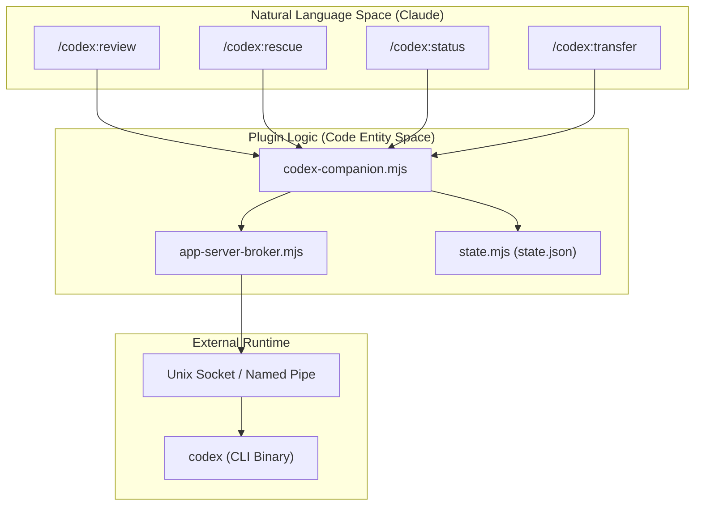
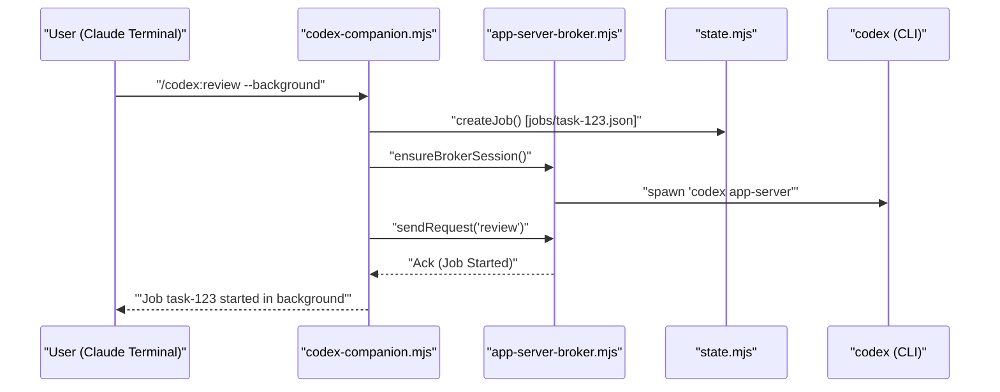

<!-- source: DeepWiki mcp.deepwiki.com · repo openai/codex-plugin-cc · page 1 Overview · fetched 2026-10-26 -->

# Overview

Relevant source files

The following files were used as context for generating this wiki page:

- [.claude-plugin/marketplace.json](.claude-plugin/marketplace.json)
- [README.md](README.md)

The `codex-plugin-cc` repository contains a Claude Code plugin that integrates the **OpenAI Codex CLI** directly into the Claude Code terminal environment [README.md:1-6](). It allows users to leverage Codex for automated code reviews, adversarial pressure-testing of designs, and task delegation (sub-agent "rescue" operations) without leaving their current Claude Code session [README.md:10-14]().

## Purpose and Scope

The primary goal of this plugin is to bridge the gap between Claude's conversational capabilities and Codex's specialized engineering workflows. It provides a set of slash commands that can run either in the foreground or as background jobs, enabling long-running analysis while the user continues to work with Claude [README.md:81-83]().

The plugin handles:
- **Environment Management**: Verifying Codex installation and authentication via `/codex:setup` [README.md:45-48]().
- **Code Review**: Providing standard and adversarial review modes [README.md:77-124]().
- **Task Delegation**: Handing off complex investigations or fixes to the `codex:codex-rescue` subagent [README.md:126-158]().
- **Job Lifecycle**: Tracking background execution, status reporting, and result retrieval [README.md:180-208]().
- **Context Transfer**: Exporting Claude Code session transcripts into persistent Codex threads via `/codex:transfer` [README.md:165-178]().

Sources: [README.md:1-243]()

---

## Ecosystem Integration

The plugin fits into the Claude Code ecosystem by registering as a marketplace plugin via `marketplace.json` [.claude-plugin/marketplace.json:1-21]() and utilizing the manifest system. It integrates with Claude Code's lifecycle by defining hooks that allow it to manage its own internal broker and state during session events.

### Conceptual Architecture
The following diagram illustrates how the plugin components bridge the gap between Claude's Natural Language interface and the underlying Code Entity space (files, processes, and the Codex CLI).

**System Bridge: Natural Language to Code Entities**

Sources: [README.md:1-15](), [.claude-plugin/marketplace.json:1-21]()

---

## High-Level Component Map

The plugin is structured around a central dispatcher called the companion script which manages communication between Claude Code and the Codex binary.

| Component | File/Entity | Role |
| :--- | :--- | :--- |
| **Dispatcher** | `codex-companion.mjs` | Main entry point for all slash commands; parses arguments and routes to logic. |
| **Broker** | `app-server-broker.mjs` | Manages a persistent session with the Codex app-server to avoid startup overhead. |
| **State Manager** | `state.mjs` | Persists job IDs, status, and results in `state.json`. |
| **Subagent** | `codex:codex-rescue` | A specialized Claude subagent configured to delegate tasks to Codex [README.md:65](). |

**Component Interaction Diagram**

Sources: [README.md:62-66]()

---

## Child Pages

For deeper technical details, refer to the following sub-pages:

* **[Getting Started & Installation](#1.1)** — Step-by-step guide for installing the plugin, authenticating the Codex CLI, running `/codex:setup`, and verifying the environment is ready [README.md:16-48]().
* **[Plugin Registration & Manifest](#1.2)** — Explains the `.claude-plugin` manifest system: marketplace.json and plugin.json, plugin discovery lifecycle, version bumping via scripts/bump-version.mjs, and directory layout [.claude-plugin/marketplace.json:1-21]().
* **[Architecture](#2)** — Overview of the layered architecture: companion script dispatcher, app-server broker, job tracking, git/workspace helpers, and hook integration.
* **[Commands Reference](#3)** — Overview of all user-facing slash commands exposed by the plugin, with links to child pages per command group [README.md:75-208]().
* **[Prompts, Skills & Output Contracts](#4)** — Overview of the prompt engineering layer: prompt templates, internal skills, and review output contracts.
* **[Testing](#5)** — Overview of the test suite: what is tested, how to run tests, and links to child pages on infrastructure and per-module coverage.
* **[Project & Build Configuration](#6)** — Overview of packaging, build, CI and licensing.

Sources: [README.md:1-243](), [.claude-plugin/marketplace.json:1-21]()

---

