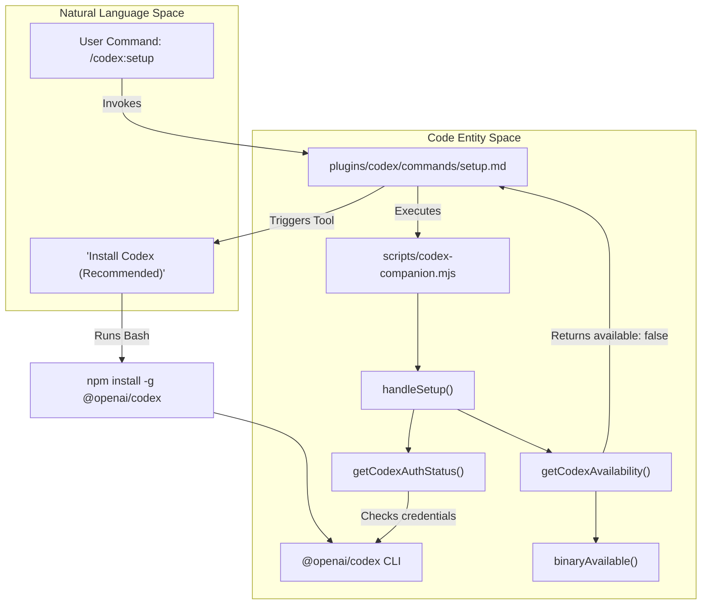
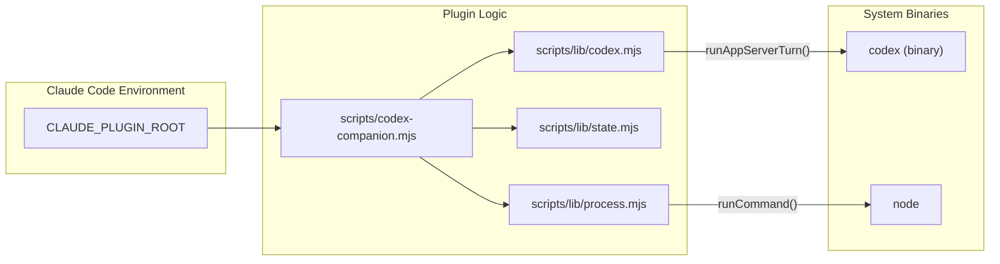

<!-- source: DeepWiki mcp.deepwiki.com · repo openai/codex-plugin-cc · page 1.1 Getting Started & Installation · fetched 2026-10-26 -->

# Getting Started & Installation

<details>
<summary>Relevant source files</summary>

The following files were used as context for generating this wiki page:

- [README.md](README.md)
- [plugins/codex/commands/setup.md](plugins/codex/commands/setup.md)
- [plugins/codex/scripts/codex-companion.mjs](plugins/codex/scripts/codex-companion.mjs)

</details>


This page provides a technical guide for installing the `codex-plugin-cc` into Claude Code, authenticating the underlying Codex CLI, and verifying the environment using the built-in setup routines.

## Installation Overview

The installation process integrates the Codex plugin into the Claude Code ecosystem by registering the plugin manifest and ensuring the local environment has the necessary Node.js dependencies and the `@openai/codex` CLI binary.

### Prerequisites
- **Node.js**: Version `18.18.0` or later is required [README.md:20-20]().
- **Claude Code**: An active installation where you can run slash commands.
- **OpenAI Account**: A ChatGPT subscription or OpenAI API key for Codex usage [README.md:18-19]().

### Step 1: Plugin Registration
To install the plugin, you must first add the OpenAI marketplace and then install the specific `codex` plugin.

```bash
/plugin marketplace add openai/codex-plugin-cc
/plugin install codex@openai-codex
/reload-plugins
```
Sources: [README.md:26-40]()

---

## The `/codex:setup` Routine

The `/codex:setup` command is the primary entry point for environment verification. It executes the `codex-companion.mjs` script with the `setup` subcommand [plugins/codex/commands/setup.md:10-11]().

### Execution Logic
When a user runs `/codex:setup`, the `handleSetup` function in the companion script performs the following checks:
1.  **Binary Detection**: `binaryAvailable` checks if `node`, `npm`, and `codex` are available in the system PATH [plugins/codex/scripts/codex-companion.mjs:184-186]().
2.  **Authentication Check**: `getCodexAuthStatus` verifies if the user is logged into Codex [plugins/codex/scripts/codex-companion.mjs:187-187]().
3.  **Review Gate Configuration**: Updates the local `config` in `state.json` via `setConfig` if flags like `--enable-review-gate` are passed [plugins/codex/scripts/codex-companion.mjs:215-225]().

### Automated Dependency Resolution
If the `codex` binary is missing, the plugin uses the `AskUserQuestion` tool defined in the command manifest to prompt the user for an automated installation via `npm install -g @openai/codex` [plugins/codex/commands/setup.md:13-22]().

### Setup Data Flow
The following diagram illustrates how the `setup` command bridges the Natural Language intent to the local system environment and code entities.

**Diagram: Setup Execution & Environment Validation**

Sources: [plugins/codex/scripts/codex-companion.mjs:182-213](), [plugins/codex/scripts/lib/process.mjs:38-51](), [plugins/codex/commands/setup.md:1-37]()

---

## Manual Authentication

If the setup routine reports that Codex is installed but not authenticated (`authStatus.loggedIn === false`), the user must perform a manual login. This is handled outside the plugin's standard background execution to allow for interactive browser-based authentication [plugins/codex/scripts/codex-companion.mjs:194-197]().

The setup report provides specific guidance based on the authentication failure mode:
- Standard: `!codex login`
- Blocked Browser: `!codex login --device-auth` or `!codex login --with-api-key` [plugins/codex/scripts/codex-companion.mjs:195-196]().

Sources: [plugins/codex/scripts/codex-companion.mjs:187-200]()

---

## Verifying the Environment

Once setup is complete, the `buildSetupReport` function generates a comprehensive status object [plugins/codex/scripts/codex-companion.mjs:182-213]().

### Verification Checklist
| Component | Verification Method | Code Entity |
| :--- | :--- | :--- |
| **Node.js** | Checks `node --version` | `binaryAvailable("node")` |
| **NPM** | Checks `npm --version` | `binaryAvailable("npm")` |
| **Codex CLI** | Checks `@openai/codex` availability | `getCodexAvailability()` |
| **Authentication** | Checks login status | `getCodexAuthStatus()` |
| **Runtime** | Checks session environment variables | `getSessionRuntimeStatus()` |

### Internal Component Mapping
The plugin maps user commands to specific script executions and background processes. The diagram below shows how these components relate to the filesystem and runtime.

**Diagram: Component Architecture & Path Mapping**

Sources: [plugins/codex/scripts/codex-companion.mjs:1-65](), [plugins/codex/scripts/lib/process.mjs:4-25](), [plugins/codex/commands/setup.md:10-11]()

---

## Review Gate Configuration (Optional)

As part of the setup, users can enable the **Review Gate**. This is a safety mechanism that triggers a Codex review whenever Claude attempts to finish a session.

- **Enable**: `/codex:setup --enable-review-gate` [plugins/codex/scripts/codex-companion.mjs:222-225]()
- **Disable**: `/codex:setup --disable-review-gate` [plugins/codex/scripts/codex-companion.mjs:226-229]()

The review gate logic in `handleSetup` calls `setConfig` to persist the `stopReviewGate` boolean in the workspace configuration [plugins/codex/scripts/codex-companion.mjs:231-231](). When enabled, the `buildSetupReport` will reflect `reviewGateEnabled: true` [plugins/codex/scripts/codex-companion.mjs:209-209]().

Sources: [plugins/codex/scripts/codex-companion.mjs:215-240](), [plugins/codex/commands/setup.md:1-5]()

---

