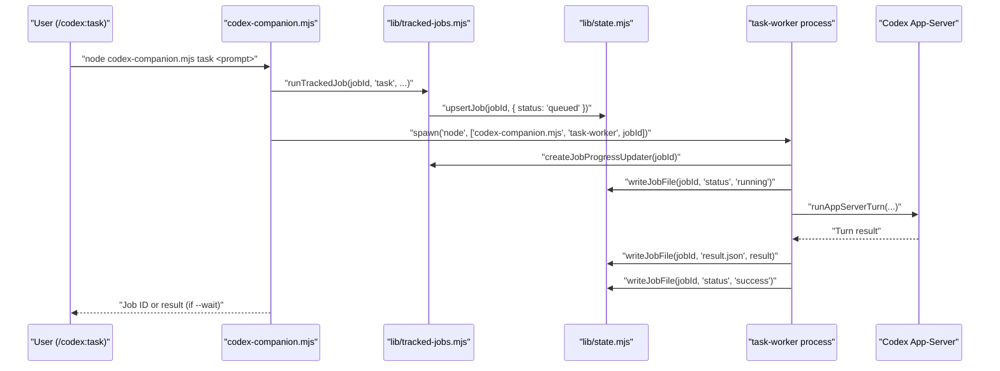
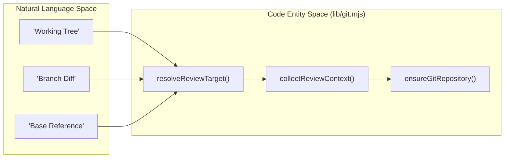

<!-- source: DeepWiki mcp.deepwiki.com · repo openai/codex-plugin-cc · page 2.1 Codex Companion Script · fetched 2026-10-26 -->

# Codex Companion Script

Relevant source files

The following files were used as context for generating this wiki page:

- [plugins/codex/scripts/codex-companion.mjs](plugins/codex/scripts/codex-companion.mjs)
- [plugins/codex/scripts/lib/args.mjs](plugins/codex/scripts/lib/args.mjs)
- [tests/runtime.test.mjs](tests/runtime.test.mjs)

The `codex-companion.mjs` script is the central entry point and CLI dispatcher for the Codex Companion plugin. It acts as a bridge between the Claude Code environment and the Codex ecosystem, managing the lifecycle of both foreground and background jobs. It handles everything from environment setup and Git context collection to job tracking and result rendering.

## Overview

`codex-companion.mjs` implements a multi-command CLI architecture. Each subcommand follows a pattern of:
1.  **Argument Parsing**: Normalizing and parsing CLI flags using `lib/args.mjs` [plugins/codex/scripts/codex-companion.mjs:9-9]().
2.  **Context Resolution**: Determining the Git repository root and working directory [plugins/codex/scripts/codex-companion.mjs:151-157]().
3.  **Delegation**: Calling specialized library modules (e.g., `lib/git.mjs`, `lib/codex.mjs`, `lib/tracked-jobs.mjs`) to perform the core logic.
4.  **Rendering**: Formatting the internal data structures into user-friendly Markdown or JSON via `lib/render.mjs` [plugins/codex/scripts/codex-companion.mjs:56-65]().

### System Architecture & Data Flow

The following diagram illustrates how `codex-companion.mjs` dispatches commands and interacts with the underlying systems.

**CLI Dispatcher Flow**

```mermaid
graph TD
    subgraph "CLI Layer"
        CLI["codex-companion.mjs"]
        ARGS["lib/args.mjs"]
    end

    subgraph "Subcommand Handlers"
        H_SETUP["handleSetup()"]
        H_REVIEW["handleReview()"]
        H_ADVERSARIAL_REVIEW["handleAdversarialReview()"]
        H_TASK["handleTask()"]
        H_TRANSFER["handleTransfer()"]
        H_STATUS["handleStatus()"]
        H_RESULT["handleResult()"]
        H_CANCEL["handleCancel()"]
        H_TASK_WORKER["handleTaskWorker()"]
    end

    subgraph "Logic & State"
        GIT["lib/git.mjs"]
        STATE["lib/state.mjs"]
        TRACK["lib/tracked-jobs.mjs"]
        CODEX["lib/codex.mjs"]
        CLAUDESESSION["lib/claude-session-transfer.mjs"]
        PROCESS["lib/process.mjs"]
        PROMPTS["lib/prompts.mjs"]
        JOB_CONTROL["lib/job-control.mjs"]
    end

    CLI --> ARGS
    CLI --> H_SETUP
    CLI --> H_REVIEW
    CLI --> H_ADVERSARIAL_REVIEW
    CLI --> H_TASK
    CLI --> H_TRANSFER
    CLI --> H_STATUS
    CLI --> H_RESULT
    CLI --> H_CANCEL
    CLI --> H_TASK_WORKER

    H_SETUP --> STATE
    H_SETUP --> CODEX
    H_SETUP --> PROCESS
    H_REVIEW --> GIT
    H_REVIEW --> TRACK
    H_REVIEW --> CODEX
    H_ADVERSARIAL_REVIEW --> GIT
    H_ADVERSARIAL_REVIEW --> TRACK
    H_ADVERSARIAL_REVIEW --> CODEX
    H_ADVERSARIAL_REVIEW --> PROMPTS
    H_TASK --> TRACK
    H_TASK --> CODEX
    H_TASK --> STATE
    H_TRANSFER --> CLAUDESESSION
    H_TRANSFER --> CODEX
    H_STATUS --> STATE
    H_STATUS --> JOB_CONTROL
    H_RESULT --> JOB_CONTROL
    H_RESULT --> CODEX
    H_CANCEL --> JOB_CONTROL
    H_CANCEL --> PROCESS
    H_CANCEL --> CODEX
    H_TASK_WORKER --> TRACK
    H_TASK_WORKER --> CODEX
    H_TASK_WORKER --> STATE
```

**Sources:** [plugins/codex/scripts/codex-companion.mjs:215-220](), [plugins/codex/scripts/lib/args.mjs:1-74](), [plugins/codex/scripts/codex-companion.mjs:21-65]()

---

## Command Implementation

### Setup (`setup`)
The `setup` command verifies the local environment for Codex compatibility. It checks for `node`, `npm`, and the `@openai/codex` binary availability via `getCodexAvailability` [plugins/codex/scripts/codex-companion.mjs:184-186](). It also manages the "Review Gate" configuration, which can be toggled via `--enable-review-gate` or `--disable-review-gate` [plugins/codex/scripts/codex-companion.mjs:221-230](). The `buildSetupReport` function [plugins/codex/scripts/codex-companion.mjs:182-209]() aggregates all status information.

### Review & Adversarial Review
These commands analyze code changes.
-   **Context Selection**: `resolveReviewTarget` [plugins/codex/scripts/codex-companion.mjs:26-26]() determines if the review should focus on the `working-tree` (dirty files) or a `branch` (diff against a base ref). `collectReviewContext` [plugins/codex/scripts/codex-companion.mjs:26-26]() gathers the actual diff.
-   **Adversarial Mode**: Uses `loadPromptTemplate` [plugins/codex/scripts/codex-companion.mjs:28-28]() to fetch `adversarial-review.md` and `interpolateTemplate` [plugins/codex/scripts/codex-companion.mjs:28-28]() to inject the diff context.
-   **Execution**: Both can run in the foreground or as background jobs using `runTrackedJob` [plugins/codex/scripts/codex-companion.mjs:52-52](). The core review logic is handled by `runAppServerReview` [plugins/codex/scripts/codex-companion.mjs:21-23]().

### Task & Task-Worker
The `task` command delegates complex instructions to Codex.
-   **Thread Management**: It attempts to find existing task threads via `findLatestTaskThread` [plugins/codex/scripts/codex-companion.mjs:13-13]() to support `--resume` logic. `buildPersistentTaskThreadName` [plugins/codex/scripts/codex-companion.mjs:11-11]() generates a consistent thread name.
-   **Backgrounding**: If `--background` is passed, it spawns a detached "task-worker" process [plugins/codex/scripts/codex-companion.mjs:3-3]().
-   **Worker Logic**: The worker uses `runAppServerTurn` [plugins/codex/scripts/codex-companion.mjs:21-23]() to communicate with the Codex App-Server via JSON-RPC, capturing progress updates and file changes. `parseStructuredOutput` [plugins/codex/scripts/codex-companion.mjs:19-19]() and `readOutputSchema` [plugins/codex/scripts/codex-companion.mjs:20-20]() are used to interpret Codex's responses.

### Transfer (`transfer`)
The `transfer` command imports Claude session transcripts. It uses `resolveClaudeSessionPath` [plugins/codex/scripts/codex-companion.mjs:24-24]() to locate the session file and `importExternalAgentSession` [plugins/codex/scripts/codex-companion.mjs:17-17]() to send the data to the app-server.

### Job Control (`status`, `result`, `cancel`)
-   **Status**: Queries `listJobs` [plugins/codex/scripts/codex-companion.mjs:32-36]() for job metadata and `buildStatusSnapshot` [plugins/codex/scripts/codex-companion.mjs:39-44]() to build a snapshot of active or completed tasks. `renderStatusReport` [plugins/codex/scripts/codex-companion.mjs:61-65]() formats the output.
-   **Result**: Retrieves the final payload of a job via `resolveResultJob` [plugins/codex/scripts/codex-companion.mjs:39-44]() and `readStoredJob` [plugins/codex/scripts/codex-companion.mjs:39-44](). For reviews, it parses structured JSON from the Codex output [plugins/codex/scripts/codex-companion.mjs:19-19](). `renderStoredJobResult` [plugins/codex/scripts/codex-companion.mjs:61-65]() handles rendering.
-   **Cancel**: Terminates the process tree associated with a job ID using `terminateProcessTree` [plugins/codex/scripts/codex-companion.mjs:27-27](). It also attempts to `interruptAppServerTurn` [plugins/codex/scripts/codex-companion.mjs:18-18]() if the job is actively communicating with the app-server. `resolveCancelableJob` [plugins/codex/scripts/codex-companion.mjs:39-44]() identifies the target job.

---

## Execution Modes: Foreground vs. Background

The script uses `runTrackedJob` from `lib/tracked-jobs.mjs` to wrap long-running operations.

| Feature | Foreground (`--wait`) | Background (`--background`) |
| :--- | :--- | :--- |
| **Process** | Runs within the current CLI process. | Spawns a detached child process. |
| **Output** | Streams progress to `stdout`. | Writes logs to `~/.claude-code/codex/jobs/<id>/log.txt`. |
| **Persistence** | State updated in `state.json`. | State updated in `state.json`. |
| **Blocking** | Blocks the Claude turn. | Returns immediately with a Job ID. |

**Sources:** [plugins/codex/scripts/lib/tracked-jobs.mjs:52-52](), [plugins/codex/scripts/codex-companion.mjs:52-52]()

---

## Mapping Natural Language to Code Entities

The following diagrams bridge user-facing concepts to the specific code implementations.

### Job Lifecycle Mapping

**Sources:** [plugins/codex/scripts/codex-companion.mjs:34-35](), [plugins/codex/scripts/lib/tracked-jobs.mjs:48-52](), [plugins/codex/scripts/lib/state.mjs:32-35](), [plugins/codex/scripts/codex-companion.mjs:21-23]()

### Git Context Mapping

**Sources:** [plugins/codex/scripts/lib/git.mjs:26-26](), [plugins/codex/scripts/codex-companion.mjs:26-26]()

## Key Functions

### Argument Parsing
-   `splitRawArgumentString(raw)`: Handles shell-like quoting and escaping within a single string argument [plugins/codex/scripts/lib/args.mjs:76-128]().
-   `parseArgs(argv, config)`: Standardizes flag parsing (e.g., `--key=value`, `-k value`) [plugins/codex/scripts/lib/args.mjs:1-74]().
-   `normalizeRequestedModel(model)`: Maps model aliases (e.g., "spark" to "gpt-5.3-codex-spark") [plugins/codex/scripts/codex-companion.mjs:103-112]().
-   `normalizeReasoningEffort(effort)`: Validates and normalizes reasoning effort levels [plugins/codex/scripts/codex-companion.mjs:114-128]().

### Codex Interaction
-   `runAppServerTurn(client, params, onProgress)`: The primary driver for Codex interactions, managing the state machine of a single "turn" [plugins/codex/scripts/codex-companion.mjs:21-23]().
-   `runAppServerReview(client, params, onProgress)`: Specifically handles the review command's interaction with the app-server [plugins/codex/scripts/codex-companion.mjs:21-23]().
-   `interruptAppServerTurn(client, threadId, turnId)`: Used by the `cancel` command to stop a running Codex generation [plugins/codex/scripts/codex-companion.mjs:18-18]().
-   `getCodexAvailability(cwd)`: Checks if the Codex CLI is installed and accessible [plugins/codex/scripts/codex-companion.mjs:15-16]().
-   `getCodexAuthStatus(cwd)`: Determines the authentication status with the Codex app-server [plugins/codex/scripts/codex-companion.mjs:15-16]().

### State & Persistence
-   `upsertJob(workspaceRoot, jobId, data)`: Atomically updates the global `state.json` file [plugins/codex/scripts/codex-companion.mjs:34-34]().
-   `writeJobFile(workspaceRoot, jobId, fileName, content)`: Writes job-specific artifacts (like logs or result JSON) to the job's directory [plugins/codex/scripts/codex-companion.mjs:35-35]().
-   `generateJobId()`: Creates a unique identifier for a new job [plugins/codex/scripts/codex-companion.mjs:31-36]().

**Sources:** [plugins/codex/scripts/lib/args.mjs:1-128](), [plugins/codex/scripts/lib/codex.mjs:1-23](), [plugins/codex/scripts/lib/state.mjs:29-36](), [plugins/codex/scripts/codex-companion.mjs:103-128]()

---

