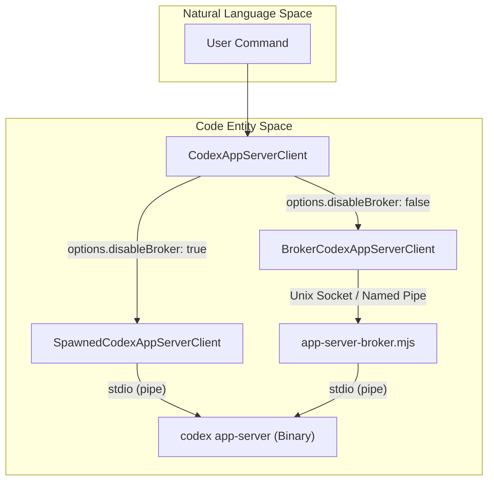
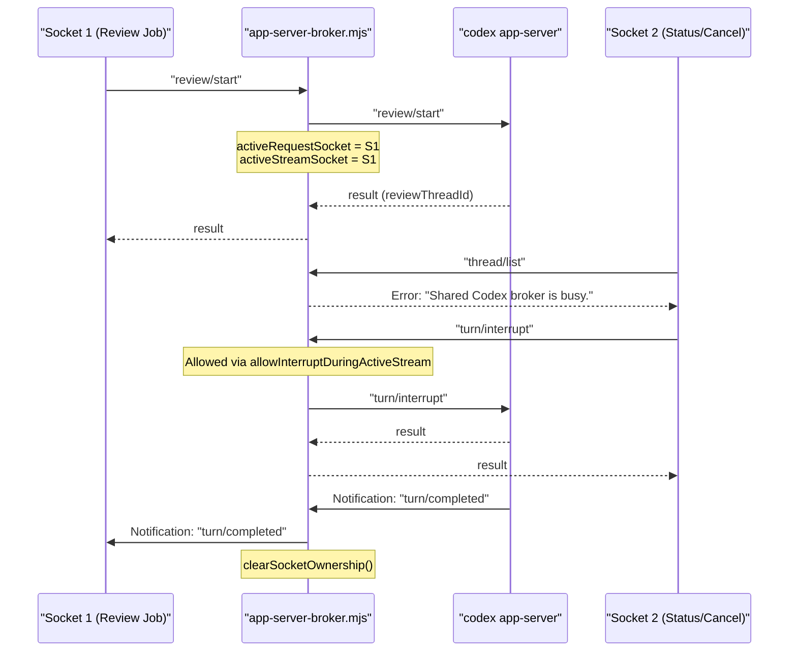

<!-- source: DeepWiki mcp.deepwiki.com · repo openai/codex-plugin-cc · page 2.2 App-Server Client & Broker · fetched 2026-10-26 -->

# App-Server Client & Broker

Relevant source files

The following files were used as context for generating this wiki page:

- [plugins/codex/scripts/app-server-broker.mjs](plugins/codex/scripts/app-server-broker.mjs)
- [plugins/codex/scripts/lib/app-server-protocol.d.ts](plugins/codex/scripts/lib/app-server-protocol.d.ts)
- [plugins/codex/scripts/lib/app-server.mjs](plugins/codex/scripts/lib/app-server.mjs)
- [plugins/codex/scripts/lib/broker-endpoint.mjs](plugins/codex/scripts/lib/broker-endpoint.mjs)
- [plugins/codex/scripts/lib/broker-lifecycle.mjs](plugins/codex/scripts/lib/broker-lifecycle.mjs)

The Codex Plugin communicates with the Codex `app-server` using a JSON-RPC 2.0 protocol over newline-delimited JSON (JSONL). Because the Codex CLI is designed for a single active session but Claude Code may trigger multiple concurrent background jobs (e.g., parallel code reviews), the plugin implements a **Broker** architecture to multiplex requests and manage the lifecycle of the underlying Codex process.

## JSON-RPC Protocol

The communication with the `app-server` follows a standard JSON-RPC pattern. The client sends requests with a unique `id`, and the server responds with either a `result` or an `error` [plugins/codex/scripts/lib/app-server.mjs:86-97](). The server also sends asynchronous notifications (without an `id`) to provide status updates or streaming content [plugins/codex/scripts/lib/app-server.mjs:151-154]().

### Key Methods
The protocol is defined in [plugins/codex/scripts/lib/app-server-protocol.d.ts:59-69]().

| Method | Purpose |
| :--- | :--- |
| `initialize` | Negotiates capabilities and client information. |
| `thread/start` | Begins a new conversation thread. |
| `thread/resume` | Continues an existing thread by ID. |
| `review/start` | Initiates a code review on a specific target (branch or working tree). |
| `turn/start` | Sends a user message to an active thread. |
| `turn/interrupt` | Stops an active turn (useful for cancellation). |
| `externalAgentConfig/import` | Imports external agent configuration. |
| `thread/name/set` | Sets the name of a thread. |
| `thread/list` | Lists available threads. |

### Streaming and Multiplexing
Certain methods are flagged as "streaming" because they trigger a sequence of notifications (e.g., `item/agentMessage/delta`) followed by a final `turn/completed` notification [plugins/codex/scripts/app-server-broker.mjs:12-23]().

## Transport Modes

The `CodexAppServerClient` supports two distinct transport modes determined at connection time via the `disableBroker` option [plugins/codex/scripts/lib/app-server.mjs:275-285]().

### 1. Direct Spawn (`direct`)
The plugin spawns the `codex app-server` binary as a child process and communicates via `stdin` and `stdout` [plugins/codex/scripts/lib/app-server.mjs:183-196](). This is typically used when the broker is disabled or for the broker's own internal connection to Codex.

### 2. Broker Client (`broker`)
The plugin connects to a long-running Broker process via a Unix domain socket (on macOS/Linux) or a Named Pipe (on Windows) [plugins/codex/scripts/lib/app-server.mjs:275-285](). This allows multiple CLI invocations to share a single Codex instance.

### Transport Data Flow
The following diagram shows how the `CodexAppServerClient` abstracts the underlying transport.

**Diagram: App-Server Transport Abstraction**

Sources: [plugins/codex/scripts/lib/app-server.mjs:246-270](), [plugins/codex/scripts/app-server-broker.mjs:68-68]()

## The Broker Multiplexer

The `app-server-broker.mjs` script acts as a stateful proxy. Its primary responsibility is to ensure that only one streaming request is active at a time, while still allowing "out-of-band" requests like `turn/interrupt` [plugins/codex/scripts/app-server-broker.mjs:170-182]().

### Concurrency Logic
1.  **Request Locking**: When a socket sends a request, it becomes the `activeRequestSocket` [plugins/codex/scripts/app-server-broker.mjs:198-198]().
2.  **Busy Errors**: If another socket attempts a request while the broker is busy, it receives a `BROKER_BUSY_RPC_CODE` (-32001) [plugins/codex/scripts/app-server-broker.mjs:173-182]().
3.  **Interrupt Exception**: An exception is made for `turn/interrupt`, which is allowed to pass through even if another socket is currently receiving a stream [plugins/codex/scripts/app-server-broker.mjs:170-171]().
4.  **Notification Routing**: Notifications from the Codex process are routed back to the socket that initiated the current stream via `routeNotification` [plugins/codex/scripts/app-server-broker.mjs:84-100]().

**Diagram: Broker Multiplexing Logic**

Sources: [plugins/codex/scripts/app-server-broker.mjs:170-221](), [plugins/codex/scripts/app-server-broker.mjs:84-100]()

## Broker Lifecycle Management

The lifecycle is managed by `lib/broker-lifecycle.mjs`, which handles the creation of the socket environment and the persistence of the broker's connection details.

### Lifecycle Functions
*   `ensureBrokerSession(cwd, options)`: The main entry point. It checks if a broker is already running by attempting to connect to the endpoint stored in `broker.json`. If it fails, it spawns a new broker [plugins/codex/scripts/lib/broker-lifecycle.mjs:113-171]().
*   `spawnBrokerProcess(config)`: Launches the broker script using `child.unref()` and `detached: true` so that the broker survives the exit of the calling process [plugins/codex/scripts/lib/broker-lifecycle.mjs:59-70]().
*   `teardownBrokerSession(config)`: Cleans up the PID file, log files, and the Unix socket/Named pipe [plugins/codex/scripts/lib/broker-lifecycle.mjs:173-209]().
*   `sendBrokerShutdown(endpoint)`: Sends a `broker/shutdown` JSON-RPC request to the broker to trigger a graceful exit [plugins/codex/scripts/lib/broker-lifecycle.mjs:43-57]().

### Endpoint Resolution
Endpoints are platform-specific and generated based on a temporary session directory [plugins/codex/scripts/lib/broker-endpoint.mjs:10-17]():
*   **macOS/Linux**: `unix:/tmp/cxc-XXXXXX/broker.sock`
*   **Windows**: `pipe:\\.\pipe\cxc-XXXXXX-codex-app-server`

### State Persistence
The broker's connection info is saved to `broker.json` within the project's state directory [plugins/codex/scripts/lib/broker-lifecycle.mjs:162-169]().

| Property | Description |
| :--- | :--- |
| `endpoint` | The socket/pipe string used for `net.connect`. |
| `pid` | The process ID of the broker. |
| `sessionDir` | Path to the temporary directory containing logs and the socket. |
| `pidFile` | Path to the file containing the broker's current PID. |

Sources: [plugins/codex/scripts/lib/broker-lifecycle.mjs:162-168](), [plugins/codex/scripts/lib/broker-endpoint.mjs:19-41](), [plugins/codex/scripts/lib/broker-lifecycle.mjs:13-13]()

---

