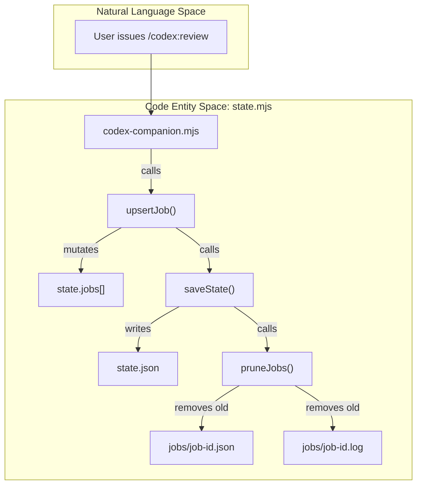
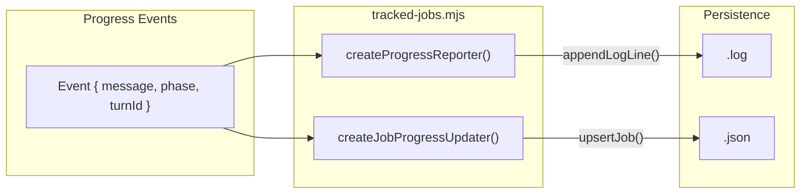

<!-- source: DeepWiki mcp.deepwiki.com · repo openai/codex-plugin-cc · page 2.3 Job Tracking & State Management · fetched 2026-10-26 -->

# Job Tracking & State Management

Relevant source files

The following files were used as context for generating this wiki page:

- [plugins/codex/scripts/lib/fs.mjs](plugins/codex/scripts/lib/fs.mjs)
- [plugins/codex/scripts/lib/job-control.mjs](plugins/codex/scripts/lib/job-control.mjs)
- [plugins/codex/scripts/lib/state.mjs](plugins/codex/scripts/lib/state.mjs)
- [plugins/codex/scripts/lib/tracked-jobs.mjs](plugins/codex/scripts/lib/tracked-jobs.mjs)
- [plugins/codex/scripts/lib/workspace.mjs](plugins/codex/scripts/lib/workspace.mjs)

The Job Tracking and State Management system provides a robust infrastructure for managing long-running background and foreground operations. It handles the persistence of job metadata, real-time progress reporting, log rotation, and state pruning to ensure the plugin remains performant and observable within the Claude Code environment.

## State Persistence and Directory Structure

State management is centralized in `state.mjs`. The system uses a workspace-specific directory to store both a global `state.json` file and individual job detail files.

### Workspace Isolation
The state directory is determined by hashing the canonical workspace root path to ensure that multiple projects do not collide.
*   **Location**: Determined by `resolveStateDir` [plugins/codex/scripts/lib/state.mjs:29-44](). It defaults to a subdirectory in the OS temp directory or the path provided by the `CLAUDE_PLUGIN_DATA` environment variable [plugins/codex/scripts/lib/state.mjs:9-10]().
*   **Structure**:
    *   `state.json`: Contains the global configuration and a summary list of the most recent jobs [plugins/codex/scripts/lib/state.mjs:11]().
    *   `jobs/`: A subdirectory containing full job definitions (`<job-id>.json`) and execution logs (`<job-id>.log`) [plugins/codex/scripts/lib/state.mjs:12]().

### The State Schema
The global state object follows a versioned schema defined in `defaultState` [plugins/codex/scripts/lib/state.mjs:19-27]().

| Field | Description |
| :--- | :--- |
| `version` | Integer version for state migrations (currently 1). |
| `config` | Plugin-wide settings (e.g., `stopReviewGate`) [plugins/codex/scripts/lib/state.mjs:23](). |
| `jobs` | An array of job summary objects, capped at `MAX_JOBS` (50) [plugins/codex/scripts/lib/state.mjs:13](). |

### Job Lifecycle State Flow
The following diagram illustrates how state transitions from a "Natural Language" request into the "Code Entity" space of the filesystem.

**Job State Persistence Flow**

**Sources:** [plugins/codex/scripts/lib/state.mjs:92-116](), [plugins/codex/scripts/lib/state.mjs:129-147]()

## Tracked Job Execution

The `tracked-jobs.mjs` module provides the `runTrackedJob` wrapper, which orchestrates the execution of a task while ensuring its status and results are persisted.

### runTrackedJob Execution Loop
When a job is executed via `runTrackedJob` [plugins/codex/scripts/lib/tracked-jobs.mjs:142-204]():
1.  **Initialization**: Sets status to `running`, records the `pid`, and sets the initial `phase` to `starting` [plugins/codex/scripts/lib/tracked-jobs.mjs:143-150]().
2.  **Persistence**: Calls `writeJobFile` for the full record and `upsertJob` for the summary [plugins/codex/scripts/lib/tracked-jobs.mjs:151-152]().
3.  **Execution**: Awaits the provided `runner` function [plugins/codex/scripts/lib/tracked-jobs.mjs:155]().
4.  **Completion**: Updates the record with `exitStatus`, `threadId`, `turnId`, and the final `rendered` output [plugins/codex/scripts/lib/tracked-jobs.mjs:158-178]().
5.  **Error Handling**: If the runner throws, the job is marked as `failed` and the error message is captured [plugins/codex/scripts/lib/tracked-jobs.mjs:181-203]().

### Progress Reporting and Logs
Progress is handled via a `createProgressReporter` which can simultaneously update the console (`stderr`), a log file, and the internal state [plugins/codex/scripts/lib/tracked-jobs.mjs:117-132]().

*   **Log Files**: Created using `createJobLogFile` [plugins/codex/scripts/lib/tracked-jobs.mjs:51-58](). Lines are prefixed with ISO timestamps via `appendLogLine` [plugins/codex/scripts/lib/tracked-jobs.mjs:36-42]().
*   **Progress Updater**: `createJobProgressUpdater` returns a function that detects changes in `phase`, `threadId`, or `turnId` and triggers a state write only when values change to minimize I/O [plugins/codex/scripts/lib/tracked-jobs.mjs:70-115]().

**Progress and Logging Architecture**

**Sources:** [plugins/codex/scripts/lib/tracked-jobs.mjs:117-132](), [plugins/codex/scripts/lib/tracked-jobs.mjs:70-115]()

## Job Control & Querying

The `job-control.mjs` module provides utilities for filtering, enriching, and resolving jobs from the state.

### Job Enrichment
Because stored job records are minimal, `enrichJob` is used to calculate derived fields for display [plugins/codex/scripts/lib/job-control.mjs:161-181]():
*   **`kindLabel`**: Maps internal `kind` or `jobClass` to user-friendly labels (e.g., `task` becomes `rescue`) [plugins/codex/scripts/lib/job-control.mjs:27-47]().
*   **`elapsed`/`duration`**: Formats time differences into strings like `2m 15s` via `formatElapsedDuration` [plugins/codex/scripts/lib/job-control.mjs:78-101]().
*   **`progressPreview`**: Extracts the last few relevant lines from the log file using `readJobProgressPreview`, stripping internal prefixes and noisy block titles [plugins/codex/scripts/lib/job-control.mjs:61-76]().
*   **`phase`**: For legacy jobs without explicit phases, `inferLegacyJobPhase` scans the log preview for keywords like "searching", "applying", or "running command" to guess the current activity [plugins/codex/scripts/lib/job-control.mjs:109-159]().

### Status Snapshots
The `buildStatusSnapshot` function creates a unified view of the system state for the `/codex:status` command [plugins/codex/scripts/lib/job-control.mjs:213-222]():
1.  Filters jobs by the current `CODEX_COMPANION_SESSION_ID` [plugins/codex/scripts/lib/job-control.mjs:19-25]().
2.  Sorts jobs newest-first using `sortJobsNewestFirst` [plugins/codex/scripts/lib/job-control.mjs:11-13]().
3.  Enriches the active running jobs and identifies the most recent finished job.

### Job Resolution Logic
Commands like `/codex:result <id>` or `/codex:cancel <id>` use `matchJobReference` to find target jobs [plugins/codex/scripts/lib/job-control.mjs:191-211]():
*   If no ID is provided, it defaults to the most recent relevant job [plugins/codex/scripts/lib/job-control.mjs:194]().
*   It supports **exact matches** on IDs [plugins/codex/scripts/lib/job-control.mjs:197]().
*   It supports **prefix matches** (e.g., `job-k2l` matches `job-k2l8xa`), throwing an error if the prefix is ambiguous [plugins/codex/scripts/lib/job-control.mjs:206-208]().

**Sources:**
*   `state.mjs`: [plugins/codex/scripts/lib/state.mjs:1-191]()
*   `tracked-jobs.mjs`: [plugins/codex/scripts/lib/tracked-jobs.mjs:1-204]()
*   `job-control.mjs`: [plugins/codex/scripts/lib/job-control.mjs:1-222]()
*   `fs.mjs`: [plugins/codex/scripts/lib/fs.mjs:1-40]()
*   `workspace.mjs`: [plugins/codex/scripts/lib/workspace.mjs:1-9]()

---

