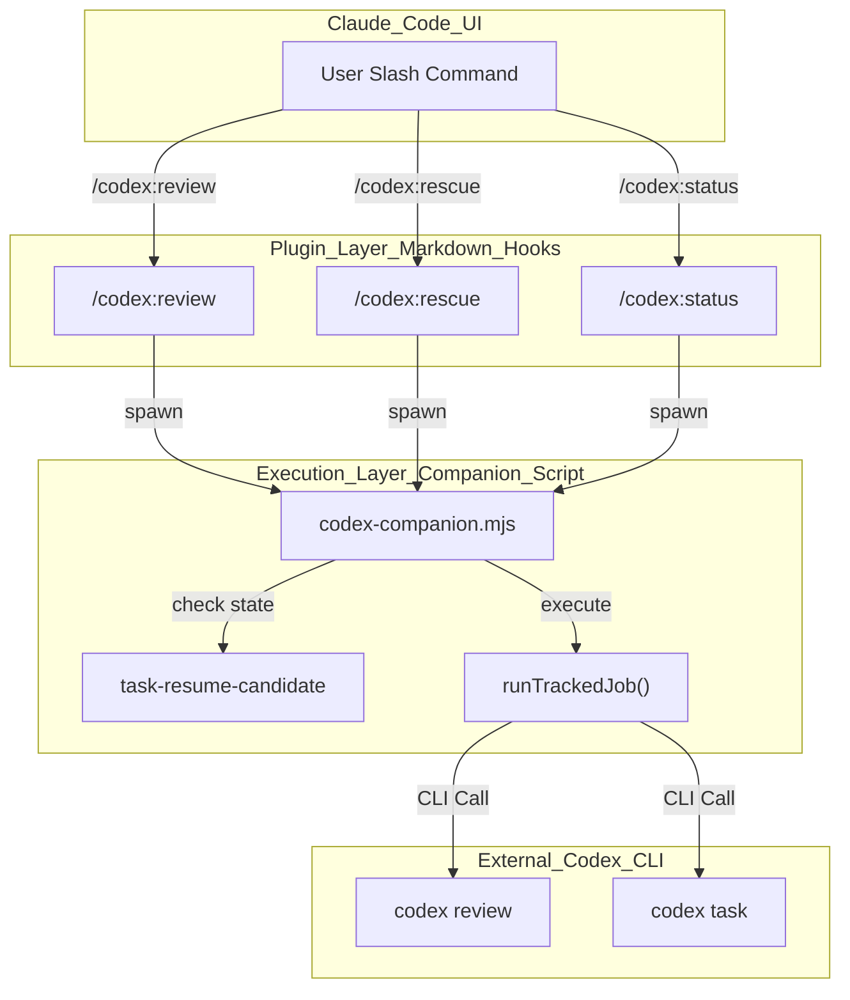

<!-- source: DeepWiki mcp.deepwiki.com · repo openai/codex-plugin-cc · page 3 Commands Reference · fetched 2026-10-26 -->

# Commands Reference

<details>
<summary>Relevant source files</summary>

The following files were used as context for generating this wiki page:

- [plugins/codex/commands/rescue.md](plugins/codex/commands/rescue.md)
- [tests/commands.test.mjs](tests/commands.test.mjs)

</details>


This page provides a high-level overview of the user-facing slash commands exposed by the `codex-plugin-cc` plugin. These commands allow users to trigger deep code reviews, delegate complex tasks to specialized subagents, and manage the lifecycle of asynchronous jobs directly from the Claude Code interface.

All commands are implemented as Markdown-defined hooks in the `plugins/codex/commands/` directory [tests/commands.test.mjs:73-83](). They act as thin wrappers that delegate execution to the `codex-companion.mjs` script [plugins/codex/commands/review.md:44-46]().

## Command Architecture Overview

The following diagram illustrates how user commands travel from the Claude Code interface through the plugin's execution layer into the Codex ecosystem.

### Natural Language to Code Entity Mapping: Command Dispatch

**Sources:** [plugins/codex/commands/review.md:44-46](), [plugins/codex/commands/rescue.md:25-27](), [tests/commands.test.mjs:26-27]()

---

## Review Commands

The review suite provides two distinct ways to analyze code changes: a standard native review and a more critical "adversarial" review. Both commands support analyzing the current working tree or specific git branches.

*   **/codex:review**: Triggers the standard Codex review process. It is strictly "review-only" and does not suggest or apply fixes [tests/commands.test.mjs:18-19]().
*   **/codex:adversarial-review**: A specialized mode that challenges implementation approach and design tradeoffs. It supports extra focus text after flags [tests/commands.test.mjs:70-70]().

Both commands can be run in the foreground (`--wait`) or background (`--background`). If no mode is specified, the plugin estimates the diff size using `git status --short` and `git diff --shortstat` to recommend a mode to the user [tests/commands.test.mjs:30-34]().

For details, see [Review Commands](#3.1).

---

## Rescue & Task Delegation

The rescue command allows Claude to offload complex investigations or implementation tasks to a specialized Codex subagent.

*   **/codex:rescue**: Routes the user's request to the `codex:codex-rescue` subagent [plugins/codex/commands/rescue.md:7-8](). This command supports advanced flags for model selection (`--model`) and reasoning effort (`--effort`) [plugins/codex/commands/rescue.md:3-3]().

Before starting, the plugin checks for resumable threads using the `task-resume-candidate --json` helper [plugins/codex/commands/rescue.md:25-27](). This allows users to continue an existing investigation via the `--resume` flag or start a fresh one via `--fresh` [tests/commands.test.mjs:109-120]().

For details, see [Rescue & Task Delegation](#3.2).

---

## Job Lifecycle Commands

Since many Codex operations can take several minutes, the plugin provides a set of commands to manage these asynchronous tasks.

*   **/codex:status**: Displays a summary table of active and recent jobs in the current session.
*   **/codex:result**: Retrieves the full, verbatim output of a completed job.
*   **/codex:cancel**: Terminates an active background job.

### Job State Transitions
```mermaid
stateDiagram-v2
    [*] --> Pending_codex_companion_mjs
    Pending_codex_companion_mjs --> Running: "runTrackedJob()"
    Running --> Completed: "Job Success"
    Running --> Failed: "Process Error"
    Running --> Cancelled: "/codex:cancel"
    
    Completed --> "/codex:result": "User Retrieval"
    Failed --> "/codex:status": "Error Reporting"
```
**Sources:** [plugins/codex/commands/rescue.md:44-44](), [tests/commands.test.mjs:77-82]()

For details, see [Job Lifecycle Commands](#3.3).

---

## Session Transfer

The session transfer command facilitates importing existing Claude session transcripts into the Codex plugin's native thread management.

*   **/codex:transfer**: Imports Claude session transcripts (`.jsonl` files) into native Codex threads. This is handled by `claude-session-transfer.mjs` and the `externalAgentConfig/import` app-server method.

For details, see [Session Transfer](#3.4).

---

## Setup Command

The setup command is the entry point for configuring the plugin environment.

*   **/codex:setup**: Verifies if the Codex CLI is installed and authenticated via `codex login`. It also handles the configuration of the optional review gate (`--enable-review-gate` or `--disable-review-gate`) which can block Claude from stopping if a review is required [plugins/codex/commands/setup.md:1-4]().

**Sources:** [plugins/codex/commands/setup.md:1-37](), [tests/commands.test.mjs:81-81]()

---

