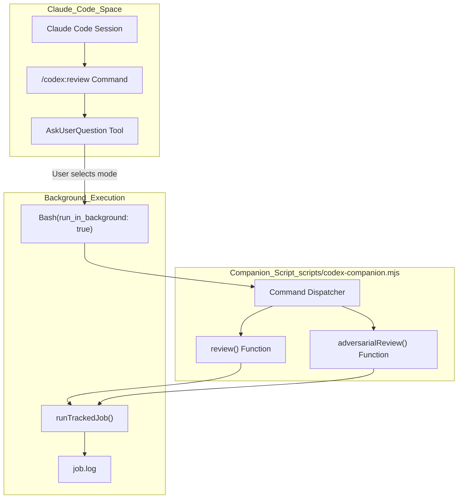
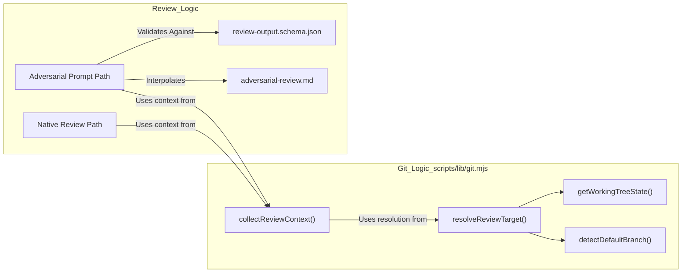

<!-- source: DeepWiki mcp.deepwiki.com · repo openai/codex-plugin-cc · page 3.1 Review Commands · fetched 2026-10-26 -->

# Review Commands

Relevant source files

The following files were used as context for generating this wiki page:

- [plugins/codex/commands/adversarial-review.md](plugins/codex/commands/adversarial-review.md)
- [plugins/codex/commands/review.md](plugins/codex/commands/review.md)
- [plugins/codex/schemas/review-output.schema.json](plugins/codex/schemas/review-output.schema.json)
- [plugins/codex/scripts/lib/git.mjs](plugins/codex/scripts/lib/git.mjs)

The Codex plugin provides two primary commands for evaluating code changes: `/codex:review` and `/codex:adversarial-review`. These commands leverage the Codex companion script to analyze Git state, resolve a review target (working tree vs. branch), and execute the analysis in either foreground or background modes.

## Overview of Review Commands

Both commands are "review-only," meaning they are strictly constrained from applying fixes, applying patches, or suggesting that they will make changes to the codebase [plugins/codex/commands/review.md:13-17](), [plugins/codex/commands/adversarial-review.md:15-19]().

| Command | Purpose | Mechanism |
| :--- | :--- | :--- |
| `/codex:review` | General purpose code review against local git state. | Uses the native Codex CLI reviewer path [plugins/codex/commands/review.md:8-9](). |
| `/codex:adversarial-review` | Skeptical review focused on challenging design choices and tradeoffs. | Uses a specialized Markdown prompt template and adversarial framing [plugins/codex/commands/adversarial-review.md:8-10](). |

### Argument Syntax
Both commands share a common argument structure [plugins/codex/commands/review.md:3](), [plugins/codex/commands/adversarial-review.md:3]():
`[--wait|--background] [--base <ref>] [--scope auto|working-tree|branch] [focus ...]`

- `--wait`: Forces foreground execution.
- `--background`: Forces execution as a Claude background task.
- `--base <ref>`: Specifies a Git reference to compare against (e.g., `main`).
- `--scope`: Explicitly sets the review target to `working-tree` (uncommitted changes) or `branch` (commits since merge-base).
- `focus ...`: (Adversarial only) Optional text to direct the reviewer's attention to specific areas [plugins/codex/commands/adversarial-review.md:45]().

## Execution Modes

The plugin determines whether a review should run in the foreground or background based on explicit user flags or an estimation of the change size.

### Mode Selection Logic
1. **Explicit Flags**: If `--wait` or `--background` is present in the raw arguments, the choice is respected immediately [plugins/codex/commands/review.md:19-20]().
2. **Size Estimation**: Claude Code performs a `git diff --shortstat` or `git status --short` to estimate the change size before asking the user [plugins/codex/commands/review.md:21-26]().
3. **Recommendation**:
   - **Foreground**: Recommended only for "tiny" reviews (roughly 1-2 files) [plugins/codex/commands/review.md:27]().
   - **Background**: Recommended for all other cases, including unclear sizes, to avoid blocking the Claude session [plugins/codex/commands/review.md:28-31]().
4. **User Confirmation**: If no flag is provided, the `AskUserQuestion` tool is used to let the user choose [plugins/codex/commands/review.md:30-35]().

### Data Flow: Command Execution
The following diagram illustrates how a review request flows from the Claude Code slash command to the background worker.

**Review Command Dispatch Flow**

Sources: [plugins/codex/commands/review.md:51-61](), [plugins/codex/commands/adversarial-review.md:56-66]().

## Review Target Resolution

The `resolveReviewTarget` function in `git.mjs` determines what specific Git state should be sent to Codex for review [plugins/codex/scripts/lib/git.mjs:134]().

### Resolution Strategy
- **Explicit Base**: If `--base <ref>` is provided, it defaults to a `branch` diff against that reference [plugins/codex/scripts/lib/git.mjs:142-149]().
- **Working Tree**: If the `working-tree` scope is requested, it collects staged, unstaged, and untracked files [plugins/codex/scripts/lib/git.mjs:151-157]().
- **Auto-Detection**:
    - If the repository is "dirty" (has uncommitted changes detected by `getWorkingTreeState`), it selects `working-tree` [plugins/codex/scripts/lib/git.mjs:175-181]().
    - If the repository is "clean," it selects `branch` and attempts to detect the default branch (e.g., `main`, `master`) using `detectDefaultBranch` [plugins/codex/scripts/lib/git.mjs:183-189](), [plugins/codex/scripts/lib/git.mjs:93-115]().

### Context Collection & Scaling
The `collectReviewContext` function gathers the actual content. It dynamically scales the detail level based on the size of the changes to avoid exceeding context limits.

- **Inline Diff Mode**: For small changes (e.g., 1-2 files), the system provides full file contents and inline diffs.
- **Self-Collect Mode**: For larger reviews or oversized single-file diffs, it falls back to a "lightweight" context. This provides a summary of changed files and instructs the reviewer to use read-only git commands to fetch details as needed.
- **Untracked Files**: These are read from disk, subject to a 24KB limit (`MAX_UNTRACKED_BYTES`) [plugins/codex/scripts/lib/git.mjs:7](), [plugins/codex/scripts/lib/git.mjs:196-210](). Broken symlinks and binary files are automatically skipped [plugins/codex/scripts/lib/git.mjs:217-222]().

## Adversarial Review Path

The `/codex:adversarial-review` command differs from the standard review by adopting an "adversarial" operating stance [plugins/codex/commands/adversarial-review.md:8-10]().

### Operating Stance & Attack Surface
The adversarial review uses the `adversarial-review.md` template, which instructs Codex to "break confidence in the change" [plugins/codex/commands/adversarial-review.md:8-10](). It prioritizes high-cost failure modes:
- Auth, permissions, and trust boundaries.
- Data loss, corruption, and irreversible state.
- Race conditions, stale state, and re-entrancy.
- Rollback safety and migration hazards.

### Structured Output Schema
The reviewer must return a JSON object adhering to `review-output.schema.json` [plugins/codex/schemas/review-output.schema.json:1]().

| Field | Type | Description |
| :--- | :--- | :--- |
| `verdict` | enum | `approve` or `needs-attention` [plugins/codex/schemas/review-output.schema.json:12-18](). |
| `summary` | string | High-level assessment of the changes [plugins/codex/schemas/review-output.schema.json:19-22](). |
| `findings` | array | Detailed issues including `severity`, `file`, and `recommendation` [plugins/codex/schemas/review-output.schema.json:23-78](). |
| `next_steps` | array | Concrete actions for the developer [plugins/codex/schemas/review-output.schema.json:79-85](). |

**Review Target and Logic Mapping**

Sources: [plugins/codex/scripts/lib/git.mjs:134](), [plugins/codex/scripts/lib/git.mjs:121](), [plugins/codex/scripts/lib/git.mjs:93](), [plugins/codex/schemas/review-output.schema.json:1](), [plugins/codex/commands/adversarial-review.md:8-10]().

Sources: [plugins/codex/scripts/lib/git.mjs:1-218](), [plugins/codex/commands/review.md:1-61](), [plugins/codex/commands/adversarial-review.md:1-66](), [plugins/codex/schemas/review-output.schema.json:1-87]().

---

