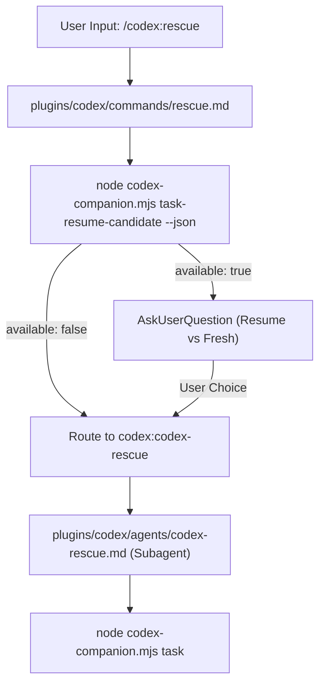
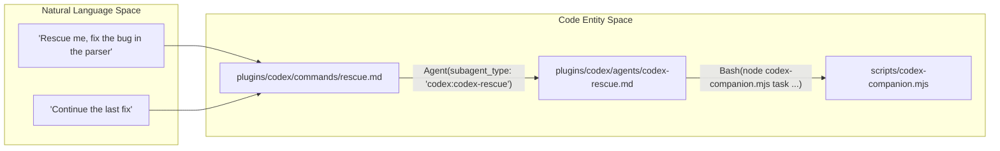

<!-- source: DeepWiki mcp.deepwiki.com · repo openai/codex-plugin-cc · page 3.2 Rescue & Task Delegation · fetched 2026-10-26 -->

# Rescue & Task Delegation

Relevant source files

The following files were used as context for generating this wiki page:

- [plugins/codex/agents/codex-rescue.md](plugins/codex/agents/codex-rescue.md)
- [plugins/codex/commands/rescue.md](plugins/codex/commands/rescue.md)
- [tests/commands.test.mjs](tests/commands.test.mjs)

The `/codex:rescue` command provides a mechanism for Claude Code to delegate complex, multi-step, or open-ended tasks to the Codex engine. This delegation is handled by a specialized subagent, `codex:codex-rescue`, which acts as a thin wrapper around the `codex-companion.mjs` CLI. This allows for long-running background investigations, automated fixes, or deep-dive diagnostics that exceed the immediate context or turn-count constraints of the main Claude session.

## Command Routing & Execution Modes

When a user invokes `/codex:rescue`, the request undergoes a two-stage routing process. First, the `rescue.md` command definition determines the execution mode (foreground vs. background) and checks for session continuity. Second, it hands off the request to the `codex-rescue` subagent.

### Execution Flags
The command supports two primary execution modes that control how Claude Code waits for the result:
*   `--background`: Runs the subagent in the background, allowing the user to continue interacting with Claude Code while Codex works [plugins/codex/commands/rescue.md:16]().
*   `--wait`: Forces foreground execution, where Claude Code waits for the subagent to complete its task before returning control [plugins/codex/commands/rescue.md:17]().
*   **Default**: If neither is specified, the system defaults to foreground execution [plugins/codex/commands/rescue.md:18]().

### Task Continuity Check
Before delegating to the subagent, the system checks if there is a "resumable" Codex thread from the current session.
1.  The command executes `node "${CLAUDE_PLUGIN_ROOT}/scripts/codex-companion.mjs" task-resume-candidate --json` [plugins/codex/commands/rescue.md:25-27]().
2.  If that helper reports `available: true`, the system uses `AskUserQuestion` to prompt the user to either "Continue current Codex thread" or "Start a new Codex thread" [plugins/codex/commands/rescue.md:29-32]().
3.  The recommendation order of these choices is determined by the presence of follow-up keywords like "continue", "resume", or "apply the top fix" [plugins/codex/commands/rescue.md:33-34]().

### Diagram: Rescue Command Flow
The following diagram illustrates the flow from the user's slash command to the subagent invocation.

"Rescue Command Delegation Flow"

Sources: [plugins/codex/commands/rescue.md:1-49](), [plugins/codex/agents/codex-rescue.md:1-46]()

## The Codex Rescue Subagent

The `codex:codex-rescue` subagent is defined as a "thin forwarding wrapper" [plugins/codex/agents/codex-rescue.md:11](). Its primary responsibility is to translate the natural language request and the routing flags into a valid `codex-companion.mjs task` invocation.

### Forwarding Rules & Skill Usage
*   **Skill: `codex-cli-runtime`**: This internal skill dictates that the subagent must use exactly one `Bash` call to invoke the companion script's `task` subcommand [plugins/codex/agents/codex-rescue.md:22]().
*   **Skill: `gpt-5-4-prompting`**: The subagent is permitted to use this skill only to "tighten" or improve the user's prompt before forwarding. It is explicitly forbidden from inspecting the repository or reasoning through the problem itself [plugins/codex/agents/codex-rescue.md:25-26]().
*   **Output Contract**: The subagent must return the `stdout` of the companion script verbatim. It is prohibited from adding commentary, summarizing, or paraphrasing the output [plugins/codex/agents/codex-rescue.md:41-46]().

### Parameter Mapping
The subagent maps high-level user intents to specific CLI flags:

| User Intent / Flag | CLI Parameter | Logic / Mapping |
| :--- | :--- | :--- |
| `--resume` | `--resume-last` | Maps to `task --resume-last` to continue the previous thread [plugins/codex/agents/codex-rescue.md:36](). |
| `--fresh` | (None) | Forces a new thread by omitting `--resume-last` [plugins/codex/agents/codex-rescue.md:37](). |
| `spark` | `--model gpt-5.3-codex-spark` | Maps the shorthand "spark" to the specific model string [plugins/codex/agents/codex-rescue.md:31](). |
| `--effort <val>` | `--effort <val>` | Passes through reasoning effort levels (none, minimal, low, medium, high, xhigh) [plugins/codex/commands/rescue.md:49](). |
| Default | `--write` | Unless read-only is explicitly requested, rescue tasks default to write-capable [plugins/codex/agents/codex-rescue.md:34](). |

Sources: [plugins/codex/agents/codex-rescue.md:29-41](), [plugins/codex/commands/rescue.md:45-47]()

## Session Transfer

In addition to delegation via rescue, the plugin supports transferring the entire current Claude session into a Codex thread using `/codex:transfer`.

### Transfer Mechanism
The `/codex:transfer` command invokes the `transfer` subcommand of the companion script [tests/commands.test.mjs:84](). This utilizes `resolveClaudeSessionPath` to locate the current Claude transcript, which is typically stored as a `.jsonl` file in the user's home directory under `.claude/projects` [plugins/codex/scripts/lib/claude-session-transfer.mjs:8-43]().

The path to the transcript can be provided via the `--source` flag or retrieved from the `CODEX_COMPANION_TRANSCRIPT_PATH` environment variable [plugins/codex/scripts/lib/claude-session-transfer.mjs:7-21]().

Sources: [tests/commands.test.mjs:84](), [plugins/codex/scripts/lib/claude-session-transfer.mjs:1-44]()

## Implementation Details

The core logic for the actual task execution resides in the `task` subcommand of the companion script. The subagent does not perform any file I/O or Git operations; it delegates everything to the companion script to ensure the Codex environment (auth, model settings, and app-server broker) is managed consistently.

### Data Flow: Natural Language to Code Entity
This diagram bridges the user's intent to the specific code entities involved in the rescue operation.

"Natural Language to Code Entity Mapping"

Sources: [plugins/codex/commands/rescue.md:7-12](), [plugins/codex/agents/codex-rescue.md:22]()

### Subagent Restrictions
To prevent the subagent from becoming a general-purpose orchestrator (which would conflict with the main Claude session), strict limitations are enforced:
1.  **No Inspection**: It cannot read files, run `grep`, or check Git status [plugins/codex/agents/codex-rescue.md:27]().
2.  **No Monitoring**: It cannot poll `/codex:status` or fetch results via `/codex:result`. It must wait for the single `task` call to return [plugins/codex/agents/codex-rescue.md:27-28]().
3.  **No Tool Proliferation**: It is restricted to the `Bash` tool and only for the purpose of calling the companion script [plugins/codex/agents/codex-rescue.md:5]().

Sources: [plugins/codex/agents/codex-rescue.md:27-28](), [plugins/codex/commands/rescue.md:41-44]()

---

