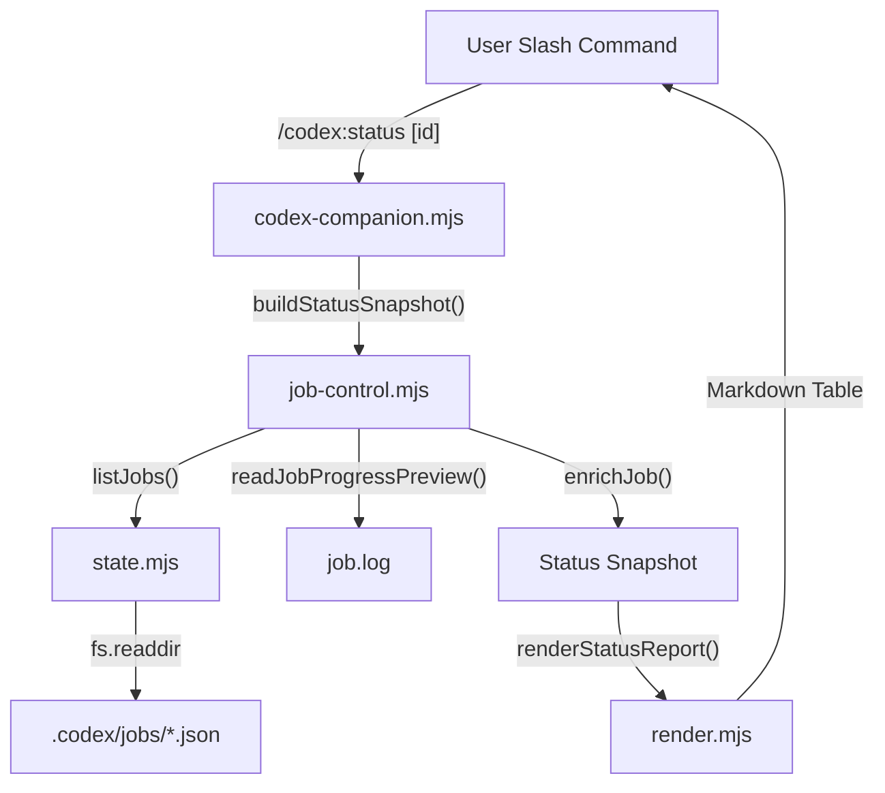
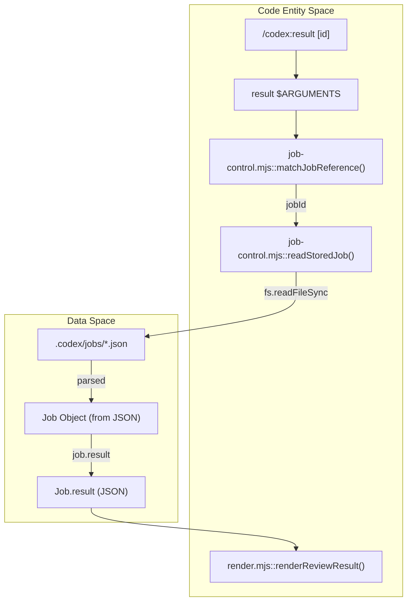
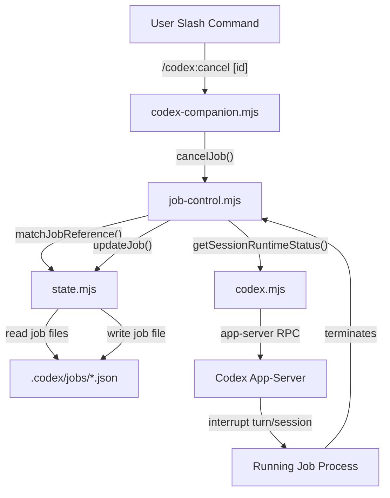

<!-- source: DeepWiki mcp.deepwiki.com · repo openai/codex-plugin-cc · page 3.3 Job Lifecycle Commands · fetched 2026-10-26 -->

# Job Lifecycle Commands

Relevant source files

The following files were used as context for generating this wiki page:

- [plugins/codex/commands/cancel.md](plugins/codex/commands/cancel.md)
- [plugins/codex/commands/result.md](plugins/codex/commands/result.md)
- [plugins/codex/commands/status.md](plugins/codex/commands/status.md)
- [plugins/codex/scripts/lib/job-control.mjs](plugins/codex/scripts/lib/job-control.mjs)

This page provides a technical reference for the commands used to monitor, retrieve results from, and terminate Codex jobs. These commands interact with the job tracking subsystem to provide visibility into background processes and manage the lifecycle of active tasks.

## Overview of Lifecycle Management

The job lifecycle is managed through a set of state files persisted in the workspace. Commands like `/codex:status`, `/codex:result`, and `/codex:cancel` act as a frontend to the `job-control.mjs` library, which aggregates data from `state.mjs` and provides real-time progress updates by tailing job logs.

### Data Flow: Command to State
The following diagram illustrates how lifecycle commands resolve job information from the local filesystem and the active app-server.

**Job Resolution and Monitoring Flow**

Sources: [plugins/codex/scripts/lib/job-control.mjs:213-224](), [plugins/codex/scripts/lib/state.mjs:4-6](), [plugins/codex/scripts/lib/render.mjs:109-122]()

---

## /codex:status

The `/codex:status` command provides a summary of active and recent jobs. It supports filtering by the current session and can provide detailed progress for a specific job.

### Implementation Details
- **Session Filtering**: By default, `filterJobsForCurrentSession` restricts the list to jobs initiated within the current Claude Code session using the `SESSION_ID_ENV` environment variable [plugins/codex/scripts/lib/job-control.mjs:15-25]().
- **Progress Tailing**: For active jobs, the system reads the last few lines of the log file using `readJobProgressPreview`. It filters out internal headers and "progress block titles" (such as "Assistant message" or "Reasoning summary") to show only meaningful activity [plugins/codex/scripts/lib/job-control.mjs:53-76]().
- **Phase Inference**: If a job does not explicitly report its phase, `inferLegacyJobPhase` scans log lines for keywords like "starting codex", "running tool:", or "applying" to determine if the job is starting, investigating, editing, or verifying [plugins/codex/scripts/lib/job-control.mjs:109-159]().
- **Duration Calculation**: The `enrichJob` function calculates `elapsed` time for running jobs and final `duration` for terminal jobs using `formatElapsedDuration` [plugins/codex/scripts/lib/job-control.mjs:78-101](), [plugins/codex/scripts/lib/job-control.mjs:161-181]().

### Command Output
| Argument | Behavior |
| :--- | :--- |
| (None) | Renders a Markdown table of current and past runs in the session [plugins/codex/commands/status.md:10-13](). |
| `[job-id]` | Shows full details for the specific job, including the Codex Session ID and log path [plugins/codex/commands/status.md:15-17](). |
| `--wait` | Blocks until the specified job reaches a terminal state (completed, failed, or cancelled) [plugins/codex/commands/status.md:3]().

Sources: [plugins/codex/commands/status.md:1-17](), [plugins/codex/scripts/lib/job-control.mjs:161-181](), [plugins/codex/scripts/lib/job-control.mjs:213-230]()

---

## /codex:result

The `/codex:result` command retrieves the final output of a completed job. It is specifically designed to handle the structured JSON output from review jobs or the final summaries from rescue tasks.

### Structured Result Handling
For review jobs, the result is often a structured JSON object. The `render.mjs` module includes a `validateReviewResultShape` function to ensure the payload contains a `verdict`, `summary`, `findings`, and `next_steps` [plugins/codex/scripts/lib/render.mjs:24-41]().

**Result Retrieval Logic**

Sources: [plugins/codex/commands/result.md:8](), [plugins/codex/scripts/lib/job-control.mjs:183-189](), [plugins/codex/scripts/lib/job-control.mjs:191-211](), [plugins/codex/scripts/lib/render.mjs:211-225]()

### Formatting Requirements
The command is instructed to present the full output without summarization, preserving:
- Job ID and status [plugins/codex/commands/result.md:11]().
- The complete result payload, including verdict, summary, and findings [plugins/codex/commands/result.md:12]().
- File paths and line numbers exactly as reported [plugins/codex/commands/result.md:13]().
- Follow-up actions like `/codex:status <id>` and `/codex:review` [plugins/codex/commands/result.md:15]().

Sources: [plugins/codex/commands/result.md:1-15](), [plugins/codex/scripts/lib/render.mjs:62-71]()

---

## /codex:cancel

The `/codex:cancel` command terminates an active background job.

### Cancellation Mechanism
1. **Job Resolution**: The command uses `matchJobReference` to find the job by ID or unique prefix. It throws an error if the reference is ambiguous [plugins/codex/scripts/lib/job-control.mjs:191-211]().
2. **Process Termination**: It attempts to stop the underlying process. For jobs managed via the app-server, it leverages the JSON-RPC interface to send an interruption signal to the specific turn or session [plugins/codex/scripts/lib/codex.mjs:3-4]().
3. **State Update**: Upon cancellation, the job status in the state file is updated to `cancelled`, and the `completedAt` timestamp is set [plugins/codex/scripts/lib/job-control.mjs:113-114](), [plugins/codex/scripts/lib/job-control.mjs:172-175]().

**Job Cancellation Flow**

Sources: [plugins/codex/commands/cancel.md:8](), [plugins/codex/scripts/lib/job-control.mjs:113-115](), [plugins/codex/scripts/lib/job-control.mjs:172-175](), [plugins/codex/scripts/lib/job-control.mjs:191-211](), [plugins/codex/scripts/lib/codex.mjs:3-4]()

### UI Hints
The system automatically appends a `/codex:cancel [id]` hint to the status output for any job that is currently in a `queued` or `running` state to facilitate quick termination [plugins/codex/scripts/lib/render.mjs:148-150]().

Sources: [plugins/codex/commands/cancel.md:1-8](), [plugins/codex/scripts/lib/job-control.mjs:113-115](), [plugins/codex/scripts/lib/render.mjs:115-117](), [plugins/codex/scripts/lib/job-control.mjs:191-211]()

---

