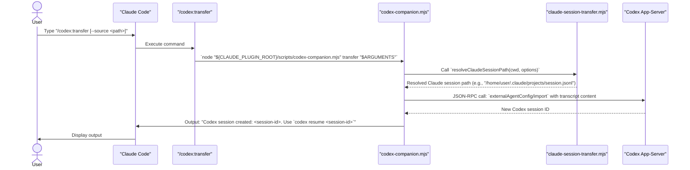
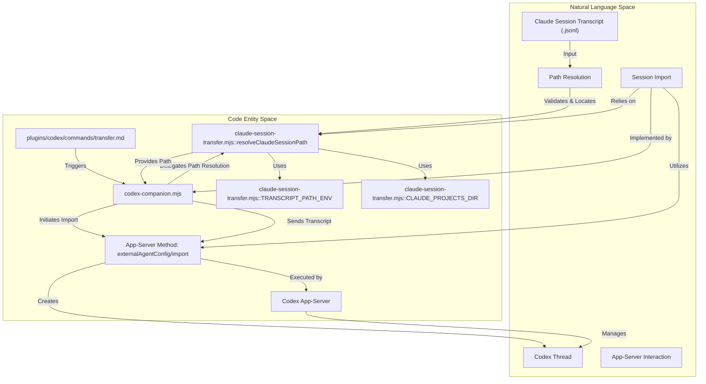

<!-- source: DeepWiki mcp.deepwiki.com · repo openai/codex-plugin-cc · page 3.4 Session Transfer · fetched 2026-10-26 -->

# 3.4. Session Transfer

Relevant source files

The following files were used as context for generating this wiki page:

- [plugins/codex/commands/transfer.md](plugins/codex/commands/transfer.md)
- [plugins/codex/scripts/lib/claude-session-transfer.mjs](plugins/codex/scripts/lib/claude-session-transfer.mjs)

This page details the `/codex:transfer` command, which facilitates importing Claude session transcripts (`.jsonl` files) into native Codex threads. This process allows users to continue their work within the Codex environment, leveraging its features for session management and interaction. The transfer is handled by the `claude-session-transfer.mjs` script and utilizes the `externalAgentConfig/import` method of the app-server.

### Purpose and Scope

The primary purpose of `/codex:transfer` is to bridge the gap between Claude Code sessions and Codex. Claude Code sessions are often recorded as `.jsonl` transcripts. This command provides a mechanism to ingest these transcripts into Codex, creating a new Codex thread that reflects the conversation history. This enables users to seamlessly transition from Claude Code to Codex without losing context, allowing for continued development, review, or task execution within the Codex ecosystem.

### Implementation Details

The `/codex:transfer` command is exposed to the user via a Markdown file [plugins/codex/commands/transfer.md](). This file defines the command's description, argument hints, and crucially, the shell command executed when `/codex:transfer` is invoked [plugins/codex/commands/transfer.md:8]().

The core logic for session transfer resides in the `codex-companion.mjs` script, which dispatches the `transfer` command to the `claude-session-transfer.mjs` module.

#### Data Flow

The session transfer process involves the following steps:

1.  **User Invocation**: The user issues the `/codex:transfer` command in Claude Code, optionally providing a `--source` argument specifying the path to the Claude session `.jsonl` file [plugins/codex/commands/transfer.md:3]().
2.  **Command Dispatch**: Claude Code executes the shell command defined in `transfer.md`, which invokes `codex-companion.mjs` with the `transfer` argument [plugins/codex/commands/transfer.md:8]().
3.  **Path Resolution**: `codex-companion.mjs` delegates to `claude-session-transfer.mjs` to resolve the path to the Claude session transcript. The `resolveClaudeSessionPath` function [plugins/codex/scripts/lib/claude-session-transfer.mjs:20-44]() handles this, checking for the `--source` option or the `CODEX_COMPANION_TRANSCRIPT_PATH` environment variable [plugins/codex/scripts/lib/claude-session-transfer.mjs:21](). It also ensures the path is a `.jsonl` file [plugins/codex/scripts/lib/claude-session-transfer.mjs:27-29]() and resides within the `~/.claude/projects` directory for security and consistency [plugins/codex/scripts/lib/claude-session-transfer.mjs:31-43]().
4.  **App-Server Interaction**: Once the transcript path is resolved, `codex-companion.mjs` (via its app-server client) calls the `externalAgentConfig/import` method on the Codex app-server. This method is responsible for ingesting the `.jsonl` transcript and creating a new Codex thread.
5.  **Result Presentation**: The app-server returns a session ID for the newly created Codex thread. `codex-companion.mjs` then formats this information and presents it to the user, including a `codex resume <session-id>` command for easy continuation [plugins/codex/commands/transfer.md:10]().

#### Key Functions and Classes

*   `plugins/codex/commands/transfer.md`: Defines the `/codex:transfer` command and its execution shell command.
*   `codex-companion.mjs`: The main CLI dispatcher that receives the `transfer` command and orchestrates the session transfer process.
*   `claude-session-transfer.mjs`:
    *   `TRANSCRIPT_PATH_ENV`: Environment variable `CODEX_COMPANION_TRANSCRIPT_PATH` used to specify the transcript path [plugins/codex/scripts/lib/claude-session-transfer.mjs:6]().
    *   `CLAUDE_PROJECTS_DIR`: Constant defining the expected base directory for Claude projects (`~/.claude/projects`) [plugins/codex/scripts/lib/claude-session-transfer.mjs:8]().
    *   `resolveUserPath(cwd, value)`: Helper function to resolve user-provided paths, handling `~` and `~/` notations [plugins/codex/scripts/lib/claude-session-transfer.mjs:10-18]().
    *   `resolveClaudeSessionPath(cwd, options)`: The core function for validating and resolving the Claude session `.jsonl` file path. It performs checks for file existence, extension, and ensures the file is located within `CLAUDE_PROJECTS_DIR` [plugins/codex/scripts/lib/claude-session-transfer.mjs:20-44]().

#### Session Transfer Process

Sources:
[plugins/codex/commands/transfer.md:3-10]()
[plugins/codex/scripts/lib/claude-session-transfer.mjs:6-44]()

#### Code Entity to System Name Mapping

Sources:
[plugins/codex/commands/transfer.md:3-10]()
[plugins/codex/scripts/lib/claude-session-transfer.mjs:6-44]()

---

