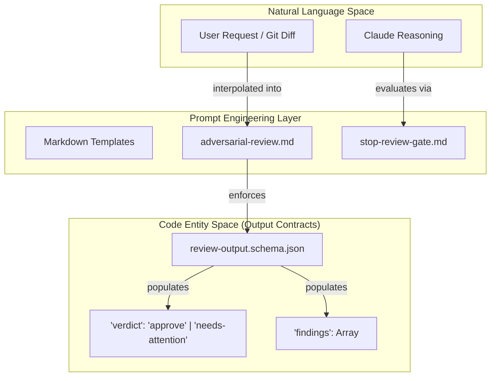
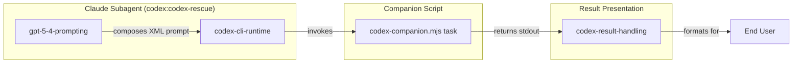

<!-- source: DeepWiki mcp.deepwiki.com · repo openai/codex-plugin-cc · page 4 Prompts, Skills & Output Contracts · fetched 2026-10-26 -->

# Prompts, Skills & Output Contracts

Relevant source files

The following files were used as context for generating this wiki page:

- [plugins/codex/schemas/review-output.schema.json](plugins/codex/schemas/review-output.schema.json)
- [plugins/codex/scripts/lib/prompts.mjs](plugins/codex/scripts/lib/prompts.mjs)

This page provides an overview of the prompt engineering layer within the Codex plugin. It covers how the plugin structures its communication with the underlying Codex models through Markdown-based templates, the internal "skills" that define Claude's behavior when interacting with the Codex runtime, and the strict JSON schemas that govern how results are returned and parsed.

## Overview of the Prompting Layer

The Codex plugin does not rely on simple string concatenation for its complex operations. Instead, it uses a structured approach involving XML-tagged templates and specific internal "skills" (non-user-invocable system instructions) to ensure high-fidelity results and predictable tool behavior.

The prompting layer bridges the gap between **Natural Language Space** (user intent and Claude's reasoning) and **Code Entity Space** (files, line numbers, and git diffs).

### System Mapping: NL to Code Entities

The following diagram illustrates how natural language concepts are mapped to specific code entities and prompt templates during a review or rescue operation.

**Prompting Flow and Entity Mapping**

Sources: [plugins/codex/prompts/adversarial-review.md:1-84](), [plugins/codex/prompts/stop-review-gate.md:1-36]()

## Prompt Templates

The plugin utilizes specialized Markdown templates to define the "persona" and "operating stance" of the Codex model for specific high-stakes tasks. These templates use XML blocks to separate instructions, grounding rules, and output contracts. The `interpolateTemplate` function [plugins/codex/scripts/lib/prompts.mjs:9-13]() is used to inject dynamic variables into these templates.

*   **Adversarial Review**: Located in `adversarial-review.md`, this template instructs the model to adopt a skeptical stance, prioritizing the discovery of "expensive, dangerous, or hard to detect" failures like race conditions or data loss [plugins/codex/prompts/adversarial-review.md:12-28](). It mandates structured JSON output with specific fields like `confidence` and `line_start`/`line_end` [plugins/codex/prompts/adversarial-review.md:48-59]().
*   **Stop Review Gate**: Located in `stop-review-gate.md`, this is used by the `Stop` hook to decide if Claude should be allowed to finish a session. It outputs a simple `ALLOW` or `BLOCK` verdict based on whether recent code changes introduced regressions [plugins/codex/prompts/stop-review-gate.md:14-26]().

For detailed information on template interpolation and XML structures, see [Prompt Templates](#4.1).
Sources: [plugins/codex/scripts/lib/prompts.mjs:9-13]()

## Internal Skills

Skills are internal system prompts that define the rules of engagement for Claude when it acts as a controller for the Codex CLI. These are not directly callable by the user but govern how Claude uses the plugin's tools.

| Skill Name | Role | Key Constraint |
| :--- | :--- | :--- |
| `codex-cli-runtime` | Forwarding logic for the rescue subagent. | Must return `task` output exactly as-is without extra analysis [plugins/codex/skills/codex-cli-runtime/SKILL.md:15-18](). |
| `gpt-5-4-prompting` | Guidelines for composing XML-structured prompts. | Prefers explicit prompt contracts over vague nudges or raising reasoning [plugins/codex/skills/gpt-5-4-prompting/SKILL.md:38-41](). |
| `codex-result-handling` | Rules for presenting Codex output to users. | **Strictly forbidden** from auto-applying fixes from a review without explicit user consent [plugins/codex/skills/codex-result-handling/SKILL.md:19-19](). |

### Skill Interaction Diagram

This diagram shows how the internal skills interact when a user triggers a `/codex:rescue` command, moving from the subagent's logic to the final output presentation.

**Internal Skill Orchestration**

Sources: [plugins/codex/skills/codex-cli-runtime/SKILL.md:9-19](), [plugins/codex/skills/gpt-5-4-prompting/SKILL.md:9-11](), [plugins/codex/skills/codex-result-handling/SKILL.md:9-21]()

For details on skill implementation and forwarding rules, see [Internal Skills](#4.2).

## Output Contracts

To ensure that Claude can reliably parse and act upon Codex's findings, the plugin enforces strict output contracts via JSON schemas and line-based protocols.

### Review Output Schema
The adversarial review process requires a structured JSON response that conforms to the `review-output.schema.json` [plugins/codex/schemas/review-output.schema.json:1-87]() schema to ensure findings are actionable:
*   **Verdict**: Must be either `approve` or `needs-attention` [plugins/codex/schemas/review-output.schema.json:13-17]().
*   **Findings**: Each finding must include the affected `file`, `line_start`, `line_end`, a `confidence` score, and a concrete `recommendation` [plugins/codex/schemas/review-output.schema.json:28-36]().
*   **Grounding**: Findings must be defensible from the provided context; inventing files or code paths is strictly forbidden [plugins/codex/prompts/adversarial-review.md:61-66]().

### Stop-Gate Contract
The stop-gate uses a more compact contract to minimize latency during the session exit hook:
*   The first line must be exactly `ALLOW: <reason>` or `BLOCK: <reason>` [plugins/codex/prompts/stop-review-gate.md:16-19]().
*   It is specifically designed to review only the work from the *previous* Claude turn [plugins/codex/prompts/stop-review-gate.md:2-4]().
*   Grounding rules require every blocking claim to be verified against the repository state rather than just the model's previous response [plugins/codex/prompts/stop-review-gate.md:28-32]().

Sources: [plugins/codex/prompts/adversarial-review.md:48-80](), [plugins/codex/prompts/stop-review-gate.md:14-36](), [plugins/codex/schemas/review-output.schema.json:1-87]()

---

