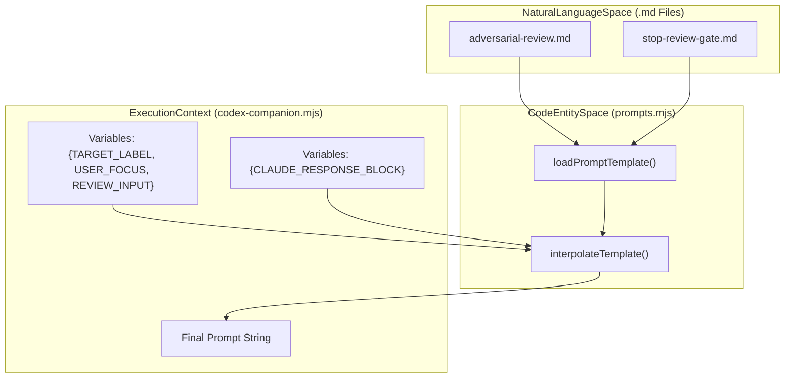
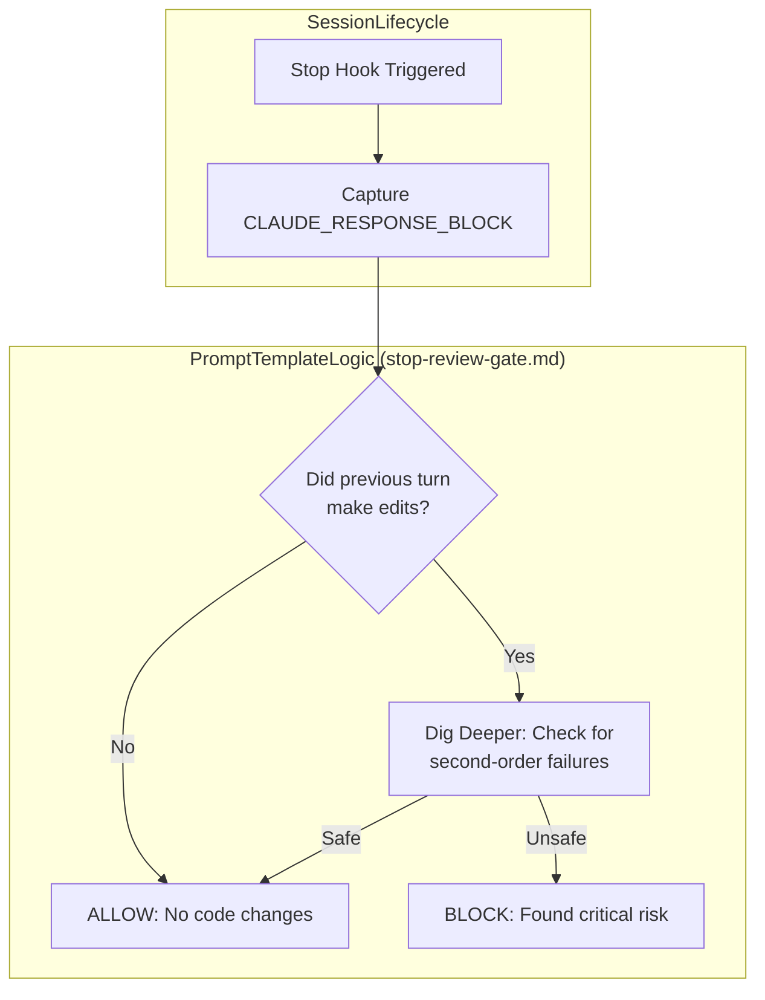

<!-- source: DeepWiki mcp.deepwiki.com · repo openai/codex-plugin-cc · page 4.1 Prompt Templates · fetched 2026-10-26 -->

# Prompt Templates

Relevant source files

The following files were used as context for generating this wiki page:

- [plugins/codex/prompts/adversarial-review.md](plugins/codex/prompts/adversarial-review.md)
- [plugins/codex/prompts/stop-review-gate.md](plugins/codex/prompts/stop-review-gate.md)
- [plugins/codex/scripts/lib/prompts.mjs](plugins/codex/scripts/lib/prompts.mjs)

The `codex-plugin-cc` utilizes specialized Markdown templates to define the behavior, persona, and output requirements for the Codex model during specific workflows. These templates are designed to be adversarial, ensuring high-quality code reviews and safe session termination.

## Template Architecture and Interpolation

Templates are stored as Markdown files in the `prompts/` directory and use a structured XML-like block format to organize instructions for the LLM. This structure helps the model distinguish between its role, the specific task, operating constraints, and the provided context.

### Loading and Interpolation Logic
The plugin uses a simple regex-based interpolation engine to inject runtime data into these templates.

*   **`loadPromptTemplate(rootDir, name)`**: Reads the `.md` file from the `prompts` directory [plugins/codex/scripts/lib/prompts.mjs:4-7]().
*   **`interpolateTemplate(template, variables)`**: Replaces placeholders using the syntax `{{VARIABLE_NAME}}` with values provided in a mapping object. It uses a global regex `\{\{([A-Z_]+)\}\}/g` to identify keys and returns an empty string if a key is missing from the `variables` object [plugins/codex/scripts/lib/prompts.mjs:9-13]().

### Data Flow Diagram: Natural Language to Code Entity

This diagram illustrates how raw template files are transformed into executable prompts within the `codex-companion.mjs` execution flow by the `prompts.mjs` utility.

**Sources:** [plugins/codex/scripts/lib/prompts.mjs:1-13](), [plugins/codex/prompts/adversarial-review.md:1-84](), [plugins/codex/prompts/stop-review-gate.md:1-36]()

---

## 1. Adversarial Review Template (`adversarial-review.md`)

This template is used by the `/codex:adversarial-review` command. Its primary purpose is to shift the model's stance from a helpful assistant to a skeptical reviewer.

### XML Block Structure
| Block | Purpose |
| :--- | :--- |
| `<role>` | Defines the persona: "break confidence in the change, not to validate it" [plugins/codex/prompts/adversarial-review.md:1-4](). |
| `<task>` | Specifies the core task of reviewing the repository context to find reasons the change should not ship, including `TARGET_LABEL` and `USER_FOCUS` variables [plugins/codex/prompts/adversarial-review.md:6-10](). |
| `<operating_stance>` | Instructs the model to assume failure and ignore "good intent" [plugins/codex/prompts/adversarial-review.md:12-17](). |
| `<attack_surface>` | Directs focus toward high-cost failures: auth, data loss, race conditions, and schema drift [plugins/codex/prompts/adversarial-review.md:19-28](). |
| `<review_method>` | Details how to actively disprove the change, looking for violated invariants and unhandled failure paths, and includes `REVIEW_COLLECTION_GUIDANCE` [plugins/codex/prompts/adversarial-review.md:30-36](). |
| `<finding_bar>` | Filters out "nitpicks" like style or naming; requires actionable, evidence-based findings [plugins/codex/prompts/adversarial-review.md:38-46](). |
| `<structured_output_contract>` | Mandates a JSON response for programmatic parsing by the plugin [plugins/codex/prompts/adversarial-review.md:48-59](). |
| `<grounding_rules>` | Emphasizes that every finding must be defensible from the provided repository context [plugins/codex/prompts/adversarial-review.md:61-66](). |
| `<calibration_rules>` | Guides the model to prefer one strong finding over several weak ones [plugins/codex/prompts/adversarial-review.md:68-72](). |
| `<final_check>` | Provides a checklist for the model to ensure findings are adversarial, tied to code, plausible, and actionable [plugins/codex/prompts/adversarial-review.md:74-80](). |
| `<repository_context>` | Placeholder for the `REVIEW_INPUT` variable, containing the code context to be reviewed [plugins/codex/prompts/adversarial-review.md:82-84](). |

### Adversarial Operating Stance and Attack Surface
The template forces the model to adopt a hostile perspective toward the code changes. The `<operating_stance>` demands skepticism, specifically stating that the model should not give credit for "good intent" or "likely follow-up work" [plugins/codex/prompts/adversarial-review.md:12-17](). 

The `<attack_surface>` defines the specific vectors the model must prioritize:
*   **Trust Boundaries**: Auth, permissions, and tenant isolation [plugins/codex/prompts/adversarial-review.md:21]().
*   **State Integrity**: Data loss, corruption, and irreversible changes [plugins/codex/prompts/adversarial-review.md:22]().
*   **Resiliency**: Rollback safety, idempotency gaps, and partial failures [plugins/codex/prompts/adversarial-review.md:23]().
*   **Concurrency**: Race conditions and stale state [plugins/codex/prompts/adversarial-review.md:24]().

### Output Contract
The model is instructed to return only valid JSON matching the provided schema [plugins/codex/prompts/adversarial-review.md:49](). It must use `needs-attention` if there is material risk and `approve` only if no substantive adversarial findings can be supported [plugins/codex/prompts/adversarial-review.md:51-52](). Every finding must include a `confidence` score from 0 to 1 and a concrete recommendation [plugins/codex/prompts/adversarial-review.md:53-57]().

**Sources:** [plugins/codex/prompts/adversarial-review.md:1-84](), [plugins/codex/scripts/lib/prompts.mjs:9-13]()

---

## 2. Stop Review Gate Template (`stop-review-gate.md`)

This template powers the `Stop` hook, which triggers when a user attempts to exit the Claude Code session. It acts as a final quality check on the work performed during the session.

### XML Block Structure
| Block | Purpose |
| :--- | :--- |
| `<task>` | Defines the core task of running a stop-gate review on the previous Claude turn, specifically if it involved code changes. Includes the `CLAUDE_RESPONSE_BLOCK` variable [plugins/codex/prompts/stop-review-gate.md:1-12](). |
| `<compact_output_contract>` | Specifies the strict `ALLOW:` or `BLOCK:` output format for the gate decision [plugins/codex/prompts/stop-review-gate.md:14-20](). |
| `<default_follow_through_policy>` | Provides guidelines for when to `ALLOW` (no code changes, no blocking issue) versus `BLOCK` (code changes made and a blocking issue found) [plugins/codex/prompts/stop-review-gate.md:22-26](). |
| `<grounding_rules>` | Emphasizes grounding blocking claims in repository context and verifying code changes, not just relying on Claude's response [plugins/codex/prompts/stop-review-gate.md:28-32](). |
| `<dig_deeper_nudge>` | Encourages checking for second-order failures if code changes were made [plugins/codex/prompts/stop-review-gate.md:34-36](). |

### Operating Logic
The gate is designed to be "quiet" unless direct code changes occurred in the immediately preceding turn.

1.  **Scope Limitation**: It only reviews the work from the previous turn [plugins/codex/prompts/stop-review-gate.md:2-3]().
2.  **Activity Filter**: If the previous turn was purely informational (e.g., `/codex:status` or `/codex:setup`), it must return `ALLOW` immediately [plugins/codex/prompts/stop-review-gate.md:5-8]().
3.  **Verification**: The model is instructed not to trust the text of the response alone but to verify changes against the repository state before blocking [plugins/codex/prompts/stop-review-gate.md:28-32]().
4.  **Adversarial Nudge**: If changes occurred, the model is nudged to check for second-order failures like stale state or rollback risks [plugins/codex/prompts/stop-review-gate.md:34-36]().

### The ALLOW/BLOCK Contract
The template enforces a strict output format for the hook logic to parse:
*   **`ALLOW: <short reason>`**: Permits the session to end. Used if no changes were made or no blocking issues were found [plugins/codex/prompts/stop-review-gate.md:17,23]().
*   **`BLOCK: <short reason>`**: Prevents the session from ending and forces the user/Claude to address a specific issue. Used only if code changes were made and a fix is required [plugins/codex/prompts/stop-review-gate.md:18,25]().

### Logic Flow: Stop Gate Execution
This diagram shows how the `stop-review-gate.md` instructions are applied during the session lifecycle to reach a terminal decision.

**Sources:** [plugins/codex/prompts/stop-review-gate.md:1-36](), [plugins/codex/scripts/lib/prompts.mjs:9-13]()

---

