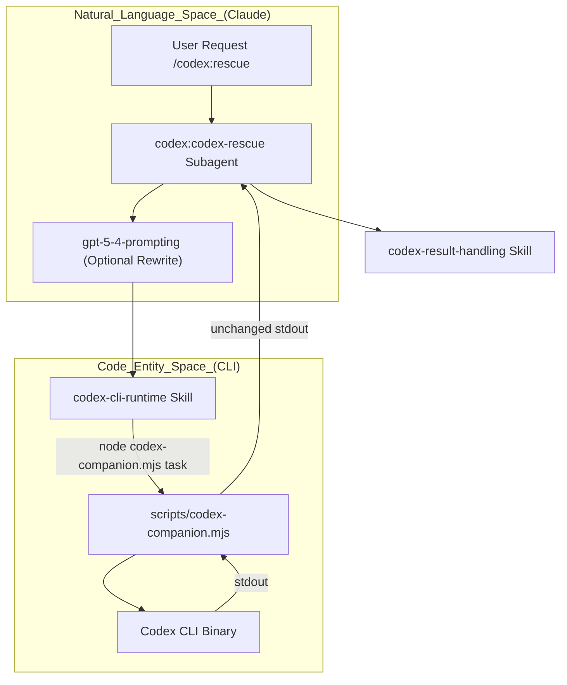
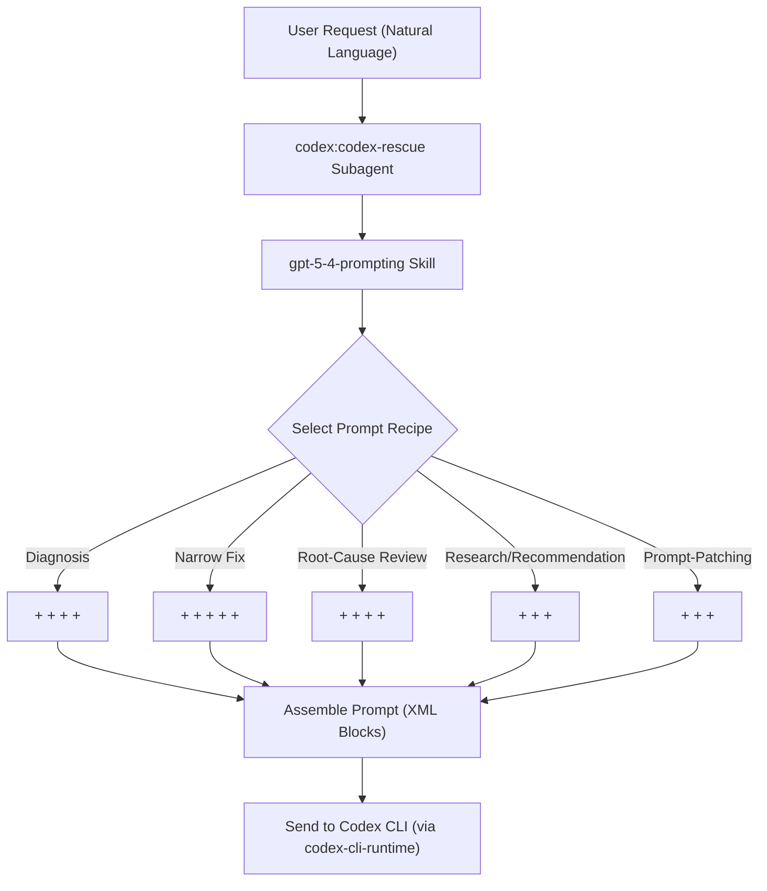
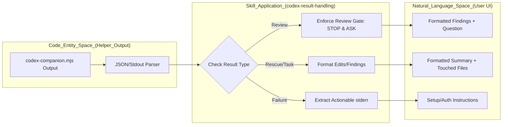

<!-- source: DeepWiki mcp.deepwiki.com · repo openai/codex-plugin-cc · page 4.2 Internal Skills · fetched 2026-10-26 -->

# Internal Skills

Relevant source files

The following files were used as context for generating this wiki page:

- [plugins/codex/skills/codex-cli-runtime/SKILL.md](plugins/codex/skills/codex-cli-runtime/SKILL.md)
- [plugins/codex/skills/codex-result-handling/SKILL.md](plugins/codex/skills/codex-result-handling/SKILL.md)
- [plugins/codex/skills/gpt-5-4-prompting/SKILL.md](plugins/codex/skills/gpt-5-4-prompting/SKILL.md)
- [plugins/codex/skills/gpt-5-4-prompting/references/codex-prompt-antipatterns.md](plugins/codex/skills/gpt-5-4-prompting/references/codex-prompt-antipatterns.md)
- [plugins/codex/skills/gpt-5-4-prompting/references/codex-prompt-recipes.md](plugins/codex/skills/gpt-5-4-prompting/references/codex-prompt-recipes.md)
- [plugins/codex/skills/gpt-5-4-prompting/references/prompt-blocks.md](plugins/codex/skills/gpt-5-4-prompting/references/prompt-blocks.md)

Internal skills are non-user-invocable contracts that govern how the Claude Code plugin interacts with the Codex runtime, how it composes prompts for high-reasoning tasks, and how it presents results back to the user. These skills ensure consistency between the Natural Language Space of the LLM and the Code Entity Space of the CLI tools.

## codex-cli-runtime

The `codex-cli-runtime` skill defines the operational contract for the `codex:codex-rescue` subagent [plugins/codex/skills/codex-cli-runtime/SKILL.md:1-5](). It establishes the subagent as a "forwarder" rather than an "orchestrator," meaning its primary responsibility is to translate natural language intent into a specific `codex-companion.mjs task` invocation [plugins/codex/skills/codex-cli-runtime/SKILL.md:15-16]().

### Forwarding Rules and Argument Mapping

The skill enforces strict mapping between Claude-side flags and CLI arguments to ensure the `task` subcommand receives correctly formatted instructions.

| Claude-side Flag | CLI Argument | Logic |
| :--- | :--- | :--- |
| `--resume` | `--resume-last` | Strip `--resume` from text, add flag to `task` [plugins/codex/skills/codex-cli-runtime/SKILL.md:31-33](). |
| `--fresh` | (None) | Strip `--fresh` from text, do not add `--resume-last` [plugins/codex/skills/codex-cli-runtime/SKILL.md:32-34](). |
| `--model spark` | `--model gpt-5.3-codex-spark` | Normalize "spark" to the specific Codex model string [plugins/codex/skills/codex-cli-runtime/SKILL.md:23-29](). |
| `--effort <val>` | `--effort <val>` | Pass through values: `none`, `minimal`, `low`, `medium`, `high`, `xhigh` [plugins/codex/skills/codex-cli-runtime/SKILL.md:30-35](). |
| (Default) | `--write` | Default to write-capable unless read-only is explicitly requested [plugins/codex/skills/codex-cli-runtime/SKILL.md:24-39](). |

### Data Flow: Rescue Forwarding

The following diagram illustrates how the `codex-cli-runtime` skill bridges the user's request to the `codex-companion.mjs` script.

**Subagent Forwarding Flow**

Sources: [plugins/codex/skills/codex-cli-runtime/SKILL.md:7-43](), [plugins/codex/skills/gpt-5-4-prompting/SKILL.md:9-11]()

## gpt-5-4-prompting

The `gpt-5-4-prompting` skill provides guidelines for composing prompts for Codex and GPT-5.4-based workflows [plugins/codex/skills/gpt-5-4-prompting/SKILL.md:1-5](). It emphasizes a "block-structured" approach using XML tags to create stable internal structures for the LLM [plugins/codex/skills/gpt-5-4-prompting/SKILL.md:11-18]().

### XML Block Library

Standardized XML blocks are used to control different aspects of the Codex run.

| Tag | Purpose | Usage Context |
| :--- | :--- | :--- |
| `<task>` | Concrete job description and context [plugins/codex/skills/gpt-5-4-prompting/references/prompt-blocks.md:13-15](). | Nearly every prompt. |
| `<structured_output_contract>` | Defines exact response shape [plugins/codex/skills/gpt-5-4-prompting/references/prompt-blocks.md:25-29](). | When schema/shape matters. |
| `<default_follow_through_policy>` | Instructions for autonomous decision-making [plugins/codex/skills/gpt-5-4-prompting/references/prompt-blocks.md:50-53](). | To avoid routine questions. |
| `<verification_loop>` | Self-correction and verification requirements [plugins/codex/skills/gpt-5-4-prompting/references/prompt-blocks.md:73-76](). | Critical correctness tasks. |
| `<grounding_rules>` | Anchors claims to evidence [plugins/codex/skills/gpt-5-4-prompting/references/prompt-blocks.md:97-101](). | Reviews and research. |
| `<action_safety>` | Restricts scope to avoid unrelated refactors [plugins/codex/skills/gpt-5-4-prompting/references/prompt-blocks.md:122-126](). | Write-capable tasks. |

### Prompt Recipes and Antipatterns

The skill includes pre-defined "recipes" for common tasks:
- **Diagnosis**: Focuses on root cause identification with `<missing_context_gating>` [plugins/codex/skills/gpt-5-4-prompting/references/codex-prompt-recipes.md:9-35]().
- **Narrow Fix**: Emphasizes minimal changes and `<action_safety>` [plugins/codex/skills/gpt-5-4-prompting/references/codex-prompt-recipes.md:39-70]().
- **Root-Cause Review**: Uses `<dig_deeper_nudge>` to find second-order failures [plugins/codex/skills/gpt-5-4-prompting/references/codex-prompt-recipes.md:74-99]().
- **Research Or Recommendation**: Separates facts, inferences, and open questions [plugins/codex/skills/gpt-5-4-prompting/references/codex-prompt-recipes.md:101-125]().

**Antipatterns to avoid** [plugins/codex/skills/gpt-5-4-prompting/references/codex-prompt-antipatterns.md:1-100]():
- Vague framing (e.g., "let me know what you think").
- Missing output contract.
- Asking for "more reasoning" instead of tightening the prompt contract.
- Mixing unrelated jobs (e.g., "review this AND fix the bug AND update docs").

**Prompting Workflow**

Sources: [plugins/codex/skills/gpt-5-4-prompting/SKILL.md:1-54](), [plugins/codex/skills/gpt-5-4-prompting/references/prompt-blocks.md:1-172](), [plugins/codex/skills/gpt-5-4-prompting/references/codex-prompt-recipes.md:1-150](), [plugins/codex/skills/gpt-5-4-prompting/references/codex-prompt-antipatterns.md:1-100]()

## codex-result-handling

The `codex-result-handling` skill governs the presentation of Codex output to the user [plugins/codex/skills/codex-result-handling/SKILL.md:1-5](). It acts as a safety and formatting layer that prevents Claude from overstepping its bounds based on Codex's findings.

### Presentation Constraints

- **Preserve Structure**: Maintain the helper's verdict, findings, and evidence boundaries [plugins/codex/skills/codex-result-handling/SKILL.md:9-13]().
- **Accuracy**: Use file paths and line numbers exactly as reported; do not hallucinate or "clean up" coordinates [plugins/codex/skills/codex-result-handling/SKILL.md:12]().
- **Explicit State**: If there are no findings, or if Codex made edits, state this explicitly [plugins/codex/skills/codex-result-handling/SKILL.md:15-16]().
- **Failure Handling**: If the helper reports a failed run or authentication error, report the actionable `stderr` and stop. Do not attempt a Claude-side implementation as a substitute [plugins/codex/skills/codex-result-handling/SKILL.md:17-21]().

### The Review Gate

A critical safety rule exists for review results: Claude **MUST NOT** auto-apply fixes found during a review. It must explicitly ask the user for permission before touching any files, even if the fix is obvious [plugins/codex/skills/codex-result-handling/SKILL.md:19]().

**Result Processing Pipeline**

Sources: [plugins/codex/skills/codex-result-handling/SKILL.md:7-21]()

---

