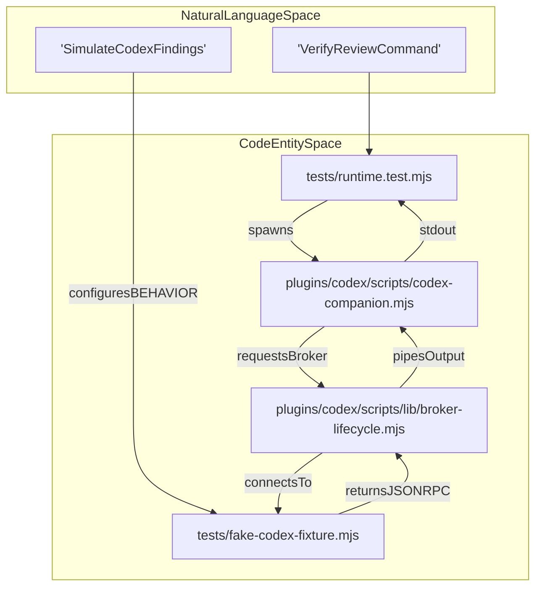
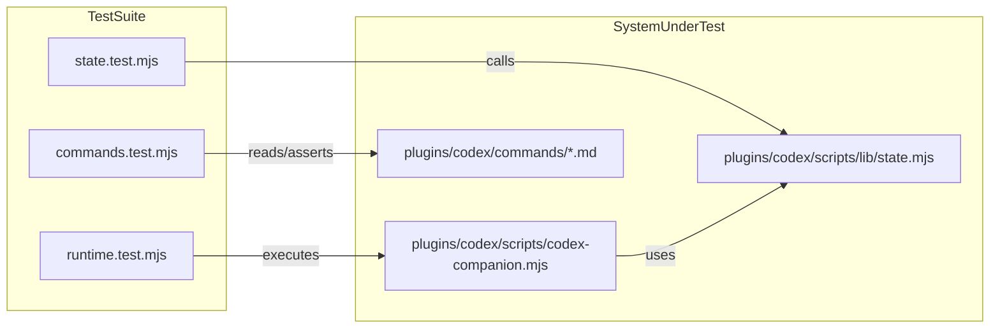

<!-- source: DeepWiki mcp.deepwiki.com · repo openai/codex-plugin-cc · page 5 Testing · fetched 2026-10-26 -->

# Testing

<details>
<summary>Relevant source files</summary>

The following files were used as context for generating this wiki page:

- [package.json](package.json)
- [tests/runtime.test.mjs](tests/runtime.test.mjs)

</details>


The `codex-plugin-cc` test suite ensures the reliability of the bridge between Claude Code and the Codex CLI. It utilizes the native Node.js test runner [tests/runtime.test.mjs:3-3]() to validate everything from low-level OS primitives (like Unix sockets) to high-level Markdown contracts for slash commands.

### Running Tests

Tests are executed via `npm`:

```bash
# Run the full test suite
npm test
```

This command is defined in `package.json` [package.json:16-16](). The test suite is designed to be hermetic, meaning it does not require an active internet connection or a real Codex installation to verify the plugin's logic.

### Test Architecture

The suite relies on a "Fake Codex" fixture to simulate the Codex CLI's behavior. This allows for deterministic testing of various authentication states and error conditions.

#### Core Components
*   **Node.js Test Runner**: Uses `node:test` and `node:assert` for minimal dependencies [tests/runtime.test.mjs:3-4]().
*   **Fake Codex Fixture**: A standalone Node.js script that mimics the Codex `app-server` JSON-RPC interface. It supports various `BEHAVIOR` modes such as `logged-out`, `adversarial-clean`, `provider-no-auth`, and `invalid-json` [tests/fake-codex-fixture.mjs:7-16](), [tests/fake-codex-fixture.mjs:68-113]().
*   **Filesystem Helpers**: Utilities in `helpers.mjs` manage temporary directories via `makeTempDir` [tests/helpers.mjs:7-9]() and mock executable creation via `writeExecutable` [tests/helpers.mjs:11-13]().

### Natural Language to Code Mapping: Test Flow

The following diagram illustrates how a natural language "Test Case" (e.g., verifying a review) interacts with the codebase through the test infrastructure.

**Diagram: Test Execution Flow**

Sources: [tests/runtime.test.mjs:139-158](), [tests/fake-codex-fixture.mjs:7-16](), [tests/fake-codex-fixture.mjs:193-233]().

---

### Test Infrastructure

The infrastructure provides the sandbox necessary for integration testing. This includes:
*   **Environment Mocking**: `buildEnv` and `installFakeCodex` allow tests to run as if the Codex CLI is installed in the system `PATH` [tests/runtime.test.mjs:31-38]().
*   **Git Simulation**: `initGitRepo` creates real `.git` directories and configures local user settings to test the plugin's ability to resolve diffs and branch targets [tests/helpers.mjs:26-32]().
*   **Process Management**: The `run` helper in `helpers.mjs` wraps `spawnSync` to provide a consistent interface for executing the companion script across platforms [tests/helpers.mjs:15-24]().

For details, see [Test Infrastructure](#5.1).

---

### Test Coverage by Module

The test suite is partitioned to cover specific functional areas of the plugin:

| Test File | Focus Area | Key Validations |
| :--- | :--- | :--- |
| `broker-endpoint.test.mjs` | IPC Transport | Validates Unix sockets on macOS/Linux vs Named Pipes on Windows. |
| `commands.test.mjs` | Markdown Contracts | Ensures `review.md` and others contain required `AskUserQuestion` and `Bash` calls [tests/commands.test.mjs:14-40](). |
| `git.test.mjs` | Context Resolution | Tests `resolveReviewTarget` logic for working-tree vs branch diffs. |
| `process.test.mjs` | Lifecycle | Verifies `terminateProcessTree` correctly manages process cleanup. |
| `render.test.mjs` | UI Output | Checks that JSON findings are correctly transformed into human-readable Markdown. |
| `state.test.mjs` | Persistence | Validates job pruning and state directory resolution [tests/runtime.test.mjs:11-11](). |
| `runtime.test.mjs` | End-to-End | Spawns the companion script to test the full loop from command to Codex response [tests/runtime.test.mjs:150-158](). |

**Diagram: Module Interaction in Tests**

Sources: [tests/runtime.test.mjs:15-17](), [tests/runtime.test.mjs:11-11](), [tests/commands.test.mjs:10-12](), [tests/helpers.mjs:15-24]().

For details, see [Test Coverage by Module](#5.2).

---

