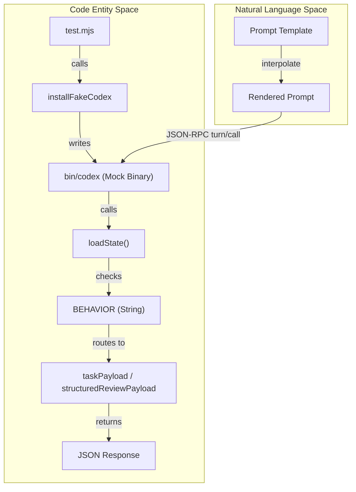
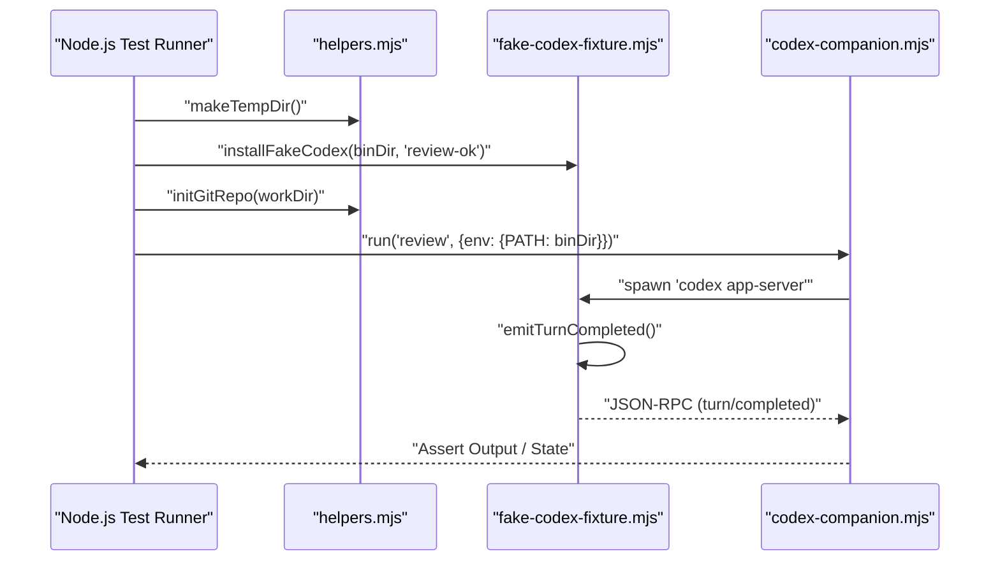

<!-- source: DeepWiki mcp.deepwiki.com · repo openai/codex-plugin-cc · page 5.1 Test Infrastructure · fetched 2026-10-26 -->

# Test Infrastructure

Relevant source files

The following files were used as context for generating this wiki page:

- [tests/fake-codex-fixture.mjs](tests/fake-codex-fixture.mjs)
- [tests/helpers.mjs](tests/helpers.mjs)

The `codex-plugin-cc` test suite is built on the Node.js native test runner and utilizes a specialized mocking infrastructure to simulate the Codex CLI environment. This allows for hermetic testing of plugin logic, JSON-RPC communication, and Git integration without requiring a real Codex installation or network access.

## Core Test Runner

The project uses the native Node.js test runner introduced in Node 18. Tests are located in the `tests/` directory and follow the `*.test.mjs` naming convention.

- **Execution**: Tests are triggered via `npm test`, which executes `node --test tests/*.test.mjs` [package.json:16-16]().
- **Environment**: The suite requires Node.js `>=18.18.0` [package.json:8-10]().
- **Build Integration**: The `prebuild` script ensures that TypeScript types for the `app-server` are generated before testing or building, maintaining type safety between the CLI and the plugin by calling `codex app-server generate-ts` [package.json:14-15]().

**Sources:** [package.json:1-22]()

## Test Helpers (`helpers.mjs`)

The `tests/helpers.mjs` module provides utility functions for setting up isolated test environments, managing temporary directories, and initializing mock Git repositories.

| Function | Description |
| :--- | :--- |
| `makeTempDir` | Creates a unique temporary directory using `fs.mkdtempSync` in the OS temp folder [tests/helpers.mjs:7-9](). |
| `writeExecutable` | Writes a string to a file and sets the executable bit (`0o755`) using `fs.writeFileSync` [tests/helpers.mjs:11-13](). |
| `run` | A wrapper around `child_process.spawnSync` to execute commands synchronously with captured output, handling platform-specific shell requirements for Windows [tests/helpers.mjs:15-24](). |
| `initGitRepo` | Initializes a new Git repository with a `main` branch and standard test configurations (e.g., disabling GPG signing) [tests/helpers.mjs:26-32](). |

**Sources:** [tests/helpers.mjs:1-32]()

## The Fake Codex Fixture

To avoid dependency on the actual `codex` binary during unit and integration tests, the suite uses `fake-codex-fixture.mjs`. This script generates a Node.js-based mock binary that implements the Codex CLI's interface and the `app-server` JSON-RPC protocol.

### Implementation Details
The `installFakeCodex` function creates a mock `codex` executable in a specified directory [tests/fake-codex-fixture.mjs:7-9](). This mock:
1.  **Maintains State**: Persists thread and turn information to a `fake-codex-state.json` file via `loadState` and `saveState` [tests/fake-codex-fixture.mjs:20-29]().
2.  **Simulates Behaviors**: Can be configured via a `behavior` parameter (e.g., `"review-ok"`, `"logged-out"`, `"adversarial-clean"`, `"invalid-json"`) to test different plugin responses [tests/fake-codex-fixture.mjs:17-17]().
3.  **JSON-RPC Protocol**: Implements the `app-server` mode, handling methods like `initialize`, `thread/start`, and `turn/call` [tests/fake-codex-fixture.mjs:115-117]().
4.  **Mock Payloads**: Generates realistic review findings and task results based on prompt contents through `structuredReviewPayload` [tests/fake-codex-fixture.mjs:193-228]() and `taskPayload` [tests/fake-codex-fixture.mjs:235-244]().

### Data Flow: Plugin to Fake Codex
The following diagram illustrates how the test infrastructure bridges the Natural Language Space (prompts) to the Code Entity Space (mocked CLI responses).

**Mocked Codex Execution Flow**

**Sources:** [tests/fake-codex-fixture.mjs:7-228]()

## Interaction Model

The test infrastructure simulates the lifecycle of a Codex session by coordinating the mock binary and the plugin's companion script.

**Test Lifecycle Diagram**

### Key Mock Functions
- `nextThread`: Generates a mock thread ID (`thr_N`) and updates the internal state [tests/fake-codex-fixture.mjs:119-132]().
- `emitTurnCompleted`: Simulates the asynchronous nature of Codex turns by emitting `turn/started`, `item/started`, and `turn/completed` events [tests/fake-codex-fixture.mjs:163-175]().
- `structuredReviewPayload`: Logic for generating mock `verdict` and `findings` objects used to test the review parser. It returns a specific "needs-attention" finding if an "adversarial software review" prompt is detected [tests/fake-codex-fixture.mjs:193-221]().
- `taskPayload`: Handles logic for task delegation, including specific responses for adversarial "BLOCK" or "ALLOW" scenarios when the prompt contains specific XML tags like `<task>` [tests/fake-codex-fixture.mjs:235-244]().
- `buildAccountReadResult`: Simulates authentication states (e.g., `logged-out`, `chatgpt` plan) based on the configured `BEHAVIOR` [tests/fake-codex-fixture.mjs:67-84]().
- `buildConfigReadResult`: Simulates different `codex config read` outputs, including scenarios with custom model providers or no authentication requirements [tests/fake-codex-fixture.mjs:87-113]().

**Sources:** [tests/fake-codex-fixture.mjs:67-244](), [tests/helpers.mjs:7-32](), [package.json:11-17]()

---

