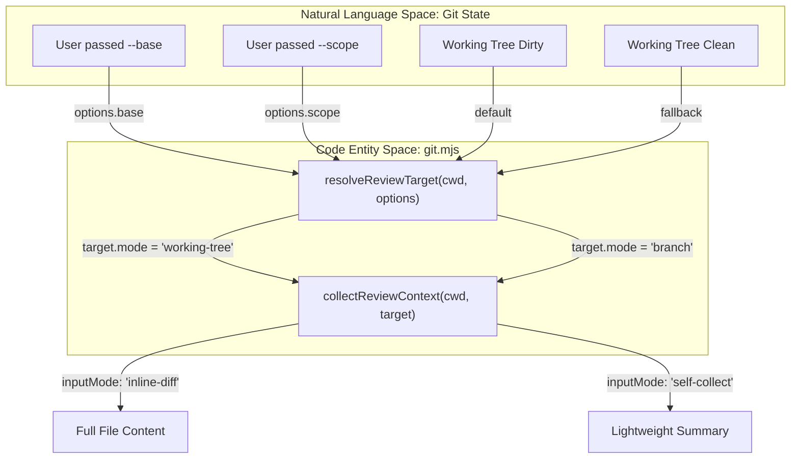
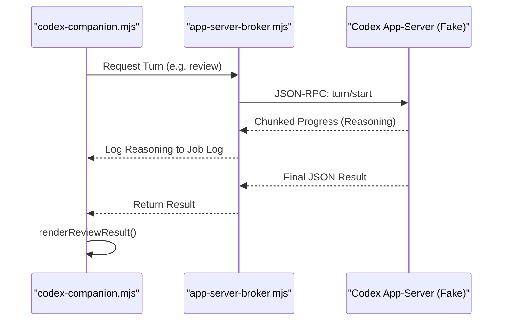

<!-- source: DeepWiki mcp.deepwiki.com · repo openai/codex-plugin-cc · page 5.2 Test Coverage by Module · fetched 2026-10-26 -->

# Test Coverage by Module

Relevant source files

The following files were used as context for generating this wiki page:

- [plugins/codex/commands/rescue.md](plugins/codex/commands/rescue.md)
- [tests/broker-endpoint.test.mjs](tests/broker-endpoint.test.mjs)
- [tests/commands.test.mjs](tests/commands.test.mjs)
- [tests/git.test.mjs](tests/git.test.mjs)
- [tests/process.test.mjs](tests/process.test.mjs)
- [tests/render.test.mjs](tests/render.test.mjs)
- [tests/state.test.mjs](tests/state.test.mjs)

This page details the test suite for the Codex Claude Code plugin, organized by functional module. The tests ensure that the plugin's core logic—ranging from OS-specific socket handling to Git context extraction and state persistence—behaves correctly across different environments.

## Overview

The test suite is built using the Node.js native test runner and focuses on verifying the contracts between the Claude Code plugin and the underlying Codex CLI. It utilizes a "fake Codex" fixture to simulate app-server responses without requiring a live backend [tests/runtime.test.mjs:8-9]().

## Broker Endpoint Resolution

The `tests/broker-endpoint.test.mjs` file verifies that the plugin correctly negotiates communication channels with the Codex app-server based on the host operating system.

*   **Unix/macOS**: Asserts that `createBrokerEndpoint` produces a Unix domain socket path [tests/broker-endpoint.test.mjs:6-13]().
*   **Windows**: Asserts that the endpoint resolves to a named pipe using the `pipe:\\.\pipe\` prefix [tests/broker-endpoint.test.mjs:15-22]().

### Data Flow: Endpoint Parsing
The following table shows how the `kind` and `path` are extracted from a raw endpoint string by `parseBrokerEndpoint` [tests/broker-endpoint.test.mjs:4]().

| Platform | Input Example | Parsed Kind | Parsed Path |
| :--- | :--- | :--- | :--- |
| Darwin/Linux | `unix:/tmp/cxc/broker.sock` | `unix` | `/tmp/cxc/broker.sock` |
| Windows | `pipe:\\.\pipe\cxc-broker` | `pipe` | `\\.\pipe\cxc-broker` |

**Sources:** [tests/broker-endpoint.test.mjs:1-22]()

## Slash Command Contracts

The `tests/commands.test.mjs` file performs static assertions against the Markdown files in the `commands/` directory. This ensures that the instructions provided to Claude (the LLM) match the technical requirements of the `codex-companion.mjs` script.

*   **Review Commands**: Validates that `/codex:review` and `/codex:adversarial-review` correctly instruct Claude to use `run_in_background: true` and pass arguments to the companion script [tests/commands.test.mjs:14-71]().
*   **Rescue Logic**: Verifies that the `rescue.md` command and `codex-rescue.md` agent correctly handle `--resume` vs `--fresh` flags and map the `spark` model to the specific `gpt-5.3-codex-spark` identifier [tests/commands.test.mjs:86-115](), [plugins/codex/commands/rescue.md:45-47]().
*   **Output Integrity**: Asserts that commands contain instructions to return stdout verbatim and avoid paraphrasing [tests/commands.test.mjs:122-123](), [plugins/codex/commands/rescue.md:9-10]().
*   **Command Exposure**: Ensures that internal-only commands like `continue` are not exposed as top-level user-facing markdown files [tests/commands.test.mjs:73-84]().

**Sources:** [tests/commands.test.mjs:1-123](), [plugins/codex/commands/rescue.md:1-49]()

## Git Context and Target Resolution

The `tests/git.test.mjs` file tests the logic for determining what code should be sent to Codex for review.

*   **Target Selection**: Verifies that `resolveReviewTarget` prefers the `working-tree` if the repository is dirty, but falls back to a `branch` diff (against the default branch) if the repo is clean [tests/git.test.mjs:9-39]().
*   **Explicit Overrides**: Ensures that the `--base <ref>` argument correctly overrides the default branch detection [tests/git.test.mjs:70-85]().
*   **Context Collection Strategy**: Validates that `collectReviewContext` switches between `inline-diff` for small changes and `self-collect` (lightweight summary) for larger reviews to avoid context window overflows [tests/git.test.mjs:101-116](), [tests/git.test.mjs:151-165]().
*   **Robustness**: Asserts that the collector skips untracked directories and handles broken symlinks without crashing [tests/git.test.mjs:118-133](), [tests/git.test.mjs:135-149]().

### Git Target Resolution Logic
This diagram bridges the CLI flags to the internal `resolveReviewTarget` and `collectReviewContext` logic defined in `plugins/codex/scripts/lib/git.mjs`.

**Sources:** [tests/git.test.mjs:1-165](), [plugins/codex/scripts/lib/git.mjs:6]()

## Process Management

The `tests/process.test.mjs` file focuses on the reliable termination of Codex processes, which is critical for the `cancel` command and session cleanup.

*   **Cross-Platform Termination**: Asserts that on Windows, the plugin uses `taskkill /PID <id> /T /F` to ensure the entire process tree is destroyed [tests/process.test.mjs:6-33]().
*   **Error Handling**: Verifies that if a process is already gone (exit code 128 on Windows), the `terminateProcessTree` utility treats it as a successful termination rather than an error [tests/process.test.mjs:35-55]().

**Sources:** [tests/process.test.mjs:1-55]()

## Runtime and App-Server Integration

The `tests/runtime.test.mjs` file is the most comprehensive, using `fake-codex-fixture.mjs` to simulate the full lifecycle of a Codex request.

*   **Setup Verification**: Checks that `codex-companion.mjs setup --json` correctly detects the presence of the Codex binary and authentication status, including support for API keys and custom providers that don't require OpenAI login [tests/runtime.test.mjs:31-120]().
*   **Auth Preflights**: Validates that the `task` command handles auth errors gracefully and allows for session refreshes [tests/runtime.test.mjs:160-197]().
*   **Review Execution**: Verifies that a full review flow from `codex-companion.mjs review` correctly processes uncommitted changes and renders findings [tests/runtime.test.mjs:139-158]().

### App-Server Turn Execution Flow
This diagram maps the interaction between the companion script and the app-server components.

**Sources:** [tests/runtime.test.mjs:1-197](), [tests/fake-codex-fixture.mjs:8]()

## State and Job Persistence

The `tests/state.test.mjs` file verifies the integrity of the plugin's local database.

*   **Directory Resolution**: Confirms that state is stored in a per-workspace directory, either in the system temp folder or the path specified by `CLAUDE_PLUGIN_DATA` [tests/state.test.mjs:10-41]().
*   **Pruning Logic**: Validates that `saveState` enforces a 50-job limit. When the limit is exceeded, it asserts that the oldest job metadata, JSON files, and log files are deleted from disk [tests/state.test.mjs:43-105]().

**Sources:** [tests/state.test.mjs:1-105]()

## Result Rendering

The `tests/render.test.mjs` file ensures that raw JSON from Codex is transformed into user-friendly Markdown.

*   **Graceful Degradation**: Verifies that if Codex returns malformed or unexpected JSON shapes (e.g., missing the `findings` array), the `renderReviewResult` function still displays the raw message instead of crashing [tests/render.test.mjs:6-28]().
*   **Structured Output**: Asserts that `renderStoredJobResult` correctly formats completed reviews, including the session ID and instructions for resuming the thread via the Codex CLI [tests/render.test.mjs:30-59]().

**Sources:** [tests/render.test.mjs:1-59]()

## Build and Versioning

The `tests/bump-version.test.mjs` file ensures consistency across the project's multiple manifest files.

*   **Manifest Synchronization**: Verifies that the `bump-version.mjs` script updates `package.json`, `package-lock.json`, `plugin.json`, and `marketplace.json` simultaneously [tests/bump-version.test.mjs:58-72]().
*   **Validation**: Checks that the `--check` mode correctly identifies stale metadata across these files [tests/bump-version.test.mjs:74-88]().

**Sources:** [tests/bump-version.test.mjs:1-88]()

---

