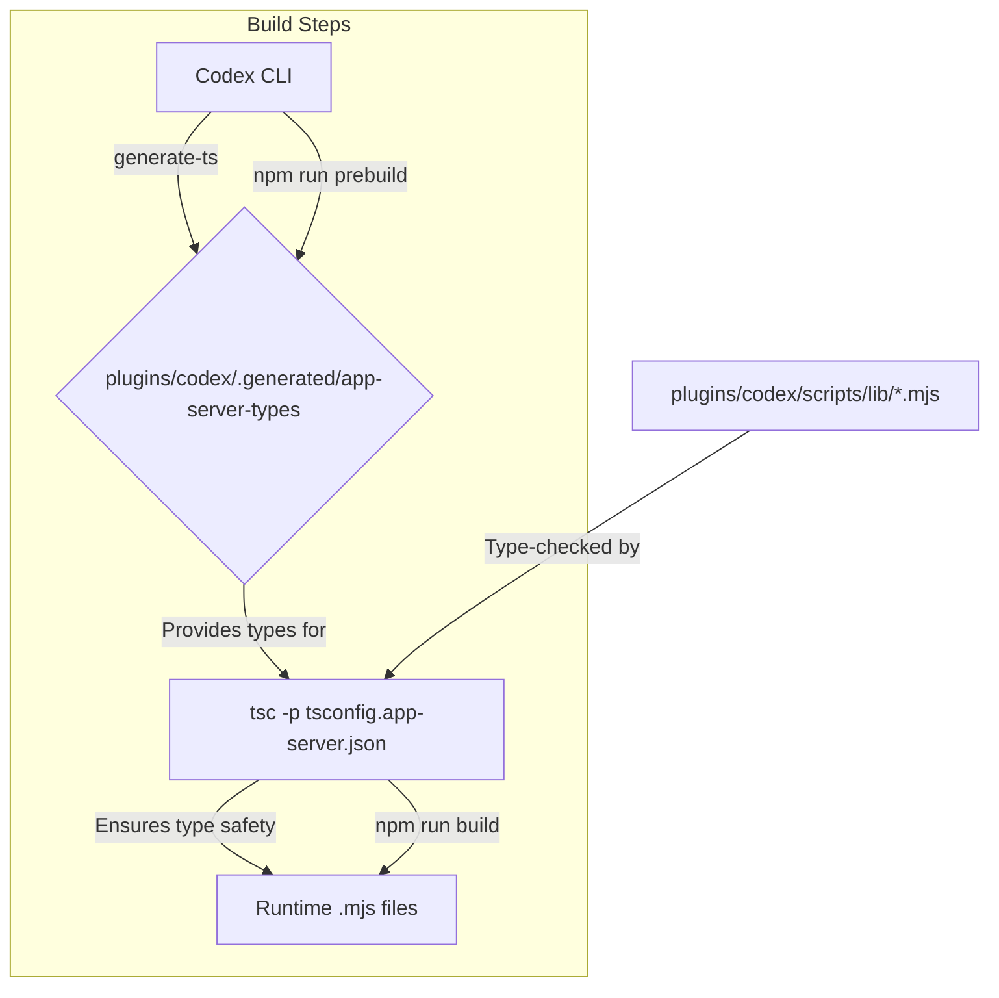
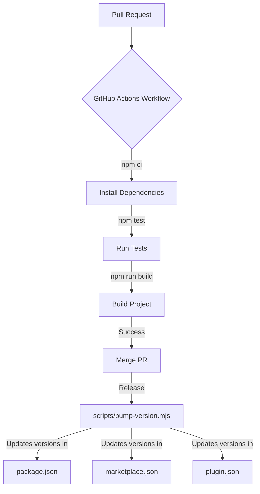

<!-- source: DeepWiki mcp.deepwiki.com · repo openai/codex-plugin-cc · page 6 Project & Build Configuration · fetched 2026-10-26 -->

# Project & Build Configuration

Relevant source files

The following files were used as context for generating this wiki page:

- [package-lock.json](package-lock.json)
- [package.json](package.json)

This page provides a high-level overview of the packaging, build process, continuous integration (CI), and licensing for the `codex-plugin-cc` project. It serves as a parent page, linking to more detailed child pages for specific topics.

## Package Management & Dependencies

The `codex-plugin-cc` project is configured as a private Node.js ES module [package.json:4-5]() targeting Node.js version 18.18.0 or higher [package.json:8-10](). It uses `npm` for dependency management, with `package.json` defining direct dependencies and `package-lock.json` ensuring reproducible builds. The project maintains a minimal set of development dependencies, primarily for TypeScript type checking.

For a detailed breakdown of the `npm` package setup, including `package.json`, `package-lock.json`, and specific dependencies, see [Build Pipeline & Dependencies](#6.1).

**Sources:** [package.json:4-10](), [package-lock.json:1-51]()

## Build Pipeline

The build process for `codex-plugin-cc` involves a code generation step followed by TypeScript type checking. Although the plugin's runtime code is in native `.mjs` files, TypeScript is leveraged to ensure type safety, especially for interactions with the Codex app-server.

The `prebuild` script generates TypeScript type definitions from the Codex CLI, which are then used by `tsc` for type validation. The `tsconfig.app-server.json` file is configured for this type-checking process without emitting JavaScript files.

### Build Process Overview

For an in-depth explanation of the build pipeline, including the `prebuild` step, `tsconfig.app-server.json` configuration, and `.gitignore` conventions, refer to [Build Pipeline & Dependencies](#6.1).

**Sources:** [package.json:14-15]()

## Continuous Integration & Release Versioning

The project utilizes GitHub Actions for continuous integration, specifically for pull requests. This workflow ensures that all changes pass tests and build checks before being merged.

Additionally, a custom script, `scripts/bump-version.mjs`, is used to manage and synchronize version numbers across various project manifest files, including `package.json`, `marketplace.json`, and `plugin.json`. This ensures consistency during releases.

### CI Workflow & Versioning Script

For more details on the GitHub Actions CI workflow and the `bump-version.mjs` script, see [CI & Release Versioning](#6.2).

**Sources:** [package.json:12-13]()

## Licensing

The `codex-plugin-cc` project is licensed under the Apache License, Version 2.0. The `LICENSE` file contains the full text of the license, and the `NOTICE` file attributes copyright to OpenAI.

**Sources:** [package-lock.json:10](), [package.json:7]()

---

