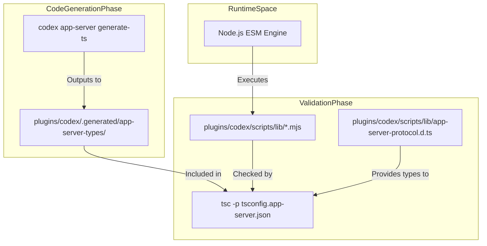
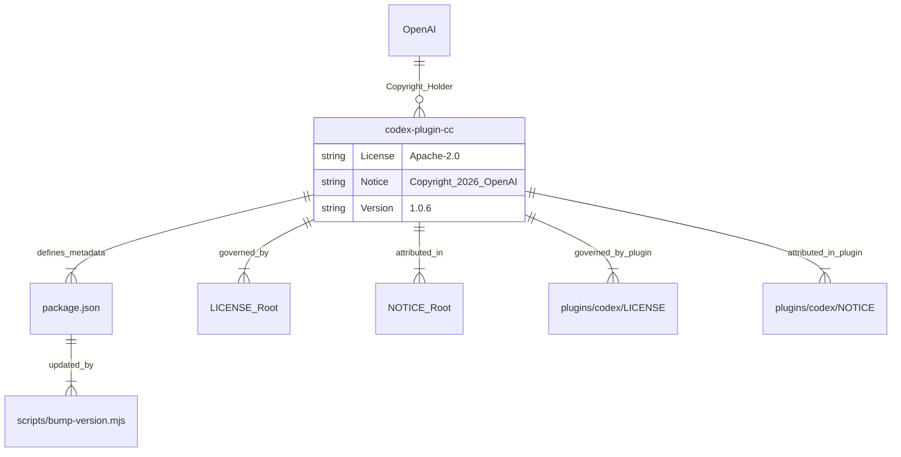

<!-- source: DeepWiki mcp.deepwiki.com · repo openai/codex-plugin-cc · page 6.1 Build Pipeline & Dependencies · fetched 2026-10-26 -->

# Build Pipeline & Dependencies

Relevant source files

The following files were used as context for generating this wiki page:

- [.gitignore](.gitignore)
- [LICENSE](LICENSE)
- [NOTICE](NOTICE)
- [package-lock.json](package-lock.json)
- [package.json](package.json)
- [plugins/codex/CHANGELOG.md](plugins/codex/CHANGELOG.md)
- [plugins/codex/LICENSE](plugins/codex/LICENSE)
- [plugins/codex/NOTICE](plugins/codex/NOTICE)
- [tsconfig.app-server.json](tsconfig.app-server.json)

This page details the build infrastructure, dependency management, and licensing configuration for the `codex-plugin-cc` project. The project utilizes a hybrid approach, using JavaScript for the runtime execution and TypeScript for type-checking and interface validation against the Codex App-Server.

## Package Management

The project is configured as a private Node.js package using ES modules [package.json:4-5](). It targets Node.js environments version 18.18.0 or higher [package.json:8-10]().

### Dependency Specification
The project maintains a lean dependency profile, primarily relying on built-in Node.js modules and using external packages only for development and type safety [package-lock.json:7-18]().

| Dependency | Version | Type | Purpose |
| :--- | :--- | :--- | :--- |
| `typescript` | `^6.0.2` | Development | Type checking and build pipeline [package.json:20]() |
| `@types/node` | `^25.5.0` | Development | Type definitions for Node.js APIs [package.json:19]() |
| `undici-types` | `~7.18.0` | Transitive | Types for Node's fetch implementation [package-lock.json:43-49]() |

### Version Management
The project includes a custom script `scripts/bump-version.mjs` to synchronize version numbers across multiple manifest files. This ensures consistency between the npm `package.json`, the Claude plugin manifest, and the marketplace metadata [package.json:12-13]().

The `bump-version.mjs` script (not provided in the current context, but inferred from `package.json` scripts) is responsible for updating version numbers.

**Sources:** [package.json:1-22](), [package-lock.json:1-51]()

---

## Build Pipeline

The build process involves a code-generation step followed by a TypeScript validation phase. While the plugin runs as native `.mjs` files, TypeScript is used to ensure the `app-server` client implementation adheres to the Codex protocol.

### Prebuild Code Generation
The `prebuild` script generates TypeScript type definitions directly from the Codex CLI using `codex app-server generate-ts` [package.json:14](). These types are stored in `plugins/codex/.generated/app-server-types` and are used to validate the JSON-RPC communication between the plugin and the Codex backend.

### TypeScript Configuration
The `tsconfig.app-server.json` file configures the `tsc` compiler for type-checking the core library modules. It is configured with `"noEmit": true`, meaning it is used strictly for validation rather than transpilation [tsconfig.app-server.json:8]().

**Build Process Flow:**

**Key Configuration Details:**
*   **Target:** `ES2022` with `ESNext` modules [tsconfig.app-server.json:3-4]().
*   **Module Resolution:** `Bundler` [tsconfig.app-server.json:5]().
*   **JS Support:** `allowJs` and `checkJs` are enabled to allow TypeScript to validate the `.mjs` library files [tsconfig.app-server.json:6-7]().

**Sources:** [package.json:11-17](), [tsconfig.app-server.json:1-23]()

---

## Environment & Git Conventions

The project uses `.gitignore` to maintain a clean repository, specifically targeting runtime artifacts, generated types, and Node.js specific logs.

### Git Exclusion Rules
The `.gitignore` file follows standard Node.js patterns but includes specific paths for this plugin's build and runtime data:
*   **Generated Types:** `plugins/codex/.generated/` is ignored to ensure types are generated fresh from the local Codex CLI during the build [ .gitignore:150]().
*   **Runtime Data:** PID files and locks (`*.pid`, `*.pid.lock`) used by the broker session management are excluded [ .gitignore:13-16]().
*   **Output:** General `output/` directories are ignored [ .gitignore:149]().

**Sources:** [.gitignore:1-150]()

---

## Licensing & Notices

The project is licensed under the **Apache License, Version 2.0**.

### License Structure
The license and notice files are located at the root of the repository and within the plugin directory to govern all project contents.

*   **LICENSE:** Contains the full text of the Apache 2.0 license [LICENSE:1-130]().
*   **NOTICE:** Contains the attribution notice, identifying the copyright holder as **OpenAI** (2026) [NOTICE:1-13]().
*   **plugins/codex/LICENSE:** A copy of the Apache 2.0 license specific to the plugin [plugins/codex/LICENSE:1-130]().
*   **plugins/codex/NOTICE:** A copy of the attribution notice specific to the plugin [plugins/codex/NOTICE:1-13]().

**Project Entity Mapping:**

**Sources:** [LICENSE:1-130](), [NOTICE:1-13](), [plugins/codex/LICENSE:1-130](), [plugins/codex/NOTICE:1-13](), [package.json:1-7](), [package-lock.json:1-9]()

---

