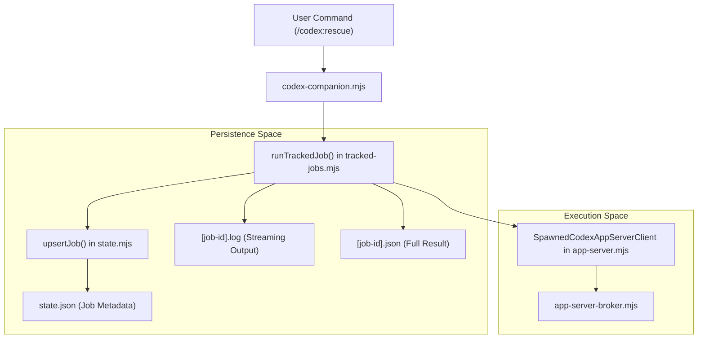
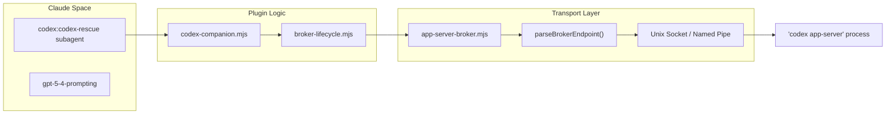

<!-- source: DeepWiki mcp.deepwiki.com · repo openai/codex-plugin-cc · page 7 Glossary · fetched 2026-10-26 -->

# Glossary

Relevant source files

The following files were used as context for generating this wiki page:

- [plugins/codex/scripts/codex-companion.mjs](plugins/codex/scripts/codex-companion.mjs)
- [plugins/codex/scripts/lib/app-server.mjs](plugins/codex/scripts/lib/app-server.mjs)
- [tests/runtime.test.mjs](tests/runtime.test.mjs)

This page defines codebase-specific terms, abbreviations, and domain concepts used within the `codex-plugin-cc` repository. It is intended to help onboarding engineers navigate the integration between Claude Code and the Codex CLI.

## Core Concepts

### App-Server
The `app-server` is the primary execution mode of the Codex CLI (`codex app-server`) that provides a JSON-RPC interface over standard I/O or sockets [plugins/codex/scripts/lib/app-server.mjs:183-196](). The plugin uses this to maintain long-lived sessions, capture granular "turn" events, and manage concurrent requests via a broker.

### Broker
A background process (`app-server-broker.mjs`) that acts as a multiplexer for the Codex `app-server`. It ensures that multiple commands (e.g., a background `/codex:review` and a foreground `/codex:status`) can share a single Codex instance without conflicting [plugins/codex/scripts/lib/app-server.mjs:15-16]().
*   **Broker Session**: A set of temporary files (PID, log, Unix socket/Named pipe) representing a running broker [plugins/codex/scripts/lib/broker-lifecycle.mjs:162-171]().
*   **Endpoint**: The communication address for the broker, typically a Unix socket on Linux/macOS or a Named Pipe on Windows [plugins/codex/scripts/lib/broker-endpoint.mjs:15-16]().

### Job
An abstraction for a Codex operation (Review or Task) tracked by the plugin. Jobs can run in the foreground or background.
*   **Job ID**: A unique string (e.g., `job-123abc`) generated to reference logs and state [plugins/codex/scripts/lib/state.mjs:124-127]().
*   **Job Class**: Categorizes jobs into `review` (read-only analysis) or `task` (write-capable implementation/rescue) [plugins/codex/scripts/lib/job-control.mjs:34-46]().
*   **Job Phase**: A derived status (e.g., `investigating`, `editing`, `verifying`) inferred from the job's progress logs [plugins/codex/scripts/lib/job-control.mjs:109-159]().

### Rescue
A domain term for delegating a difficult or substantial coding task from Claude Code to Codex. This is implemented via the `/codex:rescue` command which routes to the `codex:codex-rescue` subagent [plugins/codex/scripts/codex-companion.mjs:38-38]().

### Turn
A single exchange in a Codex thread, consisting of a user prompt and the resulting model actions (tool calls, reasoning, and final response). The plugin tracks these via `turn/started` and `turn/completed` JSON-RPC messages [tests/fake-codex-fixture.mjs:163-175]().

---

## Technical Terms & Implementation Pointers

| Term | Definition | Code Pointer |
| :--- | :--- | :--- |
| **Adversarial Review** | A steerable review mode that uses a specific prompt template to challenge design decisions and find edge cases. | [plugins/codex/scripts/codex-companion.mjs:81-81]() |
| **Companion Script** | The central entry point (`codex-companion.mjs`) for all plugin logic called by Claude Code. | [plugins/codex/scripts/codex-companion.mjs:1-15]() |
| **JSON-RPC** | The protocol used for communication between the plugin, the broker, and the Codex app-server. | [plugins/codex/scripts/lib/app-server.mjs:44-55]() |
| **Progress Reporter** | A callback function that handles real-time updates (phases, logs, stderr) from a running Codex job. | [plugins/codex/scripts/lib/tracked-jobs.mjs:48-52]() |
| **Reasoning Effort** | A parameter (`--effort`) that controls the verbosity and depth of Codex's reasoning process during a task. Valid values include `none`, `minimal`, `low`, `medium`, `high`, `xhigh`. | [plugins/codex/scripts/codex-companion.mjs:71-71](), [plugins/codex/scripts/codex-companion.mjs:114-128]() |
| **Review Gate** | An optional hook that runs a Codex review when Claude attempts to stop a session, potentially blocking the stop if issues are found. | [plugins/codex/scripts/codex-companion.mjs:198-200]() |
| **Subagent** | A specialized Claude Code agent configured to forward requests to the plugin. | [plugins/codex/scripts/codex-companion.mjs:71-71]() |
| **Tracked Job** | A job whose lifecycle (start, progress, completion, logs) is managed and persisted by the plugin's state management system. | [plugins/codex/scripts/lib/tracked-jobs.mjs:52-54]() |

---

## System Space Mapping

The following diagrams bridge the gap between Natural Language concepts (User/Claude) and the Code Entity space (Files/Classes).

### Job Lifecycle & Persistence
This diagram shows how a user-facing command maps to internal state management and file-system persistence.

**Sources:** [plugins/codex/scripts/lib/tracked-jobs.mjs:44-54](), [plugins/codex/scripts/lib/state.mjs:129-147](), [plugins/codex/scripts/lib/job-control.mjs:183-189]()

### Request Multiplexing (Broker Flow)
This diagram maps the communication path from high-level "Skills" to the low-level transport layer.

**Sources:** [plugins/codex/scripts/lib/broker-lifecycle.mjs:113-171](), [plugins/codex/scripts/lib/app-server.mjs:183-196](), [plugins/codex/scripts/lib/app-server.mjs:15-16]()

---

## Data Flow: Turn Capture

When Codex executes a task, the plugin captures the streaming output. This process translates raw JSON-RPC notifications into structured job data.

1.  **Notification Ingestion**: `AppServerClientBase` receives a message (e.g., `item/agentMessage/delta`) and dispatches it via the `notificationHandler` [plugins/codex/scripts/lib/app-server.mjs:151-154]().
2.  **State Accumulation**: `runAppServerTurn` (exported from `lib/codex.mjs`) manages the lifecycle of a single turn, accumulating items until completion [plugins/codex/scripts/codex-companion.mjs:21-22]().
3.  **Progress Updates**: The `ProgressReporter` (created via `createProgressReporter`) is invoked, which triggers `appendLogLine` to write to the job's `.log` file [plugins/codex/scripts/lib/tracked-jobs.mjs:46-54]().
4.  **Finalization**: On `turn/completed`, the final job state is enriched via `enrichJob` (which calculates `duration` and `phase`) and saved to the job's `.json` file [plugins/codex/scripts/lib/job-control.mjs:161-181]().

**Sources:** [plugins/codex/scripts/lib/app-server.mjs:107-154](), [plugins/codex/scripts/lib/tracked-jobs.mjs:46-54](), [plugins/codex/scripts/lib/job-control.mjs:161-181]()