# Page: Overview

# Overview

<details>
<summary>Relevant source files</summary>

The following files were used as context for generating this wiki page:

- [.claude-plugin/marketplace.json](.claude-plugin/marketplace.json)
- [README.md](README.md)

</details>


The `codex-plugin-cc` repository contains a Claude Code plugin that integrates the **OpenAI Codex CLI** directly into the Claude Code terminal environment [README.md:1-6](). It allows users to leverage Codex for automated code reviews, adversarial pressure-testing of designs, and task delegation (sub-agent "rescue" operations) without leaving their current Claude Code session [README.md:10-14]().

## Purpose and Scope

The primary goal of this plugin is to bridge the gap between Claude's conversational capabilities and Codex's specialized engineering workflows. It provides a set of slash commands that can run either in the foreground or as background jobs, enabling long-running analysis while the user continues to work with Claude [README.md:81-83]().

The plugin handles:
- **Environment Management**: Verifying Codex installation and authentication via `/codex:setup` [README.md:45-48]().
- **Code Review**: Providing standard and adversarial review modes [README.md:77-124]().
- **Task Delegation**: Handing off complex investigations or fixes to the `codex:codex-rescue` subagent [README.md:126-158]().
- **Job Lifecycle**: Tracking background execution, status reporting, and result retrieval [README.md:180-208]().
- **Context Transfer**: Exporting Claude Code session transcripts into persistent Codex threads via `/codex:transfer` [README.md:165-178]().

Sources: [README.md:1-243]()

---

## Ecosystem Integration

The plugin fits into the Claude Code ecosystem by registering as a marketplace plugin via `marketplace.json` [.claude-plugin/marketplace.json:1-21]() and utilizing the manifest system. It integrates with Claude Code's lifecycle by defining hooks that allow it to manage its own internal broker and state during session events.

### Conceptual Architecture
The following diagram illustrates how the plugin components bridge the gap between Claude's Natural Language interface and the underlying Code Entity space (files, processes, and the Codex CLI).

**System Bridge: Natural Language to Code Entities**
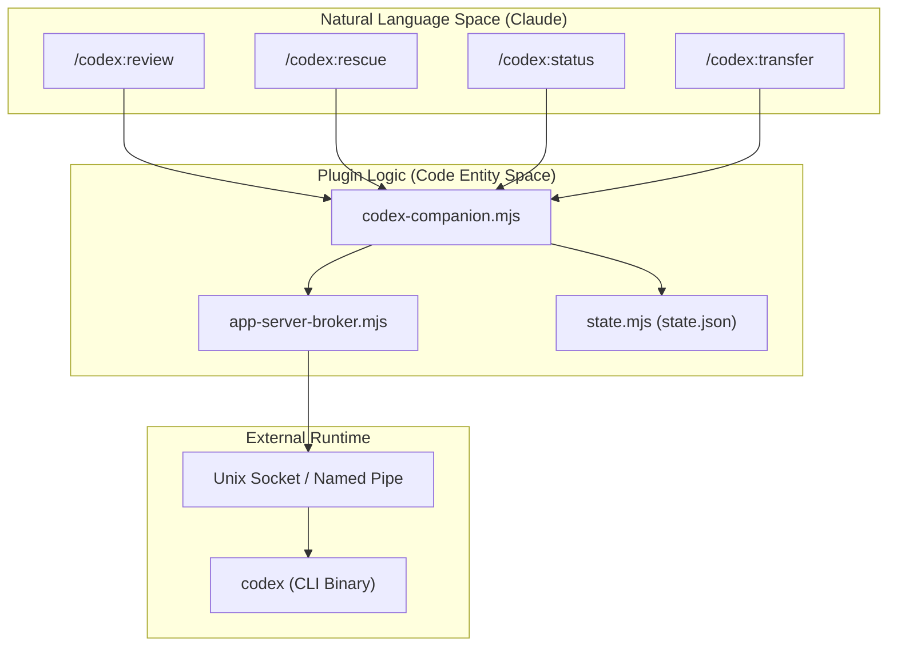
Sources: [README.md:1-15](), [.claude-plugin/marketplace.json:1-21]()

---

## High-Level Component Map

The plugin is structured around a central dispatcher called the companion script which manages communication between Claude Code and the Codex binary.

| Component | File/Entity | Role |
| :--- | :--- | :--- |
| **Dispatcher** | `codex-companion.mjs` | Main entry point for all slash commands; parses arguments and routes to logic. |
| **Broker** | `app-server-broker.mjs` | Manages a persistent session with the Codex app-server to avoid startup overhead. |
| **State Manager** | `state.mjs` | Persists job IDs, status, and results in `state.json`. |
| **Subagent** | `codex:codex-rescue` | A specialized Claude subagent configured to delegate tasks to Codex [README.md:65](). |

**Component Interaction Diagram**
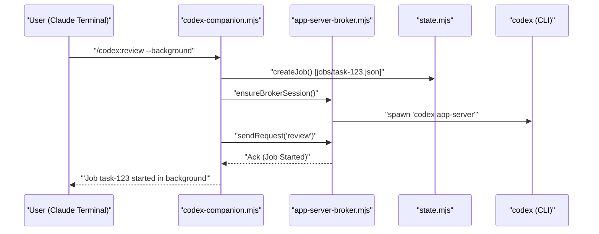
Sources: [README.md:62-66]()

---

## Child Pages

For deeper technical details, refer to the following sub-pages:

* **[Getting Started & Installation](#1.1)** — Step-by-step guide for installing the plugin, authenticating the Codex CLI, running `/codex:setup`, and verifying the environment is ready [README.md:16-48]().
* **[Plugin Registration & Manifest](#1.2)** — Explains the `.claude-plugin` manifest system: marketplace.json and plugin.json, plugin discovery lifecycle, version bumping via scripts/bump-version.mjs, and directory layout [.claude-plugin/marketplace.json:1-21]().
* **[Architecture](#2)** — Overview of the layered architecture: companion script dispatcher, app-server broker, job tracking, git/workspace helpers, and hook integration.
* **[Commands Reference](#3)** — Overview of all user-facing slash commands exposed by the plugin, with links to child pages per command group [README.md:75-208]().
* **[Prompts, Skills & Output Contracts](#4)** — Overview of the prompt engineering layer: prompt templates, internal skills, and review output contracts.
* **[Testing](#5)** — Overview of the test suite: what is tested, how to run tests, and links to child pages on infrastructure and per-module coverage.
* **[Project & Build Configuration](#6)** — Overview of packaging, build, CI and licensing.

Sources: [README.md:1-243](), [.claude-plugin/marketplace.json:1-21]()

---

# Page: Getting Started & Installation

# Getting Started & Installation

<details>
<summary>Relevant source files</summary>

The following files were used as context for generating this wiki page:

- [README.md](README.md)
- [plugins/codex/commands/setup.md](plugins/codex/commands/setup.md)
- [plugins/codex/scripts/codex-companion.mjs](plugins/codex/scripts/codex-companion.mjs)

</details>


This page provides a technical guide for installing the `codex-plugin-cc` into Claude Code, authenticating the underlying Codex CLI, and verifying the environment using the built-in setup routines.

## Installation Overview

The installation process integrates the Codex plugin into the Claude Code ecosystem by registering the plugin manifest and ensuring the local environment has the necessary Node.js dependencies and the `@openai/codex` CLI binary.

### Prerequisites
- **Node.js**: Version `18.18.0` or later is required [README.md:20-20]().
- **Claude Code**: An active installation where you can run slash commands.
- **OpenAI Account**: A ChatGPT subscription or OpenAI API key for Codex usage [README.md:18-19]().

### Step 1: Plugin Registration
To install the plugin, you must first add the OpenAI marketplace and then install the specific `codex` plugin.

```bash
/plugin marketplace add openai/codex-plugin-cc
/plugin install codex@openai-codex
/reload-plugins
```
Sources: [README.md:26-40]()

---

## The `/codex:setup` Routine

The `/codex:setup` command is the primary entry point for environment verification. It executes the `codex-companion.mjs` script with the `setup` subcommand [plugins/codex/commands/setup.md:10-11]().

### Execution Logic
When a user runs `/codex:setup`, the `handleSetup` function in the companion script performs the following checks:
1.  **Binary Detection**: `binaryAvailable` checks if `node`, `npm`, and `codex` are available in the system PATH [plugins/codex/scripts/codex-companion.mjs:184-186]().
2.  **Authentication Check**: `getCodexAuthStatus` verifies if the user is logged into Codex [plugins/codex/scripts/codex-companion.mjs:187-187]().
3.  **Review Gate Configuration**: Updates the local `config` in `state.json` via `setConfig` if flags like `--enable-review-gate` are passed [plugins/codex/scripts/codex-companion.mjs:215-225]().

### Automated Dependency Resolution
If the `codex` binary is missing, the plugin uses the `AskUserQuestion` tool defined in the command manifest to prompt the user for an automated installation via `npm install -g @openai/codex` [plugins/codex/commands/setup.md:13-22]().

### Setup Data Flow
The following diagram illustrates how the `setup` command bridges the Natural Language intent to the local system environment and code entities.

**Diagram: Setup Execution & Environment Validation**
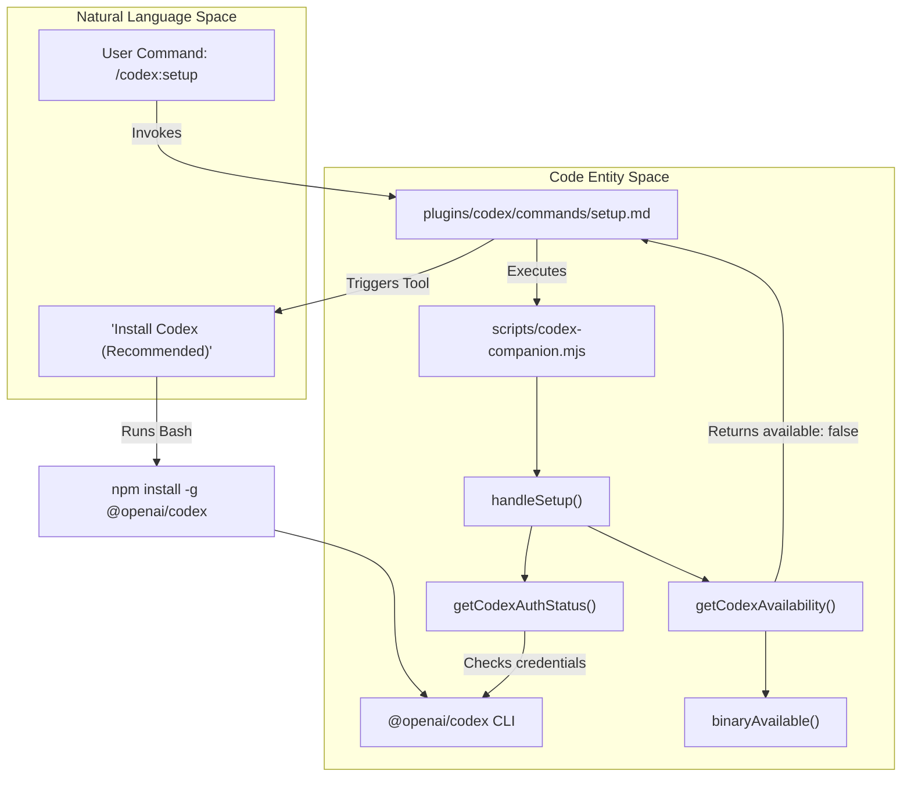
Sources: [plugins/codex/scripts/codex-companion.mjs:182-213](), [plugins/codex/scripts/lib/process.mjs:38-51](), [plugins/codex/commands/setup.md:1-37]()

---

## Manual Authentication

If the setup routine reports that Codex is installed but not authenticated (`authStatus.loggedIn === false`), the user must perform a manual login. This is handled outside the plugin's standard background execution to allow for interactive browser-based authentication [plugins/codex/scripts/codex-companion.mjs:194-197]().

The setup report provides specific guidance based on the authentication failure mode:
- Standard: `!codex login`
- Blocked Browser: `!codex login --device-auth` or `!codex login --with-api-key` [plugins/codex/scripts/codex-companion.mjs:195-196]().

Sources: [plugins/codex/scripts/codex-companion.mjs:187-200]()

---

## Verifying the Environment

Once setup is complete, the `buildSetupReport` function generates a comprehensive status object [plugins/codex/scripts/codex-companion.mjs:182-213]().

### Verification Checklist
| Component | Verification Method | Code Entity |
| :--- | :--- | :--- |
| **Node.js** | Checks `node --version` | `binaryAvailable("node")` |
| **NPM** | Checks `npm --version` | `binaryAvailable("npm")` |
| **Codex CLI** | Checks `@openai/codex` availability | `getCodexAvailability()` |
| **Authentication** | Checks login status | `getCodexAuthStatus()` |
| **Runtime** | Checks session environment variables | `getSessionRuntimeStatus()` |

### Internal Component Mapping
The plugin maps user commands to specific script executions and background processes. The diagram below shows how these components relate to the filesystem and runtime.

**Diagram: Component Architecture & Path Mapping**
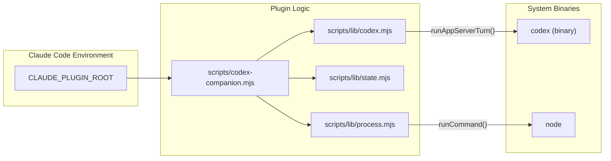
Sources: [plugins/codex/scripts/codex-companion.mjs:1-65](), [plugins/codex/scripts/lib/process.mjs:4-25](), [plugins/codex/commands/setup.md:10-11]()

---

## Review Gate Configuration (Optional)

As part of the setup, users can enable the **Review Gate**. This is a safety mechanism that triggers a Codex review whenever Claude attempts to finish a session.

- **Enable**: `/codex:setup --enable-review-gate` [plugins/codex/scripts/codex-companion.mjs:222-225]()
- **Disable**: `/codex:setup --disable-review-gate` [plugins/codex/scripts/codex-companion.mjs:226-229]()

The review gate logic in `handleSetup` calls `setConfig` to persist the `stopReviewGate` boolean in the workspace configuration [plugins/codex/scripts/codex-companion.mjs:231-231](). When enabled, the `buildSetupReport` will reflect `reviewGateEnabled: true` [plugins/codex/scripts/codex-companion.mjs:209-209]().

Sources: [plugins/codex/scripts/codex-companion.mjs:215-240](), [plugins/codex/commands/setup.md:1-5]()

---

# Page: Plugin Registration & Manifest

# Plugin Registration & Manifest

<details>
<summary>Relevant source files</summary>

The following files were used as context for generating this wiki page:

- [.claude-plugin/marketplace.json](.claude-plugin/marketplace.json)
- [plugins/codex/.claude-plugin/plugin.json](plugins/codex/.claude-plugin/plugin.json)
- [scripts/bump-version.mjs](scripts/bump-version.mjs)
- [tests/bump-version.test.mjs](tests/bump-version.test.mjs)

</details>


This page describes the manifest system and registration process that enables Claude Code to discover and load the Codex plugin. The plugin utilizes a hierarchical manifest structure to define its identity, source location, integration points, and synchronized version metadata maintained via automated tooling.

## Manifest Hierarchy & Directory Layout

The plugin registration is governed by two primary JSON files located within the `.claude-plugin` directory structure. This structure allows the repository to act as a container for one or more plugins that Claude Code can consume.

### Marketplace Manifest
The root-level manifest, `.claude-plugin/marketplace.json`, serves as the entry point for the entire repository. It defines the bundle identity and provides a registry of individual plugins available within the project [.claude-plugin/marketplace.json:1-21]().

*   **Identity**: Defines the bundle as `openai-codex` owned by `OpenAI` [.claude-plugin/marketplace.json:2-5]().
*   **Plugin Registry**: The `plugins` array contains a list of plugin definitions. Each entry specifies a `source` path relative to the root, which Claude Code uses to locate the specific plugin's assets. Currently, it registers the `codex` plugin located at `./plugins/codex` [.claude-plugin/marketplace.json:10-20]().

### Plugin Manifest
The `plugin.json` file located in the specific plugin subdirectory (`plugins/codex/.claude-plugin/plugin.json`) provides the granular metadata for that specific toolset [plugins/codex/.claude-plugin/plugin.json:1-8]().

*   **Metadata**: It defines the local name (`codex`), version (`1.0.6`), and the description that appears within the Claude Code interface [plugins/codex/.claude-plugin/plugin.json:2-7]().

### Directory Structure
The following layout illustrates how the manifest files relate to the source code and version control scripts:

```text
.
├── .claude-plugin/
│   └── marketplace.json        # Root registration for Claude Code
├── plugins/
│   └── codex/                  # Source directory for the 'codex' plugin
│       ├── .claude-plugin/
│       │   ├── plugin.json     # Plugin-specific metadata
│       │   └── hooks.json      # Lifecycle hook registrations
│       ├── hooks/
│       │   └── hooks.json      # Detailed hook command definitions
│       └── scripts/            # Executable logic for hooks
├── scripts/
│   └── bump-version.mjs        # Version synchronization script
└── package.json                # NPM configuration
```

**Sources:** [.claude-plugin/marketplace.json:1-21](), [plugins/codex/.claude-plugin/plugin.json:1-8]()

## Plugin Discovery & Lifecycle

Claude Code discovers the plugin by scanning for the `.claude-plugin` directory. The registration process maps natural language commands and lifecycle events to specific executable scripts.

### Lifecycle Hook Registration
The plugin defines hooks in `hooks.json` to manage the Codex environment during a Claude Code session. These hooks execute Node.js scripts located in the plugin's `scripts` directory.

*   **SessionStart**: Executes `session-lifecycle-hook.mjs SessionStart` to initialize the broker session.
*   **SessionEnd**: Executes `session-lifecycle-hook.mjs SessionEnd` to tear down the broker session and clean up resources.
*   **Stop**: Executes `stop-review-gate-hook.mjs` to implement a review gate that can block termination until required Codex conditions are met.

### Registration Data Flow
The following diagram illustrates how Claude Code processes the manifest files to register the plugin and its associated scripts.

**Diagram: Manifest Discovery to Code Entity Mapping**
```mermaid
graph TD
    subgraph "Claude_Code_Runtime" [Claude Code Runtime]
        CC["Runtime Engine"]
    end

    subgraph "Natural_Language_Space" [Natural Language Space]
        UserCmd[""/codex:review""]
        UserStop[""exit or stop""]
    end

    subgraph "Manifest_Space" [Manifest Space (.claude-plugin)]
        MP[""marketplace.json""]
        PJ[""plugin.json""]
        HJ[""hooks.json""]
    end

    subgraph "Code_Entity_Space" [Code Entity Space]
        Companion[""codex-companion.mjs""]
        Lifecycle[""session-lifecycle-hook.mjs""]
        StopGate[""stop-review-gate-hook.mjs""]
    end

    CC -->|Scans| MP
    MP -->|Points to| PJ
    PJ -.->|Associated with| HJ
    
    UserCmd -->|Triggers| Companion
    
    CC -->|SessionStart/End| Lifecycle
    Lifecycle -->|Script Path| HJ

    UserStop -->|Triggers Stop Hook| StopGate
    StopGate -->|Script Path| HJ
```
**Sources:** [.claude-plugin/marketplace.json:10-19](), [plugins/codex/.claude-plugin/plugin.json:1-7]()

## Plugin-to-Code Mapping

The registration system bridges the gap between the Claude Code user interface and the local filesystem entities.

**Diagram: System Name to Filepath Association**
```mermaid
graph LR
    subgraph "System_Names" [System Names (Manifests)]
        PName[""Plugin: codex""]
        MName[""Marketplace: openai-codex""]
        HookStart[""Hook: SessionStart""]
        HookStop[""Hook: Stop""]
    end

    subgraph "Code_Entities" [Code Entities (Filesystem)]
        ManifestRoot["".claude-plugin/marketplace.json""]
        PluginRoot[""plugins/codex/.claude-plugin/plugin.json""]
        LifecycleScript[""scripts/session-lifecycle-hook.mjs""]
        StopScript[""scripts/stop-review-gate-hook.mjs""]
    end

    MName --- ManifestRoot
    PName --- PluginRoot
    HookStart --- LifecycleScript
    HookStop --- StopScript
```
**Sources:** [.claude-plugin/marketplace.json:2-12](), [plugins/codex/.claude-plugin/plugin.json:2-3]()

## Version Synchronization via `scripts/bump-version.mjs`

To prevent version drift across the multiple manifests and package configurations required by the plugin ecosystem, version updates are automated via `scripts/bump-version.mjs` [scripts/bump-version.mjs:1-227]().

### Version Targets
The script targets four configuration files, validating and updating specific JSON paths to match the desired semver version string [scripts/bump-version.mjs:8-73]():
1. `package.json` (`version`) [scripts/bump-version.mjs:10-20]()
2. `package-lock.json` (`version` and `packages[""].version`) [scripts/bump-version.mjs:22-40]()
3. `plugins/codex/.claude-plugin/plugin.json` (`version`) [scripts/bump-version.mjs:42-52]()
4. `.claude-plugin/marketplace.json` (`metadata.version` and `plugins[codex].version`) [scripts/bump-version.mjs:54-72]()

### CLI Options & Implementation
The script uses `parseArgs` to process options [scripts/bump-version.mjs:88-120]():
*   `<version>`: Sets the target version after validating against `VERSION_PATTERN` (`/^(0|[1-9]\d*)\.(0|[1-9]\d*)\.(0|[1-9]\d*)(?:-[0-9A-Za-z.-]+)?(?:\+[0-9A-Za-z.-]+)?$/`) [scripts/bump-version.mjs:6,111-115,122-126]().
*   `--check`: Verifies that all target manifests match the expected version (derived from `package.json` if no explicit version is passed) [scripts/bump-version.mjs:98-99,159-173,208-215](). Exits with a non-zero status if mismatches are found [tests/bump-version.test.mjs:74-88]().
*   `--root <dir>`: Executes against an alternate repository root path [scripts/bump-version.mjs:100-106,118]().
*   `--help`: Prints usage instructions [scripts/bump-version.mjs:75-86,107-108,197-200]().

### Current Version Metadata

| Location | Key | Value |
| :--- | :--- | :--- |
| `marketplace.json` | `metadata.version` | `1.0.6` [.claude-plugin/marketplace.json:8]() |
| `marketplace.json` | `plugins[0].version` | `1.0.6` [.claude-plugin/marketplace.json:14]() |
| `plugin.json` | `version` | `1.0.6` [plugins/codex/.claude-plugin/plugin.json:3]() |
| `package.json` | `version` | `1.0.6` [scripts/bump-version.mjs:1-227]() |

**Sources:** [.claude-plugin/marketplace.json:1-21](), [plugins/codex/.claude-plugin/plugin.json:1-8](), [scripts/bump-version.mjs:1-227](), [tests/bump-version.test.mjs:1-88]()

---

# Page: Architecture

# Architecture

<details>
<summary>Relevant source files</summary>

The following files were used as context for generating this wiki page:

- [plugins/codex/scripts/codex-companion.mjs](plugins/codex/scripts/codex-companion.mjs)
- [plugins/codex/scripts/lib/app-server.mjs](plugins/codex/scripts/lib/app-server.mjs)

</details>


This page provides a high-level overview of the `codex-plugin-cc` system architecture. The plugin is designed as a layered system that bridges the gap between the Claude Code environment and the OpenAI Codex CLI, providing robust job tracking, shared runtime access, and automated review gates.

## System Overview

The architecture is centered around a companion CLI script that manages all interactions with the Codex ecosystem. Because Claude Code may execute multiple commands or hooks in parallel or sequence, the system uses a **Broker** pattern to ensure stable, multiplexed access to a single Codex `app-server` instance.

### High-Level Component Diagram

This diagram illustrates how the system components interact, moving from the user-facing slash commands to the underlying Codex runtime.

"System Components & Data Flow"
```mermaid
graph TD
    subgraph "Claude_Code_Environment"
        [CC_Session]
        [Hooks_hooks.json]
    end

    subgraph "Codex_Plugin_Layer"
        [codex-companion.mjs_Dispatcher]
        [app-server-broker.mjs_Multiplexer]
        [state.mjs_Persistence]
    end

    subgraph "External_Runtime"
        [Codex_app-server_JSON-RPC]
        [Codex_CLI_Binary]
    end

    [CC_Session] -- "executes" --> [codex-companion.mjs_Dispatcher]
    [Hooks_hooks.json] -- "triggers" --> [codex-companion.mjs_Dispatcher]
    [codex-companion.mjs_Dispatcher] -- "requests" --> [app-server-broker.mjs_Multiplexer]
    [app-server-broker.mjs_Multiplexer] -- "JSON-RPC_over_IPC" --> [Codex_app-server_JSON-RPC]
    [Codex_app-server_JSON-RPC] -- "spawns" --> [Codex_CLI_Binary]
    [codex-companion.mjs_Dispatcher] -- "reads/writes" --> [state.mjs_Persistence]
```
Sources: [plugins/codex/scripts/codex-companion.mjs:1-87](), [plugins/codex/scripts/lib/app-server.mjs:183-196](), [plugins/codex/scripts/session-lifecycle-hook.mjs:1-20]()

---

## Core Subsystems

### 1. Codex Companion Script
The `codex-companion.mjs` script is the central entry point for all plugin operations. It acts as a dispatcher, parsing arguments via `parseCommandInput` [plugins/codex/scripts/codex-companion.mjs:141-149]() and routing them to specific logic for setup, code reviews, or task delegation. It handles both foreground execution (where the user waits for a result) and background execution (where a job ID is returned immediately) by utilizing `runTrackedJob` [plugins/codex/scripts/lib/tracked-jobs.mjs:52-54](). The script also includes utility functions like `outputResult` [plugins/codex/scripts/codex-companion.mjs:91-96]() for formatting output and `normalizeRequestedModel` [plugins/codex/scripts/codex-companion.mjs:103-112]() for handling model aliases.

For details, see [Codex Companion Script](#2.1).

Sources: [plugins/codex/scripts/codex-companion.mjs:75-87](), [plugins/codex/scripts/codex-companion.mjs:215-230](), [plugins/codex/scripts/codex-companion.mjs:91-96](), [plugins/codex/scripts/codex-companion.mjs:103-112]()

### 2. App-Server Client & Broker
To avoid the overhead of repeatedly spawning the Codex CLI and to maintain session state (like conversation history), the plugin uses a broker mechanism. `AppServerClientBase` [plugins/codex/scripts/lib/app-server.mjs:57-181]() provides the foundation for JSON-RPC communication. The system supports direct spawning via `SpawnedCodexAppServerClient` [plugins/codex/scripts/lib/app-server.mjs:183-230]() or connecting to a persistent multiplexer. This ensures that only one "turn" is active at a time, preventing race conditions in the Codex runtime via `interruptAppServerTurn` [plugins/codex/scripts/lib/codex.mjs:18-18](). The client also defines default information and capabilities for the plugin, such as `DEFAULT_CLIENT_INFO` [plugins/codex/scripts/lib/app-server.mjs:26-30]() and `DEFAULT_CAPABILITIES` [plugins/codex/scripts/lib/app-server.mjs:33-42]().

For details, see [App-Server Client & Broker](#2.2).

"Natural Language to Code Entity: Broker & Protocol"
```mermaid
graph LR
    subgraph "Natural_Language_Space"
        [REQ_Run_a_review]
        [INT_Stop_current_task]
    end

    subgraph "Code_Entity_Space"
        [codex-companion.mjs]
        [AppServerClientBase]
        [interruptAppServerTurn]
        [request]
    end

    [REQ_Run_a_review] --> [codex-companion.mjs]
    [codex-companion.mjs] -- "request()" --> [request]
    [request] -- "JSON-RPC" --> [AppServerClientBase]
    [INT_Stop_current_task] --> [codex-companion.mjs]
    [codex-companion.mjs] -- "interruptAppServerTurn()" --> [interruptAppServerTurn]
```
Sources: [plugins/codex/scripts/lib/app-server.mjs:86-98](), [plugins/codex/scripts/codex-companion.mjs:10-23](), [plugins/codex/scripts/lib/app-server.mjs:26-30](), [plugins/codex/scripts/lib/app-server.mjs:33-42]()

### 3. Job Tracking & State Management
The system includes a persistence layer in `state.mjs` and `tracked-jobs.mjs`. Every significant action is assigned a `jobId` generated by `generateJobId` [plugins/codex/scripts/lib/state.mjs:30-30](). The state of these jobs, including logs, progress, and final results, is stored in a local state directory. This allows users to query `/codex:status` via `buildStatusSnapshot` [plugins/codex/scripts/lib/job-control.mjs:213-213]() or retrieve results later with `/codex:result` using `resolveResultJob` [plugins/codex/scripts/lib/job-control.mjs:42-42](). The `tracked-jobs.mjs` module also provides functions like `createJobLogFile` [plugins/codex/scripts/lib/tracked-jobs.mjs:47-47]() and `createJobProgressUpdater` [plugins/codex/scripts/lib/tracked-jobs.mjs:48-48]() for managing job output.

For details, see [Job Tracking & State Management](#2.3).

"Natural Language to Code Entity: Job Lifecycle"
```mermaid
graph TD
    subgraph "Natural_Language_Space"
        [START_Start_background_task]
        [POLL_Is_it_done_yet]
    end

    subgraph "Code_Entity_Space"
        [runTrackedJob]
        [upsertJob]
        [resolveStateFile]
        [writeJobFile]
        [buildStatusSnapshot]
    end

    [START_Start_background_task] --> [runTrackedJob]
    [runTrackedJob] --> [upsertJob]
    [upsertJob] --> [resolveStateFile]
    [resolveStateFile] --> [writeJobFile]
    [POLL_Is_it_done_yet] --> [buildStatusSnapshot]
    [buildStatusSnapshot] -- "reads" --> [writeJobFile]
```
Sources: [plugins/codex/scripts/lib/state.mjs:48-48](), [plugins/codex/scripts/lib/tracked-jobs.mjs:52-54](), [plugins/codex/scripts/lib/job-control.mjs:213-223](), [plugins/codex/scripts/lib/tracked-jobs.mjs:47-48]()

### 4. Claude Code Hook Integration
The plugin integrates with Claude Code's lifecycle via hooks.
- **SessionStart**: Triggers `session-lifecycle-hook.mjs` to prepare the Codex runtime and set environment variables like `SESSION_ID_ENV` [plugins/codex/scripts/session-lifecycle-hook.mjs:77-81]().
- **SessionEnd**: Triggers `session-lifecycle-hook.mjs` to clean up resources, including calling `teardownBrokerSession` [plugins/codex/scripts/session-lifecycle-hook.mjs:105-112]() and `cleanupSessionJobs` [plugins/codex/scripts/session-lifecycle-hook.mjs:42-75]().
- **Stop**: Can trigger a "Review Gate" which prevents Claude from exiting if there are unreviewed changes.

For details, see [Claude Code Hook Integration](#2.4).

Sources: [plugins/codex/scripts/session-lifecycle-hook.mjs:77-114](), [plugins/codex/scripts/lib/broker-lifecycle.mjs:14-15]()

---

## Component Relationship Table

| Component | Responsibility | Primary Files |
| :--- | :--- | :--- |
| **Dispatcher** | CLI argument parsing and subcommand delegation. | `codex-companion.mjs` [plugins/codex/scripts/codex-companion.mjs:1-9]() |
| **Broker** | Lifecycle management for the shared Codex `app-server`. | `lib/broker-lifecycle.mjs` [plugins/codex/scripts/lib/broker-lifecycle.mjs:1-15]() |
| **Client** | JSON-RPC communication protocol implementation. | `lib/app-server.mjs` [plugins/codex/scripts/lib/app-server.mjs:57-69]() |
| **State** | Persistence of job metadata and logs. | `lib/state.mjs` [plugins/codex/scripts/lib/state.mjs:1-36](), `lib/tracked-jobs.mjs` [plugins/codex/scripts/lib/tracked-jobs.mjs:1-13]() |
| **Control** | Logic for querying and enriching job status. | `lib/job-control.mjs` [plugins/codex/scripts/lib/job-control.mjs:1-13]() |

Sources: [plugins/codex/scripts/codex-companion.mjs:1-65](), [plugins/codex/scripts/lib/app-server.mjs:57-70](), [plugins/codex/scripts/lib/state.mjs:1-36](), [plugins/codex/scripts/lib/tracked-jobs.mjs:1-13](), [plugins/codex/scripts/lib/job-control.mjs:1-13]()

---

# Page: Codex Companion Script

# Codex Companion Script

<details>
<summary>Relevant source files</summary>

The following files were used as context for generating this wiki page:

- [plugins/codex/scripts/codex-companion.mjs](plugins/codex/scripts/codex-companion.mjs)
- [plugins/codex/scripts/lib/args.mjs](plugins/codex/scripts/lib/args.mjs)
- [tests/runtime.test.mjs](tests/runtime.test.mjs)

</details>


The `codex-companion.mjs` script is the central entry point and CLI dispatcher for the Codex Companion plugin. It acts as a bridge between the Claude Code environment and the Codex ecosystem, managing the lifecycle of both foreground and background jobs. It handles everything from environment setup and Git context collection to job tracking and result rendering.

## Overview

`codex-companion.mjs` implements a multi-command CLI architecture. Each subcommand follows a pattern of:
1.  **Argument Parsing**: Normalizing and parsing CLI flags using `lib/args.mjs` [plugins/codex/scripts/codex-companion.mjs:9-9]().
2.  **Context Resolution**: Determining the Git repository root and working directory [plugins/codex/scripts/codex-companion.mjs:151-157]().
3.  **Delegation**: Calling specialized library modules (e.g., `lib/git.mjs`, `lib/codex.mjs`, `lib/tracked-jobs.mjs`) to perform the core logic.
4.  **Rendering**: Formatting the internal data structures into user-friendly Markdown or JSON via `lib/render.mjs` [plugins/codex/scripts/codex-companion.mjs:56-65]().

### System Architecture & Data Flow

The following diagram illustrates how `codex-companion.mjs` dispatches commands and interacts with the underlying systems.

**CLI Dispatcher Flow**
```mermaid
graph TD
    subgraph "CLI Layer"
        CLI["codex-companion.mjs"]
        ARGS["lib/args.mjs"]
    end

    subgraph "Subcommand Handlers"
        H_SETUP["handleSetup()"]
        H_REVIEW["handleReview()"]
        H_ADVERSARIAL_REVIEW["handleAdversarialReview()"]
        H_TASK["handleTask()"]
        H_TRANSFER["handleTransfer()"]
        H_STATUS["handleStatus()"]
        H_RESULT["handleResult()"]
        H_CANCEL["handleCancel()"]
        H_TASK_WORKER["handleTaskWorker()"]
    end

    subgraph "Logic & State"
        GIT["lib/git.mjs"]
        STATE["lib/state.mjs"]
        TRACK["lib/tracked-jobs.mjs"]
        CODEX["lib/codex.mjs"]
        CLAUDESESSION["lib/claude-session-transfer.mjs"]
        PROCESS["lib/process.mjs"]
        PROMPTS["lib/prompts.mjs"]
        JOB_CONTROL["lib/job-control.mjs"]
    end

    CLI --> ARGS
    CLI --> H_SETUP
    CLI --> H_REVIEW
    CLI --> H_ADVERSARIAL_REVIEW
    CLI --> H_TASK
    CLI --> H_TRANSFER
    CLI --> H_STATUS
    CLI --> H_RESULT
    CLI --> H_CANCEL
    CLI --> H_TASK_WORKER

    H_SETUP --> STATE
    H_SETUP --> CODEX
    H_SETUP --> PROCESS
    H_REVIEW --> GIT
    H_REVIEW --> TRACK
    H_REVIEW --> CODEX
    H_ADVERSARIAL_REVIEW --> GIT
    H_ADVERSARIAL_REVIEW --> TRACK
    H_ADVERSARIAL_REVIEW --> CODEX
    H_ADVERSARIAL_REVIEW --> PROMPTS
    H_TASK --> TRACK
    H_TASK --> CODEX
    H_TASK --> STATE
    H_TRANSFER --> CLAUDESESSION
    H_TRANSFER --> CODEX
    H_STATUS --> STATE
    H_STATUS --> JOB_CONTROL
    H_RESULT --> JOB_CONTROL
    H_RESULT --> CODEX
    H_CANCEL --> JOB_CONTROL
    H_CANCEL --> PROCESS
    H_CANCEL --> CODEX
    H_TASK_WORKER --> TRACK
    H_TASK_WORKER --> CODEX
    H_TASK_WORKER --> STATE
```
**Sources:** [plugins/codex/scripts/codex-companion.mjs:215-220](), [plugins/codex/scripts/lib/args.mjs:1-74](), [plugins/codex/scripts/codex-companion.mjs:21-65]()

---

## Command Implementation

### Setup (`setup`)
The `setup` command verifies the local environment for Codex compatibility. It checks for `node`, `npm`, and the `@openai/codex` binary availability via `getCodexAvailability` [plugins/codex/scripts/codex-companion.mjs:184-186](). It also manages the "Review Gate" configuration, which can be toggled via `--enable-review-gate` or `--disable-review-gate` [plugins/codex/scripts/codex-companion.mjs:221-230](). The `buildSetupReport` function [plugins/codex/scripts/codex-companion.mjs:182-209]() aggregates all status information.

### Review & Adversarial Review
These commands analyze code changes.
-   **Context Selection**: `resolveReviewTarget` [plugins/codex/scripts/codex-companion.mjs:26-26]() determines if the review should focus on the `working-tree` (dirty files) or a `branch` (diff against a base ref). `collectReviewContext` [plugins/codex/scripts/codex-companion.mjs:26-26]() gathers the actual diff.
-   **Adversarial Mode**: Uses `loadPromptTemplate` [plugins/codex/scripts/codex-companion.mjs:28-28]() to fetch `adversarial-review.md` and `interpolateTemplate` [plugins/codex/scripts/codex-companion.mjs:28-28]() to inject the diff context.
-   **Execution**: Both can run in the foreground or as background jobs using `runTrackedJob` [plugins/codex/scripts/codex-companion.mjs:52-52](). The core review logic is handled by `runAppServerReview` [plugins/codex/scripts/codex-companion.mjs:21-23]().

### Task & Task-Worker
The `task` command delegates complex instructions to Codex.
-   **Thread Management**: It attempts to find existing task threads via `findLatestTaskThread` [plugins/codex/scripts/codex-companion.mjs:13-13]() to support `--resume` logic. `buildPersistentTaskThreadName` [plugins/codex/scripts/codex-companion.mjs:11-11]() generates a consistent thread name.
-   **Backgrounding**: If `--background` is passed, it spawns a detached "task-worker" process [plugins/codex/scripts/codex-companion.mjs:3-3]().
-   **Worker Logic**: The worker uses `runAppServerTurn` [plugins/codex/scripts/codex-companion.mjs:21-23]() to communicate with the Codex App-Server via JSON-RPC, capturing progress updates and file changes. `parseStructuredOutput` [plugins/codex/scripts/codex-companion.mjs:19-19]() and `readOutputSchema` [plugins/codex/scripts/codex-companion.mjs:20-20]() are used to interpret Codex's responses.

### Transfer (`transfer`)
The `transfer` command imports Claude session transcripts. It uses `resolveClaudeSessionPath` [plugins/codex/scripts/codex-companion.mjs:24-24]() to locate the session file and `importExternalAgentSession` [plugins/codex/scripts/codex-companion.mjs:17-17]() to send the data to the app-server.

### Job Control (`status`, `result`, `cancel`)
-   **Status**: Queries `listJobs` [plugins/codex/scripts/codex-companion.mjs:32-36]() for job metadata and `buildStatusSnapshot` [plugins/codex/scripts/codex-companion.mjs:39-44]() to build a snapshot of active or completed tasks. `renderStatusReport` [plugins/codex/scripts/codex-companion.mjs:61-65]() formats the output.
-   **Result**: Retrieves the final payload of a job via `resolveResultJob` [plugins/codex/scripts/codex-companion.mjs:39-44]() and `readStoredJob` [plugins/codex/scripts/codex-companion.mjs:39-44](). For reviews, it parses structured JSON from the Codex output [plugins/codex/scripts/codex-companion.mjs:19-19](). `renderStoredJobResult` [plugins/codex/scripts/codex-companion.mjs:61-65]() handles rendering.
-   **Cancel**: Terminates the process tree associated with a job ID using `terminateProcessTree` [plugins/codex/scripts/codex-companion.mjs:27-27](). It also attempts to `interruptAppServerTurn` [plugins/codex/scripts/codex-companion.mjs:18-18]() if the job is actively communicating with the app-server. `resolveCancelableJob` [plugins/codex/scripts/codex-companion.mjs:39-44]() identifies the target job.

---

## Execution Modes: Foreground vs. Background

The script uses `runTrackedJob` from `lib/tracked-jobs.mjs` to wrap long-running operations.

| Feature | Foreground (`--wait`) | Background (`--background`) |
| :--- | :--- | :--- |
| **Process** | Runs within the current CLI process. | Spawns a detached child process. |
| **Output** | Streams progress to `stdout`. | Writes logs to `~/.claude-code/codex/jobs/<id>/log.txt`. |
| **Persistence** | State updated in `state.json`. | State updated in `state.json`. |
| **Blocking** | Blocks the Claude turn. | Returns immediately with a Job ID. |

**Sources:** [plugins/codex/scripts/lib/tracked-jobs.mjs:52-52](), [plugins/codex/scripts/codex-companion.mjs:52-52]()

---

## Mapping Natural Language to Code Entities

The following diagrams bridge user-facing concepts to the specific code implementations.

### Job Lifecycle Mapping
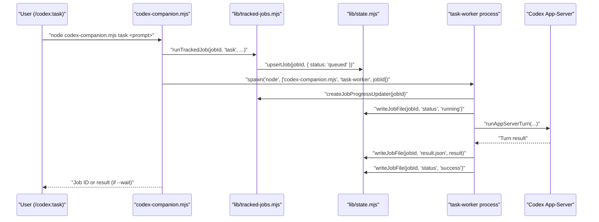
**Sources:** [plugins/codex/scripts/codex-companion.mjs:34-35](), [plugins/codex/scripts/lib/tracked-jobs.mjs:48-52](), [plugins/codex/scripts/lib/state.mjs:32-35](), [plugins/codex/scripts/codex-companion.mjs:21-23]()

### Git Context Mapping
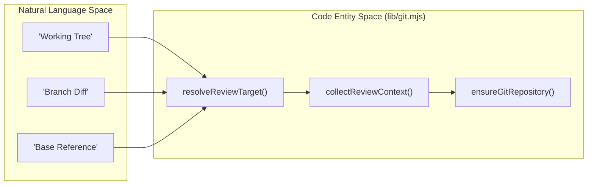
**Sources:** [plugins/codex/scripts/lib/git.mjs:26-26](), [plugins/codex/scripts/codex-companion.mjs:26-26]()

## Key Functions

### Argument Parsing
-   `splitRawArgumentString(raw)`: Handles shell-like quoting and escaping within a single string argument [plugins/codex/scripts/lib/args.mjs:76-128]().
-   `parseArgs(argv, config)`: Standardizes flag parsing (e.g., `--key=value`, `-k value`) [plugins/codex/scripts/lib/args.mjs:1-74]().
-   `normalizeRequestedModel(model)`: Maps model aliases (e.g., "spark" to "gpt-5.3-codex-spark") [plugins/codex/scripts/codex-companion.mjs:103-112]().
-   `normalizeReasoningEffort(effort)`: Validates and normalizes reasoning effort levels [plugins/codex/scripts/codex-companion.mjs:114-128]().

### Codex Interaction
-   `runAppServerTurn(client, params, onProgress)`: The primary driver for Codex interactions, managing the state machine of a single "turn" [plugins/codex/scripts/codex-companion.mjs:21-23]().
-   `runAppServerReview(client, params, onProgress)`: Specifically handles the review command's interaction with the app-server [plugins/codex/scripts/codex-companion.mjs:21-23]().
-   `interruptAppServerTurn(client, threadId, turnId)`: Used by the `cancel` command to stop a running Codex generation [plugins/codex/scripts/codex-companion.mjs:18-18]().
-   `getCodexAvailability(cwd)`: Checks if the Codex CLI is installed and accessible [plugins/codex/scripts/codex-companion.mjs:15-16]().
-   `getCodexAuthStatus(cwd)`: Determines the authentication status with the Codex app-server [plugins/codex/scripts/codex-companion.mjs:15-16]().

### State & Persistence
-   `upsertJob(workspaceRoot, jobId, data)`: Atomically updates the global `state.json` file [plugins/codex/scripts/codex-companion.mjs:34-34]().
-   `writeJobFile(workspaceRoot, jobId, fileName, content)`: Writes job-specific artifacts (like logs or result JSON) to the job's directory [plugins/codex/scripts/codex-companion.mjs:35-35]().
-   `generateJobId()`: Creates a unique identifier for a new job [plugins/codex/scripts/codex-companion.mjs:31-36]().

**Sources:** [plugins/codex/scripts/lib/args.mjs:1-128](), [plugins/codex/scripts/lib/codex.mjs:1-23](), [plugins/codex/scripts/lib/state.mjs:29-36](), [plugins/codex/scripts/codex-companion.mjs:103-128]()

---

# Page: App-Server Client & Broker

# App-Server Client & Broker

<details>
<summary>Relevant source files</summary>

The following files were used as context for generating this wiki page:

- [plugins/codex/scripts/app-server-broker.mjs](plugins/codex/scripts/app-server-broker.mjs)
- [plugins/codex/scripts/lib/app-server-protocol.d.ts](plugins/codex/scripts/lib/app-server-protocol.d.ts)
- [plugins/codex/scripts/lib/app-server.mjs](plugins/codex/scripts/lib/app-server.mjs)
- [plugins/codex/scripts/lib/broker-endpoint.mjs](plugins/codex/scripts/lib/broker-endpoint.mjs)
- [plugins/codex/scripts/lib/broker-lifecycle.mjs](plugins/codex/scripts/lib/broker-lifecycle.mjs)

</details>


The Codex Plugin communicates with the Codex `app-server` using a JSON-RPC 2.0 protocol over newline-delimited JSON (JSONL). Because the Codex CLI is designed for a single active session but Claude Code may trigger multiple concurrent background jobs (e.g., parallel code reviews), the plugin implements a **Broker** architecture to multiplex requests and manage the lifecycle of the underlying Codex process.

## JSON-RPC Protocol

The communication with the `app-server` follows a standard JSON-RPC pattern. The client sends requests with a unique `id`, and the server responds with either a `result` or an `error` [plugins/codex/scripts/lib/app-server.mjs:86-97](). The server also sends asynchronous notifications (without an `id`) to provide status updates or streaming content [plugins/codex/scripts/lib/app-server.mjs:151-154]().

### Key Methods
The protocol is defined in [plugins/codex/scripts/lib/app-server-protocol.d.ts:59-69]().

| Method | Purpose |
| :--- | :--- |
| `initialize` | Negotiates capabilities and client information. |
| `thread/start` | Begins a new conversation thread. |
| `thread/resume` | Continues an existing thread by ID. |
| `review/start` | Initiates a code review on a specific target (branch or working tree). |
| `turn/start` | Sends a user message to an active thread. |
| `turn/interrupt` | Stops an active turn (useful for cancellation). |
| `externalAgentConfig/import` | Imports external agent configuration. |
| `thread/name/set` | Sets the name of a thread. |
| `thread/list` | Lists available threads. |

### Streaming and Multiplexing
Certain methods are flagged as "streaming" because they trigger a sequence of notifications (e.g., `item/agentMessage/delta`) followed by a final `turn/completed` notification [plugins/codex/scripts/app-server-broker.mjs:12-23]().

## Transport Modes

The `CodexAppServerClient` supports two distinct transport modes determined at connection time via the `disableBroker` option [plugins/codex/scripts/lib/app-server.mjs:275-285]().

### 1. Direct Spawn (`direct`)
The plugin spawns the `codex app-server` binary as a child process and communicates via `stdin` and `stdout` [plugins/codex/scripts/lib/app-server.mjs:183-196](). This is typically used when the broker is disabled or for the broker's own internal connection to Codex.

### 2. Broker Client (`broker`)
The plugin connects to a long-running Broker process via a Unix domain socket (on macOS/Linux) or a Named Pipe (on Windows) [plugins/codex/scripts/lib/app-server.mjs:275-285](). This allows multiple CLI invocations to share a single Codex instance.

### Transport Data Flow
The following diagram shows how the `CodexAppServerClient` abstracts the underlying transport.

**Diagram: App-Server Transport Abstraction**
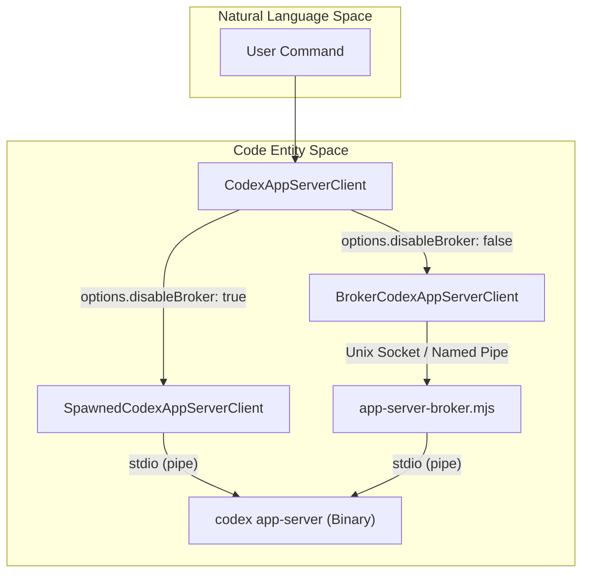
Sources: [plugins/codex/scripts/lib/app-server.mjs:246-270](), [plugins/codex/scripts/app-server-broker.mjs:68-68]()

## The Broker Multiplexer

The `app-server-broker.mjs` script acts as a stateful proxy. Its primary responsibility is to ensure that only one streaming request is active at a time, while still allowing "out-of-band" requests like `turn/interrupt` [plugins/codex/scripts/app-server-broker.mjs:170-182]().

### Concurrency Logic
1.  **Request Locking**: When a socket sends a request, it becomes the `activeRequestSocket` [plugins/codex/scripts/app-server-broker.mjs:198-198]().
2.  **Busy Errors**: If another socket attempts a request while the broker is busy, it receives a `BROKER_BUSY_RPC_CODE` (-32001) [plugins/codex/scripts/app-server-broker.mjs:173-182]().
3.  **Interrupt Exception**: An exception is made for `turn/interrupt`, which is allowed to pass through even if another socket is currently receiving a stream [plugins/codex/scripts/app-server-broker.mjs:170-171]().
4.  **Notification Routing**: Notifications from the Codex process are routed back to the socket that initiated the current stream via `routeNotification` [plugins/codex/scripts/app-server-broker.mjs:84-100]().

**Diagram: Broker Multiplexing Logic**
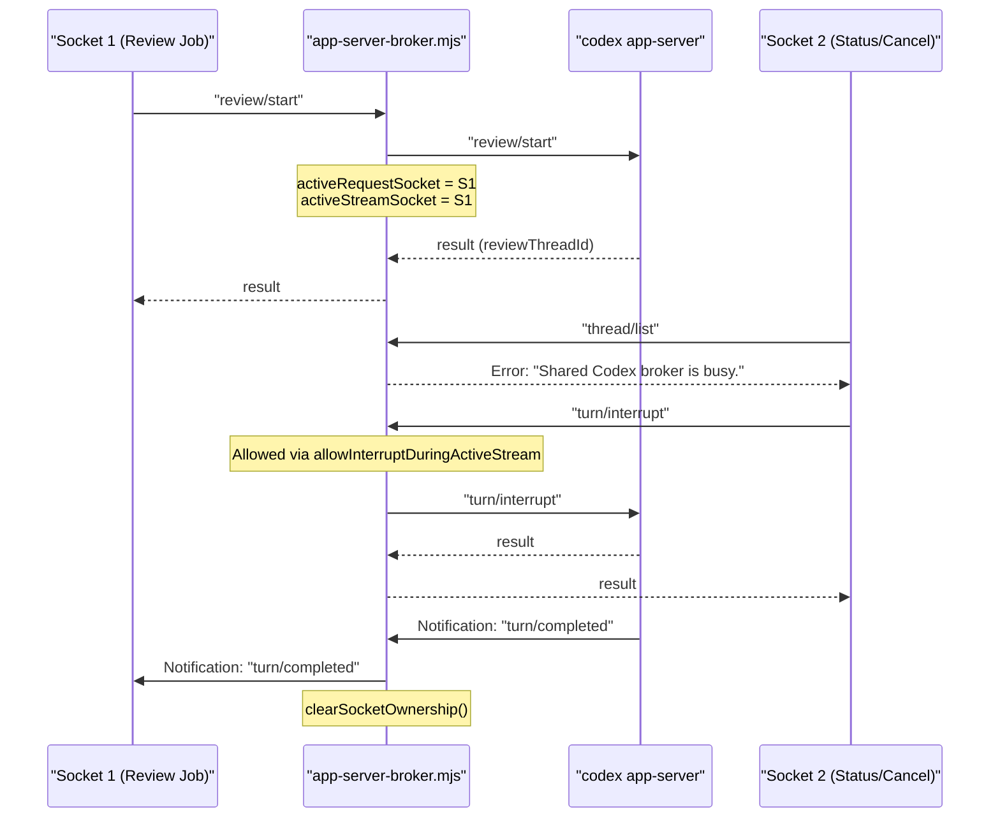
Sources: [plugins/codex/scripts/app-server-broker.mjs:170-221](), [plugins/codex/scripts/app-server-broker.mjs:84-100]()

## Broker Lifecycle Management

The lifecycle is managed by `lib/broker-lifecycle.mjs`, which handles the creation of the socket environment and the persistence of the broker's connection details.

### Lifecycle Functions
*   `ensureBrokerSession(cwd, options)`: The main entry point. It checks if a broker is already running by attempting to connect to the endpoint stored in `broker.json`. If it fails, it spawns a new broker [plugins/codex/scripts/lib/broker-lifecycle.mjs:113-171]().
*   `spawnBrokerProcess(config)`: Launches the broker script using `child.unref()` and `detached: true` so that the broker survives the exit of the calling process [plugins/codex/scripts/lib/broker-lifecycle.mjs:59-70]().
*   `teardownBrokerSession(config)`: Cleans up the PID file, log files, and the Unix socket/Named pipe [plugins/codex/scripts/lib/broker-lifecycle.mjs:173-209]().
*   `sendBrokerShutdown(endpoint)`: Sends a `broker/shutdown` JSON-RPC request to the broker to trigger a graceful exit [plugins/codex/scripts/lib/broker-lifecycle.mjs:43-57]().

### Endpoint Resolution
Endpoints are platform-specific and generated based on a temporary session directory [plugins/codex/scripts/lib/broker-endpoint.mjs:10-17]():
*   **macOS/Linux**: `unix:/tmp/cxc-XXXXXX/broker.sock`
*   **Windows**: `pipe:\\.\pipe\cxc-XXXXXX-codex-app-server`

### State Persistence
The broker's connection info is saved to `broker.json` within the project's state directory [plugins/codex/scripts/lib/broker-lifecycle.mjs:162-169]().

| Property | Description |
| :--- | :--- |
| `endpoint` | The socket/pipe string used for `net.connect`. |
| `pid` | The process ID of the broker. |
| `sessionDir` | Path to the temporary directory containing logs and the socket. |
| `pidFile` | Path to the file containing the broker's current PID. |

Sources: [plugins/codex/scripts/lib/broker-lifecycle.mjs:162-168](), [plugins/codex/scripts/lib/broker-endpoint.mjs:19-41](), [plugins/codex/scripts/lib/broker-lifecycle.mjs:13-13]()

---

# Page: Job Tracking & State Management

# Job Tracking & State Management

<details>
<summary>Relevant source files</summary>

The following files were used as context for generating this wiki page:

- [plugins/codex/scripts/lib/fs.mjs](plugins/codex/scripts/lib/fs.mjs)
- [plugins/codex/scripts/lib/job-control.mjs](plugins/codex/scripts/lib/job-control.mjs)
- [plugins/codex/scripts/lib/state.mjs](plugins/codex/scripts/lib/state.mjs)
- [plugins/codex/scripts/lib/tracked-jobs.mjs](plugins/codex/scripts/lib/tracked-jobs.mjs)
- [plugins/codex/scripts/lib/workspace.mjs](plugins/codex/scripts/lib/workspace.mjs)

</details>


The Job Tracking and State Management system provides a robust infrastructure for managing long-running background and foreground operations. It handles the persistence of job metadata, real-time progress reporting, log rotation, and state pruning to ensure the plugin remains performant and observable within the Claude Code environment.

## State Persistence and Directory Structure

State management is centralized in `state.mjs`. The system uses a workspace-specific directory to store both a global `state.json` file and individual job detail files.

### Workspace Isolation
The state directory is determined by hashing the canonical workspace root path to ensure that multiple projects do not collide.
*   **Location**: Determined by `resolveStateDir` [plugins/codex/scripts/lib/state.mjs:29-44](). It defaults to a subdirectory in the OS temp directory or the path provided by the `CLAUDE_PLUGIN_DATA` environment variable [plugins/codex/scripts/lib/state.mjs:9-10]().
*   **Structure**:
    *   `state.json`: Contains the global configuration and a summary list of the most recent jobs [plugins/codex/scripts/lib/state.mjs:11]().
    *   `jobs/`: A subdirectory containing full job definitions (`<job-id>.json`) and execution logs (`<job-id>.log`) [plugins/codex/scripts/lib/state.mjs:12]().

### The State Schema
The global state object follows a versioned schema defined in `defaultState` [plugins/codex/scripts/lib/state.mjs:19-27]().

| Field | Description |
| :--- | :--- |
| `version` | Integer version for state migrations (currently 1). |
| `config` | Plugin-wide settings (e.g., `stopReviewGate`) [plugins/codex/scripts/lib/state.mjs:23](). |
| `jobs` | An array of job summary objects, capped at `MAX_JOBS` (50) [plugins/codex/scripts/lib/state.mjs:13](). |

### Job Lifecycle State Flow
The following diagram illustrates how state transitions from a "Natural Language" request into the "Code Entity" space of the filesystem.

**Job State Persistence Flow**
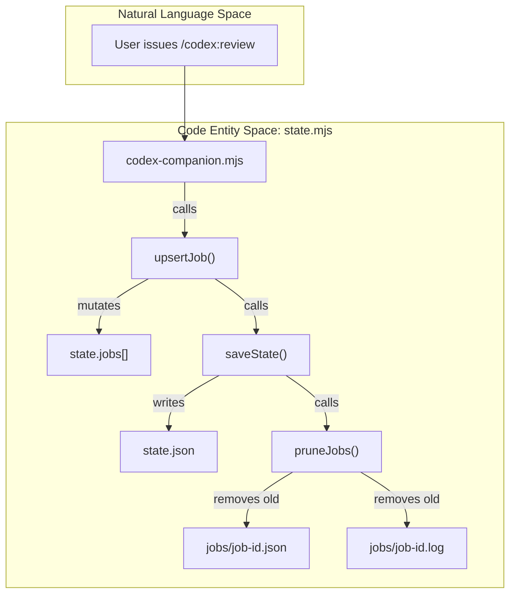
**Sources:** [plugins/codex/scripts/lib/state.mjs:92-116](), [plugins/codex/scripts/lib/state.mjs:129-147]()

## Tracked Job Execution

The `tracked-jobs.mjs` module provides the `runTrackedJob` wrapper, which orchestrates the execution of a task while ensuring its status and results are persisted.

### runTrackedJob Execution Loop
When a job is executed via `runTrackedJob` [plugins/codex/scripts/lib/tracked-jobs.mjs:142-204]():
1.  **Initialization**: Sets status to `running`, records the `pid`, and sets the initial `phase` to `starting` [plugins/codex/scripts/lib/tracked-jobs.mjs:143-150]().
2.  **Persistence**: Calls `writeJobFile` for the full record and `upsertJob` for the summary [plugins/codex/scripts/lib/tracked-jobs.mjs:151-152]().
3.  **Execution**: Awaits the provided `runner` function [plugins/codex/scripts/lib/tracked-jobs.mjs:155]().
4.  **Completion**: Updates the record with `exitStatus`, `threadId`, `turnId`, and the final `rendered` output [plugins/codex/scripts/lib/tracked-jobs.mjs:158-178]().
5.  **Error Handling**: If the runner throws, the job is marked as `failed` and the error message is captured [plugins/codex/scripts/lib/tracked-jobs.mjs:181-203]().

### Progress Reporting and Logs
Progress is handled via a `createProgressReporter` which can simultaneously update the console (`stderr`), a log file, and the internal state [plugins/codex/scripts/lib/tracked-jobs.mjs:117-132]().

*   **Log Files**: Created using `createJobLogFile` [plugins/codex/scripts/lib/tracked-jobs.mjs:51-58](). Lines are prefixed with ISO timestamps via `appendLogLine` [plugins/codex/scripts/lib/tracked-jobs.mjs:36-42]().
*   **Progress Updater**: `createJobProgressUpdater` returns a function that detects changes in `phase`, `threadId`, or `turnId` and triggers a state write only when values change to minimize I/O [plugins/codex/scripts/lib/tracked-jobs.mjs:70-115]().

**Progress and Logging Architecture**
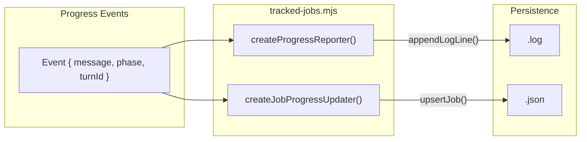
**Sources:** [plugins/codex/scripts/lib/tracked-jobs.mjs:117-132](), [plugins/codex/scripts/lib/tracked-jobs.mjs:70-115]()

## Job Control & Querying

The `job-control.mjs` module provides utilities for filtering, enriching, and resolving jobs from the state.

### Job Enrichment
Because stored job records are minimal, `enrichJob` is used to calculate derived fields for display [plugins/codex/scripts/lib/job-control.mjs:161-181]():
*   **`kindLabel`**: Maps internal `kind` or `jobClass` to user-friendly labels (e.g., `task` becomes `rescue`) [plugins/codex/scripts/lib/job-control.mjs:27-47]().
*   **`elapsed`/`duration`**: Formats time differences into strings like `2m 15s` via `formatElapsedDuration` [plugins/codex/scripts/lib/job-control.mjs:78-101]().
*   **`progressPreview`**: Extracts the last few relevant lines from the log file using `readJobProgressPreview`, stripping internal prefixes and noisy block titles [plugins/codex/scripts/lib/job-control.mjs:61-76]().
*   **`phase`**: For legacy jobs without explicit phases, `inferLegacyJobPhase` scans the log preview for keywords like "searching", "applying", or "running command" to guess the current activity [plugins/codex/scripts/lib/job-control.mjs:109-159]().

### Status Snapshots
The `buildStatusSnapshot` function creates a unified view of the system state for the `/codex:status` command [plugins/codex/scripts/lib/job-control.mjs:213-222]():
1.  Filters jobs by the current `CODEX_COMPANION_SESSION_ID` [plugins/codex/scripts/lib/job-control.mjs:19-25]().
2.  Sorts jobs newest-first using `sortJobsNewestFirst` [plugins/codex/scripts/lib/job-control.mjs:11-13]().
3.  Enriches the active running jobs and identifies the most recent finished job.

### Job Resolution Logic
Commands like `/codex:result <id>` or `/codex:cancel <id>` use `matchJobReference` to find target jobs [plugins/codex/scripts/lib/job-control.mjs:191-211]():
*   If no ID is provided, it defaults to the most recent relevant job [plugins/codex/scripts/lib/job-control.mjs:194]().
*   It supports **exact matches** on IDs [plugins/codex/scripts/lib/job-control.mjs:197]().
*   It supports **prefix matches** (e.g., `job-k2l` matches `job-k2l8xa`), throwing an error if the prefix is ambiguous [plugins/codex/scripts/lib/job-control.mjs:206-208]().

**Sources:**
*   `state.mjs`: [plugins/codex/scripts/lib/state.mjs:1-191]()
*   `tracked-jobs.mjs`: [plugins/codex/scripts/lib/tracked-jobs.mjs:1-204]()
*   `job-control.mjs`: [plugins/codex/scripts/lib/job-control.mjs:1-222]()
*   `fs.mjs`: [plugins/codex/scripts/lib/fs.mjs:1-40]()
*   `workspace.mjs`: [plugins/codex/scripts/lib/workspace.mjs:1-9]()

---

# Page: Claude Code Hook Integration

# Claude Code Hook Integration

<details>
<summary>Relevant source files</summary>

The following files were used as context for generating this wiki page:

- [plugins/codex/hooks/hooks.json](plugins/codex/hooks/hooks.json)
- [plugins/codex/scripts/session-lifecycle-hook.mjs](plugins/codex/scripts/session-lifecycle-hook.mjs)
- [plugins/codex/scripts/stop-review-gate-hook.mjs](plugins/codex/scripts/stop-review-gate-hook.mjs)

</details>


The Codex plugin integrates with the Claude Code lifecycle through a set of event-driven hooks defined in the plugin manifest. These hooks ensure that the Codex broker and background jobs are properly synchronized with the user's session and provide an optional quality gate that can prevent Claude from exiting if unresolved issues remain in the codebase.

## Hook Definitions

The plugin defines three primary hooks in `hooks.json` that map Claude Code lifecycle events to specific Node.js scripts. These scripts are executed by the Claude CLI during session transitions or when the user attempts to stop the current session.

| Hook Event | Script | Timeout | Purpose |
| :--- | :--- | :--- | :--- |
| `SessionStart` | `session-lifecycle-hook.mjs` | 5s | Initializes environment variables and session tracking. |
| `SessionEnd` | `session-lifecycle-hook.mjs` | 5s | Gracefully shuts down the broker and cleans up active jobs. |
| `Stop` | `stop-review-gate-hook.mjs` | 900s | Implements the optional "Review Gate" to validate work before exit. |

**Sources:** [plugins/codex/hooks/hooks.json:3-37]()

## Session Lifecycle Management

The `session-lifecycle-hook.mjs` script manages the state transition of the Codex environment. It interacts with the `broker-lifecycle.mjs` library to ensure the Codex App-Server broker is started and stopped correctly.

### Session Start
When a session begins, the hook captures the `session_id` provided by Claude and exports it to the environment via the `CLAUDE_ENV_FILE` [plugins/codex/scripts/session-lifecycle-hook.mjs:77-78](). This allows subsequent Codex commands to associate their background jobs with the specific interactive session using the `SESSION_ID_ENV` variable [plugins/codex/scripts/session-lifecycle-hook.mjs:20-20](). It also preserves the `CLAUDE_PLUGIN_DATA` environment variable [plugins/codex/scripts/session-lifecycle-hook.mjs:80-80]() and `TRANSCRIPT_PATH_ENV` [plugins/codex/scripts/session-lifecycle-hook.mjs:79-79]().

**Sources:** [plugins/codex/scripts/session-lifecycle-hook.mjs:77-81](), [plugins/codex/scripts/session-lifecycle-hook.mjs:35-40](), [plugins/codex/scripts/session-lifecycle-hook.mjs:20-20]()

### Session End and Cleanup
Upon session termination, the hook performs three critical cleanup tasks:
1.  **Broker Shutdown:** Sends a shutdown signal to the broker endpoint via `sendBrokerShutdown` [plugins/codex/scripts/session-lifecycle-hook.mjs:101-102]() and invokes `teardownBrokerSession` to clean up PID and log files [plugins/codex/scripts/session-lifecycle-hook.mjs:105-112]().
2.  **Job Termination:** Identifies all jobs in `state.json` associated with the current `session_id` [plugins/codex/scripts/session-lifecycle-hook.mjs:54-54](). If any jobs are still `queued` or `running`, it calls `terminateProcessTree` to kill the underlying processes [plugins/codex/scripts/session-lifecycle-hook.mjs:60-65]().
3.  **State Pruning:** Removes session-specific jobs from the persisted state by calling `saveState` with a filtered job list [plugins/codex/scripts/session-lifecycle-hook.mjs:71-74]() to prevent the job list from growing indefinitely.

**Sources:** [plugins/codex/scripts/session-lifecycle-hook.mjs:42-75](), [plugins/codex/scripts/session-lifecycle-hook.mjs:83-114]()

### Hook Execution Flow
The following diagram illustrates how `session-lifecycle-hook.mjs` mediates between Claude events and the internal Codex state.

**Diagram: Session Lifecycle Data Flow**
```mermaid
graph TD
    subgraph "Claude Code Space"
        "EVENT[SessionEnd]" --> "readHookInput()"
    end

    subgraph "Script: session-lifecycle-hook.mjs"
        "readHookInput()" --> "handleSessionEnd(input)"
        "handleSessionEnd(input)" --> "cleanupSessionJobs(cwd, sessionId)"
        "handleSessionEnd(input)" --> "teardownBrokerSession()"
    end

    subgraph "Code Entity Space"
        "cleanupSessionJobs(cwd, sessionId)" --> "loadState(workspaceRoot)"
        "loadState(workspaceRoot)" -- "Filter by sessionId" --> "terminateProcessTree(job.pid)"
        "terminateProcessTree(job.pid)" --> "saveState(workspaceRoot, newState)"
        "teardownBrokerSession()" --> "sendBrokerShutdown(endpoint)"
    end
```
**Sources:** [plugins/codex/scripts/session-lifecycle-hook.mjs:83-114](), [plugins/codex/scripts/session-lifecycle-hook.mjs:42-75]()

## Stop Review Gate

The `stop-review-gate-hook.mjs` implements a quality control mechanism. When a user attempts to exit Claude, this hook can optionally trigger a Codex "task" to review the changes made during the session.

### Gate Logic
The gate behavior depends on the `stopReviewGate` setting in the plugin configuration retrieved via `getConfig` [plugins/codex/scripts/stop-review-gate-hook.mjs:146-154]().
- **Disabled (Default):** The hook logs a note if background jobs are still running but allows the session to end immediately [plugins/codex/scripts/stop-review-gate-hook.mjs:154-157]().
- **Enabled:** The hook executes a synchronous Codex task using `spawnSync` to call the `codex-companion.mjs task` subcommand with a generated prompt [plugins/codex/scripts/stop-review-gate-hook.mjs:105-110]().

**Sources:** [plugins/codex/scripts/stop-review-gate-hook.mjs:142-176](), [plugins/codex/scripts/stop-review-gate-hook.mjs:98-110](), [plugins/codex/scripts/stop-review-gate-hook.mjs:146-154]()

### Decision Processing
The hook interprets the output of the Codex review task to decide whether to `block` the exit:
1.  **ALLOW:** If the task output starts with `ALLOW:`, the gate passes (`ok: true`) [plugins/codex/scripts/stop-review-gate-hook.mjs:80-82]().
2.  **BLOCK:** If the task output starts with `BLOCK:`, the hook emits a JSON decision to `stdout` via `emitDecision` [plugins/codex/scripts/stop-review-gate-hook.mjs:168-172]() containing the reason provided by Codex [plugins/codex/scripts/stop-review-gate-hook.mjs:83-89](). This causes Claude to stay in the session and present the reason to the user.
3.  **Failures:** Timeouts (`STOP_REVIEW_TIMEOUT_MS` set to 15 minutes [plugins/codex/scripts/stop-review-gate-hook.mjs:16-16]()) or malformed JSON results are treated as blocks to ensure safety, advising the user to run `/codex:review --wait` manually [plugins/codex/scripts/stop-review-gate-hook.mjs:112-140]().

**Sources:** [plugins/codex/scripts/stop-review-gate-hook.mjs:69-96](), [plugins/codex/scripts/stop-review-gate-hook.mjs:16-16](), [plugins/codex/scripts/stop-review-gate-hook.mjs:112-140](), [plugins/codex/scripts/stop-review-gate-hook.mjs:29-31]()

### Review Gate Execution
The diagram below shows the interaction between the gate hook and the companion script's task execution engine.

**Diagram: Stop Review Gate Logic**
```mermaid
graph TD
    subgraph "Claude Code Space"
        "EVENT[Stop]" --> "main()"
    end

    subgraph "Script: stop-review-gate-hook.mjs"
        "main()" -- "if config.stopReviewGate" --> "runStopReview(cwd, input)"
        "runStopReview(cwd, input)" --> "buildStopReviewPrompt(input)"
        "buildStopReviewPrompt(input)" -- "interpolates" --> "stop-review-gate.md"
        "runStopReview(cwd, input)" -- "spawnSync" --> "codex-companion.mjs task"
        "codex-companion.mjs task" -- "returns JSON" --> "parseStopReviewOutput(rawOutput)"
        "parseStopReviewOutput(rawOutput)" -- "Decision" --> "emitDecision(payload)"
    end

    subgraph "Output Space"
        "emitDecision(payload)" -- "stdout" --> "decision: block | allow"
    end
```
**Sources:** [plugins/codex/scripts/stop-review-gate-hook.mjs:98-140](), [plugins/codex/scripts/stop-review-gate-hook.mjs:48-57](), [plugins/codex/scripts/stop-review-gate-hook.mjs:29-31]()

## Key Functions and Variables

| Symbol | File | Description |
| :--- | :--- | :--- |
| `SESSION_ID_ENV` | `session-lifecycle-hook.mjs` | Environment variable name (`CODEX_COMPANION_SESSION_ID`) used to track jobs per session. |
| `cleanupSessionJobs` | `session-lifecycle-hook.mjs` | Iterates through `state.jobs` and terminates processes matching the current session. |
| `runStopReview` | `stop-review-gate-hook.mjs` | Spawns a synchronous companion task to perform the final code audit. |
| `parseStopReviewOutput` | `stop-review-gate-hook.mjs` | Logic for parsing the string-based `ALLOW:`/`BLOCK:` contract from Codex. |
| `appendEnvVar` | `session-lifecycle-hook.mjs` | Utility to write shell-escaped exports to the `CLAUDE_ENV_FILE`. |
| `STOP_REVIEW_TIMEOUT_MS`| `stop-review-gate-hook.mjs` | Hard limit (15 minutes) for the synchronous stop-gate review task. |

**Sources:** [plugins/codex/scripts/session-lifecycle-hook.mjs:20-20](), [plugins/codex/scripts/session-lifecycle-hook.mjs:42-42](), [plugins/codex/scripts/stop-review-gate-hook.mjs:98-98](), [plugins/codex/scripts/stop-review-gate-hook.mjs:69-69](), [plugins/codex/scripts/session-lifecycle-hook.mjs:35-35](), [plugins/codex/scripts/stop-review-gate-hook.mjs:16-16]()

---

# Page: Git, Process & Rendering Utilities

# Git, Process & Rendering Utilities

<details>
<summary>Relevant source files</summary>

The following files were used as context for generating this wiki page:

- [plugins/codex/scripts/lib/codex.mjs](plugins/codex/scripts/lib/codex.mjs)
- [plugins/codex/scripts/lib/git.mjs](plugins/codex/scripts/lib/git.mjs)
- [plugins/codex/scripts/lib/process.mjs](plugins/codex/scripts/lib/process.mjs)
- [plugins/codex/scripts/lib/render.mjs](plugins/codex/scripts/lib/render.mjs)

</details>


This page details the support libraries within the `codex-plugin-cc` codebase, focusing on `git.mjs`, `process.mjs`, `render.mjs`, and `codex.mjs`. These modules provide essential functionalities such as Git repository interaction, cross-platform command execution, output formatting, and helpers for interacting with the Codex app-server.

## Process Utilities (`process.mjs`)

The `process.mjs` module provides cross-platform utilities for executing shell commands and managing process lifecycles. It abstracts away the differences between operating systems for common tasks like running commands and terminating process trees.

### Key Functions

*   `runCommand(command, args, options)`: [plugins/codex/scripts/lib/process.mjs:4-24]() Executes a command synchronously using `child_process.spawnSync`. It returns a result object containing `stdout`, `stderr`, `status`, and `error`.
*   `runCommandChecked(command, args, options)`: [plugins/codex/scripts/lib/process.mjs:27-35]() A wrapper around `runCommand` that throws an error if the command fails (non-zero exit status or an execution error).
*   `binaryAvailable(command, versionArgs, options)`: [plugins/codex/scripts/lib/process.mjs:38-51]() Checks if a given command-line binary is available in the system's PATH. It attempts to run the command with `--version` (or specified `versionArgs`) and checks for `ENOENT` errors or non-zero exit codes.
*   `terminateProcessTree(pid, options)`: [plugins/codex/scripts/lib/process.mjs:57-117]() Terminates a process and its descendants given a process ID (`pid`). It uses `taskkill /T /F` on Windows and `kill(-pid, "SIGTERM")` for process groups on Unix-like systems, falling back to `kill(pid, "SIGTERM")` if process group termination fails.
*   `formatCommandFailure(result)`: [plugins/codex/scripts/lib/process.mjs:120-135]() Formats a command execution failure into a human-readable string, including the command, arguments, exit status/signal, and any `stderr`/`stdout`.

### Process Execution Flow

The core of `process.mjs` is the `runCommand` function, which uses Node.js's `spawnSync` to execute external processes. This function handles standard input/output redirection, working directory, environment variables, and cross-platform shell invocation.

```mermaid
graph TD
    A[Call runCommand(command, args, options)] --> B{Node.js child_process.spawnSync};
    B --&gt; C{Execute Command};
    C --&gt; D{Capture stdout, stderr, status, error};
    D --&gt; E[Return CommandResult Object];

    F[Call runCommandChecked] --> A;
    E --&gt; G{Check CommandResult.error or CommandResult.status};
    G --&gt;|Error| H[Throw Error];
    G --&gt;|Success| I[Return CommandResult Object];

    J[Call binaryAvailable] --> A;
    E --&gt; K{Check CommandResult for ENOENT or non-zero status};
    K --&gt; L[Return { available: boolean, detail: string }];

    M[Call terminateProcessTree(pid)] --> N{Determine OS Platform};
    N --&gt;|Windows| O[Execute taskkill /PID /T /F];
    N --&gt;|Unix-like| P[Attempt kill(-pid, SIGTERM)];
    P --&gt;|ESRCH| Q[Attempt kill(pid, SIGTERM)];
    O --&gt; R[Return TerminationResult];
    Q --&gt; R;
```
**Diagram 2.5.1: Process Execution and Termination Flow**
Sources:
* [plugins/codex/scripts/lib/process.mjs:4-24]()
* [plugins/codex/scripts/lib/process.mjs:27-35]()
* [plugins/codex/scripts/lib/process.mjs:38-51]()
* [plugins/codex/scripts/lib/process.mjs:57-117]()
* [plugins/codex/scripts/lib/process.mjs:120-135]()

## Git Utilities (`git.mjs`)

The `git.mjs` module provides functions for interacting with a Git repository, primarily for determining the review target and collecting diff context. It ensures that Git is installed and that commands are run within a valid Git repository.

### Key Functions

*   `git(cwd, args, options)`: [plugins/codex/scripts/lib/git.mjs:12-14]() A wrapper around `runCommand` specifically for Git commands, ensuring `shell: false` for security.
*   `gitChecked(cwd, args, options)`: [plugins/codex/scripts/lib/git.mjs:16-18]() A wrapper around `runCommandChecked` for Git commands.
*   `ensureGitRepository(cwd)`: [plugins/codex/scripts/lib/git.mjs:78-87]() Verifies that the current working directory (`cwd`) is part of a Git repository and that Git is installed. Throws an error if not.
*   `getRepoRoot(cwd)`: [plugins/codex/scripts/lib/git.mjs:90-91]() Returns the absolute path to the Git repository root.
*   `detectDefaultBranch(cwd)`: [plugins/codex/scripts/lib/git.mjs:94-116]() Attempts to detect the default branch (e.g., `main`, `master`) of the repository, checking both local and remote references.
*   `getCurrentBranch(cwd)`: [plugins/codex/scripts/lib/git.mjs:118-120]() Returns the name of the current Git branch or "HEAD" if detached.
*   `getWorkingTreeState(cwd)`: [plugins/codex/scripts/lib/git.mjs:122-133]() Gathers information about the current working tree, including staged, unstaged, and untracked files, and whether the tree is dirty.
*   `resolveReviewTarget(cwd, options)`: [plugins/codex/scripts/lib/git.mjs:135-190]() Determines the target for a code review based on user-provided options (`--scope`, `--base`) or automatically. It can target the working tree or a branch diff.
*   `collectDiffContext(cwd, reviewTarget, options)`: [plugins/codex/scripts/lib/git.mjs:220-347]() Collects the actual diff content and file context for the specified `reviewTarget`. This includes staged, unstaged, and untracked files, as well as the diff against a base branch. It handles size limits for inline diffs and untracked files.

### Review Target Resolution

The `resolveReviewTarget` function is central to how the plugin determines what code changes to review. It prioritizes explicit user input (`--base`, `--scope`) and falls back to an "auto" mode that checks for a dirty working tree or defaults to a branch comparison.

```mermaid
graph TD
    A[Start: resolveReviewTarget(cwd, options)] --> B{Is --base <ref> provided?};
    B --&gt;|Yes| C[Return { mode: "branch", baseRef: <ref>, explicit: true }];
    B --&gt;|No| D{Is --scope "working-tree" provided?};
    D --&gt;|Yes| E[Return { mode: "working-tree", explicit: true }];
    D --&gt;|No| F{Is --scope "branch" provided?};
    F --&gt;|Yes| G[Detect Default Branch];
    G --&gt; H[Return { mode: "branch", baseRef: detected, explicit: true }];
    F --&gt;|No| I{Is working tree dirty (staged/unstaged/untracked files)?};
    I --&gt;|Yes| J[Return { mode: "working-tree", explicit: false }];
    I --&gt;|No| K[Detect Default Branch];
    K --&gt; L[Return { mode: "branch", baseRef: detected, explicit: false }];
```
**Diagram 2.5.2: Review Target Resolution Flow**
Sources:
* [plugins/codex/scripts/lib/git.mjs:135-190]()
* [plugins/codex/scripts/lib/git.mjs:122-133]()
* [plugins/codex/scripts/lib/git.mjs:94-116]()

### Diff Context Collection

The `collectDiffContext` function gathers all relevant code changes and context for the review. It distinguishes between staged, unstaged, and untracked files, applying size limits to prevent overwhelming the model with excessive input.

```mermaid
graph TD
    A[Start: collectDiffContext(cwd, reviewTarget, options)] --> B{Ensure Git Repository};
    B --> C{Get Working Tree State};
    C --> D{Initialize diffSections, fileContexts};

    subgraph "Working Tree Mode"
        E{If reviewTarget.mode === "working-tree"} --> F[Add staged diff to diffSections];
        F --> G[Add unstaged diff to diffSections];
        G --> H[Process untracked files (with size limits)];
        H --> I[Add untracked file content to fileContexts];
    end

    subgraph "Branch Mode"
        J{If reviewTarget.mode === "branch"} --> K[Build Branch Comparison (merge-base, commit-range)];
        K --> L[Add diff against baseRef to diffSections];
    end

    D --> E;
    D --> J;

    I --> M[Return { diffSections, fileContexts }];
    L --> M;
```
**Diagram 2.5.3: Diff Context Collection Flow**
Sources:
* [plugins/codex/scripts/lib/git.mjs:220-347]()
* [plugins/codex/scripts/lib/git.mjs:122-133]()
* [plugins/codex/scripts/lib/git.mjs:69-76]()

## Rendering Utilities (`render.mjs`)

The `render.mjs` module is responsible for formatting various types of output for display to the user, particularly for review results and job status. It ensures consistent and readable presentation, often using Markdown.

### Key Functions

*   `severityRank(severity)`: [plugins/codex/scripts/lib/render.mjs:1-11]() Assigns a numerical rank to review finding severities (critical, high, medium, low) for sorting.
*   `formatLineRange(finding)`: [plugins/codex/scripts/lib/render.mjs:14-22]() Formats a line range for a review finding (e.g., `:10` or `:10-15`).
*   `validateReviewResultShape(data)`: [plugins/codex/scripts/lib/render.mjs:24-41]() Validates the structure of a raw review result object against an expected schema (verdict, summary, findings, next\_steps).
*   `normalizeReviewFinding(finding, index)`: [plugins/codex/scripts/lib/render.mjs:43-60]() Normalizes a single review finding, providing default values and ensuring correct data types.
*   `normalizeReviewResultData(data)`: [plugins/codex/scripts/lib/render.mjs:62-70]() Normalizes the entire review result data structure after validation.
*   `isStructuredReviewStoredResult(storedJob)`: [plugins/codex/scripts/lib/render.mjs:72-82]() Checks if a stored job result contains structured review data.
*   `formatJobLine(job)`: [plugins/codex/scripts/lib/render.mjs:84-93]() Formats a single line summary for a job.
*   `escapeMarkdownCell(value)`: [plugins/codex/scripts/lib/render.mjs:95-100]() Escapes special characters in a string to be safely used within a Markdown table cell.
*   `formatCodexResumeCommand(job)`: [plugins/codex/scripts/lib/render.mjs:102-106]() Generates the `/codex:resume` command for a given job.
*   `appendActiveJobsTable(lines, jobs)`: [plugins/codex/scripts/lib/render.mjs:108-122]() Appends a Markdown table of active jobs to an array of lines.
*   `pushJobDetails(lines, job, options)`: [plugins/codex/scripts/lib/render.mjs:124-164]() Appends detailed information about a single job to an array of lines.
*   `appendReasoningSection(lines, reasoningSummary)`: [plugins/codex/scripts/lib/render.mjs:166-175]() Appends a "Reasoning" section to an array of lines.
*   `renderSetupReport(report)`: [plugins/codex/scripts/lib/render.mjs:177-206]() Renders a comprehensive setup report, including status, checks, actions taken, and next steps.

### Review Result Formatting

The `render.mjs` module plays a crucial role in presenting the output of review commands in a structured and readable format. It validates and normalizes the raw JSON output from the Codex app-server and then formats it into Markdown.

```mermaid
graph TD
    A[Raw Review Result JSON] --> B{validateReviewResultShape};
    B --&gt;|Invalid| C[Return Error Message];
    B --&gt;|Valid| D{normalizeReviewResultData};
    D --> E[Format Verdict and Summary];
    E --> F[Sort Findings by Severity];
    F --> G[Format Each Finding (title, file, line, body, recommendation)];
    G --> H[Format Next Steps];
    H --> I[Combine into Markdown Output];
```
**Diagram 2.5.4: Review Result Rendering Flow**
Sources:
* [plugins/codex/scripts/lib/render.mjs:24-41]()
* [plugins/codex/scripts/lib/render.mjs:43-60]()
* [plugins/codex/scripts/lib/render.mjs:62-70]()

## Codex Helpers (`codex.mjs`)

The `codex.mjs` module provides various helper functions for interacting with the Codex app-server, managing authentication, and processing its output. It defines types for app-server interactions and utility functions for common tasks.

### Key Types and Constants

*   `AppServerNotification`, `ReviewTarget`, `ThreadItem`, `ThreadResumeParams`, `ThreadStartParams`, `Turn`, `UserInput`, `ProgressReporter`, `TurnCaptureState`: [plugins/codex/scripts/lib/codex.mjs:2-35]() JSDoc typedefs defining the structure of data exchanged with the Codex app-server and internal state for turn capture.
*   `SERVICE_NAME`: [plugins/codex/scripts/lib/codex.mjs:47]() Constant for the service name used when interacting with the app-server.
*   `BROKER_BUSY_RPC_CODE`, `BROKER_ENDPOINT_ENV`, `CodexAppServerClient`: [plugins/codex/scripts/lib/codex.mjs:43-44]() Imported from `app-server.mjs`, related to the app-server client and broker communication.

### Key Functions

*   `cleanCodexStderr(stderr)`: [plugins/codex/scripts/lib/codex.mjs:54-60]() Cleans up stderr output from Codex, removing known noisy warnings.
*   `buildThreadParams(cwd, options)`: [plugins/codex/scripts/lib/codex.mjs:63-71]() Constructs parameters for starting a new Codex thread.
*   `buildResumeParams(threadId, cwd, options)`: [plugins/codex/scripts/lib/codex.mjs:74-82]() Constructs parameters for resuming an existing Codex thread.
*   `buildTurnInput(prompt)`: [plugins/codex/scripts/lib/codex.mjs:85-87]() Formats user input for a Codex turn.
*   `shorten(text, limit)`: [plugins/codex/scripts/lib/codex.mjs:90-99]() Truncates a string to a specified limit, adding an ellipsis if necessary.
*   `looksLikeVerificationCommand(command)`: [plugins/codex/scripts/lib/codex.mjs:101-105]() Heuristically checks if a command string looks like a verification command (e.g., test, lint, build).
*   `buildTaskThreadName(prompt)`: [plugins/codex/scripts/lib/codex.mjs:107-110]() Generates a descriptive name for a task thread based on the initial prompt.
*   `extractThreadId(message)`: [plugins/codex/scripts/lib/codex.mjs:112-114]() Extracts the thread ID from an app-server message.
*   `extractTurnId(message)`: [plugins/codex/scripts/lib/codex.mjs:116-124]() Extracts the turn ID from an app-server message.
*   `collectTouchedFiles(fileChanges)`: [plugins/codex/scripts/lib/codex.mjs:126-135]() Gathers a list of unique file paths touched by file change items.
*   `normalizeReasoningText(text)`: [plugins/codex/scripts/lib/codex.mjs:137-139]() Normalizes reasoning text by trimming and collapsing whitespace.
*   `extractReasoningSections(value)`: [plugins/codex/scripts/lib/codex.mjs:141-172]() Recursively extracts reasoning sections from various data structures.
*   `mergeReasoningSections(existingSections, nextSections)`: [plugins/codex/scripts/lib/codex.mjs:174-184]() Merges and deduplicates reasoning sections.
*   `emitProgress(onProgress, message, phase, extra)`: [plugins/codex/scripts/lib/codex.mjs:186-200]() Emits progress updates to a registered `ProgressReporter`.
*   `emitLogEvent(onProgress, options)`: [plugins/codex/scripts/lib/codex.mjs:202-211]() Emits log events to a registered `ProgressReporter`.

### Codex Interaction Flow

The `codex.mjs` module provides the foundational utilities for constructing requests to the Codex app-server and processing its responses, particularly for managing threads and turns.

```mermaid
graph TD
    A[User Action (e.g., /codex:review)] --> B{Build Thread/Resume Params};
    B --> C{Build Turn Input (Prompt)};
    C --> D[CodexAppServerClient.startThread / resumeThread];
    D --> E[App-Server Processes Request];
    E --> F[App-Server Sends Notifications];
    F --> G{extractThreadId, extractTurnId};
    G --> H{collectTouchedFiles, extractReasoningSections};
    H --> I{emitProgress, emitLogEvent};
    I --> J[Update UI / Store State];
```
**Diagram 2.5.5: Codex App-Server Interaction Flow**
Sources:
* [plugins/codex/scripts/lib/codex.mjs:63-71]()
* [plugins/codex/scripts/lib/codex.mjs:74-82]()
* [plugins/codex/scripts/lib/codex.mjs:85-87]()
* [plugins/codex/scripts/lib/codex.mjs:112-114]()
* [plugins/codex/scripts/lib/codex.mjs:116-124]()
* [plugins/codex/scripts/lib/codex.mjs:126-135]()
* [plugins/codex/scripts/lib/codex.mjs:141-172]()
* [plugins/codex/scripts/lib/codex.mjs:186-200]()
* [plugins/codex/scripts/lib/codex.mjs:202-211]()

---

# Page: Commands Reference

# Commands Reference

<details>
<summary>Relevant source files</summary>

The following files were used as context for generating this wiki page:

- [plugins/codex/commands/rescue.md](plugins/codex/commands/rescue.md)
- [tests/commands.test.mjs](tests/commands.test.mjs)

</details>


This page provides a high-level overview of the user-facing slash commands exposed by the `codex-plugin-cc` plugin. These commands allow users to trigger deep code reviews, delegate complex tasks to specialized subagents, and manage the lifecycle of asynchronous jobs directly from the Claude Code interface.

All commands are implemented as Markdown-defined hooks in the `plugins/codex/commands/` directory [tests/commands.test.mjs:73-83](). They act as thin wrappers that delegate execution to the `codex-companion.mjs` script [plugins/codex/commands/review.md:44-46]().

## Command Architecture Overview

The following diagram illustrates how user commands travel from the Claude Code interface through the plugin's execution layer into the Codex ecosystem.

### Natural Language to Code Entity Mapping: Command Dispatch
```mermaid
graph TD
    subgraph "Claude_Code_UI"
        A["User Slash Command"]
    end

    subgraph "Plugin_Layer_Markdown_Hooks"
        B["/codex:review"]
        C["/codex:rescue"]
        D["/codex:status"]
    end

    subgraph "Execution_Layer_Companion_Script"
        E["codex-companion.mjs"]
        F["task-resume-candidate"]
        G["runTrackedJob()"]
    end

    subgraph "External_Codex_CLI"
        H["codex review"]
        I["codex task"]
    end

    A -->|"/codex:review"| B
    A -->|"/codex:rescue"| C
    A -->|"/codex:status"| D

    B -->|spawn| E
    C -->|spawn| E
    D -->|spawn| E

    E -->|check state| F
    E -->|execute| G
    G -->|CLI Call| H
    G -->|CLI Call| I
```
**Sources:** [plugins/codex/commands/review.md:44-46](), [plugins/codex/commands/rescue.md:25-27](), [tests/commands.test.mjs:26-27]()

---

## Review Commands

The review suite provides two distinct ways to analyze code changes: a standard native review and a more critical "adversarial" review. Both commands support analyzing the current working tree or specific git branches.

*   **/codex:review**: Triggers the standard Codex review process. It is strictly "review-only" and does not suggest or apply fixes [tests/commands.test.mjs:18-19]().
*   **/codex:adversarial-review**: A specialized mode that challenges implementation approach and design tradeoffs. It supports extra focus text after flags [tests/commands.test.mjs:70-70]().

Both commands can be run in the foreground (`--wait`) or background (`--background`). If no mode is specified, the plugin estimates the diff size using `git status --short` and `git diff --shortstat` to recommend a mode to the user [tests/commands.test.mjs:30-34]().

For details, see [Review Commands](#3.1).

---

## Rescue & Task Delegation

The rescue command allows Claude to offload complex investigations or implementation tasks to a specialized Codex subagent.

*   **/codex:rescue**: Routes the user's request to the `codex:codex-rescue` subagent [plugins/codex/commands/rescue.md:7-8](). This command supports advanced flags for model selection (`--model`) and reasoning effort (`--effort`) [plugins/codex/commands/rescue.md:3-3]().

Before starting, the plugin checks for resumable threads using the `task-resume-candidate --json` helper [plugins/codex/commands/rescue.md:25-27](). This allows users to continue an existing investigation via the `--resume` flag or start a fresh one via `--fresh` [tests/commands.test.mjs:109-120]().

For details, see [Rescue & Task Delegation](#3.2).

---

## Job Lifecycle Commands

Since many Codex operations can take several minutes, the plugin provides a set of commands to manage these asynchronous tasks.

*   **/codex:status**: Displays a summary table of active and recent jobs in the current session.
*   **/codex:result**: Retrieves the full, verbatim output of a completed job.
*   **/codex:cancel**: Terminates an active background job.

### Job State Transitions
```mermaid
stateDiagram-v2
    [*] --> Pending_codex_companion_mjs
    Pending_codex_companion_mjs --> Running: "runTrackedJob()"
    Running --> Completed: "Job Success"
    Running --> Failed: "Process Error"
    Running --> Cancelled: "/codex:cancel"
    
    Completed --> "/codex:result": "User Retrieval"
    Failed --> "/codex:status": "Error Reporting"
```
**Sources:** [plugins/codex/commands/rescue.md:44-44](), [tests/commands.test.mjs:77-82]()

For details, see [Job Lifecycle Commands](#3.3).

---

## Session Transfer

The session transfer command facilitates importing existing Claude session transcripts into the Codex plugin's native thread management.

*   **/codex:transfer**: Imports Claude session transcripts (`.jsonl` files) into native Codex threads. This is handled by `claude-session-transfer.mjs` and the `externalAgentConfig/import` app-server method.

For details, see [Session Transfer](#3.4).

---

## Setup Command

The setup command is the entry point for configuring the plugin environment.

*   **/codex:setup**: Verifies if the Codex CLI is installed and authenticated via `codex login`. It also handles the configuration of the optional review gate (`--enable-review-gate` or `--disable-review-gate`) which can block Claude from stopping if a review is required [plugins/codex/commands/setup.md:1-4]().

**Sources:** [plugins/codex/commands/setup.md:1-37](), [tests/commands.test.mjs:81-81]()

---

# Page: Review Commands

# Review Commands

<details>
<summary>Relevant source files</summary>

The following files were used as context for generating this wiki page:

- [plugins/codex/commands/adversarial-review.md](plugins/codex/commands/adversarial-review.md)
- [plugins/codex/commands/review.md](plugins/codex/commands/review.md)
- [plugins/codex/schemas/review-output.schema.json](plugins/codex/schemas/review-output.schema.json)
- [plugins/codex/scripts/lib/git.mjs](plugins/codex/scripts/lib/git.mjs)

</details>


The Codex plugin provides two primary commands for evaluating code changes: `/codex:review` and `/codex:adversarial-review`. These commands leverage the Codex companion script to analyze Git state, resolve a review target (working tree vs. branch), and execute the analysis in either foreground or background modes.

## Overview of Review Commands

Both commands are "review-only," meaning they are strictly constrained from applying fixes, applying patches, or suggesting that they will make changes to the codebase [plugins/codex/commands/review.md:13-17](), [plugins/codex/commands/adversarial-review.md:15-19]().

| Command | Purpose | Mechanism |
| :--- | :--- | :--- |
| `/codex:review` | General purpose code review against local git state. | Uses the native Codex CLI reviewer path [plugins/codex/commands/review.md:8-9](). |
| `/codex:adversarial-review` | Skeptical review focused on challenging design choices and tradeoffs. | Uses a specialized Markdown prompt template and adversarial framing [plugins/codex/commands/adversarial-review.md:8-10](). |

### Argument Syntax
Both commands share a common argument structure [plugins/codex/commands/review.md:3](), [plugins/codex/commands/adversarial-review.md:3]():
`[--wait|--background] [--base <ref>] [--scope auto|working-tree|branch] [focus ...]`

- `--wait`: Forces foreground execution.
- `--background`: Forces execution as a Claude background task.
- `--base <ref>`: Specifies a Git reference to compare against (e.g., `main`).
- `--scope`: Explicitly sets the review target to `working-tree` (uncommitted changes) or `branch` (commits since merge-base).
- `focus ...`: (Adversarial only) Optional text to direct the reviewer's attention to specific areas [plugins/codex/commands/adversarial-review.md:45]().

## Execution Modes

The plugin determines whether a review should run in the foreground or background based on explicit user flags or an estimation of the change size.

### Mode Selection Logic
1. **Explicit Flags**: If `--wait` or `--background` is present in the raw arguments, the choice is respected immediately [plugins/codex/commands/review.md:19-20]().
2. **Size Estimation**: Claude Code performs a `git diff --shortstat` or `git status --short` to estimate the change size before asking the user [plugins/codex/commands/review.md:21-26]().
3. **Recommendation**:
   - **Foreground**: Recommended only for "tiny" reviews (roughly 1-2 files) [plugins/codex/commands/review.md:27]().
   - **Background**: Recommended for all other cases, including unclear sizes, to avoid blocking the Claude session [plugins/codex/commands/review.md:28-31]().
4. **User Confirmation**: If no flag is provided, the `AskUserQuestion` tool is used to let the user choose [plugins/codex/commands/review.md:30-35]().

### Data Flow: Command Execution
The following diagram illustrates how a review request flows from the Claude Code slash command to the background worker.

**Review Command Dispatch Flow**
```mermaid
graph TD
  subgraph "Claude_Code_Space"
    CC["Claude Code Session"]
    Slash["/codex:review Command"]
    Ask["AskUserQuestion Tool"]
  end

  subgraph "Companion_Script_scripts/codex-companion.mjs"
    Dispatcher["Command Dispatcher"]
    ReviewCmd["review() Function"]
    AdvReviewCmd["adversarialReview() Function"]
  end

  subgraph "Background_Execution"
    BashBG["Bash(run_in_background: true)"]
    TrackedJob["runTrackedJob()"]
    LogFile["job.log"]
  end

  CC --> Slash
  Slash --> Ask
  Ask -- "User selects mode" --> BashBG
  BashBG --> Dispatcher
  Dispatcher --> ReviewCmd
  Dispatcher --> AdvReviewCmd
  ReviewCmd --> TrackedJob
  AdvReviewCmd --> TrackedJob
  TrackedJob --> LogFile
```
Sources: [plugins/codex/commands/review.md:51-61](), [plugins/codex/commands/adversarial-review.md:56-66]().

## Review Target Resolution

The `resolveReviewTarget` function in `git.mjs` determines what specific Git state should be sent to Codex for review [plugins/codex/scripts/lib/git.mjs:134]().

### Resolution Strategy
- **Explicit Base**: If `--base <ref>` is provided, it defaults to a `branch` diff against that reference [plugins/codex/scripts/lib/git.mjs:142-149]().
- **Working Tree**: If the `working-tree` scope is requested, it collects staged, unstaged, and untracked files [plugins/codex/scripts/lib/git.mjs:151-157]().
- **Auto-Detection**:
    - If the repository is "dirty" (has uncommitted changes detected by `getWorkingTreeState`), it selects `working-tree` [plugins/codex/scripts/lib/git.mjs:175-181]().
    - If the repository is "clean," it selects `branch` and attempts to detect the default branch (e.g., `main`, `master`) using `detectDefaultBranch` [plugins/codex/scripts/lib/git.mjs:183-189](), [plugins/codex/scripts/lib/git.mjs:93-115]().

### Context Collection & Scaling
The `collectReviewContext` function gathers the actual content. It dynamically scales the detail level based on the size of the changes to avoid exceeding context limits.

- **Inline Diff Mode**: For small changes (e.g., 1-2 files), the system provides full file contents and inline diffs.
- **Self-Collect Mode**: For larger reviews or oversized single-file diffs, it falls back to a "lightweight" context. This provides a summary of changed files and instructs the reviewer to use read-only git commands to fetch details as needed.
- **Untracked Files**: These are read from disk, subject to a 24KB limit (`MAX_UNTRACKED_BYTES`) [plugins/codex/scripts/lib/git.mjs:7](), [plugins/codex/scripts/lib/git.mjs:196-210](). Broken symlinks and binary files are automatically skipped [plugins/codex/scripts/lib/git.mjs:217-222]().

## Adversarial Review Path

The `/codex:adversarial-review` command differs from the standard review by adopting an "adversarial" operating stance [plugins/codex/commands/adversarial-review.md:8-10]().

### Operating Stance & Attack Surface
The adversarial review uses the `adversarial-review.md` template, which instructs Codex to "break confidence in the change" [plugins/codex/commands/adversarial-review.md:8-10](). It prioritizes high-cost failure modes:
- Auth, permissions, and trust boundaries.
- Data loss, corruption, and irreversible state.
- Race conditions, stale state, and re-entrancy.
- Rollback safety and migration hazards.

### Structured Output Schema
The reviewer must return a JSON object adhering to `review-output.schema.json` [plugins/codex/schemas/review-output.schema.json:1]().

| Field | Type | Description |
| :--- | :--- | :--- |
| `verdict` | enum | `approve` or `needs-attention` [plugins/codex/schemas/review-output.schema.json:12-18](). |
| `summary` | string | High-level assessment of the changes [plugins/codex/schemas/review-output.schema.json:19-22](). |
| `findings` | array | Detailed issues including `severity`, `file`, and `recommendation` [plugins/codex/schemas/review-output.schema.json:23-78](). |
| `next_steps` | array | Concrete actions for the developer [plugins/codex/schemas/review-output.schema.json:79-85](). |

**Review Target and Logic Mapping**
```mermaid
graph LR
  subgraph "Git_Logic_scripts/lib/git.mjs"
    RRT["resolveReviewTarget()"]
    GWTS["getWorkingTreeState()"]
    DDB["detectDefaultBranch()"]
    CRC["collectReviewContext()"]
  end

  subgraph "Review_Logic"
    Native["Native Review Path"]
    Adv["Adversarial Prompt Path"]
    Schema["review-output.schema.json"]
    Template["adversarial-review.md"]
  end

  RRT --> GWTS
  RRT --> DDB
  CRC -- "Uses resolution from" --> RRT
  Native -- "Uses context from" --> CRC
  Adv -- "Uses context from" --> CRC
  Adv -- "Interpolates" --> Template
  Adv -- "Validates Against" --> Schema
```
Sources: [plugins/codex/scripts/lib/git.mjs:134](), [plugins/codex/scripts/lib/git.mjs:121](), [plugins/codex/scripts/lib/git.mjs:93](), [plugins/codex/schemas/review-output.schema.json:1](), [plugins/codex/commands/adversarial-review.md:8-10]().

Sources: [plugins/codex/scripts/lib/git.mjs:1-218](), [plugins/codex/commands/review.md:1-61](), [plugins/codex/commands/adversarial-review.md:1-66](), [plugins/codex/schemas/review-output.schema.json:1-87]().

---

# Page: Rescue & Task Delegation

# Rescue & Task Delegation

<details>
<summary>Relevant source files</summary>

The following files were used as context for generating this wiki page:

- [plugins/codex/agents/codex-rescue.md](plugins/codex/agents/codex-rescue.md)
- [plugins/codex/commands/rescue.md](plugins/codex/commands/rescue.md)
- [tests/commands.test.mjs](tests/commands.test.mjs)

</details>


The `/codex:rescue` command provides a mechanism for Claude Code to delegate complex, multi-step, or open-ended tasks to the Codex engine. This delegation is handled by a specialized subagent, `codex:codex-rescue`, which acts as a thin wrapper around the `codex-companion.mjs` CLI. This allows for long-running background investigations, automated fixes, or deep-dive diagnostics that exceed the immediate context or turn-count constraints of the main Claude session.

## Command Routing & Execution Modes

When a user invokes `/codex:rescue`, the request undergoes a two-stage routing process. First, the `rescue.md` command definition determines the execution mode (foreground vs. background) and checks for session continuity. Second, it hands off the request to the `codex-rescue` subagent.

### Execution Flags
The command supports two primary execution modes that control how Claude Code waits for the result:
*   `--background`: Runs the subagent in the background, allowing the user to continue interacting with Claude Code while Codex works [plugins/codex/commands/rescue.md:16]().
*   `--wait`: Forces foreground execution, where Claude Code waits for the subagent to complete its task before returning control [plugins/codex/commands/rescue.md:17]().
*   **Default**: If neither is specified, the system defaults to foreground execution [plugins/codex/commands/rescue.md:18]().

### Task Continuity Check
Before delegating to the subagent, the system checks if there is a "resumable" Codex thread from the current session.
1.  The command executes `node "${CLAUDE_PLUGIN_ROOT}/scripts/codex-companion.mjs" task-resume-candidate --json` [plugins/codex/commands/rescue.md:25-27]().
2.  If that helper reports `available: true`, the system uses `AskUserQuestion` to prompt the user to either "Continue current Codex thread" or "Start a new Codex thread" [plugins/codex/commands/rescue.md:29-32]().
3.  The recommendation order of these choices is determined by the presence of follow-up keywords like "continue", "resume", or "apply the top fix" [plugins/codex/commands/rescue.md:33-34]().

### Diagram: Rescue Command Flow
The following diagram illustrates the flow from the user's slash command to the subagent invocation.

"Rescue Command Delegation Flow"
```mermaid
graph TD
    User["User Input: /codex:rescue"] --> Cmd["plugins/codex/commands/rescue.md"]
    Cmd --> CheckResume["node codex-companion.mjs task-resume-candidate --json"]
    CheckResume -- "available: true" --> Ask["AskUserQuestion (Resume vs Fresh)"]
    CheckResume -- "available: false" --> Route["Route to codex:codex-rescue"]
    Ask -- "User Choice" --> Route
    Route --> Subagent["plugins/codex/agents/codex-rescue.md (Subagent)"]
    Subagent --> Companion["node codex-companion.mjs task"]
```
Sources: [plugins/codex/commands/rescue.md:1-49](), [plugins/codex/agents/codex-rescue.md:1-46]()

## The Codex Rescue Subagent

The `codex:codex-rescue` subagent is defined as a "thin forwarding wrapper" [plugins/codex/agents/codex-rescue.md:11](). Its primary responsibility is to translate the natural language request and the routing flags into a valid `codex-companion.mjs task` invocation.

### Forwarding Rules & Skill Usage
*   **Skill: `codex-cli-runtime`**: This internal skill dictates that the subagent must use exactly one `Bash` call to invoke the companion script's `task` subcommand [plugins/codex/agents/codex-rescue.md:22]().
*   **Skill: `gpt-5-4-prompting`**: The subagent is permitted to use this skill only to "tighten" or improve the user's prompt before forwarding. It is explicitly forbidden from inspecting the repository or reasoning through the problem itself [plugins/codex/agents/codex-rescue.md:25-26]().
*   **Output Contract**: The subagent must return the `stdout` of the companion script verbatim. It is prohibited from adding commentary, summarizing, or paraphrasing the output [plugins/codex/agents/codex-rescue.md:41-46]().

### Parameter Mapping
The subagent maps high-level user intents to specific CLI flags:

| User Intent / Flag | CLI Parameter | Logic / Mapping |
| :--- | :--- | :--- |
| `--resume` | `--resume-last` | Maps to `task --resume-last` to continue the previous thread [plugins/codex/agents/codex-rescue.md:36](). |
| `--fresh` | (None) | Forces a new thread by omitting `--resume-last` [plugins/codex/agents/codex-rescue.md:37](). |
| `spark` | `--model gpt-5.3-codex-spark` | Maps the shorthand "spark" to the specific model string [plugins/codex/agents/codex-rescue.md:31](). |
| `--effort <val>` | `--effort <val>` | Passes through reasoning effort levels (none, minimal, low, medium, high, xhigh) [plugins/codex/commands/rescue.md:49](). |
| Default | `--write` | Unless read-only is explicitly requested, rescue tasks default to write-capable [plugins/codex/agents/codex-rescue.md:34](). |

Sources: [plugins/codex/agents/codex-rescue.md:29-41](), [plugins/codex/commands/rescue.md:45-47]()

## Session Transfer

In addition to delegation via rescue, the plugin supports transferring the entire current Claude session into a Codex thread using `/codex:transfer`.

### Transfer Mechanism
The `/codex:transfer` command invokes the `transfer` subcommand of the companion script [tests/commands.test.mjs:84](). This utilizes `resolveClaudeSessionPath` to locate the current Claude transcript, which is typically stored as a `.jsonl` file in the user's home directory under `.claude/projects` [plugins/codex/scripts/lib/claude-session-transfer.mjs:8-43]().

The path to the transcript can be provided via the `--source` flag or retrieved from the `CODEX_COMPANION_TRANSCRIPT_PATH` environment variable [plugins/codex/scripts/lib/claude-session-transfer.mjs:7-21]().

Sources: [tests/commands.test.mjs:84](), [plugins/codex/scripts/lib/claude-session-transfer.mjs:1-44]()

## Implementation Details

The core logic for the actual task execution resides in the `task` subcommand of the companion script. The subagent does not perform any file I/O or Git operations; it delegates everything to the companion script to ensure the Codex environment (auth, model settings, and app-server broker) is managed consistently.

### Data Flow: Natural Language to Code Entity
This diagram bridges the user's intent to the specific code entities involved in the rescue operation.

"Natural Language to Code Entity Mapping"
```mermaid
graph LR
    subgraph "Natural Language Space"
        Req["'Rescue me, fix the bug in the parser'"]
        Res["'Continue the last fix'"]
    end

    subgraph "Code Entity Space"
        CmdFile["plugins/codex/commands/rescue.md"]
        AgentFile["plugins/codex/agents/codex-rescue.md"]
        Companion["scripts/codex-companion.mjs"]
    end

    Req --> CmdFile
    Res --> CmdFile
    CmdFile -- "Agent(subagent_type: 'codex:codex-rescue')" --> AgentFile
    AgentFile -- "Bash(node codex-companion.mjs task ...)" --> Companion
```
Sources: [plugins/codex/commands/rescue.md:7-12](), [plugins/codex/agents/codex-rescue.md:22]()

### Subagent Restrictions
To prevent the subagent from becoming a general-purpose orchestrator (which would conflict with the main Claude session), strict limitations are enforced:
1.  **No Inspection**: It cannot read files, run `grep`, or check Git status [plugins/codex/agents/codex-rescue.md:27]().
2.  **No Monitoring**: It cannot poll `/codex:status` or fetch results via `/codex:result`. It must wait for the single `task` call to return [plugins/codex/agents/codex-rescue.md:27-28]().
3.  **No Tool Proliferation**: It is restricted to the `Bash` tool and only for the purpose of calling the companion script [plugins/codex/agents/codex-rescue.md:5]().

Sources: [plugins/codex/agents/codex-rescue.md:27-28](), [plugins/codex/commands/rescue.md:41-44]()

---

# Page: Job Lifecycle Commands

# Job Lifecycle Commands

<details>
<summary>Relevant source files</summary>

The following files were used as context for generating this wiki page:

- [plugins/codex/commands/cancel.md](plugins/codex/commands/cancel.md)
- [plugins/codex/commands/result.md](plugins/codex/commands/result.md)
- [plugins/codex/commands/status.md](plugins/codex/commands/status.md)
- [plugins/codex/scripts/lib/job-control.mjs](plugins/codex/scripts/lib/job-control.mjs)

</details>


This page provides a technical reference for the commands used to monitor, retrieve results from, and terminate Codex jobs. These commands interact with the job tracking subsystem to provide visibility into background processes and manage the lifecycle of active tasks.

## Overview of Lifecycle Management

The job lifecycle is managed through a set of state files persisted in the workspace. Commands like `/codex:status`, `/codex:result`, and `/codex:cancel` act as a frontend to the `job-control.mjs` library, which aggregates data from `state.mjs` and provides real-time progress updates by tailing job logs.

### Data Flow: Command to State
The following diagram illustrates how lifecycle commands resolve job information from the local filesystem and the active app-server.

**Job Resolution and Monitoring Flow**
```mermaid
graph TD
    User["User Slash Command"] -- "/codex:status [id]" --> Companion["codex-companion.mjs"]
    Companion -- "buildStatusSnapshot()" --> JobControl["job-control.mjs"]
    JobControl -- "listJobs()" --> State["state.mjs"]
    State -- "fs.readdir" --> JobsDir[".codex/jobs/*.json"]
    JobControl -- "readJobProgressPreview()" --> Logs["job.log"]
    JobControl -- "enrichJob()" --> Snapshot["Status Snapshot"]
    Snapshot -- "renderStatusReport()" --> Render["render.mjs"]
    Render -- "Markdown Table" --> User
```
Sources: [plugins/codex/scripts/lib/job-control.mjs:213-224](), [plugins/codex/scripts/lib/state.mjs:4-6](), [plugins/codex/scripts/lib/render.mjs:109-122]()

---

## /codex:status

The `/codex:status` command provides a summary of active and recent jobs. It supports filtering by the current session and can provide detailed progress for a specific job.

### Implementation Details
- **Session Filtering**: By default, `filterJobsForCurrentSession` restricts the list to jobs initiated within the current Claude Code session using the `SESSION_ID_ENV` environment variable [plugins/codex/scripts/lib/job-control.mjs:15-25]().
- **Progress Tailing**: For active jobs, the system reads the last few lines of the log file using `readJobProgressPreview`. It filters out internal headers and "progress block titles" (such as "Assistant message" or "Reasoning summary") to show only meaningful activity [plugins/codex/scripts/lib/job-control.mjs:53-76]().
- **Phase Inference**: If a job does not explicitly report its phase, `inferLegacyJobPhase` scans log lines for keywords like "starting codex", "running tool:", or "applying" to determine if the job is starting, investigating, editing, or verifying [plugins/codex/scripts/lib/job-control.mjs:109-159]().
- **Duration Calculation**: The `enrichJob` function calculates `elapsed` time for running jobs and final `duration` for terminal jobs using `formatElapsedDuration` [plugins/codex/scripts/lib/job-control.mjs:78-101](), [plugins/codex/scripts/lib/job-control.mjs:161-181]().

### Command Output
| Argument | Behavior |
| :--- | :--- |
| (None) | Renders a Markdown table of current and past runs in the session [plugins/codex/commands/status.md:10-13](). |
| `[job-id]` | Shows full details for the specific job, including the Codex Session ID and log path [plugins/codex/commands/status.md:15-17](). |
| `--wait` | Blocks until the specified job reaches a terminal state (completed, failed, or cancelled) [plugins/codex/commands/status.md:3]().

Sources: [plugins/codex/commands/status.md:1-17](), [plugins/codex/scripts/lib/job-control.mjs:161-181](), [plugins/codex/scripts/lib/job-control.mjs:213-230]()

---

## /codex:result

The `/codex:result` command retrieves the final output of a completed job. It is specifically designed to handle the structured JSON output from review jobs or the final summaries from rescue tasks.

### Structured Result Handling
For review jobs, the result is often a structured JSON object. The `render.mjs` module includes a `validateReviewResultShape` function to ensure the payload contains a `verdict`, `summary`, `findings`, and `next_steps` [plugins/codex/scripts/lib/render.mjs:24-41]().

**Result Retrieval Logic**
```mermaid
graph TD
    subgraph "Code Entity Space"
        Cmd["/codex:result [id]"]
        Companion["codex-companion.mjs"]
        ResolveJob["job-control.mjs::matchJobReference()"]
        ReadJob["job-control.mjs::readStoredJob()"]
        RenderResult["render.mjs::renderReviewResult()"]
    end

    subgraph "Data Space"
        JobFiles[".codex/jobs/*.json"]
        JobData["Job Object (from JSON)"]
        ResultPayload["Job.result (JSON)"]
    end

    Cmd --> Companion["result $ARGUMENTS"]
    Companion --> ResolveJob
    ResolveJob -- "jobId" --> ReadJob
    ReadJob -- "fs.readFileSync" --> JobFiles
    JobFiles -- "parsed" --> JobData
    JobData -- "job.result" --> ResultPayload
    ResultPayload --> RenderResult
```
Sources: [plugins/codex/commands/result.md:8](), [plugins/codex/scripts/lib/job-control.mjs:183-189](), [plugins/codex/scripts/lib/job-control.mjs:191-211](), [plugins/codex/scripts/lib/render.mjs:211-225]()

### Formatting Requirements
The command is instructed to present the full output without summarization, preserving:
- Job ID and status [plugins/codex/commands/result.md:11]().
- The complete result payload, including verdict, summary, and findings [plugins/codex/commands/result.md:12]().
- File paths and line numbers exactly as reported [plugins/codex/commands/result.md:13]().
- Follow-up actions like `/codex:status <id>` and `/codex:review` [plugins/codex/commands/result.md:15]().

Sources: [plugins/codex/commands/result.md:1-15](), [plugins/codex/scripts/lib/render.mjs:62-71]()

---

## /codex:cancel

The `/codex:cancel` command terminates an active background job.

### Cancellation Mechanism
1. **Job Resolution**: The command uses `matchJobReference` to find the job by ID or unique prefix. It throws an error if the reference is ambiguous [plugins/codex/scripts/lib/job-control.mjs:191-211]().
2. **Process Termination**: It attempts to stop the underlying process. For jobs managed via the app-server, it leverages the JSON-RPC interface to send an interruption signal to the specific turn or session [plugins/codex/scripts/lib/codex.mjs:3-4]().
3. **State Update**: Upon cancellation, the job status in the state file is updated to `cancelled`, and the `completedAt` timestamp is set [plugins/codex/scripts/lib/job-control.mjs:113-114](), [plugins/codex/scripts/lib/job-control.mjs:172-175]().

**Job Cancellation Flow**
```mermaid
graph TD
    User["User Slash Command"] -- "/codex:cancel [id]" --> Companion["codex-companion.mjs"]
    Companion -- "cancelJob()" --> JobControl["job-control.mjs"]
    JobControl -- "matchJobReference()" --> State["state.mjs"]
    State -- "read job files" --> JobsDir[".codex/jobs/*.json"]
    JobControl -- "getSessionRuntimeStatus()" --> Codex["codex.mjs"]
    Codex -- "app-server RPC" --> AppServer["Codex App-Server"]
    AppServer -- "interrupt turn/session" --> RunningJob["Running Job Process"]
    RunningJob -- "terminates" --> JobControl
    JobControl -- "updateJob()" --> State
    State -- "write job file" --> JobsDir
```
Sources: [plugins/codex/commands/cancel.md:8](), [plugins/codex/scripts/lib/job-control.mjs:113-115](), [plugins/codex/scripts/lib/job-control.mjs:172-175](), [plugins/codex/scripts/lib/job-control.mjs:191-211](), [plugins/codex/scripts/lib/codex.mjs:3-4]()

### UI Hints
The system automatically appends a `/codex:cancel [id]` hint to the status output for any job that is currently in a `queued` or `running` state to facilitate quick termination [plugins/codex/scripts/lib/render.mjs:148-150]().

Sources: [plugins/codex/commands/cancel.md:1-8](), [plugins/codex/scripts/lib/job-control.mjs:113-115](), [plugins/codex/scripts/lib/render.mjs:115-117](), [plugins/codex/scripts/lib/job-control.mjs:191-211]()

---

# Page: Session Transfer

# 3.4. Session Transfer

<details>
<summary>Relevant source files</summary>

The following files were used as context for generating this wiki page:

- [plugins/codex/commands/transfer.md](plugins/codex/commands/transfer.md)
- [plugins/codex/scripts/lib/claude-session-transfer.mjs](plugins/codex/scripts/lib/claude-session-transfer.mjs)

</details>


This page details the `/codex:transfer` command, which facilitates importing Claude session transcripts (`.jsonl` files) into native Codex threads. This process allows users to continue their work within the Codex environment, leveraging its features for session management and interaction. The transfer is handled by the `claude-session-transfer.mjs` script and utilizes the `externalAgentConfig/import` method of the app-server.

### Purpose and Scope

The primary purpose of `/codex:transfer` is to bridge the gap between Claude Code sessions and Codex. Claude Code sessions are often recorded as `.jsonl` transcripts. This command provides a mechanism to ingest these transcripts into Codex, creating a new Codex thread that reflects the conversation history. This enables users to seamlessly transition from Claude Code to Codex without losing context, allowing for continued development, review, or task execution within the Codex ecosystem.

### Implementation Details

The `/codex:transfer` command is exposed to the user via a Markdown file [plugins/codex/commands/transfer.md](). This file defines the command's description, argument hints, and crucially, the shell command executed when `/codex:transfer` is invoked [plugins/codex/commands/transfer.md:8]().

The core logic for session transfer resides in the `codex-companion.mjs` script, which dispatches the `transfer` command to the `claude-session-transfer.mjs` module.

#### Data Flow

The session transfer process involves the following steps:

1.  **User Invocation**: The user issues the `/codex:transfer` command in Claude Code, optionally providing a `--source` argument specifying the path to the Claude session `.jsonl` file [plugins/codex/commands/transfer.md:3]().
2.  **Command Dispatch**: Claude Code executes the shell command defined in `transfer.md`, which invokes `codex-companion.mjs` with the `transfer` argument [plugins/codex/commands/transfer.md:8]().
3.  **Path Resolution**: `codex-companion.mjs` delegates to `claude-session-transfer.mjs` to resolve the path to the Claude session transcript. The `resolveClaudeSessionPath` function [plugins/codex/scripts/lib/claude-session-transfer.mjs:20-44]() handles this, checking for the `--source` option or the `CODEX_COMPANION_TRANSCRIPT_PATH` environment variable [plugins/codex/scripts/lib/claude-session-transfer.mjs:21](). It also ensures the path is a `.jsonl` file [plugins/codex/scripts/lib/claude-session-transfer.mjs:27-29]() and resides within the `~/.claude/projects` directory for security and consistency [plugins/codex/scripts/lib/claude-session-transfer.mjs:31-43]().
4.  **App-Server Interaction**: Once the transcript path is resolved, `codex-companion.mjs` (via its app-server client) calls the `externalAgentConfig/import` method on the Codex app-server. This method is responsible for ingesting the `.jsonl` transcript and creating a new Codex thread.
5.  **Result Presentation**: The app-server returns a session ID for the newly created Codex thread. `codex-companion.mjs` then formats this information and presents it to the user, including a `codex resume <session-id>` command for easy continuation [plugins/codex/commands/transfer.md:10]().

#### Key Functions and Classes

*   `plugins/codex/commands/transfer.md`: Defines the `/codex:transfer` command and its execution shell command.
*   `codex-companion.mjs`: The main CLI dispatcher that receives the `transfer` command and orchestrates the session transfer process.
*   `claude-session-transfer.mjs`:
    *   `TRANSCRIPT_PATH_ENV`: Environment variable `CODEX_COMPANION_TRANSCRIPT_PATH` used to specify the transcript path [plugins/codex/scripts/lib/claude-session-transfer.mjs:6]().
    *   `CLAUDE_PROJECTS_DIR`: Constant defining the expected base directory for Claude projects (`~/.claude/projects`) [plugins/codex/scripts/lib/claude-session-transfer.mjs:8]().
    *   `resolveUserPath(cwd, value)`: Helper function to resolve user-provided paths, handling `~` and `~/` notations [plugins/codex/scripts/lib/claude-session-transfer.mjs:10-18]().
    *   `resolveClaudeSessionPath(cwd, options)`: The core function for validating and resolving the Claude session `.jsonl` file path. It performs checks for file existence, extension, and ensures the file is located within `CLAUDE_PROJECTS_DIR` [plugins/codex/scripts/lib/claude-session-transfer.mjs:20-44]().

#### Session Transfer Process

```mermaid
sequenceDiagram
    actor User
    participant ClaudeCode as "Claude Code"
    participant TransferCommand as "/codex:transfer"
    participant CodexCompanion as "codex-companion.mjs"
    participant ClaudeSessionTransfer as "claude-session-transfer.mjs"
    participant CodexAppServer as "Codex App-Server"

    User->>ClaudeCode: Type "/codex:transfer [--source <path>]"
    ClaudeCode->>TransferCommand: Execute command
    TransferCommand->>CodexCompanion: `node "${CLAUDE_PLUGIN_ROOT}/scripts/codex-companion.mjs" transfer "$ARGUMENTS"`
    CodexCompanion->>ClaudeSessionTransfer: Call `resolveClaudeSessionPath(cwd, options)`
    ClaudeSessionTransfer-->>CodexCompanion: Resolved Claude session path (e.g., "/home/user/.claude/projects/session.jsonl")
    CodexCompanion->>CodexAppServer: JSON-RPC call: `externalAgentConfig/import` with transcript content
    CodexAppServer-->>CodexCompanion: New Codex session ID
    CodexCompanion->>ClaudeCode: Output: "Codex session created: <session-id>. Use `codex resume <session-id>`"
    ClaudeCode->>User: Display output
```
Sources:
[plugins/codex/commands/transfer.md:3-10]()
[plugins/codex/scripts/lib/claude-session-transfer.mjs:6-44]()

#### Code Entity to System Name Mapping

```mermaid
graph TD
    subgraph "Natural Language Space"
        A["Claude Session Transcript (.jsonl)"]
        B["Codex Thread"]
        C["Session Import"]
        D["Path Resolution"]
        E["App-Server Interaction"]
    end

    subgraph "Code Entity Space"
        F["plugins/codex/commands/transfer.md"]
        G["codex-companion.mjs"]
        H["claude-session-transfer.mjs::resolveClaudeSessionPath"]
        I["claude-session-transfer.mjs::TRANSCRIPT_PATH_ENV"]
        J["claude-session-transfer.mjs::CLAUDE_PROJECTS_DIR"]
        K["App-Server Method: externalAgentConfig/import"]
        L["Codex App-Server"]
    end

    A -- "Input" --> D
    D -- "Validates & Locates" --> H
    H -- "Uses" --> I
    H -- "Uses" --> J
    F -- "Triggers" --> G
    G -- "Delegates Path Resolution" --> H
    G -- "Initiates Import" --> K
    K -- "Executed by" --> L
    H -- "Provides Path" --> G
    G -- "Sends Transcript" --> K
    K -- "Creates" --> B
    L -- "Manages" --> B
    C -- "Implemented by" --> G
    C -- "Relies on" --> H
    C -- "Utilizes" --> K
```
Sources:
[plugins/codex/commands/transfer.md:3-10]()
[plugins/codex/scripts/lib/claude-session-transfer.mjs:6-44]()

---

# Page: Prompts, Skills & Output Contracts

# Prompts, Skills & Output Contracts

<details>
<summary>Relevant source files</summary>

The following files were used as context for generating this wiki page:

- [plugins/codex/schemas/review-output.schema.json](plugins/codex/schemas/review-output.schema.json)
- [plugins/codex/scripts/lib/prompts.mjs](plugins/codex/scripts/lib/prompts.mjs)

</details>


This page provides an overview of the prompt engineering layer within the Codex plugin. It covers how the plugin structures its communication with the underlying Codex models through Markdown-based templates, the internal "skills" that define Claude's behavior when interacting with the Codex runtime, and the strict JSON schemas that govern how results are returned and parsed.

## Overview of the Prompting Layer

The Codex plugin does not rely on simple string concatenation for its complex operations. Instead, it uses a structured approach involving XML-tagged templates and specific internal "skills" (non-user-invocable system instructions) to ensure high-fidelity results and predictable tool behavior.

The prompting layer bridges the gap between **Natural Language Space** (user intent and Claude's reasoning) and **Code Entity Space** (files, line numbers, and git diffs).

### System Mapping: NL to Code Entities

The following diagram illustrates how natural language concepts are mapped to specific code entities and prompt templates during a review or rescue operation.

**Prompting Flow and Entity Mapping**
```mermaid
graph TD
    subgraph "NaturalLanguageSpace"["Natural Language Space"]
        UserIntent["User Request / Git Diff"]
        ClaudeReasoning["Claude Reasoning"]
    end

    subgraph "PromptEngineeringLayer"["Prompt Engineering Layer"]
        Template["Markdown Templates"]
        AdversarialReview["adversarial-review.md"]
        StopGate["stop-review-gate.md"]
    end

    subgraph "CodeEntitySpace"["Code Entity Space (Output Contracts)"]
        JSONSchema["review-output.schema.json"]
        Verdict["'verdict': 'approve' | 'needs-attention'"]
        Findings["'findings': Array<Finding>"]
    end

    UserIntent -->|interpolated into| AdversarialReview
    AdversarialReview -->|enforces| JSONSchema
    JSONSchema -->|populates| Verdict
    JSONSchema -->|populates| Findings
    ClaudeReasoning -->|evaluates via| StopGate
```
Sources: [plugins/codex/prompts/adversarial-review.md:1-84](), [plugins/codex/prompts/stop-review-gate.md:1-36]()

## Prompt Templates

The plugin utilizes specialized Markdown templates to define the "persona" and "operating stance" of the Codex model for specific high-stakes tasks. These templates use XML blocks to separate instructions, grounding rules, and output contracts. The `interpolateTemplate` function [plugins/codex/scripts/lib/prompts.mjs:9-13]() is used to inject dynamic variables into these templates.

*   **Adversarial Review**: Located in `adversarial-review.md`, this template instructs the model to adopt a skeptical stance, prioritizing the discovery of "expensive, dangerous, or hard to detect" failures like race conditions or data loss [plugins/codex/prompts/adversarial-review.md:12-28](). It mandates structured JSON output with specific fields like `confidence` and `line_start`/`line_end` [plugins/codex/prompts/adversarial-review.md:48-59]().
*   **Stop Review Gate**: Located in `stop-review-gate.md`, this is used by the `Stop` hook to decide if Claude should be allowed to finish a session. It outputs a simple `ALLOW` or `BLOCK` verdict based on whether recent code changes introduced regressions [plugins/codex/prompts/stop-review-gate.md:14-26]().

For detailed information on template interpolation and XML structures, see [Prompt Templates](#4.1).
Sources: [plugins/codex/scripts/lib/prompts.mjs:9-13]()

## Internal Skills

Skills are internal system prompts that define the rules of engagement for Claude when it acts as a controller for the Codex CLI. These are not directly callable by the user but govern how Claude uses the plugin's tools.

| Skill Name | Role | Key Constraint |
| :--- | :--- | :--- |
| `codex-cli-runtime` | Forwarding logic for the rescue subagent. | Must return `task` output exactly as-is without extra analysis [plugins/codex/skills/codex-cli-runtime/SKILL.md:15-18](). |
| `gpt-5-4-prompting` | Guidelines for composing XML-structured prompts. | Prefers explicit prompt contracts over vague nudges or raising reasoning [plugins/codex/skills/gpt-5-4-prompting/SKILL.md:38-41](). |
| `codex-result-handling` | Rules for presenting Codex output to users. | **Strictly forbidden** from auto-applying fixes from a review without explicit user consent [plugins/codex/skills/codex-result-handling/SKILL.md:19-19](). |

### Skill Interaction Diagram

This diagram shows how the internal skills interact when a user triggers a `/codex:rescue` command, moving from the subagent's logic to the final output presentation.

**Internal Skill Orchestration**
```mermaid
graph LR
    subgraph "ClaudeSubagent"["Claude Subagent (codex:codex-rescue)"]
        RuntimeSkill["codex-cli-runtime"]
        PromptingSkill["gpt-5-4-prompting"]
    end

    subgraph "CompanionScript"["Companion Script"]
        Companion["codex-companion.mjs task"]
    end

    subgraph "ResultPresentation"["Result Presentation"]
        ResultSkill["codex-result-handling"]
    end

    PromptingSkill -->|composes XML prompt| RuntimeSkill
    RuntimeSkill -->|invokes| Companion
    Companion -->|returns stdout| ResultSkill
    ResultSkill -->|formats for| User["End User"]
```
Sources: [plugins/codex/skills/codex-cli-runtime/SKILL.md:9-19](), [plugins/codex/skills/gpt-5-4-prompting/SKILL.md:9-11](), [plugins/codex/skills/codex-result-handling/SKILL.md:9-21]()

For details on skill implementation and forwarding rules, see [Internal Skills](#4.2).

## Output Contracts

To ensure that Claude can reliably parse and act upon Codex's findings, the plugin enforces strict output contracts via JSON schemas and line-based protocols.

### Review Output Schema
The adversarial review process requires a structured JSON response that conforms to the `review-output.schema.json` [plugins/codex/schemas/review-output.schema.json:1-87]() schema to ensure findings are actionable:
*   **Verdict**: Must be either `approve` or `needs-attention` [plugins/codex/schemas/review-output.schema.json:13-17]().
*   **Findings**: Each finding must include the affected `file`, `line_start`, `line_end`, a `confidence` score, and a concrete `recommendation` [plugins/codex/schemas/review-output.schema.json:28-36]().
*   **Grounding**: Findings must be defensible from the provided context; inventing files or code paths is strictly forbidden [plugins/codex/prompts/adversarial-review.md:61-66]().

### Stop-Gate Contract
The stop-gate uses a more compact contract to minimize latency during the session exit hook:
*   The first line must be exactly `ALLOW: <reason>` or `BLOCK: <reason>` [plugins/codex/prompts/stop-review-gate.md:16-19]().
*   It is specifically designed to review only the work from the *previous* Claude turn [plugins/codex/prompts/stop-review-gate.md:2-4]().
*   Grounding rules require every blocking claim to be verified against the repository state rather than just the model's previous response [plugins/codex/prompts/stop-review-gate.md:28-32]().

Sources: [plugins/codex/prompts/adversarial-review.md:48-80](), [plugins/codex/prompts/stop-review-gate.md:14-36](), [plugins/codex/schemas/review-output.schema.json:1-87]()

---

# Page: Prompt Templates

# Prompt Templates

<details>
<summary>Relevant source files</summary>

The following files were used as context for generating this wiki page:

- [plugins/codex/prompts/adversarial-review.md](plugins/codex/prompts/adversarial-review.md)
- [plugins/codex/prompts/stop-review-gate.md](plugins/codex/prompts/stop-review-gate.md)
- [plugins/codex/scripts/lib/prompts.mjs](plugins/codex/scripts/lib/prompts.mjs)

</details>


The `codex-plugin-cc` utilizes specialized Markdown templates to define the behavior, persona, and output requirements for the Codex model during specific workflows. These templates are designed to be adversarial, ensuring high-quality code reviews and safe session termination.

## Template Architecture and Interpolation

Templates are stored as Markdown files in the `prompts/` directory and use a structured XML-like block format to organize instructions for the LLM. This structure helps the model distinguish between its role, the specific task, operating constraints, and the provided context.

### Loading and Interpolation Logic
The plugin uses a simple regex-based interpolation engine to inject runtime data into these templates.

*   **`loadPromptTemplate(rootDir, name)`**: Reads the `.md` file from the `prompts` directory [plugins/codex/scripts/lib/prompts.mjs:4-7]().
*   **`interpolateTemplate(template, variables)`**: Replaces placeholders using the syntax `{{VARIABLE_NAME}}` with values provided in a mapping object. It uses a global regex `\{\{([A-Z_]+)\}\}/g` to identify keys and returns an empty string if a key is missing from the `variables` object [plugins/codex/scripts/lib/prompts.mjs:9-13]().

### Data Flow Diagram: Natural Language to Code Entity

This diagram illustrates how raw template files are transformed into executable prompts within the `codex-companion.mjs` execution flow by the `prompts.mjs` utility.

```mermaid
graph TD
    subgraph "NaturalLanguageSpace (.md Files)"
        A["adversarial-review.md"]
        B["stop-review-gate.md"]
    end

    subgraph "CodeEntitySpace (prompts.mjs)"
        C["loadPromptTemplate()"]
        D["interpolateTemplate()"]
    end

    subgraph "ExecutionContext (codex-companion.mjs)"
        E["Variables: {TARGET_LABEL, USER_FOCUS, REVIEW_INPUT}"]
        F["Variables: {CLAUDE_RESPONSE_BLOCK}"]
        G["Final Prompt String"]
    end

    A --> C
    B --> C
    C --> D
    E --> D
    F --> D
    D --> G
```
**Sources:** [plugins/codex/scripts/lib/prompts.mjs:1-13](), [plugins/codex/prompts/adversarial-review.md:1-84](), [plugins/codex/prompts/stop-review-gate.md:1-36]()

---

## 1. Adversarial Review Template (`adversarial-review.md`)

This template is used by the `/codex:adversarial-review` command. Its primary purpose is to shift the model's stance from a helpful assistant to a skeptical reviewer.

### XML Block Structure
| Block | Purpose |
| :--- | :--- |
| `<role>` | Defines the persona: "break confidence in the change, not to validate it" [plugins/codex/prompts/adversarial-review.md:1-4](). |
| `<task>` | Specifies the core task of reviewing the repository context to find reasons the change should not ship, including `TARGET_LABEL` and `USER_FOCUS` variables [plugins/codex/prompts/adversarial-review.md:6-10](). |
| `<operating_stance>` | Instructs the model to assume failure and ignore "good intent" [plugins/codex/prompts/adversarial-review.md:12-17](). |
| `<attack_surface>` | Directs focus toward high-cost failures: auth, data loss, race conditions, and schema drift [plugins/codex/prompts/adversarial-review.md:19-28](). |
| `<review_method>` | Details how to actively disprove the change, looking for violated invariants and unhandled failure paths, and includes `REVIEW_COLLECTION_GUIDANCE` [plugins/codex/prompts/adversarial-review.md:30-36](). |
| `<finding_bar>` | Filters out "nitpicks" like style or naming; requires actionable, evidence-based findings [plugins/codex/prompts/adversarial-review.md:38-46](). |
| `<structured_output_contract>` | Mandates a JSON response for programmatic parsing by the plugin [plugins/codex/prompts/adversarial-review.md:48-59](). |
| `<grounding_rules>` | Emphasizes that every finding must be defensible from the provided repository context [plugins/codex/prompts/adversarial-review.md:61-66](). |
| `<calibration_rules>` | Guides the model to prefer one strong finding over several weak ones [plugins/codex/prompts/adversarial-review.md:68-72](). |
| `<final_check>` | Provides a checklist for the model to ensure findings are adversarial, tied to code, plausible, and actionable [plugins/codex/prompts/adversarial-review.md:74-80](). |
| `<repository_context>` | Placeholder for the `REVIEW_INPUT` variable, containing the code context to be reviewed [plugins/codex/prompts/adversarial-review.md:82-84](). |

### Adversarial Operating Stance and Attack Surface
The template forces the model to adopt a hostile perspective toward the code changes. The `<operating_stance>` demands skepticism, specifically stating that the model should not give credit for "good intent" or "likely follow-up work" [plugins/codex/prompts/adversarial-review.md:12-17](). 

The `<attack_surface>` defines the specific vectors the model must prioritize:
*   **Trust Boundaries**: Auth, permissions, and tenant isolation [plugins/codex/prompts/adversarial-review.md:21]().
*   **State Integrity**: Data loss, corruption, and irreversible changes [plugins/codex/prompts/adversarial-review.md:22]().
*   **Resiliency**: Rollback safety, idempotency gaps, and partial failures [plugins/codex/prompts/adversarial-review.md:23]().
*   **Concurrency**: Race conditions and stale state [plugins/codex/prompts/adversarial-review.md:24]().

### Output Contract
The model is instructed to return only valid JSON matching the provided schema [plugins/codex/prompts/adversarial-review.md:49](). It must use `needs-attention` if there is material risk and `approve` only if no substantive adversarial findings can be supported [plugins/codex/prompts/adversarial-review.md:51-52](). Every finding must include a `confidence` score from 0 to 1 and a concrete recommendation [plugins/codex/prompts/adversarial-review.md:53-57]().

**Sources:** [plugins/codex/prompts/adversarial-review.md:1-84](), [plugins/codex/scripts/lib/prompts.mjs:9-13]()

---

## 2. Stop Review Gate Template (`stop-review-gate.md`)

This template powers the `Stop` hook, which triggers when a user attempts to exit the Claude Code session. It acts as a final quality check on the work performed during the session.

### XML Block Structure
| Block | Purpose |
| :--- | :--- |
| `<task>` | Defines the core task of running a stop-gate review on the previous Claude turn, specifically if it involved code changes. Includes the `CLAUDE_RESPONSE_BLOCK` variable [plugins/codex/prompts/stop-review-gate.md:1-12](). |
| `<compact_output_contract>` | Specifies the strict `ALLOW:` or `BLOCK:` output format for the gate decision [plugins/codex/prompts/stop-review-gate.md:14-20](). |
| `<default_follow_through_policy>` | Provides guidelines for when to `ALLOW` (no code changes, no blocking issue) versus `BLOCK` (code changes made and a blocking issue found) [plugins/codex/prompts/stop-review-gate.md:22-26](). |
| `<grounding_rules>` | Emphasizes grounding blocking claims in repository context and verifying code changes, not just relying on Claude's response [plugins/codex/prompts/stop-review-gate.md:28-32](). |
| `<dig_deeper_nudge>` | Encourages checking for second-order failures if code changes were made [plugins/codex/prompts/stop-review-gate.md:34-36](). |

### Operating Logic
The gate is designed to be "quiet" unless direct code changes occurred in the immediately preceding turn.

1.  **Scope Limitation**: It only reviews the work from the previous turn [plugins/codex/prompts/stop-review-gate.md:2-3]().
2.  **Activity Filter**: If the previous turn was purely informational (e.g., `/codex:status` or `/codex:setup`), it must return `ALLOW` immediately [plugins/codex/prompts/stop-review-gate.md:5-8]().
3.  **Verification**: The model is instructed not to trust the text of the response alone but to verify changes against the repository state before blocking [plugins/codex/prompts/stop-review-gate.md:28-32]().
4.  **Adversarial Nudge**: If changes occurred, the model is nudged to check for second-order failures like stale state or rollback risks [plugins/codex/prompts/stop-review-gate.md:34-36]().

### The ALLOW/BLOCK Contract
The template enforces a strict output format for the hook logic to parse:
*   **`ALLOW: <short reason>`**: Permits the session to end. Used if no changes were made or no blocking issues were found [plugins/codex/prompts/stop-review-gate.md:17,23]().
*   **`BLOCK: <short reason>`**: Prevents the session from ending and forces the user/Claude to address a specific issue. Used only if code changes were made and a fix is required [plugins/codex/prompts/stop-review-gate.md:18,25]().

### Logic Flow: Stop Gate Execution
This diagram shows how the `stop-review-gate.md` instructions are applied during the session lifecycle to reach a terminal decision.

```mermaid
flowchart TD
    subgraph "SessionLifecycle"
        Start["Stop Hook Triggered"]
        GetResp["Capture CLAUDE_RESPONSE_BLOCK"]
    end

    subgraph "PromptTemplateLogic (stop-review-gate.md)"
        CheckEdits{"Did previous turn<br/>make edits?"}
        Allow["ALLOW: No code changes"]
        Deeper["Dig Deeper: Check for<br/>second-order failures"]
        Block["BLOCK: Found critical risk"]
    end

    Start --> GetResp
    GetResp --> CheckEdits
    CheckEdits -- "No" --> Allow
    CheckEdits -- "Yes" --> Deeper
    Deeper -- "Safe" --> Allow
    Deeper -- "Unsafe" --> Block
```
**Sources:** [plugins/codex/prompts/stop-review-gate.md:1-36](), [plugins/codex/scripts/lib/prompts.mjs:9-13]()

---

# Page: Internal Skills

# Internal Skills

<details>
<summary>Relevant source files</summary>

The following files were used as context for generating this wiki page:

- [plugins/codex/skills/codex-cli-runtime/SKILL.md](plugins/codex/skills/codex-cli-runtime/SKILL.md)
- [plugins/codex/skills/codex-result-handling/SKILL.md](plugins/codex/skills/codex-result-handling/SKILL.md)
- [plugins/codex/skills/gpt-5-4-prompting/SKILL.md](plugins/codex/skills/gpt-5-4-prompting/SKILL.md)
- [plugins/codex/skills/gpt-5-4-prompting/references/codex-prompt-antipatterns.md](plugins/codex/skills/gpt-5-4-prompting/references/codex-prompt-antipatterns.md)
- [plugins/codex/skills/gpt-5-4-prompting/references/codex-prompt-recipes.md](plugins/codex/skills/gpt-5-4-prompting/references/codex-prompt-recipes.md)
- [plugins/codex/skills/gpt-5-4-prompting/references/prompt-blocks.md](plugins/codex/skills/gpt-5-4-prompting/references/prompt-blocks.md)

</details>


Internal skills are non-user-invocable contracts that govern how the Claude Code plugin interacts with the Codex runtime, how it composes prompts for high-reasoning tasks, and how it presents results back to the user. These skills ensure consistency between the Natural Language Space of the LLM and the Code Entity Space of the CLI tools.

## codex-cli-runtime

The `codex-cli-runtime` skill defines the operational contract for the `codex:codex-rescue` subagent [plugins/codex/skills/codex-cli-runtime/SKILL.md:1-5](). It establishes the subagent as a "forwarder" rather than an "orchestrator," meaning its primary responsibility is to translate natural language intent into a specific `codex-companion.mjs task` invocation [plugins/codex/skills/codex-cli-runtime/SKILL.md:15-16]().

### Forwarding Rules and Argument Mapping

The skill enforces strict mapping between Claude-side flags and CLI arguments to ensure the `task` subcommand receives correctly formatted instructions.

| Claude-side Flag | CLI Argument | Logic |
| :--- | :--- | :--- |
| `--resume` | `--resume-last` | Strip `--resume` from text, add flag to `task` [plugins/codex/skills/codex-cli-runtime/SKILL.md:31-33](). |
| `--fresh` | (None) | Strip `--fresh` from text, do not add `--resume-last` [plugins/codex/skills/codex-cli-runtime/SKILL.md:32-34](). |
| `--model spark` | `--model gpt-5.3-codex-spark` | Normalize "spark" to the specific Codex model string [plugins/codex/skills/codex-cli-runtime/SKILL.md:23-29](). |
| `--effort <val>` | `--effort <val>` | Pass through values: `none`, `minimal`, `low`, `medium`, `high`, `xhigh` [plugins/codex/skills/codex-cli-runtime/SKILL.md:30-35](). |
| (Default) | `--write` | Default to write-capable unless read-only is explicitly requested [plugins/codex/skills/codex-cli-runtime/SKILL.md:24-39](). |

### Data Flow: Rescue Forwarding

The following diagram illustrates how the `codex-cli-runtime` skill bridges the user's request to the `codex-companion.mjs` script.

**Subagent Forwarding Flow**
```mermaid
graph TD
    subgraph "Natural_Language_Space_(Claude)"
        A["User Request /codex:rescue"] --> B["codex:codex-rescue Subagent"]
        B --> C["gpt-5-4-prompting (Optional Rewrite)"]
    end

    subgraph "Code_Entity_Space_(CLI)"
        C --> D["codex-cli-runtime Skill"]
        D -- "node codex-companion.mjs task" --> E["scripts/codex-companion.mjs"]
        E --> F["Codex CLI Binary"]
        F -- "stdout" --> E
        E -- "unchanged stdout" --> B
    end

    B --> G["codex-result-handling Skill"]
```
Sources: [plugins/codex/skills/codex-cli-runtime/SKILL.md:7-43](), [plugins/codex/skills/gpt-5-4-prompting/SKILL.md:9-11]()

## gpt-5-4-prompting

The `gpt-5-4-prompting` skill provides guidelines for composing prompts for Codex and GPT-5.4-based workflows [plugins/codex/skills/gpt-5-4-prompting/SKILL.md:1-5](). It emphasizes a "block-structured" approach using XML tags to create stable internal structures for the LLM [plugins/codex/skills/gpt-5-4-prompting/SKILL.md:11-18]().

### XML Block Library

Standardized XML blocks are used to control different aspects of the Codex run.

| Tag | Purpose | Usage Context |
| :--- | :--- | :--- |
| `<task>` | Concrete job description and context [plugins/codex/skills/gpt-5-4-prompting/references/prompt-blocks.md:13-15](). | Nearly every prompt. |
| `<structured_output_contract>` | Defines exact response shape [plugins/codex/skills/gpt-5-4-prompting/references/prompt-blocks.md:25-29](). | When schema/shape matters. |
| `<default_follow_through_policy>` | Instructions for autonomous decision-making [plugins/codex/skills/gpt-5-4-prompting/references/prompt-blocks.md:50-53](). | To avoid routine questions. |
| `<verification_loop>` | Self-correction and verification requirements [plugins/codex/skills/gpt-5-4-prompting/references/prompt-blocks.md:73-76](). | Critical correctness tasks. |
| `<grounding_rules>` | Anchors claims to evidence [plugins/codex/skills/gpt-5-4-prompting/references/prompt-blocks.md:97-101](). | Reviews and research. |
| `<action_safety>` | Restricts scope to avoid unrelated refactors [plugins/codex/skills/gpt-5-4-prompting/references/prompt-blocks.md:122-126](). | Write-capable tasks. |

### Prompt Recipes and Antipatterns

The skill includes pre-defined "recipes" for common tasks:
- **Diagnosis**: Focuses on root cause identification with `<missing_context_gating>` [plugins/codex/skills/gpt-5-4-prompting/references/codex-prompt-recipes.md:9-35]().
- **Narrow Fix**: Emphasizes minimal changes and `<action_safety>` [plugins/codex/skills/gpt-5-4-prompting/references/codex-prompt-recipes.md:39-70]().
- **Root-Cause Review**: Uses `<dig_deeper_nudge>` to find second-order failures [plugins/codex/skills/gpt-5-4-prompting/references/codex-prompt-recipes.md:74-99]().
- **Research Or Recommendation**: Separates facts, inferences, and open questions [plugins/codex/skills/gpt-5-4-prompting/references/codex-prompt-recipes.md:101-125]().

**Antipatterns to avoid** [plugins/codex/skills/gpt-5-4-prompting/references/codex-prompt-antipatterns.md:1-100]():
- Vague framing (e.g., "let me know what you think").
- Missing output contract.
- Asking for "more reasoning" instead of tightening the prompt contract.
- Mixing unrelated jobs (e.g., "review this AND fix the bug AND update docs").

**Prompting Workflow**
```mermaid
graph TD
    A["User Request (Natural Language)"] --> B["codex:codex-rescue Subagent"]
    B --> C["gpt-5-4-prompting Skill"]
    C --> D{Select Prompt Recipe}
    D -- "Diagnosis" --> D1["<task> + <compact_output_contract> + <default_follow_through_policy> + <verification_loop> + <missing_context_gating>"]
    D -- "Narrow Fix" --> D2["<task> + <structured_output_contract> + <default_follow_through_policy> + <completeness_contract> + <verification_loop> + <action_safety>"]
    D -- "Root-Cause Review" --> D3["<task> + <structured_output_contract> + <grounding_rules> + <dig_deeper_nudge> + <verification_loop>"]
    D -- "Research/Recommendation" --> D4["<task> + <structured_output_contract> + <research_mode> + <citation_rules>"]
    D -- "Prompt-Patching" --> D5["<task> + <structured_output_contract> + <grounding_rules> + <verification_loop>"]
    D1 & D2 & D3 & D4 & D5 --> E["Assemble Prompt (XML Blocks)"]
    E --> F["Send to Codex CLI (via codex-cli-runtime)"]
```
Sources: [plugins/codex/skills/gpt-5-4-prompting/SKILL.md:1-54](), [plugins/codex/skills/gpt-5-4-prompting/references/prompt-blocks.md:1-172](), [plugins/codex/skills/gpt-5-4-prompting/references/codex-prompt-recipes.md:1-150](), [plugins/codex/skills/gpt-5-4-prompting/references/codex-prompt-antipatterns.md:1-100]()

## codex-result-handling

The `codex-result-handling` skill governs the presentation of Codex output to the user [plugins/codex/skills/codex-result-handling/SKILL.md:1-5](). It acts as a safety and formatting layer that prevents Claude from overstepping its bounds based on Codex's findings.

### Presentation Constraints

- **Preserve Structure**: Maintain the helper's verdict, findings, and evidence boundaries [plugins/codex/skills/codex-result-handling/SKILL.md:9-13]().
- **Accuracy**: Use file paths and line numbers exactly as reported; do not hallucinate or "clean up" coordinates [plugins/codex/skills/codex-result-handling/SKILL.md:12]().
- **Explicit State**: If there are no findings, or if Codex made edits, state this explicitly [plugins/codex/skills/codex-result-handling/SKILL.md:15-16]().
- **Failure Handling**: If the helper reports a failed run or authentication error, report the actionable `stderr` and stop. Do not attempt a Claude-side implementation as a substitute [plugins/codex/skills/codex-result-handling/SKILL.md:17-21]().

### The Review Gate

A critical safety rule exists for review results: Claude **MUST NOT** auto-apply fixes found during a review. It must explicitly ask the user for permission before touching any files, even if the fix is obvious [plugins/codex/skills/codex-result-handling/SKILL.md:19]().

**Result Processing Pipeline**
```mermaid
graph LR
    subgraph "Code_Entity_Space_(Helper_Output)"
        A["codex-companion.mjs Output"] --> B["JSON/Stdout Parser"]
    end

    subgraph "Skill_Application_(codex-result-handling)"
        B --> C{Check Result Type}
        C -- "Review" --> D["Enforce Review Gate: STOP & ASK"]
        C -- "Rescue/Task" --> E["Format Edits/Findings"]
        C -- "Failure" --> F["Extract Actionable stderr"]
    end

    subgraph "Natural_Language_Space_(User UI)"
        D --> G["Formatted Findings + Question"]
        E --> H["Formatted Summary + Touched Files"]
        F --> I["Setup/Auth Instructions"]
    end
```
Sources: [plugins/codex/skills/codex-result-handling/SKILL.md:7-21]()

---

# Page: Testing

# Testing

<details>
<summary>Relevant source files</summary>

The following files were used as context for generating this wiki page:

- [package.json](package.json)
- [tests/runtime.test.mjs](tests/runtime.test.mjs)

</details>


The `codex-plugin-cc` test suite ensures the reliability of the bridge between Claude Code and the Codex CLI. It utilizes the native Node.js test runner [tests/runtime.test.mjs:3-3]() to validate everything from low-level OS primitives (like Unix sockets) to high-level Markdown contracts for slash commands.

### Running Tests

Tests are executed via `npm`:

```bash
# Run the full test suite
npm test
```

This command is defined in `package.json` [package.json:16-16](). The test suite is designed to be hermetic, meaning it does not require an active internet connection or a real Codex installation to verify the plugin's logic.

### Test Architecture

The suite relies on a "Fake Codex" fixture to simulate the Codex CLI's behavior. This allows for deterministic testing of various authentication states and error conditions.

#### Core Components
*   **Node.js Test Runner**: Uses `node:test` and `node:assert` for minimal dependencies [tests/runtime.test.mjs:3-4]().
*   **Fake Codex Fixture**: A standalone Node.js script that mimics the Codex `app-server` JSON-RPC interface. It supports various `BEHAVIOR` modes such as `logged-out`, `adversarial-clean`, `provider-no-auth`, and `invalid-json` [tests/fake-codex-fixture.mjs:7-16](), [tests/fake-codex-fixture.mjs:68-113]().
*   **Filesystem Helpers**: Utilities in `helpers.mjs` manage temporary directories via `makeTempDir` [tests/helpers.mjs:7-9]() and mock executable creation via `writeExecutable` [tests/helpers.mjs:11-13]().

### Natural Language to Code Mapping: Test Flow

The following diagram illustrates how a natural language "Test Case" (e.g., verifying a review) interacts with the codebase through the test infrastructure.

**Diagram: Test Execution Flow**
```mermaid
graph TD
    subgraph "NaturalLanguageSpace"
        A["'VerifyReviewCommand'"]
        B["'SimulateCodexFindings'"]
    end

    subgraph "CodeEntitySpace"
        C["tests/runtime.test.mjs"]
        D["tests/fake-codex-fixture.mjs"]
        E["plugins/codex/scripts/codex-companion.mjs"]
        F["plugins/codex/scripts/lib/broker-lifecycle.mjs"]
    end

    A --> C
    C -- "spawns" --> E
    E -- "requestsBroker" --> F
    B -- "configuresBEHAVIOR" --> D
    F -- "connectsTo" --> D
    D -- "returnsJSONRPC" --> F
    F -- "pipesOutput" --> E
    E -- "stdout" --> C
```
Sources: [tests/runtime.test.mjs:139-158](), [tests/fake-codex-fixture.mjs:7-16](), [tests/fake-codex-fixture.mjs:193-233]().

---

### Test Infrastructure

The infrastructure provides the sandbox necessary for integration testing. This includes:
*   **Environment Mocking**: `buildEnv` and `installFakeCodex` allow tests to run as if the Codex CLI is installed in the system `PATH` [tests/runtime.test.mjs:31-38]().
*   **Git Simulation**: `initGitRepo` creates real `.git` directories and configures local user settings to test the plugin's ability to resolve diffs and branch targets [tests/helpers.mjs:26-32]().
*   **Process Management**: The `run` helper in `helpers.mjs` wraps `spawnSync` to provide a consistent interface for executing the companion script across platforms [tests/helpers.mjs:15-24]().

For details, see [Test Infrastructure](#5.1).

---

### Test Coverage by Module

The test suite is partitioned to cover specific functional areas of the plugin:

| Test File | Focus Area | Key Validations |
| :--- | :--- | :--- |
| `broker-endpoint.test.mjs` | IPC Transport | Validates Unix sockets on macOS/Linux vs Named Pipes on Windows. |
| `commands.test.mjs` | Markdown Contracts | Ensures `review.md` and others contain required `AskUserQuestion` and `Bash` calls [tests/commands.test.mjs:14-40](). |
| `git.test.mjs` | Context Resolution | Tests `resolveReviewTarget` logic for working-tree vs branch diffs. |
| `process.test.mjs` | Lifecycle | Verifies `terminateProcessTree` correctly manages process cleanup. |
| `render.test.mjs` | UI Output | Checks that JSON findings are correctly transformed into human-readable Markdown. |
| `state.test.mjs` | Persistence | Validates job pruning and state directory resolution [tests/runtime.test.mjs:11-11](). |
| `runtime.test.mjs` | End-to-End | Spawns the companion script to test the full loop from command to Codex response [tests/runtime.test.mjs:150-158](). |

**Diagram: Module Interaction in Tests**
```mermaid
graph LR
    subgraph "TestSuite"
        T_RUN["runtime.test.mjs"]
        T_CMD["commands.test.mjs"]
        T_STATE["state.test.mjs"]
    end

    subgraph "SystemUnderTest"
        LIB_STATE["plugins/codex/scripts/lib/state.mjs"]
        COMPANION["plugins/codex/scripts/codex-companion.mjs"]
        MD_CONTRACTS["plugins/codex/commands/*.md"]
    end

    T_RUN -- "executes" --> COMPANION
    T_CMD -- "reads/asserts" --> MD_CONTRACTS
    T_STATE -- "calls" --> LIB_STATE
    COMPANION -- "uses" --> LIB_STATE
```
Sources: [tests/runtime.test.mjs:15-17](), [tests/runtime.test.mjs:11-11](), [tests/commands.test.mjs:10-12](), [tests/helpers.mjs:15-24]().

For details, see [Test Coverage by Module](#5.2).

---

# Page: Test Infrastructure

# Test Infrastructure

<details>
<summary>Relevant source files</summary>

The following files were used as context for generating this wiki page:

- [tests/fake-codex-fixture.mjs](tests/fake-codex-fixture.mjs)
- [tests/helpers.mjs](tests/helpers.mjs)

</details>


The `codex-plugin-cc` test suite is built on the Node.js native test runner and utilizes a specialized mocking infrastructure to simulate the Codex CLI environment. This allows for hermetic testing of plugin logic, JSON-RPC communication, and Git integration without requiring a real Codex installation or network access.

## Core Test Runner

The project uses the native Node.js test runner introduced in Node 18. Tests are located in the `tests/` directory and follow the `*.test.mjs` naming convention.

- **Execution**: Tests are triggered via `npm test`, which executes `node --test tests/*.test.mjs` [package.json:16-16]().
- **Environment**: The suite requires Node.js `>=18.18.0` [package.json:8-10]().
- **Build Integration**: The `prebuild` script ensures that TypeScript types for the `app-server` are generated before testing or building, maintaining type safety between the CLI and the plugin by calling `codex app-server generate-ts` [package.json:14-15]().

**Sources:** [package.json:1-22]()

## Test Helpers (`helpers.mjs`)

The `tests/helpers.mjs` module provides utility functions for setting up isolated test environments, managing temporary directories, and initializing mock Git repositories.

| Function | Description |
| :--- | :--- |
| `makeTempDir` | Creates a unique temporary directory using `fs.mkdtempSync` in the OS temp folder [tests/helpers.mjs:7-9](). |
| `writeExecutable` | Writes a string to a file and sets the executable bit (`0o755`) using `fs.writeFileSync` [tests/helpers.mjs:11-13](). |
| `run` | A wrapper around `child_process.spawnSync` to execute commands synchronously with captured output, handling platform-specific shell requirements for Windows [tests/helpers.mjs:15-24](). |
| `initGitRepo` | Initializes a new Git repository with a `main` branch and standard test configurations (e.g., disabling GPG signing) [tests/helpers.mjs:26-32](). |

**Sources:** [tests/helpers.mjs:1-32]()

## The Fake Codex Fixture

To avoid dependency on the actual `codex` binary during unit and integration tests, the suite uses `fake-codex-fixture.mjs`. This script generates a Node.js-based mock binary that implements the Codex CLI's interface and the `app-server` JSON-RPC protocol.

### Implementation Details
The `installFakeCodex` function creates a mock `codex` executable in a specified directory [tests/fake-codex-fixture.mjs:7-9](). This mock:
1.  **Maintains State**: Persists thread and turn information to a `fake-codex-state.json` file via `loadState` and `saveState` [tests/fake-codex-fixture.mjs:20-29]().
2.  **Simulates Behaviors**: Can be configured via a `behavior` parameter (e.g., `"review-ok"`, `"logged-out"`, `"adversarial-clean"`, `"invalid-json"`) to test different plugin responses [tests/fake-codex-fixture.mjs:17-17]().
3.  **JSON-RPC Protocol**: Implements the `app-server` mode, handling methods like `initialize`, `thread/start`, and `turn/call` [tests/fake-codex-fixture.mjs:115-117]().
4.  **Mock Payloads**: Generates realistic review findings and task results based on prompt contents through `structuredReviewPayload` [tests/fake-codex-fixture.mjs:193-228]() and `taskPayload` [tests/fake-codex-fixture.mjs:235-244]().

### Data Flow: Plugin to Fake Codex
The following diagram illustrates how the test infrastructure bridges the Natural Language Space (prompts) to the Code Entity Space (mocked CLI responses).

**Mocked Codex Execution Flow**
```mermaid
graph TD
    subgraph "Natural Language Space"
        P["Prompt Template"] -- "interpolate" --> RP["Rendered Prompt"]
    end

    subgraph "Code Entity Space"
        TS["test.mjs"] -- "calls" --> FC["installFakeCodex"]
        FC -- "writes" --> B["bin/codex (Mock Binary)"]
        RP -- "JSON-RPC turn/call" --> B
        B -- "calls" --> LS["loadState()"]
        LS -- "checks" --> BEH["BEHAVIOR (String)"]
        BEH -- "routes to" --> PL["taskPayload / structuredReviewPayload"]
        PL -- "returns" --> JSON["JSON Response"]
    end
```
**Sources:** [tests/fake-codex-fixture.mjs:7-228]()

## Interaction Model

The test infrastructure simulates the lifecycle of a Codex session by coordinating the mock binary and the plugin's companion script.

**Test Lifecycle Diagram**
```mermaid
sequenceDiagram
    participant T as "Node.js Test Runner"
    participant H as "helpers.mjs"
    participant F as "fake-codex-fixture.mjs"
    participant C as "codex-companion.mjs"

    T->>H: "makeTempDir()"
    T->>F: "installFakeCodex(binDir, 'review-ok')"
    T->>H: "initGitRepo(workDir)"
    T->>C: "run('review', {env: {PATH: binDir}})"
    C->>F: "spawn 'codex app-server'"
    F->>F: "emitTurnCompleted()"
    F-->>C: "JSON-RPC (turn/completed)"
    C-->>T: "Assert Output / State"
```

### Key Mock Functions
- `nextThread`: Generates a mock thread ID (`thr_N`) and updates the internal state [tests/fake-codex-fixture.mjs:119-132]().
- `emitTurnCompleted`: Simulates the asynchronous nature of Codex turns by emitting `turn/started`, `item/started`, and `turn/completed` events [tests/fake-codex-fixture.mjs:163-175]().
- `structuredReviewPayload`: Logic for generating mock `verdict` and `findings` objects used to test the review parser. It returns a specific "needs-attention" finding if an "adversarial software review" prompt is detected [tests/fake-codex-fixture.mjs:193-221]().
- `taskPayload`: Handles logic for task delegation, including specific responses for adversarial "BLOCK" or "ALLOW" scenarios when the prompt contains specific XML tags like `<task>` [tests/fake-codex-fixture.mjs:235-244]().
- `buildAccountReadResult`: Simulates authentication states (e.g., `logged-out`, `chatgpt` plan) based on the configured `BEHAVIOR` [tests/fake-codex-fixture.mjs:67-84]().
- `buildConfigReadResult`: Simulates different `codex config read` outputs, including scenarios with custom model providers or no authentication requirements [tests/fake-codex-fixture.mjs:87-113]().

**Sources:** [tests/fake-codex-fixture.mjs:67-244](), [tests/helpers.mjs:7-32](), [package.json:11-17]()

---

# Page: Test Coverage by Module

# Test Coverage by Module

<details>
<summary>Relevant source files</summary>

The following files were used as context for generating this wiki page:

- [plugins/codex/commands/rescue.md](plugins/codex/commands/rescue.md)
- [tests/broker-endpoint.test.mjs](tests/broker-endpoint.test.mjs)
- [tests/commands.test.mjs](tests/commands.test.mjs)
- [tests/git.test.mjs](tests/git.test.mjs)
- [tests/process.test.mjs](tests/process.test.mjs)
- [tests/render.test.mjs](tests/render.test.mjs)
- [tests/state.test.mjs](tests/state.test.mjs)

</details>


This page details the test suite for the Codex Claude Code plugin, organized by functional module. The tests ensure that the plugin's core logic—ranging from OS-specific socket handling to Git context extraction and state persistence—behaves correctly across different environments.

## Overview

The test suite is built using the Node.js native test runner and focuses on verifying the contracts between the Claude Code plugin and the underlying Codex CLI. It utilizes a "fake Codex" fixture to simulate app-server responses without requiring a live backend [tests/runtime.test.mjs:8-9]().

## Broker Endpoint Resolution

The `tests/broker-endpoint.test.mjs` file verifies that the plugin correctly negotiates communication channels with the Codex app-server based on the host operating system.

*   **Unix/macOS**: Asserts that `createBrokerEndpoint` produces a Unix domain socket path [tests/broker-endpoint.test.mjs:6-13]().
*   **Windows**: Asserts that the endpoint resolves to a named pipe using the `pipe:\\.\pipe\` prefix [tests/broker-endpoint.test.mjs:15-22]().

### Data Flow: Endpoint Parsing
The following table shows how the `kind` and `path` are extracted from a raw endpoint string by `parseBrokerEndpoint` [tests/broker-endpoint.test.mjs:4]().

| Platform | Input Example | Parsed Kind | Parsed Path |
| :--- | :--- | :--- | :--- |
| Darwin/Linux | `unix:/tmp/cxc/broker.sock` | `unix` | `/tmp/cxc/broker.sock` |
| Windows | `pipe:\\.\pipe\cxc-broker` | `pipe` | `\\.\pipe\cxc-broker` |

**Sources:** [tests/broker-endpoint.test.mjs:1-22]()

## Slash Command Contracts

The `tests/commands.test.mjs` file performs static assertions against the Markdown files in the `commands/` directory. This ensures that the instructions provided to Claude (the LLM) match the technical requirements of the `codex-companion.mjs` script.

*   **Review Commands**: Validates that `/codex:review` and `/codex:adversarial-review` correctly instruct Claude to use `run_in_background: true` and pass arguments to the companion script [tests/commands.test.mjs:14-71]().
*   **Rescue Logic**: Verifies that the `rescue.md` command and `codex-rescue.md` agent correctly handle `--resume` vs `--fresh` flags and map the `spark` model to the specific `gpt-5.3-codex-spark` identifier [tests/commands.test.mjs:86-115](), [plugins/codex/commands/rescue.md:45-47]().
*   **Output Integrity**: Asserts that commands contain instructions to return stdout verbatim and avoid paraphrasing [tests/commands.test.mjs:122-123](), [plugins/codex/commands/rescue.md:9-10]().
*   **Command Exposure**: Ensures that internal-only commands like `continue` are not exposed as top-level user-facing markdown files [tests/commands.test.mjs:73-84]().

**Sources:** [tests/commands.test.mjs:1-123](), [plugins/codex/commands/rescue.md:1-49]()

## Git Context and Target Resolution

The `tests/git.test.mjs` file tests the logic for determining what code should be sent to Codex for review.

*   **Target Selection**: Verifies that `resolveReviewTarget` prefers the `working-tree` if the repository is dirty, but falls back to a `branch` diff (against the default branch) if the repo is clean [tests/git.test.mjs:9-39]().
*   **Explicit Overrides**: Ensures that the `--base <ref>` argument correctly overrides the default branch detection [tests/git.test.mjs:70-85]().
*   **Context Collection Strategy**: Validates that `collectReviewContext` switches between `inline-diff` for small changes and `self-collect` (lightweight summary) for larger reviews to avoid context window overflows [tests/git.test.mjs:101-116](), [tests/git.test.mjs:151-165]().
*   **Robustness**: Asserts that the collector skips untracked directories and handles broken symlinks without crashing [tests/git.test.mjs:118-133](), [tests/git.test.mjs:135-149]().

### Git Target Resolution Logic
This diagram bridges the CLI flags to the internal `resolveReviewTarget` and `collectReviewContext` logic defined in `plugins/codex/scripts/lib/git.mjs`.

```mermaid
graph TD
  subgraph "Code Entity Space: git.mjs"
    RT["resolveReviewTarget(cwd, options)"]
    CC["collectReviewContext(cwd, target)"]
  end

  subgraph "Natural Language Space: Git State"
    Dirty["Working Tree Dirty"]
    Clean["Working Tree Clean"]
    BaseFlag["User passed --base <ref>"]
    ScopeFlag["User passed --scope"]
  end

  BaseFlag -->|options.base| RT
  ScopeFlag -->|options.scope| RT
  Dirty -->|default| RT
  Clean -->|fallback| RT
  
  RT -->|target.mode = 'working-tree'| CC
  RT -->|target.mode = 'branch'| CC
  CC -->|"inputMode: 'inline-diff'"| Result["Full File Content"]
  CC -->|"inputMode: 'self-collect'"| Summary["Lightweight Summary"]
```

**Sources:** [tests/git.test.mjs:1-165](), [plugins/codex/scripts/lib/git.mjs:6]()

## Process Management

The `tests/process.test.mjs` file focuses on the reliable termination of Codex processes, which is critical for the `cancel` command and session cleanup.

*   **Cross-Platform Termination**: Asserts that on Windows, the plugin uses `taskkill /PID <id> /T /F` to ensure the entire process tree is destroyed [tests/process.test.mjs:6-33]().
*   **Error Handling**: Verifies that if a process is already gone (exit code 128 on Windows), the `terminateProcessTree` utility treats it as a successful termination rather than an error [tests/process.test.mjs:35-55]().

**Sources:** [tests/process.test.mjs:1-55]()

## Runtime and App-Server Integration

The `tests/runtime.test.mjs` file is the most comprehensive, using `fake-codex-fixture.mjs` to simulate the full lifecycle of a Codex request.

*   **Setup Verification**: Checks that `codex-companion.mjs setup --json` correctly detects the presence of the Codex binary and authentication status, including support for API keys and custom providers that don't require OpenAI login [tests/runtime.test.mjs:31-120]().
*   **Auth Preflights**: Validates that the `task` command handles auth errors gracefully and allows for session refreshes [tests/runtime.test.mjs:160-197]().
*   **Review Execution**: Verifies that a full review flow from `codex-companion.mjs review` correctly processes uncommitted changes and renders findings [tests/runtime.test.mjs:139-158]().

### App-Server Turn Execution Flow
This diagram maps the interaction between the companion script and the app-server components.

```mermaid
sequenceDiagram
    participant C as "codex-companion.mjs"
    participant B as "app-server-broker.mjs"
    participant A as "Codex App-Server (Fake)"

    C->>B: Request Turn (e.g. review)
    B->>A: JSON-RPC: turn/start
    A-->>B: Chunked Progress (Reasoning)
    B-->>C: Log Reasoning to Job Log
    A-->>B: Final JSON Result
    B-->>C: Return Result
    C->>C: renderReviewResult()
```

**Sources:** [tests/runtime.test.mjs:1-197](), [tests/fake-codex-fixture.mjs:8]()

## State and Job Persistence

The `tests/state.test.mjs` file verifies the integrity of the plugin's local database.

*   **Directory Resolution**: Confirms that state is stored in a per-workspace directory, either in the system temp folder or the path specified by `CLAUDE_PLUGIN_DATA` [tests/state.test.mjs:10-41]().
*   **Pruning Logic**: Validates that `saveState` enforces a 50-job limit. When the limit is exceeded, it asserts that the oldest job metadata, JSON files, and log files are deleted from disk [tests/state.test.mjs:43-105]().

**Sources:** [tests/state.test.mjs:1-105]()

## Result Rendering

The `tests/render.test.mjs` file ensures that raw JSON from Codex is transformed into user-friendly Markdown.

*   **Graceful Degradation**: Verifies that if Codex returns malformed or unexpected JSON shapes (e.g., missing the `findings` array), the `renderReviewResult` function still displays the raw message instead of crashing [tests/render.test.mjs:6-28]().
*   **Structured Output**: Asserts that `renderStoredJobResult` correctly formats completed reviews, including the session ID and instructions for resuming the thread via the Codex CLI [tests/render.test.mjs:30-59]().

**Sources:** [tests/render.test.mjs:1-59]()

## Build and Versioning

The `tests/bump-version.test.mjs` file ensures consistency across the project's multiple manifest files.

*   **Manifest Synchronization**: Verifies that the `bump-version.mjs` script updates `package.json`, `package-lock.json`, `plugin.json`, and `marketplace.json` simultaneously [tests/bump-version.test.mjs:58-72]().
*   **Validation**: Checks that the `--check` mode correctly identifies stale metadata across these files [tests/bump-version.test.mjs:74-88]().

**Sources:** [tests/bump-version.test.mjs:1-88]()

---

# Page: Project & Build Configuration

# Project & Build Configuration

<details>
<summary>Relevant source files</summary>

The following files were used as context for generating this wiki page:

- [package-lock.json](package-lock.json)
- [package.json](package.json)

</details>


This page provides a high-level overview of the packaging, build process, continuous integration (CI), and licensing for the `codex-plugin-cc` project. It serves as a parent page, linking to more detailed child pages for specific topics.

## Package Management & Dependencies

The `codex-plugin-cc` project is configured as a private Node.js ES module [package.json:4-5]() targeting Node.js version 18.18.0 or higher [package.json:8-10](). It uses `npm` for dependency management, with `package.json` defining direct dependencies and `package-lock.json` ensuring reproducible builds. The project maintains a minimal set of development dependencies, primarily for TypeScript type checking.

For a detailed breakdown of the `npm` package setup, including `package.json`, `package-lock.json`, and specific dependencies, see [Build Pipeline & Dependencies](#6.1).

**Sources:** [package.json:4-10](), [package-lock.json:1-51]()

## Build Pipeline

The build process for `codex-plugin-cc` involves a code generation step followed by TypeScript type checking. Although the plugin's runtime code is in native `.mjs` files, TypeScript is leveraged to ensure type safety, especially for interactions with the Codex app-server.

The `prebuild` script generates TypeScript type definitions from the Codex CLI, which are then used by `tsc` for type validation. The `tsconfig.app-server.json` file is configured for this type-checking process without emitting JavaScript files.

### Build Process Overview

```mermaid
graph TD
    A[Codex CLI] -- "generate-ts" --> B{plugins/codex/.generated/app-server-types};
    B -- "Provides types for" --> C[tsc -p tsconfig.app-server.json];
    D[plugins/codex/scripts/lib/*.mjs] -- "Type-checked by" --> C;
    C -- "Ensures type safety" --> E[Runtime .mjs files];

    subgraph "Build Steps"
        A -- "npm run prebuild" --> B;
        C -- "npm run build" --> E;
    end
```

For an in-depth explanation of the build pipeline, including the `prebuild` step, `tsconfig.app-server.json` configuration, and `.gitignore` conventions, refer to [Build Pipeline & Dependencies](#6.1).

**Sources:** [package.json:14-15]()

## Continuous Integration & Release Versioning

The project utilizes GitHub Actions for continuous integration, specifically for pull requests. This workflow ensures that all changes pass tests and build checks before being merged.

Additionally, a custom script, `scripts/bump-version.mjs`, is used to manage and synchronize version numbers across various project manifest files, including `package.json`, `marketplace.json`, and `plugin.json`. This ensures consistency during releases.

### CI Workflow & Versioning Script

```mermaid
graph TD
    A[Pull Request] --> B{GitHub Actions Workflow};
    B -- "npm ci" --> C[Install Dependencies];
    C -- "npm test" --> D[Run Tests];
    D -- "npm run build" --> E[Build Project];
    E -- "Success" --> F[Merge PR];
    F -- "Release" --> G[scripts/bump-version.mjs];
    G -- "Updates versions in" --> H[package.json];
    G -- "Updates versions in" --> I[marketplace.json];
    G -- "Updates versions in" --> J[plugin.json];
```

For more details on the GitHub Actions CI workflow and the `bump-version.mjs` script, see [CI & Release Versioning](#6.2).

**Sources:** [package.json:12-13]()

## Licensing

The `codex-plugin-cc` project is licensed under the Apache License, Version 2.0. The `LICENSE` file contains the full text of the license, and the `NOTICE` file attributes copyright to OpenAI.

**Sources:** [package-lock.json:10](), [package.json:7]()

---

# Page: Build Pipeline & Dependencies

# Build Pipeline & Dependencies

<details>
<summary>Relevant source files</summary>

The following files were used as context for generating this wiki page:

- [.gitignore](.gitignore)
- [LICENSE](LICENSE)
- [NOTICE](NOTICE)
- [package-lock.json](package-lock.json)
- [package.json](package.json)
- [plugins/codex/CHANGELOG.md](plugins/codex/CHANGELOG.md)
- [plugins/codex/LICENSE](plugins/codex/LICENSE)
- [plugins/codex/NOTICE](plugins/codex/NOTICE)
- [tsconfig.app-server.json](tsconfig.app-server.json)

</details>


This page details the build infrastructure, dependency management, and licensing configuration for the `codex-plugin-cc` project. The project utilizes a hybrid approach, using JavaScript for the runtime execution and TypeScript for type-checking and interface validation against the Codex App-Server.

## Package Management

The project is configured as a private Node.js package using ES modules [package.json:4-5](). It targets Node.js environments version 18.18.0 or higher [package.json:8-10]().

### Dependency Specification
The project maintains a lean dependency profile, primarily relying on built-in Node.js modules and using external packages only for development and type safety [package-lock.json:7-18]().

| Dependency | Version | Type | Purpose |
| :--- | :--- | :--- | :--- |
| `typescript` | `^6.0.2` | Development | Type checking and build pipeline [package.json:20]() |
| `@types/node` | `^25.5.0` | Development | Type definitions for Node.js APIs [package.json:19]() |
| `undici-types` | `~7.18.0` | Transitive | Types for Node's fetch implementation [package-lock.json:43-49]() |

### Version Management
The project includes a custom script `scripts/bump-version.mjs` to synchronize version numbers across multiple manifest files. This ensures consistency between the npm `package.json`, the Claude plugin manifest, and the marketplace metadata [package.json:12-13]().

The `bump-version.mjs` script (not provided in the current context, but inferred from `package.json` scripts) is responsible for updating version numbers.

**Sources:** [package.json:1-22](), [package-lock.json:1-51]()

---

## Build Pipeline

The build process involves a code-generation step followed by a TypeScript validation phase. While the plugin runs as native `.mjs` files, TypeScript is used to ensure the `app-server` client implementation adheres to the Codex protocol.

### Prebuild Code Generation
The `prebuild` script generates TypeScript type definitions directly from the Codex CLI using `codex app-server generate-ts` [package.json:14](). These types are stored in `plugins/codex/.generated/app-server-types` and are used to validate the JSON-RPC communication between the plugin and the Codex backend.

### TypeScript Configuration
The `tsconfig.app-server.json` file configures the `tsc` compiler for type-checking the core library modules. It is configured with `"noEmit": true`, meaning it is used strictly for validation rather than transpilation [tsconfig.app-server.json:8]().

**Build Process Flow:**

```mermaid
graph TD
    subgraph "CodeGenerationPhase"
        CodexCLI["codex app-server generate-ts"] -- "Outputs to" --> GeneratedTypes["plugins/codex/.generated/app-server-types/"]
    end

    subgraph "ValidationPhase"
        GeneratedTypes -- "Included in" --> TypeScriptCompiler["tsc -p tsconfig.app-server.json"]
        LibModules["plugins/codex/scripts/lib/*.mjs"] -- "Checked by" --> TypeScriptCompiler
        AppServerProtocol["plugins/codex/scripts/lib/app-server-protocol.d.ts"] -- "Provides types to" --> TypeScriptCompiler
    end

    subgraph "RuntimeSpace"
        NodeJSEngine["Node.js ESM Engine"] -- "Executes" --> LibModules
    end
```

**Key Configuration Details:**
*   **Target:** `ES2022` with `ESNext` modules [tsconfig.app-server.json:3-4]().
*   **Module Resolution:** `Bundler` [tsconfig.app-server.json:5]().
*   **JS Support:** `allowJs` and `checkJs` are enabled to allow TypeScript to validate the `.mjs` library files [tsconfig.app-server.json:6-7]().

**Sources:** [package.json:11-17](), [tsconfig.app-server.json:1-23]()

---

## Environment & Git Conventions

The project uses `.gitignore` to maintain a clean repository, specifically targeting runtime artifacts, generated types, and Node.js specific logs.

### Git Exclusion Rules
The `.gitignore` file follows standard Node.js patterns but includes specific paths for this plugin's build and runtime data:
*   **Generated Types:** `plugins/codex/.generated/` is ignored to ensure types are generated fresh from the local Codex CLI during the build [ .gitignore:150]().
*   **Runtime Data:** PID files and locks (`*.pid`, `*.pid.lock`) used by the broker session management are excluded [ .gitignore:13-16]().
*   **Output:** General `output/` directories are ignored [ .gitignore:149]().

**Sources:** [.gitignore:1-150]()

---

## Licensing & Notices

The project is licensed under the **Apache License, Version 2.0**.

### License Structure
The license and notice files are located at the root of the repository and within the plugin directory to govern all project contents.

*   **LICENSE:** Contains the full text of the Apache 2.0 license [LICENSE:1-130]().
*   **NOTICE:** Contains the attribution notice, identifying the copyright holder as **OpenAI** (2026) [NOTICE:1-13]().
*   **plugins/codex/LICENSE:** A copy of the Apache 2.0 license specific to the plugin [plugins/codex/LICENSE:1-130]().
*   **plugins/codex/NOTICE:** A copy of the attribution notice specific to the plugin [plugins/codex/NOTICE:1-13]().

**Project Entity Mapping:**

```mermaid
erDiagram
    "OpenAI" ||--o{ "codex-plugin-cc" : "Copyright_Holder"
    "codex-plugin-cc" {
        string License "Apache-2.0"
        string Notice "Copyright_2026_OpenAI"
        string Version "1.0.6"
    }
    "codex-plugin-cc" ||--|{ "package.json" : "defines_metadata"
    "codex-plugin-cc" ||--|{ "LICENSE_Root" : "governed_by"
    "codex-plugin-cc" ||--|{ "NOTICE_Root" : "attributed_in"
    "codex-plugin-cc" ||--|{ "plugins/codex/LICENSE" : "governed_by_plugin"
    "codex-plugin-cc" ||--|{ "plugins/codex/NOTICE" : "attributed_in_plugin"
    "package.json" ||--|{ "scripts/bump-version.mjs" : "updated_by"
```

**Sources:** [LICENSE:1-130](), [NOTICE:1-13](), [plugins/codex/LICENSE:1-130](), [plugins/codex/NOTICE:1-13](), [package.json:1-7](), [package-lock.json:1-9]()

---

# Page: CI & Release Versioning

# CI & Release Versioning

<details>
<summary>Relevant source files</summary>

The following files were used as context for generating this wiki page:

- [.github/workflows/pull-request-ci.yml](.github/workflows/pull-request-ci.yml)
- [scripts/bump-version.mjs](scripts/bump-version.mjs)
- [tests/bump-version.test.mjs](tests/bump-version.test.mjs)

</details>


This page details the continuous integration (CI) workflow for pull requests and the `bump-version.mjs` script. The CI workflow ensures code quality and consistency, while the `bump-version.mjs` script is crucial for maintaining synchronized version numbers across various manifest files, including `marketplace.json`, `plugin.json`, and `package.json`.

## Pull Request CI Workflow

The `pull-request-ci.yml` GitHub Actions workflow is triggered on every pull request to ensure that all changes adhere to the project's standards before being merged. This workflow automates several critical steps, including dependency installation, testing, and building the project.

```mermaid
graph TD
    A[Pull Request Opened] --> B{GitHub Actions Trigger};
    B --> C[Checkout Repository];
    C --> D[Set up Node.js];
    D --> E[Install Dependencies];
    E --> F[Install Codex CLI];
    F --> G[Run Test Suite];
    G --> H[Run Build];
    H --> I{CI Complete};
    I -- Success --> J[Mergeable];
    I -- Failure --> K[Review Required];

    style A fill:#f9f,stroke:#333,stroke-width:2px
    style B fill:#bbf,stroke:#333,stroke-width:2px
    style C fill:#bbf,stroke:#333,stroke-width:2px
    style D fill:#bbf,stroke:#333,stroke-width:2px
    style E fill:#bbf,stroke:#333,stroke-width:2px
    style F fill:#bbf,stroke:#333,stroke-width:2px
    style G fill:#bbf,stroke:#333,stroke-width:2px
    style H fill:#bbf,stroke:#333,stroke-width:2px
    style I fill:#f9f,stroke:#333,stroke-width:2px
    style J fill:#bfb,stroke:#333,stroke-width:2px
    style K fill:#fbb,stroke:#333,stroke-width:2px
```
**Diagram: Pull Request CI Workflow**

The workflow consists of a single job named `ci` [`.github/workflows/pull-request-ci.yml:10-10`] that runs on `ubuntu-latest` and has a timeout of 10 minutes [`.github/workflows/pull-request-ci.yml:12-13`].

### Workflow Steps:

1.  **Check out repository**: Uses `actions/checkout@v6.0.2` to clone the repository [`.github/workflows/pull-request-ci.yml:16-17`].
2.  **Set up Node.js**: Uses `actions/setup-node@v6.3.0` to set up Node.js version 22 and configure npm caching [`.github/workflows/pull-request-ci.yml:19-24`].
3.  **Install dependencies**: Executes `npm ci` to install project dependencies, ensuring a clean and consistent installation [`.github/workflows/pull-request-ci.yml:26-26`].
4.  **Install Codex CLI**: Installs the `@openai/codex` CLI globally using `npm install -g @openai/codex` [`.github/workflows/pull-request-ci.yml:28-29`]. This is necessary for running certain tests or build steps that rely on the CLI.
5.  **Run test suite**: Executes `npm test` to run all defined tests [`.github/workflows/pull-request-ci.yml:31-31`]. This step is critical for verifying the correctness and stability of the codebase.
6.  **Run build**: Executes `npm run build` to compile the project [`.github/workflows/pull-request-ci.yml:34-34`].

Sources:
- [.github/workflows/pull-request-ci.yml]()

## Release Versioning with `bump-version.mjs`

The `scripts/bump-version.mjs` script is a utility designed to synchronize version numbers across various configuration and manifest files within the project. This ensures that `package.json`, `package-lock.json`, `plugin.json`, and `marketplace.json` all reflect the same version.

### Purpose

The script's primary purpose is to automate the process of updating version strings, preventing inconsistencies that could lead to deployment issues or incorrect plugin registration. It supports both updating versions and checking for discrepancies.

### Usage

The script can be run in two main modes:

*   **Bump Version**: `node scripts/bump-version.mjs <version>`
    *   Updates all tracked version fields to the specified `<version>`.
*   **Check Version**: `node scripts/bump-version.mjs --check [version]`
    *   Verifies that all tracked version fields match the specified `[version]`. If `[version]` is omitted, it defaults to the version found in `package.json` [`.scripts/bump-version.mjs:202-202`].

The script also supports a `--root <dir>` option to specify a different repository root [`.scripts/bump-version.mjs:100-106`] and `--help` for usage information [`.scripts/bump-version.mjs:107-108`].

### Implementation Details

The script defines a `TARGETS` array [`.scripts/bump-version.mjs:8-72`] which specifies the files and the JSON paths within those files where the version string needs to be managed.

```javascript
const TARGETS = [
  {
    file: "package.json",
    values: [
      {
        label: "version",
        get: (json) => json.version,
        set: (json, version) => {
          json.version = version;
        }
      }
    ]
  },
  {
    file: "package-lock.json",
    values: [
      {
        label: "version",
        get: (json) => json.version,
        set: (json, version) => {
          json.version = version;
        }
      },
      {
        label: "packages[\"\"].version",
        get: (json) => json.packages?.[""]?.version,
        set: (json, version) => {
          requireObject(json.packages?.[""], "package-lock.json packages[\"\"]");
          json.packages[""].version = version;
        }
      }
    ]
  },
  {
    file: "plugins/codex/.claude-plugin/plugin.json",
    values: [
      {
        label: "version",
        get: (json) => json.version,
        set: (json, version) => {
          json.version = version;
        }
      }
    ]
  },
  {
    file: ".claude-plugin/marketplace.json",
    values: [
      {
        label: "metadata.version",
        get: (json) => json.metadata?.version,
        set: (json, version) => {
          requireObject(json.metadata, ".claude-plugin/marketplace.json metadata");
          json.metadata.version = version;
        }
      },
      {
        label: "plugins[codex].version",
        get: (json) => findMarketplacePlugin(json).version,
        set: (json, version) => {
          findMarketplacePlugin(json).version = version;
        }
      }
    ]
  }
];
```
Each entry in `TARGETS` specifies:
*   `file`: The path to the JSON file.
*   `values`: An array of objects, each defining a specific version field within that file:
    *   `label`: A descriptive name for the field.
    *   `get`: A function to retrieve the current version value from the parsed JSON object.
    *   `set`: A function to update the version value in the parsed JSON object.

#### Key Functions:

*   `parseArgs(argv)`: Parses command-line arguments to determine the desired operation (check or bump) and the target version [`.scripts/bump-version.mjs:88-119`].
*   `validateVersion(version)`: Ensures the provided version string conforms to a semver-like pattern [`.scripts/bump-version.mjs:122-126`].
*   `readJson(root, file)`: Reads and parses a JSON file [`.scripts/bump-version.mjs:140-143`].
*   `writeJson(root, file, json)`: Writes a JSON object back to a file, formatted with 2-space indentation [`.scripts/bump-version.mjs:145-148`].
*   `checkVersions(root, expectedVersion)`: Iterates through `TARGETS`, reads each file, and compares the actual version with the `expectedVersion`. It returns a list of mismatches [`.scripts/bump-version.mjs:159-172`].
*   `bumpVersion(root, version)`: Iterates through `TARGETS`, reads each file, updates the specified version fields using the `set` functions, and writes the modified JSON back to the file if changes were made [`.scripts/bump-version.mjs:175-193`].

```mermaid
graph TD
    A[Start] --> B{Parse Arguments};
    B -- Help --> C[Print Usage];
    B -- No Version & Not Check --> D[Error: Missing Version];
    B -- Version Provided --> E{Validate Version Format};
    E -- Invalid --> F[Error: Invalid Version];
    E -- Valid --> G{Is Check Mode?};

    G -- Yes --> H[Read package.json Version];
    H --> I[Check All Target Versions];
    I -- Mismatches Found --> J[Error: Version Mismatch];
    I -- All Match --> K[Log Success];

    G -- No --> L[Bump All Target Versions];
    L --> M[Log Changed Files];

    C --> N[End];
    D --> N;
    F --> N;
    J --> N;
    K --> N;
    M --> N;

    style A fill:#f9f,stroke:#333,stroke-width:2px
    style B fill:#bbf,stroke:#333,stroke-width:2px
    style C fill:#bfb,stroke:#333,stroke-width:2px
    style D fill:#fbb,stroke:#333,stroke-width:2px
    style E fill:#bbf,stroke:#333,stroke-width:2px
    style F fill:#fbb,stroke:#333,stroke-width:2px
    style G fill:#bbf,stroke:#333,stroke-width:2px
    style H fill:#bbf,stroke:#333,stroke-width:2px
    style I fill:#bbf,stroke:#333,stroke-width:2px
    style J fill:#fbb,stroke:#333,stroke-width:2px
    style K fill:#bfb,stroke:#333,stroke-width:2px
    style L fill:#bbf,stroke:#333,stroke-width:2px
    style M fill:#bfb,stroke:#333,stroke-width:2px
    style N fill:#f9f,stroke:#333,stroke-width:2px
```
**Diagram: `bump-version.mjs` Script Flow**

### Files Managed by `bump-version.mjs`

The script ensures consistency across the following files:

| File Path                                     | Version Field(s)                               | Description                                                                                                                                                                                                                                                                                                                                                                                                                                                                                                                                                                                                                                                                                                                                                                                                                                                                                                                                                                                                                                                                                                                                                                                                                                                                                                                                                                                                                                                                                                                                                                                                                                                                                                                                                                                                                                                                                                                                                                                                                                                                                                                                                                                                                                                                                                                                                                                                                                                                                                                                                                                                                                                                                                                                                                                                                                                                                                                                                                                                                                                                                                                                                                                                                                                                                                                                                                                                                                                                                                                                                                                                                                                                                                                                                                                                                                                                                                                                                                                                                                                                                                                                                                                                                                                                                                                                                                                                                                                                                                                                                                                                                                                                                                                                                                                                                                                                                                                                                                                                                                                                                                                                                                                                                                                                                                                                                                                                                                                                                                                                                                                                                                                                                                                                                                                                                                                                                                                                                                                                                                                                                                                                                                                                                                                                                                                                                                                                                                                                                                                                                                                                                                                                                                                                                                                                                                                                                                                                                                                                                                                                                                                                                                                                                                                                                                                                                                                                                                                                                                                                                                                                                                                                                                                                                                                                                                                                                                                                                                                                                                                                                                                                                                                                                                                                                                                                                                                                                                                                                                                                                                                                                                                                                                                                                                                                                                                                                                                                                                                                                                                                                                                                                                                                                                                                                                                                                                                                                                                                                                                                                                                                                                                                                                                                                                                                                                                                                                                                                                                                                                                                                                                                                                                                                                                                                                                                                                                                                                                                                                                                                                                                                                                                                                                                                                                                                                                                                                                                                                                                                                                                                                                                                                                                                                                                                                                                                                                                                                                                                                                                                                                                                                                                                                                                                                                                                                                                                                                                                                                                                                                                                                                                                                                                                                                                                                                                                                                                                                                                                                                                                                                                                                                                                                                                                                                                                                                                                                                                                                                                                                                                                                                                                                                                                                                                                                                                                                                                                                                                                                                                                                                                                                                                                                                                                                                                                                                                                                                                                                                                                                                                                                                                                                                                                                                                                                                                                                                                                                                                                                                                                                                                                                                                                                                                                                                                                                                                                                                                                                                                                                                                                                                                                                                                                                                                                                                                                                                                                                                                                                                                                                                                                                                                                                                                                                                                                                                                                                                                                                                                                                                                                                                                                                                                                                                                                                                                                                                                                                                                                                                                                                                                                                                                                                                                                                                                                                                                                                                                                                                                                                                                                                                                                                                                                                                                                                                                                                                                                                                                                                                                                                                                                                                                                                                                                                                                                                                                                                                                                                                                                                                                                                                                                                                                                                                                                                                                                                                                                                                                                                                                                                                                                                                                                                                                                                                                                                                                                                                                                                                                                                                                                                                                                                                                                                                                                                                                                                                                                                                                                                                                                                                                                                                                                                                                                                                                                                                                                                                                                                                                                                                                                                                                                                                                                                                                                                                                                                                                                                                                                                                                                                                                                                                                                                                                                                                                                                                                                                                                                                                                                                                                                                                                                                                                                                                                                                                                                                                                                                                                                                                                                                                                                                                                                                                                                                                                                                                                                                                                                                                                                                                                                                                                                                                                                                                                                                                                                                                                                                                                                                                                                                                                                                                                                                                                                                                                                                                                                                                                                                                                                                                                                                                                                                                                                                                                                                                                                                                                                                                                                                                                                                                                                                                                                                                                                                                                                                                                                                                                                                                                                                                                                                                                                                                                                                                                                                                                                                                                                                                                                                                                                                                                                                                                                                                                                                                                                                                                                                                                                                                                                                                                                                                                                                                                                                                                                                                                                                                                                                                                                                                                                                                                                                                                                                                                                                                                                                                                                                                                                                                                                                                                                                                                                                                                                                                                                                                                                                                                                                                                                                                                                                                                                                                                                                                                                                                                                                                                                                                                                                                                                                                                                                                                                                                                                                                                                                                                                                                                                                                                                                                                                                                                                                                                                                                                                                                                                                                                                                                                                                                                                                                                                                                                                                                                                                                                                                                                                                                                                                                                                                                                                                                                                                                                                                                                                                                                                                                                                                                                                                                                                                                                                                                                                                                                                                                                                                                                                                                                                                                                                                                                                                                                                                                                                                                                                                                                                                                                                                                                                                                                                                                                                                                                                                                                                                                                                                                                                                                                                                                                                                                                                                                                                                                                                                                                                                                                                                                                                                                                                                                                                                                                                                                                                                                                                                                                                                                                                                                                                                                                                                                                                                                                                                                                                                                                                                                                                                                                                                                                                                                                                                                                                                                                                                                                                                                                                                                                                                                                                                                                                                                                                                                                                                                                                                                                                                                                                                                                                                                                                                                                                                                                                                                                                                                                                                                                                                                                                                                                                                                                                                                                                                                                                                                                                                                                                                                                                                                                                                                                                                                                                                                                                                                                                                                                                                                                                                                                                                                                                                                                                                                                                                                                                                                                                                                                                                                                                                                                                                                                                                                                                                                                                                                                                                                                                                                                                                                                                                                                                                                                                                                                                                                                                                                                                                                                                                                                                                                                                                                                                                                                                                                                                                                                                                                                                                                                                                                                                                                                                                                                                                                                                                                                                                                                                                                                                                                                                                                                                                                                                                                                                                                                                                                                                                                                                                                                                                                                                                                                                                                                                                                                                                                                                                                                                                                                                                                                                                                                                                                                                                                                                                                                                                                                                                                                                                                                                                                                                                                                                                                                                                                                                                                                                                                                                                                                                                                                                                                                                                                                                                                                                                                                                                                                                                                                                                                                                                                                                                                                                                                                                                                                                                                                                                                                                                                                                                                                                                                                                                                                                                                                                                                                                                                                                                                                                                                                                                                                                                                                                                                                                                                                                                                                                                                                                                                                                                                                                                                                                                                                                                                                                                                                                                                                                                                                                                                                                                                                                                                                                                                                                                                                                                                                                                                                                                                                                                                                                                                                                                                                                                                                                                                                                                                                                                                                                                                                                                                                                                                                                                                                                                                                                                                                                                                                                                                                                                                                                                                                                                                                                                                                                                                                                                                                                                                                                                                                                                                                                                                                                                                                                                                                                                                                                                                                                                                                                                                                                                                                                                                                                                                                                                                                                                                                                                                                                                                                                                                                                                                                                                                                                                                                                                                                                                                                                                                                                                                                                                                                                                                                                                                                                                                                                                                                                                                                                                                                                                                                                                                                                                                                                                                                                                                                                                                                                                                                                                                                                                                                                                                                                                                                                                                                                                                                                                                                                                                                                                                                                                                                                                                                                                                                                                                                                                                                                                                                                                                                                                                                                                                                                                                                                                                                                                                                                                                                                                                                                                                                                                                                                                                                                                                                                                                                                                                                                                                                                                                                                                                                                                                                                                                                                                                                                                                                                                                                                                                                                                                                                                                                                                                                                                                                                                                                                                                                                                                                                                                                                                                                                                                                                                                                                                                                                                                                                                                                                                                                                                                                                                                                                                                                                                                                                                                                                                                                                                                                                                                                                                                                                                                                                                                                                                                                                                                                                                                                                                                                                                                                                                                                                                                                                                                                                                                                                                                                                                                                                                                                                                                                                                                                                                                                                                                                                                                                                                                                                                                                                                                                                                                                                                                                                                                                                                                                                                                                                                                                                                                                                                                                                                                                                                                                                                                                                                                                                                                                                                                                                                                                                                                                                                                                                                                                                                                                                                                                                                                                                                                                                                                                                                                                                                                                                                                                                                                                                                                                                                                                                                                                                                                                                                                                                                                                                                                                                                                                                                                                                                                                                                                                                                                                                                                                                                                                                                                                                                                                                                                                                                                                                                                                                                                                                                                                                                                                                                                                                                                                                                                                                                                                                                                                                                                                                                                                                                                                                                                                                                                                                                                                                                                                                                                                                                                                                                                                                                                                                                                                                                                                                                                                                                                                                                                                                                                                                                                                                                                                                                                                                                                                                                                                                                                                                                                                                                                                                                                                                                                                                                                                                                                                                                                                                                                                                                                                                                                                                                                                                                                                                                                                                                                                                                                                                                                                                                                                                                                                                                                                                                                                                                                                                                                                                                                                                                                                                                                                                                                                                                                                                                                                                                                                                                                                                                                                                                                                                                                                                                                                                                                                                                                                                                                                                                                                                                                                                                                                                                                                                                                                                                                                                                                                                                                                                                                                                                                                                                                                                                                                                                                                                                                                                                                                                                                                                                                                                                                                                                                                                                                                                                                                                                                                                                                                                                                                                                                                                                                                                                                                                                                                                                                                                                                                                                                                                                                                                                                                                                                                                                                                                                                                                                                                                                                                                                                                                                                                                                                                                                                                                                                                                                                                                                                                                                                                                                                                                                                                                                                                                                                                                                                                                                                                                                                                                                                                                                                                                                                                                                                                                                                                                                                                                                                                                                                                                                                                                                                                                                                                                                                                                                                                                                                                                                                                                                                                                                                                                                                                                                                                                                                                                                                                                                                                                                                                                                                                                                                                                                                                                                                                                                                                                                                                                                                                                                                                                                                                                                                                                                                                                                                                                                                                                                                                                                                                                                                                                                                                                                                                                                                                                                                                                                                                                                                                                                                                                                                                                                                                                                                                                                                                                                                                                                                                                                                                                                                                                                                                                                                                                                                                                                                                                                                                                                                                                                                                                                                                                                                                                                                                                                                                                                                                                                                                                                                                                                                                                                                                                                                                                                                                                                                                                                                                                                                                                                                                                                                                                                                                                                                                                                                                                                                                                                                                                                                                                                                                                                                                                                                                                                                                                                                                                                                                                                                                                                                                                                                                                                                                                                                                                                                                                                                                                                                                                                                                                                                                                                                                                                                                                                                                                                                                                                                                                                                                                                                                                                                                                                                                                                                                                                                                                                                                                                                                                                                                                                                                                                                                                                                                                                                                                                                                                                                                                                                                                                                                                                                                                                                                                                                                                                                                                                                                                                                                                                                                                                                                                                                                                                                                                                                                                                                                                                                                                                                                                                                                                                                                                                                                                                                                                                                                                                                                                                                                                                                                                                                                                                                                                                                                                                                                                                                                                                                                                                                                                                                                                                                                                                                                                                                                                                                                                                                                                                                                                                                                                                                                                                                                                                                                                                                                                                                                                                                                                                                                                                                                                                                                                                                                                                                                                                                                                                                                                                                                                                                                                                                                                                                                                                                                                                                                                                                                                                                                                                                                                                                                                                                                                                                                                                                                                                                                                                                                                                                                                                                                                                                                                                                                                                                                                                                                                                                                                                                                                                                                                                                                                                                                                                                                                                                                                                                                                                                                                                                                                                                                                                                                                                                                                                                                                                                                                                                                                                                                                                                                                                                                                                                                                                                                                                                                                                                                                                                                                                                                                                                                                                                                                                                                                                                                                                                                                                                                                                                                                                                                                                                                                                                                                                                                                                                                                                                                                                                                                                                                                                                                                                                                                                                                                                                                                                                                                                                                                                                                                                                                                                                                                                                                                                                                                                                                                                                                                                                                                                                                                                                                                                                                                                                                                                                                                                                                                                                                                                                                                                                                                                                                                                                                                                                                                                                                                                                                                                                                                                                                                                                                                                                                                                                                                                                                                                                                                                                                                                                                                                                                                                                                                                                                                                                                                                                                                                                                                                                                                                                                                                                                                                                                                                                                                                                                                                                                                                                                                                                                                                                                                                                                                                                                                                                                                                                                                                                                                                                                                                                                                                                                                                                                                                                                                                                                                                                                                                                                                                                                                                                                                                                                                                                                                                                                                                                                                                                                                                                                                                                                                                                                                                                                                                                                                                                                                                                                                                                                                                                                                                                                                                                                                                                                                                                                                                                                                                                                                                                                                                                                                                                                                                                                                                                                                                                                                                                                                                                                                                                                                                                                                                                                                                                                                                                                                                                                                                                                                                                                                                                                                                                                                                                                                                                                                                                                                                                                                                                                                                                                                                                                                                                                                                                                                                                                                                                                                                                                                                                                                                                                                                                                                                                                                                                                                                                                                                                                                                                                                                                                                                                                                                                                                                                                                                                                                                                                                                                                                                                                                                                                                                                                                                                                                                                                                                                                                                                                                                                                                                                                                                                                                                                                                                                                                                                                                                                                                                                                                                                                                                                                                                                                                                                                                                                                                                                                                                                                                                                                                                                                                                                                                                                                                                                                                                                                                                                                                                                                                                                                                                                                                                                                                                                                                                                                                                                                                                                                                                                                                                                                                                                                                                                                                                                                                                                                                                                                                                                                                                                                                                                                                                                                                                                                                                                                                                                                                                                                                                                                                                                                                                                                                                                                                                                                                                                                                                                                                                                                                                                                                                                                                                                                                                                                                                                                                                                                                                                                                                                                                                                                                                                                                                                                                                                                                                                                                                                                                                                                                                                                                                                                                                                                                                                                                                                                                                                                                                                                                                                                                                                                                                                                                                                                                                                                                                                                                                                                                                                                                                                                                                                                                                                                                                                                                                                                                                                                                                                                                                                                                                                                                                                                                                                                                                                                                                                                                                                                                                                                                                                                                                                                                                                                                                                                                                                                                                                                                                                                                                                                                                                                                                                                                                                                                                                                                                                                                                                                                                                                                                                                                                                                                                                                                                                                                                                                                                                                                                                                                                                                                                                                                                                                                                                                                                                                                                                                                                                                                                                                                                                                                                                                                                                                                                                                                                                                                                                                                                                                                                                                                                                                                                                                                                                                                                                                                                                                                                                                                                                                                                                                                                                                                                                                                                                                                                                                                                                                                                                                                                                                                                                                                                                                                                                                                                                                                                                                                                                                                                                                                                                                                                                                                                                                                                                                                                                                                                                                                                                                                                                                                                                                                                                                                                                                                                                                                                                                                                                                                                                                                                                                                                                                                                                                                                                                                                                                                                                                                                                                                                                                                                                                                                                                                                                                                                                                                                                                                                                                                                                                                                                                                                                                                                                                                                                                                                                                                                                                                                                                                                                                                                                                                                                                                                                                                                                                                                                                                                                                                                                                                                                                                                                                                                                                                                                                                                                                                                                                                                                                                                                                                                                                                                                                                                                                                                                                                                                                                                                                                                                                                                                                                                                                                                                                                                                                                                                                                                                                                                                                                                                                                                                                                                                                                                                                                                                                                                                                                                                                                                                                                                                                                                                                                                                                                                                                                                                                                                                                                                                                                                                                                                                                                                                                                                                                                                                                                                                                                                                                                                                                                                                                                                                                                                                                                                                                                                                                                                                                                                                                                                                                                                                                                                                                                                                                                                                                                                                                                                                                                                                                                                                                                                                                                                                                                                                                                                                                                                                                                                                                                                                                                                                                                                                                                                                                                                                                                                                                                                                                                                                                                                                                                                                                                                                                                                                                                                                                                                                                                                                                                                                                                                                                                                                                                                                                                                                                                                                                                                                                                                                                                                                                                                                                                                                                                                                                                                                                                                                                                                                                                                                                                                                                                                                                                                                                                                                                                                                                                                                                                                                                                                                                                                                                                                                                                                                                                                                                                                                                                                                                                                                                                                                                                                                                                                                                                                                                                                                                                                                                                                                                                                                                                                                                                                                                                                                                                                                                                                                                                                                                                                                                                                                                                                                                                                                                                                                                                                                                                                                                                                                                                                                                                                                                                                                                                                                                                                                                                                                                                                                                                                                                                                                                                                                                                                                                                                                                                                                                                                                                                                                                                                                                                                                                                                                                                                                                                                                                                                                                                                                                                                                                                                                                                                                                                                                                                                                                                                                                                                                                                                                                                                                                                                                                                                                                                                                                                                                                                                                                                                                                                                                                                                                                                                                                                                                                                                                                                                                                                                                                                                                                                                                                                                                                                                                                                                                                                                                                                                                                              ```

The script ensures that the version numbers in these files are consistent. This is particularly important for plugin discovery and deployment within the Claude Code ecosystem.

Sources:
- [scripts/bump-version.mjs:8-72]()
- [scripts/bump-version.mjs:88-119]()
- [scripts/bump-version.mjs:122-126]()
- [scripts/bump-version.mjs:140-143]()
- [scripts/bump-version.mjs:145-148]()
- [scripts/bump-version.mjs:159-172]()
- [scripts/bump-version.mjs:175-193]()
- [scripts/bump-version.mjs:202-202]()
- [tests/bump-version.test.mjs:58-72]()
- [tests/bump-version.test.mjs:74-88]()

---

# Page: Glossary

# Glossary

<details>
<summary>Relevant source files</summary>

The following files were used as context for generating this wiki page:

- [plugins/codex/scripts/codex-companion.mjs](plugins/codex/scripts/codex-companion.mjs)
- [plugins/codex/scripts/lib/app-server.mjs](plugins/codex/scripts/lib/app-server.mjs)
- [tests/runtime.test.mjs](tests/runtime.test.mjs)

</details>


This page defines codebase-specific terms, abbreviations, and domain concepts used within the `codex-plugin-cc` repository. It is intended to help onboarding engineers navigate the integration between Claude Code and the Codex CLI.

## Core Concepts

### App-Server
The `app-server` is the primary execution mode of the Codex CLI (`codex app-server`) that provides a JSON-RPC interface over standard I/O or sockets [plugins/codex/scripts/lib/app-server.mjs:183-196](). The plugin uses this to maintain long-lived sessions, capture granular "turn" events, and manage concurrent requests via a broker.

### Broker
A background process (`app-server-broker.mjs`) that acts as a multiplexer for the Codex `app-server`. It ensures that multiple commands (e.g., a background `/codex:review` and a foreground `/codex:status`) can share a single Codex instance without conflicting [plugins/codex/scripts/lib/app-server.mjs:15-16]().
*   **Broker Session**: A set of temporary files (PID, log, Unix socket/Named pipe) representing a running broker [plugins/codex/scripts/lib/broker-lifecycle.mjs:162-171]().
*   **Endpoint**: The communication address for the broker, typically a Unix socket on Linux/macOS or a Named Pipe on Windows [plugins/codex/scripts/lib/broker-endpoint.mjs:15-16]().

### Job
An abstraction for a Codex operation (Review or Task) tracked by the plugin. Jobs can run in the foreground or background.
*   **Job ID**: A unique string (e.g., `job-123abc`) generated to reference logs and state [plugins/codex/scripts/lib/state.mjs:124-127]().
*   **Job Class**: Categorizes jobs into `review` (read-only analysis) or `task` (write-capable implementation/rescue) [plugins/codex/scripts/lib/job-control.mjs:34-46]().
*   **Job Phase**: A derived status (e.g., `investigating`, `editing`, `verifying`) inferred from the job's progress logs [plugins/codex/scripts/lib/job-control.mjs:109-159]().

### Rescue
A domain term for delegating a difficult or substantial coding task from Claude Code to Codex. This is implemented via the `/codex:rescue` command which routes to the `codex:codex-rescue` subagent [plugins/codex/scripts/codex-companion.mjs:38-38]().

### Turn
A single exchange in a Codex thread, consisting of a user prompt and the resulting model actions (tool calls, reasoning, and final response). The plugin tracks these via `turn/started` and `turn/completed` JSON-RPC messages [tests/fake-codex-fixture.mjs:163-175]().

---

## Technical Terms & Implementation Pointers

| Term | Definition | Code Pointer |
| :--- | :--- | :--- |
| **Adversarial Review** | A steerable review mode that uses a specific prompt template to challenge design decisions and find edge cases. | [plugins/codex/scripts/codex-companion.mjs:81-81]() |
| **Companion Script** | The central entry point (`codex-companion.mjs`) for all plugin logic called by Claude Code. | [plugins/codex/scripts/codex-companion.mjs:1-15]() |
| **JSON-RPC** | The protocol used for communication between the plugin, the broker, and the Codex app-server. | [plugins/codex/scripts/lib/app-server.mjs:44-55]() |
| **Progress Reporter** | A callback function that handles real-time updates (phases, logs, stderr) from a running Codex job. | [plugins/codex/scripts/lib/tracked-jobs.mjs:48-52]() |
| **Reasoning Effort** | A parameter (`--effort`) that controls the verbosity and depth of Codex's reasoning process during a task. Valid values include `none`, `minimal`, `low`, `medium`, `high`, `xhigh`. | [plugins/codex/scripts/codex-companion.mjs:71-71](), [plugins/codex/scripts/codex-companion.mjs:114-128]() |
| **Review Gate** | An optional hook that runs a Codex review when Claude attempts to stop a session, potentially blocking the stop if issues are found. | [plugins/codex/scripts/codex-companion.mjs:198-200]() |
| **Subagent** | A specialized Claude Code agent configured to forward requests to the plugin. | [plugins/codex/scripts/codex-companion.mjs:71-71]() |
| **Tracked Job** | A job whose lifecycle (start, progress, completion, logs) is managed and persisted by the plugin's state management system. | [plugins/codex/scripts/lib/tracked-jobs.mjs:52-54]() |

---

## System Space Mapping

The following diagrams bridge the gap between Natural Language concepts (User/Claude) and the Code Entity space (Files/Classes).

### Job Lifecycle & Persistence
This diagram shows how a user-facing command maps to internal state management and file-system persistence.

```mermaid
graph TD
    User["User Command (/codex:rescue)"] --> Companion["codex-companion.mjs"]
    Companion --> TrackedJob["runTrackedJob() in tracked-jobs.mjs"]
    
    subgraph "Persistence Space"
        TrackedJob --> State["upsertJob() in state.mjs"]
        State --> JSON["state.json (Job Metadata)"]
        TrackedJob --> LogFile["[job-id].log (Streaming Output)"]
        TrackedJob --> JobFile["[job-id].json (Full Result)"]
    end
    
    subgraph "Execution Space"
        TrackedJob --> AppClient["SpawnedCodexAppServerClient in app-server.mjs"]
        AppClient --> Broker["app-server-broker.mjs"]
    end
```
**Sources:** [plugins/codex/scripts/lib/tracked-jobs.mjs:44-54](), [plugins/codex/scripts/lib/state.mjs:129-147](), [plugins/codex/scripts/lib/job-control.mjs:183-189]()

### Request Multiplexing (Broker Flow)
This diagram maps the communication path from high-level "Skills" to the low-level transport layer.

```mermaid
graph LR
    subgraph "Claude Space"
        Agent["codex:codex-rescue subagent"]
        Skill["gpt-5-4-prompting"]
    end

    subgraph "Plugin Logic"
        Companion["codex-companion.mjs"]
        Lifecycle["broker-lifecycle.mjs"]
    end

    subgraph "Transport Layer"
        Broker["app-server-broker.mjs"]
        Endpoint["parseBrokerEndpoint()"]
        Socket["Unix Socket / Named Pipe"]
    end

    Agent --> Companion
    Companion --> Lifecycle
    Lifecycle --> Broker
    Broker --> Endpoint
    Endpoint --> Socket
    Socket --> CodexCLI["'codex app-server' process"]
```
**Sources:** [plugins/codex/scripts/lib/broker-lifecycle.mjs:113-171](), [plugins/codex/scripts/lib/app-server.mjs:183-196](), [plugins/codex/scripts/lib/app-server.mjs:15-16]()

---

## Data Flow: Turn Capture

When Codex executes a task, the plugin captures the streaming output. This process translates raw JSON-RPC notifications into structured job data.

1.  **Notification Ingestion**: `AppServerClientBase` receives a message (e.g., `item/agentMessage/delta`) and dispatches it via the `notificationHandler` [plugins/codex/scripts/lib/app-server.mjs:151-154]().
2.  **State Accumulation**: `runAppServerTurn` (exported from `lib/codex.mjs`) manages the lifecycle of a single turn, accumulating items until completion [plugins/codex/scripts/codex-companion.mjs:21-22]().
3.  **Progress Updates**: The `ProgressReporter` (created via `createProgressReporter`) is invoked, which triggers `appendLogLine` to write to the job's `.log` file [plugins/codex/scripts/lib/tracked-jobs.mjs:46-54]().
4.  **Finalization**: On `turn/completed`, the final job state is enriched via `enrichJob` (which calculates `duration` and `phase`) and saved to the job's `.json` file [plugins/codex/scripts/lib/job-control.mjs:161-181]().

**Sources:** [plugins/codex/scripts/lib/app-server.mjs:107-154](), [plugins/codex/scripts/lib/tracked-jobs.mjs:46-54](), [plugins/codex/scripts/lib/job-control.mjs:161-181]()