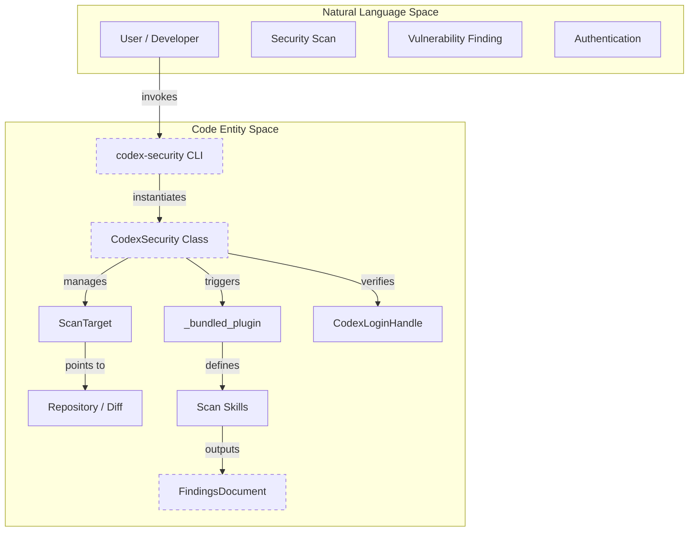
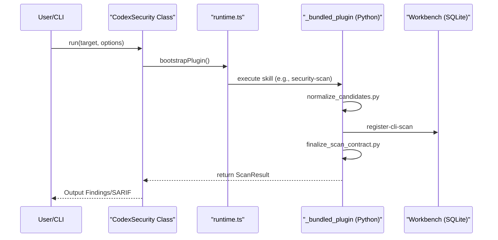

<!-- source: DeepWiki mcp.deepwiki.com · repo openai/codex-security · page 1 Overview · fetched 2026-10-26 -->

# Overview

Relevant source files

The following files were used as context for generating this wiki page:

- [.gitattributes](.gitattributes)
- [.gitignore](.gitignore)
- [CONTRIBUTING.md](CONTRIBUTING.md)
- [README.md](README.md)
- [SECURITY.md](SECURITY.md)
- [sdk/typescript/README.md](sdk/typescript/README.md)
- [sdk/typescript/_bundled_plugin/.codex-plugin/plugin.json](sdk/typescript/_bundled_plugin/.codex-plugin/plugin.json)

Codex Security is a comprehensive security analysis platform designed to find, validate, and remediate vulnerabilities in source code using advanced AI models. It is delivered as a TypeScript SDK and a command-line interface (CLI) that orchestrates a specialized Python-based execution engine.

The system supports a variety of analysis modes, including full repository scans, targeted path assessments, and differential analysis for pull requests or local working trees [sdk/typescript/README.md:46-49]().

### Core Capabilities
*   **Vulnerability Discovery**: Identifies security flaws with detailed evidence and attack paths [sdk/typescript/README.md:51-53]().
*   **Differential Scanning**: Analyzes changes between Git refs or uncommitted changes in the working tree [sdk/typescript/README.md:135-136]().
*   **Automated Remediation**: Generates and validates patches for identified findings [sdk/typescript/README.md:122-122]().
*   **CI/CD Integration**: Supports automated gates via severity-based exit codes and Git pre-commit hooks [sdk/typescript/README.md:131-133]().
*   **Knowledge Integration**: Incorporates external threat models or architecture documents to inform the scan [sdk/typescript/README.md:101-101]().

## System Architecture

Codex Security operates by bridging a high-level TypeScript orchestrator with a specialized Python plugin environment. The TypeScript layer handles user interaction, authentication, and file system safety, while the Python layer executes the security logic and interacts with the Codex reasoning models.

### Conceptual Mapping: Natural Language to Code Entities

The following diagram illustrates how high-level system concepts map to specific classes and files within the codebase.

**Concept to Entity Mapping**

**Sources:** [sdk/typescript/README.md:29-44](), [sdk/typescript/_bundled_plugin/.codex-plugin/plugin.json:1-20]()

### Component Interaction

The interaction between the TypeScript SDK and the underlying Python execution engine is managed through a "plugin" architecture. The SDK bootstraps a runtime that executes the bundled Python logic in a controlled environment.

**System Interaction Flow**

**Sources:** [sdk/typescript/README.md:32-44](), [sdk/typescript/_bundled_plugin/.codex-plugin/plugin.json:18-20](), [sdk/typescript/README.md:118-120]()

## Key Components

| Component | Description | Primary Code Location |
| :--- | :--- | :--- |
| **CLI / SDK** | The primary interface for users to interact with the system. | `sdk/typescript/` |
| **Bundled Plugin** | The core security logic, containing Python scripts for ranking, validation, and reporting. | `sdk/typescript/_bundled_plugin/` |
| **Workbench** | A persistence layer using SQLite to track scan history, findings, and remediation status. | `_bundled_plugin/` (Python logic) |
| **MCP Server** | A Model Context Protocol server that exposes security tools to AI agents. | `sdk/typescript/_bundled_plugin/.mcp.json` |

**Sources:** [sdk/typescript/README.md:1-5](), [sdk/typescript/_bundled_plugin/.codex-plugin/plugin.json:1-20]()

## Navigating the Wiki

To understand the system in depth, follow these links to the specialized documentation pages:

*   **[Getting Started](#1.1)**: Installation (Node.js 22+, Python 3.10+), authentication flows (API keys vs. ChatGPT login), and running your first scan.
*   **[Repository Structure and Build System](#1.2)**: A guide to the monorepo layout, the TypeScript build pipeline using `pnpm`, and how the bundled plugin is packaged.
*   **CLI Reference**: Detailed documentation of all command-line flags, including `scan`, `bulk-scan`, and `scans` history management.
*   **TypeScript SDK**: Technical details on the `CodexSecurity` class, the scan lifecycle, and cost tracking.
*   **Bundled Plugin Architecture**: Deep dive into the Python-based security skills, artifact conventions, and the MCP server.
*   **Workbench**: Details on the SQLite schema used for state persistence and finding triage.
*   **Security Model and Sandboxing**: Information on how the system protects the host machine, handles path isolation, and operates within Docker containers.

**Sources:** [sdk/typescript/README.md:11-21](), [sdk/typescript/README.md:55-94](), [sdk/typescript/README.md:95-123]()

---

