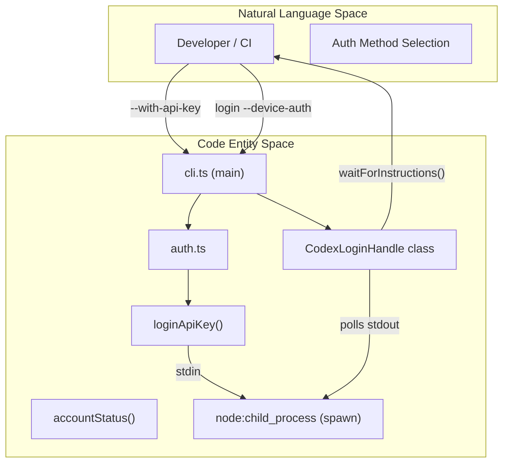
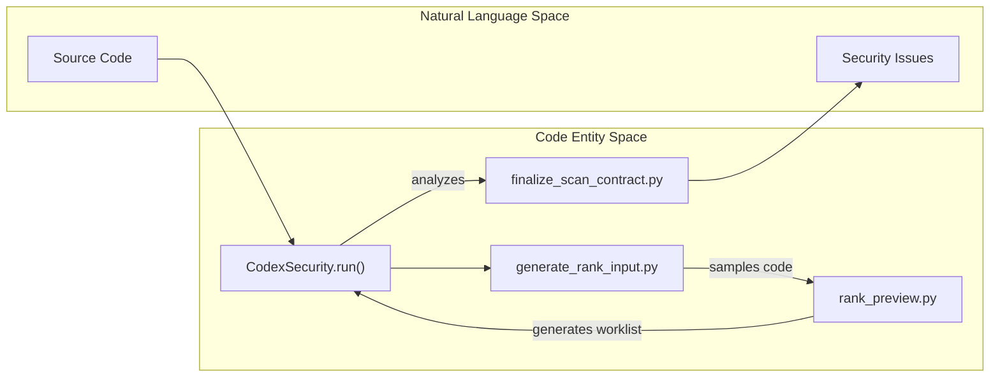

<!-- source: DeepWiki mcp.deepwiki.com · repo openai/codex-security · page 1.1 Getting Started · fetched 2026-10-26 -->

# Getting Started

<details>
<summary>Relevant source files</summary>

The following files were used as context for generating this wiki page:

- [.github/workflows/node-ci.yml](.github/workflows/node-ci.yml)
- [README.md](README.md)
- [sdk/typescript/README.md](sdk/typescript/README.md)
- [sdk/typescript/_bundled_plugin/scripts/generate_rank_input.py](sdk/typescript/_bundled_plugin/scripts/generate_rank_input.py)
- [sdk/typescript/_bundled_plugin/scripts/rank_preview.py](sdk/typescript/_bundled_plugin/scripts/rank_preview.py)
- [sdk/typescript/package.json](sdk/typescript/package.json)
- [sdk/typescript/src/auth.ts](sdk/typescript/src/auth.ts)
- [sdk/typescript/tests-ts/cli-authentication.test.ts](sdk/typescript/tests-ts/cli-authentication.test.ts)

</details>


Codex Security is a security analysis platform that uses generative AI to find, validate, and remediate vulnerabilities. This page covers the initial setup, authentication workflows, and basic usage patterns for both the CLI and TypeScript SDK.

## Prerequisites

Before installing, ensure your environment meets the following requirements:

| Requirement | Version | Notes |
| :--- | :--- | :--- |
| **Node.js** | 22+ | Required for the CLI and SDK runtime. [sdk/typescript/package.json:16-16]() |
| **Python** | 3.10+ | Required for scanning and exporting findings. [sdk/typescript/README.md:19-19]() |
| **Package Manager** | `pnpm` 11.9.0+ | Used for building the monorepo. [sdk/typescript/package.json:18-18]() |

*Note: If using Python 3.10, the `tomli` package must be installed for TOML parsing.* [sdk/typescript/README.md:19-21]()

Sources: [sdk/typescript/package.json:1-30](), [sdk/typescript/README.md:1-22]()

---

## Installation

The package is distributed as `@openai/codex-security`. You can install it globally or as a project dependency.

```bash
# Local installation
npm install @openai/codex-security

# Verify installation
npx codex-security --version
```

Sources: [sdk/typescript/README.md:11-16]()

---

## Authentication

Codex Security supports three primary authentication methods. The system prioritizes environment variables over stored credentials. [sdk/typescript/README.md:89-91]()

### 1. Interactive Login (Local Development)
For local use, the standard login flow uses ChatGPT authentication.
```bash
npx codex-security login
```

### 2. Device Code (Headless/Remote)
On remote servers where a browser cannot be opened, use the device code flow.
```bash
npx codex-security login --device-auth
```
This generates a user code that you must enter at the provided URL. The `CodexLoginHandle` class manages this lifecycle, polling for completion. [sdk/typescript/src/auth.ts:18-101]()

### 3. API Key (CI/CD)
For automated environments, set the `OPENAI_API_KEY` or `CODEX_API_KEY` environment variables. Alternatively, you can pipe a key into the login command:
```bash
printenv OPENAI_API_KEY | npx codex-security login --with-api-key
```

### Authentication Logic Flow
The following diagram illustrates how the `CodexLoginHandle` and `runCodex` functions interact with the underlying system to establish identity.

**Identity Resolution Diagram**

Sources: [sdk/typescript/src/auth.ts:18-201](), [sdk/typescript/README.md:55-93]()

---

## First Scan Walkthrough

A scan requires a **target** (repository or path) and an **output directory**. The output directory **must** be outside the scanned repository for security isolation. [sdk/typescript/README.md:137-138]()

### Using the CLI
```bash
# Basic scan of the current directory
npx codex-security scan . --output-dir ../results
```

### Using the SDK
The `CodexSecurity` class is the entry point for programmatic usage.

```typescript
import { CodexSecurity } from "@openai/codex-security";

const security = new CodexSecurity();
try {
  const result = await security.run("/path/to/repo", {
    outputDir: "/path/outside/repo/results",
  });
  console.log(`Scan completed. Report: ${result.reportPath}`);
} finally {
  await security.close(); // Ensure child processes are terminated
}
```
Sources: [sdk/typescript/README.md:23-53](), [README.md:19-30]()

---

## Scan Execution Pipeline

When a scan is initiated, the system goes through several phases managed by the `_bundled_plugin` Python scripts.

**Scan Pipeline Data Flow**

Sources: [sdk/typescript/_bundled_plugin/scripts/generate_rank_input.py:1-23](), [sdk/typescript/_bundled_plugin/scripts/rank_preview.py:1-14]()

---

## CI/CD Integration Patterns

In CI/CD, Codex Security is typically used to block PRs based on finding severity.

### GitHub Actions Example
Use the `--fail-on-severity` flag to return a non-zero exit code if vulnerabilities are found. [sdk/typescript/README.md:153-154]()

```yaml
- name: Run Codex Security Scan
  env:
    OPENAI_API_KEY: ${{ secrets.OPENAI_API_KEY }}
  run: |
    npx codex-security scan . \
      --output-dir ../scan-results \
      --fail-on-severity high
```

### Key CI Flags
| Flag | Purpose |
| :--- | :--- |
| `--fail-on-severity <level>` | Exit with code 1 if findings meet threshold. [sdk/typescript/README.md:153-154]() |
| `--max-cost <USD>` | Hard limit on scan spend. [sdk/typescript/README.md:107-107]() |
| `--diff <ref>` | Only scan changes since a specific Git ref. [sdk/typescript/README.md:102-102]() |

Sources: [sdk/typescript/README.md:95-168](), [.github/workflows/node-ci.yml:48-53]()

---

