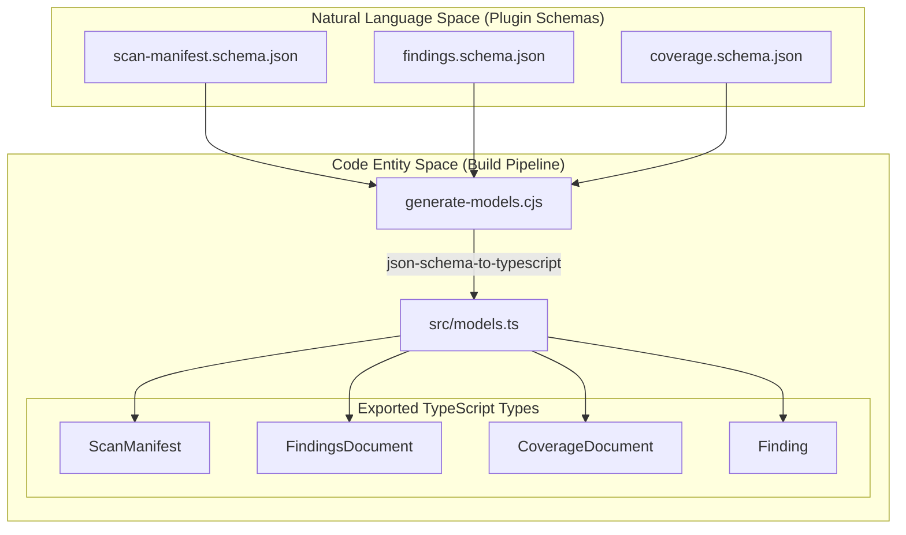
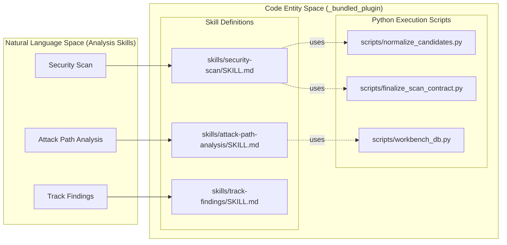

<!-- source: DeepWiki mcp.deepwiki.com · repo openai/codex-security · page 1.2 Repository Structure and Build System · fetched 2026-10-26 -->

# Repository Structure and Build System

Relevant source files

The following files were used as context for generating this wiki page:

- [sdk/typescript/.gitignore](sdk/typescript/.gitignore)
- [sdk/typescript/_bundled_plugin/skills/security-scan/references/scan-artifacts-and-ledger.md](sdk/typescript/_bundled_plugin/skills/security-scan/references/scan-artifacts-and-ledger.md)
- [sdk/typescript/bin/codex-security.mjs](sdk/typescript/bin/codex-security.mjs)
- [sdk/typescript/package.json](sdk/typescript/package.json)
- [sdk/typescript/plugin-files.json](sdk/typescript/plugin-files.json)
- [sdk/typescript/scripts/check-package.mjs](sdk/typescript/scripts/check-package.mjs)
- [sdk/typescript/scripts/generate-models.cjs](sdk/typescript/scripts/generate-models.cjs)
- [sdk/typescript/scripts/smoke-package.mjs](sdk/typescript/scripts/smoke-package.mjs)

This page details the monorepo layout, the TypeScript-based build pipeline, and the verification mechanisms that ensure the integrity of the `@openai/codex-security` package and its bundled Python-based execution engine.

## Monorepo Layout

The repository is organized to separate the TypeScript SDK/CLI from the core security analysis logic (the "plugin"). The primary development and build activities occur within the `sdk/typescript` directory.

| Directory | Purpose |
| :--- | :--- |
| `sdk/typescript` | The primary workspace containing the CLI, SDK, and build scripts [sdk/typescript/package.json:8-12](). |
| `sdk/typescript/bin` | Contains the `codex-security.mjs` entrypoint for the CLI [sdk/typescript/bin/codex-security.mjs:1-27](). |
| `sdk/typescript/dist` | Build output directory for transpiled JavaScript and type definitions [sdk/typescript/package.json:19-20](). |
| `sdk/typescript/_bundled_plugin` | The embedded analysis engine, containing Python scripts, skills, and schemas [sdk/typescript/package.json:34](). |
| `sdk/typescript/scripts` | Build, model generation, and package verification utilities [sdk/typescript/package.json:44-47](). |
| `sdk/typescript/tests-ts` | TypeScript test suite executed via `bun` [sdk/typescript/package.json:49](). |

**Sources:** [sdk/typescript/package.json:1-40](), [sdk/typescript/bin/codex-security.mjs:1-27]()

## TypeScript Build Pipeline

The build system leverages `pnpm` and `tsc` (TypeScript Compiler) to transform source code into a distributable ESM (ECMAScript Module) package.

### Build Lifecycle
1.  **Model Generation**: The build begins by generating TypeScript interfaces from JSON schemas located in the bundled plugin. The `generate:models` script uses `json-schema-to-typescript` to create `src/models.ts` [sdk/typescript/scripts/generate-models.cjs:25-44]().
2.  **Cleaning**: The `dist` directory is removed to ensure a fresh state [sdk/typescript/package.json:42]().
3.  **Compilation**: `tsc` compiles the project using `tsconfig.build.json` [sdk/typescript/package.json:43]().
4.  **Verification**: Post-build scripts verify the package structure and bundled plugin integrity.

### Data Flow: Schema to TypeScript Models
The following diagram illustrates how analysis contracts defined in JSON Schema are projected into the TypeScript SDK.

**Sources:** [sdk/typescript/scripts/generate-models.cjs:25-87](), [sdk/typescript/package.json:46-47]()

## Bundled Plugin and Manifest (`plugin-files.json`)

The `_bundled_plugin` directory is a critical component that allows the CLI to function without external dependencies. Its contents are strictly controlled by the `plugin-files.json` manifest.

### Manifest Structure
The manifest defines two categories of files:
*   **`externalOwnedExact`**: Files like `plugin.json` and `OWNERS` that are required for plugin identification [sdk/typescript/plugin-files.json:2-5]().
*   **`shippedExact`**: A comprehensive list of Python scripts, skills (e.g., `security-scan`, `attack-path-analysis`), and reference documents included in the package [sdk/typescript/plugin-files.json:6-100]().

### Plugin Asset Mapping
This diagram bridges the conceptual "Skills" used by the analysis engine to the physical file entities in the repository.

**Sources:** [sdk/typescript/plugin-files.json:30-99](), [sdk/typescript/_bundled_plugin/skills/security-scan/references/scan-artifacts-and-ledger.md:27-32]()

## Package Verification Scripts

To ensure security and correctness before publishing to npm, the repository utilizes two primary verification scripts: `check-package.mjs` and `smoke-package.mjs`.

### `check-package.mjs`
This script performs static analysis on the generated npm tarball [sdk/typescript/scripts/check-package.mjs:9-12]():
*   **Tarball Integrity**: Validates the tar header and ensures no trailing data or duplicate paths exist [sdk/typescript/scripts/check-package.mjs:41-73]().
*   **Structure Validation**: Ensures all required files (`package.json`, `dist/cli.js`, `bin/codex-security.mjs`) are present [sdk/typescript/scripts/check-package.mjs:74-87]().
*   **Plugin Contract Enforcement**: Cross-references the tarball contents against `plugin-files.json` to ensure no unauthorized files are included and no required analysis scripts are missing [sdk/typescript/scripts/check-package.mjs:105-128]().
*   **Permission Checks**: Verifies that the CLI launcher has executable bits set [sdk/typescript/scripts/check-package.mjs:198-205]().

### `smoke-package.mjs`
This script performs a dynamic "smoke test" by installing the tarball into a temporary directory [sdk/typescript/scripts/smoke-package.mjs:177-186]():
*   **Installation Test**: Runs `npm install` on the tarball to ensure dependency resolution works [sdk/typescript/scripts/smoke-package.mjs:189-203]().
*   **SDK Import**: Verifies that the installed package can be imported as a module and that the `CodexSecurity` class is exported [sdk/typescript/scripts/smoke-package.mjs:222-230]().
*   **CLI Execution**: Validates the presence and pathing of the `codex-security` binary [sdk/typescript/scripts/smoke-package.mjs:232-245]().

**Sources:** [sdk/typescript/scripts/check-package.mjs:1-215](), [sdk/typescript/scripts/smoke-package.mjs:1-245]()

---

