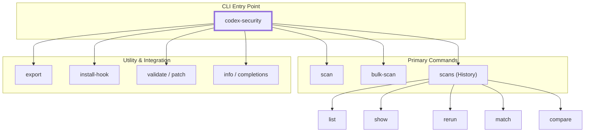
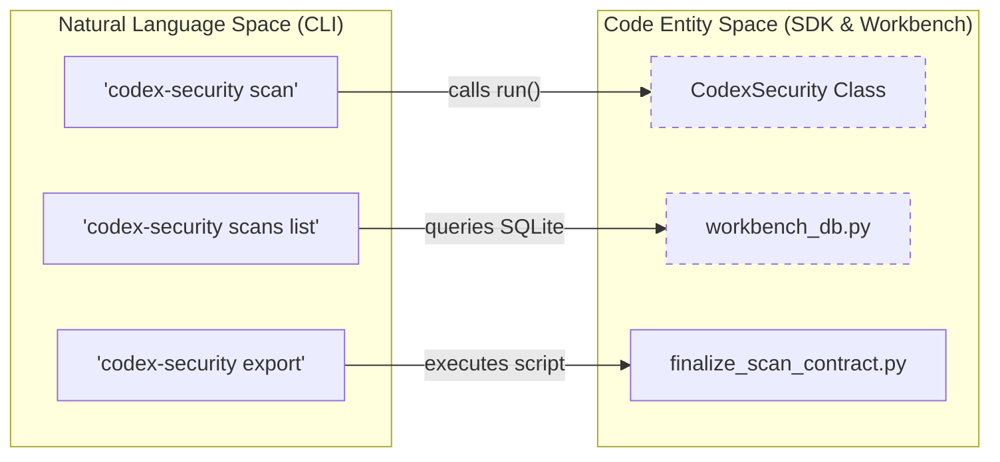

<!-- source: DeepWiki mcp.deepwiki.com · repo openai/codex-security · page 2 CLI Reference · fetched 2026-10-26 -->

# CLI Reference

Relevant source files

The following files were used as context for generating this wiki page:

- [sdk/typescript/src/cli.ts](sdk/typescript/src/cli.ts)
- [sdk/typescript/tests-ts/cli.test.ts](sdk/typescript/tests-ts/cli.test.ts)

The `codex-security` CLI is the primary interface for executing AI-powered security analysis, managing scan history, and integrating with development workflows. It acts as a wrapper around the `CodexSecurity` SDK [sdk/typescript/src/cli.ts:32-36](), orchestrating the lifecycle of scans from preflight checks to artifact export.

### Command Hierarchy

The CLI is built using the `incur` framework [sdk/typescript/src/cli.ts:28](), providing a structured command tree with built-in schema validation and shell completions.

**Sources:** [sdk/typescript/src/cli.ts:79-146](), [sdk/typescript/tests-ts/cli.test.ts:75-85]()

---

### Global Flags and Output Modes

The CLI supports several global flags that modify execution behavior and output formatting across all commands.

| Flag | Description |
| :--- | :--- |
| `--json` | Outputs machine-readable JSON to `stdout`. Disables interactive progress bars. |
| `--schema` | Prints the JSON schema for the current command's arguments and options. |
| `--format` | Specifies output format (e.g., `json`, `csv`, `sarif`) for supported commands. |
| `--codex` | Pass configuration overrides as `key=value` pairs. [sdk/typescript/src/cli.ts:166]() |
| `--llms` | Displays the tool manifest and available LLM configurations. [sdk/typescript/tests-ts/cli.test.ts:123-126]() |

**Sources:** [sdk/typescript/src/cli.ts:94-121](), [sdk/typescript/tests-ts/cli.test.ts:88-107]()

---

### Signal Handling and Terminal State

The CLI implements robust signal handling to ensure that terminal states (like cursor visibility) are restored even if a scan is interrupted.

*   **SIGINT / SIGTERM:** When these signals are received, the CLI attempts to gracefully shut down the worker pool and close the `CodexSecurity` instance [sdk/typescript/src/cli.ts:218-221]().
*   **Progress UI:** During interactive scans, the CLI uses ANSI escape codes (`HIDE_CURSOR`, `SHOW_CURSOR`) to manage the `Progress` display [sdk/typescript/src/cli.ts:96-97]().
*   **Synchronous Cleanup:** The `writeSynchronously` utility ensures terminal cleanup commands are flushed to the file descriptor even during process exit [sdk/typescript/src/cli.ts:244-251]().

**Sources:** [sdk/typescript/src/cli.ts:54-55](), [sdk/typescript/src/cli.ts:218-221]()

---

### Detailed Command Groups

The CLI functionality is divided into three major areas, each documented in detail on its own child page:

#### 1. Scan Commands
The core analysis engine. Supports single-repository scans, path-based scanning, and differential scanning (analyzing changes between commits). Includes the `scans` management group for interacting with the local workbench history.
*   **Key Entities:** `ScanTarget`, `ScanMode`, `ScanResult`.
*   **For details, see [Scan Commands](#2.1).**

#### 2. Export, Validate, and Utility Commands
Tools for integrating Codex into the wider security ecosystem. This includes exporting results to standard formats like **SARIF**, validating findings against custom security skills, and installing **Git pre-commit hooks** to block insecure code from being committed.
*   **Key Entities:** `ExportArguments`, `SkillCommandOutput`.
*   **For details, see [Export, Validate, Patch, and Utility Commands](#2.2).**

#### 3. Bulk Scan and Multi-Repository Scanning
Designed for large-scale security audits across hundreds of repositories. Uses a worker pool to execute parallel scans and a ledger system to track progress and handle retries.
*   **Key Entities:** `runMultiscan`, `BulkScanDiscoveryDependencies`.
*   **For details, see [Bulk Scan and Multi-Repository Scanning](#2.3).**

---

### Code Mapping: CLI to SDK
The following diagram illustrates how CLI commands map to internal SDK classes and Python-based workbench entities.

**Sources:** [sdk/typescript/src/cli.ts:32](), [sdk/typescript/src/runtime.ts:65](), [sdk/typescript/src/cli.ts:222-225]()

---

